# 2026年中国汽车出口海外自主品牌数据跟踪

- 公開日時: 2026-04-07 18:14（北京時間）
- 出典: [搜狐号・崔东树](https://www.sohu.com/a/1006441815_115312)
- テーマ（自動判定）: 自主ブランド 海外販売
- 画像: 12枚

---

自2021年以来，随着世界新冠疫情的爆发，中国汽车产业链的韧性较强的优势充分体现，中国汽车出口市场近两年表现超强增长。2026年1-2月的中国海外市场自主品牌销量72万台，同比增长66%，由于自主的海外地位提升，过去统计不到的自主车型销量现在也有统计了，因此中国自主的海外部分可统计市场的零售表现很好。

我们总体汽车销量在海外市场的份额差异巨大，南半球18%，欧洲10%，东南亚和中东在10%左右，主流地区份额达到10%左右，但出口美国、日韩还是很谨慎的。中国新能源车的世界表现超强，海外溢出效应明显。2026年1-2月达到27%的份额，其中欧洲16%，南半球83%，东南亚和西亚的份额在51%左右，部分区域已经是绝对优势。

2026年1-2月中国自主海外销量份额主要是俄罗斯超强，东南亚、大洋洲、非洲等地区超20%，欧盟6%，日韩和美国几乎为零。印度等部分国家还有自己的汽车工业，世界汽车的多极化特征尚未改变。2026年比亚迪、吉利、奇瑞、上汽等中国车企在大洋洲和东南亚的份额明显提升。日本丰田、本田、铃木等在大洋洲、非洲、东南亚的压力加大。

由于有中国家电等产业出海的经验教训，汽车出海的策略日益清晰完善，从KD组装到本地化生产、海外并购，车企海外战略效果突出。目前我国自主品牌出口进入了强化根据地打造游击区的农村包围城市的战略新阶段。自主品牌在海外以建设KD组装为起步，逐步加大本土化产业链建设，以整车企业为龙头，零部件与整车抱团出海效果显著，上汽、吉利、长城、奇瑞等取得巨大的成功。自主整车出口从买断模式基本全面转向经销模式，比亚迪、长城、奇瑞等自主整车品牌建设海外本土化的商务管控中心，全面监督当地提升销售服务网点的体系能力，自主品牌在当地市场的口碑越来越好。

一、中国自主车企海外表现

1、中国自主车企在海外部分地区月度销量走势

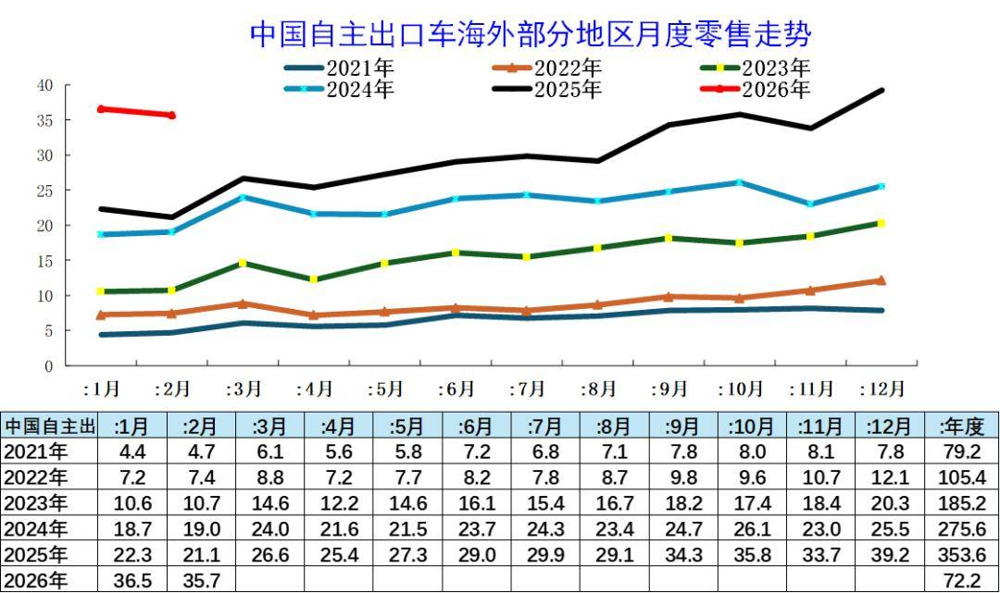

近几年的中国汽车出口不断走强，年内呈现夏季走高过山车的见顶回落走势特征。从中国汽车的海外出口零售数据看，月度走势相对平稳，近期呈现较好的增长态势，尤其2025年开始的拉升速度较快，推动2026年年初的同比超高增长，1-2月销量仅次于2025年12月，类似于2024年年初的走势。

2、中国自主车企在海外部分地区销量特征

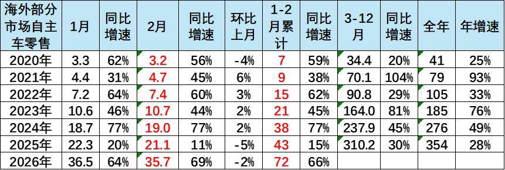

中国自主车企在海外部分地区销量特征较强。2025年中国自主车企在海外部分能持续统计的地区的当地销量354万台，同比增长28%；2026年1-2月的中国海外市场自主品牌销量72万台，同比增长66%，中国自主的海外部分可统计市场的零售表现很好。

3、中国出口车海外份额大幅增长

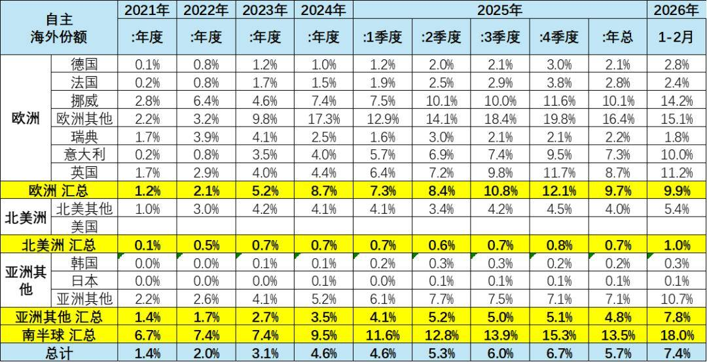

我们总体汽车销量在海外市场的份额差异巨大，南半球18%，欧洲10%，东南亚和中东在10%左右，主流地区份额达到10%左右，但出口美国、日韩还是很谨慎的。

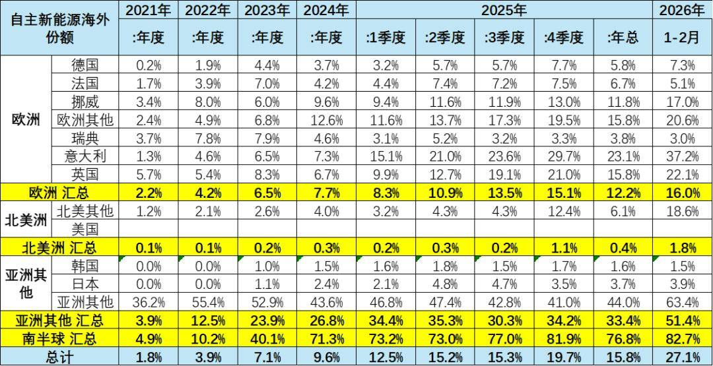

中国新能源车的世界表现超强，海外溢出效应明显，2026年1-2月达到27%的份额。其中欧洲16%，南半球83%，东南亚和西亚的份额在51%左右，部分区域已经是绝对优势。

4、中国出口车海外数据大幅增长

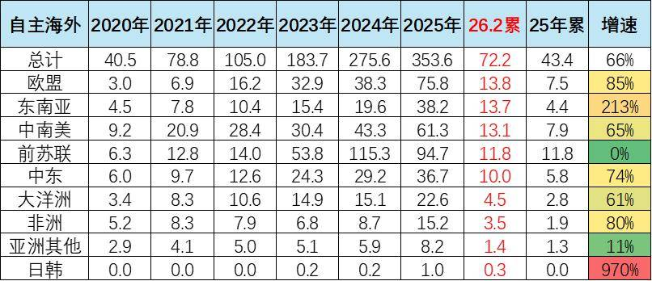

中国汽车出口表现极其优秀，从中国海关数据来看增长极其迅猛。而从海外当地市场的数据统计来看，中国汽车出口也呈现更加强势良好增长局面。中国海外市场波动发展，2025年海外市场零售较强的是东南亚、非洲、欧盟，而出口走势较差的是俄国中亚地区、美国、印度等地区。

海外增速超强的最主要原因是过去我们的汽车出口很多处于非洲等不发达国家，或者是难以统计的市场，因此海外数据体现的并不是很充分，而现在我们出口体现出在海外的一些高端市场表现更为突出，所以总体可以看到海外数据的中国汽车出口增长速度在2023-2025年呈现强势增长态势，尤其2022年以来中国汽车出口呈现一轮爆发式增长的态势，在欧洲市场呈现连续3年较强增长，2024年走弱，因此2025年在欧盟的市场较强。

5、中国出口车海外数据大幅增长

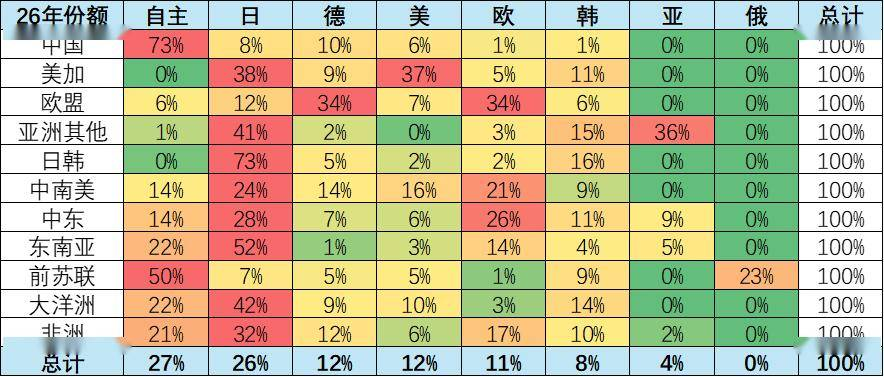

目前2026年1-2月中国自主海外销量份额主要是俄罗斯超强，东南亚、大洋洲、非洲等地区超20%，欧盟6%，日韩和美国几乎为零。

印度等部分国家还有自己的汽车工业，世界汽车的多极化特征尚未改变。

6、中国车企出口车海外份额大幅增长

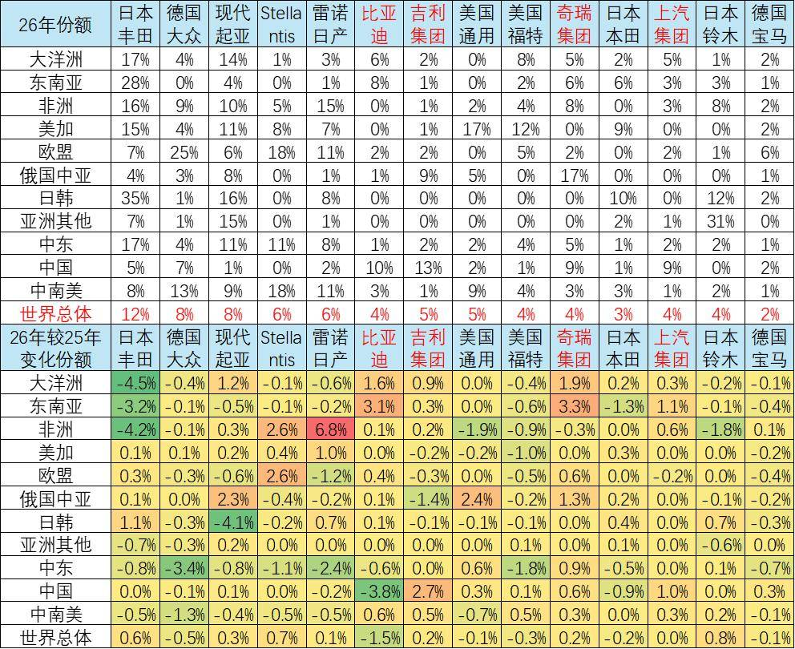

2026年比亚迪、吉利、奇瑞、上汽等中国车企在大洋洲和东南亚的份额明显提升。日本丰田、本田、铃木等在大洋洲、非洲、东南亚的压力加大。

二、中国自主车企海外跟踪

1、中国车企的海外销量数据跟踪

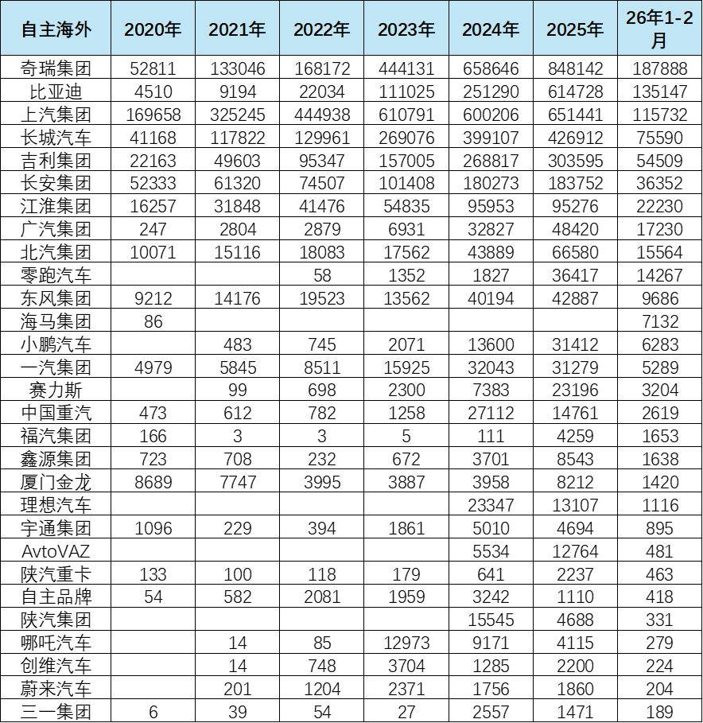

中国车企的海外出口数据近几年表现不断走强，尤其是看到主力车企的海外表现相对比较突出。目前来看，主力车企的奇瑞、比亚迪、上汽、长城汽车、吉利等表现是极强的走势，这里尤其是比亚迪的出口在近期表现极其强势良好的态势。

2、中国自主品牌新能源的海外状态

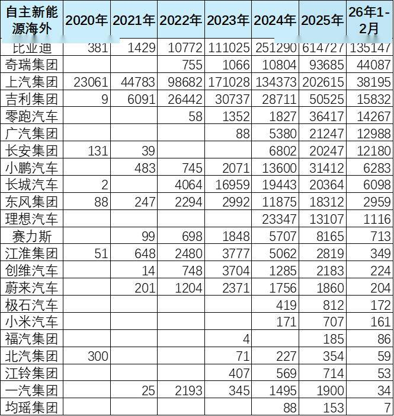

从品牌的出口表现来看，中国汽车出口新能源主要的表现亮点在于比亚迪、奇瑞汽车、上汽名爵品牌、吉利、零跑等，尤其是近期奇瑞等海外销量表现极其的抢眼，上汽受欧盟制裁后的转型表现突出。

3、海外市场的中国车企表现

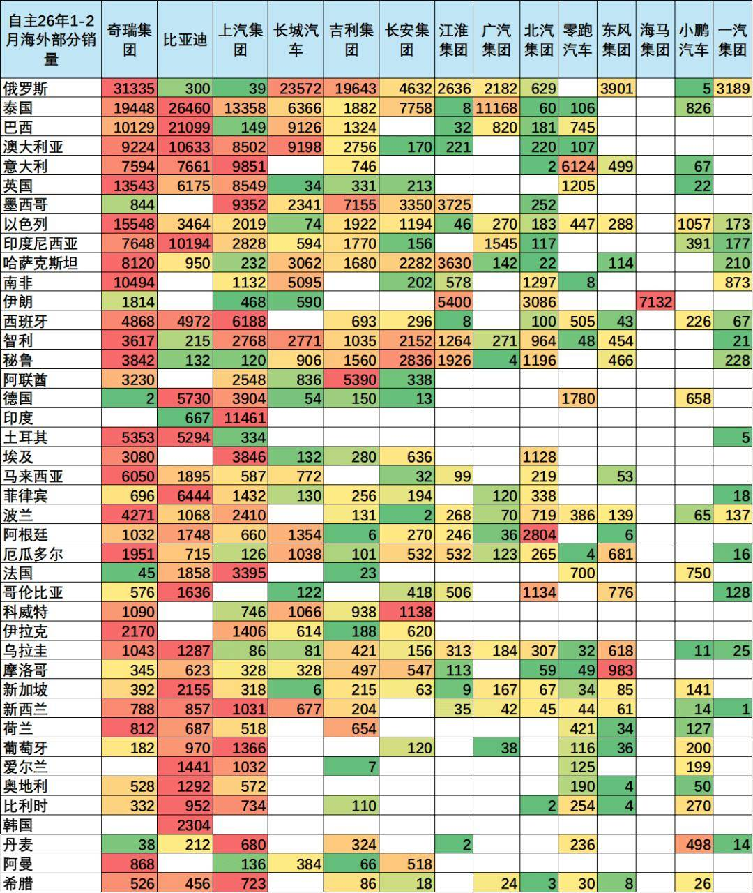

在海外的主流市场上自主品牌的差异特色明显，各厂家都有自己的优势市场。全面发展较快的是比亚迪，在部分发达市场快速进入，形成一定的规模，体现了自主的海外竞争力较强。

而奇瑞和上汽都有较强的海外市场优势，奇瑞在俄罗斯和巴西、南非等市场表现很强。上汽在英国、意大利、澳大利亚等市场表现超强。吉利在俄罗斯、沙特等海外表现也很强，但部分是海外品牌的体现。长安在沙特、阿联酋和智利等市场表现较好。长城汽车在俄罗斯市场和南非市场以及其它部分市场表现也都是极其良好的态势。

新势力的海外市场拓展也取得一定成果，小鹏和零跑均有一定的海外销量，以色列是中国自主新势力的巨大市场。

4、海外市场的中国新能源车企跟踪

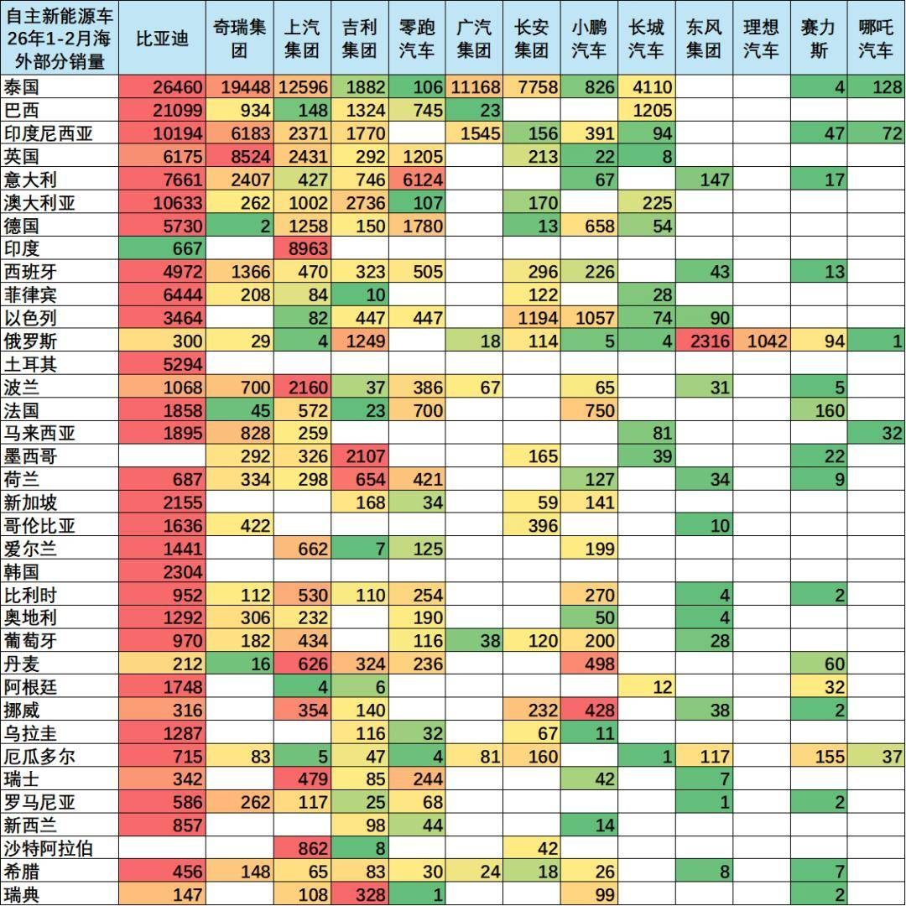

从海外部分市场数据印证中国海关出口数据，中国新能源汽车出口表现较强，自主表现很好。近期可以看到像泰国、巴西、印度尼西亚、以色列、英国、德国以及其它主力市场中国车企的表现也都是规模巨大的态势，北欧市场的上汽、吉利以及比亚迪等车企表现相对优秀。

新势力在荷兰和挪威市场也有相对较好的表现，几家新势力主要在挪威登陆欧洲，有一定的规模，体现了中国车企在海外市场获得良好的突破。

5、俄罗斯中国车企

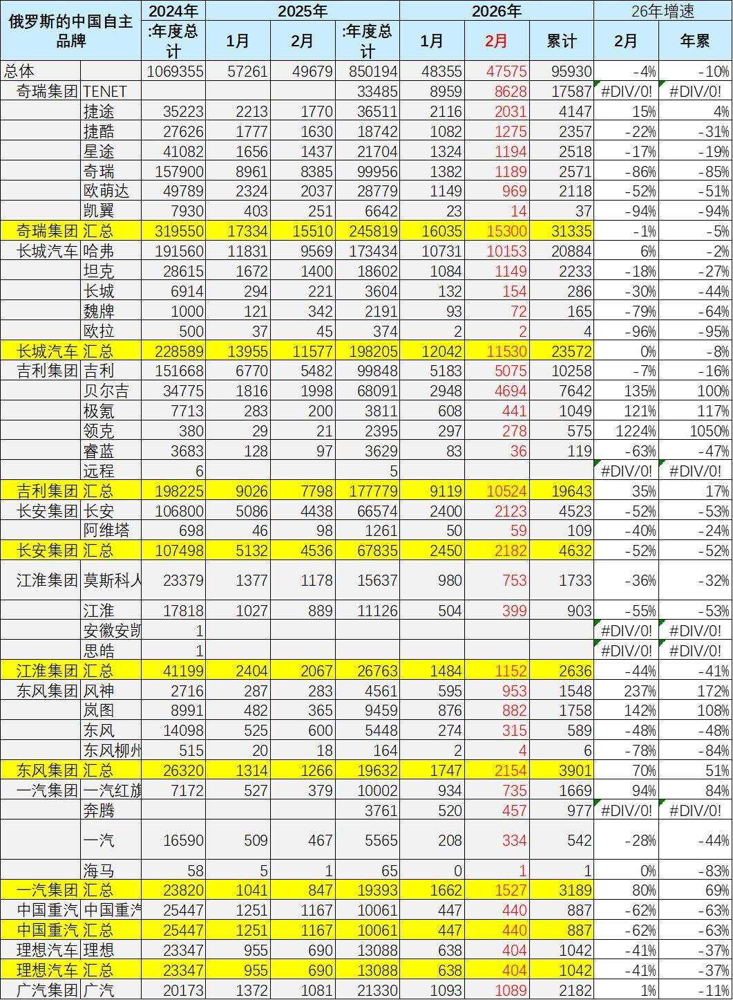

因技术和产品力较弱，俄罗斯本土汽车主要集中于价格段较低的低端市场。俄罗斯汽车市场销量冠军是拉达，畅销主要因为其价格便宜，符合俄罗斯人用车需求。

俄罗斯对从中国经由中亚国家中转，再运往俄罗斯的车辆需要补齐各类税费，包括关税、增值税和消费税等。俄罗斯宣布自2024年10月1日起进口车辆报废税上涨70%至85%，每年上涨10%至20%，直到2030年。回收费是在车辆报废时进行环保处置的费用，是一项强制性税款，它与增值税和关税一样，是影响进口汽车成本的重要因素。

2025年俄罗斯进口汽车报废税已提高至66.7万卢布（约7500美元），较2023年翻倍。此举直接增加中国等进口车型的成本，导致终端售价上涨10%-15%。

中国自主车企依靠强大的技术提升和产业链优势，在俄罗斯表现相对是较强的特征。奇瑞在2025年达到了月销量2万辆以上的水平。尤其是奇瑞以多个品牌在俄罗斯实现了本土化生产、代工生产和进口车组合的全面发展的良好态势，实现了规模超强的增长，也实现了多生孩子好打架的联合发展的走势特点。

长城汽车在俄罗斯表现相对突出，尤其是哈佛和坦克品牌表现相对较好。哈佛品牌实现了小型燃油车在俄罗斯市场超强发展，类似哈弗初恋等这些车型表现极其优秀。而吉利在俄罗斯的表现也实现了超强的增长，以本土化代工生产的产品和进口车型表现都相对较强，尤其是极氪等产品表现相对也是极其优秀的情况。其它中国车企也很强，北汽等产品在俄罗斯表现也是相对较强的情况。

附：近日信息合集
