# 2026年3月份全国乘用车市场运行特征分析

- 公開日時: 2026-04-10 12:13（北京時間）
- 出典: [搜狐号・崔东树](https://www.sohu.com/a/1007681595_115312)
- テーマ（自動判定）: 乗用車市場
- 画像: 24枚

---

注：本分析文章仅代表崔东树个人观点，如有异议，请留言。

自2014年9月开始实施的新能源车购置税免税政策且在2025年12月底正式退出后，2026年新能源车市场处于税收补贴调整期。欧美新能源补贴力度较大的国家也都有补贴调整的市场修正期。今年车市呈现：1）新品少：今年一季度的车市新品数量仅有18款，明显低于2024年一季度的33款和2025年一季度的28款，全新品的增量贡献度下降，在市场充分竞争的现状下逐步过渡到年款改款更新。2）结构变：随着消费升级的趋势日益明显，经济型车的推出锐减到仅1款，近期部分新品寻求以增程式电动车和混合动力车型为突破口，预计会在国内外市场上有较好的增长空间，对车市有一定拉动作用。3）成本涨：随着美国AI革命带来内存、芯片、有色金属等的价格飙升、近期中东危机僵持延续致国际油价飙升等，造成车规级的零部件制造成本和终端用户用车成本上升，抑制了消费潜力释放。4）渠道难：随着一季度车市销量负增长，经销商生存压力加大，3月的燃油车促销环比下降0.8个百分点、新能源车促销环比增幅较去年同期持平，加之未出现降价潮，消费观望情绪明显。汽车行业反内卷将作为提质增效产业升级的主基调，预计今年出口与国内车市增速分化，新能源车表现不强，国内消费仍需要类似购车抵个税等长效政策予以支持。

2026年3月乘用车市场的特征：一、3月乘用车厂家燃油车与新能源车出口量均创出历年各月的新高，充分表明中国汽车产业在全球市场的竞争力不断提升，海外需求持续旺盛；二、车购税免税到期后的零售回落明显，高端新能源车占比明显提升，反映出入门级消费的占比下降的结构推动，有利于推动行业向高质量发展转型；三、2026年新车上市平稳，叠加“反内卷”工作推进遏制无序降价，3月新能源促销保持在10.6%，连续7个月保持在10%左右，没有出现以价换量的恶性竞争，有助于维护市场秩序；四、春节后燃油车零售表现弱于新能源车的历史规律再次延续，3月燃油车国内零售同比下降16%，纯电动市场零售同比下降12%，增程同比下降6%，插混同比下降24%，随着消费者逐步适应新能源车的税收正常化，新能源市场有望逐步重回正增长轨道；五、今年3月属春节后重归新能源车主导消费阶段，新能源车国内零售渗透率51.5%，出口渗透率50.2%，表现是较好的；六、2026年3月自主燃油乘用车出口30.7万，同比增长42%，自主新能源出口30.0万，同比增长133%，新能源占自主出口49.4%，尤其是新能源出口在欧洲、东南亚等地的高增长，标志着中国新能源汽车品牌在国际市场上的影响力不断扩大，为未来出口增长奠定了坚实基础。

1.2026年3月全国乘用车厂家销量平稳

3月1-31日全国乘用车厂家批发237.8万辆，同比去年同期下降2%，较上月同期增长57%；今年以来累计批发587.2万辆，同比去年同期下降7%。3月1-31日市场零售164.8万辆，同比去年同期下降15%，较上月同期增长59%；今年以来累计零售422.6万辆，同比去年同期下降17%。

3月1-31日全国乘用车厂家新能源批发114.4万辆，同比去年同期增长1%，较上月同期增长58%；今年以来累计批发273.3万辆，同比去年同期下降4%。3月1-31日新能源车市场零售84.8万辆，同比去年同期下降14%，较上月同期增长83%；今年以来累计零售190.8万辆，同比去年同期下降21%。

2026年3月1-31日全国新能源市场零售渗透率51.5%；新能源厂家批发渗透率48.1%。3月第1-4周全国纯燃料轻型车生产91.1万辆，同比去年同期下降17%，较上月同期增长96%。3月第1-4周混合动力与插混总体生产33.1万辆，同比去年同期下降28%，较上月同期增长121%。

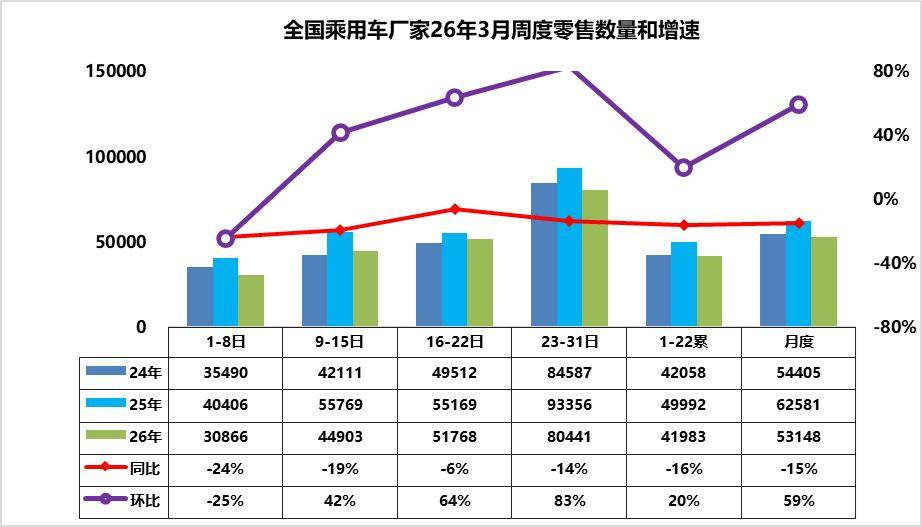

3月第1周乘用车市场日均零售3.1万辆，同比去年同期下降24%，较上月同期下降25%。

3月第2周乘用车市场日均零售4.5万辆，同比去年同期下降19%，较上月同期增42%。

3月第3周乘用车市场日均零售5.2万辆，同比去年同期下降6%，较上月同期增64%。

3月第4周乘用车市场日均零售8.0万辆，同比去年同期下降14%，较上月同期增83%。

2026年是大年，2月的春节较晚，处于正常的节后回暖前期，属于相对同期的倒春寒期间，因此3月第一周的销量相对较低，市场表现较平稳。春节前市场是燃油车的销售旺季，因此3月春节后车市相对平稳较低迷，等待新能源车的市场活跃，第二周已经有回暖迹象。

今年原材料、石油、芯片等价格上涨，反内卷利剑高悬，整车企业面临环境更复杂。国际地缘政治动荡，局势不明朗，油价上涨，对燃油车形成了不小的负向影响。

新能源车年内新车预计即将陆续上市发布，新能源市场热度有望回升，但从技术发布到预售再到交付仍存在一定的时间跨度，这部分增量很难在3月体现到终端市场表现里。

目前经销商承压，终端成交价相对稳定，没有达到消费者的心理预期，3月市场整体热度在逐步恢复。目前新能源车市场等待新品和市场环境明朗，目前是最难熬的时间。

2.近年狭义乘用车零售走势

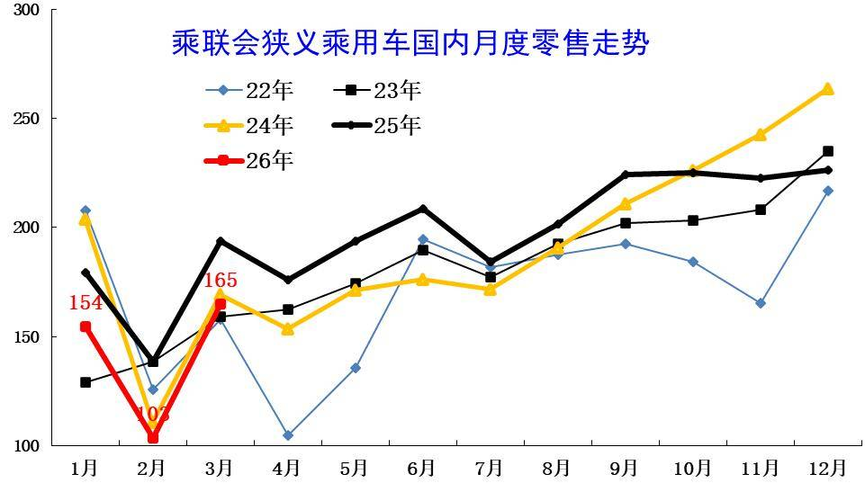

3月全国乘用车市场零售165万辆，同比增长表现较弱。3月负增长原因是多元的，首先是春节后回暖慢因素的影响，其次是以旧换新的新政策规范性较强和补贴缩水，加之今年1季度是去库存特征，与历年的加库存反差较大，深层原因是消费能力和意愿偏低。

3月1-31日，全国乘用车市场零售164.8万辆，同比下降15%，环比增长59%。今年以来累计零售422.9万辆，同比下降17%。由于市场因素影响较复杂，近几年年度销量“前低后高”特征较明显，今年特殊的去库存特征明显，所以2026年下降17%属于历年3月增速剧烈波动的偏低状态。

3.2026年3月全国乘用车厂家销量平稳

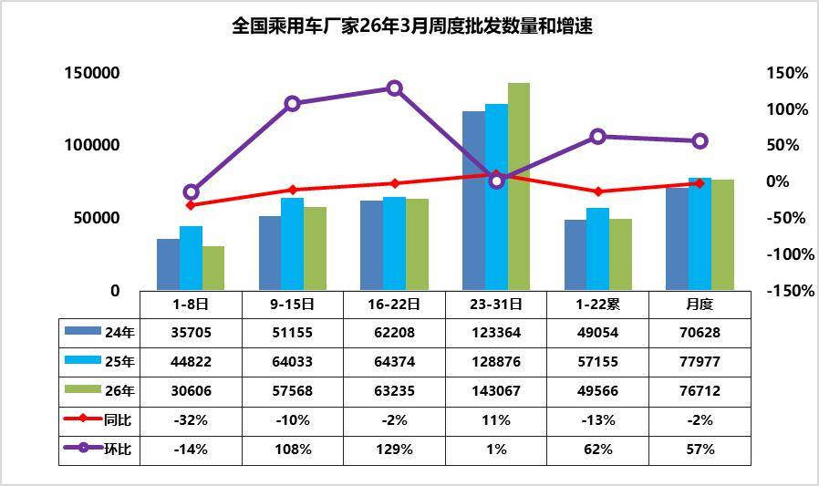

3月第1周批发日均3.1万台，同比去年3月同期下降32%，环比上月同期下降14%。

3月第2周批发日均5.8万台，同比去年3月同期下降10%，环比上月同期增108%。

3月第3周批发日均6.3万台，同比去年3月同期下降2%，环比上月同期增129%。

3月第4周批发日均14.3万台，同比去年3月同期增11%，环比上月同期增1%。

第一周的厂家销量算是相对低迷的表现，较3月的环比走势较低。虽然3月的厂家销量很低，实现了较大的渠道去库存，但经销商生存压力剧烈加大，渠道信心不足，春节后厂家销量恢复较慢。由于市场较弱，经销商等着厂家的新车发布和政策调整，再观察市场效果，厂商博弈压力进一步加大。

3月春节后刚开局的销售一般是偏低的，由于新能源车的直营增加，实际是平抑了市场的波动，经销商的进货是月内周度波动巨大的，而直营的零售波动要小得多，因此实际的区分开的厂家进度是分化剧烈的。厂家的新车发布对月度销量节奏影响巨大，消费者也要等靴子落地才行动，经销商也在等厂家新车发布和竞争态势逐步明朗才知道哪些车型更有竞争力，进货调整的针对性更强，因此3月第一周的市场还不清晰，需要子弹飞一会。第二周和第三周的厂家销量已经明显改善，随着最后一周出口数据的汇入，随着季度末的冲刺，最后一周的厂家销量恢复正增长。3月的厂家国内外总体销量也是走势较平稳的。

4.近年狭义乘用车批发走势

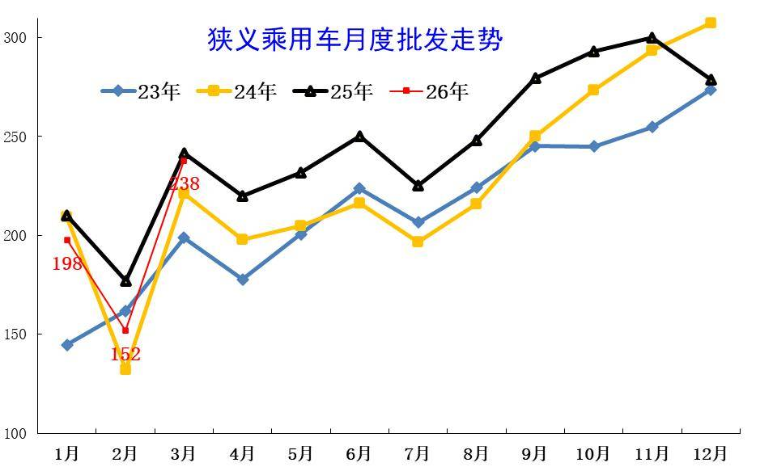

3月全国乘用车厂商批发238万辆，处于历史中高位。历年3月的走势波动巨大，今年国内低迷但出口增长，因此总体较强。

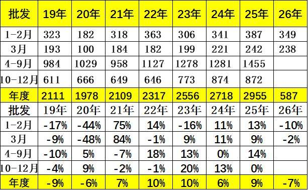

3月全国乘用车厂商批发238万辆，同比下降2%，环比增长57%；1-3月全国乘用车厂商批发587万辆，同比下降7%。受出口的促进，3月乘用车批发同比增速较零售增速高出13个百分点。

5.近年狭义乘用车生产走势

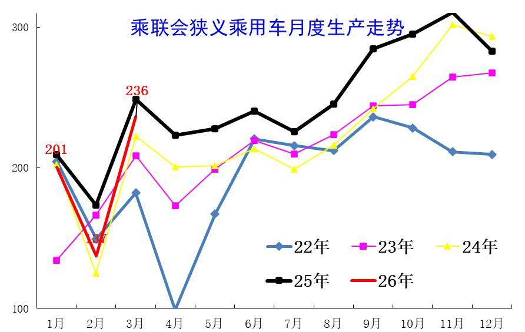

3月乘用车生产减产力度大，市场需求持续较弱，导致主动减产力度很大。3月乘用车生产236万辆，较1月大幅拉升，应属于上半年峰值。

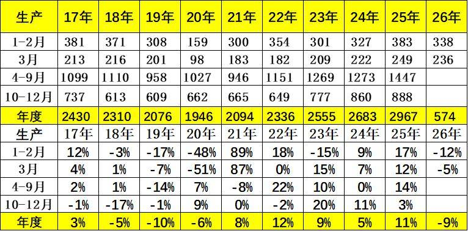

3月乘用车生产236万辆，同比下降5%，环比增长72%。1-3月乘用车生产574万辆，同比下降9%，减产力度大。

6.近年狭义乘用车出口走势

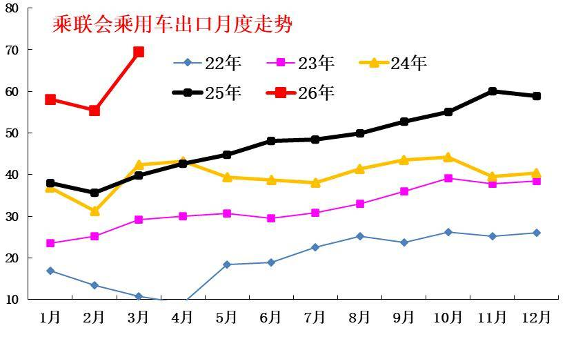

根据乘联数据，3月乘用车出口（含整车与CKD）69万辆，同比增长74%，环比增长25%。

根据乘联数据，3月乘用车出口（含整车与CKD）69万辆，同比增长74%，由于外部环境机会较大，今年的增长是延续去年的强势增长。

7.产销库存月度变化特征

由于3月厂商生产态势较平稳，3月厂商批发高于生产1.5万辆，而厂商月度国内批发高于国内零售3.6万辆，3月总体乘用车厂商行业库存仅增加2万辆（2025年增15万辆、2024年增10万、2023年增20万）。

8.狭义乘用车促销走势

A、新能源车促销力度小幅增长

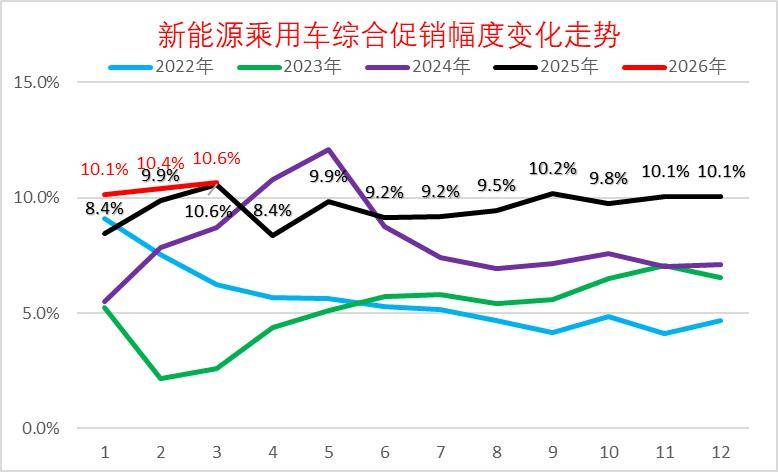

2026年3月的新能源车的促销回升到10.6%的中高位，较同期促销持平，较上月微增0.2%。近几个月的促销较稳，随着降价的受约束，7年低息等促销新模式推动，促销体系也有回收，目前基本保持正常促销水平的中高位。

B、燃油车促销走势

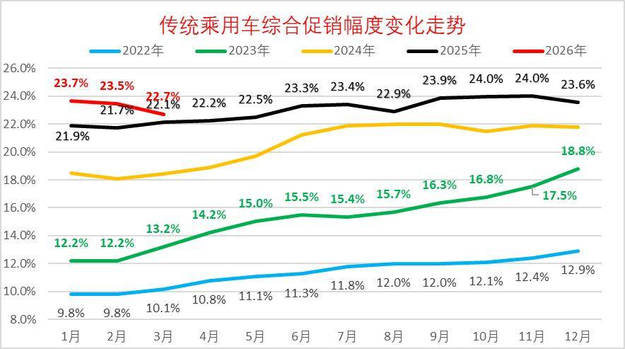

2026年3月传统燃油车的促销下降到22.7%的水平，较上月微降0.8个百分点，较同期增加0.6个百分点，燃油车促销连续9个月维持在23%左右。传统燃油车的促销在2024年下半年处于22%的近期高位水平徘徊，国家补贴政策推动了燃油车行业的2025年稳定走势，但2025年9月开始的车企促销小幅加大，幅度较温和，26年因降价实现逐步回落。

C、豪华车促销走势

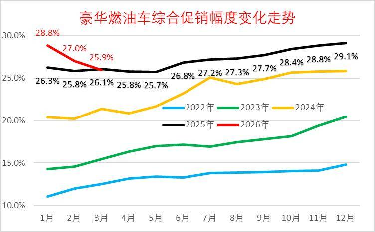

2026年3月豪华车的促销逐步达到25.9%的中高位，较上月下降1.1个点，较同期下降0.2个百分点。虽然消费升级推动高端需求较强，2025年5月以来豪华车促销力度相加大,2026年年初以来的新车指导价调整力度较大，促销因此下降，实际价格变化不大。

D、主流合资车促销走势

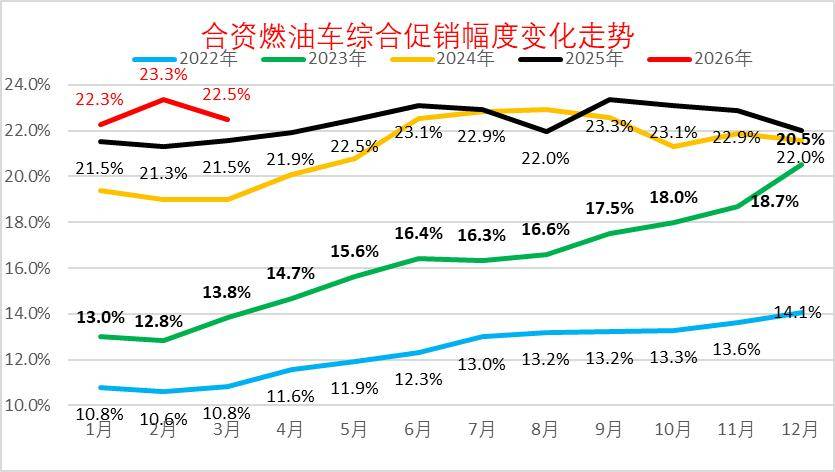

2026年3月合资燃油车的促销逐步达到22.5%的低位，较上月下降0.8个点，较同期增1个百分点。合资促销近期稍有增大。

合资燃油车的促销从2023年的13%的低位，2025年9月回升到23.3%峰值，随着新车强力降价，近三个月小幅波动。随着春节前的燃油车表现较强，促销力度相对平稳微增。

E、自主燃油车促销走势

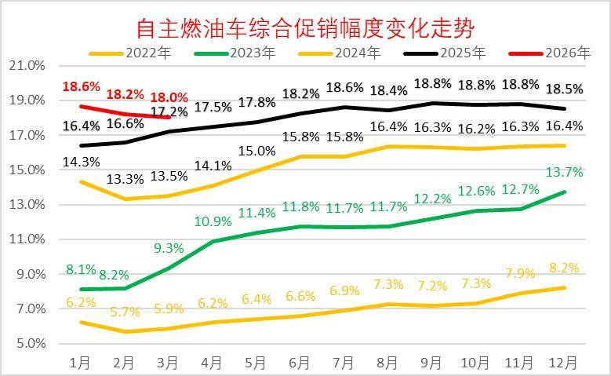

由于自主的新能源较强，加之燃油车出口较好，2025年自主燃油车促销总体平稳。

2026年3月自主燃油车的促销逐步达到18.0%的中位，较同期增加0.8个百分点。自主车企在2024-2025年上半年的促销上升较快，随后2025年下半年以来的促销总体稳定。

F、分动力促销力度跟踪

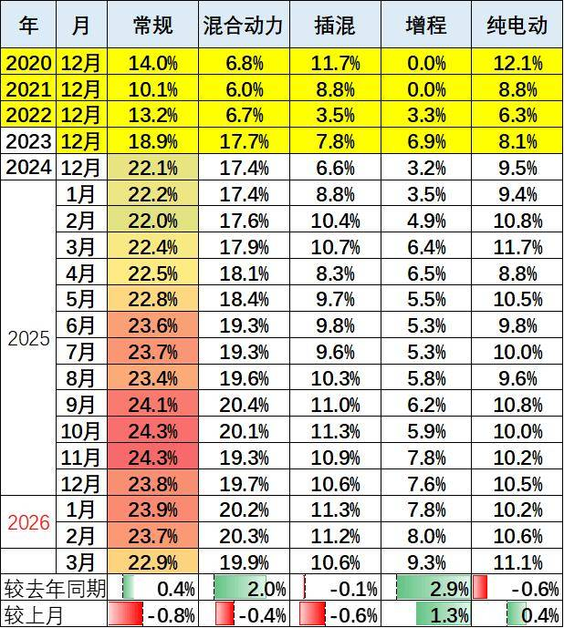

由于部分品牌降价带来的指导价回归，降低了促销幅度。2026年的常规燃油车和混合动力的促销压力较小，而新能源车由于降价带来的车型促销大幅下降，因此总体纯电动促销相对温和，3月同比下滑0.6个点的促销。今年插电混合动力促销波动较大，3月同比下滑0.1个点的促销，环比降0.6个百分点；增程车型总体较2025年3月增加2.9个点左右的促销。混合动力较2025年3月增加2个点左右的促销，较上月下降0.4个点左右的促销。

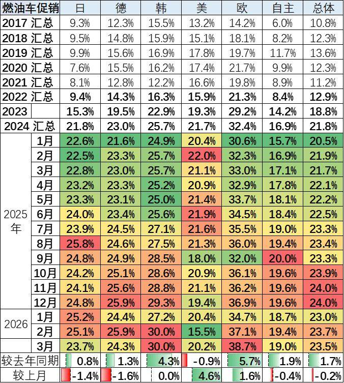

3月的车市促销相对平稳，经销商也是稳促销保利润。目前的欧系促销较大，其它合资车企促销基本24%左右，差异不大。自主车企成为促销最小的。

9.狭义乘用车各级别增长特征

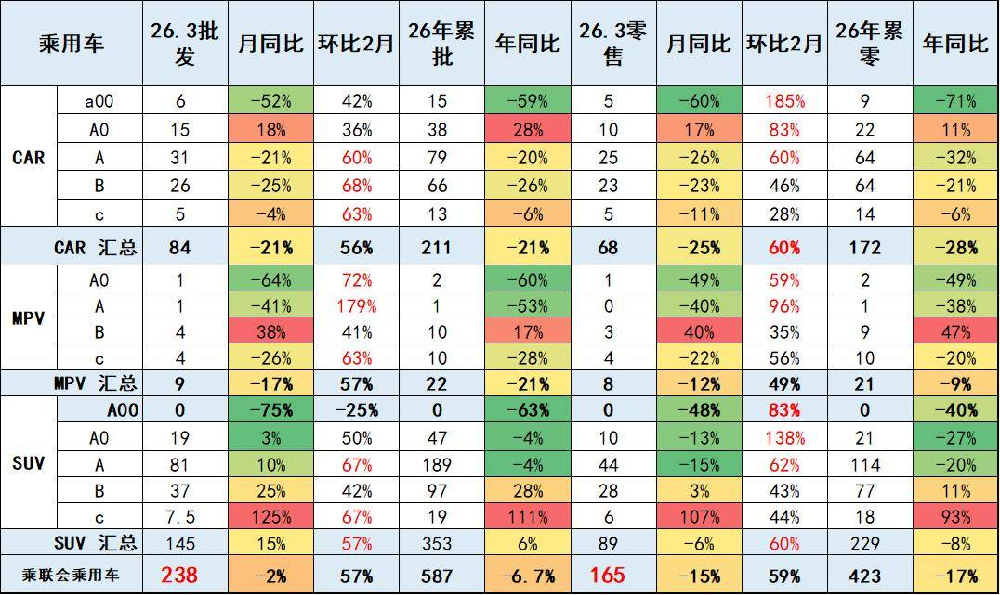

2026年3月乘用车零售降15%，大幅低于批发降2%的增速。由于高油价冲击和补贴暂停带来零售回落，3月A级轿车零售与A00级轿车零售均较低，A0级轿车和高端车型成为3月零售主力，SUV的高端表现较强，轿车中主要是A0级轿车销量回升。

10.狭义乘用车国别增长特征

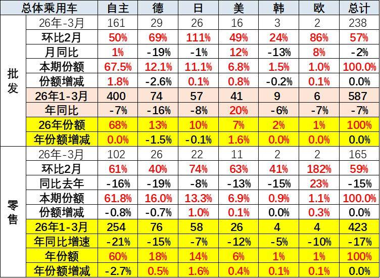

3月自主品牌零售102万辆，同比下降16%，环比增长61%。当月自主品牌国内零售份额为61.8%，同比下降0.8个百分点。自主品牌在新能源市场和出口市场总体较平稳。部分头部传统车企转型升级表现优异，吉利汽车、长安汽车等传统车企品牌份额提升明显。

3月主流合资品牌零售41万辆，同比下降13%，环比增长54%。3月德系品牌零售份额16.0%，同比下降0.7个百分点，日系品牌零售份额13.3%，同比增长1.0个百分点。美系品牌市场零售份额6.9%，同比增长0.1个百分点。韩系零售份额有所微降。

3月豪华车零售21万辆，同比下降15%，环比增长62%。

11.2026年品牌产销特征

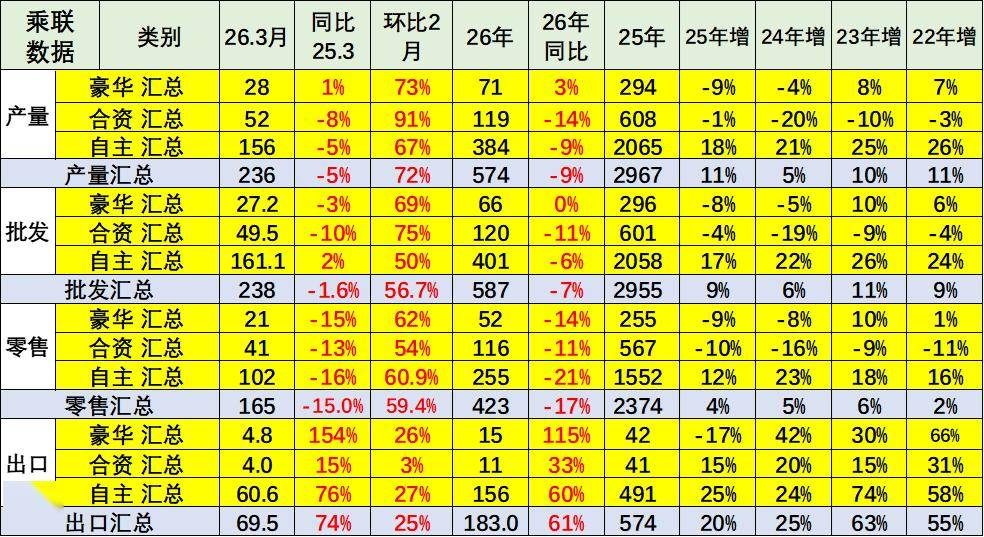

原有的品牌价值体系变化，豪华品牌近期持续压力加大，合资车企的产销走势压力持续较大，自主品牌产业链优势明显。3月行业分化稍有改善，燃油车市场环比走势较好，导致合资品牌走势较好。

随着豪华车指导价的合理回归，3月的豪华品牌零售份额12.9%，同比增长0.1个百分点，传统豪华车市场有所企稳。

12.全国新能源渗透率-批发

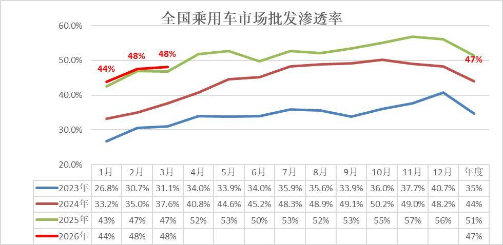

3月新能源车厂商批发渗透率48.1%，较2025年3月提升1个百分点。

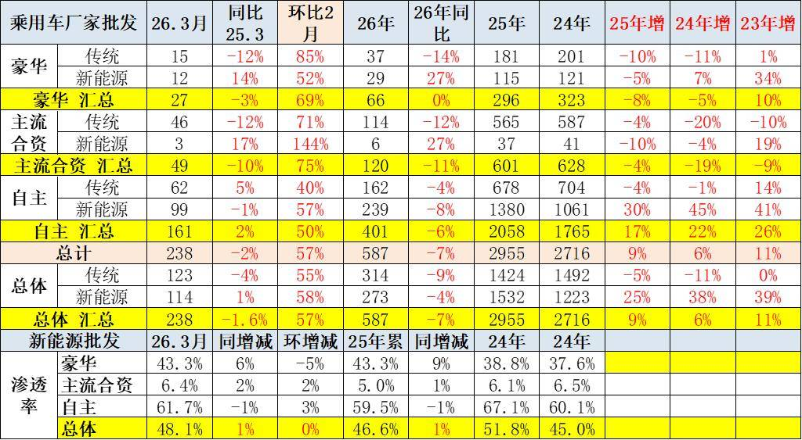

3月，自主品牌新能源车渗透率61.7%；豪华车中的新能源车渗透率43.3%；而主流合资品牌新能源车渗透率仅有6.4%。

3月传统车厂家批发同比降4%，而新能源车同比增1%，增速差距5个点。燃油车的市场稍有改善，新能源出口的贡献度大。

13.全国新能源渗透率-零售

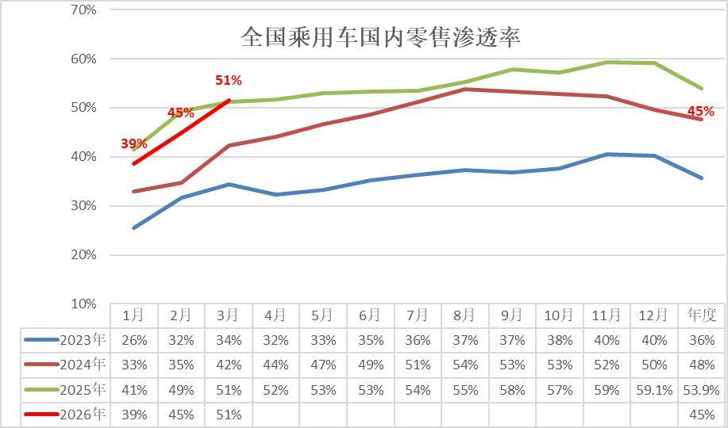

3月新能源车在国内总体乘用车的零售渗透率51.5%，较去年同期增长0.3个百分点，环比2月增加7个百分点。

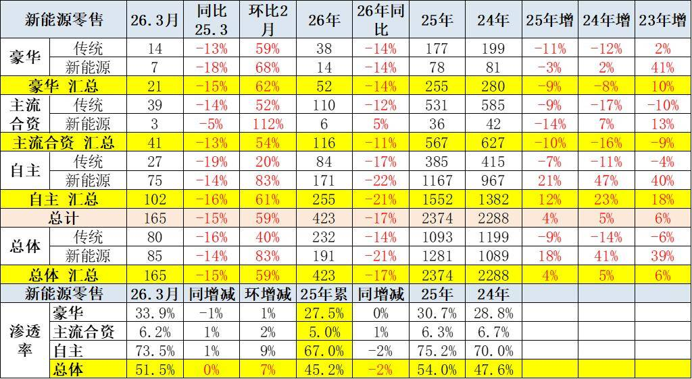

在3月国内零售中，自主品牌中的新能源车渗透率73.5%；豪华车中的新能源车渗透率33.9%；而主流合资品牌中的新能源车渗透率仅有6.2%。

附：近日信息合集
