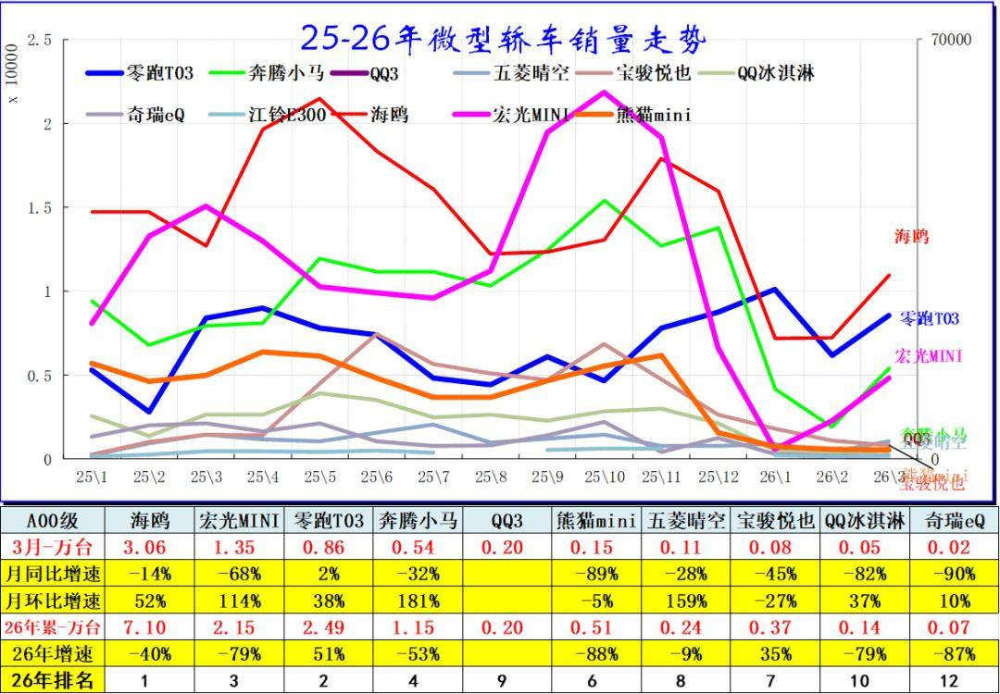
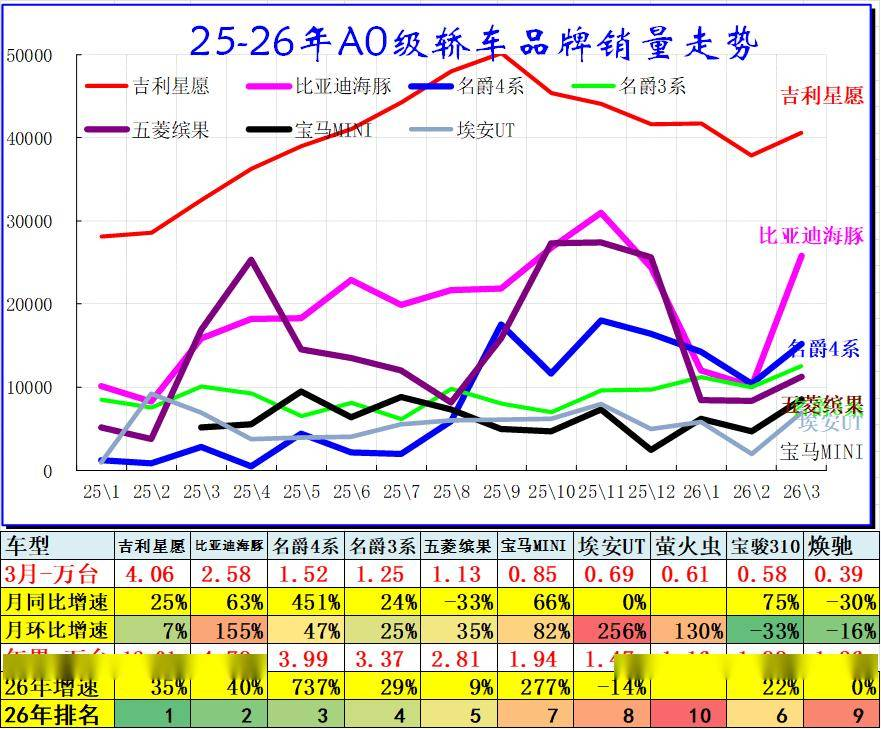
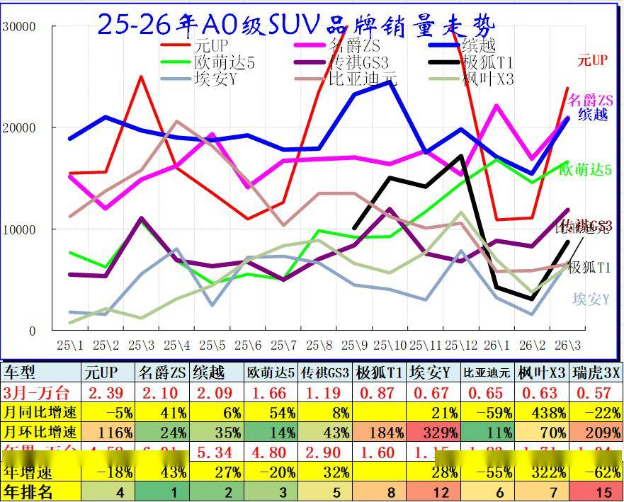
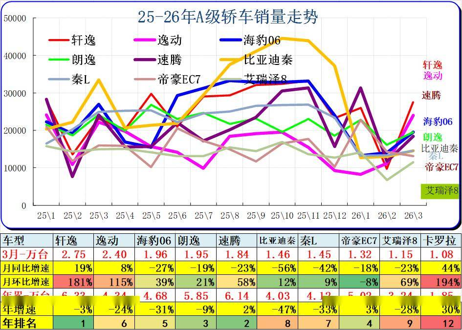
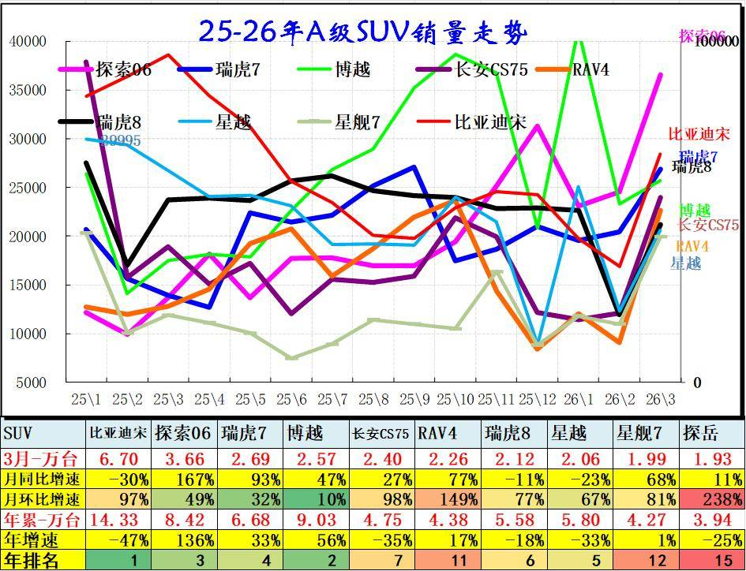
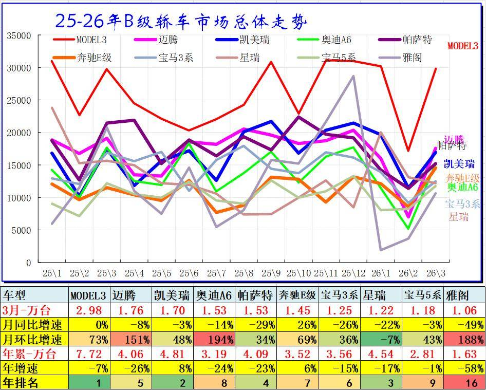
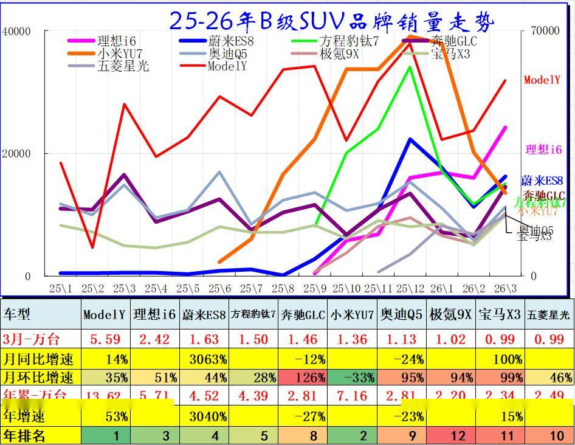
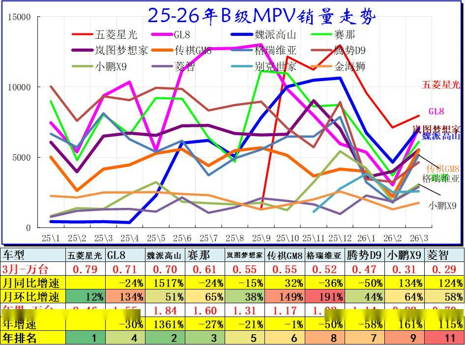

# 2026年3月乘用车细分市场车型走势

- 公開日時: 2026-04-12 12:02（北京時間）
- 出典: [搜狐号・崔东树](https://www.sohu.com/a/1008494352_115312)
- テーマ（自動判定）: セグメント・車種
- 画像: 9枚

---

注：本分析文章仅代表崔东树个人观点，如有异议，请留言。

2025年全国乘用车批发增速9%，新能源乘用车批发增速25%，圆满实现“十四五”的新能源车市增长预期。随着新能源车辆购置税免税政策年末到期，2026年车市新能源低迷期和燃油车春节前抢购阶段，但大多数省市以旧换新政策实施不快，中低端消费者需求低迷，市场走势分化明显。

2026年3月乘用车零售降15%，大幅低于批发降2%的增速。由于高油价冲击和补贴暂停带来零售回落，3月A级轿车零售与A00级轿车零售均较低，A0级轿车和高端车型成为3月零售主力，SUV的高端表现较强，轿车中主要是A0级轿车销量回升。3月本来是加库存月度，但今年3月罕见的去库存，体现了市场的低迷已经成为共识，厂家努力产销平衡，而出口强导致去库存。

一、经济型乘用车市场走势

1、A00级轿车市场表现

A00级轿车2026年3月批发6.48万台，占批发份额7.76%，批发较去年同期同比下降52%，批发环比今年上月增长42%；2026年3月零售较去年同期同比下降60%，零售环比今年上月增长185%。2026年1-3月批发数量15.21万台，厂家批发销售累计下降59%；2026年1-3月国内零售数量8.87万台，零售累计下降71%。

2、A0级轿车主力车型市场走势

A0级轿车2026年3月批发14.84万台，占批发份额17.77%，批发较去年同期同比增长18%，批发环比今年上月增长36%；2026年3月零售较去年同期同比增长17%，零售环比今年上月增长83%。2026年1-3月批发数量38.39万台，厂家批发销售累计增幅28%；2026年1-3月国内零售数量21.61万台，零售累计增幅11%。

自主电动车替代燃油车特征明显，竞争格局由合资主导转为自主为主的新趋势。前期日系的丰田和本田保持较强地位，近几年自主的燃油小型入门级车走势相对艰难。

A0级轿车的全面电动化趋势明显，基本没有太强的燃油车产品，体现了自主的纯电动的产品优势明显。

3、A0级SUV销量走势

A0级SUV 2026年3月批发19.36万台，占批发份额13.33%，批发较去年同期同比增长3%，批发环比今年上月增长50%；2026年3月零售较去年同期同比下降13%，零售环比今年上月增长138%。2026年1-3月批发数量47.2万台，厂家批发销售累计下降4%；2026年1-3月国内零售数量21.04万台，零售累计下降27%。

主流小型SUV的日韩系基本退出市场，自主的电动车表现较强。

二、A级乘用车市场走势

1、紧凑型轿车主力车型市场走势

A级轿车2026年3月批发31.18万台，占批发份额37.34%，批发较去年同期同比下降21%，批发环比今年上月增长60%；2026年3月零售较去年同期同比下降26%，零售环比今年上月增长60%。2026年1-3月批发数量78.83万台，厂家批发销售累计下降20%；2026年1-3月国内零售数量63.55万台，零售累计下降32%。

2024年主流轿车市场的新能源占据主导地位，其中比亚迪绝对领先。2025年燃油车市场阶段性回暖，而大众的燃油车仍有一定的市场空间，主流家用车仍是燃油车最实用。

2、紧凑型SUV主力车型市场走势

A级SUV 2026年3月批发80.85万台，占批发份额55.69%，批发较去年同期同比增长10%，批发环比今年上月增长67%；2026年3月零售较去年同期同比下降15%，零售环比今年上月增长62%。2026年1-3月批发数量189.31万台，厂家批发销售累计下降4%；2026年1-3月国内零售数量113.94万台，零售累计下降20%。

主流SUV市场格局迅速变化，比亚迪和吉利、长安、奇瑞的SUV 表现超强，实现了自主SUV的国内外全面突破。

三、B 级乘用车市场走势

1、B级及C级轿车市场走势

B级轿车2026年3月批发25.76万台，占批发份额30.84%，批发较去年同期同比下降25%，批发环比今年上月增长68%；2026年3月零售较去年同期同比下降23%，零售环比今年上月增长46%。2026年1-3月批发数量66.04万台，厂家批发销售累计下降26%；2026年1-3月国内零售数量64.01万台，零售累计下降21%。

C级轿车2026年3月批发5.25万台，占批发份额6.28%，批发较去年同期同比下降4%，批发环比今年上月增长63%；2026年3月零售较去年同期同比下降11%，零售环比今年上月增长28%。2026年1-3月批发数量12.96万台，厂家批发销售累计下降6%；2026年1-3月国内零售数量13.92万台，零售累计下降6%。

高端轿车市场的日系仍有一定稳定需求，新能源的高端自主快速崛起，尤其是出租网约的高端市场被自主电动车占领。

2、B级SUV市场走势

B级SUV 2026年3月批发37.36万台，占批发份额25.73%，批发较去年同期同比增长25%，批发环比今年上月增长42%；2026年3月零售较去年同期同比增长3%，零售环比今年上月增长43%。2026年1-3月批发数量97.21万台，厂家批发销售累计增幅28%；2026年1-3月国内零售数量76.59万台，零售累计增幅11%。

C级SUV 2026年3月批发7.53万台，占批发份额5.19%，批发较去年同期同比增长125%，批发环比今年上月增长67%；2026年3月零售较去年同期同比增长107%，零售环比今年上月增长44%。2026年1-3月批发数量19.29万台，厂家批发销售累计增幅111%；2026年1-3月国内零售数量17.67万台，零售累计增幅93%。

高端SUV市场的自主新能源迅速崛起，传统燃油车的高端优势弱化，近期的宝马等高端有所改善。

3、B级及以上MPV市场走势

B级MPV 2026年3月批发4.01万台，占批发份额44%，批发较去年同期同比增长38%，批发环比今年上月增长41%；2026年3月零售较去年同期同比增长40%，零售环比今年上月增长35%。2026年1-3月批发数量10.14万台，厂家批发销售累计增幅17%；2026年1-3月国内零售数量8.59万台，零售累计增幅47%。

C级MPV 2026年3月批发3.87万台，占批发份额42.44%，批发较去年同期同比下降26%，批发环比今年上月增长63%；2026年3月零售较去年同期同比下降22%，零售环比今年上月增长56%。2026年1-3月批发数量9.54万台，厂家批发销售累计下降28%；2026年1-3月国内零售数量10.02万台，零售累计下降20%。

MPV市场的高增长阶段已经改为低增长趋势。魏派高山、GL8近期表现较强，比亚迪与腾势和传祺的MPV表现超强，日系的MPV优势迅速下降。

附：近日信息合集
