# 车市扫描-2026年13期（4月7日-12日）

- 公開日時: 2026-04-15 17:24（北京時間）
- 出典: [搜狐号・崔东树](https://www.sohu.com/a/1009963247_115312)
- テーマ（自動判定）: 車市スキャン（週次）
- 画像: 15枚

---

主要信息源自乘联分会每日新闻等

中国汽车流通协会

乘用车市场信息联席分会（乘联分会）

网站：http://www.cpcaauto.com

一、本周车市概述1.2026年4月全国乘用车市场零售低位起步

【2026年4月1-12日乘联会市场分析要闻】

4月1-12日全国乘用车厂家批发37.4万辆，同比去年同期下降29%，较上月同期下降21%；今年以来累计批发624.1万辆，同比去年同期下降8%。4月1-12日市场零售37.7万辆，同比去年同期下降20%，较上月同期下降12%；今年以来累计零售459.8万辆，同比去年同期下降18%。

4月1-12日全国乘用车厂家新能源批发19.9万辆，同比去年同期下降29%，较上月同期下降15%；今年以来累计批发292.7万辆，同比去年同期下降7%。4月1-12日新能源车市场零售22.4万辆，同比去年同期下降11%，较上月同期增长7%；今年以来累计零售213.2万辆，同比去年下降20%。

2026年4月1-12日全国新能源市场零售渗透率59.5%；新能源厂家批发渗透率53.2%。

4月第1-2周全国纯燃料轻型车生产26万辆，同比去年同期下降31%，较上月同期下降23%。4月第1-2周混合动力与插混总体生产12.2万辆，同比去年同期下降18%，较上月同期下降1%。

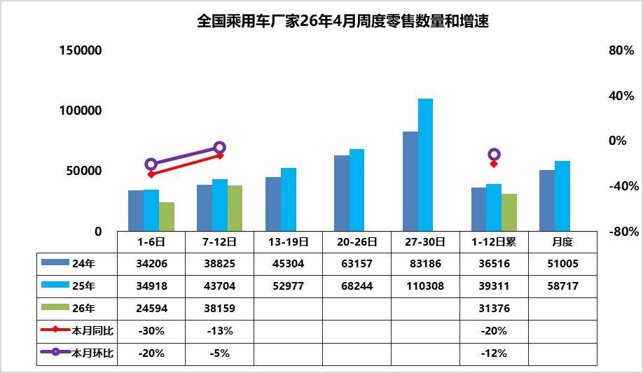

4月第1周乘用车市场日均零售2.5万辆，同比去年同期下降30%，较上月同期下降20%。

4月第2周乘用车市场日均零售3.8万辆，同比去年同期下降13%，较上月同期下降5%。

4月1-12日市场零售37.7万辆，同比去年同期下降20%，较上月同期同期下降12%；今年以来累计零售459.8万辆，同比去年下降18%。

4月第一周受清明假期因素影响，实际有效销售及上牌时间较短，季度末成交冲刺后、4月初成交节奏放缓，直接导致环比3月同期零售量偏低，市场整体表现较为清淡。随着高油价的冲击逐步适应，车市销售会逐步回暖。

同时，国际油价持续高涨推高用车成本，车市终端热度有一定幅度的下降，燃油车与新能源分化较三月进一步加剧。随着成本上涨，消费压力加大，燃油车的零售量进一步放缓，新能源车好于燃油车表现，但目前尚未弥补燃油车丢量损失。

当前车市消费开口难打开，连续两个季度同比下滑，经销商卖车不盈利、不卖更亏，厂家难以补贴，造成恶性循环，渠道问题已经成为当下流通领域最大的问题，需要重点关注和支持。

2.2026年4月全国乘用车厂家销量低位平稳

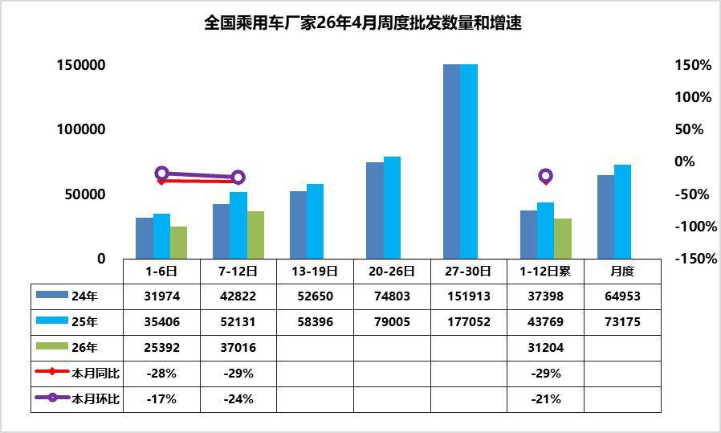

4月第1周批发日均2.5万台，同比去年4月同期下降28%，环比上月同期下降17%。

4月第2周批发日均3.7万台，同比去年4月同期下降29%，环比上月同期下降24%。

4月1-12日全国乘用车厂家批发37.4万辆，同比去年同期下降29%，较上月同期下降21%；今年以来累计批发624.1万辆，同比去年下降8%。

近期车市相对平淡，新车不多、价格稳、促销稳，消费者的观望心态仍较强。随着一季度末的冲刺完成，经销商的库存相对较高，4月初的进货节奏较慢。其中新能源批发同比降幅大于整体车市，反映出厂家针对终端需求低迷现状，主动收缩生产与供货节奏，避免库存进一步积压。

产品、技术加速迭代，3月以来虽然新车不多，但行业共召开80余场新车新技术发布会，希望北京车展前提前获取热度和订单，但造成客户对新车的观望。4月下旬北京车展新车集中上市，且近期终端价格稳定，进一步加重消费者观望情绪。当前批发走弱，既是对终端零售低迷的被动适配调整，也是车企主动控制产销节奏、缓解渠道压力的理性选择。总体来看，批发端与零售端同步下滑，市场供需两端均开局不强。随着后续终端需求逐步回暖、库存压力缓解，厂家批发有望在下旬恢复性回升，批零增速差将逐步收敛。

3.3月锂电池装车56.5Wh，同比下降0.1%。

3月，我国动力和其它电池合计产量为178GWh，同比增长32%；1-3月，我国动力和其它电池合计产量为487GWh，同比增长26%。2026年3月锂电池装车56.5Wh，同比下降0.1%。1-3月锂电池装车125Wh，同比下降4%。2026年3月动力电池的产量中装车的比例下降到32%，其中三元电池装车率34%，磷酸铁锂装车率31%。动力电池装车景气度达到历史低位。

2026年3月新能源车国内市场的装车82万台、同比下降26%，其中纯电动乘用车49万台、同比下降28%；插混乘用车26.5万台、同比下降30%；纯电动货车5.5万台，这样的产量数据分化严重。

2026年1季度的电池能量密度160以上的车型占比14%，相对于2025年同期的9%出现了明显的回升，这主要还是三元的高端需求有所回升。而125以下的能量密度的产品2026年下降到了0%的比例。

电池企业的竞争格局形成宁德时代和比亚迪两者相对较强的特征。宁德和比亚迪到2026年仍保持66%的比例，其它企业的空间有超30%左右的空间。今年国轩高科、蜂巢能源、吉利耀宁、楚能新能等表现较强。由于比亚迪全面转型磷酸铁锂电池，因此宁德时代、蜂巢能源等三元电池优势更加明显，近期高端插混较强推动三元电池走强。

4.3月份皮卡市场销售7万辆，同比增11.7%

皮卡产销：皮卡产销呈现春季的产销拉升特征，季度末走势超强。2026年3月份皮卡市场销售7万辆，同比增11.7%，环比增73%，处于近5年的高位水平。1-3月销量16.1万台，增7.6%。2026年3月份皮卡生产为6.77万辆，同比增9.3%；2026年1-3月皮卡生产16.2万台，增12.3%。

长城汽车持续保持强势皮卡领军地位，国内外表现均较平稳。受出口持续同比增长促进，长安汽车、江铃汽车、上汽大通、江淮汽车、郑州日产表现较强。在国内皮卡零售市场，长城皮卡、江铃汽车、郑州日产、雷达汽车、江西五十铃等表现较好，国内“皮卡一超多强”格局继续保持。

皮卡出口：2026年3月全国皮卡出口3.3万辆，同比增长35%，环比增43%；2026年1-3月全国皮卡出口8.2万辆，同比增长32%，行业出口占比继续保持高位。2024年皮卡出口占比皮卡总销量的45%，2025年皮卡出口达到50%，由于2026年总体汽车市场压力大，3月国内皮卡厂家冲刺销量力度超强。2026年3月皮卡出口达到46%。

新能源皮卡：2026年3月新能源皮卡0.69万辆，同比降3%，环比增26%；2026年1-3月新能源皮卡1.8万辆，同比增2%；形成春节因素的年初新能源皮卡稍弱于燃油皮卡总体增速的走势。随着电动化和乘用化的发展，皮卡市场的空间仍将逐步改善。3月新能源皮卡销量中：比亚迪皮卡海外销量2709辆、吉利雷达电动皮卡1802辆、郑州日产1028辆、长安增程皮卡568辆，其它皮卡企业的新能源车也有一定规模。伴随着国内新能源皮卡市场启动，逐步培育市场，预计中国皮卡未来将会更快的发展来满足国内外需求。

5.3月乘用车市场价格段跟踪

2025年豪华车均价35.8万元，较2024年降1.8万元；2026年3月均价33.9万元，较同期降1.9万元。2025年合资品牌17.2万元，较2024年降0.7万元；2026年3月均价17.3万元较同期降0.1万。2025年新势力24.1万元，较2024年降4万元；2026年3月均价24.1万元，较同期增1.8万元。2025年自主品牌均价12.2万元，较同期降1.2万元；2026年3月自主品牌均价12.5万元，较同期增0.7万元。

常规燃油车价格持续上升，市场萎缩在中低端很明显，而高端萎缩慢，因此从2021年的16.6万元上升到2024年的18.8万元。2025年随着高端燃油车的较快萎缩，2025年的均价降低到18.2万元，2026年3月均价18.1万元，燃油车购买群体买车逐步稳定。

而新能源车的均价近期逐步下降，从2023年的均价18.4万元，下降到2024年的均价18.0万元，2025年的均价16.0万元，价格下降明显。2026年3月是16.9万元，涨价1.5万元，量跌价升，体现新能源车消费的结构性变化。

二、本周上市新车1.阿维塔12新款上市售价区间为29.39万-43.39万元

4月8日，新款阿维塔12上市，新车共推7款，售价区间为29.39万-43.39万元。外观与老款车型基本保持一致。配备四激光雷达、零重力座椅、前排中间气囊、线控制动等。增程版配备双电机，CLTC纯电续航里程350km，纯电版提供双电机或三电机系统，CLTC纯电续航里程为735km、670km。新车搭载鸿蒙座舱5.0，支持MoLA大模型。

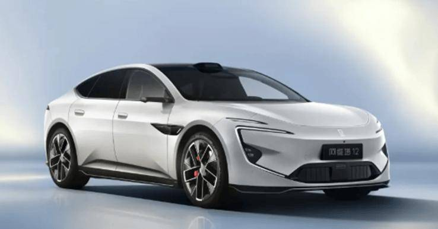

2.奥迪A6L e-tron上市售价30.98万-43.98万元

4月10日，一汽奥迪A6L e-tron上市，新车共推4款，售价30.98万-43.98万元。新车采用扁平化分体式大灯、贯穿式第二代OLED尾灯。采用11.9英寸奥迪虚拟座舱、14.5英寸MMI中控屏、10.9英寸副驾娱乐屏。配备智能可调光全景天幕、中国专属云感座椅、华为乾崑辅助驾驶、2个激光雷达等。CLTC工况续航里程分别为720km、815km、745km、721km。

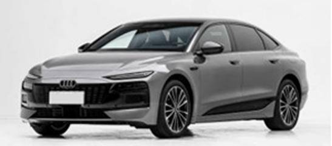

3.奥迪Q6L e-tron家族新款上市售价26.98万-41.98万元

4月10日，新款奥迪Q6L e-tron家族上市，新车共推6款，售价26.98万-41.98万元。外观与老款车型基本保持一致。配备20扬声器B&O音响+VNC主动降噪、超纤绒顶棚、华为乾崑辅助驾驶等。CLTC续航里程为672km，709km，668km，715km，677km，675km。

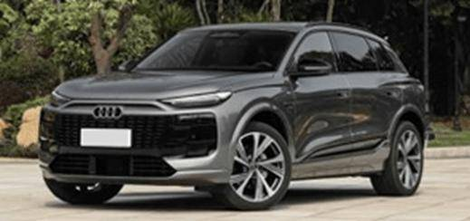

4.东风日产NX8上市限时权益价14.99万-19.99万元

4月8日，东风日产NX8上市，新车共推7款，售价区间为15.99万-20.99万元，限时权益价14.99万-19.99万元。新车采用星环式灯组、发光品牌LOGO、隐藏式水切、量子光幕尾灯。采用10.25英寸仪表盘+双15.6英寸连屏设计+63英寸AR HUD。配备高通8295P芯片、25扬声器、AI零重力座椅、Momenta强化学习大模型等。纯电车型CLTC续航里程为580km，650km，630km；1.5T增程车型CLTC纯电续航里程为150km，310km。

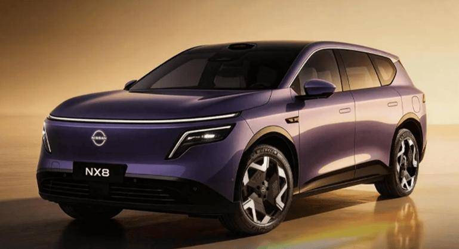

5.广汽埃安AION RT换电版上市租电池购车价8.88万元

4月8日，埃安AION RT换电版上市，售价9.98-12.38万元，租电池购车价8.88万元。外观与现款车型基本保持一致。配置与此前的中配车型智豪版看齐。搭载宁德时代巧克力换电电池，实现99秒极速换电+可充可换双模式，CLTC纯电续航505km。

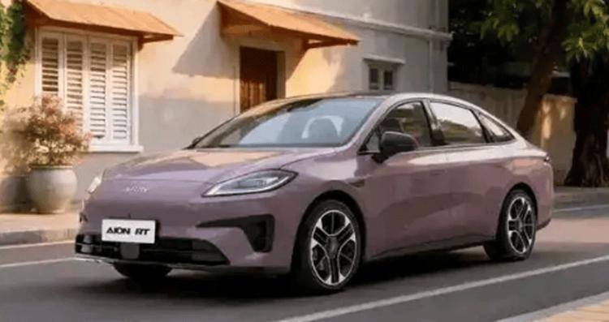

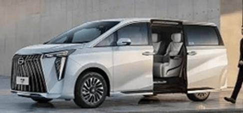

7.极氪007/007GT新款上市限时权益价19.39万-23.39万元

4月10日，新款极氪007/007GT上市，两车各推3款，售价区间为20.39万-24.39万元，限时权益价19.39万-23.39万元。新车配备激光雷达+Thor-U芯片，升级闭式空气悬架，标配CCD电磁减振+智能魔毯。升级900V高压架构，新款极氪007的CLTC最大续航为715km，905km，800km，极氪007GT的CLTC续航里程为702km，880km，760km。

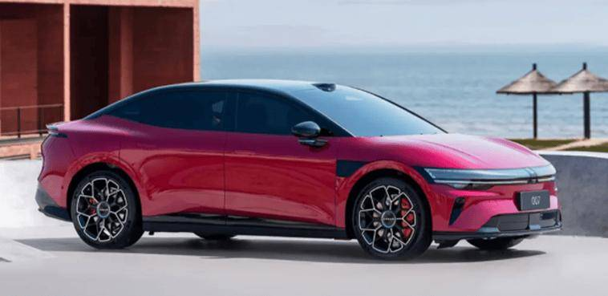

8.领克10发布900V超充版售价39.8–49.8万元

4月9日，领克全新领克10高性能版上市，售价39.8–49.8万元。搭载900V碳化硅高压架构，800kW超充桩实现10%–97%仅8分42秒，纯电版配120kWh麒麟电池，CLTC续航920km；双电机680kW，零百2.7秒。

9.奇瑞瑞虎5运动版上市限时优惠价7.09万-8.09万元

4月8日，奇瑞瑞虎5运动版上市，新车共推3款，售价区间为7.99万-8.99万元，限时优惠价7.09万-8.09万元。新车取消家族大嘴格栅，采用分体式车灯、全新贯穿式尾灯组。采用8.88英寸全液晶屏+15.6英寸2K中控屏。配备高通骁龙8155、座椅加热、64色氛围灯等。搭载1.5T发动机，匹配7DCT变速箱。

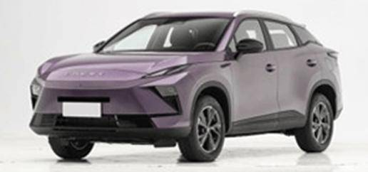

10.奇瑞瑞虎7L上市限时优惠价7.89万-9.99万元

4月8日，奇瑞瑞虎7L上市，新车共推4款，售价区间为8.59万-10.69万元，限时优惠价7.89万-9.99万元。新车采用V型黑色运动格栅、熏黑LED波光流影大灯、贯穿式尾灯。采用可左右滑动的15.6英寸悬浮式中控屏。配备高通骁龙8155芯片、50W无线充电、256色音律氛围灯等。搭载1.5T，1.6T发动机，匹配6DCT，7DCT变速箱。

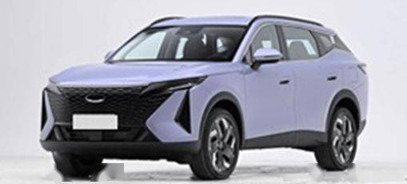

11.奇瑞瑞虎7新款上市限时优惠价6.99万-8.19万元

4月8日，新款奇瑞瑞虎7上市，新车共推3款，售价区间为7.99万-9.19万元，限时优惠价6.99万-8.19万元。新车采用更大尺寸的黑化竖置前格栅，车身尺寸增大。采用24.6英寸曲面沉浸环绕屏，全新方向盘。配备电动尾门、前排座椅加热与通风、全景影像、定速巡航等。搭载1.5T发动机，匹配CVT变速箱。

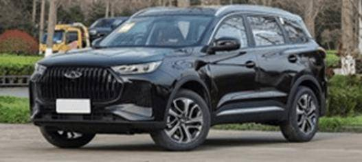

12.萤火虫新款上市租电方案售7.98万-8.58万元

4月7日，新款firefly萤火虫上市，新车共推2款，售价区间为11.98万-12.58万元，租电方案售7.98万-8.58万元。新车新增全新车色、轮毂和下包围。配备辅助驾驶小蓝灯、直接式胎压监测、后视镜下翻+记忆等。新车升级120kW电机，CLTC纯电续航里程420km。

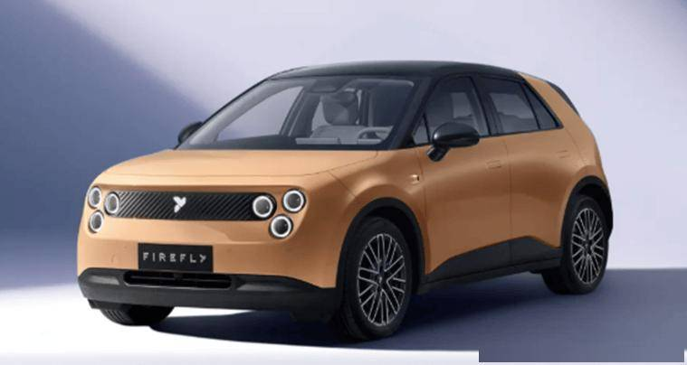

13.长安启源A06新款上市售价区间为10.99万-11.99万元

4月10日，新款长安启源A06上市，新车共推2款，售价区间为10.99万-11.99万元。外观与老款车型基本保持一致。配备电动尾门、MTK8676芯片、高速领航等。新车CLTC纯电续航为510km，630km。

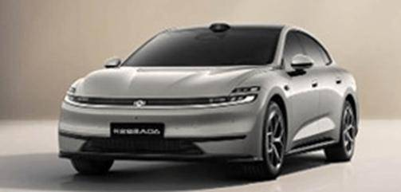

14.长安启源Q05新款上市售价区间为8.99万-9.59万元

4月10日，新款长安启源Q05上市，新车共推2款，售价区间为8.99万-9.59万元。外观与老款车型基本保持一致。配备天枢智能驾驶辅助激光版。CLTC续航里程为506km。

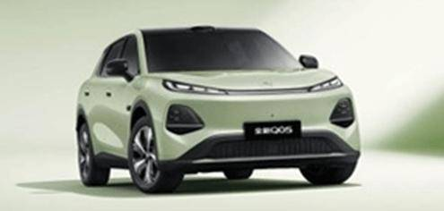

三、宏观经济与政策1.工信部：2025年度乘用车企业平均燃料消耗量与新能源汽车积分情况公示

4月7日，工信部发布关于2025年度乘用车企业平均燃料消耗量与新能源汽车积分情况的公示。87家境内乘用车企业参与核算。

2.全新一代理想L8、小鹏MONA L03等登录工信部公告

4月9日，工信部第406批《道路机动车辆生产企业及产品公告》公布了全新一代理想L8、小鹏MONA L03、启境GT7、魏牌V8X、腾势Z9S、哈弗HX、长安启源Q06、新世代宝马iX3等车型的图片和申报信息。

3.统计局：2026年3月份CPI同比上涨1.0%

4月10日，统计局发布数据显示，2026年3月份，CPI同比上涨1.0%，环比下降0.7%。1-3月平均，CPI比上年同期上涨0.9%。

4月10日，统计局发布数据显示，2026年3月份，PPI同比由上月下降0.9%转为上涨0.5%；环比上涨1.0%，涨幅比上月扩大0.6个百分点。一季度，PPI比上年同期下降0.6%。

4.上海：持续开展汽车以旧换新活动

上海市商务委员会近日印发《2026年上海市扩消费行动方案》，其中提到，加快促进汽车更新消费。持续开展汽车以旧换新活动，全面释放汽车消费潜力。支持符合条件的消费者申领新能源汽车专用额度，落实新能源汽车车辆购置税减免政策。畅通汽车流通链条，推动加速老旧车辆淘汰更新。培育壮大二手车经营主体，持续落实取消二手车限迁、二手车销售“反向开票”、异地交易登记等便利化措施。鼓励汽车生产企业出台汽车收旧换新优惠措施，自营或与二手车经销企业合作开展汽车销售或租赁收旧换新服务。

5.山东两年内打造覆盖全省的电动重卡绿色补能廊道

山东省日前印发实施《山东省重点公路运输通道布局建设电动重卡大功率充电示范站实施方案(2026—2027年)》和《关于支持电动重卡规模化应用的若干措施》。利用2026—2027年两年时间，山东将全面开展重点路段示范站建设。高速公路方面，建成24对服务区48座示范站，构建覆盖省会、胶东、鲁南三大经济圈，串联16市、总里程2600余公里的“四纵两横”电动重卡绿色补能廊道。普通国省道方面，建成107座示范站，完成14条普通国省干线布局，形成覆盖16市、总里程6600余公里的“四纵三横”电动重卡绿色补能廊道。

四、企业信息1.比亚迪携手肯德基打造一站式人车补能生态

4 月8 日，比亚迪与肯德基在深圳比亚迪全球总部正式签署战略合作协议。双方将整合各自在新能源汽车与餐饮零售领域的核心优势，围绕闪充技术、智能座舱与肯德基车速取服务展开全链路深度协同，共同打造“9分钟一站式人车补能”新生态。

2.广汽发布新一代全域混动技术

4月12日，广汽集团以“科技向心”为主题举办2026广汽科技日，发布了新一代全域混动、端云一体智能座舱、新一代电子电气架构。同时宣布昊铂GT攀登版将于5月份上市。

3.吉利远程汽车换帅完成工商变更

近日，浙江远程新能源商用车集团有限公司发生工商变更，周建群卸任法定代表人、董事长，由戴庆接任。

4.奇瑞欧洲运营中心+西班牙研究院启用

当地时间4月8日，奇瑞汽车正式宣布启用欧洲运营中心，并同步启动奇瑞西班牙研究院。中心将成为奇瑞欧洲枢纽，负责市场、销售、售后、研发一体化。研究院聚焦智能座舱、车规芯片、氢能系统，计划3年投入8亿欧元。

5.奇瑞犀牛S全固态电池亮相

奇瑞汽车在武汉举办技术发布会，正式发布自研犀牛S全固态电池，能量密度达600Wh/kg，是传统三元锂电池的2倍，计划2027年批量上市。支持5分钟极速补能，可实现500km续航。犀牛S电池将率先搭载于奇瑞星途旗舰SUV与捷途硬派越野车型，续航突破1200km。

6.深蓝汽车拟于2027年推出全新燃料电池乘用车

长安汽车旗下深蓝汽车产品全球开发总经理喻成在智能电动汽车发展高层论坛（2026）上表示，预计深蓝汽车将于2027年推出全新燃料电池乘用车。

7.腾势D9全量推送天神之眼5.0

腾势汽车宣布，腾势D9全量推送天神之眼5.0，新增强化学习端到端大模型。新增驾驶辅助报告，驾驶辅助新增高快道路环境下紧急停车辅助功能。

8.蔚来萤火虫纯电小车推送1.4.0车机系统更新

蔚来旗下萤火虫纯电小车推出1.4.0版本车机系统更新，新增多项功能并优化现有体验。新增误加速抑制辅助功能，在车辆静止起步或低速行驶时，若快速深踩加速踏板且前方或后方存在障碍物及碰撞风险，系统将限制动力输出并发出警报。

9.奕境汽车核心管理层落定

4月7日，由华为乾崑与东风汽车集团联合打造的全新汽车品牌奕境汽车正式公布其核心管理团队：汪俊君出任董事长，全方位负责东风汽车集团与华为乾崑深度融合与产品落地；曾清林正式履职品牌总经理，全面主持品牌各项工作。

10.长安汽车发布2025年年报

长安汽车发布2025年年度报告，公司2025年实现营业收入1640亿元，同比增长2.7%；归母净利润40.8亿元，扣非后归母净利润28.0亿元，同比增长8.03%。研发投入126亿元，占营收7.67%。2025年长安汽车全年销量291.3万辆，创近9年新高；全年新能源销量110.9万辆，同比增长51%；海外销量63.7万辆，同比增长18.9%。

五、行业信息1.3月全国乘用车市场零售销量同比下滑15.0%

乘联分会数据显示，3月全国乘用车市场零售销量为164.8万辆，同比下滑15.0%，环比增长59.4%。其中新能源乘用车市场零售为84.8万辆，同比下滑14.4%，环比增长82.6%，新能源车在国内总体乘用车的零售渗透率为51.5%。其中自主品牌中的新能源车渗透率为73.5%。

2.3月新能源乘用车出口34.9万辆

乘联分会数据显示，3月乘用车出口（含整车与CKD）69.5万辆，同比增长74.3%，环比增长25.2%。3月新能源乘用车出口34.9万辆，同比增长139.9%，环比增长29.6%，占乘用车出口50.2%，较去年同期增长13.7个百分点。

3.华为兆瓦级重卡超充落地深圳

华为联合深博创科技在深圳建成广东最大商用车兆瓦级超充站，总面积1.1万平方米，配备20台兆瓦超充桩，单桩功率达1.2MW，可实现15分钟为电动重卡补能80%，续航提升400km+ 。实测显示，应用兆瓦超充后，重卡运输效率提升15%，日均多跑150公里。

4.小马智行在克罗地亚开启商业化Robotaxi服务

4月7日，小马智行与新加坡最大交通运营商康福德高（ComfortDelGro）联合宣布，正式在新加坡榜鹅（Punggol）地区开启Robotaxi载客运营。

4月8日，小马智行联合自动驾驶出行服务公司Verne及出行平台Uber，在克罗地亚首都萨格勒布开启Robotaxi商业化运营，成为欧洲首个面向公众开放的Robotaxi商业化服务。

5.优信集团：2025年实现总收入32.4亿元

4月10日，二手车零售商优信集团发布未经审计的2025年第四季度及全年业绩报告。2025年公司实现总收入32.4亿元，同比增长78.6%；全年总交易量为57408辆，同比增长119.6%；零售交易量为51110辆，同比增长134.7%；全年运营亏损1.74亿元，亏损幅度同比收窄39%。其中，第四季度总收入为11.98亿元，同比增长100.7%，环比增长36.2%。

六、跨国集团与国际市场1.Waymo在纳什维尔推出自动驾驶网约车服务

当地时间4月7日，Alphabet旗下无人驾驶技术公司Waymo宣布已在美国田纳西州纳什维尔市开始向公众提供自动驾驶网约车服务。目前，该公司还在纳什维尔国际机场进行测试。

2.澳大利亚3月电动汽车市占率近15%

4月8日，澳大利亚联邦汽车工业商会公布的数据显示，今年3月份，电动汽车在澳大利亚新车总销量中占比近15%，较去年同期的7.5%大幅提升。

3.宝马氢能扁平化储存系统2028年量产

宝马集团推出氢能扁平化储存系统，并将于2028年在新一代宝马X5上量产，该系统可储存至少7千克氢气，并在5分钟内全部加满。

4.大众汽车官宣停产纯电车型

大众汽车集团在德国总部召开紧急发布会，官宣全面停产现有纯电车型，包括ID.3、ID.4、ID.6等全系ID系列，2026年底前完成清库，不再推出全新纯电产品。集团将战略转向高效混动+氢能燃料电池双技术路线。2027年推出首款量产氢能SUV，加氢5分钟、续航700km+。

5.大众汽车将在美国停产纯电车型

大众汽车当地时间4月9日宣布，将于4月中旬停止美国田纳西州组装厂的ID.4电动跨界车生产，以便工厂为燃油SUV车型Atlas的2027年款车型换代做准备。

6.德国3月纯电动车注册量超过油车

德国联邦汽车运输管理局4月7日公布的数据显示，今年3月，德国纯电动汽车注册量达70663辆，同比增长66.2%。德国汽油车3月的注册量为66959辆，同比下降4.9%。3月新乘用车注册量为29.4万辆，同比增长16.0%，一季度累计增长5.2%。

7.梅赛德斯-奔驰集团第一季度全球销量下降6%

梅赛德斯-奔驰集团通过电子邮件发布的声明显示，其第一季度全球销量下降6%，至49.97万辆。集团第一季度纯电动车销量增长11%，达到50400辆。

8.美国二手电动汽车销量激增

据美国考克斯汽车咨询公司估算，今年第一季度，美国二手电动汽车销量与去年同期相比增长12%，与前一季度相比上涨17%。

9.起亚汽车计划到2030年将全球销量提升至413万辆

起亚汽车4月9日公告称，起亚汽车计划到2030年将全球年销量从今年的目标销量335万辆提升至413万辆，目标2030年将全球市场份额提高至4.5%。

10.日产将取消纯电越野车型计划

日产汽车高管日前表示，该公司将取消纯电动越野车型的开发计划，原定为新一代Xterra的硬派SUV将不再推出纯电版，转而提供V6燃油及混动版本。

11.现代汽车调整全球航运路线

因霍尔木兹海峡航运受阻，现代宣布全球货轮绕行非洲好望角，航程增12天、成本涨35% 。同时紧急扩大欧洲本地采购，将本地零部件占比从42%提至70%，减少韩国海运依赖。

12.越南将免收燃油税政策延长至6月底

4月12日，越南国会办公厅表示，为稳定国内油价，越南决定将暂停征收燃油税的期限由先前公布的4月15日延长至6月底。

附：近日信息合集
