# 2026年1-3月汽车投资增4.8%，生产降6%，汽车消费降9%，新能源汽车降6%渗透率42%

- 公開日時: 2026-04-16 15:40（北京時間）
- 出典: [搜狐号・崔东树](https://www.sohu.com/a/1010385996_115312)
- テーマ（自動判定）: 産業統計
- 画像: 11枚

---

2026年国家实施更加积极有为的宏观政策，加大逆周期和跨周期调节，持续扩大内需、优化供给，总体市场需求稳中有升，实现良好开局。

2026年3月汽车生产307万台，同比降0.1%；新能源汽车生产134万台，同比增1%，渗透率44%；燃油车生产173万台，同比降1%。2026年1-3月汽车生产715万台，同比降6%；新能源汽车生产302万台，同比降6%，渗透率42%；燃油车生产413万台，同比降5%。2026年1-3月汽车工业增加值增5.1%，其中3月汽车工业增加值增7.5%，表现改善。

2026年1—3月份，汽车行业固定资产投资同比增长4.8%，高于1.7%的各行业平均水平。

当前，外部环境更趋复杂严峻，海湾局势复杂、保护主义加剧，冲击产业链供应链稳定；国内经济回升向好基础还不稳固，有效需求不足、市场缺乏活力等问题挑战仍然存在，行业稳增长任务依然艰巨。

由于2026年以旧换新的乘用车补贴力度远低于商用车，因此商用车补贴推动零售增长特别好，乘用车下滑。目前乘用车消费压力很大，期待未来能有长效的强力接续政策，减免购车人员个税、推动新能源车下乡、优化C7经济型电动车驾照申领、给200公里以下续航的合规纯电动车车购税更大优惠、鼓励结婚和生育购车等更多的改善措施，拉动购车消费促进经济增长。

1.汽车消费相对平稳

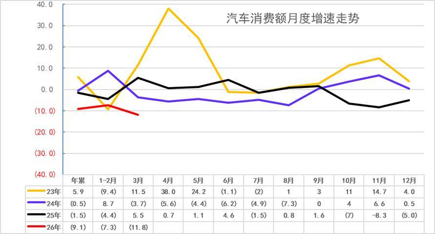

自从楼市2021年下跌以来，汽车消费从2020年的3.94万亿元上升到2024年的5.03万亿元，摆脱了2018-2020年连续3年徘徊在3.9万亿元的被动局面。由于房地产下跌利好消费，买房投资挤压消费问题改善，目前看消费不旺的问题稍有改善。

2026年1-3月份，汽车消费同比降9.1%,3月汽车消费同比降11.8%。2025年的高基数和政策收缩的销量放缓压力体现，基数连续拉高后，今年的回落较大。

2.2026年汽车产量起步偏低

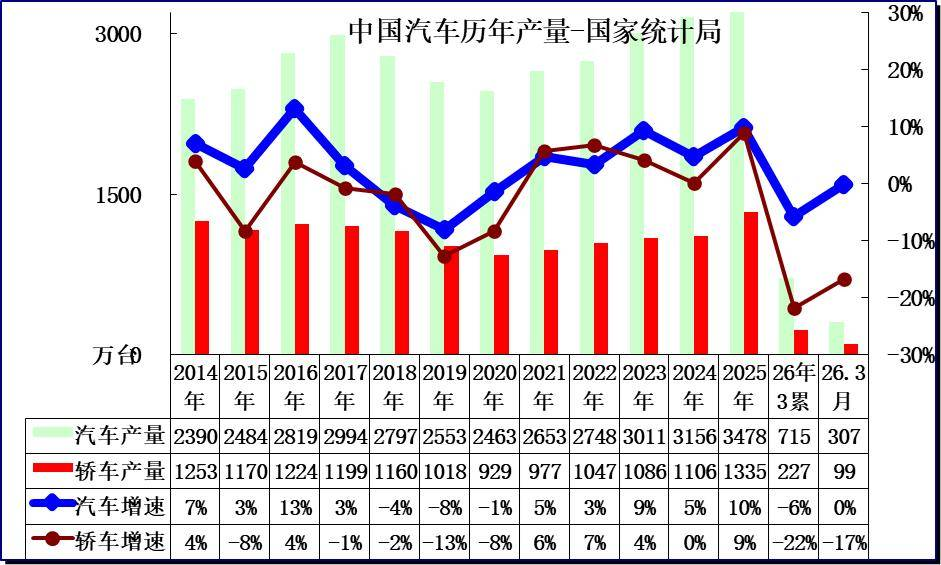

3月份，规模以上工业626种产品中有329种产品产量同比增长。其中，汽车306.7万辆，下降0.1%，其中新能源汽车133.6万辆，增长1.2%；发电量8025亿千瓦时，增长1.4%；原油加工量6167万吨，下降2.2%。

3.2026年汽车增加值表现较好

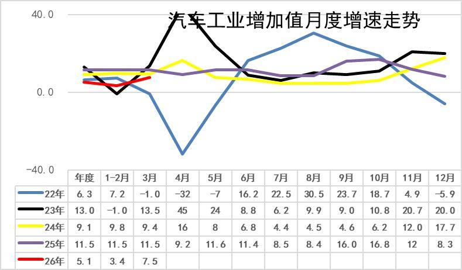

2020年汽车工业增加值增6.6%；2021年增速徘徊在5.5%的水平；2022年的汽车增加值6.3%，较强；2023年汽车业增加值增13%，实现超强增长；2024年的9.1%的汽车增加值相对提升较好；2025年的汽车工业增加值增11.5%。

2026年1-3月汽车工业增加值增5.1%，其中3月汽车工业增加值增7.5%，表现改善。

4.汽车产能利用率相对平稳

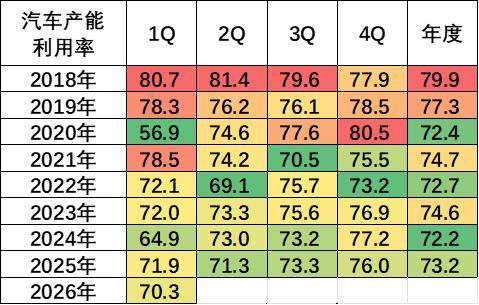

2020-2024年全国工业产能利用率保持在72.4—74.6的较小波动范围内。2024年四季度，全国规模以上工业产能利用率为76.2%，比上年同期上升0.3个百分点，比三季度上升1.1个百分点。2025年全国规模以上工业产能利用率为74.4%。分主要行业看，2025年汽车行业产能利用率73.2%，相对处于较低水平。

2026年1季度，汽车工业产能利用率为70.3%，比去年下降1.6个百分点。

5.汽车生产具体情况

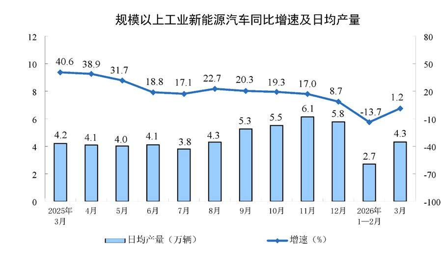

2026年3月份日均新能源汽车生产4.3万台，同比增1.2%。由于新能源轿车的去年基数较高，今年生产波动较大。2025年上半年的生产较好是小微型电动车，需求也是中低端的需求较强，因此销售额增速稍低于销量增速。今年补贴锐减的小微型冲击较大。

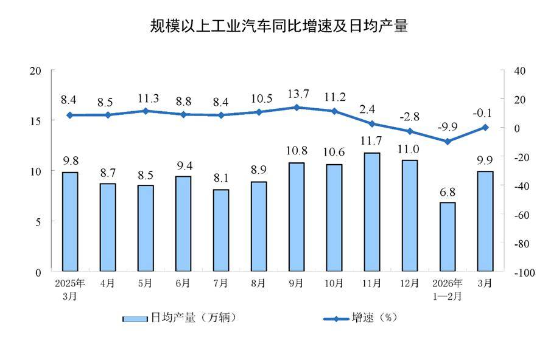

分产品看，2026年3月份，汽车日均9.9万辆，降0.1%，考虑到2025年1-3月基数抬高，2025年年末政策性需求收缩，今年1-3月增速的表现较弱。

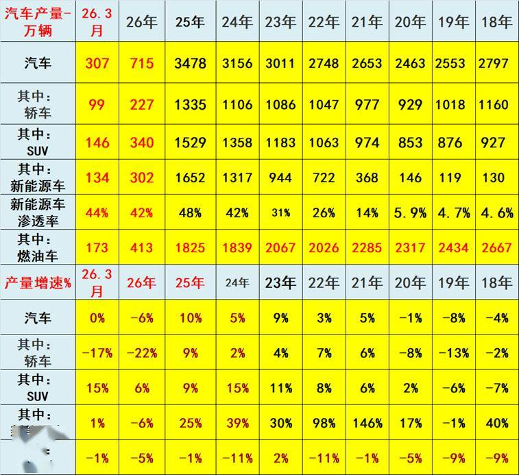

2022年汽车生产2748万台，产量同比增长3%；新能源汽车生产722万，增长98%，渗透率26%；燃油车生产2026万台，降11%。

2023年汽车生产3011万台，同比增9%；新能源汽车生产944万台，同比增30%，渗透率31%；燃油车生产2067万台，增2%。

2024年汽车生产3156万台，同比增长5%；新能源汽车生产1317万台，同比增39%，渗透率42%；燃油车生产1839万台，降11%。

2025年汽车生产3478万台，同比增10%；新能源汽车生产1652万台，同比增25%，渗透率48%；燃油车生产1825万台，同比降1%。

2026年1-3月汽车生产715万台，同比降6%；新能源汽车生产302万台，同比降6%，渗透率42%；燃油车生产413万台，同比降5%。

2026年3月汽车生产307万台，同比降0.1%；新能源汽车生产134万台，同比增1%，渗透率44%；燃油车生产173万台，同比降1%。

6.2026年汽车投资稳步增长

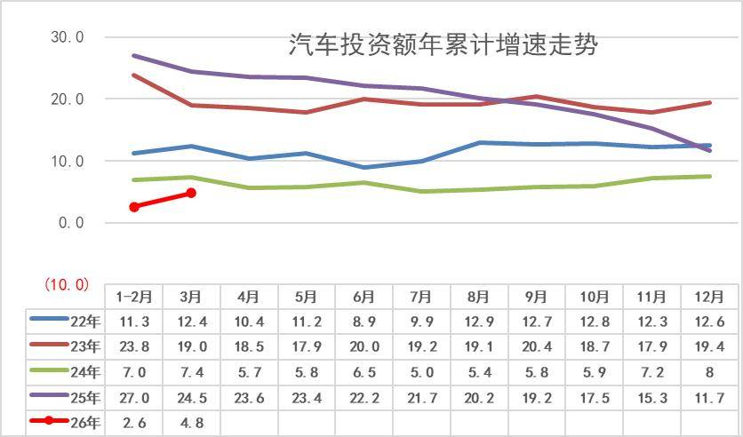

7.房价下跌的消费挤压问题改善

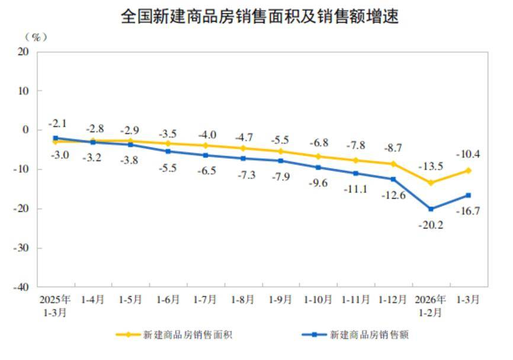

1—3月份，新建商品房销售面积19525万平方米，同比下降10.4%，降幅比1—2月份收窄3.1个百分点；其中住宅销售面积下降13.1%。新建商品房销售额17262亿元，下降16.7%，降幅收窄3.5个百分点；其中住宅销售额下降18.5%。

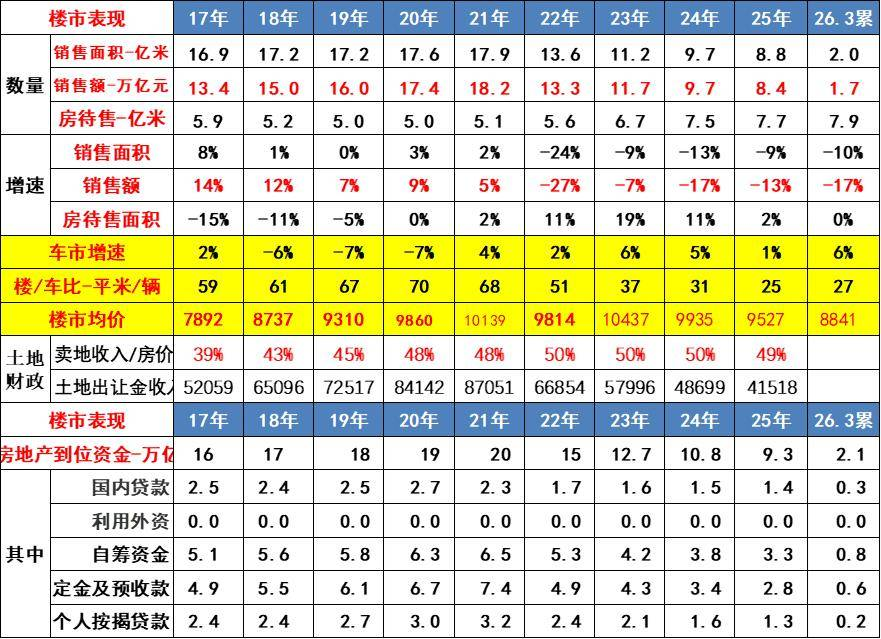

2021年土地出让金收入87051亿元，占房地产销售额48%；2023年土地出让金收入57996亿元，占房地产销售额50%；2024年土地出让金收入48699亿元，占卖房收入50%，房地产对地方财政贡献巨大。2025年卖地收入数据仍占房价49%。

目前，2026年1-3月汽车销量与房地产销量关系是27平米房/1辆车，销量的对比不合理现象有所改善。虽然房车比最高时的2020年70平米房/1辆车有所改善，但前期的债务压力和目前万元均价的楼市挤压消费压力仍大，导致车市需求因债务压力低迷。

楼市的财富效应对高端车需求有一定的促进效果，近期居民的楼市债务压力下降和购房需求减弱，对改善车市消费也带来一定潜在利好。

8.车市消费需要有持续政策支持

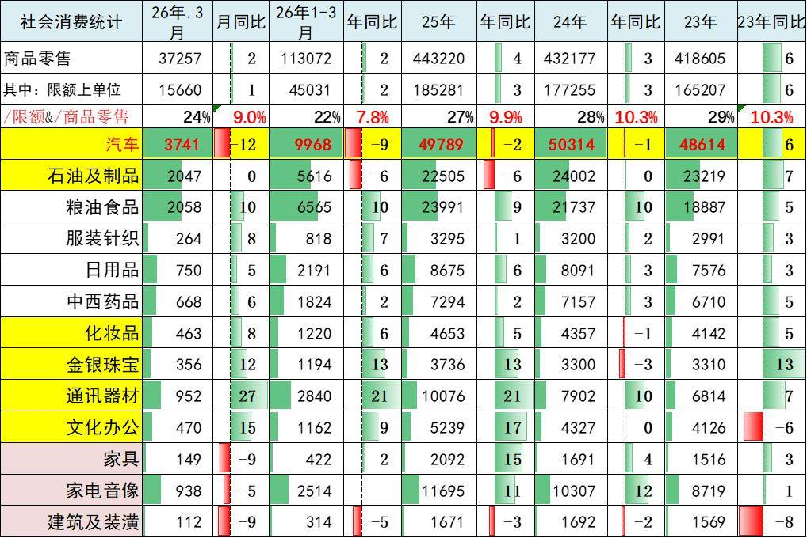

2026年1-3月车市消费降9%，目前看消费不旺的问题仍有待改善。

近几年的成品油消费相对负增长，随着价格暴涨，成品油消费额逐步回升，这也是汽车消费的拉动体现。在总体社会零售中，限额以上的商品零售表现较弱，这体现了房地产对消费影响较大，楼市对总体大宗消费的抑制效果明显。

附：近日信息合集
