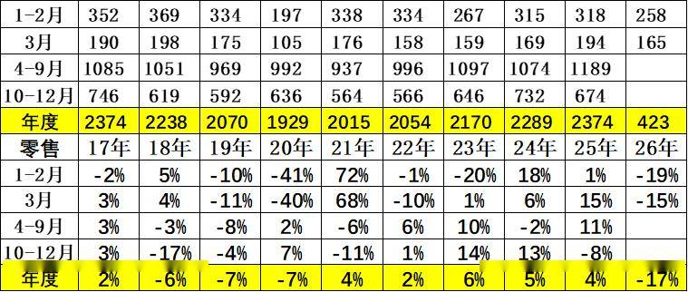
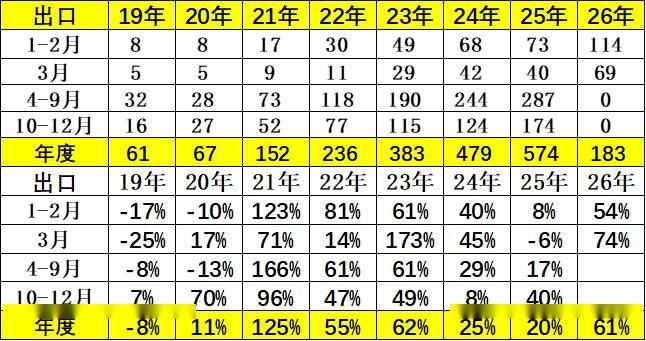
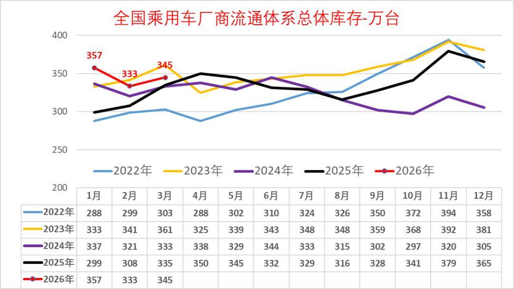
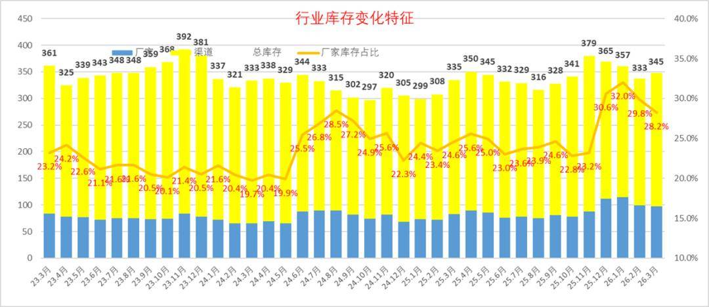
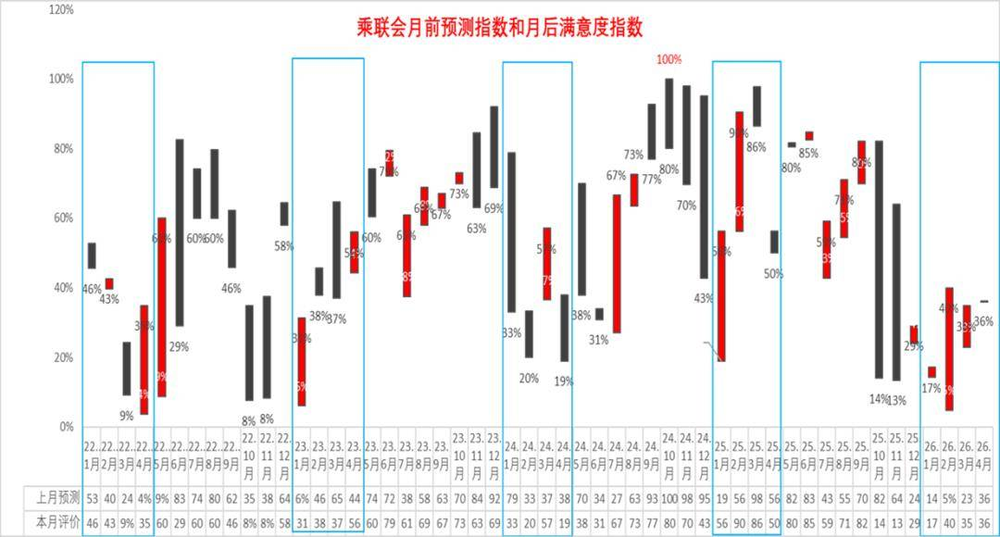
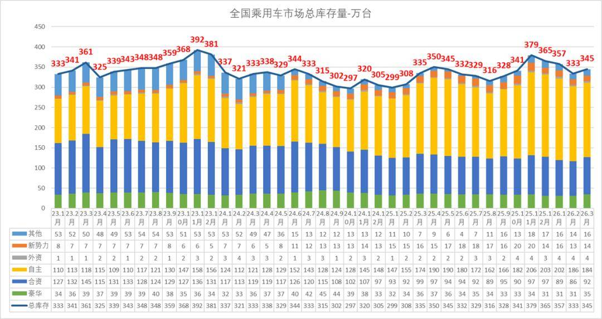
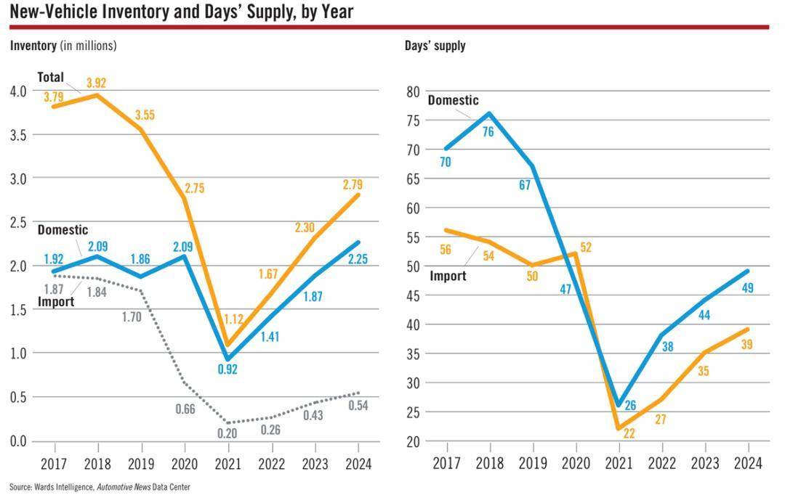
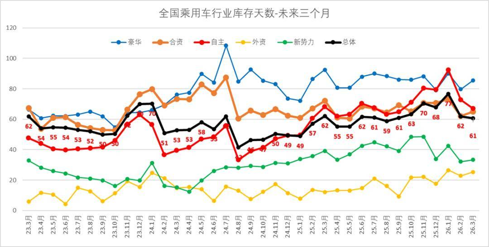
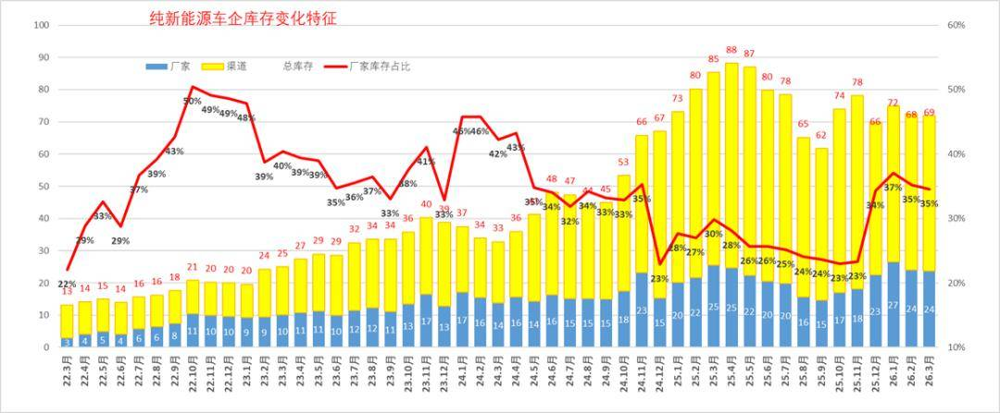

# 全国乘用车行业2026年3月末库存345万辆、库存61天、满意度35%

- 公開日時: 2026-04-17 18:22（北京時間）
- 出典: [搜狐号・崔东树](https://www.sohu.com/a/1010989157_115312)
- テーマ（自動判定）: 在庫
- 画像: 13枚

---

注：本分析文章仅代表崔东树个人观点，如有异议，请留言。

2026年3月月末全国乘用车行业库存345万辆，较上月增长12万辆，较2025年3月增10万辆，形成库存持续增长的趋势。2026年3月初的预期是23%的乐观度，但4月初的3月月后满意度为35%，预期低但满意度改善。团队对4月市场的乐观度回升到36%，这仍是近期市场乐观度判断的偏低水平，预期不断调低后仍未转为更乐观。

我们根据未来N+3的月度零售预测测算库存支撑未来天数，因此不是固定的当月数据，库存天数也会随预测调整而变化。根据2026年3月底的库存与未来销量综合预估的现有库存支撑未来销售天数在61天，相对于2023年3月的62天、2024年3月的53天，2025年3月的61天，今年3月的总体库存压力相对稍大。

从仅生产新能源车企业的库存变化特征分析看，随着反内卷的推动，行业库存2025年9月降到62万辆，2026年3月行业库存上升到69万辆，较2025年11月峰值库存降9万辆，但较2025年4月的88万台降19万辆。近期新能源经销商的厂家和渠道库存面临市场零售低于预期，行业库存总体压力较大。

1.近年狭义乘用车零售走势

3月全国乘用车市场零售165万辆，同比增长表现较弱。3月负增长原因是多元的，首先是春节后回暖慢因素的影响，其次是以旧换新的新政策规范性较强和补贴缩水，加之今年1季度是去库存特征，与历年的加库存反差较大，深层原因是消费能力和意愿偏低。

3月1-31日，全国乘用车市场零售164.8万辆，同比下降15%，环比增长59%。今年以来累计零售422.9万辆，同比下降17%。由于市场因素影响较复杂，近几年年度销量“前低后高”特征较明显，今年特殊的去库存特征明显，所以2026年的下降15%属于历年3月增速的偏低状态。

2.近年狭义乘用车生产走势

3月乘用车生产减产力度大，市场需求持续较弱，导致主动减产力度很大。3月乘用车生产236万辆，较1月大幅拉升，应属于上半年峰值。

3月乘用车生产236万辆，同比下降5%，环比增长72%。1-3月乘用车生产574万辆，同比下降9%，减产力度大。

3.近年狭义乘用车出口走势

根据乘联数据，3月乘用车出口（含整车与CKD）69.5万辆，同比增长74%，环比增长25%。

根据乘联数据，3月乘用车出口（含整车与CKD）69万辆，同比增长74%，由于外部环境机会较大，今年的增长是延续去年的强势增长。

4.全国乘用车行业库存跟踪

2026年3月月末全国乘用车行业库存345万辆，较上月增长12万辆，较2025年3月增10万辆，形成库存持续增长的趋势。2025年的以旧换新政策启动带来厂商的总体乐观，以旧换新推动的销量较高，厂家生产相对谨慎，形成5-8月持续去库存。由于去年10月以来市场严重低于预期，11月库存创近两年新高，但随后生产下调力度大，3月库存低于1月库存。

5.全国乘用车行业库存跟踪

2023年以来乘用车行业整体库存保持相对平稳状态，2024年10月回落在297万辆左右,2025年11月回升到379万辆，随后回落，2026年3月的库存下降到345万辆，其中厂家库存占比28.2%。

由于前期市场预期较好，厂商生产热情较高，总体行业库存压力相对不可控。目前厂家库存占比处于高位，市场严重低迷，厂家减产，但未来几个月销量消化库存压力仍不小。

6.全国乘用车市场预测指数与满意度指数

我们按照PMI指数的设定方式和评价结果评价月度市场表现。根据厂家内部人员的预测汇总测算，乘联分会预测团队2025年初以来对市场预测很乐观，逐步悲观，2026年3月初的预期是23%的乐观度，但4月初的3月月后满意度为35%，预期低但满意度改善。团队对4月市场的乐观度回升到36%，这仍是近期市场乐观度判断的偏低水平，预期不断调低后仍未转为更乐观。

从目前的345万辆的库存水平和预期的到未来几个月的市场增长的判断，行业库存消化压力仍较大。鉴于目前销量持续低于预期的现状，车企需及时跟踪政策环境与市场变化，谨慎设定产销节奏，根据经销商库存结构，谨慎增加库存，及时清理历史库存。

7.全国乘用车市场总体库存特征

随着新能源车的占比提升，燃油车销量下降，对应的库存占比也逐步减少。从库存周期看，从2023年4月的325万辆，随后回升到2023年11月392万辆，随后下行到2024年10月的297万辆的库存低位。

2025年-2026年仍属加库存周期，行业压力逐步加大。近期车市下滑较大，由于新能源车萎缩较严重，库存的压力也并未有效缓解。

8.美国乘用车行业库存对比

美国的库存目前是在40-50天，总体的库存压力不大，这也是中国车市参考的对象。

9.全国乘用车市场库存天数小幅回落

随着2025年市场回暖的如期到来，生产走势较强，前期的去库存的特征改变，反内卷带来行业库存控制，库存增长相对温和。2025年4季度，虽然有免税政策的到期促进，但走势实际低于预期，行业库存天数峰值回升到77天，随后生产减产力度大。因此根据2026年3月底的库存与未来销量综合预估的现有库存支撑未来销售天数在61天，相对于2023年3月的62天、2024年3月的53天，2025年3月的61天，今年3月的总体库存压力相对稍大。

10.全国新能源乘用车库存持续回落

从仅生产新能源车的企业的库存变化特征分析看，2023年年初库存20万辆，随后进入库存快速增长期， 2025年4月仅生产新能源车的企业的库存达到88万辆，这是近期的峰值。随着反内卷的推动，行业库存2025年9月降到62万辆，2026年3月行业库存上升到69万辆，较2025年11月峰值库存降9万辆，但较2025年4月的88万台降19万辆。近期新能源经销商的厂家和渠道库存面临市场零售低于预期，行业库存总体压力较大。

附：近日信息合集
