# 全国商用车国内保险特征—2026年3月

- 公開日時: 2026-04-18 16:16（北京時間）
- 出典: [搜狐号・崔东树](https://www.sohu.com/a/1011323762_115312)
- テーマ（自動判定）: 商用車
- 画像: 14枚

---

注：本分析文章仅代表崔东树个人观点，如有异议，请留言。

根据国家金融局交强险数据，国内商用车交强险数据2025年商用车强势增长。由于新能源车强势增长和报废更新政策促进车辆更新，2025年新能源商用车整体呈现快速拉升的良好局面。今年商用车1-2月32万台下滑20%，3月商用车国内销量实现35万台，同比增10%，环比增178%。2026年1-3月商用车国内销量实现66.8万台，同比下降7%，相对于2022年以来的商用车平稳期，2026年类似2024年的下滑7%，因此2026年全年总体增速不会太强。

2026年1-2月份新能源商用车达到7.8万台，同比增长3%；3月新能源商用车暴增到9.89万台，同比增42%，环比2月增247%。2026年1-3月新能源商用车交强险17.7万台，累计增速22%。

2026年1-3月份新能源渗透率达到27%，相对于去年1-3月的20%，提升7个百分点，表现相对较好。2026年3月商用车新能源渗透率28%， 较同期增长6个点，强于乘用车的增长。2026年仍是纯电动增长较强，插混与增程的表现改善较大。

2026年3月卡车新能源渗透率20%，卡车较同期小幅提升，其中重卡达到24%、轻卡达到22%，高油耗高税收的物流车型新能源渗透率提升较大。重卡电动化带来储能效果的体现，有效稳定了电网的用电负荷。客车新能源渗透率71%，大中客新能源暴跌，成为新能源车渗透的反面典型。

1、全国商用车市场交强险数据分析

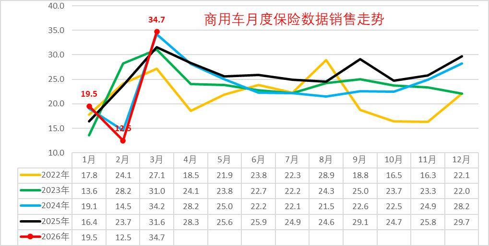

春节错位不利于商用车的1季度销量。2025年商用车车市呈现1月春节前置带来1月的较低销量，也导致2-3月的较强增长。2026年1月因春节晚带来的大幅走强，但也导致2月剧烈下滑的走势特征，1-2月下滑较大，3月商用车走势创近期新高，但也是类似2024年的走势。

前几年国内商用车市场呈现需求快速下降趋势，2025年开始出现新能源的拉动特征。从2020年的超高销量，到2021年的峰值回落，2022年处于低谷期，2023-2024年商用车国内保险实现285万台左右，同比几乎持平。2025年达到310万台，增速9%也是超强的。

今年商用车1-2月32万台下滑20%，3月商用车国内销量实现35万台，同比增10%，环比增178%。2026年1-3月商用车国内销量实现66.8万台，同比下降7%，相对于2022年以来的商用车平稳期，2026年类似2024年的下滑7%，因此2026年全年总体增速不会太强。

2、全国新能源商用车市场销量分析

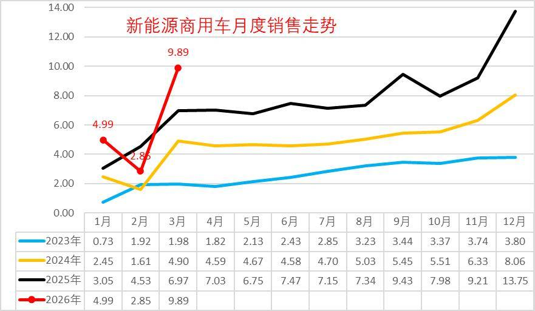

2025年新能源商用车整体呈现快速拉升的良好局面。3-12月持续高位，新能源增长较强。2026年1月的新能源销量迅速达到5万台的高位，但2月回落明显，3月走势较强。

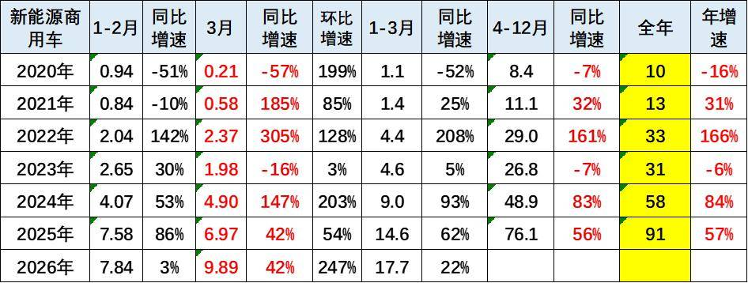

2024年新能源商用车销量57.9万台，同比增长84%；2025年新能源商用车累计达到91万台，同比增长57%。

2026年1-2月份新能源商用车达到7.8万台，同比增长3%；3月新能源商用车暴增到9.89万台，同比增42%，环比2月增247%。2026年1-3月新能源商用车交强险17.7万台，累计增速22%。

3、新能源商用车渗透率

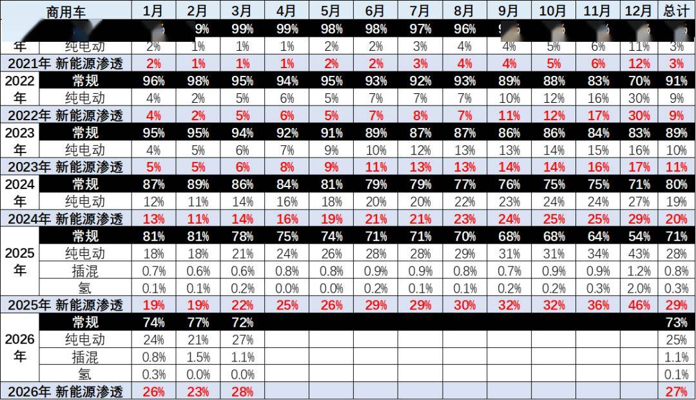

2025年新能源商用车渗透率达到29%的水平，相对于2024年实现了较好提升。2026年1-3月份新能源渗透率达到27%，相对于去年1-3月的20%，提升7个百分点，表现相对较好。

2026年3月商用车新能源渗透率28%，较同期增长6个点，强于乘用车的增长。2026年仍是纯电动增长较强，插混的表现改善较大。

4、商用车市场变化分析

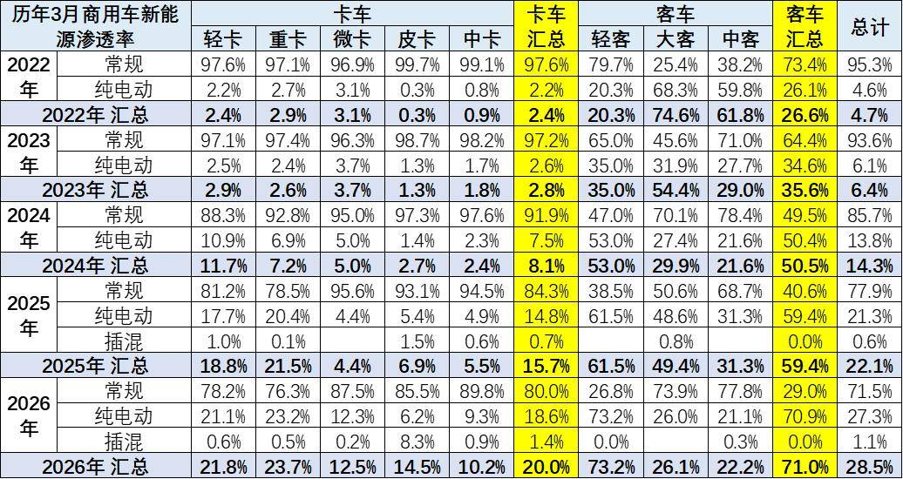

商用车的卡车和客车结构相对稳定。卡车中的重卡和轻卡表现较好，报废更新政策的拉动效果强力体现，中重卡在补贴拉动下近两年年走势改善，但2026年3月走势表现不强。

客车中的轻客走势较强，电动化带来轻客替代微客成为市场主力。大中型客车2026年初表现较弱，燃油大中型客车走势较稳，新能源大中型客车表现一般。

2026年3月卡车新能源渗透率20%，卡车较同期小幅提升；客车新能源渗透率71%，大中客暴跌。其中重卡达到24%、轻卡达到22%，高油耗高税收的物流车型新能源渗透率提升较大。

5、商用车竞争结构变化分析

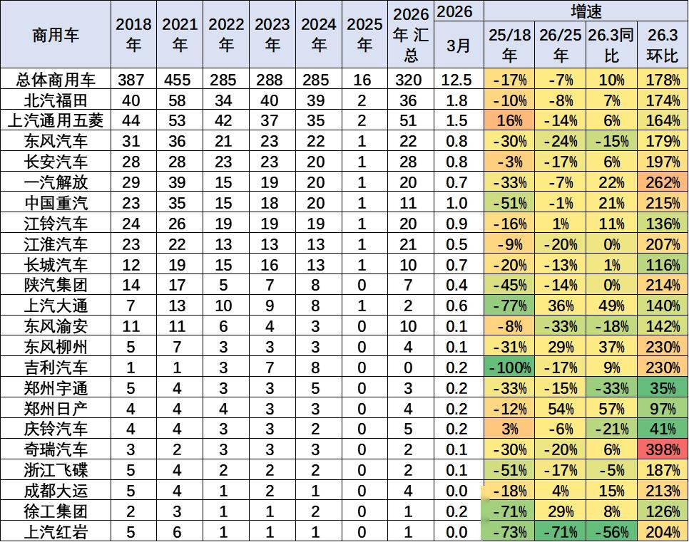

商用车企业主要是轻卡和重卡企业支撑销量，福田和五菱、重汽是商用车的主力，分别在轻卡、重卡和客车市场销量较强。今年郑州日产、上汽大通表现较强。

6、中重型卡车区域市场结构

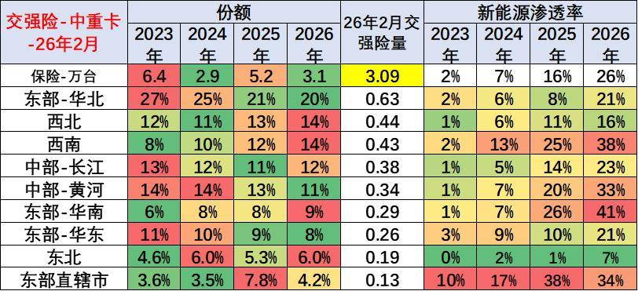

总体中重型卡车在华北、西北等地区市场份额较高，近两年的华南、西南持续走强。

今年新能源重卡在华南、西南地区等渗透率表现较好，其中华南的渗透率提升较快。

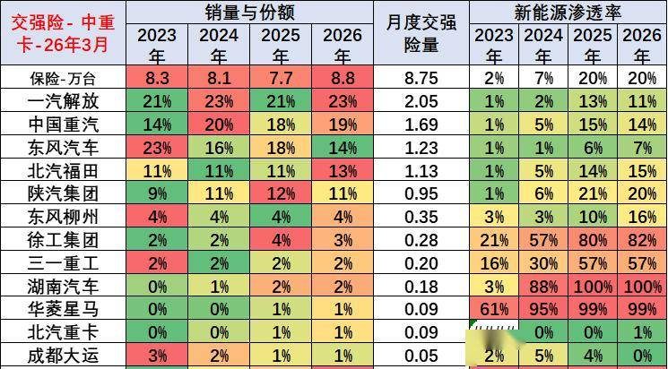

国内市场中重卡市场表现最为优秀的应该是一汽解放、中国重汽、东风汽车、福田等企业。重卡总体表现相对较强，补贴因素导致重卡电动化大幅提升。徐工、三一重工等部分重卡二线车企电动车渗透率提升。重卡去年出口力度很强，今年国内新能源较多，今年燃油车相对较低。

7、轻型卡车区域市场结构

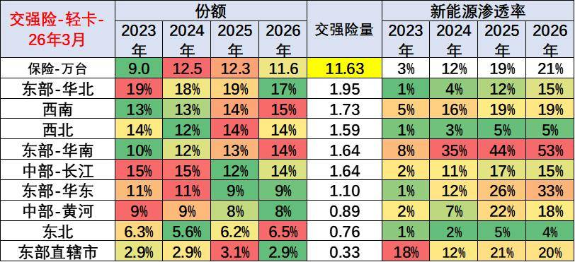

轻卡市场主要是在西南、华北等地区份额较高，近期华南地区的轻卡表现逐步走强。

新能源轻卡主要的市场还是在东部—华南市场和华东市场表现相对较强，而京津沪的直辖市市场总体来看今年增长不快。

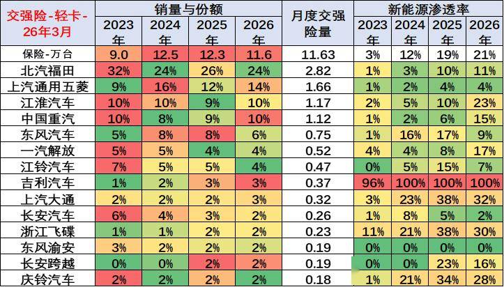

国内轻卡的主力厂家仍然是北汽福田、上汽通用五菱、江淮汽车、中国重汽以及东风汽车等企业，尤其是近期五菱这些小微卡逐步上升到小轻卡的市场表现相对优秀。

新能源轻卡的主力企业是吉利汽车等，尤其是江淮汽车近两年在新能源轻卡表现相对优秀。

8、轻型客车区域市场结构

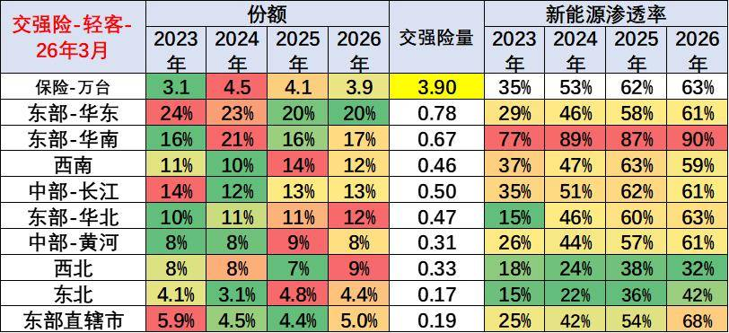

国内轻客市场的销售区域主要是经济相对发达的华东和华南地区，今年的中部长江地区份额也较高。

新能源轻客主要是发达地区的需求较大，华南地区新能源表现较强。受路权政策约束，京津沪等城市地区的燃油轻客销量出现萎缩。

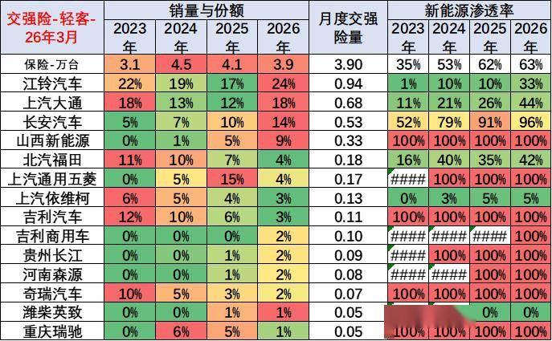

轻客的主力厂家主要是江铃汽车、上汽大通、长安汽车、吉利商用车、上汽通用五菱等企业，其中新兴势力的吉利商用车等的新能源轻客表现较强。近期长安的电动轻客很有竞争力。

9、大中型客车区域市场结构

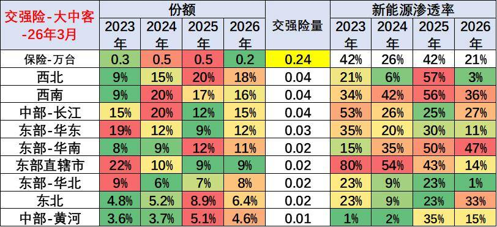

大中客市场近期表现不强，区域间的市场需求波动较大。政策性补贴和市场推动，形成大中客的新能源政策推动和燃油车的市场需求的差异化。

新能源大中客市场渗透率较高的主要是南方地区，其它地区看政策补贴，今年的东北的公交电动化份额提升较大。

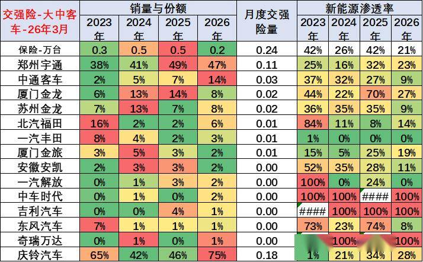

大中客的主要厂家还是宇通、中通、厦门金龙等企业表现相对优秀，尤其是宇通的传统燃油车表现较强。3月的中通客车等企业表现相对也是很强的。

新能源大中客渗透率高的企业主要是二线企业，主力企业都是燃油车的新能源全面发展的，且主力企业的燃油车市场不错。

附：近日信息合集
