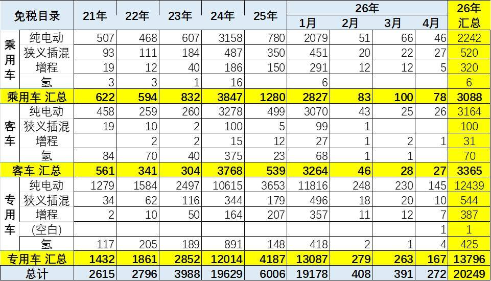
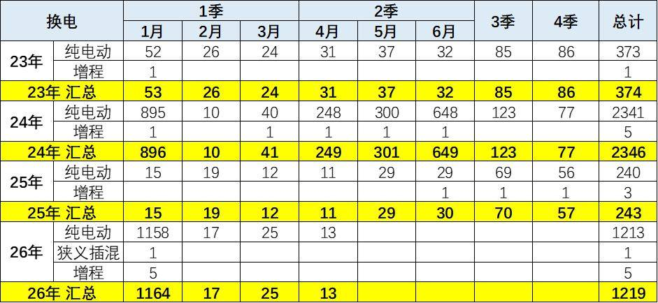
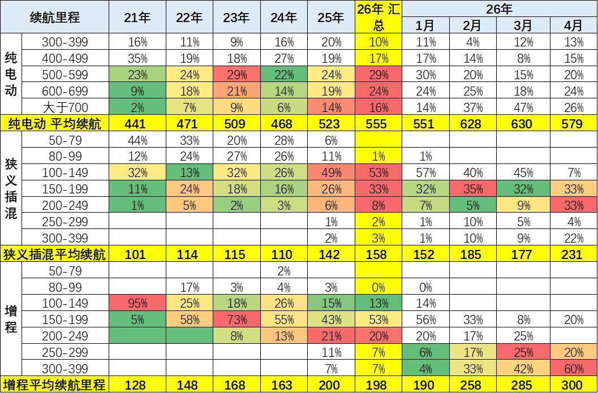
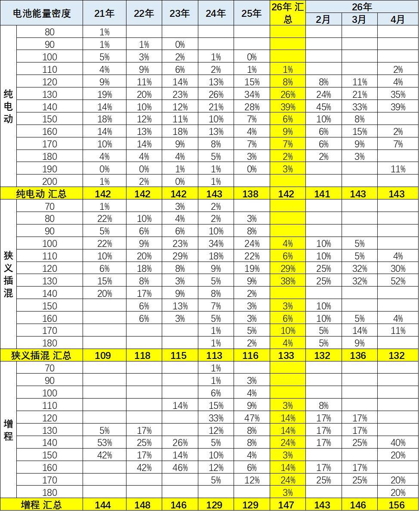
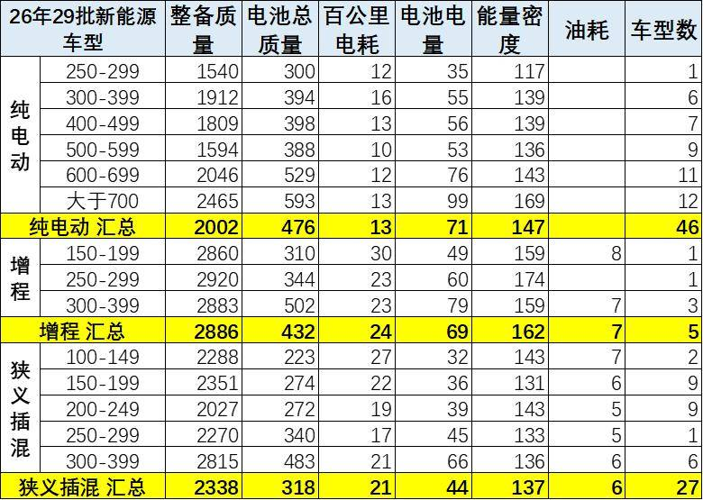
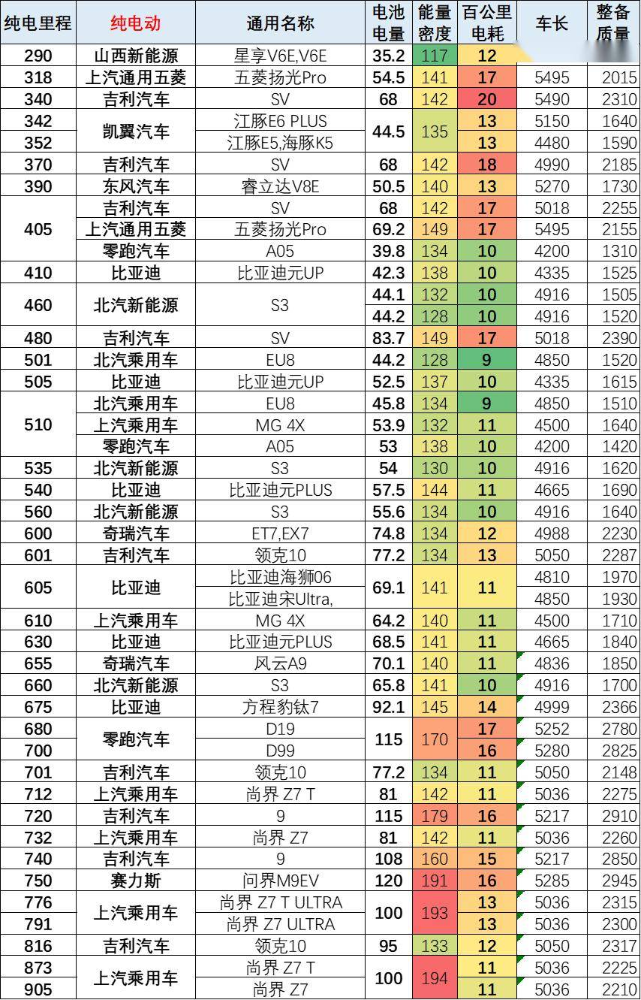
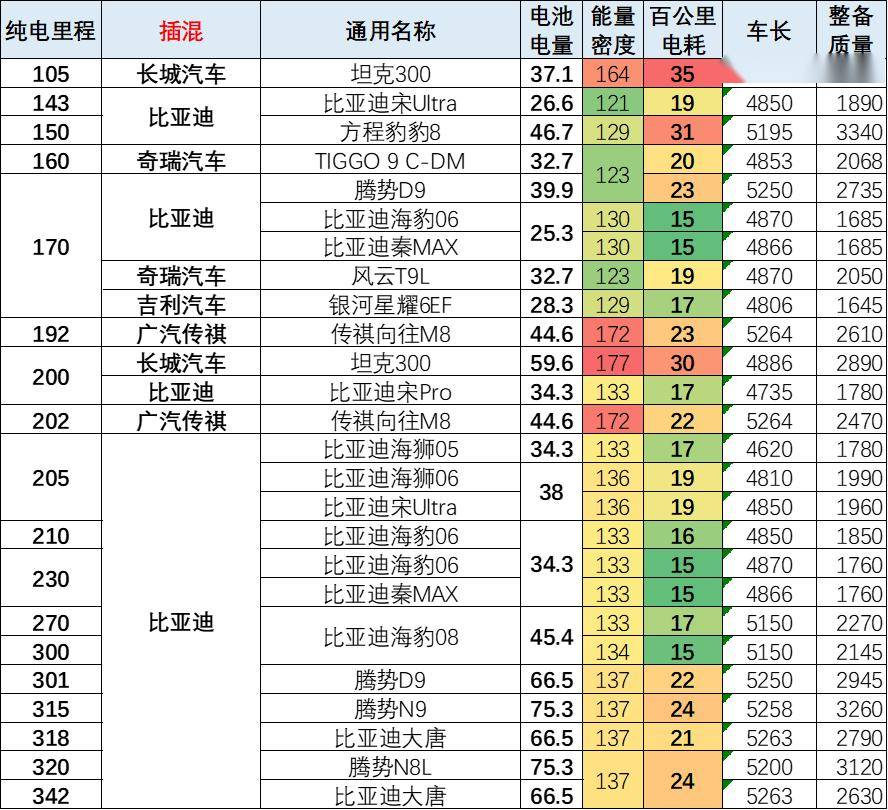

# 4月新能源新品与技术线路跟踪

- 公開日時: 2026-04-21 09:18（北京時間）
- 出典: [搜狐号・崔东树](https://www.sohu.com/a/1012292065_115312)
- テーマ（自動判定）: NEV新製品・技術
- 画像: 7枚

---

工信部网站持续公布减免车辆购置税的新能源汽车车型29批目录。2026年4月有272款新车型，相对历年同期处于低位，但2-4月的目录资源相对2025年更丰富。

纯电动乘用车新品的续航里程提升快，从2024年的468公里、2025年的平均523公里，提升到2026年4月平均达到平均579公里。2026年高于700公里的续航里程的产品数量持续提升，技术提升明显。狭义插混新品的续航爆发增长，从2024年的110公里、2025年的平均142公里，提升到2026年4月的平均231公里。增程式新品的续航爆发增长，从2024年的163公里、2025年的平均200公里，提升到2026年4月的平均300公里。

近几年纯电动车电池的能量密度提升缓慢，2025年平均为138瓦时每千克、2026年平均为142瓦时每千克、4月达到平均143瓦时每千克。140瓦-150瓦时左右的车型推出增多。插混的低能量密度的产品较多，2025年平均为116瓦时每千克、2026年平均为133瓦时每千克、4月达到平均132瓦时每千克。100-120瓦时每千克区间的产品较多。高能量密度的也有一些，中间产品较少。增程和插混的产品差异化发展，2025年平均为129瓦时每千克、2026年平均为147瓦时每千克、4月达到平均156瓦时每千克。增程的高能量密度的电池装车较多，增程的高能量密度的较多。

目前4月新品的纯电动车型的电耗基本是在13度左右，插混和增程的电耗较高，狭义插混车型平均百公里耗电21度，增程车型平均百公里耗电24度。

1、2026年免税目录总体情况

2026年1-4月新能源车免税目录共有20249款，其中4月有272款新车型，相对历年同期处于低位，2-4月的目录资源相对2025年更丰富。

近几年的新能源车目录逐步丰富。2024-2026年的新能源乘用车的目录应该说是总体数量较多的。随着免车购税指标的发布，今年的新能源车的高端新车产品仍是蓬勃发展。

2、新车动力结构变化

由于超高的氢燃料的补贴因素，前期的氢能源商用车的表现超强，近期氢能国内外均走弱。近期乘用车氢燃料可以忽略不关心，短期没有发展空间。

虽然插混增程的市场表现较弱，但2026年增程近期爆发增长，插混也较多。客车纯电动保持绝对主力，增程开始探索。

专用车中的纯电动是绝对主力，而氢燃料成为热点。2026年2月以来没有乘用车的氢燃料产品，这也是符合市场需求的很好的事情。

3、换电车型跟踪

目前的换电车型数量较多，2026年换电稍有增多，主要是纯电动的。其中乘用车换电车型稍有放缓，而纯电动专用车的换电车型增长较快。

4、2026年纯电动乘用车续航里程

新能源车的续航里程总体持续增长，从2021年的441公里到2026年的平均555公里，增长较快。2026年纯电动乘用车500-599公里的推出较多，399公里以下的车型推出大幅减少。

纯电动乘用车新品的续航里程提升快，从2024年的468公里、2025年的平均523公里，提升到2026年4月平均达到平均579公里。2026年高于700公里的续航里程的产品数量持续提升，技术提升明显。

狭义插混新品的续航爆发增长，从2024年的110公里、2025年的平均142公里，提升到2026年4月的平均231公里。

增程式新品的续航爆发增长，从2024年的163公里、2025年的平均200公里，提升到2026年4月的平均300公里。

5、电池的能量密度

近几年纯电动车电池的能量密度提升缓慢，2025年平均为138瓦时每千克、2026年平均为142瓦时每千克、4月达到平均143瓦时每千克。140瓦-150瓦时左右的车型推出增多。

插混的低能量密度的产品较多，2025年平均为116瓦时每千克、2026年平均为133瓦时每千克、4月达到平均132瓦时每千克。100-120瓦时每千克区间的产品较多。高能量密度的也有一些，中间产品较少。

增程和插混的产品差异化发展，2025年平均为129瓦时每千克、2026年平均为147瓦时每千克、4月达到平均156瓦时每千克。增程的高能量密度的电池装车较多，增程的高能量密度的较多。

6、2026年各类车型的综合对比

300公里以上的纯电动车型的电耗基本是在13度左右，长续航的耗电增加不明显。续航400公里以上的电池能量密度也在140以上水平。

目前4月新品的纯电动车型的电耗基本是在13度左右，插混和增程的电耗较高，狭义插混车型平均百公里耗电21度，增程车型平均百公里耗电24度。

7、纯电动乘用车分析

自主的新品较多，大部分是4.8米以上产品，5米以上车型占比高，高端产品竞争力较强。华为问界等的产品指标较好。吉利、北汽的电耗超低，实用性的优势明显。

8、插混新车跟踪

长城、奇瑞、吉利等自主品牌的插混表现很好。吉利等部分车型的插混电耗也降到16度左右，表现很好。吉利部分油耗较高的车型实际是甲醇车型，甲醇没有汽油的消费税收，因此甲醇很便宜，油耗高一些影响不大。

增程产品推出很丰富，长续航的增程车型油耗和电耗均较低，也是未来的增长亮点。但近期的增程市场走势较差，新品期待能激活这个市场。

附：近日信息合集
