# 车市扫描-2026年14期（4月13 -19日）

- 公開日時: 2026-04-22 16:46（北京時間）
- 出典: [搜狐号・崔东树](https://www.sohu.com/a/1013043385_115312)
- テーマ（自動判定）: 車市スキャン（週次）
- 画像: 17枚

---

主要信息源自乘联分会每日新闻等

中国汽车流通协会

乘用车市场信息联席分会（乘联分会）

网站：http://www.cpcaauto.com

一、本周车市概述1.2026年4月全国乘用车市场零售低位徘徊

【2026年4月1-19日乘联会市场分析要闻】

4月1-19日全国乘用车厂家批发75.6万辆，同比去年同期下降19%，较上月同期下降16%；今年以来累计批发662.2万辆，同比去年同期下降8%。4月1-19日市场零售62.7万辆，同比去年同期下降26%，较上月同期下降18%；今年以来累计零售484.8万辆，同比去年同期下降19%。

4月1-19日全国乘用车厂家新能源批发41.3万辆，同比去年同期下降17%，较上月同期下降9%；今年以来累计批发314.1万辆，同比去年同期下降6%。4月1-19日新能源车市场零售38.7万辆，同比去年同期下降14%，较上月同期下降5%；今年以来累计零售229.5万辆，同比去年同期下降20%。

2026年4月1-19日全国新能源市场零售渗透率61.7%；新能源厂家批发渗透率54.7%。

4月第1-2周全国纯燃料轻型车生产26万辆，同比去年同期下降31%，较上月同期下降23%。4月第1-2周混合动力与插混总体生产12.2万辆，同比去年同期下降18%，较上月同期下降1%。

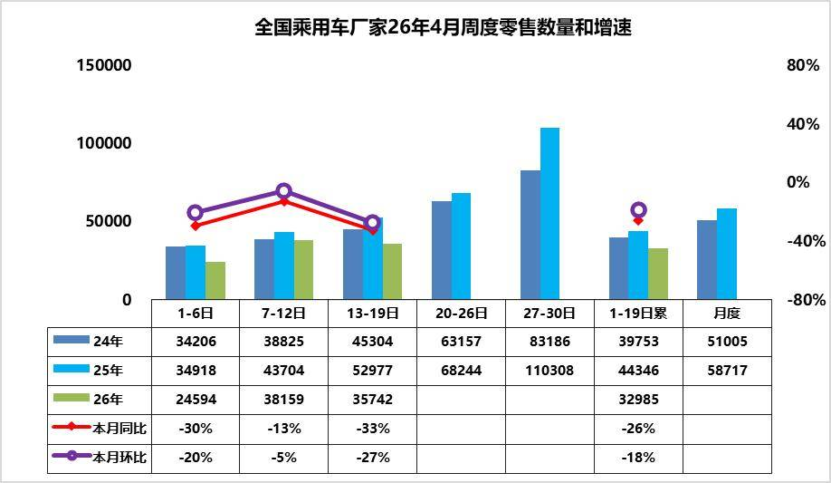

4月第1周乘用车市场日均零售2.5万辆，同比去年同期下降30%，较上月同期下降20%。

4月第2周乘用车市场日均零售3.8万辆，同比去年同期下降13%，较上月同期下降5%。

4月第3周乘用车市场日均零售3.6万辆，同比去年同期下降33%，较上月同期下降27%。

4月1-19日市场零售62.7万辆，同比去年同期下降26%，较上月同期下降18%；今年以来累计零售484.8万辆，同比去同期年下降19%。

4月第一周受清明假期因素影响，实际有效销售及上牌时间较短，季度末成交冲刺后、4月初成交节奏放缓，直接导致环比3月同期零售量偏低，市场整体表现较为清淡。随着高油价的冲击逐步适应，车市销售会逐步回暖。

同时，国际油价持续高涨推高用车成本，车市终端热度有一定幅度的下降，燃油车与新能源分化较三月进一步加剧。随着成本上涨，消费压力加大，燃油车的零售量进一步放缓，新能源车好于燃油车表现，但目前尚未弥补燃油车丢量损失。

当前车市消费开口难打开，连续两个季度同比下滑，经销商卖车不盈利、不卖更亏，厂家难以补贴，造成恶性循环，渠道问题已经成为当下流通领域最大的问题，需要重点关注和支持。

2.2026年4月全国乘用车厂家销量低位平稳

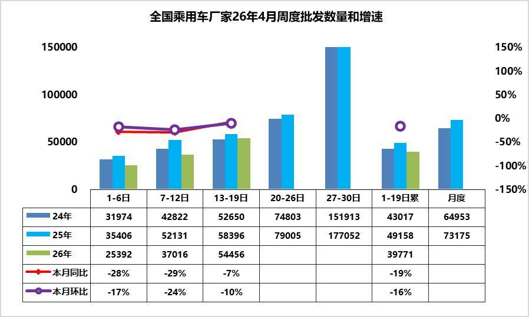

4月第1周批发日均2.5万台，同比去年4月同期下降28%，环比上月同期下降17%。

4月第2周批发日均3.7万台，同比去年4月同期下降29%，环比上月同期下降24%。

4月第3周批发日均5.4万台，同比去年4月同期增7%，环比上月同期下降10%。

4月1-19日全国乘用车厂家批发75.6万辆，同比去年同期下降19%，较上月同期下降16%；今年以来累计批发662.2万辆，同比去年同期下降8%。

近期车市相对平淡，真正新车不多、价格稳、促销稳，消费者的观望心态仍较强。随着1季度末的冲刺完成，经销商的库存相对较高，4月初的进货节奏较慢。其中新能源批发同比降幅大于整体车市，反映出厂家针对终端需求低迷现状，主动收缩生产与供货节奏，避免库存进一步积压。

产品、技术加速迭代，3月以来虽然新车不多，但行业共召开80余场新车新技术发布会，希望北京车展前提前获取热度和订单，但造成客户对新车的观望。4月下旬北京车展新车集中上市，且近期终端价格稳定，进一步加重消费者观望情绪。当前批发走弱，既是对终端零售低迷的被动适配调整，也是车企主动控制产销节奏、缓解渠道压力的理性选择。今年以来出口市场持续较强，形成出口拉动批发的走势特征。总体来看，批发端与零售端同步下滑，市场供需两端均开局不强。随着后续终端需求逐步回暖、库存压力缓解，厂家批发有望在下旬恢复性回升，批零增速差将逐步收敛。

3.2026年1-3月汽车投资增4.8%，生产降6%，汽车消费降9%，新能源汽车降6%渗透率42%

2026年国家实施更加积极有为的宏观政策，加大逆周期和跨周期调节，持续扩大内需、优化供给，总体市场需求稳中有升，实现良好开局。

2026年3月汽车生产307万台，同比降0.1%；新能源汽车生产134万台，同比增1%，渗透率44%；燃油车生产173万台，同比降1%。2026年1-3月汽车生产715万台，同比降6%；新能源汽车生产302万台，同比降6%，渗透率42%；燃油车生产413万台，同比降5%。2026年1-3月汽车工业增加值增5.1%，其中3月汽车工业增加值增7.5%，表现改善。

2026年1—3月份，汽车行业固定资产投资同比增长4.8%，高于1.7%的各行业平均水平。

当前，外部环境更趋复杂严峻，海湾局势复杂、保护主义加剧，冲击产业链供应链稳定；国内经济回升向好基础还不稳固，有效需求不足、市场缺乏活力等问题挑战仍然存在，行业稳增长任务依然艰巨。

由于2026年以旧换新的乘用车补贴力度远低于商用车，因此商用车补贴推动零售增长特别好，乘用车下滑。目前乘用车消费压力很大，期待未来能有长效的强力接续政策，减免购车人员个税、推动新能源车下乡、优化C7经济型电动车驾照申领、给200公里以下续航的合规纯电动车车购税更大优惠、鼓励结婚和生育购车等更多的改善措施，拉动购车消费促进经济增长。

4.全国乘用车行业2026年3月末库存345万辆、库存61天、满意度35%

2026年3月月末全国乘用车行业库存345万辆，较上月增长12万辆，较2025年3月增10万辆，形成库存持续增长的趋势。2026年3月初的预期是23%的乐观度，但4月初的3月月后满意度为35%，预期低但满意度改善。团队对4月市场的乐观度回升到36%，这仍是近期市场乐观度判断的偏低水瓶，预期不断调低后仍未转为更乐观。

我们根据未来N+3的月度零售预测测算库存支撑未来天数，因此不是固定的当月数据，库存天数也会随预测调整而变化。根据2026年3月底的库存与未来销量综合预估的现有库存支撑未来销售天数在61天，相对于2023年3月的62天、2024年3月的53天，2025年3月的61天，今年3月的总体库存压力相对稍大。

从仅生产新能源车企业的库存变化特征分析看，随着反内卷的推动，行业库存2025年9月降到62万辆，2026年3月行业库存上升到69万辆，较2025年11月峰值库存降9万辆，但较2025年4月的88万台降19万辆。近期新能源经销商的厂家和渠道库存面临市场零售低于预期，行业库存总体压力较大。

5.3月商用车国内保险实现35万台，同比增10%，环比增178%

根据国家金融局交强险数据，国内商用车交强险数据的2025年商用车强势增长。由于新能源车强势增长和报废更新政策促进车辆更新，2025年新能源商用车整体呈现快速拉升的良好局面。今年商用车1-2月32万下滑20%，3月商用车国内保险实现35万台，同比增10%，环比增178%。2026年1-3月商用车国内销量实现66.8万台，同比下降7%，相对于2022年以来的商用车平稳期，2026年类似2024年的下滑7%，因此2026年全年总体增速不会太强。

2026年1-2月份新能源商用车达到7.8万台，同比增长3%。3月新能源商用车暴增到9.89万台，同比增42%。环比2月增247%。2026年1-3月新能源商用车交强险17.7万台，累计增速22%。

2026年1-3月份新能源渗透率达到27%，相对于去年1-3月的20%，提升7个百分点，表现相对较好。2026年3月商用车新能源渗透率28%， 较同期增长6个点，强于乘用车的增长。2026年仍是纯电动增长较强，插混与增程的表现改善较大。

2026年3月的卡车新能源渗透率20%，卡车较同期小幅提升，其中重卡达到24%、轻卡达到22%，高油耗高税收的物流车型新能源渗透率提升较大。重卡电动化带来储能效果的体现，有效稳定了电网的用电负荷。客车新能源渗透率71%，大中客新能源暴跌到21%，成为新能源车渗透的反面典型。

6.2025年的燃油与新能源双积分效果良好

按照《乘用车企业平均燃料消耗量与新能源汽车积分并行管理办法》要求，工信部将企业递交的2025年乘用车企业平均燃料消耗量与新能源汽车积分执行情况年度报告进行公示。

2025年，根据双积分政策统计的国内乘用车产量达到2452万台，其中国产车产量2405万台，进口车47万台，国产车同比增长在7%，进口车竞争力下降，总体乘用车国内供给量达到2452万台增长6%。

2025年新能源乘用车内销产量1387万台，同比增长17%，其中国产车1377万台，增长17%，进口新能源车10万台，下降19%，体现了中国新能源车的自主强势增长。2025年国产乘用车油耗积分达到4516万分，进口车-93万分，国产车环比稍有下降，总体4424万分，2025年较2024年下降287万分。而2025年国产新能源车积分2002万分，进口车-13万分，国产车环比大增，总体1990万分，2025年较2024年增长390万分，新能源积分保持高位。

新能源车与燃油车协同发展是合理选择。燃油车从强势群体到弱势群体，迅速转变，因此新局面下对燃油车的保护与支持亟待考虑了，需要加大新购群体购买燃油车的支持，确保我们出口与国内外双循环的燃油与新能源车优势持续发展。

二、本周上市新车1.奇瑞风云T9L上市12.99万-18.69万元

4月13日，奇瑞风云T9L上市，新车共推5款，售价区间为12.99万-18.69万元。新车采用狭长点墨大灯、贯穿式OLED尾灯。采用15.6英寸中控屏、17.3英寸二排吸顶屏。配备激光雷达+地平线征程6P、双零重力座椅、23扬声器等。搭载1.5T插混系统，CLTC纯电续航135km，230km，200km。搭载猎鹰智能辅助驾驶系统。

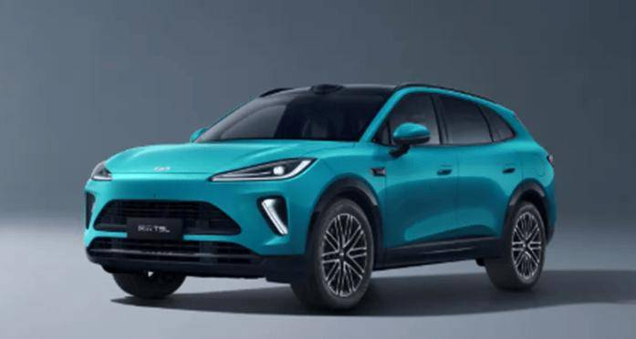

2.捷途大圣青春版豪华+版上市限时抢购价7.99万元

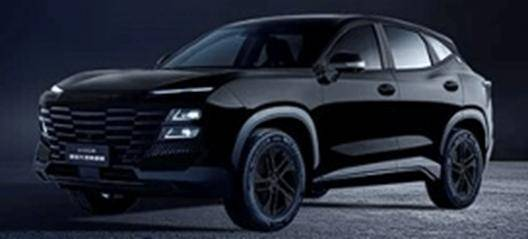

3.比亚迪领汇e7上市售价9.58-11.58万元

4月15日，领汇e7正式上市，售价9.58-11.58万元。定位纯电动中型轿车，闪充版车型搭载比亚迪第二代刀片电池及闪充技术，10%-97%充电时间低至9分钟。

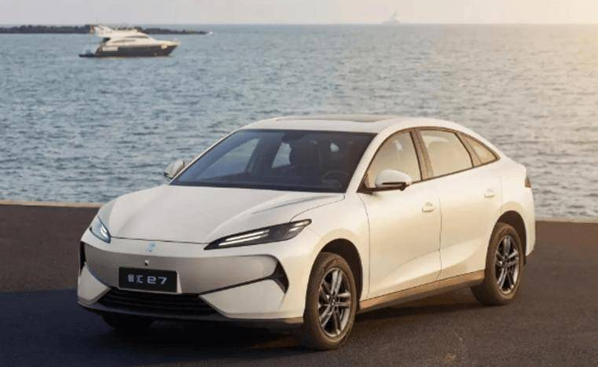

4.零跑D19上市21.98万-26.98万元

4月16日，零跑D19上市，新车共推7款，售价区间为21.98万-26.98万元。新车采用三段式贯穿日行灯、百万像素DLP投影大灯、ISD智慧交互灯幕。采用17.3英寸中控屏、21.4英寸3K电动娱乐屏、天鹅绒顶棚+头层小牛皮软包。配备双高通8797芯片、车规级氧舱、双层玻璃车窗、23扬声器等。1.5T增程车型CLTC续航里程分别为400km，500km；纯电车型采用1000V平台，CLTC续航里程分别为620km，720km，680km。

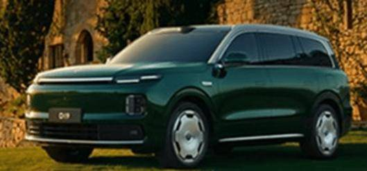

5.大众安徽与众08上市22.99万-28.99万元

4月16日，大众安徽与众08上市，新车共推3款，售价区间为22.99万-28.99万元。新车采用金色大众徽标、隐藏式矩阵大灯。采用双14.96英寸2.4K双联屏、智能调光天幕。配备双图灵AI芯片、高通骁龙8295P芯片、智谱AI与文心大模型、20扬声器等。配备空悬+DCC，CLTC续航630km，730km，700km。

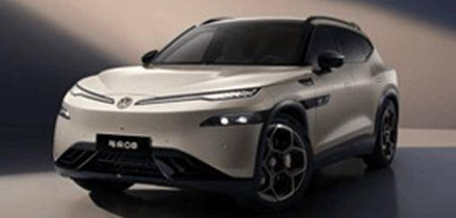

6.智己LS8上市权益价24.98万-29.98万元

4月16日，智己LS8上市，新车共推4款，售价26.18万-31.18万元，上市权益价24.98万-29.98万元。新车采用贯穿式星环灯带、贯穿式灯语尾灯。采用27.1英寸5K MiniLED中控屏、15.6英寸3K副驾屏、21.5英寸4K吸顶屏。配备25扬声器B&O音响、IM Ultra Agent、520线激光雷达、智控地暖等。配备灵蜥数字底盘3.0，搭载1.5T增程系统，CLTC纯电续航355km，430km。

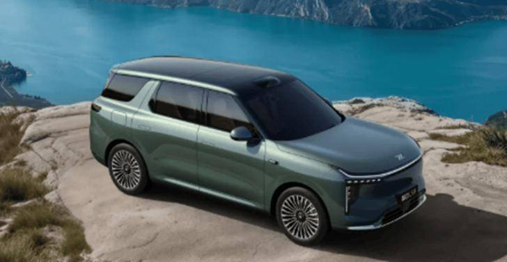

7.新款捷途X70 PLUS冠军版上市限时优惠价9.49万-11.09万

4月16日，新款捷途X70 PLUS冠军版上市，新车共推3款，售价区间为11.29万-12.89万元，限时优惠价9.49万-11.09万。外观和现款车型基本保持一致。采用双12.3英寸连屏、水晶挡把。搭载鲲鹏动力1.5TGDI发动机与6DCT变速箱的动力组合。

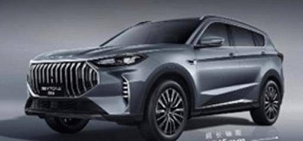

8.极氪8X正式上市官方指导价37.68-51.68万元

4月17日，极氪全新旗舰SUV极氪8X正式上市，官方指导价37.68-51.68万元。新车定位中大型豪华SUV，配备浩瀚-S超级电混架构、全栈900V高压架构、浩瀚AI数字底盘，支持6C超快充，20%-80%仅需9分钟。配备双8295芯片、超级Eva、千里浩瀚G-ASD 4.0等。

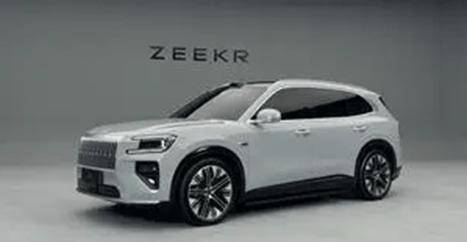

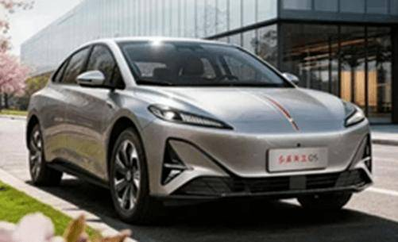

10.星途EX7上市抢先置换价19.49万-25.89万元

4月19日，星途EX7上市，新车共推6款，售价区间为19.99万-26.39万元，抢先置换价19.49万-25.89万元。新车采用贯穿式LED日行灯、星际轨道贯穿尾灯。配备30英寸6K悬浮式中控联屏、星河流光氛围灯等。搭载高通骁龙8295P芯片、23扬声器伯牙之音音响系统、猎鹰700辅助驾驶系统等。搭载飞鱼底盘3.0、航空级EMB线控制动，1.5T增程车型CLTC续航里程分别为225km，245km；纯电车型采用800V平台，CLTC续航里程分别为600km、682km、726km。

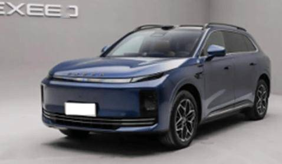

三、宏观经济与政策1.李强：中方愿同阿方拓展新能源汽车、动力电池等合作

4月13日下午，国务院总理李强在北京人民大会堂同来华访问的阿联酋阿布扎比王储哈立德举行会谈。李强指出，中方愿同阿方夯实能源合作基础，拓展储能、氢能、新能源汽车、动力电池等领域合作，促进两国绿色转型。

2.五部门：围绕汽车、锂电池等开发绿色设计方案

4月17日，工业和信息化部、发展改革委、教育部、生态环境部、市场监管总局等五部门印发《工业产品绿色设计指南（2026年版）》，其中提出，围绕汽车、工程机械、氢能装备、光伏、锂电池、甲醇、轮胎等行业，针对绿色设计重点方向，开发技术先进、经济可行、供需适配的绿色设计解决方案，形成一批可复制可推广的绿色设计解决方案典型示例。

3.工信部：强化道路机动车辆产品生产一致性监督检查

4月13日，工业和信息化部办公厅发布《关于做好2026年工业和信息化质量工作的通知》。开展锂电池、光伏组件等重点产品质量检查，强化道路机动车辆产品生产一致性监督检查。

4.工信部等三部门召开智能网联汽车道路测试与示范应用工作会议

4月14日，工业和信息化部装备工业一司、公安部交通管理局、交通运输部运输服务司联合组织召开智能网联汽车道路测试与示范应用工作会议，部署开展自查整改，加强安全监管工作。稳妥有序开展智能网联汽车道路测试与示范应用。

5.工信部公示L2级智驾国标

工信部公示《智能网联汽车 组合驾驶辅助系统安全要求》强制性国标（报批稿），征求意见至4月22日。标准覆盖单车道、多车道、领航辅助系统。建议2027年1月1日实施。

6.工信部：加快制定发布汽车自动驾驶、数据安全等标准

4月16日,第六届全国汽车标准化技术委员会成立大会在北京召开，工信部副部长辛国斌在讲话中表示，加快急需标准制定，制定发布自动驾驶、数据安全、网络安全、碳足迹核算、车用人工智能等标准。强化标准全生命周期管理。构建汽车行业“十五五”技术标准体系。

7.国家能源局在全国部署开展供电质量提升专项行动

国家能源局联合国家发展改革委在全国部署开展供电质量提升专项行动。围绕对电能质量敏感的新质生产力相关企业终端监测实现全覆盖。2028年底前各项任务全面落实落地。

8.今年以来消费品以旧换新销售额突破5000亿元

商务大数据监测显示，截至4月12日，2026年消费品以旧换新销售额5029.4亿元，惠及6977.7万人次。分品类来看，截至4月12日，今年以来汽车以旧换新超167万辆，带动新车销售额超2694.4亿元。其中，汽车报废更新超47.2万辆，销售额超606.9亿元；汽车置换更新超119.8万辆，销售额超2087.5亿元。

9.日本五大车企掌门人集体访华

丰田、本田、日产、马自达、斯巴鲁五家日本车企总裁罕见同步抵达北京，核心诉求直指中国电池级石墨出口管制问题。日本93.7%的电池级石墨依赖中国进口。

10.市场监管总局部署CCC认证专项行动，涵盖汽车等产品

市场监管总局近日部署在全国范围内开展CCC认证守底线专项行动，组织各级市场监管部门进一步严格CCC认证管理，将组织开展重点领域认证检测成本核算，纠治“内卷式”竞争。所有在中国生产、销售和进口的汽车（包括国产和进口整车）都必须获得CCC认证。

11.统计局：2026年一季度全国GDP同比增长5.0%

4月16日，统计局发布数据显示，初步核算，一季度国内生产总值334,193亿元，按不变价格计算，同比增长5.0%，比上年四季度加快0.5个百分点。一季度GDP环比增长1.3%。

3月份，社会消费品零售总额41,616亿元，同比增长1.7%。其中，除汽车以外的消费品零售额37,875亿元，增长3.2%。1-3月份，社会消费品零售总额127,695亿元，同比增长2.4%。其中，除汽车以外的消费品零售额117,727亿元，增长3.6%。

统计局发布数据显示，3月份，规模以上工业增加值同比实际增长5.7%。从环比看，3月份，规模以上工业增加值比上月增长0.28%。1-3月份，规模以上工业增加值同比增长6.1%。

12.四川城际道路将实现“快充快走”高效补电

四川省发展和改革委员会、省交通运输厅等七部门联合发布《四川省电动汽车充电设施服务能力倍增行动方案》，提出进一步加密城际道路充电设施点位布局，形成“快充快走”高效补电模式，明确到2027年年底，在全省范围内建成205万个充电设施，提供超过1700万千瓦的公共充电容量，满足400万辆电动汽车充电需求。

四、新品信息跟踪1.小鹏GX开启预售

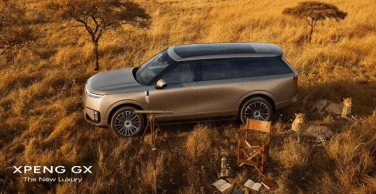

2.五菱缤果Pro开启预售

4月14日，五菱缤果Pro正式开启预售，预售价5.88-7.28万元。定位纯电动小型轿车，匹配31.9/37.9kWh磷酸铁锂电池组，最高车速130km/h，CLTC续航里程330/403km。

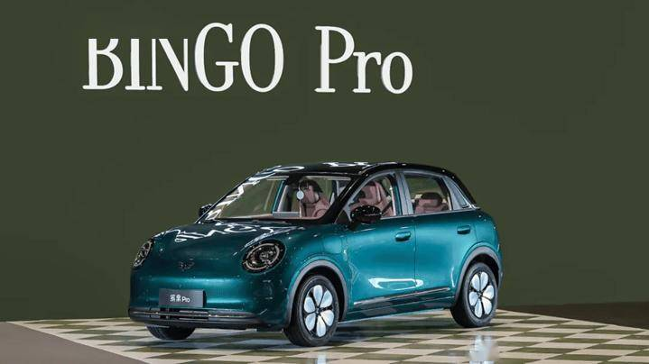

3.埃安N60开启预售

4月16日，埃安N60正式开启预售，预售价11.58-13.58万元。全系标配激光雷达+4D毫米波雷达等27个感知硬件、高通骁龙8650芯片，以及文远知行L4级同源一段式端到端大模型，支持全场景智能驾驶辅助和智能泊车辅助。首发搭载165kW非晶合金碳化硅电机，匹配弹匣电池2.0，CLTC续航里程410/510/610km，百公里电耗低至11.7kWh。

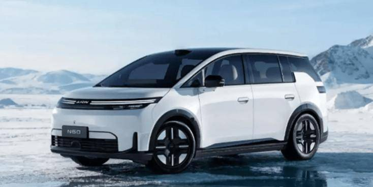

4.吉利银河星耀7开启预售

4月16日，吉利银河星耀7正式开启预售，预售价11.28-14.28万元。采用千里浩瀚H3方案，支持高速领航辅助、智能泊车辅助、AES/AEB等功能。匹配28.3kWh磷酸铁锂电池组，官方零百加速时间7.8/5.4s，最高车速185-190km/h，CLTC纯电续航里程230/220km。

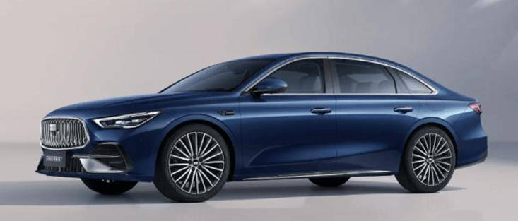

5.魏牌V9X开启预售

4月17日，魏牌V9X正式开启预售，预售价37.18-41.18万元。搭载Coffee Pilot 4辅助驾驶系统，支持车位到车位领航辅助、遥控/记忆/自定义泊车、AEB/AES等功能。匹配53.6/64.7/77.7kWh三元锂电池组，官方零百加速时间4.6/4.9s，最高车速210-225km/h，CLTC纯电续航里程310/402/470km，综合续航里程1632/1656/1700km。

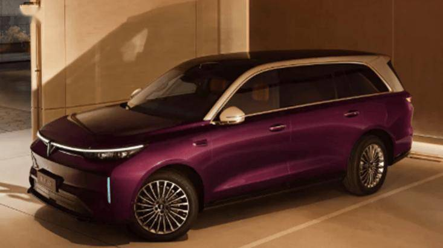

五、企业信息1.奥迪高管透露明年将推出第三款中国专属车型

德国奥迪汽车公司首席执行官索内拉表示，为重夺中国市场份额，奥迪计划于明年与中国合作伙伴上汽集团联合推出第三款中国专属车型，定位为高端运动型轿车。索内拉强调，该车型已进入开发阶段，并延续“中国需求优先”策略。

2.奥迪与上汽将在华设立奥迪创新技术中心

4月17日，奥迪与上汽集团正式签署战略合作协议，进一步深化合作。将在上海设立奥迪创新技术中心。将基于下一代智能数字平台联合开发AUDI品牌未来车型，首批规划四款车型，将于未来几年陆续登陆中国市场。

3.巴西劳工部将比亚迪移出“黑名单”

此前，巴西劳工部发布信息称将包括比亚迪在内的多家巴西境内企业和个人雇主列入涉“奴役劳动”名单。近日，巴劳工法院裁定针对比亚迪的上述认定程序不合法，巴劳工部已宣布将比亚迪移出相关名单。

4.比亚迪硫化物全固态电池通过车规验证

比亚迪硫化物全固态电池正式通过车规级验证，意味着该电池已完全满足装车使用的安全与性能标准，标志着固态电池从实验室概念迈入量产准备阶段。

5.东风汽车集团自研国产芯片+舱驾一体方案将量产

4月16日，东风汽车集团宣布，其自主研发的“天元智舱Plus”平台即将实现量产。基于东风汽车集团自研的国产芯片“武当C1296”打造，将智能座舱和智能驾驶两套系统融合为一。

6.东风本田：目前没有工厂关停计划

针对本田将于明年关闭一家与东风汽车集团合资工厂的消息，东风本田方表示，公司运营正常，目前没有工厂关停的计划。

7.广汽埃安AION UT欧洲上市

广汽埃安AION UT在意大利米兰正式登陆欧洲市场。新车由米兰设计、奥地利麦格纳工厂生产，采用“欧洲设计+本土制造”模式。定位小型纯电SUV，续航450km，支持快充，配备智能座舱与高阶智驾。将以德、法、西为核心市场，目标年销2万台。

8.广汽本田回应关闭工厂传闻

针对本田将于今年6月关闭一家与广汽集团合资运营的工厂的消息，广汽本田方面表示，结合市场环境变化，广汽本田持续整合资源，优化战略布局，提升运营效率。

9.广汽集团成立智能座舱产品线

广汽集团宣布正式组建全新智能座舱产品线，将对座舱领域的软硬件资源、研发能力、设计团队进行系统性整合，统一负责全品牌的产品定义、技术规划与用户体验设计。

10.吉利i-HEV智擎混动技术正式发布

4月13日，吉利汽车正式发布全球新一代AI油电混动技术方案——i-HEV智擎混动。该技术融合全域AI 2.0，实现48.41%全球最高热效率，百公里油耗低至2.22L，搭载11合1电驱与三动力冗余安全，通过480万公里极限验证，即将登陆星瑞、星越L等中国星车型。

11.吉利“千里浩瀚”辅助驾驶方案：2026年目标百万量级

吉利汽车的千里浩瀚辅助驾驶方案公布新进展。截至目前，该方案已交付近50万辆汽车，计划到2026年实现超过百万辆的装车量。H5、H7、H9三个辅助驾驶等级较高的方案将在年内覆盖40款车型，并在明年扩展至七大品牌的96款车型。H1、H3方案将逐步收缩。

12.极星4召回

由于高压动力电池的部件制造一致性原因，长期使用动力电池内阻会异常升高，可能导致部分动力电池性能下降，极端情况下可能导致动力电池热失控，存在安全隐患。浙江吉利汽车有限公司向国家市场监督管理总局备案了召回计划。召回部分2023-2024年款配备86kWh动力电池的国产极星4纯电动车型，共计1473辆。

13.理想诉东风日产黑公关工信部介入约谈双方

理想汽车与东风日产“黑公关”事件升级，工信部约谈双方，要求停止恶性竞争、自查自纠 。

14.奇瑞汽车创新预测用户偏好方法

奇瑞汽车股份有限公司申请一项名为“一种用户偏好模型训练方法、装置及设备”的专利，可根据车辆的当前车辆状态数据以及目标个性化模型，预测用户的偏好车辆功能参数，以基于偏好车辆功能参数为用户提供个性化服务，可以解决传统模型训练中存在的数据隐私泄露风险较高、车载资源适应性较差以及个性化建模精度不足等问题。

15.上汽集团新专利可提高续航里程计算精度

国家知识产权局信息显示，上海汽车集团股份有限公司申请一项名为“纯电动车的续航里程的计算方法、装置、设备及介质”的专利。专利摘要显示，本发明提供一种纯电动车的续航里程的计算方法、装置、设备及介质，可以对续航里程的预测风格进行设定，从而使得续航里程的计算结果更符合驾驶员的驾驶风格和性格特征，提高了续航里程的计算精度。

16.上汽通用五菱与宁德时代战略合作

上汽通用五菱与宁德时代签署全面战略合作协议。宁德时代称，将为五菱提供神行超充电池，支持10分钟补能400km。2026年推出5款换电车型，覆盖轿车、SUV、商用车。

17.赛力斯加入宝马、奔驰合资超充公司

4月17日，宝马、奔驰在中国成立的超充合资公司-逸安启宣布，赛力斯作为新的投资方加入，与现有股东方持股比例相等，即三家股东各自持有该合资公司33.3%股份。通过此次股权投资，赛力斯旗下问界品牌将支持逸安启豪华超充基础设施建设。

18.小米汽车首设CTO岗位

4月17日，小米集团通过内部邮件宣布两项关键人事任命：胡峥楠出任小米集团副总裁、汽车部CTO，宋钢出任小米集团汽车部副总裁、参谋长。

19.小鹏汽车新专利可有效提高电池检测准确性

肇庆小鹏汽车有限公司申请一项名为“电池系统监测方法、装置、设备、车辆、存储介质和产品”的专利，摘要显示，其基于运行特征数据和预测电压，共同确定电池系统的工作状态，增强了对复杂工况的适应性，有效提高检测结果的准确性。

六、行业信息1.西班牙首相体验中国电动汽车

4月13日，正在中国进行正式访问的西班牙首相桑切斯一行到访位于北京的小米科技园，并听取了介绍。桑切斯还深入了解并体验了小米新SU7、小米YU7汽车等产品。

2.中国长安汽车集团取得济南轻骑铃木50%股权

4月13日，国家市场监管总局发布2026年3月30日至4月5日无条件批准经营者集中案件列表，其中包括中国长安汽车集团有限公司通过合同取得济南轻骑铃木摩托车有限公司的控制权案等。交易后，中国长安汽车和铃木集团各持有济南轻骑铃木50%的股权。

3.阿尔特两股东拟减持

汽车设计与零部件企业阿尔特发布公告，称股东嘉兴珺文银宝及江苏悦达绿色发展基金，计划未来3个月内合计减持不超总股本2.05%的股份。

4.多氟多：2025年度净利润2.13亿元

4月15日，多氟多发布2025年年度报告，实现营业收入94.34亿元，同比增长14.37%；归属于上市公司股东的净利润为2.13亿元，较2024年净亏损3.08亿元实现扭亏为盈。

5.华望半导体公司变更法定代表人

广州华望半导体科技有限公司发生工商变更，黄旭盛卸任法定代表人、董事长，由郭江南接任。该公司成立于2015年7月，注册资本8250万元，经营范围包括汽车零部件及配件制造、汽车零配件批发、汽车零配件零售等，由广汽零部件有限公司全资持股。

6.华为与一汽红旗敲定“三智双智”合作

华为与一汽红旗正式敲定“三智双智”合作模式，首款合作车型预计年内落地。

7.宁德时代：一季度净利润207.38亿元

宁德时代公告称，2026年第一季度实现营业收入1291.31亿元，同比增长52.45%；归属于上市公司股东的净利润为207.38亿元，同比增长48.52%。基本每股收益4.58元。

8.天瞳威视与土耳其出行平台达成合作

天瞳威视（CalmCar）与土耳其出行平台Tripy近日达成战略合作，协议双方合作基于上汽大通MIFA7型和地平线征程®6智驾芯片的CalmCar ConnectOne Robotaxi产品，在2026年于中国和土耳其两地完成商业运营测试，并在土耳其全域推广和运营。

9.香港华为携手合作伙伴推动港区重型货车电动化

4月16日，中电源动集团、香港华为国际有限公司及智充动力有限公司共同签署合作备忘录，携手推动香港商用电动车普及化。三企业计划部署为重型商用电动货车而设的超级充电站，并引进适合香港市场的重型电动货车，全面加速本地运输及物流业绿色转型。

10.小马智行与广汽领程达成战略合作

4月16日，小马智行与广汽领程在广州签署战略合作协议。双方将通过“整车平台+自动驾驶系统集成+运营场景”的深度协同，共同推进自动驾驶卡车（Robotruck）在大湾区及全国物流场景的规模化商业化应用。

七、跨国集团与国际市场1.保时捷一季度交付量下滑15%

保时捷发布2026年一季度全球交付数据：全球交付量7.8万辆，同比下滑15%；其中中国市场交付1.8万辆，同比暴跌21%。保时捷计划北京车展发布多款新车。

2.宝马一季度销量下滑3.5%

4月14日，宝马集团发布一季度销量数据：全球交付56.57万辆，同比下滑3.5%；其中中国市场交付14.4万辆，同比大跌10%。宝马计划北京车展发布国产i5长轴版、新款X5。

3.宾利调整电动化战略

宾利确认下一代添越将于2028年发布，将采用插电式混合动力系统，不再推出原计划的纯电版本。已取消2030年前推出5款纯电车型的计划。主因高端纯电市场需求增长放缓。

4.本田首次将中国产电动车型引入日本

本田汽车已计划于4月17日起，在日本推出一款全新纯电动车Insight，成为首家引入中国产车型的日本本土车企。日本市场消费者可享受日本政府130万日元电动车补贴。

5.德国将每升汽油税降低17%

4月13日消息，德国将每升汽油税降低17%，为期两个月。

6.福特电动化负责人道格·菲尔德离职

福特汽车宣布，电动汽车与软件业务负责人道格·菲尔德（Doug Field）将于5月离职。菲尔德2021年加盟，主导福特电动化与智能化战略，2026年一季度电动部门亏损达48亿美元。福特将收缩纯电投入，转向混动与软件服务优化。接替者为艾伦·克拉克，权限大幅缩减。

7.自动驾驶初创公司Glydways洽谈2.5亿美元融资

由山姆•奥特曼支持的自动驾驶汽车初创公司Glydways正在洽谈新一轮融资，计划筹集2.5亿美元，这将使公司估值达到10亿美元或更高。此前刚刚完成1.7亿美元的融资。

8.荷兰汽车电动化进程加速

据荷兰国家统计局公布的数据显示，2026年初荷兰乘用车总量约为940万辆，比一年前增长近2%，新增部分几乎全部为电动化车型。目前，荷兰全部或部分以电为动力的汽车数量已超过200万辆，较一年前增长近6%，约占汽车总保有量的五分之一。

9.韩国3月汽车出口额为63.7亿美元

韩国产业通商部4月15日发布数据，3月韩国汽车出口额为63.7亿美元，同比增长2.2%。其中，3月混合动力汽车出口同比增长79%，电动汽车增长32%，带动新能源汽车整体出口同比增长42.6%。3月汽车产量为38.7万辆，同比增长4.5%；一季度累计产量为102.6万辆，同比增长1.3%，连续第四年保持在100万辆以上水平。

10.雷诺韩国将在釜山生产下一代电动车

雷诺韩国计划到2029年每年推出新车型，并从2028年起在釜山生产下一代电动车。

11.尼日利亚对大排量汽车征税

尼日利亚将对大排量汽车（包括SUV和卡车）购买者征收新税，此举旨在将污染成本纳入价格、推动电动车普及、并增加财政税收。

12.Rivian与Redwood Materials合作

电动汽车初创公司Rivian正与Redwood Materials公司合作，回收电动汽车电池用于储能。

13.日产将裁减10款全球车型

日产汽车称，将全球车型阵容从56款精简至46款，退出表现不佳的车型。

14.Stellantis第一季度合并出货量为140万辆

4月15日，Stellantis发表声明称，公司2026年第一季度预计综合出货量为140万辆，同比增长12%。其中，北美第一季度出货量较2025年同期增长约5.4万辆，同比增长17%。

15.Stellantis与微软携手共同开发人工智能项目

当地时间4月16日，Stellantis与微软组建联合团队，共同开发人工智能项目。

16.特斯拉AI5芯片成功流片

马斯克宣布特斯拉AI芯片设计团队已成功完成AI5芯片的流片。AI5芯片将主要用于自动驾驶系统的训练与推理计算，并为特斯拉人形机器人Optimus提供算力基础。目前，特斯拉在售车型主要依赖AI4（HW4）芯片来运行FSD（完全自动驾驶）系统。

17.特斯拉一季度重夺全球纯电销冠

特斯拉公布2026 Q1数据：全球交付35.8万辆，同比+6.3%，时隔六季度重夺全球纯电销冠。比亚迪纯电交付31万辆，位居第二。特斯拉上海工厂贡献近60%交付量。

附：近日信息合集
