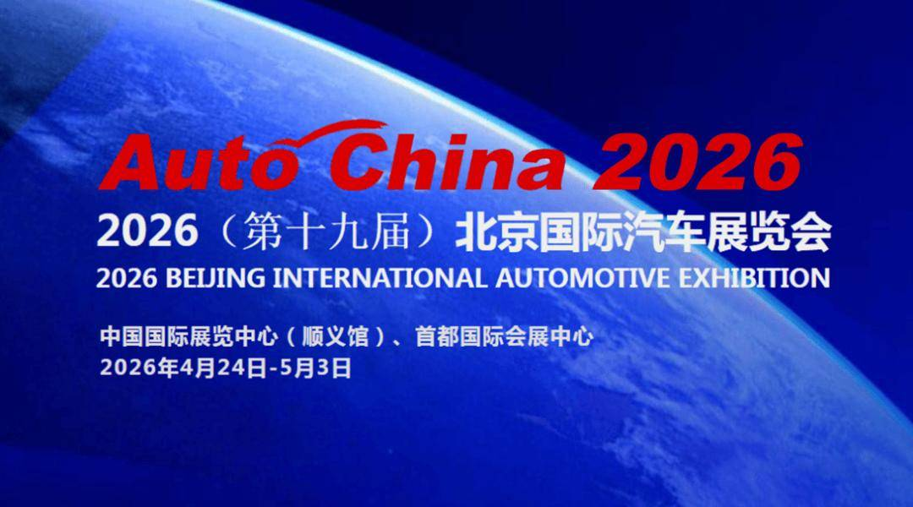

# 2026北京车展体现中国汽车的高质量发展

- 公開日時: 2026-04-22 16:46（北京時間）
- 出典: [搜狐号・崔东树](https://www.sohu.com/a/1013043692_115312)
- テーマ（自動判定）: その他
- 画像: 1枚

---

注：本分析文章仅代表崔东树个人观点，如有异议，请留言。

当前中国汽车产业已迈入高质量发展关键期，形成独特发展格局并呈现清晰趋势。当前全球车展普遍萧条，欧美日韩知名车展纷纷缩减规模甚至停办，而2026北京车展成为全球唯一火爆的顶级车展，这种反差正是世界汽车百年大变局的直观体现。作为全球规模最大、技术浓度最高的汽车盛会，北京车展精准锚定产业趋势，展示成果、放大红利，推动中国汽车产业从“大国”向“强国”跨越，印证全球汽车产业重心向中国转移的不可逆性。

一、当前中国汽车产业的总体特征

经过多年积淀，中国汽车产业形成“规模引领、结构优化、技术突围、格局重塑”的总体特征，四大核心彰显综合竞争力：

1. 规模稳居全球第一，产业根基持续夯实

中国汽车连续17年产销量全球第一，2025年产销均突破3400万辆，占全球约1/3，汽车出口跃居全球首位；2025年达709.8万辆，新能源占比超60%。产业配套完善，形成全产业链布局，供应链韧性全球领先。这种硬实力体现在车展反差上：法兰克福、东京等车展缩水，而2026北京车展双馆联动、38万㎡规模，集结1451台展车、181台全球首发车。国际车企清晰认识到中国产业链的核心支撑作用，不能也不敢掉队，纷纷主动拥抱、深化合作，形成“中国赋能、联动共强”的新格局。

2. 市场结构深度优化，竞争逻辑全面升级

新能源渗透率突破50%，成为市场主导；中国品牌份额近70%，扭转“外资主导”格局。行业竞争从“价格博弈”转向“价值竞争”，产品力、技术力、服务力成为核心，推动产业高质量转型。

3. 技术创新实现突破，自主可控能力提升

电动化、智能化领域实现“换道超车”，800V高压平台、兆瓦闪充、端侧大模型等技术全球领先，L3级自动驾驶进入合法商用阶段。华为、宁德时代等供应链企业技术实现全球输出，打破欧美日韩垄断。

4. 内外循环协同发力，发展格局持续拓展

形成“国内消费升级+全球化扩张”双轮驱动格局，国内向高端化、智能化升级，全球向产业链重塑、技术与生态出海升级。国际车企转型困境凸显，欧洲整车工厂产能利用率仅55%，中国产业链优势凸显，国际车企加速拥抱中国产业链，补齐短板、合作共强成为必然趋势。

二、当前中国汽车产业的核心发展趋势

结合产业现状与市场需求，中国汽车产业呈现六大核心趋势，重点凸显两大核心要求，引领未来3-5年发展：

趋势1：规模全球第一，正式进入“国内消费升级+全球化扩张”双轮驱动阶段

中国汽车产业进入“国内提质、全球拓局”高阶阶段，国内20-50万价格带成为增长主力，消费者注重“实在豪华”；全球形成“国内筑牢根基、全球打开空间”的良性循环。车展冷热反差印证这一趋势：传统车展萧条源于转型滞后，北京车展火爆源于中国产业活力与国际车企主动参与，国际车企通过车展对接中国资源、深化合作，践行“合作共强”理念。

趋势2：全球扩张升级，从“产品走量”到“产业链重塑、技术输出、生态出海”的高阶跨越

中国出海从“卖产品”升级为“产业链、技术、生态”协同出海，搭建海外全闭环布局，输出核心技术与全生态方案。国际车企深知脱离中国产业链难以转型，纷纷主动拥抱，斯特兰蒂斯、大众等巨头与中国车企深化协同，形成“中国赋能、双向共赢”的全球化新格局。

趋势3：电动化进入深水区，从“普及”到“升级”，补能与安全成为核心竞争点

电动化进入高质量发展阶段，政策驱动转向市场驱动。核心聚焦补能效率（800V平台、兆瓦闪充）、续航突破（纯电700-900km）、安全提升（第二代刀片电池），逐步解决续航焦虑，推动产业健康发展。

趋势4：智能化从“选配”变“标配”，L3商用元年开启，系统能力成为竞争核心

2026年成为L3级自动驾驶商用元年，智能化成为“入场券”。竞争从“堆硬件”转向系统能力，20-30万级车型标配激光雷达、高算力芯片，多模态交互全面上车，推动汽车向移动智能终端转型。

趋势5：市场格局持续重塑，自主冲高、豪华本土化、新势力分化成为常态

自主品牌冲击40-60万高端市场，对标豪华品牌；传统豪华品牌加速本土化、电动化转型，本质是国际车企不敢掉队、拥抱中国产业链的体现。新势力呈现分化，头部巩固地位、尾部出清，合作共强成为不可逆趋势。

趋势6：全产业链协同竞争加剧，跨界融合成为产业发展新动能

竞争升级为全产业链+生态竞争，跨界融合加剧，汽车成为多元载体。供应链与整车企业协同发力，安波福等全球供应链加速本土化。国际车企普遍拥抱中国产业链，借助中国技术与成本优势实现转型，推动全球产业协同升级。

三、2026北京车展精准顺应、放大产业发展趋势

2026北京车展以38万㎡规模、1451台展车、181台全球首发车，精准锚定六大趋势，以“全球萧条、中国独火”的反差，成为百年大变局的“风向标”。中国抓住转型机遇实现领跑，让北京车展成为全球车企必参盛会，通过多举措顺应、放大趋势：

1. 顺应“规模全球第一、国内消费升级+全球化扩张”趋势，打造双向展示窗口

立足国内，集中展示40-60万级自主旗舰与20-35万级高端车型，将百万级配置下探，贴合消费升级需求；面向全球，展示中国全球化成果，成为国际车企对接中国产业链的核心平台，斯特兰蒂斯、大众等巨头现场洽谈合作，实现“优势互补、合作共强”。

2. 顺应“全球化扩张升级”趋势，集中展示产业链、技术、生态出海成果

集中展示中国全球化高阶成果，彰显“整车+零部件”协同出海优势，公开核心技术授权模式，展示全球补能与智能生态布局。国际车企借助平台主动拥抱中国产业链，补齐转型短板，推动全球产业协同发展。

3. 顺应“电动化深水区”趋势，推动补能与安全技术普及放大

集中展示800V高压平台、兆瓦闪充、固态电池等技术，纯电续航普遍700-900km，强化电池安全认知，结合政策引导市场消费，放大电动化趋势红利。

4. 顺应“智能化标配、L3商用元年”趋势，推动智驾技术量产落地放大

集中展示L3智驾方案并现场演示，展示20-30万级车型智能化标配，华为乾崑智驾等方案亮相，彰显中国智能化领先性，推动汽车向移动智能终端转型。

5. 顺应“市场格局重塑”趋势，搭建中外车企同台竞技平台

为自主品牌冲高提供舞台，吸引BBA等豪华品牌展示中国特供车型，体现国际车企拥抱中国产业链的实践；斯特兰蒂斯等巨头现场洽谈合作，呈现市场分化格局，助力开辟增量市场。

6. 顺应“全产业链协同、跨界融合”趋势，打造全生态展示场景

推动整车与供应链、科技企业同台参展，展示全链条技术成果与跨界融合成果，举办技术论坛与合作签约，推动全产业链升级，放大产业发展动能。

四、总结

中国汽车产业形成规模全球第一、技术自主可控、内外循环协同的特征，朝着核心趋势稳步迈进。车展冷热反差彰显百年大变局下产业重心向中国转移的必然，国际车企认清中国产业链价值，加速拥抱、合作共强成为主流。2026北京车展精准锚定趋势，搭建展示与合作平台，对内引领消费升级、提质增效，对外输出中国技术与生态，助力中国汽车产业从“大国”向“强国”跨越，引领全球汽车产业进入“中国主导、协同共强”的新时代。

附：近日信息合集
