# 2026年1-3月中国汽车出口市场分析

- 公開日時: 2026-04-24 10:54（北京時間）
- 出典: [搜狐号・崔东树](https://www.sohu.com/a/1014011272_115312)
- テーマ（自動判定）: 輸出
- 画像: 38枚

---

2025年中国汽车实现出口832万辆，同比2024年全年增速30%。2026年1-3月中国汽车实现出口234万辆，同比2025年同期增速53%，3月中国汽车实现出口79万辆，同比增39%，环比增6%，同比走势总体较强, 环比受到中东影响而偏低。2026年3月中国新能源汽车出口34万辆，同比增长55%，1-3月累计出口101万台，增75%的表现很好，3月新能源车出口环比2月表现不强。

2026年3月中国汽车出口总量的前10国家：俄罗斯80542辆、巴西69881辆、墨西哥40111辆、英国37301辆、比利时32943辆、澳大利亚25920辆、意大利24036辆、德国18214辆、阿尔及利亚17797辆、吉尔吉斯斯坦17076辆，其中本期较同期增量增大的前五个是：巴西45229辆、俄罗斯39172辆、英国22593辆、德国14378辆、阿尔及利亚13802辆。

2026年3月中国汽车出口中纯电动占比28%（同比增2%），插混占比15%（同比+3%），混动占比8%（同比+2%），纯燃油车占比37%（同比-7%）。

2026年3月中国新能源汽车出口总量的前10国家：巴西51243辆、比利时32197辆、英国24047辆、德国17013辆、泰国15940辆、澳大利亚15675辆、意大利13430辆、韩国12672辆、中国香港11210辆、西班牙9154辆，其中本期较同期增量增大的前五个是：巴西32261辆、德国14026辆、比利时13799辆、英国12887辆、韩国11591辆。

中国新能源车2026年1-3月出口表现好于预期，主要是插混和混动替代纯电动成为出口增长的新增长点，尤其是卡车出口表现较强，成为商用车新能源车出口亮点。中国新能源车出口向中东和发达国家市场呈现高质量发展的局面，主要是出口西欧和中南美市场。

汽车对俄罗斯出口大幅回升，但3月受伊朗战争影响，阿联酋下滑89%，沙特下滑47%，带来的出口损失巨大。

一、中国汽车出口总体走势

1、汽车出口历年走势

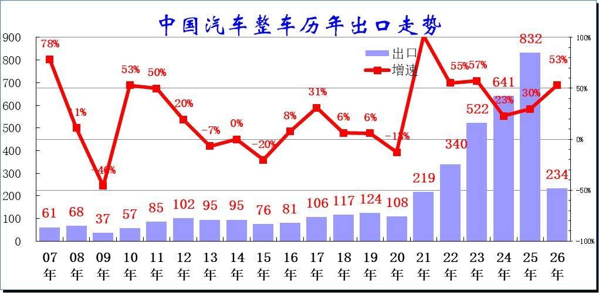

中国汽车出口历经多年百万量级的平台期后，于2021年实现突破。在2013 - 2016年世界经济低迷的大环境下，汽车出口出现剧烈下滑。2017 - 2020年，出口增速逐步企稳并有所改善，年度出口量维持在100万辆左右的水平。2020年出口量达到108万辆，同比下降13%，随后进入2021年以来的高增长期。

中国汽车出口自2021年突破百万量级后持续高增长（2021年增102%，2022-2023年增50%+，2024-2025年增速回落至30%左右），2026年1-3月出口234万辆（同比2025年增53%），延续增长态势。近期中国汽车出口呈现超高速增长态势，未来只要国际市场环境稳定，中国汽车出口发展仍具有巨大空间。

2026年1-3月中国汽车实现出口234万辆，同比2025年同期增速53%，3月中国汽车实现出口79万辆，同比增39%，环比增6%，同比走势总体较强, 环比受到中东影响而偏低。今年的主要动力仍是中国产品竞争力提升和全球南方国家市场的小幅增长，俄罗斯车市贡献较大。

从月度走势来看，近几年的中国汽车出口仍呈现出季节性特征，有夏季走高与国内反差的走势特点。2026年1-3月出口增速相对强劲，主要也是国内市场低迷，企业对应海外市场能力增强。

2、整车出口月度走势

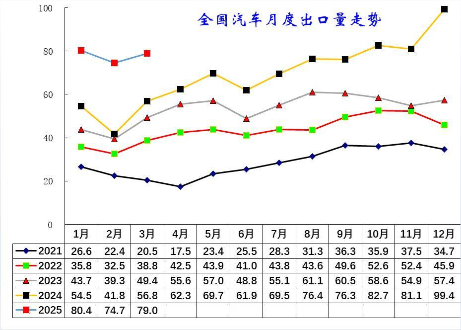

从月度走势看，近几年的中国汽车出口仍呈现季节性特征，呈现夏季走高与国内反差走势特征。2026年1-3月出口增速相对很强，延续持续增长动力。虽然有美伊战争的爆发，但由于市场分散，中国汽车出口增速受外部环境影响较小,2025年以来持续拉升。

3、汽车整车出口结构特征

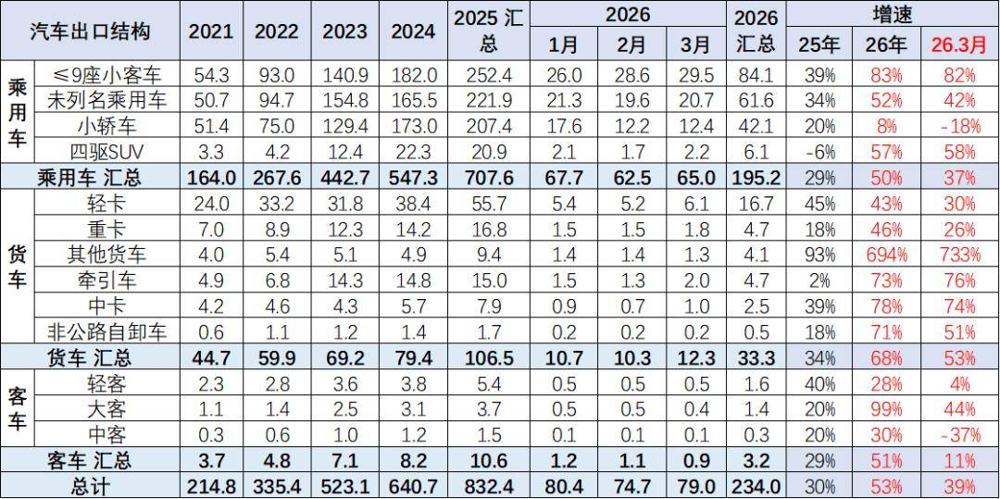

2020年前的中国汽车出口维持在百万规模，随后持续高速增长到2025年的832万辆。乘用车出口持续走强，货车和客车出口也持续较好增长。

今年全年海关各类车型增速分化，乘用车增速逐步回升，卡车、客车的增速均好于乘用车。尤其是货车出口增长68%，客车增长51%，相对于国内的燃油货车平稳走势，近期电动卡车出口较好。

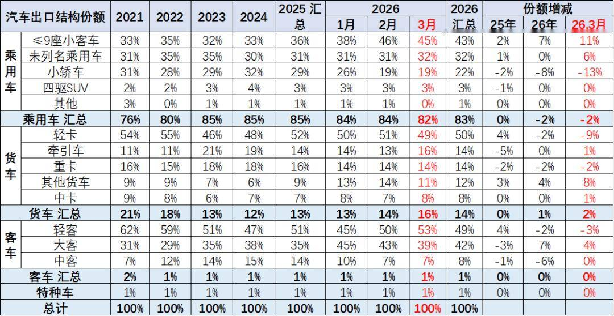

从结构看，乘用车出口占比不断提升，到2023年达到85%，随后相对稳定回落。货车出口因电动卡车而明显提升。近几年客车的出口占比持续回落到较低水平。由于乘用车是贸易焦点，出口的货车和客车比例总体达到18%，稍高于国内的商用车占比。

乘用车内部的几类主力车型表现较均衡，2026年乘用车出口表现较强的是9座以下小客车，2026年9座以下客车占比43%，其中3月达到45%。虽然特斯拉出口回落的影响较大，但3月自主的电动车出口增长较好。

客车3月份额表现较好。皮卡3月增长提升，重卡出口表现高位回落。客车中的大中型客车表现较好，轻型客车出口占比回落。

4、出口动力结构特征

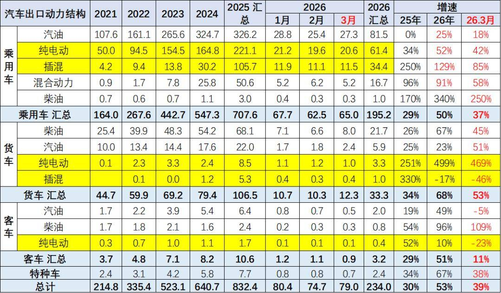

出口动力结构特征方面，2025年乘用车的出口增速回落较大，其中汽油车的出口均增速偏低，今年混合动力乘用车的出口很强，而插混的乘用车出口增速最强。今年货车和客车出口平稳，乘用车出口俄罗斯和欧洲的波动是核心增长推动。

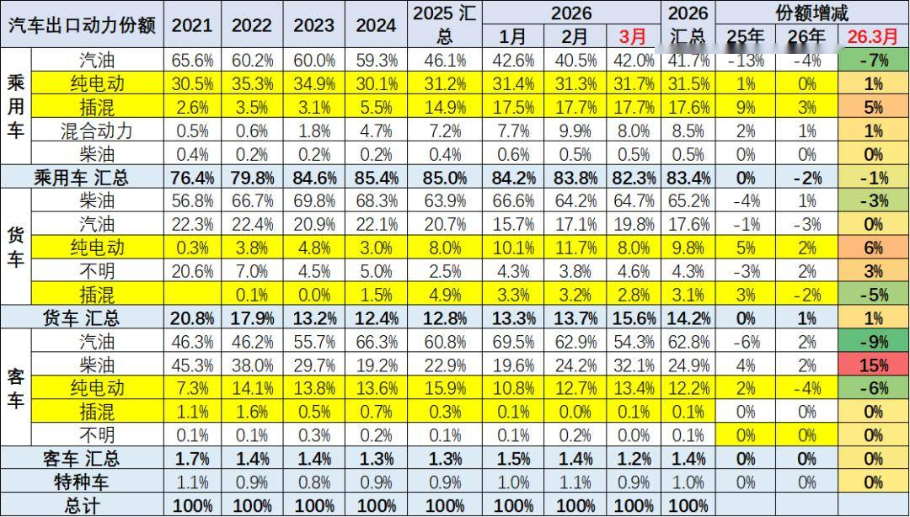

2026年1-3月乘用车的新能源的占比回升，燃油车占比下降明显，混合动力异军突起。汽油乘用车和柴油货车、汽油客车出口下降较大。3月的插混乘用车、纯电动卡车和混动乘用车出口较好增长。

二、汽车出口市场格局

1、出口厂家国内区域特征

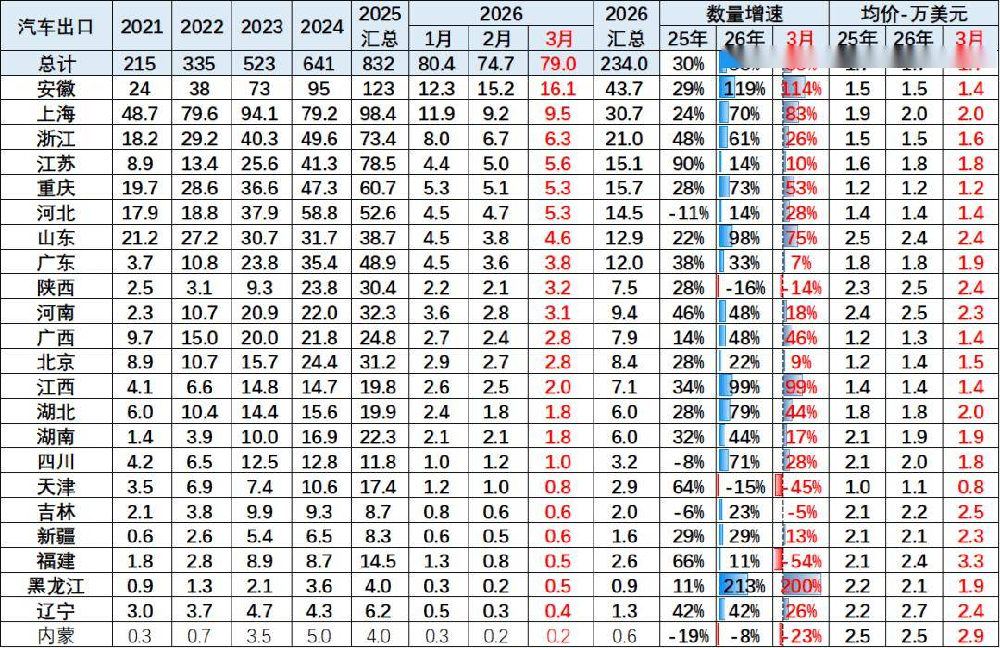

2024年开始上海出口的全国汽车龙头地位被安徽替代，2026年安徽仍保持出口第一的地位。上海对中国出口的重要意义极其明显，实际是长四角的龙头，辐射效应强。2026年1-3月安徽汽车出口44万辆，这主要是由于安徽本地的企业相对比较优秀，加之比亚迪等企业落户合肥。上海企业出口档次高，上汽乘用车和特斯拉两家企业，出口均价较高。

近两年安徽的出口表现相对较强，主要也是奇瑞和江淮的出口表现相对较强，但俄罗斯的市场波动巨大，因此近期安徽出口多元化较好。2026年的重庆、山东、江西的汽车出口贡献度上升较大。

2、出口区域特征

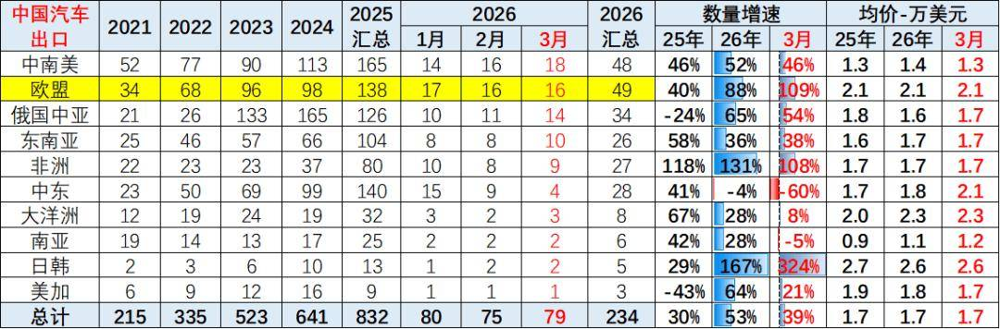

中国汽车出口总体表现较强，其中欧盟和非洲暴增，针对中东和非洲以及大洋洲的出口表现相对优秀。而针对东南亚地区、大洋洲出口表现压力较大。

前期的中国汽车出口在中南美洲和欧盟占比高，东南亚以及南亚等亚洲其它地区表现较强，目前逐步转到以中南美、欧洲表、俄国中亚现相对较强的特征，日韩和美国出口也有改善。尤其3月受到美伊战争影响，中东出口受阻明显。

3、整车出口分国别走势分析

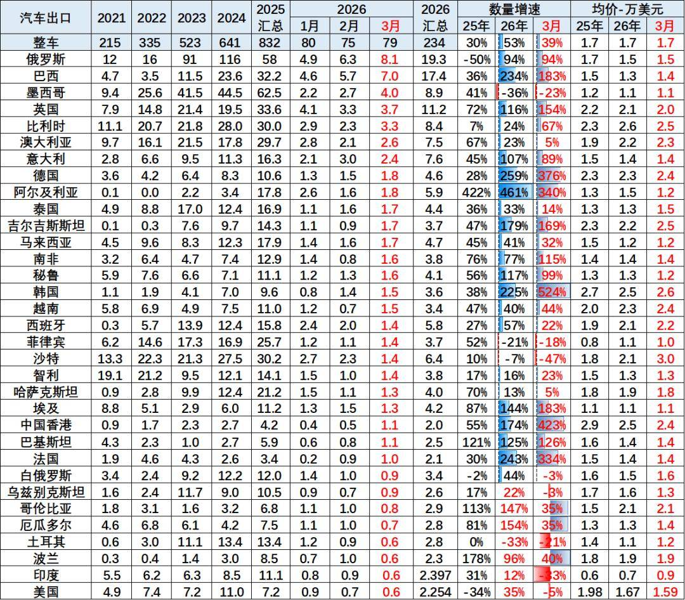

出口均价下降有利于出口增长，随着人民币升值，出口美元价格保持稳定，2026年中国汽车出口价格竞争力较强。前期俄罗斯市场巨变，其它外资退出，因此2023年以来中国对俄罗斯的出口也较多，2025年去库存,2026年回归正常状态。去年出口是对比利时的出口车较多，今年欧洲关系改善，出口表现也有改善。

近期的巴西市场表现较强，中国汽车走进入的本土化建厂取得一定成效。秘鲁、泰国等车市前期暴跌，今年有所恢复。

4、整车出口月度增减量走势

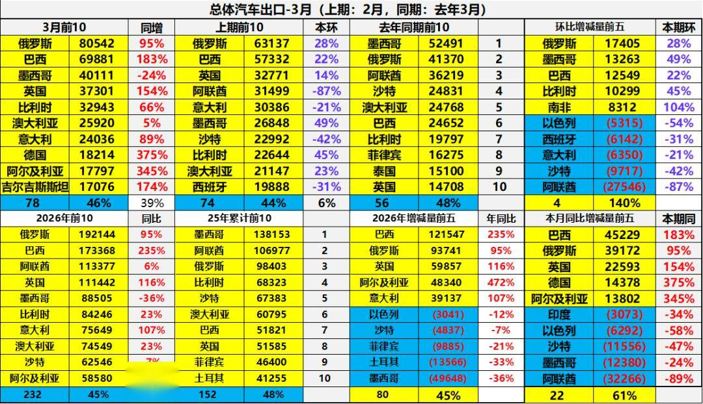

2026年3月中国汽车出口总量的前10国家：俄罗斯80542辆、巴西69881辆、墨西哥40111辆、英国37301辆、比利时32943辆、澳大利亚25920辆、意大利24036辆、德国18214辆、阿尔及利亚17797辆、吉尔吉斯斯坦17076辆，其中本期较同期增量增大的前五个是：巴西45229辆、俄罗斯39172辆、英国22593辆、德国14378辆、阿尔及利亚13802辆。

俄罗斯市场中国车企防风险意识提升，2025年俄罗斯国内销量下滑不大，但我们出口去库存力度很大。2026年1-3月我们对俄罗斯的出口恢复较大。

5、历年出口主力国家变化分析

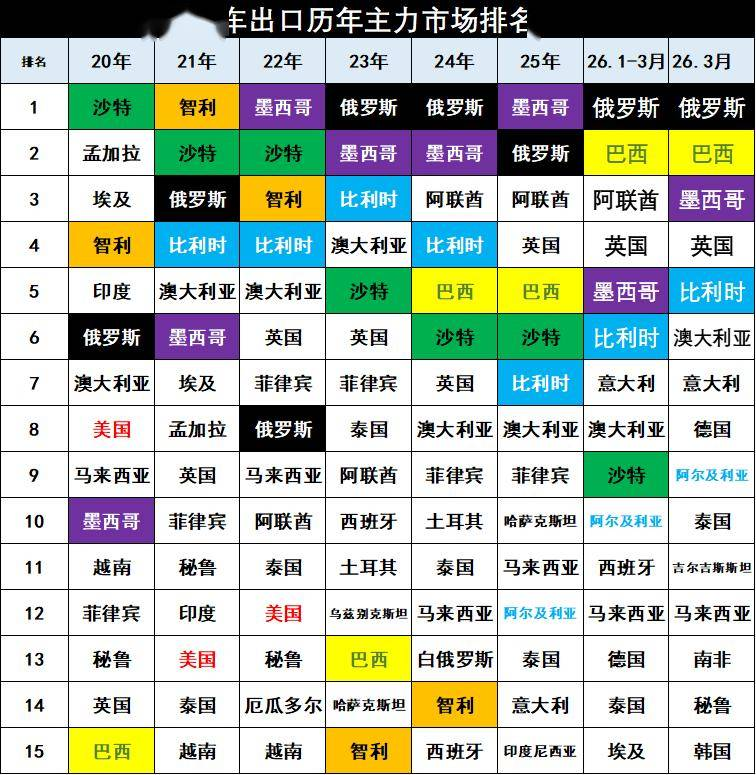

前期汽车出口的海外根据地效果并不理想，主力市场波动较大。2023 - 2024年汽车出口主要市场来自俄罗斯、墨西哥、比利时、澳大利亚、沙特、英国等国家，欧美市场走势较强。近期阿联酋、英国等相对发达国家表现改善。

2026年1-3月汽车出口结构变化，俄罗斯回升到出口第一地位，1-3月阿联酋的出口同比提升较大。3月对阿联酋的出口暴跌。英国市场增长很强，巴西出口表现较好。

6、对俄罗斯出口变化分析

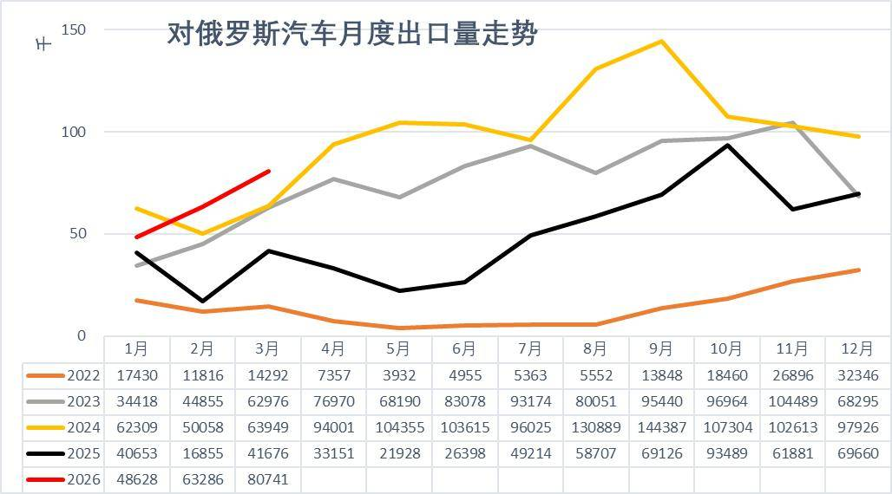

近期由于其它国家汽车企业退出俄罗斯，2023年中国车企迅速保证了俄罗斯的车辆供给需求，前期的中国车企在俄罗斯应该暂时是安全的。

俄罗斯的进口规则根据供需不断调整，2024年俄罗斯汽车销量已经是近几年的最高水平，因此需求提前透支后的2025年下跌是必然的。2025年以来的中国对俄罗斯的新能源车的出口剧烈波动，今年全年的俄罗斯国内需求逐步企稳，中国汽车出口在逐步回升。

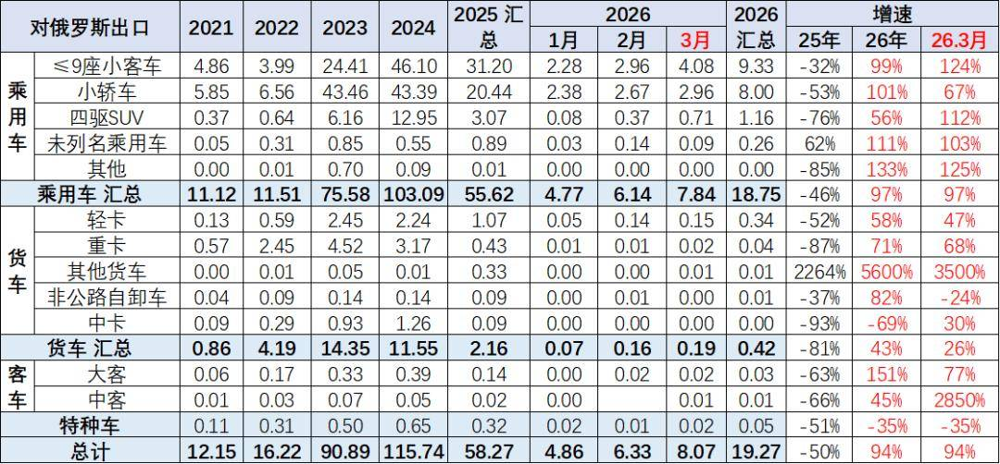

2023年以来俄罗斯突然变成中国汽车出口第一大市场，这是时隔15年后中国汽车再一次的出口巨变。2008年中国自主品牌进军俄罗斯的市场表现很好，但随着俄罗斯对中国汽车巨额加征关税政策，当年中国汽车车企大面积退出俄罗斯，2025年上半年下滑有些类似2009年的走势，但2026年开局因低基数而暴增。

三、新能源车出口走势

1、历年新能源汽车整车出口特征

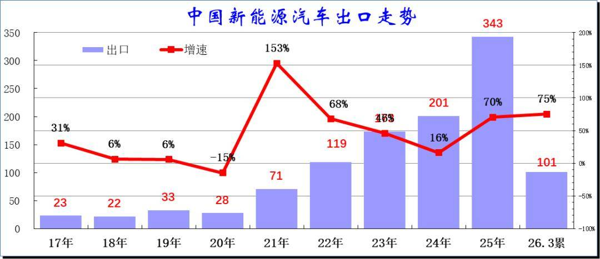

随着中国国内新能源车市场从补贴驱动向市场驱动的转型，中国新能源汽车的市场竞争力大幅增长。中国新能源汽车出口自2021年实现爆发增长，随后进入持续的高增长区间。虽然2024年受到欧盟出口新能源的政策干扰，但2024年全年中国新能源汽车出口仍达到201万辆，同比增长16%。2025年出口新能源车343万辆，同比增长70%，表现良好。2026年1-3月出口新能源车101万辆，同比增长75%，表现良好。

2、历年新能源汽车月度出口特征

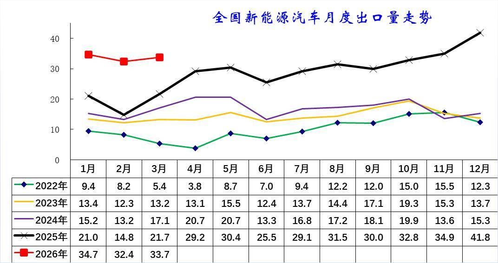

因欧盟加征关税，2024年下半年中国新能源出口走势低迷，市场压力较大。2025年4月开始的新能源车出口暴增的走势超强。2026年1-3月新能源出口持续历史高位，国内低迷推动出口热情更高。

在连续高增长后，2024年全年新能源汽车累计出口量201万辆，同比增长16%。2025年新能源汽车出口量343万辆，同比增长70%，增速高于2024年全年的16%较多。2026年3月中国新能源汽车出口34万辆，同比增长55%，1-3月累计出口101万台，增75%的表现很好，3月新能源车出口环比2月表现不强。

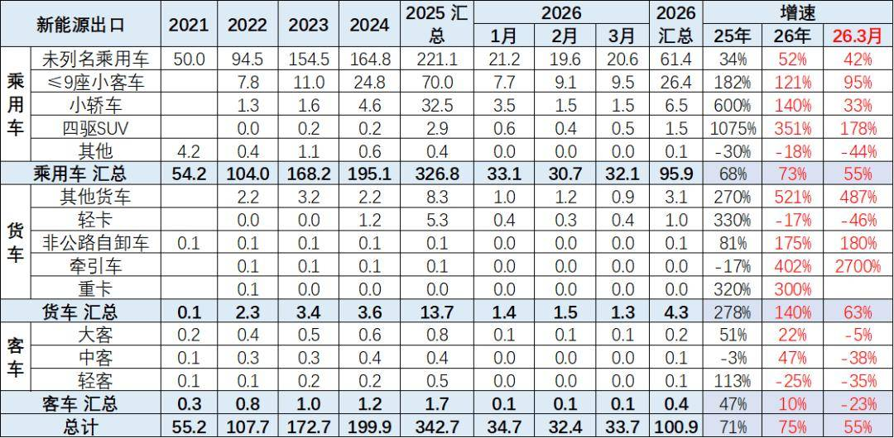

新能源车出口的96%都是乘用车，商用车占比较小，新能源卡车表现好于客车。电动化导致的未列名乘用车占比保持高位。

3、汽车整车出口结构变化

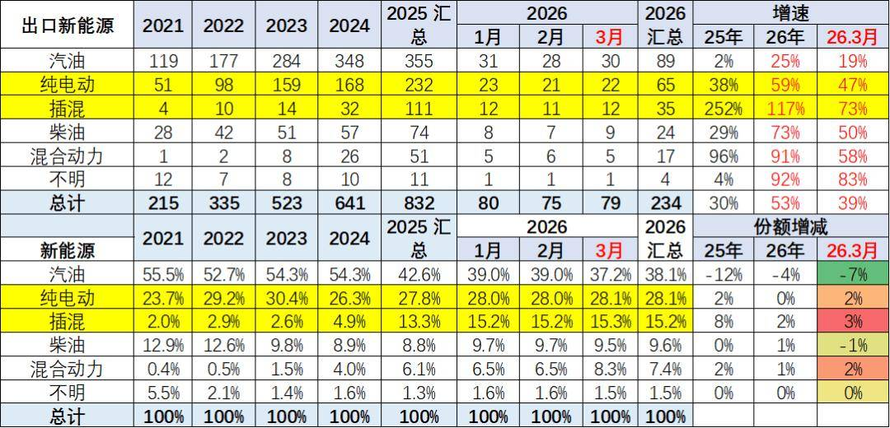

2026年3月中国汽车出口中纯电动占比28%（同比增2%），插混占比15%（同比+3%），混动占比8%（同比+2%），纯燃油车占比37%（同比-7%）。

4、新能源出口地区变化分析

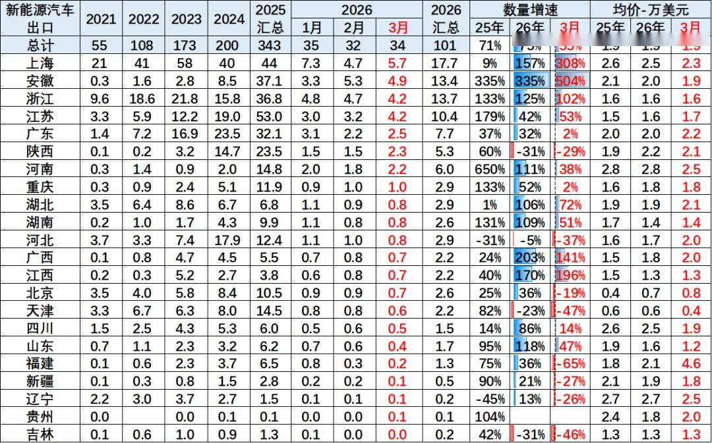

随着特斯拉进入中国，中国汽车出口格局改变，前几年上海长期第一。随着国产车崛起，自主成为新能源出口核心，近期安徽等崛起，3月上海、安徽、浙江、江苏的新能源出口表现较好。

2026年新能源汽车出口均价相对稳定。

5、历年新能源乘用车整车出口国家特征

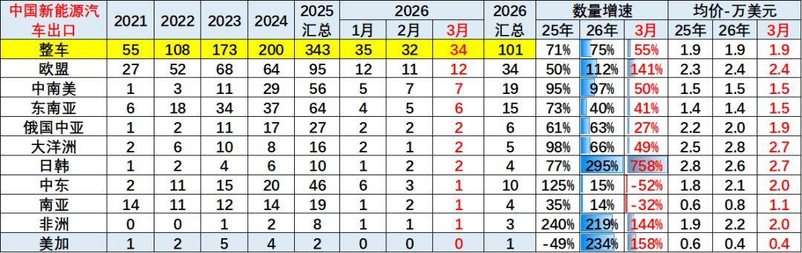

新能源车出口获得更多的突破，2026年仍是欧盟最强，日韩增速表现较高，东南亚还相对平稳增长。

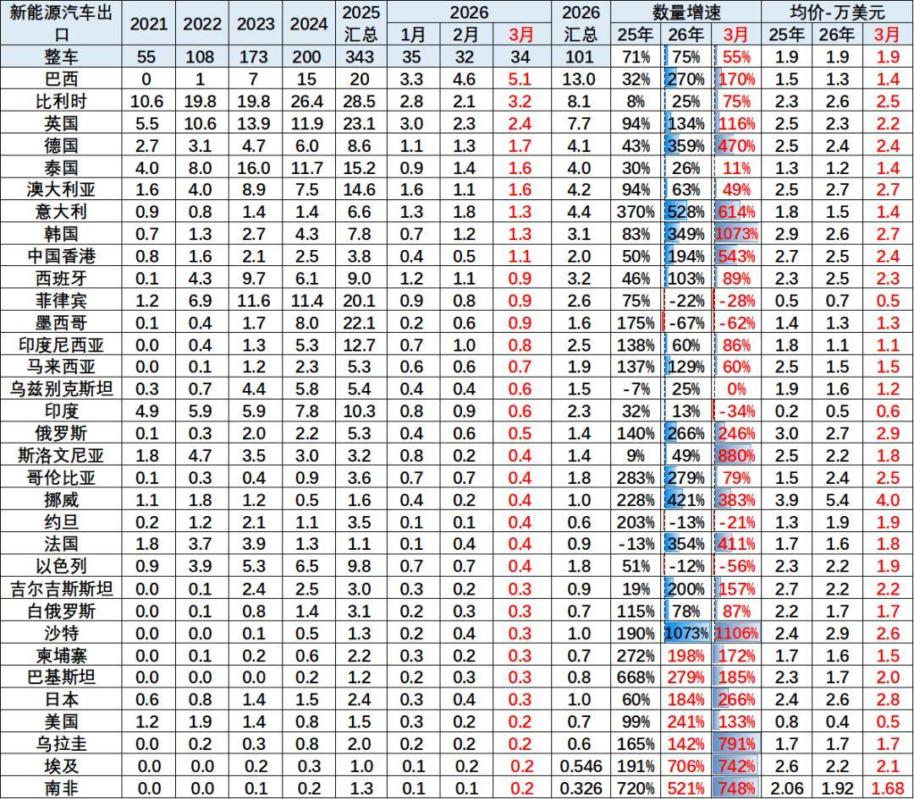

2026年新能源汽车出口同比增长分化。新能源汽车出口主要是欧洲、亚洲两大市场，今年的巴西超越比利时成为新能源车出口的第一大市场，巴西建厂推动巴西出口暴增。

今年新能源车出口的主力市场基本都有较好增长。德国、意大利等市场新能源车出口增长表现突出，墨西哥市场走弱，泰国市场走势相对一般。

6、2026年新能源汽车整车出口变化分析

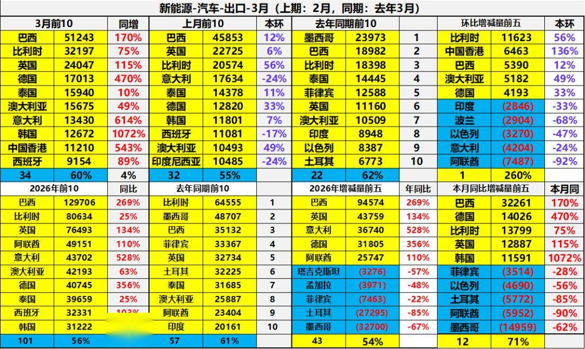

2026年3月中国新能源汽车出口总量的前10国家：巴西51243辆、比利时32197辆、英国24047辆、德国17013辆、泰国15940辆、澳大利亚15675辆、意大利13430辆、韩国12672辆、中国香港11210辆、西班牙9154辆，其中本期较同期增量增大的前五个是：巴西32261辆、德国14026辆、比利时13799辆、英国12887辆、韩国11591辆。

2026年出口巴西、比利时、英国等欧盟是几大主力方向。近期的土耳其、墨西哥等市场出口较弱。

7、燃油车分动力整车出口变化分析

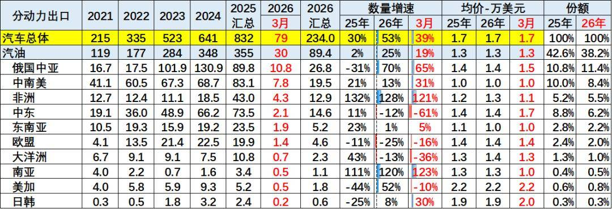

2024年全年中国汽油车型出口348万辆、增22%；2025年中国汽油燃油车出口355万辆、增2%,2026年1-3月中国汽油燃油车出口89万辆、增25%。

今年中国对俄罗斯、非洲、南亚等市场的燃油车市场较强，其它市场总体表现一般，尤其是欧盟、大洋洲等市场的燃油车出口下降，高质量发展特征明显。

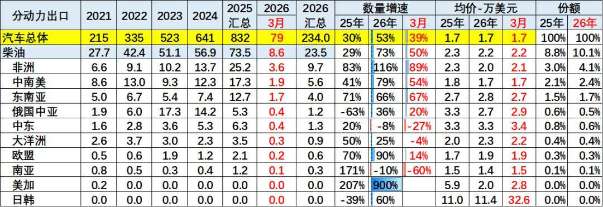

今年柴油车出口好于汽油车，实现柴油车在非洲、中南美的较强增长局面。3月的中东和南亚的出口表现较差。

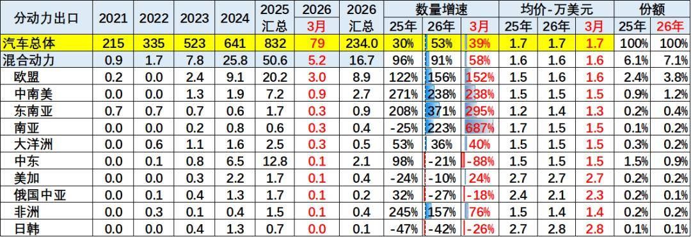

今年混合动力车型对欧洲和中南美、亚洲其他市场的增量超强，体现了中国乘用车竞争力的全面提升。但中东销量剧烈下滑，俄国中亚地区的混合动力表现一般。

8、2026年新能源汽车整车出口变化分析

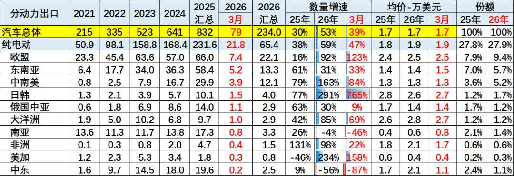

2024年全年中国纯电动车型出口168万辆、增6%；2025年中国纯电动车出口232万辆、增38%；2026年1-3月中国纯电动车出口65万辆、增59%，3月增长47%也是很好的。

目前纯电动的欧盟市场仍是绝对主力市场，东南亚市场和中南美等市场的需求相对波动较大，日韩市场上升明显，但中东市场损失巨大。由于国外基础设施缺乏，加之中国纯电动过于追求高端，大型化特征明显，小型电动车缺乏好产品，纯电动的出口仍有提升空间。

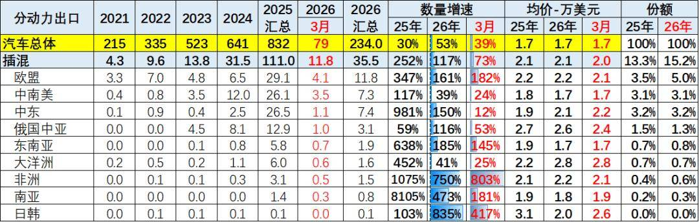

2026年1-3月中国插混车型出口35.5万辆、增117%，其中3月插混出口11.8万辆、增73%。除了美加等地区的插混需求很少，其它地区的中国插混表现都很突出。而欧盟地区的中国插混车型需求爆发增长，中东的土耳其等插混出口总体算是增长。

四、乘用车分类别出口走势

1、乘用车分排量出口

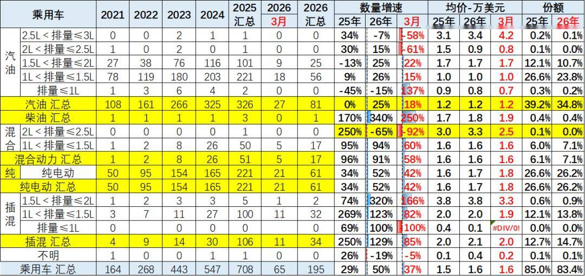

乘用车出口主要靠插混和混合动力乘用车，纯电动表现也很强，燃油车出口保持较好走势。燃油车的排量在1升-1.5升区间为主体，这也是中国自主乘用车的产品综合优势。2025年的1.5-2升车型下滑剧烈。今年1.5-2升车型出口恢复较快，说明俄罗斯等更需求中国的高端高价SUV车型，柴油乘用车基本没啥市场。

而电动车车型的产品档次分化，高端电动车出口改善较大，而入门级插混出口增长较好。

2、乘用车整车出口结构特征

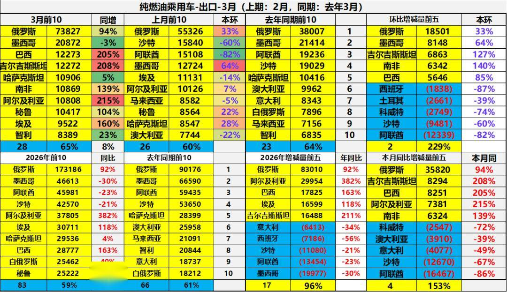

中国燃油乘用车2026年3月出口规模最大的是俄罗斯73827辆、墨西哥20872辆、巴西12273辆、吉尔吉斯斯坦12272辆、哈萨克斯坦10906辆、南非10869辆、阿尔及利亚10808辆、秘鲁10417辆、埃及9522辆、智利8389辆，其中本期较同期增量增大的前五个是：俄罗斯35820辆、吉尔吉斯斯坦8294辆、巴西8251辆、阿尔及利亚7381辆、南非6324辆。

中国纯电动乘用车2026年3月出口主要是巴西23850辆、比利时22490辆、泰国15625辆、英国14068辆、韩国12424辆、中国香港11070辆、德国10589辆、澳大利亚9462辆、意大利8926辆、菲律宾7438辆，其中本期较同期增量增大的前五个是：巴西19247辆、韩国11443辆、中国香港9378辆、比利时9169辆、英国8316辆。

中国纯电动乘用车2026年1-3月出口主要是巴西74883辆、比利时60200辆、英国44605辆、泰国38018辆、韩国30100辆、澳大利亚26250辆、意大利24511辆、德国24037辆、印度尼西亚23887辆，其中今年较去年同期增量增大的前五个是：巴西64283辆、韩国23378辆、英国22089辆、意大利20076辆、德国16574辆。

2026年3月出口插混乘用车的主要是巴西26834辆、英国9532辆、比利时9377辆、德国6038辆、澳大利亚4799辆、西班牙4634辆、意大利4439辆、墨西哥4405辆、俄罗斯3648辆、以色列3245辆，其中本期较同期增量增大的前五个是：巴西12554辆、德国5501辆、比利时4434辆、英国4226辆、意大利4115辆。

2026年1-3月出口插混乘用车的主要是、巴西53676辆、阿联酋39147辆、英国30250辆、意大利18315辆、比利时17399辆、西班牙17396辆、德国15533辆、以色列13589辆、俄罗斯11424辆，其中今年较去年同期增量增大的前五个是：阿联酋34229辆、巴西29268辆、英国20334辆、意大利16172辆、德国14164辆。

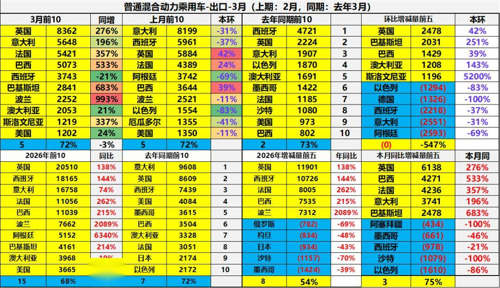

2026年3月出口乘用车普通混合动力的主要是英国8362辆、意大利5648辆、法国5421辆、巴西5073辆、西班牙3743辆、巴基斯坦2841辆、波兰2252辆、澳大利亚2053辆、斯洛文尼亚1219辆、美国1202辆，其中本期较同期增量增大的前五个是：英国6138辆、巴西4271辆、法国4236辆、意大利3741辆、巴基斯坦2478辆。

2026年1-3月出口乘用车普通混合动力的主要是英国20510辆、西班牙18165辆、意大利16758辆、法国11056辆、巴西11039辆、波兰7662辆、阿根廷5152辆、巴基斯坦4161辆、澳大利亚3968辆，其中今年较去年同期增量增大的前五个是：英国11901辆、西班牙10726辆、法国8005辆、巴西7535辆、波兰7312辆。

五、货车分类别出口走势

1、货车出口

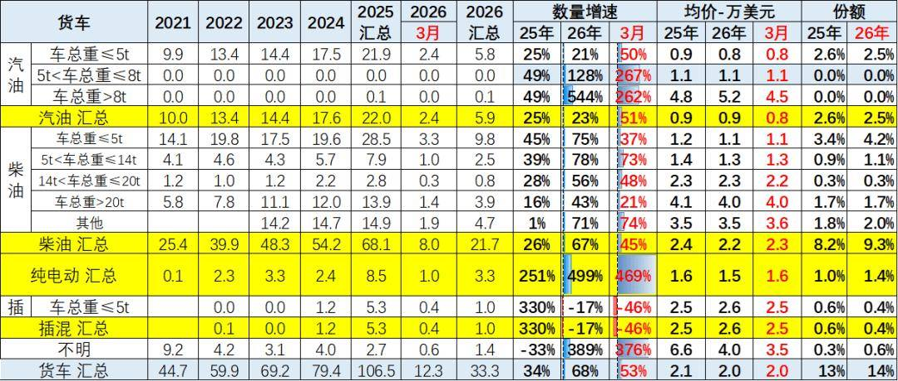

货车市场出口近几年增速不强，在汽车出口市场占比表现处于持续小幅萎缩状态，但2026年因纯电动和柴油轻卡表现较强，拉动出口占比改善。货车市场主力是5吨以下汽油和柴油货车较强，5-14吨和20吨以上柴油重卡货车总体来看也有较强需求。

2、货车出口市场变化特征

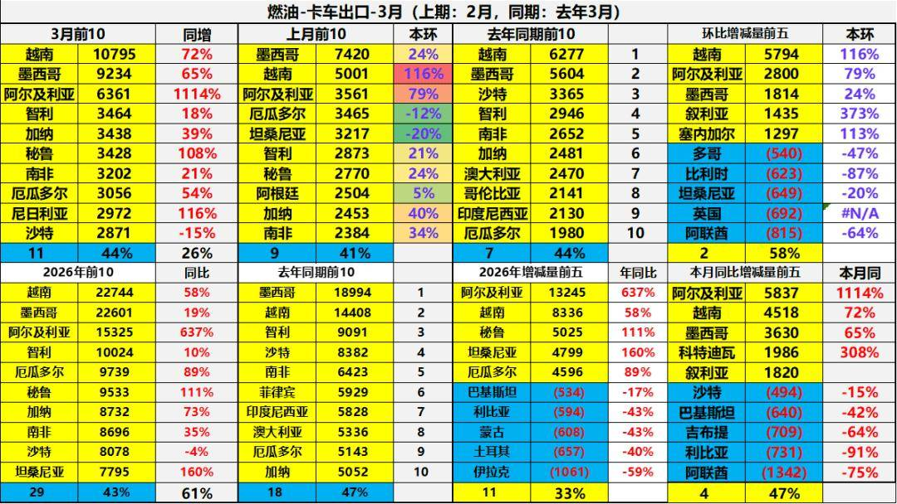

燃油卡车出口市场前几位总体表现稳定。2026年3月主力出口市场越南10795辆、墨西哥9234辆、阿尔及利亚6361辆、智利3464辆、加纳3438辆、秘鲁3428辆、南非3202辆、厄瓜多尔3056辆、尼日利亚2972辆、沙特2871辆，其中本期较同期增量增大的前五个是：阿尔及利亚5837辆、越南4518辆、墨西哥3630辆、科特迪瓦1986辆、叙利亚1820辆。

2026年1-3月燃油货车主力出口市场:越南22744辆、墨西哥22601辆、阿尔及利亚15325辆、智利10024辆、厄瓜多尔9739辆、秘鲁9533辆、加纳8732辆、南非8696辆、沙特8078辆，其中今年较去年同期增量增大的前五个是：阿尔及利亚13245辆、越南8336辆、秘鲁5025辆、坦桑尼亚4799辆、厄瓜多尔4596辆。

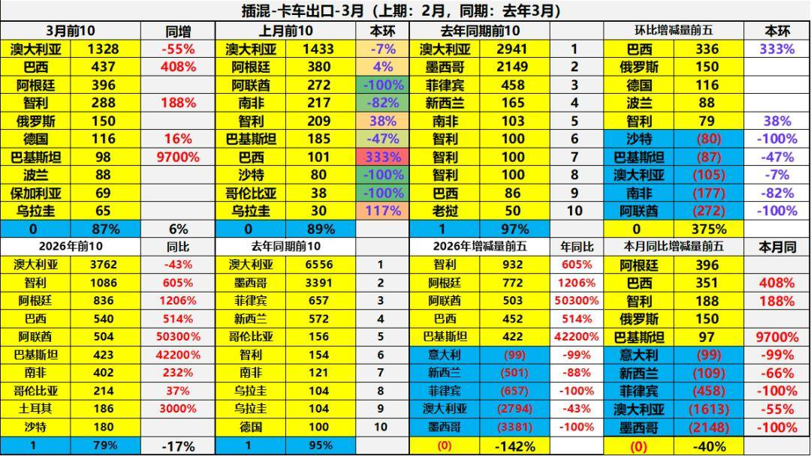

插混的货车出口市场近期较强，这主要是皮卡的乘用车属性的增量，在海外市场形成插混的野外场景便利和使用成本优势。

目前3月出口市场的澳大利亚1328辆、巴西437辆、阿根廷396辆、智利288辆、俄罗斯150辆、德国116辆、巴基斯坦98辆、波兰88辆、保加利亚69辆、乌拉圭65辆，其中本期较同期增量增大的前五个是：阿根廷396辆、巴西351辆、智利188辆、俄罗斯150辆、巴基斯坦97辆。

目前全年累计出口的澳大利亚3762辆、智利1086辆、阿根廷836辆、巴西540辆、阿联酋504辆、巴基斯坦423辆、南非402辆、哥伦比亚214辆、土耳其186辆，其中今年较去年同期增量增大的前五个是：智利932辆、阿根廷772辆、阿联酋503辆、巴西452辆、巴基斯坦422辆。

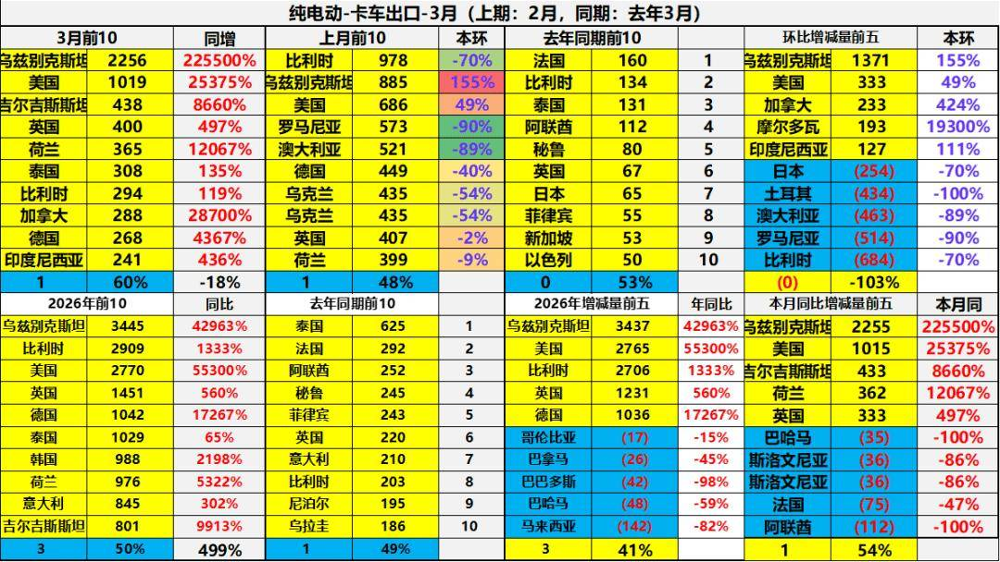

纯电动的货车出口市场近期暴增，这主要是特殊用车属性的暴增，在海外市场形成超强的场景便利和使用成本优势。

六、客车分类别出口走势

1、客车出口总体

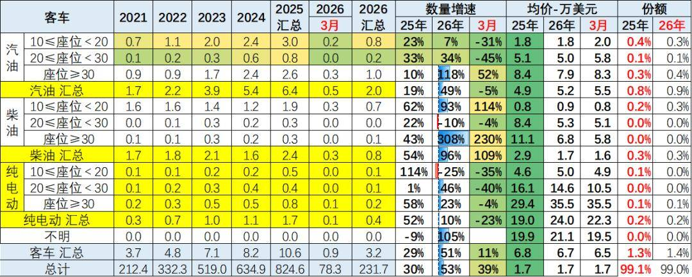

近期世界客车需求出现一定下降，导致前两年的中国客车出口持续萎缩，从2019年的6.4万辆下降到2022年的4.8万辆。2023年以来的世界需求恢复，中国客车2025年的全年达到10.6万辆。

2026年1-3月纯电动客车出口0.4万辆，增长10%的表现一般，柴油客车低基数出口增长较大，汽油大中型客车出口较强。

2、客车出口市场变化特征

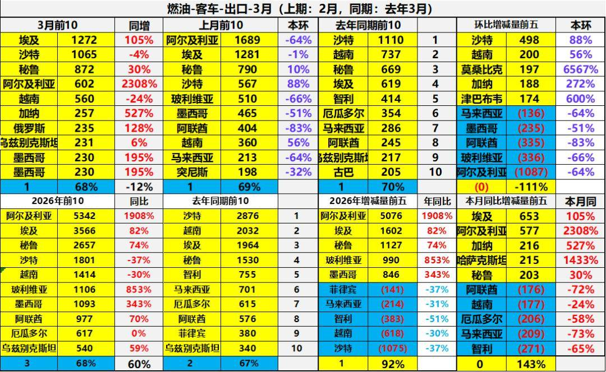

中国燃油客车出口主要市场比较分散，属于欠发达国家为主，市场比较复杂，难以有序持续开展出口。

今年3月燃油客车出口的主力是：埃及1272辆、沙特1065辆、秘鲁872辆、阿尔及利亚602辆、越南560辆、加纳257辆、俄罗斯235辆、乌兹别克斯坦231辆、墨西哥230辆、墨西哥230辆，其中本期较同期增量增大的前五个是：埃及653辆、阿尔及利亚577辆、加纳216辆、哈萨克斯坦215辆、秘鲁203辆。

今年全年燃油客车出口的主力是：阿尔及利亚5342辆、埃及3566辆、秘鲁2657辆、沙特1801辆、越南1414辆、玻利维亚1106辆、墨西哥1093辆、阿联酋977辆、厄瓜多尔617辆，其中今年较去年同期增量增大的前五个是：阿尔及利亚5076辆、埃及1602辆、秘鲁1127辆、玻利维亚990辆、墨西哥846辆。

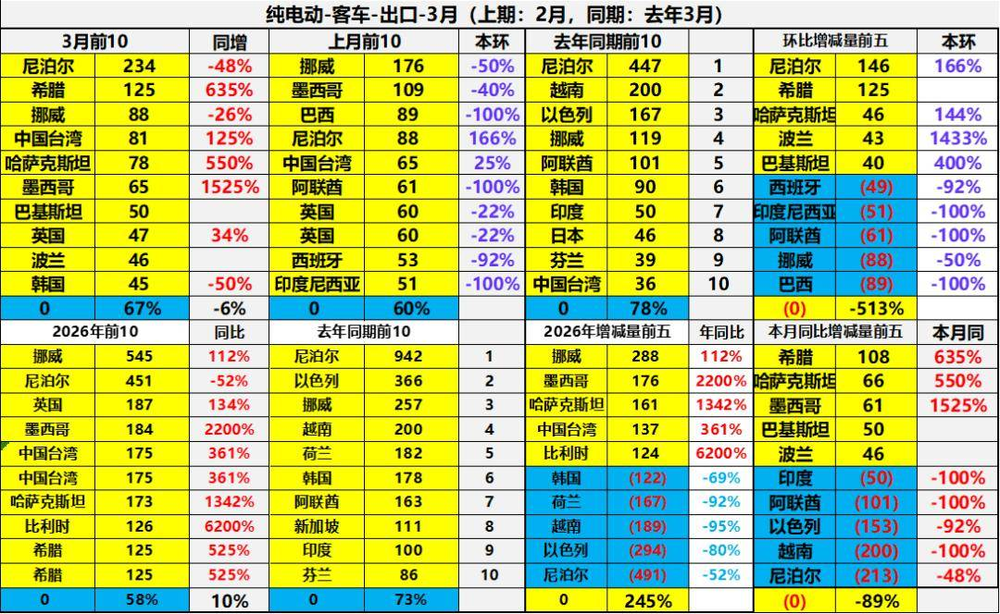

纯电动客车出口市场较小，数据波动较大，今年3月的出口主力是：尼泊尔234辆、希腊125辆、挪威88辆、中国台湾81辆、哈萨克斯坦78辆、墨西哥65辆、巴基斯坦50辆、英国47辆、波兰46辆、韩国45辆，其中本期较同期增量增大的前五个是：希腊108辆、哈萨克斯坦66辆、墨西哥61辆、巴基斯坦50辆、波兰46辆。

纯电动客车今年全年的出口主力是：挪威545辆、尼泊尔451辆、英国187辆、墨西哥184辆、中国台湾175辆、中国台湾175辆、哈萨克斯坦173辆、比利时126辆、希腊125辆，其中今年较去年同期增量增大的前五个是：挪威288辆、墨西哥176辆、哈萨克斯坦161辆、中国台湾137辆、比利时124辆。
