# 2026年1-3月中国汽车进口10万辆、增3%

- 公開日時: 2026-04-26 14:12（北京時間）
- 出典: [搜狐号・崔东树](https://www.sohu.com/a/1014804852_115312)
- テーマ（自動判定）: 輸入
- 画像: 15枚

---

由于2025年1月基数低，虽然美国与伊朗战争导致运输受阻，3月进口车进口下滑较大，但2026年1-3月进口汽车10万辆，同比增3%，这仍是近期少见的1-3月增长，主要原因是因为25年末的低基数。随着国产车的崛起和国际品牌本土化加速，近几年汽车进口持续低迷，进口车持续3年负增长，如果熨平波动，则是连续8年的负增长。。

3月进口车下滑压力仍较大。2026年3月进口最高的前10国家是：日本18154辆、德国3929辆、斯洛伐克1290辆、美国1226辆、英国978辆、墨西哥774辆、泰国542辆、奥地利344辆、韩国86辆、意大利55辆。，其中本期较同期增量增大的前五个是：日本654辆、泰国542辆、墨西哥256辆、奥地利187辆、加拿大12辆。

2026年1-3月进口最高的前10国家是：日本52382辆、德国18446辆、美国9085辆、英国6034辆、斯洛伐克5653辆、墨西哥1451辆、泰国1374辆、奥地利1081辆、瑞典489辆、芬兰299辆。其中本期较同期增量增大的前五个是：日本21869辆、泰国1251辆、奥地利386辆、美国214辆、芬兰159辆。

在进口车近几年持续下滑的背景下，今年的豪华市场走势分化，雷克萨斯销量实现同比基本持平，稳定保持进口豪华车的第一位置。但部分豪华品牌异常波动，行业运行压力较大，需要更多的政策和信贷支持。

一、中国汽车进口总体走势

1、汽车进口增速特征

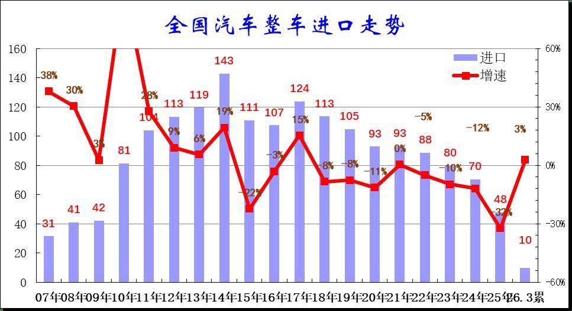

在2014年进口车达到143万辆峰值后下行，2016-2017年进口增速稍有企稳改善，2018年以来至今持续下滑，2024年进口规模持续锐减，全年进口仅有70万辆，同比下降12%。而2025年进口汽车48万辆，同比下降32%，进口车持续萎缩压力较大。2026年1-3月进口汽车10万辆，同比增3%，低基数下的26年进口车进口量稍有回升。

由于2025年1月基数低，虽然美国与伊朗战争导致运输受阻，3月进口车进口下滑较大，但2026年1-3月进口汽车10万辆，同比增3%，这仍是近期少见的1-3月增长，主要原因是因为25年末的低基数。随着国产车的崛起和国际品牌本土化加速，近几年汽车进口持续低迷，进口车持续3年负增长，如果熨平波动，则是连续8年的负增长。

2、整车进口月度走势

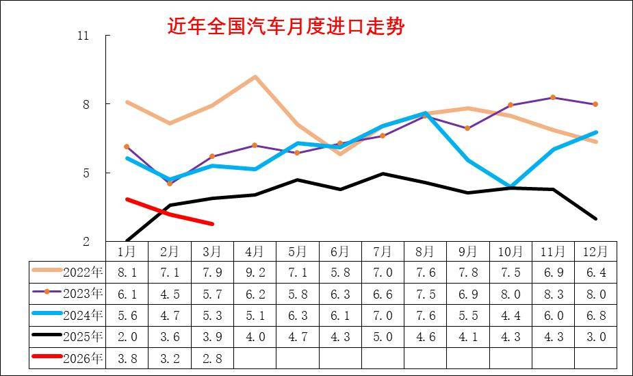

2025年初的进口下滑幅度惊人，主要也是因为2024年年末特朗普上台前的担忧。随着中美贸易的逐步可预期，2025年进口车逐步回升，7月创出当年新高,但随着自主高端崛起，8-11月进口车持续低迷，2025年12月异常下滑回落，推动2026年1月的增长。

2026年初的进口暴涨是由于上年12月的剧烈下滑。由于美国与伊朗战争导致运输受阻，3月进口车进口下滑较大，燃油车市场回归沉闷的平缓下滑趋势。

3、汽车整车进口结构特征

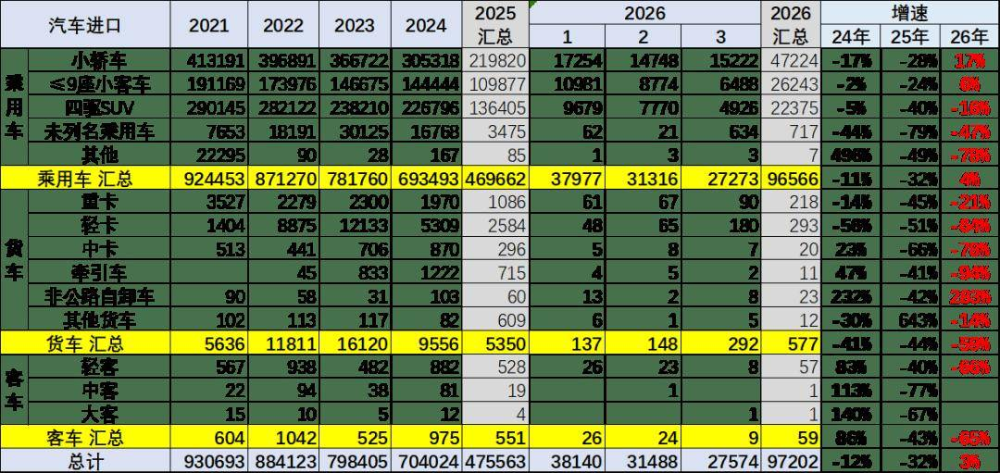

2019年以来各类进口车型全面下滑。传统的卡车目前快速回落明显。2026年1-3月乘用车的进口小于需求，持续去库存。

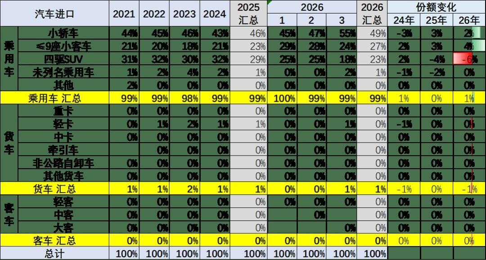

今年汽车进口结构中的乘用车占到超99%的绝对主力地位，如果包含轻卡中的皮卡，则乘用车数量占比更高。

乘用车中2026年1-3月进口轿车占比49%；进口四驱SUV进口占比23%；而的未列名机动车进口占比几乎为零。2026年的商用车进口表现一般，尤其是轻卡进口下滑较大，近期的进口皮卡也很弱。

4、新能源汽车整车进口结构特征

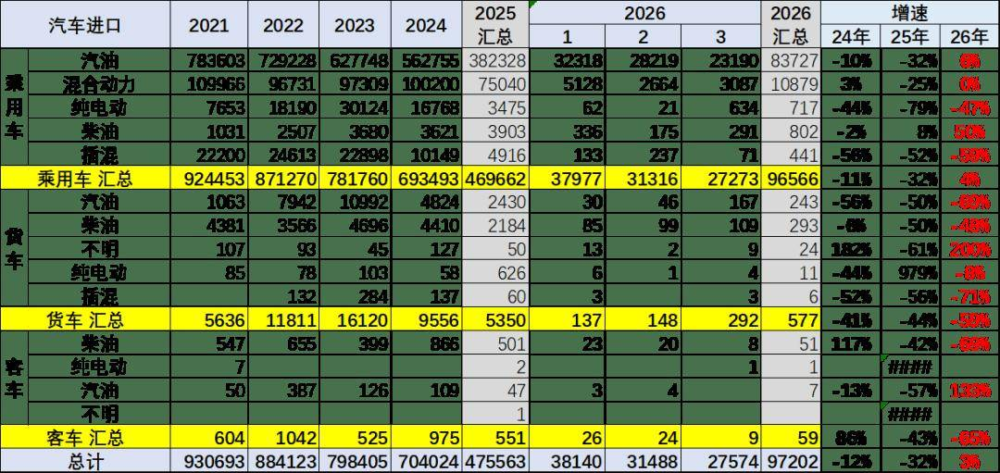

2021-2023年进口新能源乘用车实现持续高增长，2025年出现剧烈下滑。2026年1-3月进口纯电动乘用车降47%；插混降59%，进口新能源乘用车表现较弱。

乘用车的传统燃料进口车市场回升较大，混合动力占比回升。而汽油货车的占比下降，与牵引车需求相关。

2026年的高端汽油皮卡进口表现较差。近期国内新能源皮卡市场表现相对较强，但进口纯电动皮卡车市场表现相对较差。

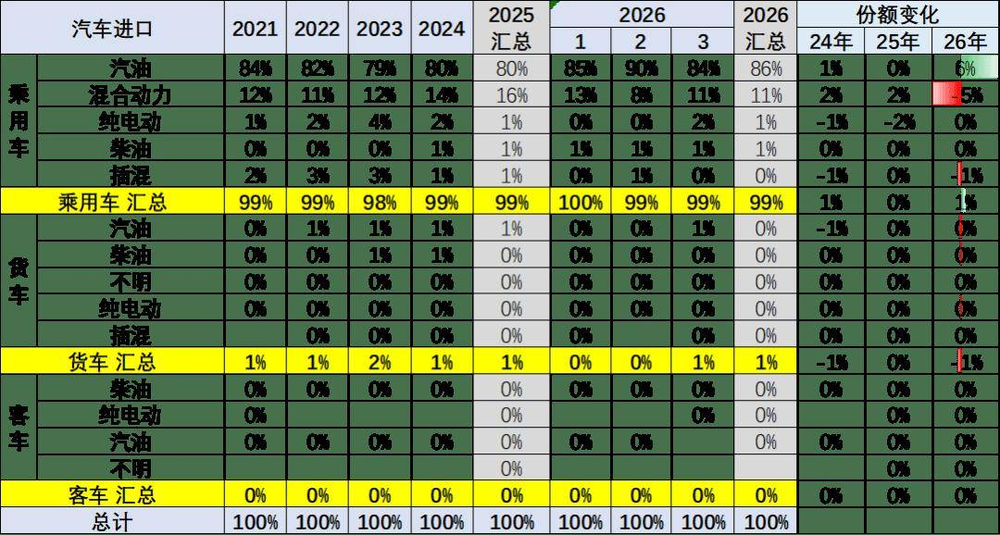

2024年进口乘用车新能源进口占比达到3%，2026年1-3月进口新能源车占比下降到1%，纯电动较去年有大幅下降，燃油乘用车仍是绝对主力。货车中的汽油车比例仍是较高的，纯电动货车下滑巨大。

5、乘用车整车进口排量结构特征

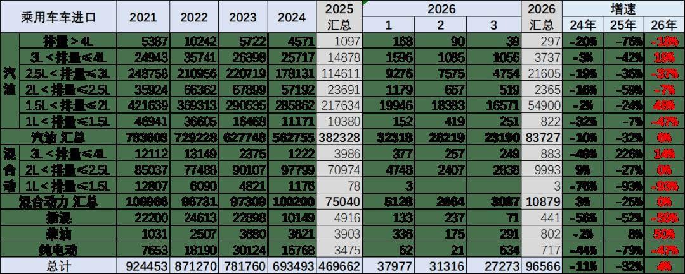

乘用车的进口车型排量集中于2升以下汽油车型，去年3-4升抗跌能力较好，今年1.5-2.5升相对较好。

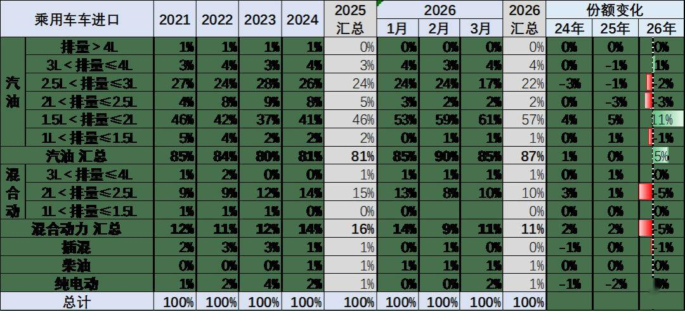

乘用车的进口车型排量原本集中于2升以下汽油车型，2026年1-3月占比整个进口车的进口量58%的比例，较去年增加11个点。

高端大排量车型下降的稍慢。近几年的3-4升的大排量进口车销量下降慢，占比提升。由于国内市场的车型主要2升以下，因此进口的3升以上的竞争压力较小。

二、汽车进口市场格局

1、分国别进口特征

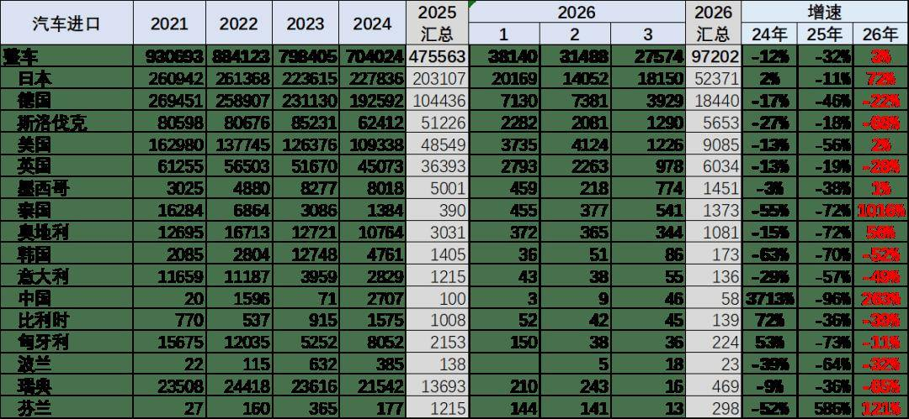

中国乘用车的进口国别仍以日本、德国、美国、斯洛伐克、英国等为核心，近期日本和德国进口表现较稳，斯洛伐克进口损失较大。

2、整车进口月度走势

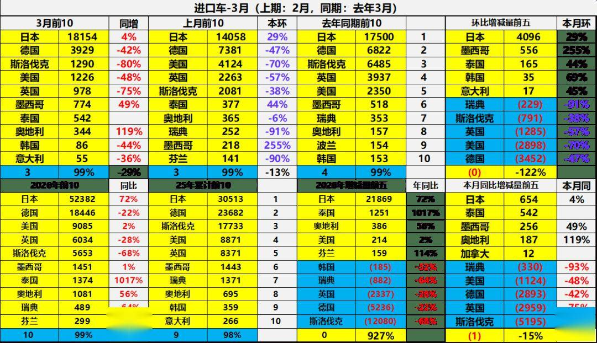

3月进口车下滑压力仍较大。2026年3月进口最高的前10国家是：日本18154辆、德国3929辆、斯洛伐克1290辆、美国1226辆、英国978辆、墨西哥774辆、泰国542辆、奥地利344辆、韩国86辆、意大利55辆。，其中本期较同期增量增大的前五个是：日本654辆、泰国542辆、墨西哥256辆、奥地利187辆、加拿大12辆。

2026年1-3月进口最高的前10国家是：日本52382辆、德国18446辆、美国9085辆、英国6034辆、斯洛伐克5653辆、墨西哥1451辆、泰国1374辆、奥地利1081辆、瑞典489辆、芬兰299辆。其中本期较同期增量增大的前五个是：日本21869辆、泰国1251辆、奥地利386辆、美国214辆、芬兰159辆。

3、新能源汽车整车进口国家特征

2025年国产车竞争力较强，进口主力国家的新能源车进口下滑52%。2026年进口新能源乘用车压力进一步加大，德国进口车很差，美国进口新能源还有一点销量。

三、汽车市场销量格局

1、进口车总体销量

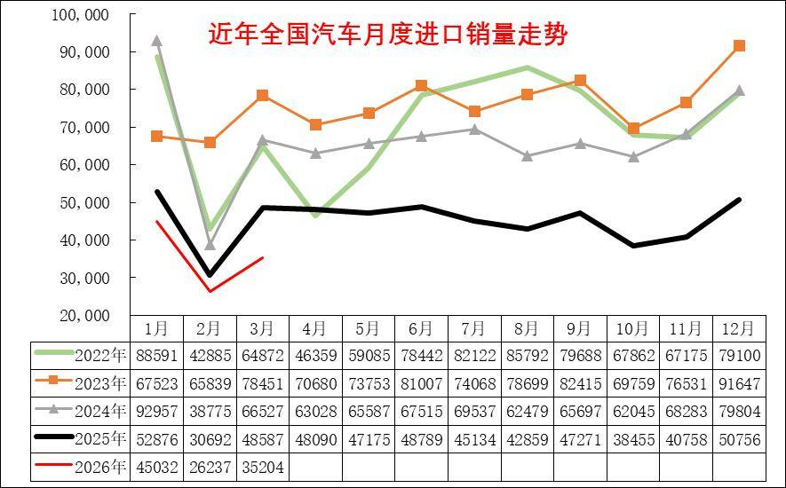

进口车在1-3月均稍低于去年走势，下滑幅度小于前几年走势，年初进口燃油车表现较好。

由于中国自主车企强大，进口车销量表现持续走差，也弱于国内国产豪华车市走势。

2022-2024年进口车的销量在80-90万辆徘徊，市场压力逐步加大。2025年进口车交强险数据为54万辆，同比下降33%。由于2025年初低基数的促进，今年1-3月进口车零售11万辆，下滑19%的表现不太差，3月下降到3.5万辆降28%，未来压力仍大。

2、进口车品牌特征

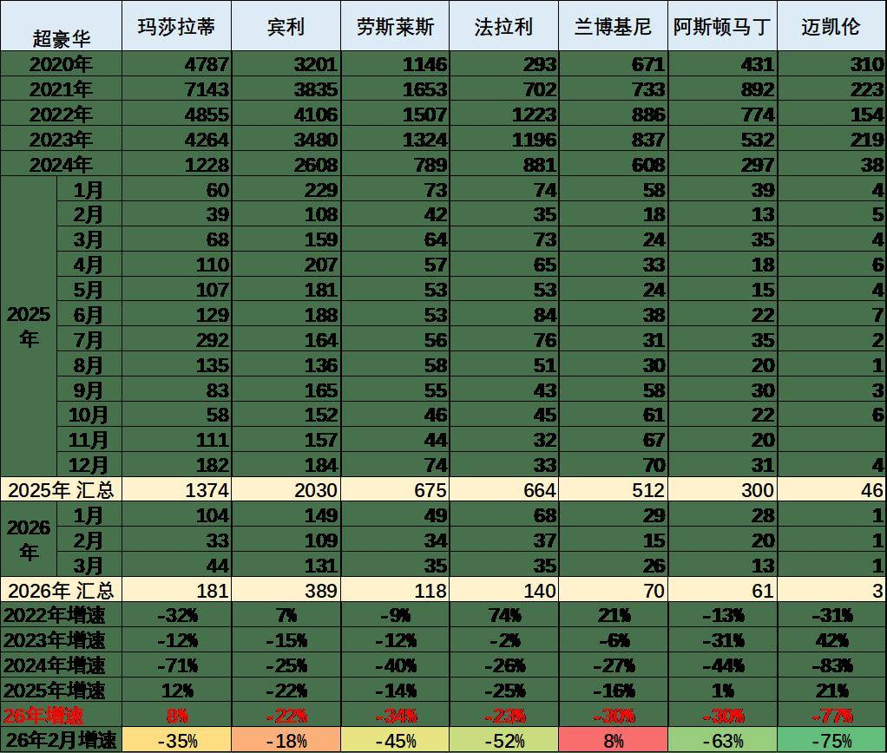

过去几年进口超豪华车持续增长，但2023年以来出现较大的下滑，2024年加速下滑，2026年1-3月下滑仍较严峻。超豪华的走势出现巨大波动，2025年玛莎拉蒂的走势总体异常较高，2026年回落。宾利和劳斯莱斯的走势低迷。法拉利表现较坚挺。超豪华总体走弱，体现超高端消费群体的购买力暂时放缓，近期抛售带来的超豪华车销量异常，市场价格合理回归。

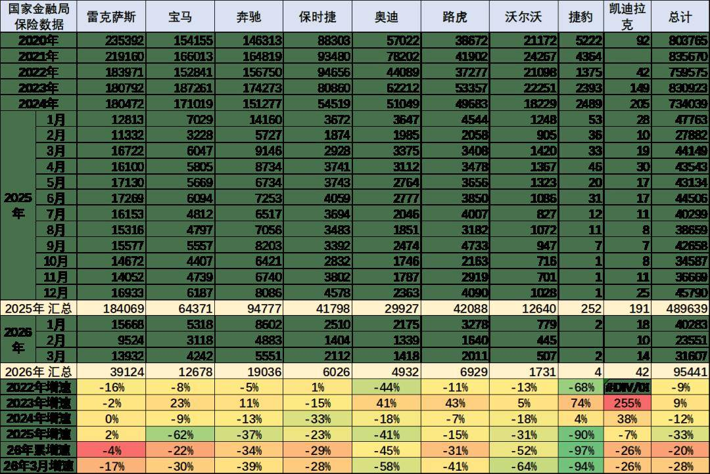

目前进口车主要靠豪华车的需求支撑，非豪华进口车剧烈萎缩。进口车中的主力进口豪华车占比大幅增长。合资品牌进口车快速萎缩，欧系的大众进口车等部分品牌进口车萎缩剧烈。

2025年的雷克萨斯的进口保险零售数据18.4万台，同比增长2%，并且雷克萨斯2025年销量高于2022年销量，在2022-2024年连续三年保持在18万水平基础上，2026年1-3月仍处于过去四年的高位，其表现的确很强。保时捷、路虎的表现总体相对稍好。

3、进口超豪华车品牌区域变化特征

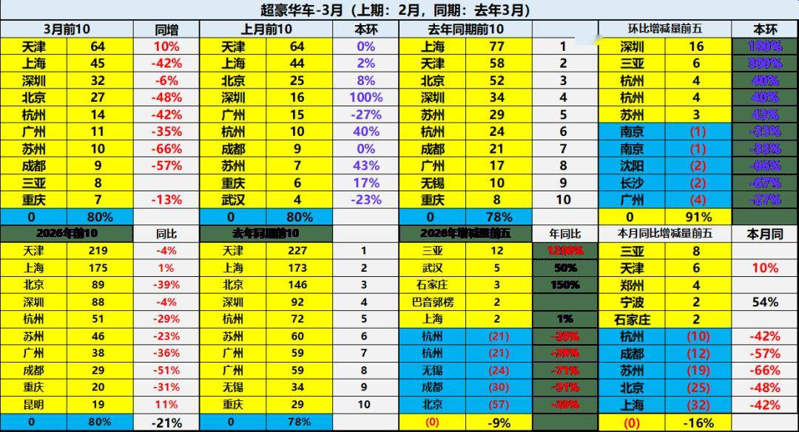

进口车超豪华市场的需求总体偏弱，天津保持超豪华第一，近期上海下滑较大，深圳表现稍好。

上海、北京、成都、杭州、深圳、广州与宁波等传统富裕地区的进口超豪华车市场压力较大。新能源车对超豪华的影响体现，由于超豪华的市场萎缩，市场的需求总体不佳，价格体系压力大。

4、进口豪华车区域变化特征

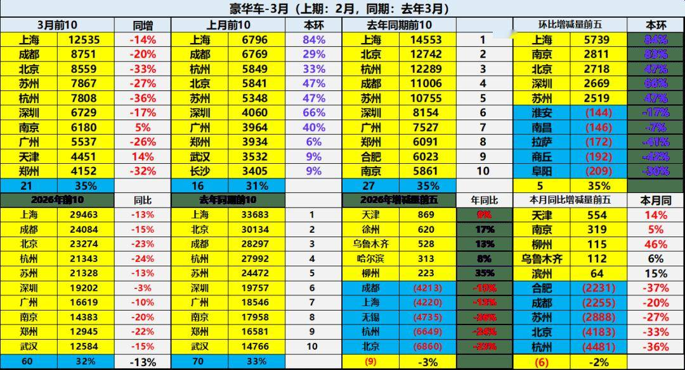

总体国产与进口豪华车市场的需求总体偏弱，其中北京、杭州、成都、上海、无锡等传统富裕地区的豪华车市场压力较大。今年的天津、徐州、乌鲁木齐、哈尔滨等中西部地区较强。

附：近日信息合集
