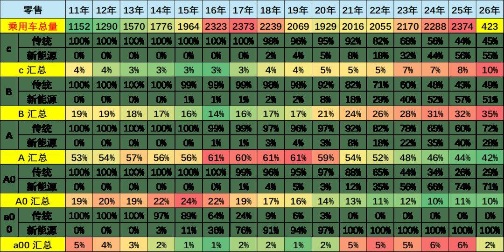
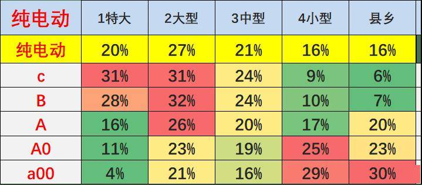
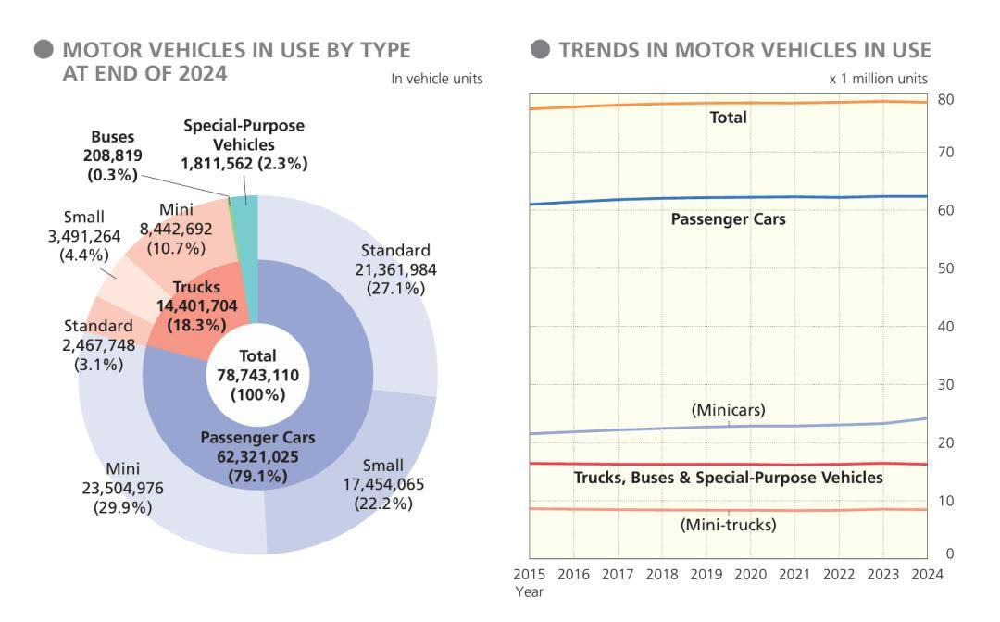

# 建议推出经济型电动车标准

- 公開日時: 2026-05-06 18:56（北京時間）
- 出典: [搜狐号・崔东树](https://www.sohu.com/a/1019014357_115312)
- テーマ（自動判定）: その他
- 画像: 3枚

---

.

一、经济型电动车很重要

当前，中国汽车市场呈现“高端车型强势崛起、但低端市场相对低迷”的格局，今年车市相对低迷，低端车型萎缩成为制约行业复苏的关键瓶颈。与此同时，我国老龄化进程持续加快，老年群体出行需求日益迫切，而现有电动车产品要么价格偏高、要么合规性不足，难以适配大众尤其是老年群体、县乡市场的代步需求。

县乡市场电动车普及滞后，核心原因在于缺乏明确的经济型电动车标准，导致低价、实用的代步车型合规性不足，既无法满足民生需求，也难以激活下沉市场活力。

核心倡议：中国应加快推出经济型电动车标准，完善C7驾照、推动其体系化普及并建立世界优势。当前，经济型电动车已成为全球代步车型主流，凭借经济、便捷、实用的特点，适配多个国家和地区的民生需求，推出统一标准既是适配国内老龄化、县乡市场等需求、破解车市低迷等行业痛点的关键，也是对接国际市场、推动汽车产业升级、培育本土出海品牌的重要举措。

早在2008年，乘联会秘书长饶达老师和我共同提出经济型车标准相关建议，饶老和我共同认为经济型车是适配民生需求、推动汽车普及的重要方向，有利于自主品牌全方位发展，也契合当前我国汽车产业发展与民生保障的现实需求。

二、海外参考：欧洲推进E-Car，日本K-Car提供成熟经验

海外参考核心：近期欧洲正重点推进经济型纯电动车（E-Car）标准落地与产业布局，形成了兼具低碳化、国际化的标准体系与政策支撑；日本K-Car经过数十年发展，已形成完善的标准体系、市场生态与政策配套，两者从不同维度为我国经济型电动车标准制定、产业培育与海外拓展提供了宝贵借鉴，助力我国标准科学制定、高效落地。

（一）欧盟E-Car：重点推进的新型经济型纯电动车

发展现状：前期，欧盟委员会主席冯德莱恩在国情咨文中宣布，将与整车制造商和供应链企业合作，启动 “经济型小型车振兴计划”，并提出设立全新的 “E-Car ”类别-以环保（Environmental）、经济（Economical）和欧洲（European）为核心标准，鼓励本地制造与供应链重构。欧盟已正式启动平价小型车振兴计划，由欧盟委员会牵头推进，E-Car标准已逐步完善，明确计划2027年实现规模化上市。目前，大众、雷诺、斯柯达等欧洲本土车企纷纷布局E-Car车型研发，欧盟纯电市场加速崛起，2025年纯电动汽车注册量首次超过传统汽油动力汽车，为E-Car落地奠定良好基础，也为我国车型对接欧洲标准、拓展欧洲市场提供了重要契机。

目前的标准特征：以纯电为核心，聚焦低碳化、标准化与国际兼容性，明确归入M1类乘用车（命名为“M1E”），标准细节清晰且针对性极强。车身尺寸严格限定为车长不超过4.2米、车宽不超过1.6米、车高不超过1.6米，适配欧洲城市狭窄街道与密集车位；动力上限定电机峰值功率≤15kW（约20马力），最高时速≤90km/h，续航≥100km（WLTP标准），能耗≤13kWh/100km，凸显低碳节能特点；安全上保留双气囊、ESC车身稳定系统等基础配置，豁免自动紧急制动（AEB）等高级主动安全配置，平衡安全与成本；合规上需符合欧7零排放标准，满足WP29信息安全与软件升级强制法规。

借鉴意义：其“低碳化导向、国际化兼容、双渠道扶持”的模式，为我国经济型电动车电动化、标准化、国际化发展提供重要参考，尤其是政策配套与标准细节的衔接，助力我国车型突破欧洲技术壁垒，顺利对接欧洲市场需求。

（二）日本K-Car：成熟普及的经济型车标杆

标准特征：聚焦小尺寸、低成本、基础安全，适配日本人口密集、道路狭窄的国情，标准规格严格且细致。车身尺寸限定为长≤3.4米、宽≤1.48米、高≤2米，整备质量≤600kg；动力上，燃油版排量上限0.66升，电动版电机功率≤47千瓦，均以低能耗为核心；安全上保留基础碰撞保护、双气囊等核心配置，豁免部分高级主动安全配置，控制研发与制造成本；同时明确车辆需满足日本本土安全与环保标准，兼顾实用性与合规性。

政策支持：配套全链条政策扶持，降低民众购车与使用成本，推动K-Car普及。购车端，无需提供车位证明即可购买，享受购车补贴与购置税减免，部分地区还推出低息贷款政策；使用端，免征或减半征收年度车船税，在高速通行、停车等方面享受优惠；生产端，对生产K-Car的车企给予研发补贴与产能扶持，简化车型认证流程，鼓励车企聚焦K-Car研发与生产，形成“政策引导、企业响应、市场接受”的良性循环。

发展现状：日本K-Car市场成熟度极高，市场渗透率接近40%，成为日本每“2辆半”车里就有1辆的主流车型，是老年群体、普通家庭、单身人士的首选代步工具。经过数十年发展，培育出铃木、斯巴鲁等本土特色品牌，其中铃木依托K-Car技术与标准，成功出海印度等新兴市场，推出符合当地需求的车型，长期占据印度乘用车市场40%以上份额，成为印度汽车市场领军品牌，出海经验成熟且可复制。

借鉴意义：形成了“标准培育品牌、品牌拓展市场”的完整生态，其“贴合国情、民生优先、政策联动、品牌出海”的思路，不仅为我国经济型电动车适配国内老年群体、县乡市场提供参考，更为我国培育本土出海品牌、拓展东南亚、印度等新兴市场提供了直接借鉴。

三、必要性：契合多重需求，破解行业痛点

国际市场需求：经济型电动车是世界通用代步车型，具有广阔的全球市场空间。欧洲正推进E-Car布局，存在低端电动代步车市场空白；东南亚“油改电”加速推进，民生代步需求旺盛；印度等新兴市场小型车需求突出，这些地区均为我国经济型电动车提供了巨大的出口潜力，推出统一标准可依托我国产业链优势与高性价比，顺利拓展海外市场。

国内民生需求：我国老龄化进程持续加快，老年群体数量不断增加，老年群体对低价、简便、安全、易操作的代步车需求日益迫切，而当前市场现有车型难以充分适配老年群体需求。经济型电动车可精准对接这一需求，同时适配县乡市场消费能力，市场空间十分广阔。

行业发展需求：当前我国车市持续低迷，核心症结之一是低端经济型车型萎缩，县乡等下沉市场优质低价车型供给不足。推出经济型电动车标准，可引导车企聚焦下沉市场与老年群体需求，丰富产品供给，激活下沉市场活力，有效缓解车市低迷态势。

标准完善需求：我国目前尚无统一的经济型电动车标准，导致低端电动车市场乱象丛生，部分产品存在安全隐患、质量参差不齐、规格不统一等问题，既影响消费者权益，也制约行业健康发展。推出统一标准可规范生产销售行为，淘汰劣质产品，推动行业向高质量、规范化方向发展。

四、推出经济型电动车标准的建议

核心建议：制定中国经济型电动车统一标准。充分参考欧盟E-Car的低碳化、国际化标准与日本K-Car的民生适配、低成本标准，结合我国国情，明确车身尺寸、动力参数、安全配置、续航里程等核心指标，既适配国内老年群体、县乡市场的代步需求，也兼顾国际市场准入标准，为国内普及与海外出口奠定基础。

配套建议：推出C7专项驾照。专门适配经济型低功率电动车，简化考试流程，放宽老年群体的考核要求，重点考核基础驾驶技能与安全意识，降低老年群体与新手司机的驾驶门槛，推动经济型电动车体系化普及，激活潜在消费群体。

辅助建议：完善配套激励与监管政策。出台针对性购车补贴、税费减免政策，重点向老年群体、县乡市场倾斜；加快县乡地区与海外出口重点区域的充电配套设施建设，提升产品使用便利性；规范市场监管，严厉打击劣质产品，引导车企聚焦需求研发适配车型，培育本土特色出海品牌，参考铃木印度模式，推动我国经济型电动车走向全球。

五、推出经济型电动车标准的预期成效

激活市场活力：通过统一标准与配套政策，有效激活国内低端电动车市场与海外出口市场，带动经济型电动车销量提升，缓解车市低迷态势，推动汽车产业稳步复苏，带动上下游产业链协同发展。

保障民生需求：精准解决老年群体出行难问题，适配老龄化社会发展趋势，让老年群体与县乡居民享受到经济、便捷、安全的出行服务，彰显民生温度，助力共同富裕。

推动产业升级：规范经济型电动车行业发展，淘汰劣质产品，引导行业向高质量方向转型；培育本土特色品牌，推动我国经济型电动车突破海外技术壁垒，拓展海外市场，实现民生保障、产业升级与出口拓展的多重赋能。

六、结论与建议

总结核心：推出经济型电动车标准，是适配国内老龄化与县乡市场需求、破解车市低迷痛点、对接国际市场、推动我国汽车产业高质量发展的迫切需求。欧盟E-Car的推进经验与日本K-Car的成熟实践，均证明了标准引领与政策配套的重要性，也为我国提供了可借鉴的路径。

建议我们加快经济型电动车标准的制定与政策落地，完善C7驾照、补贴、监管等配套举措；呼吁车企积极响应政策导向，聚焦民生与出口需求，优化产品设计、提升产品质量，培育本土出海品牌；各方协同发力，共同推动经济型电动车体系化普及，助力我国汽车产业实现新突破，让中国经济型电动车为全球电动车普及做出更大贡献。
