# 车市扫描-2026年16期（4月27日-4月30日）

- 公開日時: 2026-05-08 17:46（北京時間）
- 出典: [搜狐号・崔东树](https://www.sohu.com/a/1019942136_115312)
- テーマ（自動判定）: 車市スキャン（週次）
- 画像: 22枚

---

主要信息源自乘联分会每日新闻等

中国汽车流通协会

乘用车市场信息联席分会（乘联分会）

网站：http://www.cpcaauto.com

一、本周车市概述1.2026年4月全国乘用车市场零售低位徘徊

【2026年4月1-30日乘联会市场分析要闻】

4月1-30日全国乘用车厂家批发213.0万辆，同比去年同期下降3%，较上月同期下降10%；今年以来累计批发799.7万辆，同比去年同期下降6%。4月1-30日市场零售140.6万辆，同比去年同期下降20%，较上月同期下降15%；今年以来累计零售562.8万辆，同比去年同期下降18%。

4月1-30日全国乘用车厂家新能源批发122万辆，同比去年同期增长7%，较上月同期增长7%；今年以来累计批发394.9万辆，同比去年同期下降1%。4月1-30日新能源车市场零售88.3万辆，同比去年同期下降5%，较上月同期增长4%；今年以来累计零售279.2万辆，同比去年同期下降17%。

2026年4月1-30日全国新能源市场零售渗透率62.8%；新能源厂家批发渗透率57.3%。

4月第1-5周全国纯燃料轻型车生产62.9万辆，同比去年同期下降32%，较上月同期下降30%。4月第1-5周混合动力与插混总体生产30.5万辆，同比去年同期下降20%，较上月同期下降11%。

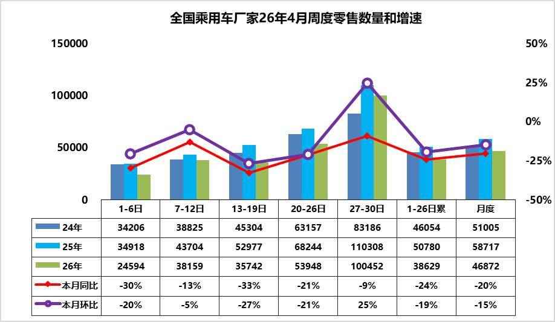

4月第1周乘用车市场日均零售2.5万辆，同比去年同期下降30%，较上月同期下降20%。

4月第2周乘用车市场日均零售3.8万辆，同比去年同期下降13%，较上月同期下降5%。

4月第3周乘用车市场日均零售3.6万辆，同比去年同期下降33%，较上月同期下降27%。

4月第4周乘用车市场日均零售5.4万辆，同比去年同期下降21%，较上月同期下降21%。

4月第5周乘用车市场日均零售10.0万辆，同比去年同期下降9%，较上月同期增25%。

4月1-30日市场零售140.6万辆，同比去年同期下降20%，较上月同期下降15%；今年以来累计零售562.8万辆，同比去年同期下降18%。

4月第一周受清明假期因素影响，实际有效销售及上牌时间较短，季度末成交冲刺后、4月近几周成交节奏放缓，直接导致零售量偏低，市场整体表现较为清淡。随着高油价的冲击逐步适应，北京车展开幕，4月末车市零售数据明显改善。

同时，国际油价持续高涨推高用车成本，车市终端热度有一定幅度的下降，燃油车与新能源分化较三月进一步加剧。随着成本上涨，消费压力加大，燃油车的零售量进一步放缓，新能源车好于燃油车表现，但目前尚未弥补燃油车丢量损失。

当前车市消费开口难打开，连续两个季度同比下滑，经销商卖车不盈利、不卖更亏，厂家难以补贴，造成恶性循环，渠道问题已经成为当下流通领域最大的问题，需要重点关注和支持。

2.2026年4月全国乘用车厂家销量低位平稳

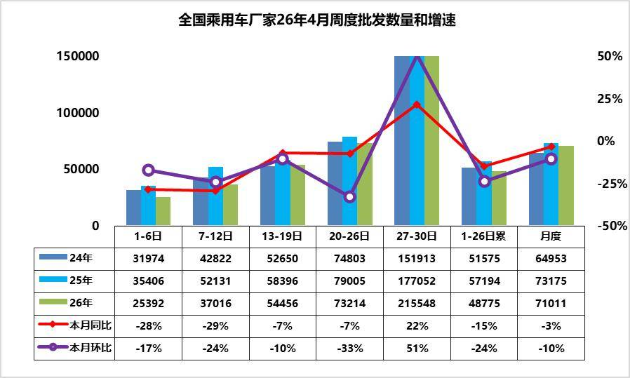

4月第1周批发日均2.5万台，同比去年4月同期下降28%，环比上月同期下降17%。

4月第2周批发日均3.7万台，同比去年4月同期下降29%，环比上月同期下降24%。

4月第3周批发日均5.4万台，同比去年4月同期降7%，环比上月同期下降10%。

4月第4周批发日均7.3万台，同比去年4月同期降7%，环比上月同期下降33%。

4月第5周批发日均21.6万台，同比去年4月同期增22%，环比上月同期增51%。

4月1-30日全国乘用车厂家批发213.0万辆，同比去年同期下降3%，较上月同期下降10%；今年以来累计批发799.7万辆，同比去年同期下降6%。

近期车市相对平淡，真正新车不多、价格稳、促销稳，消费者的观望心态仍较强。随着一季度末的冲刺完成，经销商的库存相对较高，4月初的进货节奏较慢。其中新能源批发同比降幅大于整体车市，反映出厂家针对终端需求低迷现状，主动收缩生产与供货节奏，避免库存进一步积压。一般每月4周的数据，由于今年的4月下旬多一周的数据，因此拆分后的上月日均同期基数稍高，第四周环比下滑稍大，第五周明显改善。

产品、技术加速迭代，3月以来虽然新车不多，但行业共召开80余场新车新技术发布会，希望北京车展前提前获取热度和订单，但造成客户对新车的观望。4月下旬北京车展新车集中上市，且近期终端价格稳定，进一步加重消费者观望情绪。当前批发走弱，既是对终端零售低迷的被动适配调整，也是车企主动控制产销节奏、缓解渠道压力的理性选择。今年以来出口市场持续较强，形成出口拉动批发的走势特征。总体来看，批发端与零售端同步下滑，市场供需两端均开局不强。随着后续终端需求逐步回暖、库存压力缓解，厂家批发有望在最后几天大幅回升，批零增速差将逐步收敛。

3.2026年1-3月世界新能源车分析

2026年1-3月世界汽车销量达到2240万台，新能源汽车达到453万台。2026年1-3月的新能源车份额达到20.2%，其中纯电动车的占比达到13.8%，插电混动达到6.4%的汽车比例，混合动力达到7.2%的表现优秀。

由于高关税和新能源补贴取消的涨价因素，美国新能源车2026年3月销量11.2万台同比降32%，1-3月美国新能源车销量16万台，降低31%。欧洲新能源乘用车3月35万台同比降5%，2026年1-3月92万台同比增10%。

由于中国新能源车海外销量大增，国内偏弱，因此2025年中国新能源乘用车世界份额68.3%；2026年1-3月中国新能源乘用车世界份额降到61%的水平。中国在世界纯电动车市场份额表现相对平稳，2023 -2025年的份额在63%的左右份额水平；2026年中国在世界纯电动车市场份额56%份额，年初因素的中国纯电动车表现暂时较差。中国在世界插电混动份额表现遥遥领先。2025年中国在世界插电混动份额达到76.4%的超高水平，2026年中国在世界插电混动份额达到73%的高水平，中国在世界插电混动市场呈现超强的表现。

由于自主新能源出口表现较好，而美国变化大，因此自主新能源乘用车海外市场销量份额提升较大。2025年自主新能源乘用车海外市场销量份额达到15.8%，提升较大。2026年自主新能源乘用车海外市场销量份额达到22%，进一步大幅跃升。

4.2020-2025年世界汽车上市公司综合运营特征分析

受疫情、全球芯片短缺、大宗商品涨价冲击，产业先深跌、后反弹再温和增长。全球汽车产销重心持续向东亚转移，中国稳居全球最大消费市场、制造基地和出口大国；自主品牌快速崛起，在全球车企梯队、新能源产业链中话语权大幅提升，形成东升西降的格局态势。新能源汽车渗透率连年跨越式攀升，产业链利润向上游转移，从应收应付账期看电池端强势地位不断凸显。

2020-2025年，全球汽车产业链格局发生深刻重构，核心指标呈现明显分化：行业总营收从14万亿元增至20万亿元，比亚迪营收从1535亿元跃升至8040亿元，跻身全球前十，而传统车企福特、宝马营收增速降至-1%。盈利端，丰田净利润以2316亿元稳居行业第一，福特、Stellantis陷入大额亏损，中国新势力实现扭亏，零跑净利润从-28亿元增至5亿元；毛利率方面，法拉利以51.7%维持高位，比亚迪毛利率从17.8%提升至18.8%，追平日系主流品牌。库存与资金效率上，整车行业存货周转天数从55天降至54天，中国车企效率领跑，比亚迪、上汽控制在50天左右；账期差（应付-应收）分化显著，宁德时代达177天、比亚迪达98天，而丰田、LG新能源为负值，产业链话语权加速向中国品牌与头部电池企业集中。

5.2026年3月俄罗斯车市分析-自主车企份额54%

2026年1-3月俄罗斯汽车销量达到29.3万辆的低位水平，同比增3%。2026年1-3月中国出口俄罗斯19.2万辆，自主品牌俄罗斯销量15.9万辆，当地销量是中国出口的83%，总体相对平衡。

2025年俄罗斯的中国自主车企份额回升到57.2%。2026年3月自主车企在俄罗斯份额仍有54.4%。面对俄罗斯的复杂环境，自主品牌多生孩子好打架的战略意义重大。自主品牌的整车官方出口，平行出口、绕道出口、本地化建厂、合资组装等各种模式齐上阵，大量的品牌群狼作战，实现了很好的效果。中国自主新能源车销量在俄罗斯车市总体表现是不错的，尤其是以增程式插电混动等高端车型，实现替代了欧美的豪华车的良好表现。新能源车中表现比较突出的是理想、极氪、岚图等品牌，这些品牌表现相对是极强的特征。而问界，比亚迪、小米等品牌也有一定的销量的表现。

二、本周上市新车1.第二代腾势D9上市35.98万-46.98万元

4月27日，第二代腾势D9上市，新车共推6款，售价区间为35.98万-46.98万元。外观与老款车型基本保持一致。采用10.25英寸液晶仪表、15.6英寸中控屏、15.6英寸开合式副驾屏、17.3英寸吸顶屏。配备天神之眼5.0、3激光雷达、30扬声器帝瓦雷音响、闪充技术等。1.5T插混系统CLTC纯电续航突破401km，纯电车型CLTC续航里程分别为750km，800km。

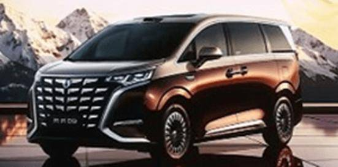

2.东风日产N6新车型上市限时权益价9.89万-12.09万元

4月27日，东风日产N6新车型上市，新车共推3款，售价区间为10.39万-12.79万元，限时权益价9.89万-12.09万元。外观与现款车型基本保持一致。新车配备8155车机芯片、AI助手小尼、后排零压云毯大沙发等。新车搭载1.5L插混动力，CLTC纯电续航180km。

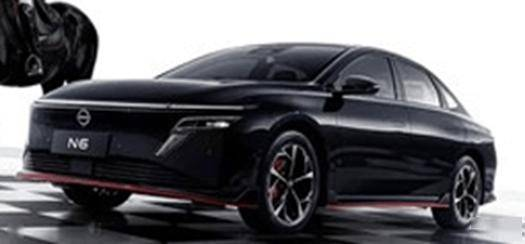

3.东风日产N7新车型上市限时权益价13.49万-14.49万元

4月27日，东风日产N7新车型上市，新车共推4款，售价区间为14.89万-15.89万元，限时权益价13.49万-14.49万元。外观与现款车型基本保持一致。可选装升级锋刃套件以及赛道主题拉花。新车搭载纯电动力，CLTC纯电续航为625km。

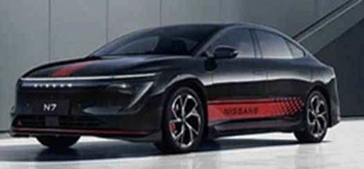

4.星光730尊享型上市

4月27日，星光730尊享型上市。外观与现款车型基本保持一致。新车配备电滑门、AI大模型、自动大灯、感应雨刮等。新车1.5L插混版CLTC纯电续航125km，纯电版CLTC续航500km，燃油版搭载1.5T发动机+CVT变速箱。

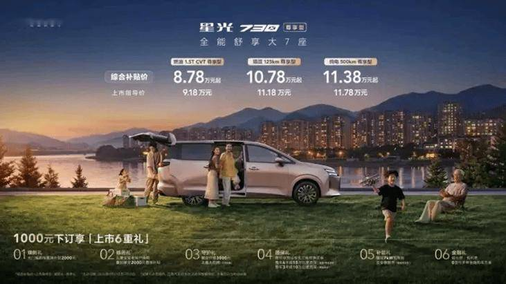

5.领克900五座版上市限时置换价25.48万-30.08万元

4月27日，领克900五座版上市，新车共推3款，售价区间为29.98万-34.58万元，限时置换价25.48万-30.08万元。外观与现款车型基本保持一致。新车后备厢容积达1030L，可拓展至1215L。搭载1.5T，2.0T两套插混系统，CLTC纯电续航分别为220km，280km。

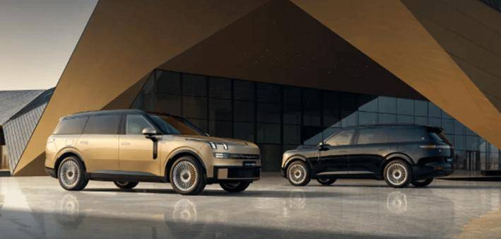

6.吉利银河M7远航家上市限时指导价10.98万-13.78万元

4月28日，吉利银河M7远航家上市，新车共推4款，售价区间为11.98万-14.78万元，上市限时指导价10.98万-13.78万元。新车回归了类似银河L7的设计。采用15.4英寸2.5K中控屏、25.6英寸AR-HUD。配备23扬声器、Flyme Auto 2、256色AI氛围灯、千里浩瀚H3等。新车搭载1.5L插混系统，CLTC纯电续航225km。

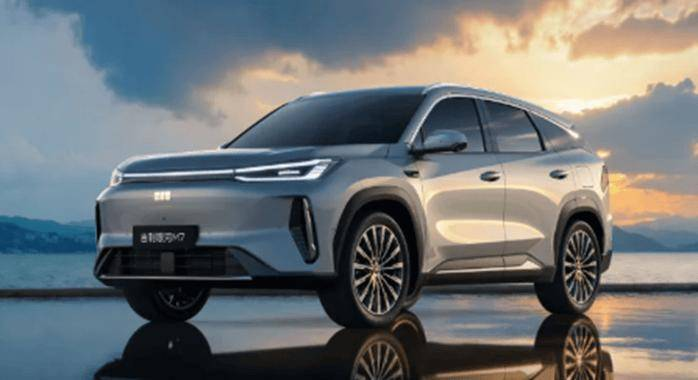

7.吉利星越L i-HEV智擎混动上市限时售价13.07万-14.47万元

4月29日，吉利星越L i-HEV智擎混动上市，新车共推3款，售价区间为14.57万-15.97万元，上市限时售价13.07万-14.47万元。外观与现款车型基本保持一致。配备高通骁龙8155芯片、FlymeAuto、千里浩瀚辅助H3方案等。搭载1.5T油混动力，匹配DHT变速箱。

8.吉利星瑞i-HEV智擎混动上市限时售价9.67万-10.87万元

4月29日，吉利星瑞i-HEV智擎混动上市，新车共推3款，售价区间为10.47万-11.67万元，上市限时售价9.67万-10.87万元。外观与现款车型基本保持一致。配备高通骁龙8155芯片、FlymeAuto、千里浩瀚辅助H3方案等。搭载1.5L油混动力，匹配DHT变速箱。

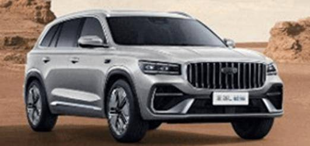

9.别克世纪新款上市售价区间为53.99万-69.99万元

4月28日，新款别克世纪上市，新车共推2款，售价区间为53.99万-69.99万元。新车采用“飞檐展翼” 前脸。配备二排22点按摩、骁龙8155芯片，四座版配备32英寸升降屏+智慧幕墙系统。搭载2.0T 48V轻混系统，匹配9TIP变速箱。

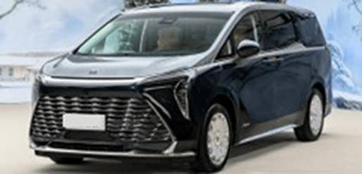

10.埃安AION N60上市限时焕新价10.68万-12.68万元

4月28日，埃安AION N60上市，新车共推3款，售价区间为10.98万-12.98万元，限时焕新价10.68万-12.68万元。新车采用星环式贯穿灯带、贯穿式尾灯组、半隐藏式门把手。采用15.6英寸2.5K中控屏。配备激光雷达+4D毫米波雷达、副驾零重力座椅等。新车CLTC续航里程为410km，510km，610km。

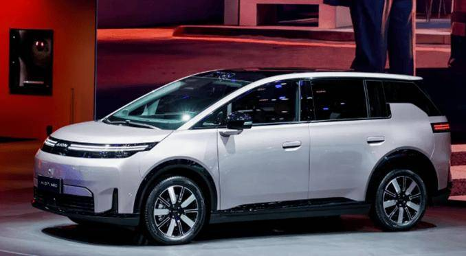

11.新款广汽埃安UT 320星辉版上市限时一口价6.88万元

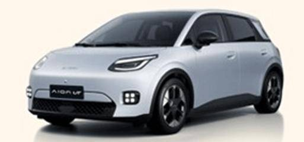

12.新款哈弗H9上市限时换新价17.49-20.49万元

4月28日，新款哈弗H9上市，汽油版推出3款车型，售价区间为19.99-22.99万元，限时换新价17.49-20.49万元；柴油版推出2款车型，售价区间为23.39-24.79万元，限时换新价20.89-22.29万元。新车升高20毫米，最小离地间隙226mm。新车中控屏由14.6英寸升级至15.6英寸。配备Coffee OS 3、坦克转弯、540度全景影像、2.5吨牵引资质等。提供2.0T汽油发动机+8AT变速箱，以及2.4T柴油发动机+9AT变速箱。

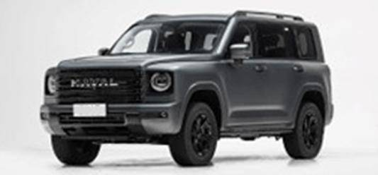

13.凯翼拾月max上市限时权益价4.59万-4.99万元

4月28日，凯翼拾月max上市，新车共推2款，售价区间为4.79万-5.19万元，限时权益价4.59万-4.99万元。新车采用长轴短悬、宽体平顶设计。采用8.8英寸彩色液晶仪表、12.8英寸触控液晶屏。配备360度全景影像、透明底盘、全车无钥匙进入、4G车联网等。新车CLTC纯电续航里程310km。

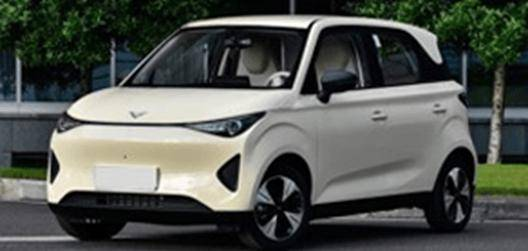

14.比亚迪汉EV闪充版上市售价区间为17.98万-18.78万元

4月28日，比亚迪汉EV闪充版上市，新车共推2款，售价区间为17.98万-18.78万元。外观与现款车型基本保持一致。提供240kW电机、二代刀片电池，CLTC纯电续航为705km。

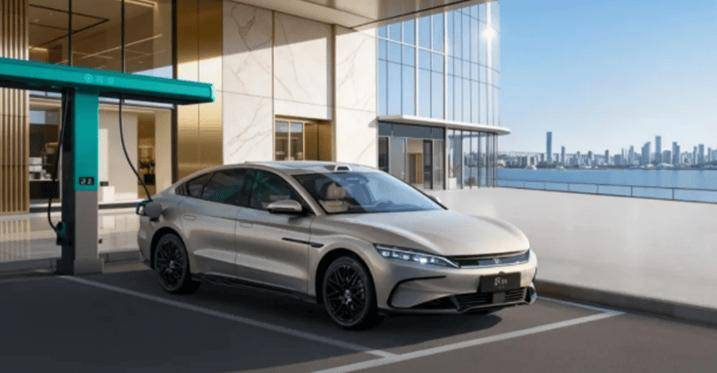

15.荣威i6上市限时抢定价6.59万-7.59万元

4月28日，荣威i6上市，新车共推3款，售价区间为7.49万-8.49万元，限时抢定价6.59万-7.59万元。新车采用大尺寸直瀑式前格栅、熏黑前大灯。采用15.6英寸2.5K中控屏。配备高通骁龙8155芯片、豆包深度思考大模型、360全景影像和AI补盲功能等。新车搭载1.5L发动机，匹配CVT变速箱。

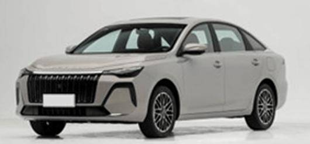

16.方程豹钛7 EV闪充版上市售价区间为19.98万-20.98万元

4月29日，方程豹钛7 EV闪充版上市，新车共推2款，售价区间为19.98万-20.98万元。新车增加201L前备厢。配备20扬声器帝瓦雷音响、4.5L冷暖冰箱、主动香氛等。新车CLTC纯电续航675km，755km。

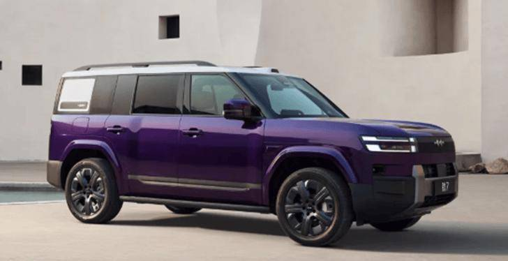

三、宏观经济与政策1.国家发展改革委：以旧换新中，有超60%的消费者购买新能源汽车

4月28日，“国家发展改革委”公众号发文称，2024年和2025年乘用车销量平均增速约4.6%。以旧换新活动中，有超过60%的消费者购买新能源汽车。

2.工信部等五部门联合开展规范废旧动力电池回收利用执法专项行动

4月27日，工信部、生态环境部等五部门联合印发《关于开展规范废旧动力电池回收利用联合执法专项行动的通知》。聚焦新能源汽车废旧动力电池回收利用面临的突出问题，按照“分工合作、协调联动、齐抓共管”的原则，明确工业和信息化、生态环境、交通运输、商务、市场监督管理五大领域监管与执法任务。下一步，五部门将推进执法专项行动落地见效，加大典型案例曝光力度，强化警示震慑效应，加快推动形成应对新能源汽车废旧动力电池规模化退役的长效机制。

3.国家能源局：将围绕重卡充电等应用场景推动充电设施扩规模、提质效

4月27日，国家能源局举行季度例行新闻发布会。国家能源局电力司副司长刘明阳表示，将围绕重卡充电等应用场景，进一步推动充电设施扩规模、提质效，以高质量充电设施网络支撑交通能源绿色低碳转型需要。

4.汽车流通消费改革试点40城拟入选名单公示

商务部消费促进司发布《汽车流通消费改革试点城市拟入选名单公示》，拟确定40个城市纳入试点范围。公示期为2026年4月29日至5月8日。北京、上海、天津、重庆等直辖市均有区域入选，广州、成都、杭州、武汉、郑州等省会城市也在列。

5.今年以来汽车以旧换新带动新车销售额3389.6亿元

商务大数据显示，截至5月2日，2026年消费品以旧换新惠及8427.4万人次，带动销售额6193.6亿元。其中，汽车以旧换新211.1万辆，带动新车销售额3389.6亿元。

6.统计局：2026年1-3月份全国规模以上工业企业利润增长15.5%

4月27日，统计局发布数据显示，1-3月份，规模以上工业企业实现营业收入33.19万亿元，同比增长5.0%。1-3月份，全国规模以上工业企业实现利润总额16,960.4亿元，同比增长15.5%；3月份，规模以上工业企业利润同比增长15.8%。

7.统计局：4月份制造业PMI为50.3%

4月30日，统计局发布数据显示，4月份，制造业PMI为50.3%，比上月下降0.1个百分点。同时，标普全球发布中国4月RatingDog制造业PMI为52.2，创2021年以来的新高。

8.青岛开展新一轮新车消费补贴活动

青岛市安排资金3000万元，于5月1日至6月30日期间开展“2026嗨购仲夏”新车消费补贴活动。个人消费者在青岛市购买符合标准的新能源乘用车，可补贴车辆售价的4%，最高不超过1.2万元；购买符合标准的燃油乘用车，可补贴售价的3%，最高不超过1万元。

9.深圳启动新一轮汽车购买补贴

深圳市于2026年5月1日起启动汽车等购新补贴。将对个人消费者在政策实施期间（5月1日至12月31日）购买新能源或符合国六排放标准的燃油乘用车新车的，发放一次性购车补贴。补贴标准按购车价格分为三档：6万元（含）至8万元（不含）补贴2000元/辆；8万元（含）至15万元（不含）补贴4000元/辆；15万元（含）以上补贴5000元/辆。

四、新品信息跟踪1.北汽极狐问道V9开启预售

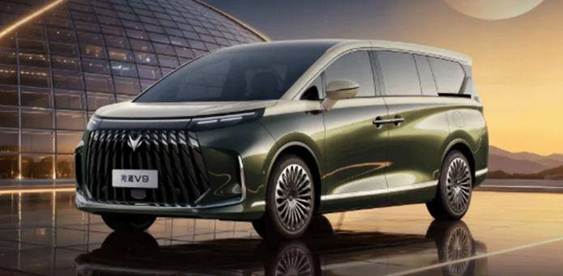

2.乐道L80开启预售

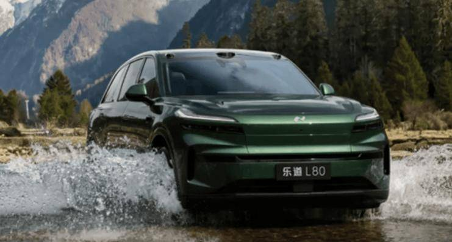

3.FREELANDER首款车型定名神行者8

4月27日，FREELANDER神行者发布了品牌首款量产车型的外观官图，并宣布该车正式定名「神行者8」。定位豪华科技全地形中大型SUV，搭载华为乾崑896线激光雷达。

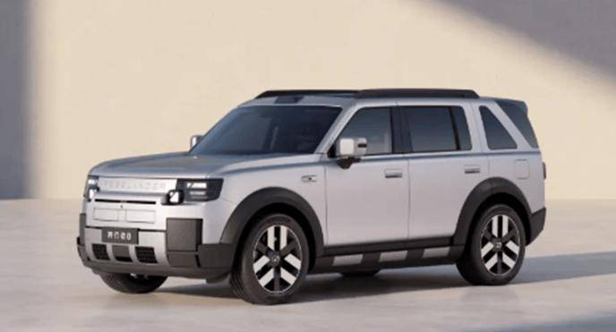

五、企业信息1.比亚迪一季度营业收入1502亿元

4月28日，比亚迪发布一季度财务数据，本报告期实现营业收入1502.25亿元，同比下降11.82%；归属于上市公司股东的净利润40.85亿元，同比大降55.38%；扣非净利润41.48亿元，同比下滑49.24%。

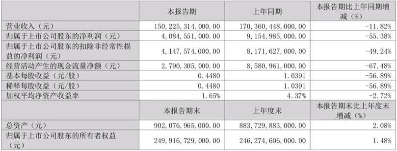

2.比亚迪旗下部分选装天神之眼B辅助驾驶激光版车型价格将上调至12000元

4月28日，比亚迪汽车宣布，受全球存储硬件成本大幅上涨的影响，旗下（王朝、海洋、方程豹）部分车型，选装天神之眼B辅助驾驶激光版的价格，将从9000元上调为12000元。

3.宝马领悦与火山引擎签署谅解备忘录

华晨宝马旗下全资子公司领悦数字信息技术有限公司与北京火山引擎科技有限公司宣布签署谅解备忘录，进一步深化双方在中国的合作，尤其在人工智能（AI）领域的探索。

4.俄罗斯将长城汽车图拉州工厂合同有效期延长至2033年底

俄罗斯方面已经同意，将长城汽车图拉州工厂哈弗汽车本地化生产项目的特别投资合同有效期延长至2033年底。

5.东风汽车集团新技术，提升工业机器人监控智能化与高效性

国家知识产权局信息显示，东风汽车集团有限公司申请一项名为“工业机器人监控方法、装置、设备及计算机可读存储介质”的专利，摘要显示，该专利使机器人运行状态得到直观化、高保真的可视化呈现，同时通过对机器人运行相关数据的深度分析，实现对机器人运行状态的精准判断与故障早期预警，提升工业机器人运维监控的智能化与高效性。

6.东风奕派科技生产基地项目落户武汉经开区

4月28日，武汉经开区管委会和奕派科技签订合作协议。奕派科技生产基地项目落户武汉经开区，将导入多款具有市场竞争力的全新新能源车型。此次落户武汉经开区的项目将建设集整车制造、研发测试、零部件配套、生态协同于一体的智能化标杆工厂。

7.大众汽车下调在华业务预期

大众汽车正式下调其在华业务预期，2030年前在华销量预期由原350万至400万辆调整为320万辆，大众目前的目标是到2030年在华实现4%至6%的营业利润率。

8.吉利汽车进军奥地利市场

近日，吉利汽车与奥地利汽车销售企业AutoWallis签署合作协议，由后者负责吉利品牌在奥地利的进口与分销业务。首批车型GeelyE5和STARRYEM-i计划于2026年第二季度在奥地利上市，分别提供纯电和插混版本。

9.吉利汽车与曹操出行订立服务协议

吉利汽车在港交所公告，与曹操出行订立服务协议，本集团有条件同意向曹操出行集团采购商旅及活动服务。截至2028年12月31日止三个年度，服务协议之建议年度上限分别为约人民币9.34亿元、9.94亿元及10.58亿元。

10.吉利正式登陆法国

日前，吉利品牌在巴黎卢浮宫卡鲁塞尔厅举办上市暨新品发布活动。吉利推出Geely STARRAY EM-i和Geely E5。两款车型均高分通过Euro NCAP五星认证。

11.江淮汽车公告称拟投资引望

江淮汽车公告称，公司拟投资引望智能技术有限公司。交易对方为华为技术有限公司，标的公司引望智能技术有限公司主要股东包括华为技术有限公司(持股80%)、赛力斯汽车有限公司(持股10%)等。目前双方暂未签署相关投资协议，存在不确定性。

12.江淮汽车2026年Q1营收114亿元

4月28日，江淮汽车发布2026年第一季度业绩报告。营收114.59亿元，同比增长16.91%；净亏损6.06亿元，去年同期为净亏损2.23亿元。

13.上海三中院裁定受理集度汽车重整申请

上海市第三中级人民法院发布公告，于2026年4月29日裁定受理申请人上海集度汽车有限公司的重整申请，并对申请人上海集度汽车有限公司和被申请人上海集度科技有限公司、集度科技（武汉）有限公司、武汉集度汽车服务有限公司、北京集度科技有限公司、北京集度汽车零部件有限公司进行实质合并重整。

14.极石汽车调整战略

极石汽车调整其战略规划，将于2026年全面加大对中国市场的投入。极石汽车采用轻代理制，对代理商的资金要求较低，展车和库存车辆由厂家提供，支持硬件利旧。目标覆盖全国主要地级市市场。极石汽车聚焦越野爱好者需求，如全新极石ADAMAS中国版，融合SUV、MPV及宿营车功能。

15.理想汽车正式进入阿联酋、沙特阿拉伯市场

近日，理想汽车于北京绿色智能制造基地与阿联酋Al Fahim Motors、沙特阿拉伯Mohamed YousufNaghi Motors共同举行合作签约仪式，将携理想L系列进入中东市场。同时，理想还公布了在中国澳门特别行政区、柬埔寨、老挝、缅甸的具体市场进入计划。

16.欧拉好猫迎OTA升级

欧拉好猫迎来OTA升级，本次升级适配2025款豪华型和尊荣型车型，带来2项新增功能与4项体验优化，从车机交互到用车场景全面焕新。新增手机APP端技能智造功能，支持用户自定义语音、空调、导航等组合操作，实现“回家模式”等场景自动化 ，同时优化3D桌面车色自定义、智能感光背景、座椅记忆弹窗显示及音效界面。

17.奇瑞汽车推新技术

奇瑞汽车股份有限公司申请一项名为“数据合规平台配置方法、系统及电子设备”的专利，其提供了一种数据合规平台配置方法、系统及电子设备，不仅极大提升了效率与准确性，更从根本上构建了一种可信的、工程化的合规治理新范式。

18.赛力斯2026年Q1营收257亿元

4月29日，赛力斯发布2026年第一季度业绩报告。营收257.46亿元，同比增长34.46%，环比下降52.78%；毛利率26.24%，同比下降1.38个百分点，环比下降2.43个百分点；净利润7.54亿元，同比增长0.89%，环比增长17.8%。

19.安森美与蔚来进一步深化长期战略合作

安森美与蔚来进一步深化长期战略合作，助力蔚来加速向下一代900V高压电动汽车平台转型。此次合作基于安森美EliteSiC技术，旨在提升蔚来最新电动汽车系列的能效、性能与可扩展性。部分搭载该技术的车型于2026年北京国际车展首次亮相。

20.一汽奔腾与Unity中国达成战略合作

六、行业信息1.我国牵头修订的商用车辆气电连接位置国际标准正式发布

由我国牵头修订的国际标准《商用车辆 牵引车与挂车之间的电气和气动连接位置》经国际标准化组织（ISO）批准，近日正式发布。重点修订了电气与气动连接器的布置位置、安装顺序、操作间隙及管路防护等多个核心要点。

2.4月中国汽车经销商库存预警指数62.1%

4月30日，中国汽车流通协会发布的最新一期“中国汽车经销商库存预警指数调查”VIA（Vehicle Inventory Alert Index）显示，2026年4月中国汽车经销商库存预警指数为62.1%，同比上升2.3个百分点，环比上升4.6个百分点，库存预警指数位于荣枯线之上。

3.中国车企海外产量将增至近3倍

近日，咨询公司艾睿铂（AlixPartners）发布报告称，到2030年，中国车企海外年产量将增至340万辆，较目前规模增至近3倍，欧洲和拉美将成为核心主攻市场。艾睿铂全球汽车与工业业务联合负责人DanHearsch还表示，过去两年中国整车售价累计下跌两成。

4.阿里云占据中国汽车公共云42%市场份额

据国际数据公司（IDC）最新发布的《中国汽车云市场（2025年下半年）跟踪》报告显示，2025年下半年中国汽车公共云IaaS市场持续高速增长，市场规模达68亿元人民币，其中阿里云以42%的市场份额位居第一。

5.大搜车获证监会备案拟赴美IPO

杭州的大搜车控股有限公司近日获得中国证监会境外发行上市备案，计划在纳斯达克上市。该公司为蚂蚁集团参股的汽车产业互联网平台。

6.导远科技与均联智行达成深度合作

近日，导远科技与均联智行达成深度合作。双方将主要聚焦高阶智能辅助驾驶域控制器集成时空智能方案，助推定位、测姿、域控全链路落地，加速L2+至L4级智驾方案规模化量产，同时同步延伸具身智能领域技术。

7.广汇物流、九洲恒昌、主线科技拟共同出资建无人驾驶合资公司

近日，广汇物流、九洲恒昌、主线科技三方正式签署合作备忘录，拟共同出资设立无人驾驶合资公司，预计年内首批新能源重卡将到位运营。

8.黑芝麻智能官宣加入理想星环OS开源生态

4月27日，黑芝麻智能正式宣布加入理想星环OS开源生态。双方将围绕开源共建展开深度合作，基于黑芝麻智能全系列芯片平台，对星环OS进行深度适配与性能优化。

9.宁德时代：完成H股配售事项

4月30日，宁德时代港交所公告，完成H股配售事项，所得款项总额约391.9亿港元合共6238.5万股新H股已由本公司于2026年4月30日按每股配售股份628.2港元的配售价成功配发及发行予不少于六名承配人，该等承配人及其最终实益拥有人均为独立第三方。

10.宁德时代与海博思创签署钠电合作

4月27日，宁德时代与海博思创在福建宁德签署储能钠离子电池战略合作协议。双方宣布，达成3年60GWh钠离子电池订单合作。

七、跨国集团与国际市场1.澳洲4月新车销量电动化加速

4月，澳大利亚新车总销量为92,591辆，同比增长2.2%。其中纯电动车销量达15,185辆，占整体市场的16.4%。汽油车销量同比下滑30.1%，柴油车下降21.7%。

2.阿斯顿·马丁再度亏损

英国豪华车企阿斯顿·马丁公布数据显示，今年第一季度，其税前亏损同比小幅收窄至6550万英镑，净债务攀升至14.6亿英镑。亿万富翁Lawrence Stroll旗下财团再度注资5000万英镑，试图缓解这家深陷困境车企的资金压力。

3.布加迪被出售

保时捷宣布，其持有的布加迪相关全部股权将出售给以纽约投资机构HOF Capital牵头的国际财团，目前交易已完成签约，预计将于2026年底正式完成交割。

4.本田将对自动驾驶AI软件初创公司helm_ai追加投资

自动驾驶AI软件初创公司helm_ai在社交媒体上发帖称：“本田和helm_ai已达成协议，本田将对我们追加投资！我们将携手推进下一代端到端（E2E）自动驾驶和ADAS系统，用于2027年及以后推出的一系列电动汽车和混合动力汽车。”

5.德国汽车业景气度因伊朗战争而减弱

德国经济研究所（Ifo Institute）表示，4月份德国汽车行业的景气度恶化，原因是伊朗战争加剧了不确定性并导致能源价格飙升。该研究所表示，该行业的商业景气指数从3月份的负19.0点降至负23.8点，企业对未来几个月的看法明显更为悲观。

6.丰田汽车3月全球销量同比下降7.3%

7.丰田在印度建三新厂

5月3日，丰田汽车宣布计划在印度新建三座整车工厂，目标是到2030年将年产能提升至100万辆，首座工厂预计于2029年投产，其余两座将在2030年代陆续投用，总投资约为3000亿日元。不仅将服务印度本土市场，还将作为出口枢纽，向中东和非洲地区供货。

8.美加征汽车关税将使德国损失150亿欧元

德国基尔世界经济研究所公布的一份分析报告显示，美国拟提高欧盟输美汽车进口关税将对德国经济产生重大影响，德国汽车行业的产出损失短期内将达150亿欧元，长期损失则可能高达300亿欧元。意大利、斯洛伐克和瑞典等国家也将面临较大损失。

9.梅赛德斯-奔驰第一季度利润下滑17%

4月29日，梅赛德斯-奔驰集团发布财报，2026年第一季度营收为316.02亿欧元，同比下降4.9%；净利润为14.33亿欧元，同比下降17%。该公司还警告称，中东冲突可能对消费者信心产生影响，由于燃料价格上升、利率走高或资产价格下跌，汽车销售可能受到抑制。

10.起亚CEO宋虎声暗示将在欧洲降价以抵御中国竞争

起亚正在欧洲主动缩小与中国车企的价格差距。起亚CEO宋虎声透露，起亚今年已缩小了在欧洲市场与中国竞争对手之间的价格差距。他表示，从今年开始，起亚在欧洲市场已将旗下车型与中国车型的价格差距从此前的20%-25%（视市场而定）缩小至15%-20%。

11.日产计划2026年投资4500万美元扩建埃及工厂

日产汽车计划于2026年投资4500万美元，扩大其在埃及的汽车生产业务，拟将当地产量提升约三分之一，并增加对非洲各国市场的出口。

12.日产固态电池突破

日产汽车在固态电池技术领域取得重大突破。公司在横滨工厂的试产线上成功完成车用全固态电池的原型测试。测试的电池由23层电芯堆叠而成，能量密度达到400-500kWh/kg，充电速度仅需10分钟即可充至80%。计划2026年确定电芯堆叠层数，力争2028年实现量产。

13.特斯拉计划将V14 Lite扩展至更多国际市场

当地时间4月28日，特斯拉在社交平台表示，在美国市场为HW3车型推出FSD V14 Lite之后，其计划将V14 Lite扩展至更多国际市场。

14.特斯拉Semi首辆量产车下线

特斯拉官方4月30日宣布，首辆量产版Semi半挂式纯电重卡正式从内华达超级工厂的专属高产能产线下线，标志着这款备受瞩目的电动重卡正式迈入规模化量产阶段。

15.通用汽车中国市场连续6季度盈利

通用汽车公司4月28日发布2026年第一季度财报，净收入达436亿美元，净利润达26亿美元，调整后息税前利润达43亿美元。通用汽车在中国市场已连续六个季度实现盈利。

附：近日信息合集
