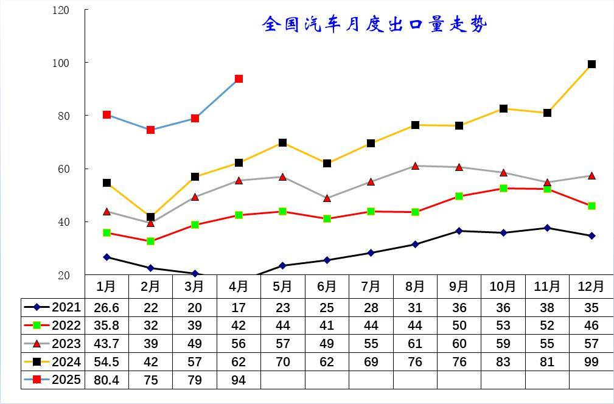
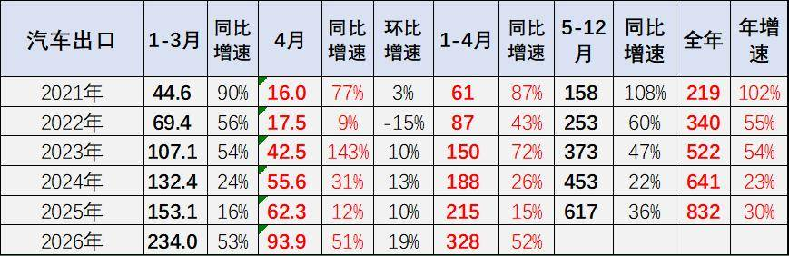
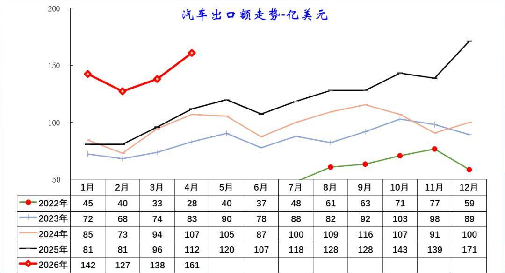
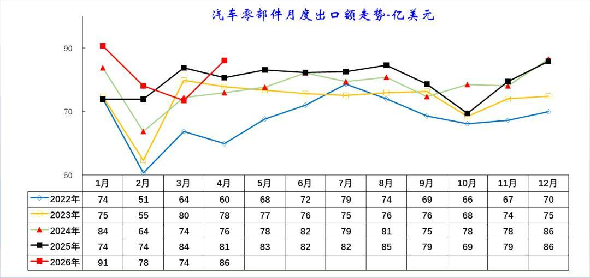
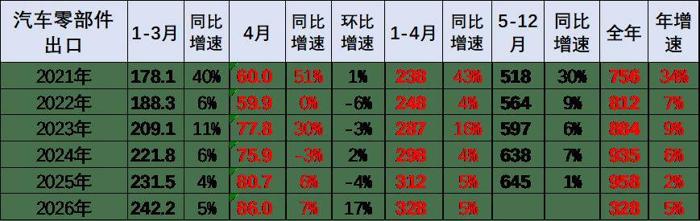

# 4月中国汽车出口93.9万，环比增19%同比增51%,

- 公開日時: 2026-05-09 12:50（北京時間）
- 出典: [搜狐号・崔东树](https://www.sohu.com/a/1020243724_115312)
- テーマ（自動判定）: 輸出
- 画像: 5枚

---

根据海关数据，2026 年 4 月，中国汽车出口在高油价、运力紧张背景下实现强势突破：整车出口93.9万台，161亿美元，量、额同比分别增长 51%、44%，以新能源产品为核心，精准承接全球市场对低能耗车型的旺盛需求，对冲油价波动影响，形成 “高油价→新能源优势放大→出口加速” 的正向循环。

与此同时，汽车零部件出口同步稳步增长，重点服务欧美成熟市场，依托完善的供应链体系，为全球车企提供稳定配套，形成 “零部件深耕欧美、整车辐射全球” 的交叉互补格局，产业链协同效应凸显，共同支撑中国汽车产业的全球竞争力持续提升。

1、中国汽车出口爆发增长

2025 年中国汽车出口开年延续高增态势，在海湾冲突和国际运力紧张的背景下，4 月已达 94 万辆，增长动能强劲。

2021-2025 年我国汽车月度出口量整体呈阶梯式增长，2021 年基数较低，全年在 20-38 万辆区间波动；2022 年起突破 40 万辆，进入稳步上行通道；2023 年多数月份突破 50 万辆，8 月起稳定在 60 万辆左右；2024 年实现跨越式增长，12 月出口量达 99 万辆，创历史新高； 从月度规律看，每年 2 月受春节假期影响，出口量普遍为全年低点，随后逐步回升，下半年（尤其是四季度）常迎来出口高峰，体现了订单交付节奏与海外市场需求的季节性特征。整体来看，我国汽车出口已摆脱低基数阶段，进入持续放量的高增长周期，竞争力显著提升

2026 年 1-4 月累计达 328 万辆，同比增速高达 52%，创近年新高。月度维度上，2026 年 4 月出口量 93.9 万辆，同比增长 51%，环比提升 19%，延续了 2023 年以来的高景气度。

从增速规律看，2021 年基数较低时增速超 100%，2022-2024 年增速逐步回落至 20%-50% 区间，2026 年增速重回 50% 以上，显示出口动能再度增强。同时，每年 4 月出口量均较 1-3 月显著放量，且5-12 月贡献了全年超 70% 的出口量，呈现明显的出口动能增强特征。

2、中国汽车出口均价持续提升

2022-2026 年我国汽车出口额（美元口径）实现了持续且跨越式的增长。2022 年基数较低， 2023 年起突破 80 亿美元，进入稳步上行通道；2025 年已形成明显的高增曲线，2026 年开年延续爆发式增长，4 月出口额已达 161 亿美元，较 2022 年同期实现超 5 倍增长，显示出口价值量显著提升。

从月度规律看，出口额呈现明显的季节性特征：2 月受春节假期影响普遍为阶段性低点，随后逐步回升，下半年尤其是四季度常迎来全年高峰，与出口量的交付节奏高度匹配。同时，出口额增速长期高于出口量增速，反映出我国汽车出口正从 “以价换量” 向 “以质取胜” 转型，产品结构持续优化，高端化、高附加值车型占比不断提升。

2021-2026年我国汽车出口额（美元口径）呈现规模与结构双升级的强劲态势。从总量看，2021年全年仅345亿美元，2025年已突破1400亿美元，2026年1-4月累计达569亿美元，同比增速高达54%，创近年新高。月度维度上，2026年4月出口额161亿美元，同比增长44%，环比提升17%，延续了高景气度。

从增速规律看，2021-2023年基数较低时增速超60%，2024-2025年增速阶段性回落，2026年重回50%以上，显示出口价值量增长动能再度增强。同时，出口额增速长期高于出口量增速，反映出我国汽车出口正从“以价换量”向“以质取胜”转型，高附加值车型占比持续提升。

3、汽车零部件出口走势

我国汽车零部件出口呈现规模稳步扩张,与整车出口特征反差较大。2022-2026年我国汽车零部件月度出口额整体呈稳步增长态势，规模持续扩张。2022年基数较低，月度出口额在51-79亿美元区间波动；2023-2024年稳步抬升，多数月份突破75亿美元；2025年基本稳定在74-86亿美元的高位区间；2026年开年表现亮眼，1月出口额达91亿美元，创近年新高，4月延续增长至86亿美元，显示出口韧性强劲。

2021-2026年我国汽车零部件出口呈现规模稳步扩张、增速偏低的特征，这与汽车零部件主要是满足欧美维修市场需求的特征相关。从总量看，2021年全年出口额756亿美元，2025年已增至958亿美元，2026年1-4月累计达328亿美元，延续增长态势。月度维度上，2026年4月出口额86亿美元，同比增长7%，环比提升17%，出口韧性持续显现。

从增速规律看，2021年基数较低时增速达34%，2022-2025年增速逐步回落至个位数，2026年重回5%的稳定增长区间，显示行业从高速扩张转向高质量增长。同时，零部件出口增速长期低于整车，反映出我国汽车出口正由“l零部件驱动”向“整车驱动出海”转型，未来整车与零部件产业链配套能力持续增强。
