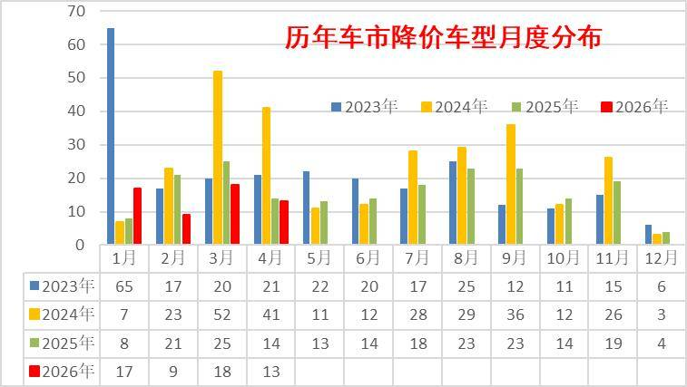
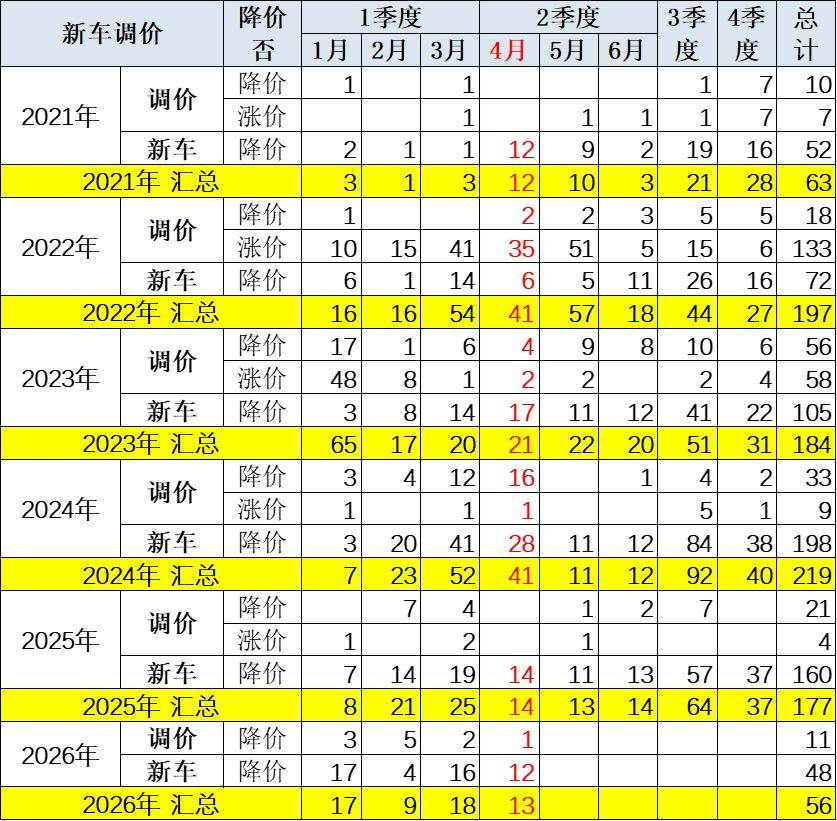
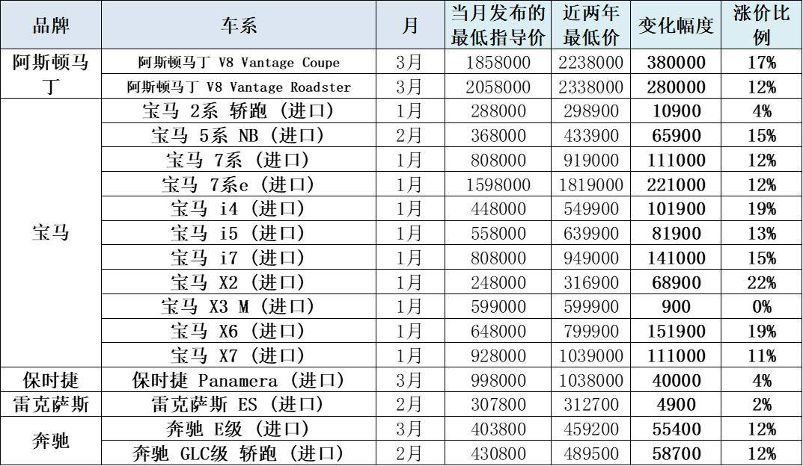
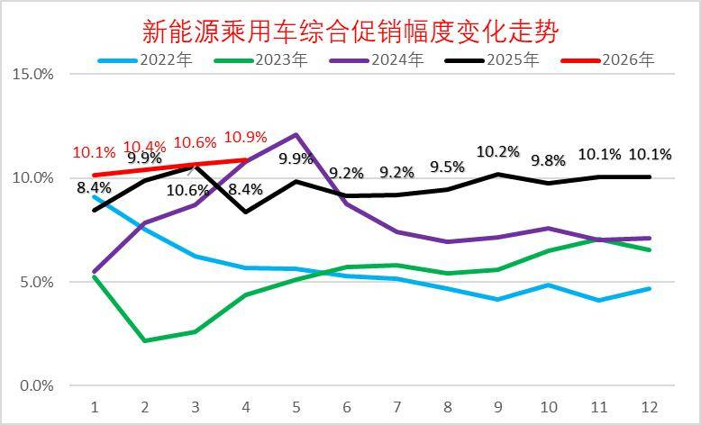
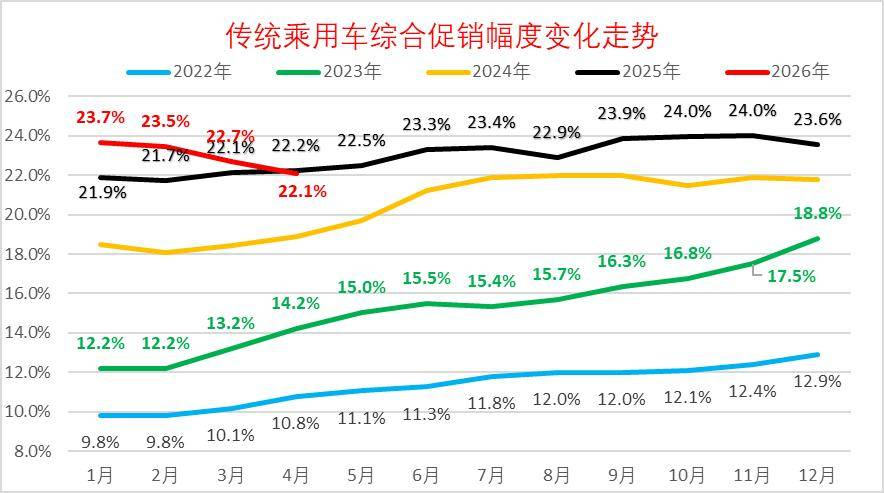
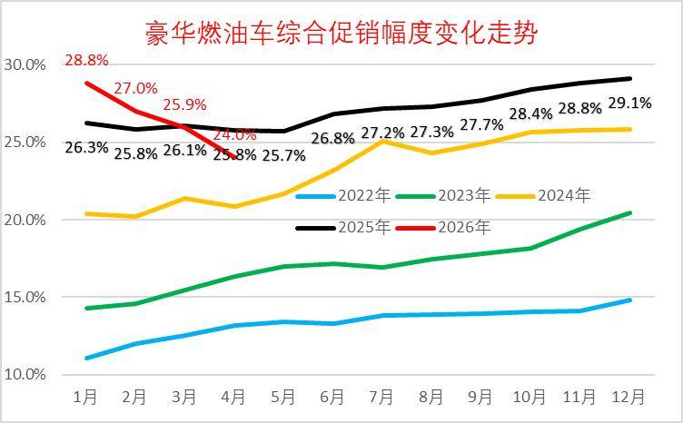
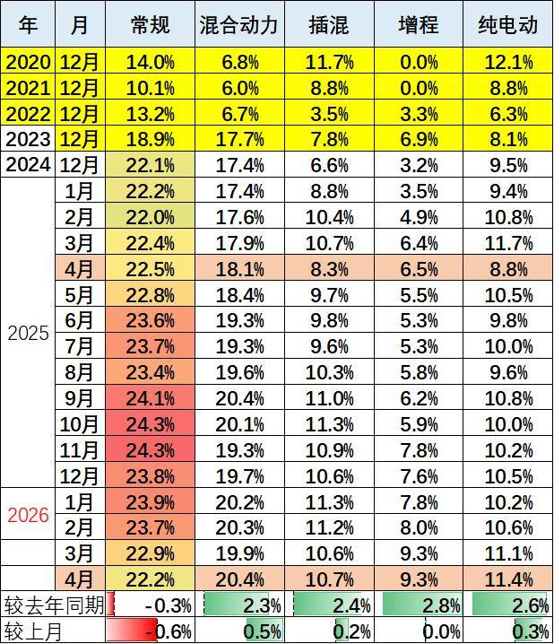

# 2026年4月乘用车市场降价促销分析

- 公開日時: 2026-05-10 15:55（北京時間）
- 出典: [搜狐号・崔东树](https://www.sohu.com/a/1020693832_115312)
- テーマ（自動判定）: 値引き・販促
- 画像: 10枚

---

注：本分析文章仅代表崔东树个人观点，如有异议，请留言。

2025年以来全国乘用车行业促销与降级均回归理性，市场秩序明显改善。由于新能源车购税恢复征收，指导价对消费者购车交税影响体现，2026年降价规模56款，较同期少12款，其中常规燃油车降价25款，较同期增8款；混合动力燃油车降价3款，较同期持平；插混燃油车降价9款，较同期减少4款；增程式车型降价3款，较同期减少2；纯电动车型降价16款，较同期减少14款。

2026年4月降价规模13款，较同期少1款。其中混动车型2款，较同期多2款；纯电动车型4款，较同期少1款。

2026年1~4月份，新能源车新车降价车型均价26.0万元的降价力度算术平均达到3.4万元，降价力度达到13.3 %。2026年4月份，新能源车新车降价车型均价20.7万元的降价力度算术平均达到2.3万元，降价力度达到11.1%的较高水平。2026年1~4月份，常规燃油车新车降价车型均价23.6万元的降价力度算术平均达到3.4万元，降价力度达到14.6%。2026年4月份，常规燃油车新车降价车型均价13.1万元的降价力度算术平均达到2.3万元，降价力度达到17.2%。2026年1~4月份，总体乘用车市场新车降价车型均价25.2万元的降价力度算术平均达到3.4万元，降价力度达到13.7%。2026年4月份，总体乘用车市场新车降价车型均价18.6万元的降价力度算术平均达到2.3万元，降价幅度达到12.3%。

2026年4月的新能源车的促销回升到10.9%的中高位，较同期促销持平，较上月微增0.3%。近几个月的促销较稳，随着降价的受约束，7年低息等促销新模式推动，促销体系也有回收，目前基本保持正常促销水平的中高位。2026年4月传统燃油车的促销下降到22.1%的水平，较上月微降0.6个百分点，较同期微降0.1个百分点，燃油车促销连续9个月维持在23%左右。传统燃油车的促销2025年9月开始小幅加大，幅度较温和，2026年因降价力度大，实现促销逐步回落。

一、总体降价跟踪

1、月度降价状态跟踪

降价分析主要关注新车推出而突破前期价格下限的情况，也就是较隐蔽的降价行为，这里主要定义三年内的降价。而有些新车前几年开始上市很便宜，随后因2022年碳酸锂价格而宣布涨价，然后现在宣布降价，虽然没有突破上市时的底价，但为了体现降价的现象，因此此次分析中也算降价。

由于部分按动力细分的车型在年内有多次的价格调整行动，因此按照非重复计算的方式，车型数不是简单累加，而是合并了重复车型。

从降价节奏来看，2023年的降价总体较多， 2024年的降价在3-4月份达到了超强的程度，2025年的部分车企春季和秋季的阶段性组合促销，其一口价的价格包含补贴等因素，没有明确宣布降低到新的价格，因此目前只能按照促销处理，没有计入当年的降价车型范畴，这将在下面的促销幅度体现。

面对价格体系的重塑，2026年3月份有18款车型降价，4月份有13款车型降价，较去年3-4月的39款，今年3-4月市场保持相对克制。

2、车型最低价分析

2020-2021年的车企降价力度较小，2022-2024年力度较猛，2025年降到177款车型，2026年1月的新车降价的规模相对活跃,2月因春节因素大幅减少,3月回升到18款降价,4月降到13款。由于市场运行压力太大，目前的价格竞争主要是新车推出直接突破原有价格的下限，而不是增配不降价的模式。

面对新能源车车购税开始征收，2026年1-4月直接降价的车型较多，虚高的指导价回归，有利于消费者的交税成本合理化。

2026年截止到4月的降价车型总体较丰富，主要是豪华车的价格重新梳理。

2026年降价规模56款，较同期少12款，其中常规燃油车降价25款，较同期增8款；混合动力燃油车降价3款，较同期持平；插混燃油车降价9款，较同期减少4款；增程式车型降价3款，较同期减少2；纯电动车型降价16款，较同期减少14款。

2026年4月降价规模13款，较同期少1款。其中混动车型2款，较同期多2款；纯电动车型4款，较同期少1款。

3、综合降价幅度

2026年1~4月份，新能源车新车降价车型均价26.0万元的降价力度算术平均达到3.4万元，降价力度达到13.3 %。2026年4月份，新能源车新车降价车型均价20.7万元的降价力度算术平均达到2.3万元，降价力度达到11.1%的较高水平。

2026年1~4月份，常规燃油车新车降价车型均价23.6万元的降价力度算术平均达到3.4万元，降价力度达到14.6%。2026年4月份，常规燃油车新车降价车型均价13.1万元的降价力度算术平均达到2.3万元，降价力度达到17.2%。

2026年1~4月份，总体乘用车市场新车降价车型均价25.2万元的降价力度算术平均达到3.4万元，降价力度达到13.7%。2026年4月份，总体乘用车市场新车降价车型均价18.6万元的降价力度算术平均达到2.3万元，降价幅度达到12.3%。

4、进口车价格变化

由于高端市场竞争格局巨变，市场环境剧烈恶化，降价车型逐步出现，为了经销商利益和消费者权益，宝马等品牌开始调整指导价格，实际成交价格基本稳定，这样的空降还是很有意义的。

二、车市促销跟踪

1、新能源车促销力度小幅增长

2026年4月的新能源车的促销回升到10.9%的中高位，较同期促销持平，较上月微增0.3%。近几个月的促销较稳，随着降价的受约束，7年低息等促销新模式推动，促销体系也有回收，目前基本保持正常促销水平的中高位。

2、燃油车促销走势逐步下降

2026年4月传统燃油车的促销下降到22.1%的水平，较上月微降0.6个百分点，较同期微降0.1个百分点，燃油车促销连续9个月维持在23%左右。传统燃油车的促销2025年9月开始小幅加大，幅度较温和，2026年因降价力度大，实现促销逐步回落。

3、豪华车促销走势大幅下降

2026年4月豪华车的促销逐步达到24.0%的中高位，较上月下降1.9个点，较同期下降1.8个百分点。虽然消费升级推动高端需求较强，2025年5月以来豪华车促销力度相加大,2026年年初以来的新车指导价降价力度较大，促销因此下降，实际成交价格变化不大。

4、主流合资车促销走势平稳

2026年4月合资燃油车的促销逐步达到22.4%的低位，较上月下降0.1个点，较同期增0.5个百分点。合资促销近期稍有增大。

合资燃油车的促销从2023年的13%的低位，2025年9月回升到23.3%峰值，随着新车强力降价，近三个月小幅波动。由于新车价格特别低，因此总体促销力度相对平稳微增。

5、自主燃油车促销走势保持平稳

由于自主的新能源较强，加之燃油车出口较好，2025年自主燃油车促销总体平稳。

2026年4月自主燃油车的促销逐步达到18.6%的中位，较同期增加1.1个百分点。自主车企在2024-2025年上半年的促销上升较快，随后2025年下半年以来的促销总体稳定。

6、分动力促销力度跟踪相对温和

由于部分品牌降价带来的指导价回归，降低了促销幅度。2026年的常规燃油车和混合动力的促销压力较小，而新能源车由于降价带来的车型促销大幅下降，因此总体纯电动促销相对温和，4月同比增加2.6个点的促销。今年插电混合动力促销波动较大，4月同比增加2.4个点的促销，环比增0.2个百分点；增程车型总体较2025年4月增加2.8个点左右的促销。混合动力较2025年4月增加2.3个点左右的促销，较上月增加0.5个点左右的促销。

4月的车市促销相对平稳，经销商也是稳促销保利润。目前的欧系促销较大，其它合资车企促销基本24%左右，差异不大。自主车企成为促销最小的。

三、具体降价车型跟踪-4月

1、新能源车降价分析

2026年4月份纯电动车型新车降价的力度似乎较大，尤其是部分车型指导价下探的降价达到20%左右，但非主力车型的实际影响不大。根据新能源车促销10%的规模，正常车型价格下探的力度还是问题不大的。

近期有个别车型的个别款式出现涨价事件，由于有促销等因素干扰，实际的意义不大，只是宣传改善心态的举措。

2026年4月份插混和增程车型新车降价的力度相对温和，因为其中部分是有较好销量的车型，实际效果还是不错的。

2、燃油车降价分析
