# 2026年4月份全国乘用车市场运行特征分析

- 公開日時: 2026-05-12 17:06（北京時間）
- 出典: [搜狐号・崔东树](https://www.sohu.com/a/1021635424_115312)
- テーマ（自動判定）: 乗用車市場
- 画像: 22枚

---

注：本分析文章仅代表崔东树个人观点，如有异议，请留言。

今年乘用车市场受新能源车购置税政策调整、消费信心偏弱及高油价等多重因素影响，市场呈现“国内放缓、出口高增，燃油收缩、新能源主导”的运行态势。高油价对燃油车国内零售造成重创，直接影响到国内零售复苏进程。今年1-2月燃油车零售同比下滑74万辆，占乘用车零售减量的40%；3月燃油车同比销量下滑34.5万辆，占乘用车零售减量的52%，4月燃油车销量同比下滑36.5万辆，减量占比进一步扩大到84%。在成本焦虑笼罩的气氛下，消费需求正加速从燃油车向新能源车转移，市场“油电分化”格局愈发显著。但出口端则相反，1-2月燃油车出口同比增长10万辆，占乘用车出口增量的25%；3月燃油车出口增长10万辆，占乘用车出口增量的32%，4月燃油车出口量增长13万辆，攀升到38%。

1.近年狭义乘用车零售走势

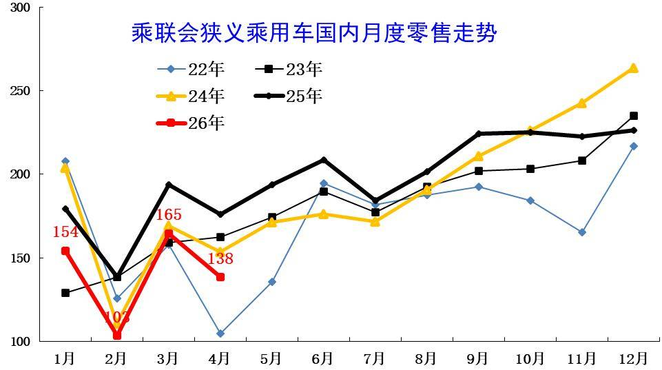

4月全国乘用车市场零售138万辆，同比增长表现较弱，脱离正常增长线路。4月负增长原因是多元的，首先是春节后回暖慢因素的影响，其次是以旧换新的新政策规范性较强和补贴缩水，加之高油价剧烈冲击，深层原因是消费能力和意愿偏低。

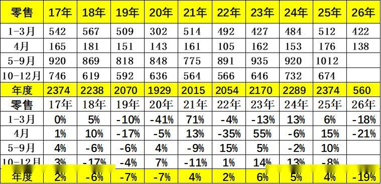

4月全国乘用车市场零售138.4万辆，同比下降21%，环比下降16.0%；今年1-4月累计零售560.4万辆，同比下降18.5%。由于市场因素影响较复杂，近几年年度销量“前低后高”特征较明显，今年特殊的去库存特征明显，所以2026年4月降21%，属于历年增速的偏低状态。

2.近年狭义乘用车批发走势

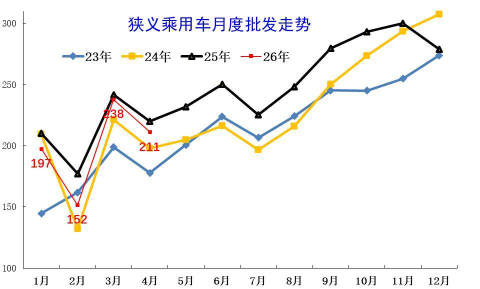

4月全国乘用车厂商批发211万辆，较同期差9万台，大于3月的差距，市场走势没有改善。历年4月的走势相对平稳，今年国内低迷但出口增长，因此总体下滑不大。

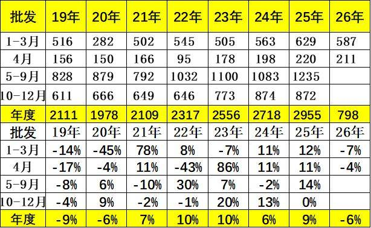

4月全国乘用车厂商批发211.0万辆，同比下降4.0%，环比下降11.3%；受出口暴增的促进，4月乘用车批发同比增速较零售增速高出17个百分点。

3.近年狭义乘用车生产走势

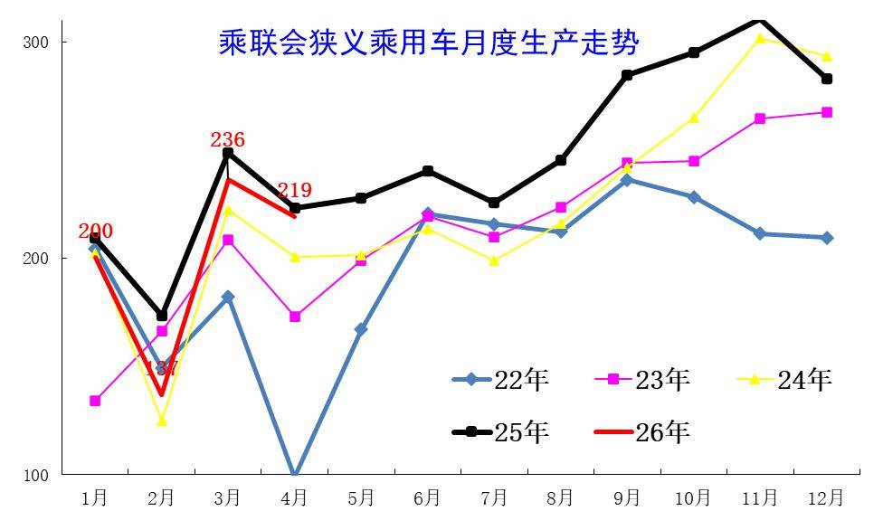

4月乘用车生产减产力度不大，市场需求持续较弱，导致3月主动减产力度很大。4月乘用车生产偏高，5月仍然有压力。

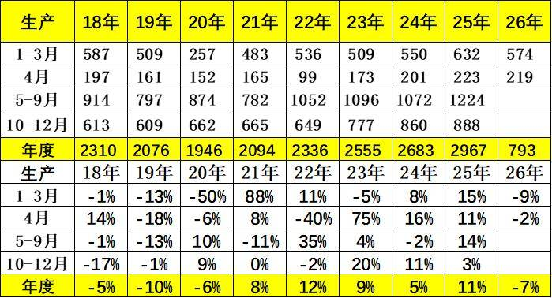

4月乘用车生产219.3万辆，同比下降1.8%，环比下降7.2%，较1-3月改善较好。

4.近年狭义乘用车出口走势

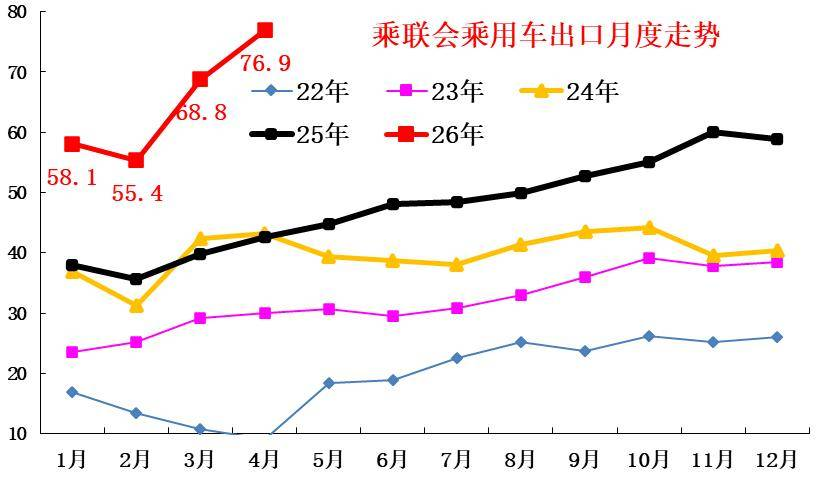

4月乘用车出口（含整车与CKD）76.9万辆，少有的连续两个月爆发式增长，与2025年走势反差较大。

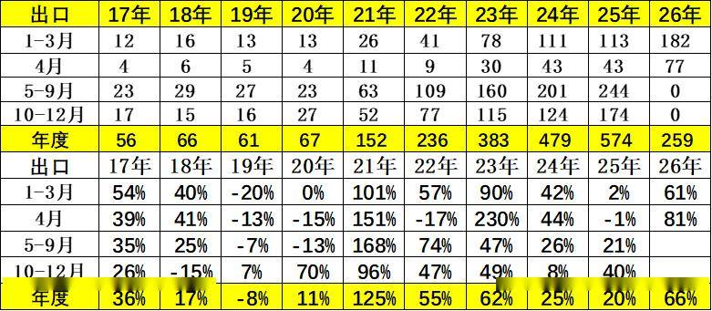

根据乘联数据，4月乘用车出口（含整车与CKD）76.9万辆，同比增长80.7%，环比增长11.8%，占乘用车厂家销量36%（上月29%，25年同期19%）。

5.产销库存月度变化特征

由于4月厂商生产态势偏乐观，4月厂商批发低于生产8.3万辆，而厂商月度国内批发低于国内零售4.3万辆。今年仍是去库存特征，1-4月总体乘用车行业库存下降26万辆（2025年同期增长11万辆、2024年同期下降39万辆、2023年同期下降15万辆）。

6.狭义乘用车促销走势

A、新能源车促销力度小幅增长

2026年4月的新能源车的促销回升到10.9%的中高位，较同期促销持平，较上月微增0.3%。近几个月的促销较稳，随着降价的受约束，7年低息等促销新模式推动，促销体系也有回收，目前基本保持正常促销水平的中高位。

B、燃油车促销走势逐步下降

2026年4月传统燃油车的促销下降到22.1%的水平，较上月微降0.6个百分点，较同期微降0.1个百分点，燃油车促销连续9个月维持在23%左右。传统燃油车的促销2025年9月开始小幅加大，幅度较温和，2026年因降价力度大，实现促销逐步回落。

C、豪华车促销走势大幅下降

2026年4月豪华车的促销逐步达到24.0%的中高位，较上月下降1.9个点，较同期下降1.8个百分点。虽然消费升级推动高端需求较强，2025年5月以来豪华车促销力度相加大,2026年年初以来的新车指导价降价力度较大，促销因此下降，实际成交价格变化不大。

D、主流合资车促销走势平稳

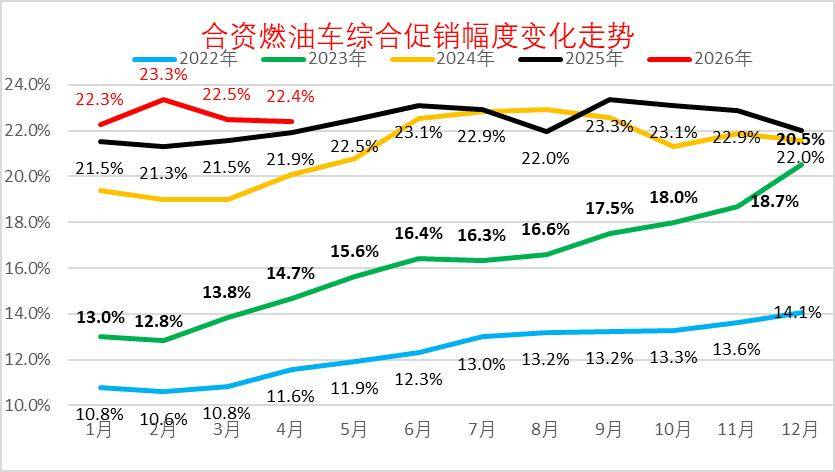

2026年4月合资燃油车的促销逐步达到22.4%的低位，较上月下降0.1个点，较同期增0.5个百分点。合资促销近期稍有增大。

合资燃油车的促销从2023年的13%的低位，2025年9月回升到23.3%峰值，随着新车强力降价，近三个月小幅波动。由于新车价格特别低，因此总体促销力度相对平稳微增。

E、自主燃油车促销走势保持平稳

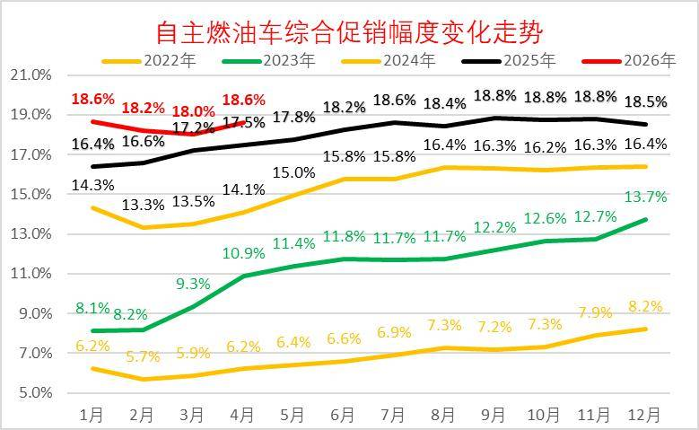

由于自主的新能源较强，加之燃油车出口较好，2025年自主燃油车促销总体平稳。

2026年4月自主燃油车的促销逐步达到18.6%的中位，较同期增加1.1个百分点。自主车企在2024-2025年上半年的促销上升较快，随后2025年下半年以来的促销总体稳定。

F、分动力促销力度跟踪相对温和

由于部分品牌降价带来的指导价回归，降低了促销幅度。2026年的常规燃油车和混合动力的促销压力较小，而新能源车由于降价带来的车型促销大幅下降，因此总体纯电动促销相对温和，4月同比增加2.6个点的促销。今年插电混合动力促销波动较大，4月同比增加2.4个点的促销，环比增0.2个百分点；增程车型总体较2025年4月增加2.8个点左右的促销。混合动力较2025年4月增加2.3个点左右的促销，较上月增加0.5个点左右的促销。

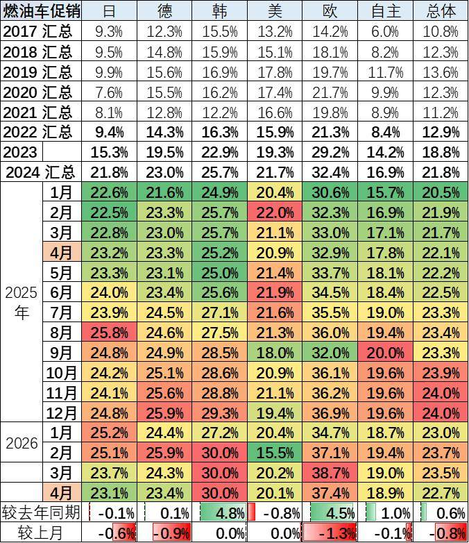

4月的车市促销相对平稳，经销商也是稳促销保利润。目前的欧系促销较大，其它合资车企促销基本24%左右，差异不大。自主车企成为促销最小的。

7.狭义乘用车各级别增长特征

2026年4月乘用车零售降21%，大幅低于批发下降4%的增速,形成内冷外热格局。由于高油价冲击和补贴暂停带来零售回落，4月A级轿车零售与A00级轿车零售均较低，A0级轿车和高端车型成为4月零售主力，SUV的高端表现较强，轿车中主要是A0级轿车销量回升。

8.狭义乘用车国别增长特征

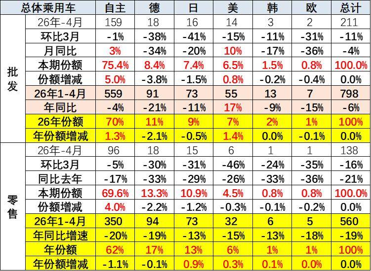

4月自主品牌零售97万辆，同比下降16%，环比下降5%。当月自主品牌国内零售份额为69.6%，同比增长4个百分点。自主品牌在新能源市场和出口市场总体较平稳。部分头部传统车企转型升级表现优异，吉利汽车、长安汽车等传统车企品牌份额提升明显。

4月主流合资品牌零售28万辆，同比下降37%，环比下降33%。4月德系品牌零售份额13.3%，同比下降2.2个百分点；日系品牌零售份额10.9%，同比下降1.2个百分点；美系品牌市场零售份额4.5%，同比下降0.3个百分点；韩系零售份额也有所微降。

4月豪华车零售14万辆，同比下降16%，环比下降33%。随着豪华车指导价的合理回归，4月的豪华品牌零售份额10.2%，同比增长0.6个百分点，传统豪华车市场有所企稳。

9.2026年品牌产销特征

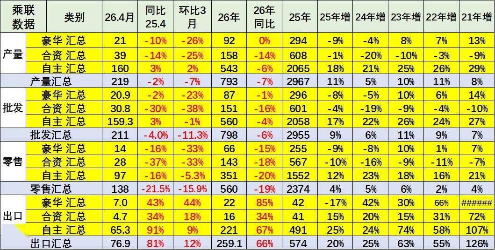

原有的品牌价值体系变化，豪华品牌近期持续压力加大，合资车企的产销走势压力持续较大，自主品牌产业链优势明显。4月行业分化稍有改善，燃油车市场环比走势较差，导致合资品牌走势恶化。

10.全国新能源渗透率-批发

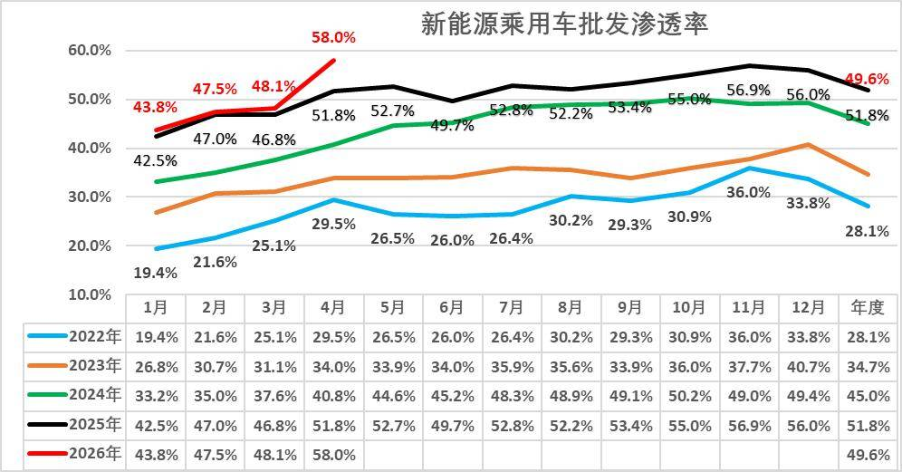

4月新能源车厂商批发渗透率58%，较2025年4月提升6.2个百分点。

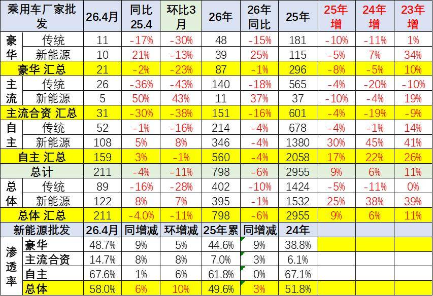

4月新能源车厂商批发渗透率58.0%，较2025年4月提升6个百分点。4月自主品牌新能源车渗透率67.6%；豪华车中的新能源车渗透率48.7%；而主流合资品牌新能源车渗透率上升到14.7%。

4月传统车厂家批发同比降16%，而新能源车同比增8%，增速差距24个点。燃油车的市场稍有改善，新能源出口的贡献度大。

11.全国新能源渗透率-零售

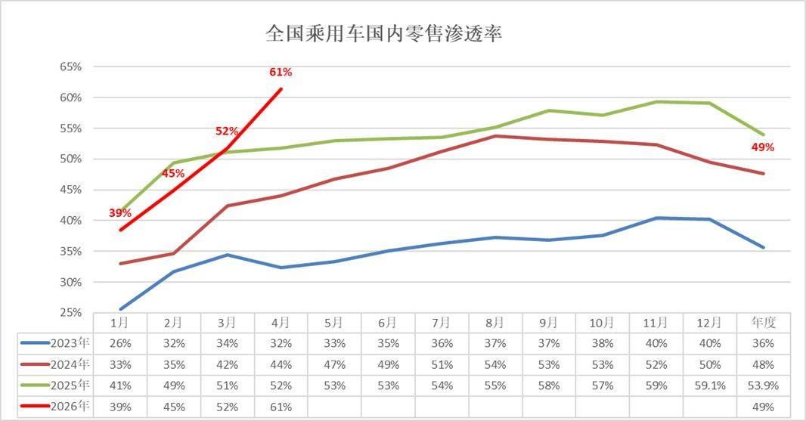

4月新能源车在国内总体乘用车的零售渗透率61.4%，形成1-4月大幅拉升的特色月度走势，创历史新高，首次突破60%。

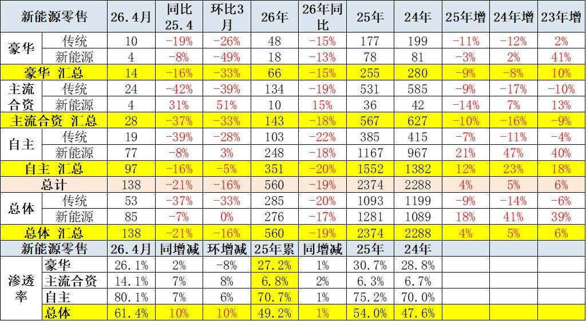

4月新能源车在国内总体乘用车的零售渗透率61.4%，较去年同期增长9.7个百分点，环比增长9.6个百分点。在4月国内零售中，自主品牌中的新能源车渗透率80.1%；豪华车中的新能源车渗透率26.1%；而主流合资品牌中的新能源车渗透率上升到14.1%。

附：近日信息合集
