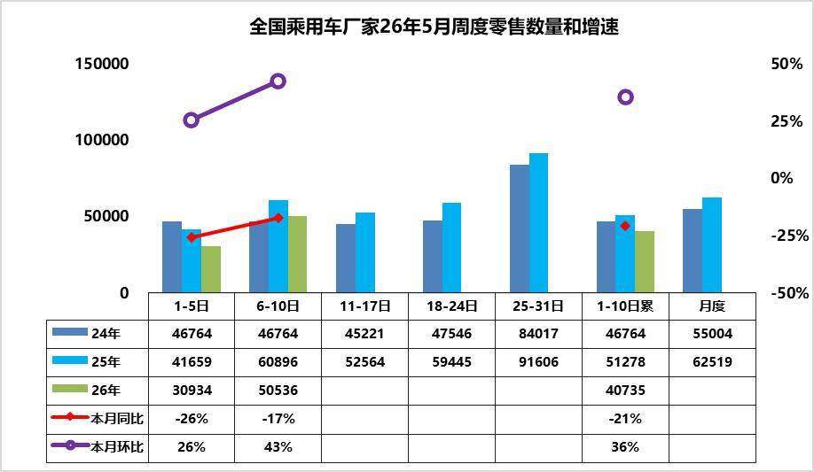
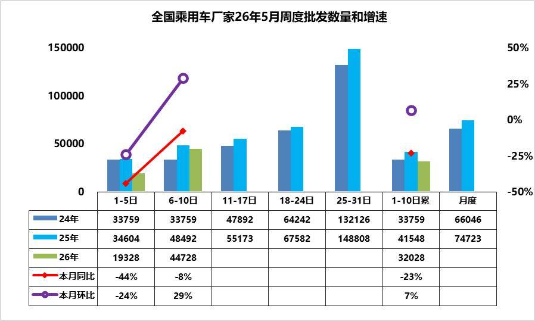
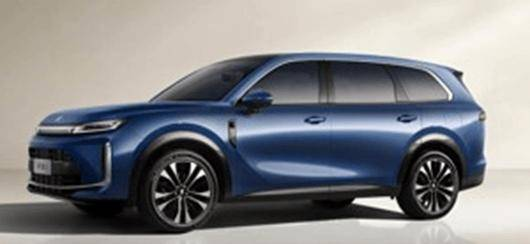
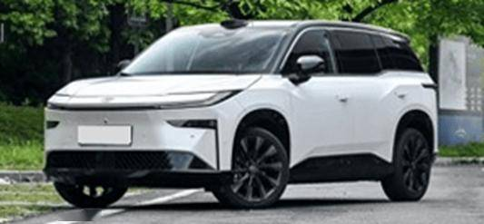
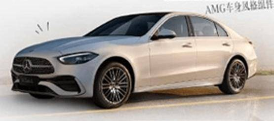
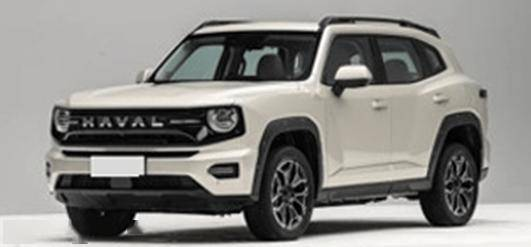
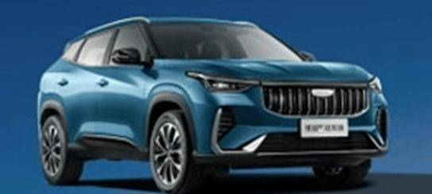
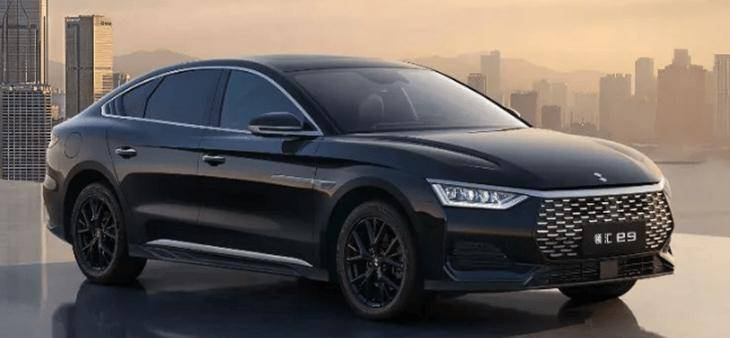
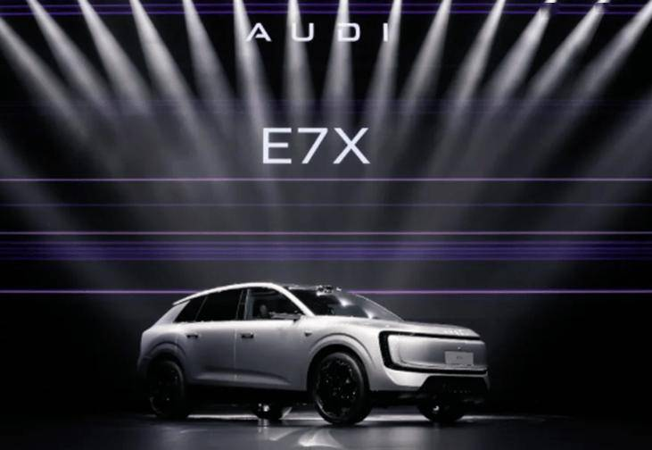

# 车市扫描-2026年17期（5月6日-5月10日）

- 公開日時: 2026-05-13 17:52（北京時間）
- 出典: [搜狐号・崔东树](https://www.sohu.com/a/1022149440_115312)
- テーマ（自動判定）: 車市スキャン（週次）
- 画像: 10枚

---

主要信息源自乘联分会每日新闻等

中国汽车流通协会

乘用车市场信息联席分会（乘联分会）

网站：http://www.cpcaauto.com

一、本周车市概述1.2026年5月全国乘用车市场零售相对较强

【2026年5月1-10日乘联会市场分析要闻】

5月1-10日全国乘用车厂家批发32.0万辆，同比去年同期下降23%，较上月同期增长7%；今年以来累计批发829.7万辆，同比去年同期下降7%。5月1-10日市场零售40.7万辆，同比去年同期下降21%，较上月同期增长36%；今年以来累计零售601.2万辆，同比去年同期下降19%。

5月1-10日全国乘用车厂家新能源批发19.3万辆，同比去年同期下降16%，较上月同期增长23%；今年以来累计批发414.7万辆，同比去年同期下降2%。5月1-10日新能源车市场零售22.6万辆，同比去年同期下降13%，较上月同期增长27%；今年以来累计零售298.4万辆，同比去年同期下降17%。

2026年5月1-10日全国新能源市场零售渗透率55.5%；新能源厂家批发渗透率60.3%。

5月第1-2周全国纯燃料轻型车生产14.3万辆，同比去年同期下降42%，较上月同期下降35%。5月第1-2周混合动力与插混总体生产10.4万辆，同比去年同期下降12%，较上月同期增长0%。

5月第1周乘用车市场日均零售3.1万辆，同比去年同期下降26%，较上月同期增26%。

5月第2周乘用车市场日均零售5.1万辆，同比去年同期下降17%，较上月同期增43%。

5月1-10日市场零售40.7万辆，同比去年同期下降21%，较上月同期增长36%；今年以来累计零售601.2万辆，同比去年下降19%。

2026 年5 月前两周，乘用车厂家零售市场呈现 “环比修复、同比承压” 的运行特征。周度数据分化背后，地方促消费政策的落地执行，车展效应正逐步显现。

由于高油价和人民币升值的压力逐步体现。从节奏看，前两周零售占比偏低，后续周度补量压力较大，叠加去年同期基数偏高，月度同比仍面临挑战。短期来看，政策红利释放、渠道库存消化仍是影响市场走势的关键变量，需持续关注后续周度零售表现及终端优惠变化。

2.2026年5月全国乘用车厂家销量平稳

5月第1周批发日均1.9万台，同比去年5月同期下降44%，环比上月同期下降24%。

5月第2周批发日均4.5万台，同比去年5月同期下降8%，环比上月同期增29%。

近期乘用车零售持续相对偏弱，各环节的运行压力都在加大，产销节奏需要放缓。从生产进度看，燃油车的生产剧烈萎缩42%，混合动力表现较好，新能源车性价比更高。由于市场的持续下行压力，经销商库存压力更大，需要有效的化解经销商的运营成本。

3.3月，全国二手车市场汽车交易量130.1万台，环比降25%，同比降6.5%

2026年3月，全国二手车市场汽车交易量130.1万台，环比降25%，同比降6.5%，交易金额为884亿元，同比降6%。2026年1-3月，二手车汽车累计交易量482万台，同比增4.7%，交易额3129亿元，增3.2%。

2026年3月，全国新能源二手车市场汽车交易量14万台，环比增32%，同比增长19.5%，新能源渗透率10.5%。2026年1-3月，新能源二手车汽车累计交易量40.5万台，同比增32%。

在中国汽车流通协会的呼吁下，二手车流通改善。各地交管部门办实事，便利群众企业办事，促进二手车流通。但与国际先进的发达国家市场相比，中国二手车的交易比例相对比较低，而中国的汽车市场起步相对较晚，二手车消费起步更晚，目前二手车正处于快速崛起阶段，未来发展潜力极其巨大。尤其是新能源车的发展，让中国的更多的普通消费者有了购车和用车的低成本的巨大优势。虽然国家报废更新政策的力度暂时放缓，但中国二手车发展潜力极其巨大，汽车经销商集团的二手车业务和汽车报废更新蓬勃发展，2026年以旧换新必然是超强增长。

4.2026年4月乘用车市场降价促销分析

2025年以来全国乘用车行业促销与降级均回归理性，市场秩序明显改善。由于新能源车购税恢复征收，指导价对消费者购车交税影响体现，2026年降价规模56款，较同期少12款，其中常规燃油车降价25款，较同期增8款；混合动力燃油车降价3款，较同期持平；插混燃油车降价9款，较同期减少4款；增程式车型降价3款，较同期减少2；纯电动车型降价16款，较同期减少14款。

2026年4月降价规模13款，较同期少1款。其中混动车型2款，较同期多2款；纯电动车型4款，较同期少1款。

2026年1~4月份，新能源车新车降价车型均价26.0万元的降价力度算术平均达到3.4万元，降价力度达到13.3 %。2026年4月份，新能源车新车降价车型均价20.7万元的降价力度算术平均达到2.3万元，降价力度达到11.1%的较高水平。2026年1~4月份，常规燃油车新车降价车型均价23.6万元的降价力度算术平均达到3.4万元，降价力度达到14.6%。2026年4月份，常规燃油车新车降价车型均价13.1万元的降价力度算术平均达到2.3万元，降价力度达到17.2%。2026年1~4月份，总体乘用车市场新车降价车型均价25.2万元的降价力度算术平均达到3.4万元，降价力度达到13.7%。2026年4月份，总体乘用车市场新车降价车型均价18.6万元的降价力度算术平均达到2.3万元，降价幅度达到12.3%。

2026年4月的新能源车的促销回升到10.9%的中高位，较同期促销持平，较上月微增0.3%。近几个月的促销较稳，随着降价的受约束，7年低息等促销新模式推动，促销体系也有回收，目前基本保持正常促销水平的中高位。2026年4月传统燃油车的促销下降到22.1%的水平，较上月微降0.6个百分点，较同期微降0.1个百分点，燃油车促销连续9个月维持在23%左右。传统燃油车的促销2025年9月开始小幅加大，幅度较温和，2026年因降价力度大，实现促销逐步回落。

5.4月中国汽车出口93.9万，环比增19%同比增51%

2026 年4 月，中国汽车出口在高油价、运力紧张背景下实现强势突破：整车出口量、额同比分别增长51%、44%，以新能源产品为核心，精准承接全球市场对低能耗车型的旺盛需求，对冲油价波动影响，形成 “高油价→新能源优势放大→出口加速” 的正向循环。

与此同时，汽车零部件出口同步稳步增长，重点服务欧美成熟市场，依托完善的供应链体系，为全球车企提供稳定配套，形成 “零部件深耕欧美、整车辐射全球” 的交叉互补格局，产业链协同效应凸显，共同支撑中国汽车产业的全球竞争力持续提升。

二、本周上市新车1.华境S上市限时置换价14.98-19.38万元

5月8日，华境S上市，新车共推4款，售价区间为15.98万-20.38万元，限时置换价14.98-19.38万元。新车采用贯穿式极光之翼尾灯，翼子板灵犀智慧灯支持充电闪烁。采用15.6英寸中控屏+8.8英寸仪表屏、15.6英寸后排娱乐屏。配备华为乾崑车云、8.8L冷暖冰箱、乾崑ADS Pro增强版等。新车搭载1.5T插混系统，CLTC纯电续航里程200km，255km，235km。

2.新款丰田铂智3X上市限时权益价9.48万-14.48万元

5月8日，新款丰田铂智3X上市，新车共推7款，售价区间为10.98万-15.98万元，限时权益价9.48万-14.48万元。外观与老款车型基本保持一致。配备禾赛新一代ATX激光雷达、MomentaR6强化学习世界模型。新车CLTC纯电续航为430km、520km、610km。

3.奔驰C 260 L运动轿车经典版上市29.99万元

5月8日，奔驰C 260 L运动轿车经典版上市，新车售29.99万元。外观与现款车型基本保持一致。新车采用12.3英寸悬浮式数字仪表屏、11.9英寸中央触摸屏。配备高通8295芯片、5G网络、360°智能泊车等。搭载2.0T四缸发动机+48V轻混系统，匹配9TIP变速箱。

4.哈弗大狗PLUS长续航版上市限时售15.28万元

5.吉利博越十周年冠军版上市9.69万元，限时售8.79万元

6.比亚迪新品牌“领汇”第二款车上市售价15.08万至16.98万元

5月9日，领汇汽车旗下第二款战略车型领汇e9上市，售价15.08万至16.98万元，定位闪充商务C级轿车，搭载比亚迪多项技术，面向多元群体。领汇汽车是比亚迪的对公品牌。

三、宏观经济与政策1.三部门：汽车座舱等人工智能终端国家标准发布

5月8日，工业和信息化部、国家市场监督管理总局、商务部等部门联合发布《人工智能终端智能化分级》系列国家标准。首批标准包括7个品类，后续将推进其他品类标准研制。《标准》涉及汽车座舱、移动终端、微型计算机、电视、眼镜、音箱、耳机等多种智能终端产品。

2.三部门：推动智能体与汽车等终端设备协同发展

5月8日，国家网信办、国家发展改革委、工业和信息化部联合印发《智能体规范应用与创新发展实施意见》。其中提出，终端应用方面，推动智能体赋能互联网应用及服务，优化在线购物、出行导航、生活缴费、日常办公等服务体验。推动智能体与汽车、手机、电脑、家居、可穿戴、消费级机器人等终端设备协同发展，提升跨应用、跨设备任务完成能力。

3.两部门：新能源城市公交车每车平均补贴8万元

交通运输部办公厅、国家发展改革委办公厅联合印发《2026年新能源城市公交车及动力电池更新补贴实施细则》，利用超长期特别国债资金，对城市公共汽电车企业更新新能源城市公交车及更换动力电池，给予定额补贴。每辆车平均补贴8万元；其中，对更换动力电池的，每辆车平均补贴4.2万元。

4.公安机关可调取汽车行驶记录仪、自动驾驶数据记录系统等电子数据作为证据材料

5月8日，公安部就关于修改《道路交通事故处理程序规定》的决定（征求意见稿）公开征求意见，共114条，拟修改9条，主要包括：调整机动车检验合格标志或保险标志要求；调整处理事故方式以及认定书签名和送达规定；调整现场勘查工作要求。增加2种固定证据方式（摄像、实景三维采集）；补充作为证据材料的电子数据种类，明确公安机关交通管理部门可以向有关单位、个人调取上述与道路交通事故直接相关的电子数据作为证据材料等。

5.第一季度中国出口“一带一路”沿线国家汽车金额增长31.6%

2026年1-3月，中国出口到“一带一路”沿线国家的汽车商品累计金额达到383.0亿美元，同比增长31.6%，占汽车商品出口总额的58.0%。其中：出口汽车整车151.0万辆，同比增长38.0%；出口新能源汽车46.9万辆，同比增长27.9%。

6.交通运输部：加快推动新能源重卡规模化应用

5月9日，交通运输部党组书记、部长刘伟主持召开部务会。会议强调，要持续加强能源物资运输保障，继续实施交通运输大规模设备更新行动，加快推动新能源重卡规模化应用，建设零碳运输走廊，推动交通运输与能源融合发展。

7.国内汽油价格每吨分别上调320元

5月8日24时国内成品油调价窗口开启，国内汽、柴油价格每吨分别上调320和310元。

8.北京数据跨境流动3.0方案落地

北京市商务局、市网信办、市经信局联合印发《关于进一步深化数据跨境流动便利化综合配套改革实施方案》，将数据出境负面清单管理模式从自贸试验区推广至全市域，覆盖汽车、医药、人工智能等9大重点领域，并建立动态更新机制，让更多市场主体享受政策红利。

9.重庆出台智能汽车高速公路测试新规

5月7日，重庆市经济信息委联合市公安局、市交委共同印发《重庆市智能网联汽车高速公路测试管理细则（试行）》，从严细化了测试主体、车辆、驾驶人准入门槛。其中，要求L3车辆同批次累计安全里程不低于2000公里、单车不少于200公里；L4及以上单车累计安全里程需达10000公里，均须完成仿真模拟、封闭场地、城市道路前置测试并出具完整报告。

四、新品信息跟踪1.奥迪E7X开启预售

2.蔚来ES9定档5月27日上市并交付

5月6日，蔚来汽车官方宣布，旗下大型SUV蔚来ES9计划于5月27日正式上市及交付，过道版本将于7月交付。

3.小米新一代SU7锁单突破8万台

小米汽车官方宣布，新一代SU7自3月19日上市以来，仅用48天，累计锁单量已突破80000台。

五、企业信息1.比亚迪已建成5924座闪充站点

5月8日，比亚迪公布闪充业务最新运营数据，截至5月6日，全国已建成5,924座闪充站，覆盖311座城市；闪充APP下载用户数突破100万。3月6日至5月6日期间，闪充站累计充电度数突破2,100万度。

2.比亚迪与神州租车签署采购框架协议

比亚迪与神州租车在深圳正式签署闪充中国战略合作暨10万台采购框架协议。比亚迪与神州租车将围绕“闪充中国战略”开展深度合作，在全国范围内符合条件的神州租车门店铺设比亚迪闪充桩设施。

3.比亚迪UK成为纯电最畅销品牌

据英国汽车制造商和贸易商协会（SMMT）最新发布的前四个月新车注册数据显示，比亚迪以12754辆纯电动车销量、超7%的市场份额，超越特斯拉、宝马、大众等老牌车企，正式登顶英国最大电动汽车品牌。

4.东风汽车牵头成立湖北省固态电池产业技术创新联合体

湖北省固态电池产业技术创新联合体及重大科技项目启动会暨先进电池技术交流会5月8日在东风汽车研发总院召开，湖北省固态电池产业技术创新联合体揭牌成立。该联合体由东风汽车牵头，18家合作伙伴共同创立。

5.广汽领程新能源商用车拿下2.5亿元战略投资

5月8日，从化区政府与广汽领程战略合作协议暨从化城投集团、从化百千万基金与广汽领程投资协议签约仪式在广汽集团总部举行。从化区政府通过从化城投集团等区属国企，以市场化方式向广汽领程投资2.5亿元人民币，支持企业持续深耕新能源商用车产业。

6.江汽集团与华为数字能源成立智能电动联合创新中心

5月7日，江汽集团与华为数字能源举行“江汽集团-华为数字能源智能电动联合创新中心”揭牌仪式。智能电动联合创新中心将聚焦新一代新能源汽车的高压化、高效化和智能化方向，协同攻关智能电控、功率模组应用、高性能电机等核心领域的技术。

7.吉利向加拿大出口高端电动汽车

近日，吉利控股旗下的一批莲花品牌高端电动汽车装船启运，发往加拿大。这批车辆产自吉利控股旗下位于武汉的莲花汽车全球智能工厂。

8.零跑汽车进军德国市场

零跑汽车抢占欧洲汽车市场份额，德国消费者可每月最低49欧元租赁零跑T03城市代步电动车。该租赁方案已包含德国最新电动车补贴，租金约为同级别菲亚特500车型的一半。

9.奇瑞控股等成立新公司

安徽嘉途汽车有限公司成立，注册资本19.2亿元，经营范围包含充电桩销售；电池制造；集成电路制造等。由奇瑞控股集团有限公司旗下奇瑞商用车（安徽）有限公司等共同持股。

10.Stellantis宣布与零跑汽车扩大战略合作伙伴关系

Stellantis宣布与零跑汽车扩大战略合作伙伴关系。为提升Stellantis位于西班牙萨拉戈萨的菲格鲁埃拉斯工厂的产能，双方正在评估增设一条生产线，用于生产欧宝全新的C级SUV纯电动汽车车型。最早可能在2028年投产。零跑也计划将其C级SUV B10车型引入该工厂，最早可能在2026年开始生产。此外，Stellantis和零跑还将通过合资公司在采购领域展开合作，加快新车型上市速度。

11.特斯拉向多品牌开放1400+超充站点

特斯拉正式宣布，中国内地已向非特斯拉新能源车主开放超1400座充电站点，其中包含1000多座超级充电站与400多座目的地充电站。

12.小米成立新科技公司含电机、电池、发电机制造等业务

北京小米景旭科技有限公司成立，经营范围包含电机制造；电池制造；电动机制造；发电机及发电机组制造；汽车零部件及配件制造等。该公司由小米通讯技术有限公司间接全资持股。

13.小鹏第二代VLA智驾里程占比首超50%

小鹏集团5月8日公布，第二代VLA系统推送满月后，智能驾驶里程占比正式突破50%，同期第二代VLA百公里接管次数环比下降25.87%，全程100%使用VLA的行程数环比增长27.84%。“五一”假期期间，小鹏AI辅助驾驶日均使用率达93.21%，累计行驶里程达8446万公里，单车最长智驾里程达5441公里。

六、行业信息1.白犀牛完成C1轮融资

5月6日，L4级自动驾驶企业白犀牛正式宣布完成C1轮融资。资金将主要用于核心技术研发迭代、车规级产品规模化量产、多场景商业化拓展及全球市场布局。

2.高德地图与比亚迪汽车达成战略合作

高德地图与比亚迪汽车正式签署战略合作协议，围绕“闪充中国”战略展开深度合作。比亚迪闪充网络将全面接入高德地图平台，双方在用户找桩、站点规划、商用车补能及品牌营销等多领域协同，共同优化新能源汽车补能服务体验。

3.宁德时代与Togg达成磐石底盘量产合作

宁德时代近日与土耳其汽车品牌Togg正式达成磐石底盘量产合作。Togg与宁德时代子公司时代智能将聚焦Togg全新B级平台下3款车型进行联合开发，首款车型计划于2027年实现量产。这是国内首个一体化智能底盘面向海外乘用车市场实现供货的合作项目。

七、跨国集团与国际市场1.澳大利亚将分阶段收紧电动汽车税收优惠政策

澳大利亚政府近日宣布，将分阶段收紧电动汽车附加税优惠政策。部分较高价位电动汽车将从2027年起不再享受全额税收豁免，所有符合条件的电动车将从2029年起统一适用较低幅度税收优惠。调整旨在鼓励汽车制造商向澳大利亚市场投放更多价格较低的电动汽车。

2.宝马集团2026年Q1营收310亿元

5月6日，宝马集团发布2026年第一季度业绩报告。营收310.07亿欧元，同比下降8.1%，环比下降14.86%；毛利率15.21%，同比下降0.47个百分点，环比下降0.32个百分点；净利润16.72亿欧元，同比下降23.1%，环比下降49.21%。总销量56.57万辆，同比下降3.5%。

3.保时捷宣布关停三家子公司

当地时间5月8日，保时捷股份公司发布公告宣布，终止旗下Cellforce Group GmbH、Porsche eBike Performance GmbH及Cetitec GmbH三家德国子公司的运营。

4.大众汽车10亿美元再投新势力车企

大众汽车集团完成对美国造车新势力Rivian的新一轮增持，以10亿美元的资金注入，正式超越亚马逊成为Rivian的最大单一股东，持股比例达15.9%。

5.戴姆勒卡车公司一季度营业利润减半

5月6日，戴姆勒卡车公司表示，受历史性疲软的需求及其关键市场北美地区进口关税的影响，该公司经调整后的营业利润为4.98亿欧元，而去年同期为10.8亿欧元。北美市场销量下降了四分之一，至29432辆。北美地区的调整后销售利润率从去年的14.4%降至5.4%。

6.FF宣布暂停原FX Super One 400V车型合作项目

北京时间5月7日，法拉第未来宣布，公司计划升级FX Super One为800V版本或加速AIHER混增项目，同时暂停原Super One 400V车型合作项目。

7.丰田：营业利润将较上一财年减少2700亿日元

丰田汽车表示，预计本财年受中东局势影响，营业利润将较上一财年减少2700亿日元。本财年混合动力汽车销量预计将首次突破500万辆，电动化汽车总销量将达到约600万辆。

8.美国4月混动车销量逆势增长

据美国全国汽车经销商协会的数据显示。4月份新车整体销量下降了7.1%，为连续第八个年头同比下滑，混合动力汽车销量增长了9.2%。

9.特斯拉上线官方高压电池维修认证功能

特斯拉在其App最新版本中上线了一项新功能：当车辆的高压电池接受大修或整体更换后，系统将自动生成一份官方电子版“高压电池维修认证证书”。该证书永久有效、可验证，并直接显示在App内对应车辆的维修记录栏目中，用户可随时导出为PDF文件用于交易或备案。

10.特斯拉Model Y通过美国辅助驾驶安全测试车型

5月8日，美国国家公路交通安全管理局（NHTSA）宣布，2026 款特斯拉Model Y已成为首款通过美国辅助驾驶（ADAS）安全测试的车型。

11.印尼宣布电动车购车补贴将于6月起正式生效

5月7日，印尼宣布电动车购车补贴将于6月起正式生效。

12.英力士计划开发小型越野车

英国汽车初创企业英力士（Ineos）正调整其产品战略，计划通过与其他汽车制造商合作，推进新车型开发。该公司首席执行官表示，英力士不会基于现有Grenadier平台推出短轴版车型，但会推出一款更小的四驱越野车，并聚焦增程式技术路线。

附：近日信息合集
