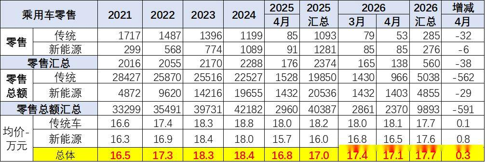
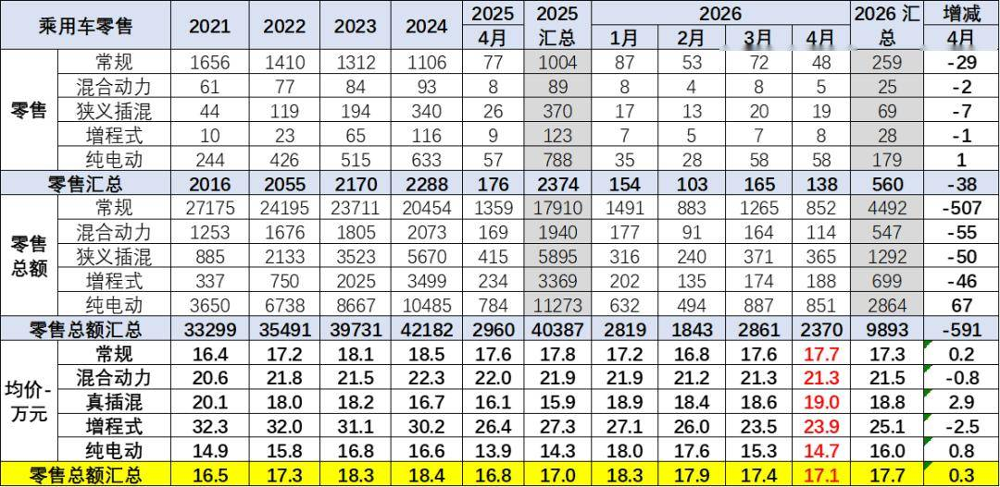
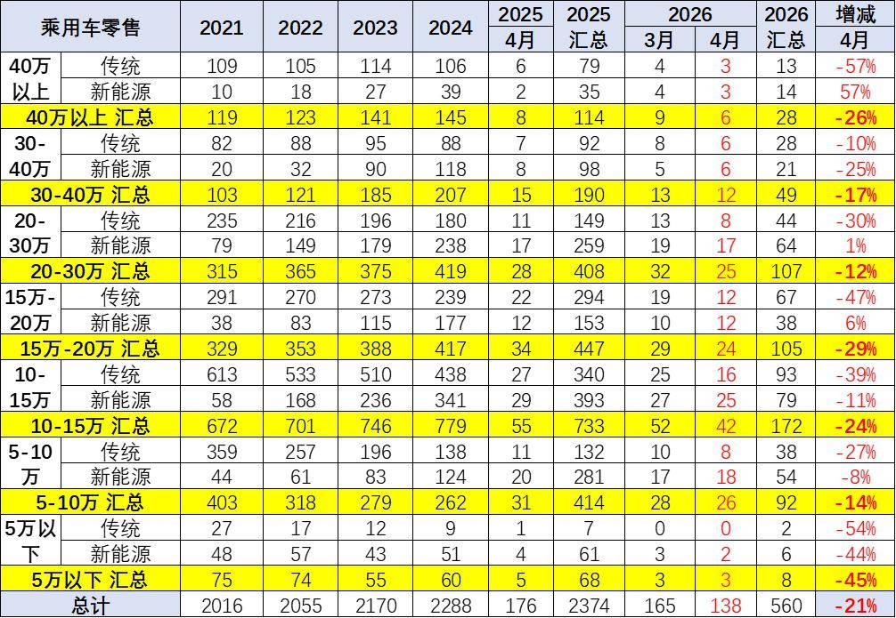
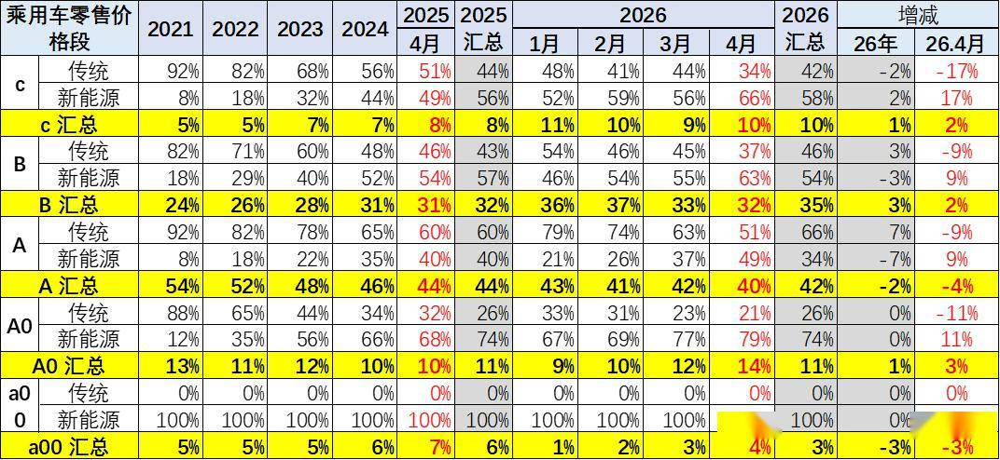
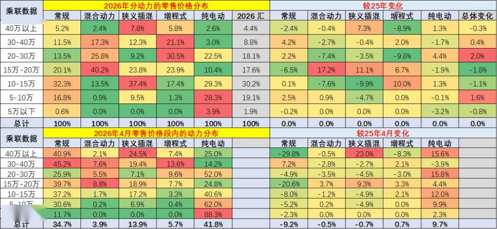
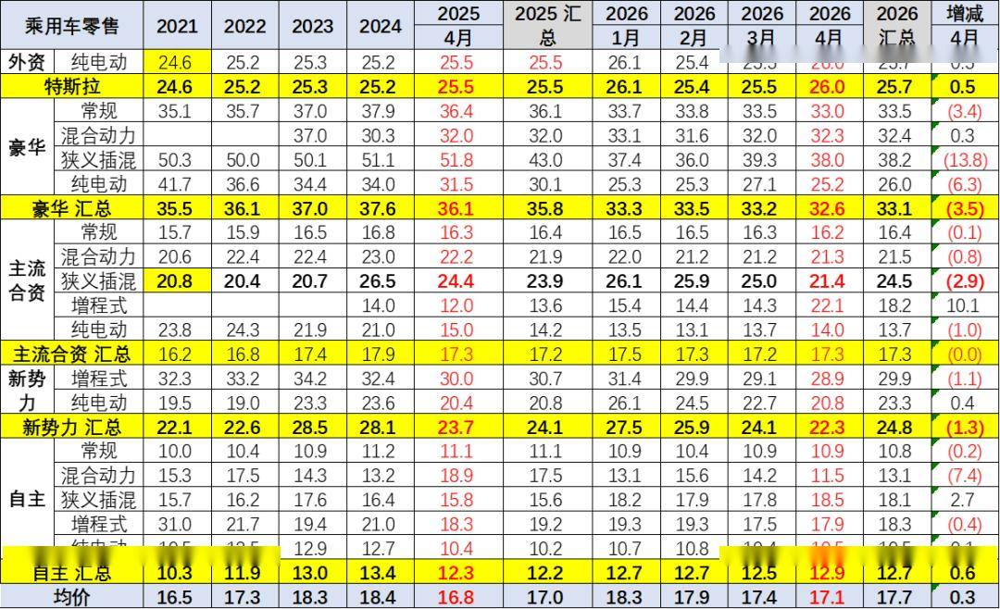

# 2026年4月乘用车市场价格段跟踪

- 公開日時: 2026-05-14 15:11（北京時間）
- 出典: [搜狐号・崔东树](https://www.sohu.com/a/1022522786_115312)
- テーマ（自動判定）: 価格帯
- 画像: 6枚

---

注：本分析文章仅代表崔东树个人观点，如有异议，请留言。

2025年豪华车均价35.8万元，较2024年降1.8万元；2026年4月均价32.6万元，较同期降3.5万元。2025年合资品牌17.2万元，较2024年降0.7万元；2026年4月均价17.3万元，较同期几乎持平。2025年新势力24.1万元，较2024年降4万元；2026年4月均价22.3万元，较同期增1.4万元。2025年自主品牌均价12.2万元，较同期降1.2万元；2026年4月自主品牌均价12.5万元，较同期增0.7万元。

常规燃油车价格持续上升，市场萎缩在中低端很明显，而高端萎缩慢，因此从2021年的16.6万元上升到2024年的18.8万元。2025年随着高端燃油车的较快萎缩，2025年的均价降低到18.2万元，2026年4月均价18.1万元，燃油车购买群体买车逐步稳定。

而新能源车的均价近期逐步下降，从2023年的均价18.4万元，下降到2024年的均价18.0万元，2025年的均价16.0万元，价格下降明显。2026年4月是16.5万元，涨价0.8万元，量跌价升，体现新能源车消费的结构性变化。

中国汽车普及仅有254台/千人，而汽车消费普及是未来最重要趋势，电动化的低成本带来车价持续下降是趋势。目前随着车购税免税政策退出后，新能源车免税技术指标的升级，部分短续航和高耗电车型面临改款压力。4月的A00级电动车剧烈萎缩带来均价的上升，2026年销量增长压力较大。

1、乘用车价格大幅拉升

常规燃油车价格持续上升，市场萎缩在中低端很明显，而高端萎缩慢，因此从2021年的16.6万元上升到2024年的18.8万元。2025年随着高端燃油车的较快萎缩，2025年的均价降低到18.2万元，2026年4月均价18.1万元，燃油车购买群体买车逐步稳定。

而新能源车的均价近期逐步下降，从2023年的均价18.4万元，下降到2024年的均价18.0万元，2025年的均价16.0万元，价格下降明显。2026年4月是16.5万元，涨价0.8万元，量跌价升，体现新能源车消费的结构性变化。

2024-2025年受到报废更新和以旧换新补贴政策促进，中低端的销量提升明显，因此出现均价降低，市场回暖。由于中国私车普及相对落后，均价降低推动市场的全方位发展，有利于车市的普及和规模提升。

车市中均价最高的是增程和混合动力，最低的是纯电动车。2025年均价下降的结构性原因是入门级纯电动的占比提升，价格较高的混合动力及增程式的占比下降，形成结构性拉动。2026年4月新能源增速下降，低端萎缩带来插混和纯电动的价格提升巨大，导致4月均价17.1万元，相对提升0.3万元。

在中国车市普及较低的客观现实情况下，车市均价下降体现了中低端人群的购买增加，应该是有增量是好的事情。2026年4月的零售下降，低端下降更大，均价提升，市场压力很大。

2、乘用车市场价格段销量结构的低端萎缩

根据乘联数据，前几年全国零售市场的价格段结构走势是持续上行，高端新能源车型销售提升明显，中低价车型销量减少。2025年随着报废更新政策推动，车市的中低端市场回暖，中低价位消费回升。2026年随着政策高质量发展，近期剧烈下滑，其中5万以下下降45%，较剧烈。

自主高端化突破体现乘用车新能源增长带来高端化发展趋势明显，但突破建立在低端稳定的基础上。目前入门级新能源下降的趋势较严峻。高端化体现的是普通消费不强，百姓消费是根本，虽然高端消费强，但实际体现了车市总体较弱。

3、乘用车级别市场销量结构

近期新能源车渗透率最高的是小车，4月的微型车渗透率100%，A0级小型车达到79%，A级的新能源回升较快，渗透率达到49%。

B级车新能源渗透率持续提升，增程式类车型表现改善。C级车的新能源渗透率大幅提升，体现高端电动化的优势明显。

4、乘用车的新能源线路结构

纯电动新能源车国内零售持续高增长，插混的表现近几年表现突出，增程持续小幅增长。传统乘用车的销量出现持续下行压力。

2026年的新能源车占比达到49%的较强比例，2026年4月的新能源车渗透率达到61%，高油价带动的新能源车贡献度提升较大。

5、2026年4月各价格段的内部动力的销量结构

在价格段市场内，动力分布式相对是不均衡的。其中在10万元以下市场的纯电动表现最弱，而增程式电动车在高端市场表现分布相对是最强，而混合动力是在15-40万元市场份额稍高，在10-20万市场表现相对较强。

传统燃油车是在5-20万元表现相对较强，30万以上市场表现也很强，形成了差异化分布的特征。混合动力的分布相对较窄，属于中高价区间的产品为主。而插电混动属于主流车型为主的，10-20万元级表现优秀。年初的低端市场下滑剧烈，这也是消费收缩，低端增长减速。

6、各类品牌市场均价变化

2025年豪华车均价35.8万元，较2024年降1.8万元；2026年4月均价32.6万元，较同期降3.5万元。2025年合资品牌17.2万元，较2024年降0.7万元；2026年4月均价17.3万元，较同期几乎持平。2025年新势力24.1万元，较2024年降4万元；2026年4月均价22.3万元，较同期增1.4万元。2025年自主品牌均价12.2万元，较同期降1.2万元；2026年4月自主品牌均价12.5万元，较同期增0.7万元。

自主品牌新能源全面发力，纯电动与狭义插混表现均压力较大，混合动力表现较强。总体看高端新能源价格竞争力提升，新势力的结构波动较大，纯电动的市场明显走弱，2026年4月自主燃油车均价10.9万元，价格与同期降0.2万元。
