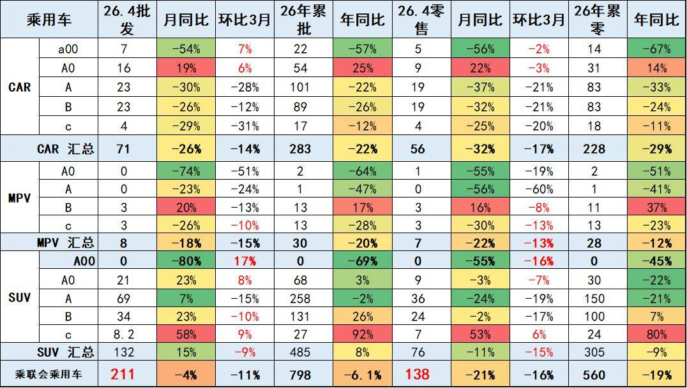
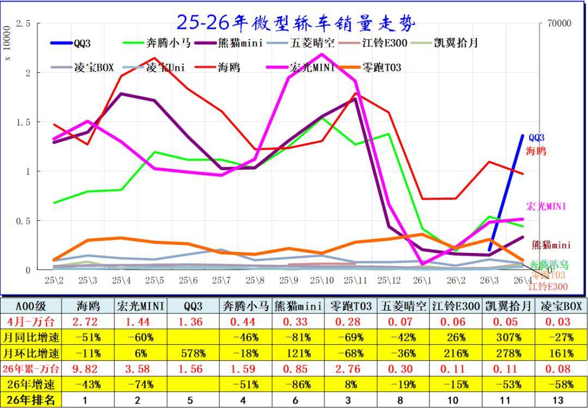
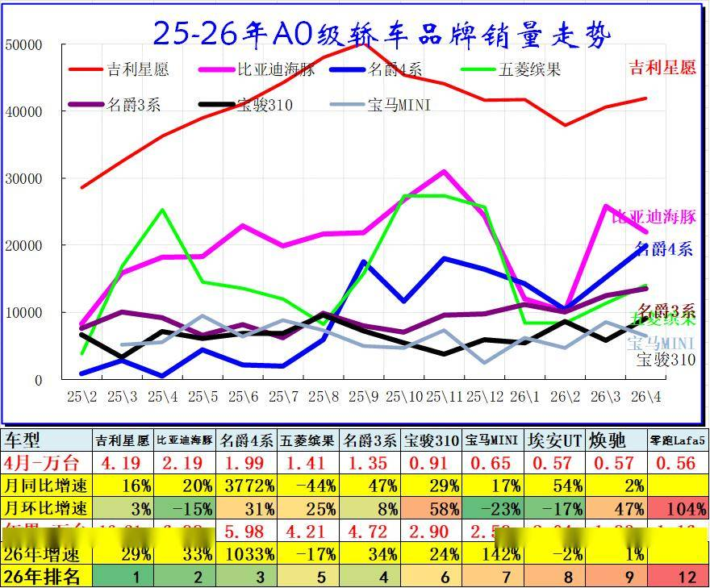
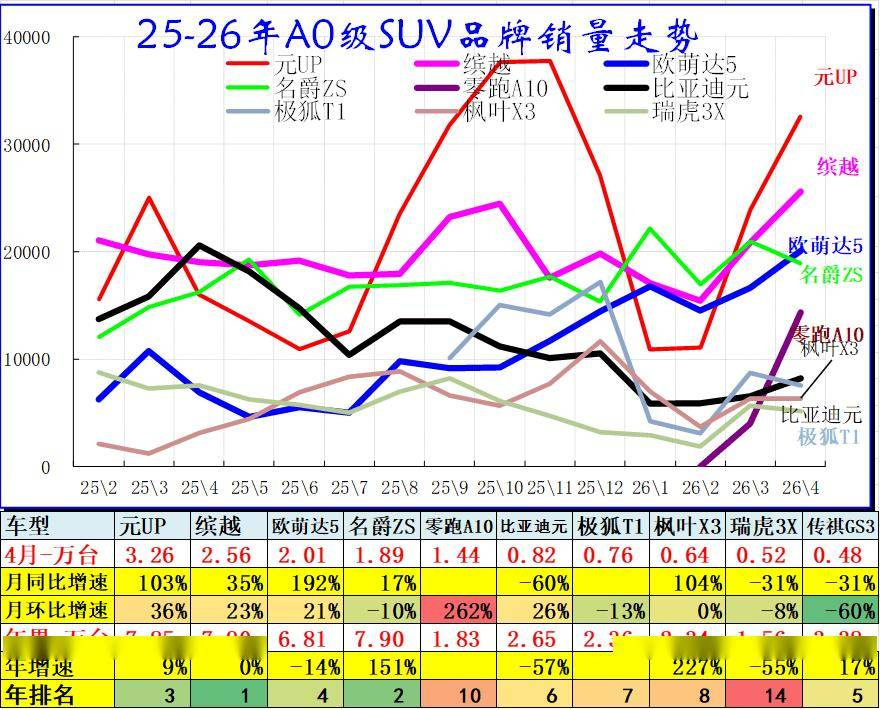
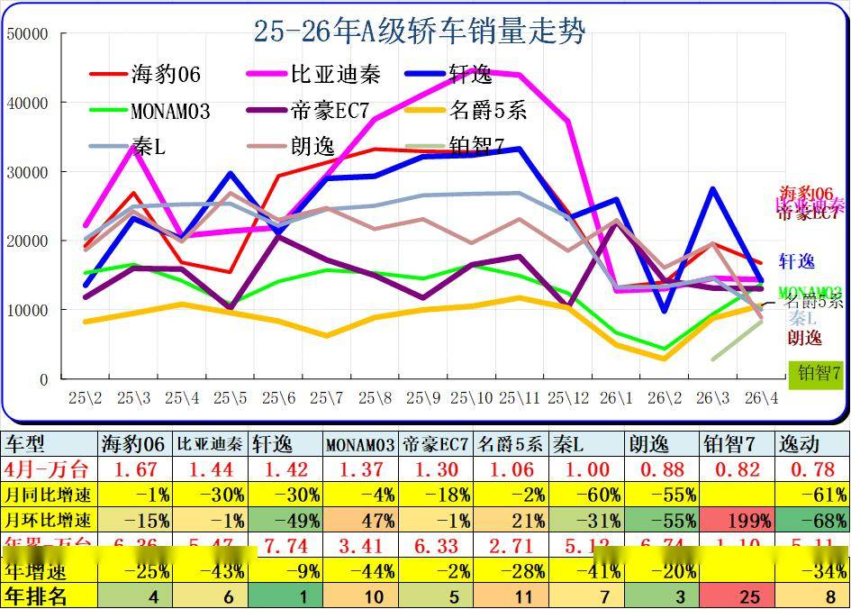
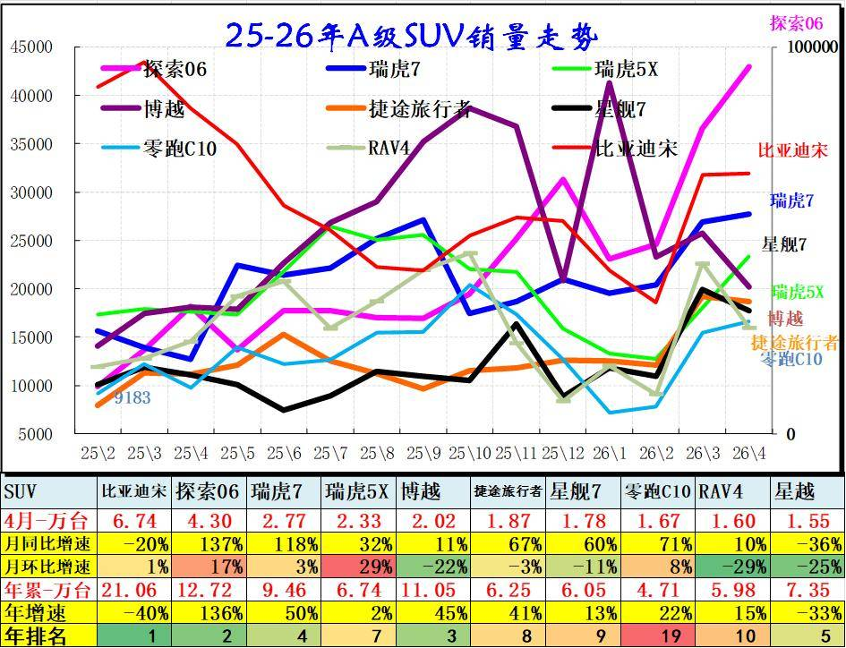
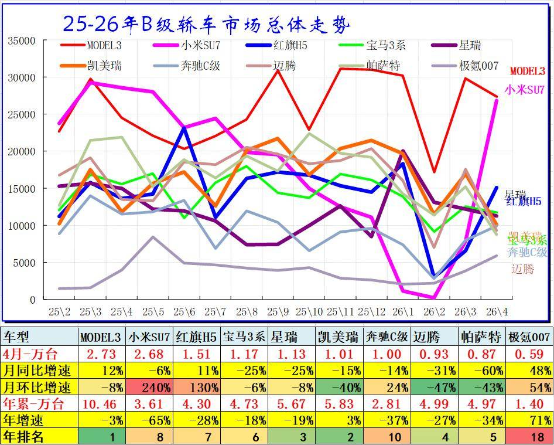
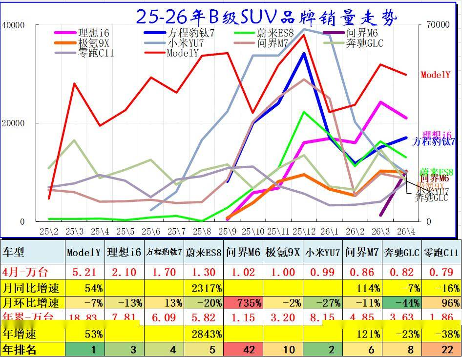
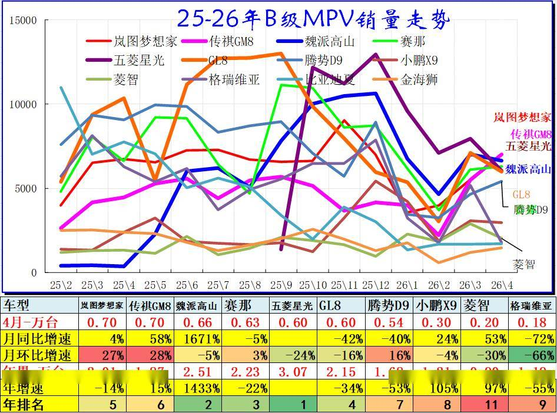

# 2026年4月乘用车细分市场车型走势

- 公開日時: 2026-05-16 15:46（北京時間）
- 出典: [搜狐号・崔东树](https://www.sohu.com/a/1023514601_115312)
- テーマ（自動判定）: セグメント・車種
- 画像: 9枚

---

注：本分析文章仅代表崔东树个人观点，如有异议，请留言。

2025年全国乘用车批发增速9%，新能源乘用车批发增速25%，圆满实现“十四五”的新能源车市增长预期。随着新能源车辆购置税免税政策年末到期，2026年车市新能源低迷期，但大多数省市以旧换新政策实施不快，中低端消费者需求低迷，市场走势分化明显。

2026年4月乘用车市场的特征：一、总量承压、结构性大分化，“燃油冷、新能源热”成最大焦点，国内零售下滑核心原因是“燃油崩塌”导致，新能源零售渗透率61.4%（历史首次突破60%），电动化替代速度超预期；二、自主份额持续走强，传统自主转型成功，合资品牌电动化进程迟缓,“自主主导”格局固化；三、出口爆发式增长、新能源占比52.7%（历史首次突破50%），“新能源+自主”双轮驱动，“出海”成核心增长引擎；四、被动去库存特征明显、渠道库存下降较快，上市经销商全面亏损，经销商生存压力持续加大；五、新能源内部结构剧变，B级电动车爆发、经济型电动车承压，“高端向上、低端艰难”；六、新车贡献度下降：2026年上市新车的4月厂商销量10.84万辆，总量占比5.1%，而2025年上市新车的4月销量13万辆，部分经典车型销量保持头部稳定态势。

2026年4月乘用车零售降21%，大幅低于批发下降4%的增速,形成内冷外热格局。由于高油价冲击和补贴暂停带来零售回落，4月A级轿车零售与A00级轿车零售均较低，A0级轿车和高端车型成为4月零售主力，SUV的高端表现较强，轿车中主要是A0级轿车销量回升。

一、经济型乘用车市场走势

1、A00级轿车市场表现

A00级轿车2026年4月批发6.92万台，占批发份额9.69%，批发较去年同期同比下降54%，批发环比今年上月增长7%；2026年4月零售较去年同期同比下降56%，零售环比今年上月下降2%。2026年1-4月批发数量22.13万台，厂家批发销售累计下降57%；2026年1-4月国内零售数量13.86万台，零售累计下降67%。

2、A0级轿车主力车型市场走势

A0级轿车2026年4月批发15.8万台，占批发份额22.11%，批发较去年同期同比增长19%，批发环比今年上月增长6%；2026年4月零售较去年同期同比增长22%，零售环比今年上月下降3%。2026年1-4月批发数量54.19万台，厂家批发销售累计增幅25%；2026年1-4月国内零售数量30.82万台，零售累计增幅14%。

自主电动车替代燃油车特征明显，竞争格局由合资主导转为自主为主的新趋势。前期日系的丰田和本田保持较强地位，近几年自主的燃油小型入门级车走势相对艰难。

A0级轿车的全面电动化趋势明显，基本没有太强的燃油车产品，体现了自主的纯电动的产品优势明显。

3、A0级SUV销量走势

A0级SUV 2026年4月批发20.95万台，占批发份额15.88%，批发较去年同期同比增长23%，批发环比今年上月增长8%；2026年4月零售较去年同期同比下降3%，零售环比今年上月下降7%。2026年1-4月批发数量68.28万台，厂家批发销售累计增幅3%；2026年1-4月国内零售数量30.2万台，零售累计下降22%。

主流小型SUV的日韩系基本退出市场，自主的电动车表现较强。

二、A级乘用车市场走势

1、紧凑型轿车主力车型市场走势

A级轿车2026年4月批发22.51万台，占批发份额31.49%，批发较去年同期同比下降30%，批发环比今年上月下降28%；2026年4月零售较去年同期同比下降37%，零售环比今年上月下降21%。2026年1-4月批发数量101.22万台，厂家批发销售累计下降22%；2026年1-4月国内零售数量82.84万台，零售累计下降33%。

2024年主流轿车市场的新能源占据主导地位，其中比亚迪绝对领先。2025年燃油车市场阶段性回暖，而大众的燃油车仍有一定的市场空间，主流家用车仍是燃油车最实用。

2、紧凑型SUV主力车型市场走势

A级SUV 2026年4月批发68.89万台，占批发份额52.23%，批发较去年同期同比增长7%，批发环比今年上月下降15%；2026年4月零售较去年同期同比下降24%，零售环比今年上月下降19%。2026年1-4月批发数量258.19万台，厂家批发销售累计下降2%；2026年1-4月国内零售数量150.3万台，零售累计下降21%。

主流SUV市场格局迅速变化，比亚迪和吉利、长安、奇瑞的SUV 表现超强，实现了自主SUV的国内外全面突破。

三、B 级乘用车市场走势

1、B级及C级轿车市场走势

B级轿车2026年4月批发22.6万台，占批发份额31.63%，批发较去年同期同比下降26%，批发环比今年上月下降12%；2026年4月零售较去年同期同比下降32%，零售环比今年上月下降21%，2026年1-4月批发数量88.64万台，厂家批发销售累计下降26%；2026年1-4月国内零售数量82.63万台，零售累计下降24%。

高端轿车市场的日系仍有一定稳定需求，新能源的高端自主快速崛起，尤其是出租网约的高端市场被自主电动车占领。

2、B级SUV市场走势

B级SUV 2026年4月批发33.75万台，占批发份额25.59%，批发较去年同期同比增长23%，批发环比今年上月下降10%；2026年4月零售较去年同期同比下降2%，零售环比今年上月下降17%。2026年1-4月批发数量130.57万台，厂家批发销售累计增幅26%；2026年1-4月国内零售数量99.72万台，零售累计增幅7%。

C级SUV 2026年4月批发8.2万台，占批发份额6.22%，批发较去年同期同比增长58%，批发环比今年上月增长9%；2026年4月零售较去年同期同比增长53%，零售环比今年上月增长6%。2026年1-4月批发数量27.48万台，厂家批发销售累计增幅92%；2026年1-4月国内零售数量24.43万台，零售累计增幅80%。

高端SUV市场的自主新能源迅速崛起，传统燃油车的高端优势弱化，近期的宝马等高端有所改善。

3、B级及以上MPV市场走势

B级MPV 2026年4月批发3.43万台，占批发份额44.77%，批发较去年同期同比增长20%，批发环比今年上月下降13%；2026年4月零售较去年同期同比增长16%，零售环比今年上月下降8%。2026年1-4月批发数量13.49万台，厂家批发销售累计增幅17%；2026年1-4月国内零售数量11.34万台，零售累计增幅37%。

C级MPV 2026年4月批发3.48万台，占批发份额45.42%，批发较去年同期同比下降26%，批发环比今年上月下降10%；2026年4月零售较去年同期同比下降30%，零售环比今年上月下降13%。2026年1-4月批发数量13.02万台，厂家批发销售累计下降28%；2026年1-4月国内零售数量13.34万台，零售累计下降23%。

MPV市场的高增长阶段已经改为低增长趋势。魏派高山、GL8近期表现较强，比亚迪与腾势和传祺的MPV表现超强，日系的MPV优势迅速下降。

附：近日信息合集
