# 从全国各类、各地、各行业的单位员工收入分析看车市消费特征

- 公開日時: 2026-05-17 16:18（北京時間）
- 出典: [搜狐号・崔东树](https://www.sohu.com/a/1023879020_115312)
- テーマ（自動判定）: 産業統計
- 画像: 12枚

---

注：本分析文章仅代表崔东树个人观点，如有异议，请留言。

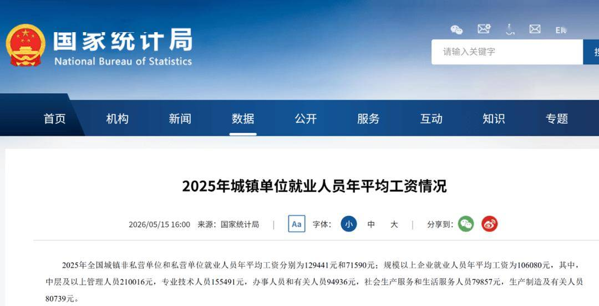

区域与行业的“马太效应”在2026年进一步加剧，直接框定了车企的主战场。东部沿海地区以15.0万元的非私营单位收入遥遥领先，构筑了新能源与高端化渗透率的高地；相比之下，中部与东北地区虽有增长但差距依旧。行业层面，信息软件、金融及科研服务业凭借远超均值的薪酬（如IT业达24.2万元），成为了高价值车型的“金矿”；而传统服务业与劳动密集型行业的消费能力则有待提升，未来乘用车市场普及仍是任重道远。

一、规模以上单位平均工资变化1、规模以上企业员工平均工资

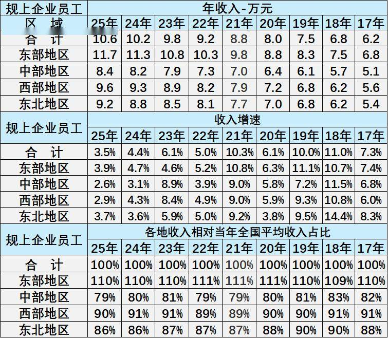

区域收入梯度明显，东部领先优势稳固。东部地区员工年收入始终高于全国均值，2025年达11.7万元，是中部地区（8.4万元）的1.4倍，且占比稳定在110%左右，显示其经济活力与薪酬竞争力持续领跑。

中西部增速波动中追赶，东北收入占比小幅下滑。中部地区2023年增速达8.9%，西部2018年增速10.8%，均高于东部，但2025年中部收入占比降至79%，东北从2017年88%降至2025年86%，区域间增长动能分化。

全国收入稳步增长，区域差距长期存在。2017-2025年全国规上企业员工收入从6.2万元增至10.6万元，年均增速约7%，但东部与中部收入比始终维持在1.3-1.4倍，区域协调发展仍需政策持续发力。

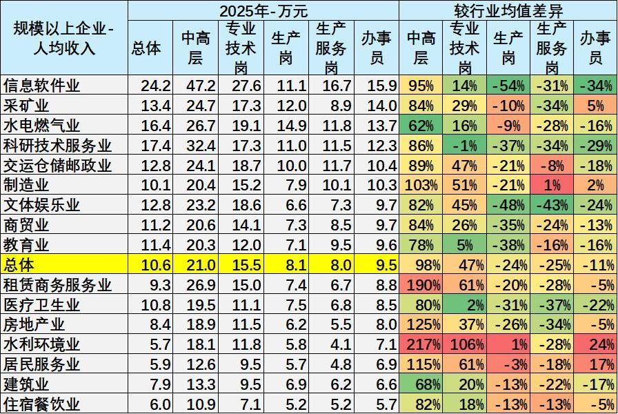

行业收入分化显著，信息软件业与科研服务业领跑。信息软件业以24.2万元的总体人均收入居首，其中高层岗位达47.2万元，专业技术岗27.6万元，均远超行业均值；科研技术服务业紧随其后，总体收入17.4万元，高层与专业技术岗收入分别为32.4万元、17.3万元，技术密集型行业薪酬优势突出。

岗位层级收入差距悬殊，中高层与生产岗分化明显。中高层岗位总体收入21.0万元，较生产岗（8.1万元）高出159%，其中租赁商务服务业中高层收入26.9万元，是生产服务岗（6.7万元）的4倍；生产岗在文体娱乐业（6.6万元）、房地产业（6.2万元）收入垫底，基层岗位薪酬增长乏力。

传统行业收入偏低，水利环境与住宿餐饮业薪酬竞争力弱。水利环境业总体收入5.7万元，住宿餐饮业6.0万元，分别仅为行业均值的54%和57%；其生产岗收入分别为5.8万元、5.2万元，较总体均值低28%和36%，劳动密集型行业薪酬提升空间有限。

3、中高层收入变化走势

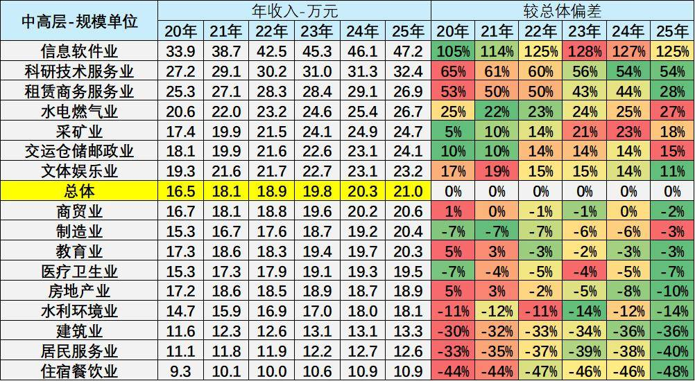

中高层岗位收入行业分化显著，技术密集型行业优势突出。信息软件业中高层收入从2020年33.9万元增至2025年47.2万元，较总体均值偏差达125%，科研技术服务业（32.4万元）、租赁商务服务业（26.9万元）紧随其后，技术与管理要素在薪酬分配中权重持续提升。

传统行业中高层收入增长乏力，与总体差距扩大。住宿餐饮业中高层收入2025年仅10.9万元，较总体均值低48%，建筑业（13.3万元）、居民服务业（12.6万元）偏差分别为-36%、-40%，且2020-2025年偏差幅度普遍扩大，显示传统行业管理岗薪酬竞争力持续弱化。

中高层收入总体稳步增长，但行业间“马太效应”加剧。2020-2025年总体中高层收入从16.5万元增至21.0万元，年均增速约5%，但信息软件业与住宿餐饮业收入差距从3.6倍扩大至4.3倍，高收入行业对优质管理资源的虹吸效应愈发明显。

4、专业技术岗收入变化走势

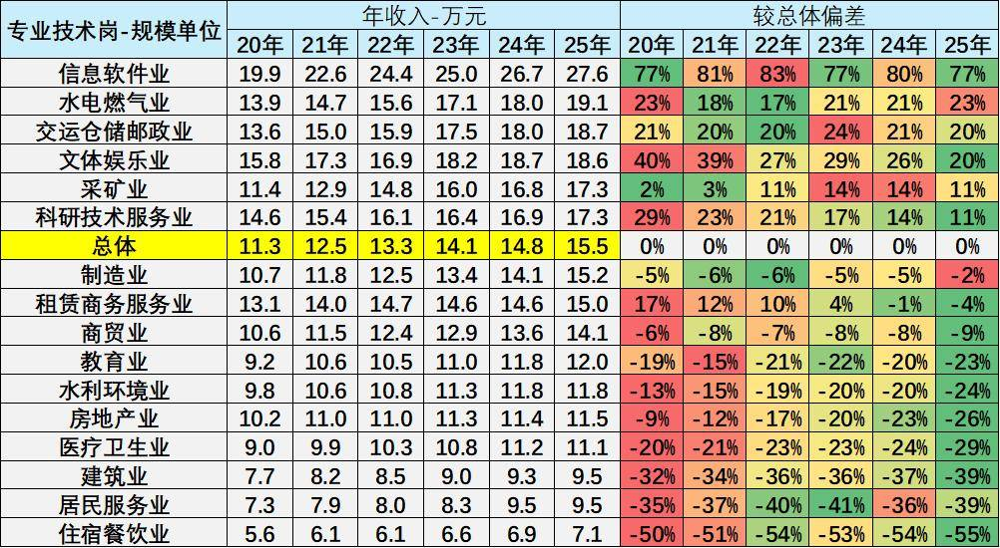

专业技术岗收入呈显著行业分层，信息软件业技术岗薪酬领跑优势持续强化。2025年信息软件业专业技术岗年收入达27.6万元，较总体均值偏差77%，2020-2025年偏差率始终维持在77%以上，技术密集型行业对核心人才的薪酬溢价持续凸显。

传统基建与能源行业技术岗待遇稳步提升，部分行业溢价能力增强。水电燃气业技术岗2025年收入19.1万元，较总体均值偏差23%，较2020年提升1个百分点；交运仓储邮政业偏差率稳定在20%左右，行业技术岗薪酬增长与总体水平基本同步，稳定性特征明显。

民生服务类行业技术岗收入持续低迷，与总体差距呈扩大趋势。住宿餐饮业技术岗2025年收入仅7.1万元，较总体均值偏差-55%，较2020年扩大5个百分点；居民服务业、建筑业偏差率分别达-39%、-39%，劳动密集型行业技术岗薪酬竞争力持续弱化，人才留存压力加剧。

5、生产岗收入变化走势

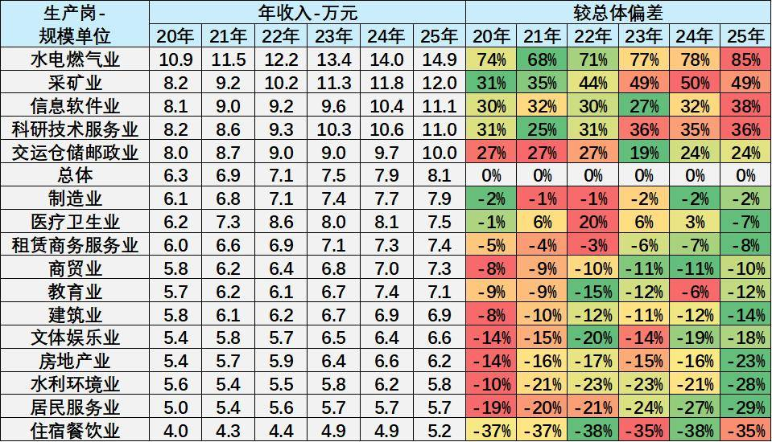

生产岗收入行业分化显著，能源与资源型行业薪酬优势突出。2025年水电燃气业生产岗年收入达14.9万元，较总体均值（8.1万元）高出85%，采矿业以12.0万元紧随其后，偏差率49%，资源垄断与高附加值属性推动生产岗薪酬持续领跑。

技术密集型行业生产岗溢价有限，传统服务业收入持续低迷。信息软件业生产岗2025年收入11.1万元，偏差率38%，虽高于总体但远低于其技术岗77%的偏差；住宿餐饮业生产岗仅5.2万元，偏差率-35%，居民服务业、水利环境业偏差率分别为-29%、-28%，劳动密集型行业基层岗位薪酬增长乏力。

生产岗总体收入稳步增长，但行业间差距呈扩大趋势。2020-2025年总体生产岗收入从6.3万元增至8.1万元，年均增速约5%，但水电燃气业与住宿餐饮业收入比从2.7倍扩大至2.9倍，资源型行业对基层劳动力的薪酬吸引力持续增强，而服务业基层岗位薪酬竞争力进一步弱化。

6、单位办事人员收入变化走势

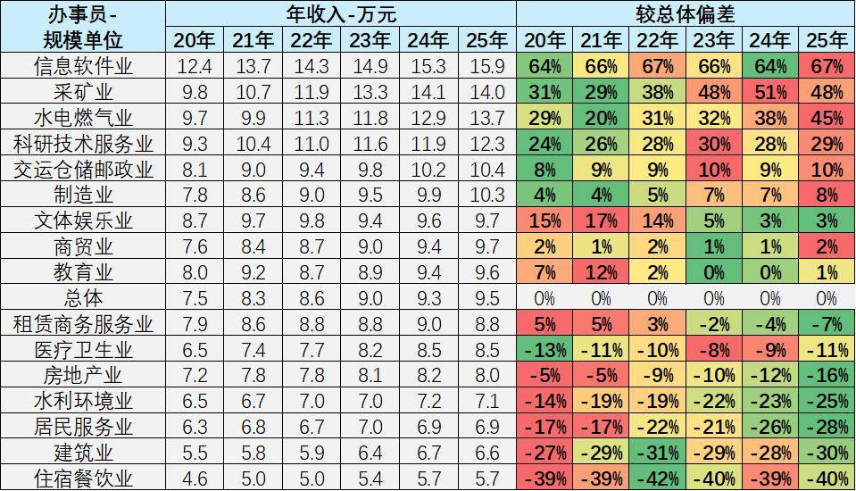

办事员收入行业分化显著，信息软件业与采矿业薪酬优势持续强化。2025年信息软件业办事员年收入达15.9万元，较总体均值（9.5万元）高出67%，采矿业以14.0万元紧随其后，偏差率48%，技术密集型与资源型行业对行政岗位薪酬溢价明显。

传统服务业办事员收入持续低迷，与总体差距呈扩大趋势。住宿餐饮业办事员2025年收入仅5.7万元，较总体均值偏差-40%，建筑业、居民服务业偏差率分别为-30%、-28%，劳动密集型行业行政岗位薪酬增长乏力，人才留存压力加剧。

办事员总体收入稳步增长，但行业间“马太效应”愈发显著。2020-2025年总体办事员收入从7.5万元增至9.5万元，年均增速约5%，但信息软件业与住宿餐饮业收入差距从2.7倍扩大至2.8倍，高收入行业对优质行政资源的虹吸效应持续增强。

二、非私营单位的行业收入差异特征1、城镇非私营员工收入

东部地区薪酬优势显著，区域间收入差距保持稳定。2025年东部地区城镇非私营单位年收入平均达15.0万元，较总体均值（12.9万元）高出16%，持续领跑全国；中部、东北地区收入分别为10.3万元、10.4万元，较总体均值低约20%，区域间“东高西稳、中部东北偏低”的格局未发生明显变化。

全国非私营单位收入稳步增长，区域与资本属性分化并存。2022-2025年总体收入从11.4万元增至12.9万元，年均增速约4.3%，但东部地区与中部地区收入差距始终维持在4.7万元左右，外资与内资单位收入差距扩大至3.9万元，资源与资本集聚效应持续强化区域及单位类型间的薪酬分化。

2、城镇非私营分类

外资背景单位薪酬溢价突出，内资单位接近总体均值。2025年外商投资单位年收入达16.5万元，较总体均值高出27%，港澳台投资单位14.7万元，较总体均值高13%，资本国际化程度高的单位对人才薪酬吸引力更强。

3、各行业收入变化

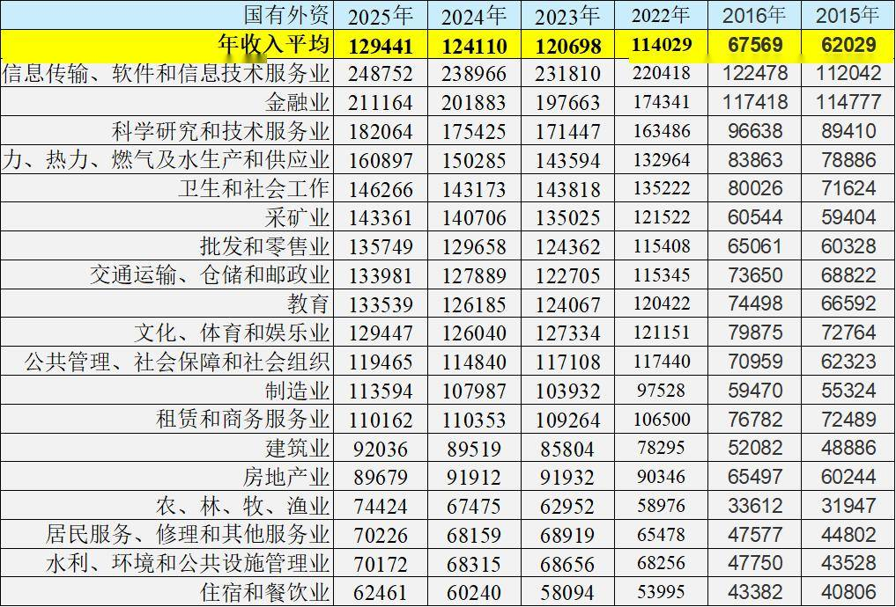

4、收入差异性变化

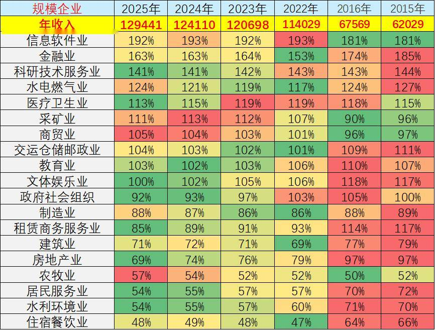

行业收入分化固化，头部效应显著。信息软件业（192%）、金融业（163%）、科研技术服务业（141%）连续多年稳居收入前三，2025年收入分别为总体均值的1.92倍、1.63倍、1.41倍，且比例长期稳定（2015-2025年信息软件业始终高于180%），形成“技术+资本”驱动的高收入集群。相比之下，住宿餐饮业（48%）、农牧业（57%）、水利环境业（54%）持续处于底部，2025年收入不足总体均值的60%，行业间“金字塔”结构固化。

收入比例动态演变：新兴行业崛起与传统行业承压。信息软件业比例从2015年的181%升至2025年的192%，十年间提升11个百分点，反映数字经济对薪酬的拉动效应；金融业则从185%降至163%，比例收缩22个百分点，或与行业监管及盈利模式调整相关。传统行业中，房地产业比例从2015年的97%降至2025年的69%，建筑业从79%降至71%，显示房地产周期下行对收入的持续影响；而医疗卫生业比例从115%升至113%（2022年达119%），公共属性行业收入稳定性凸显。

三、私营单位员工平均工资1、区域收入差异

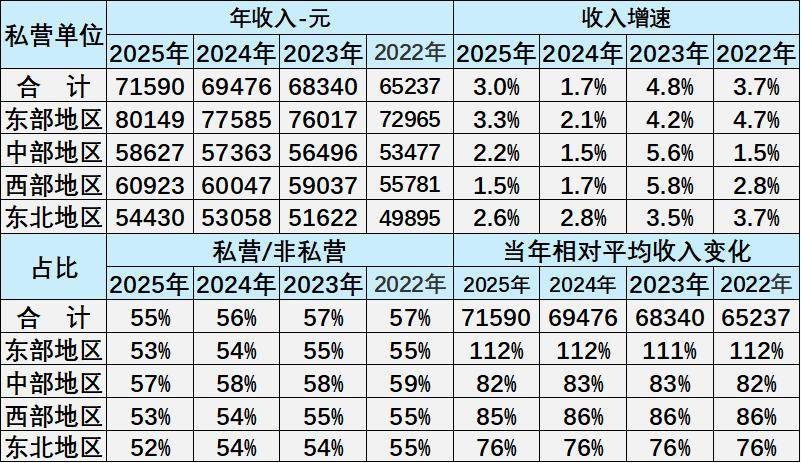

区域收入分化显著，东部私营单位薪酬持续领跑且增速稳健。2025年东部地区私营单位年收入达80149元，较总体均值（71590元）高出12%，2022-2025年年均增速3.3%，显著高于西部1.5%的增速，东部地区经济活力对私营单位薪酬的支撑作用持续凸显。

中西部及东北地区收入差距明显，西部地区增速放缓突出。2025年中部、东北地区收入分别为58627元、54430元，较总体均值低18%、24%；西部地区虽收入60923元略高于中部，但2025年增速仅1.5%，为四大区域最低，区域间薪酬增长动能差异加剧分化。

私营单位收入占比小幅下降，区域相对差距保持稳定。2025年私营单位收入占非私营单位比例为55%，较2022年下降2个百分点；东部地区私营收入始终为非私营的112%左右，东北稳定在76%，区域间薪酬层级格局未发生明显变化，东部私营单位对劳动力的吸引力持续强化。

2、行业收入差异

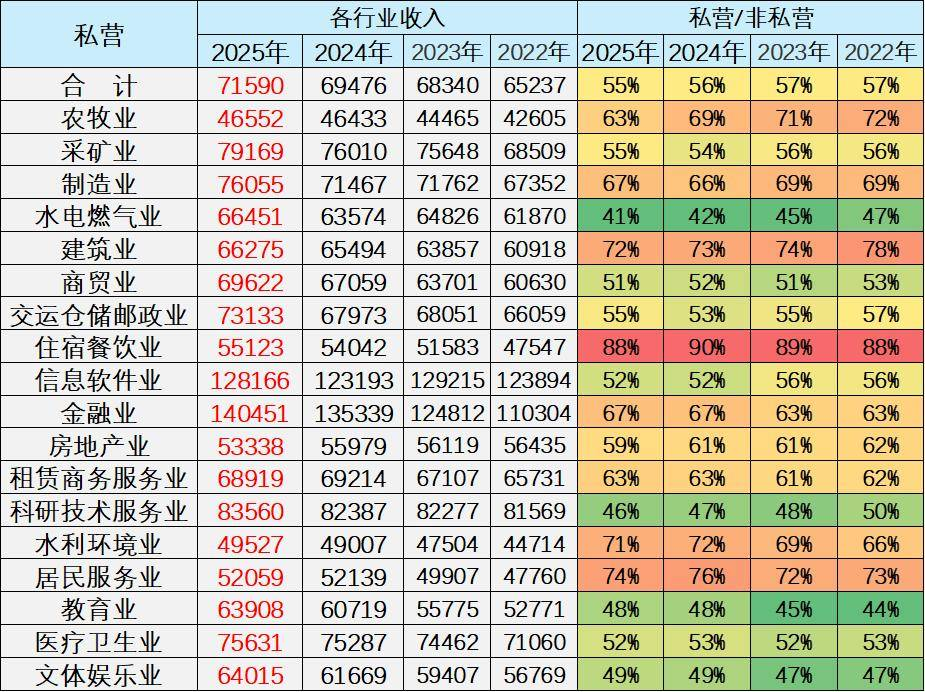

传统服务业与基础行业收入低迷，与高收入行业差距扩大。2025年住宿餐饮业收入仅55123元，农林牧渔业46552元，不足金融业的一半；建筑业、水利环境业收入占比虽达非私营的72%、71%，但绝对值仍低于总体均值，劳动密集型行业薪酬增长乏力。

私营单位总体收入稳步增长，行业间“马太效应”强化。2022-2025年总体收入从65237元增至71590元，年均增速3.1%，但金融与信息软件业收入占比非私营单位稳定在52%-67%，而住宿餐饮业占比虽高（88%-90%），绝对值差距仍持续扩大，高收入行业对优质劳动力的虹吸效应愈发明显。

四、车市消费群体的消费特征分析

从职业收入看车市消费特征及相关数据，我们可以从收入增长、行业、岗位及区域四个维度，深度剖析当前车市消费群体的特征。这一分析揭示了一个核心事实：2026年的车市并非“全民狂欢”，而是由高技能、高管理层级和特定高收益行业驱动的“结构性增长”市场。

以下是详细的消费特征画像：

1、收入增长与车市消费潜力

从宏观数据看，全国城镇非私营单位和私营单位的年平均工资在2025年分别达到 12.9万元和 7.16万元。对于规模以上企业，员工年平均工资为 10.6万元。

·消费门槛变化：这意味着家庭年收入在10万-15万元区间的“新中产”群体正在壮大，他们是15万-25万元价位主流家用车（如B级轿车、紧凑型SUV）的核心购买力。

·购买力分化：虽然总体收入稳步增长（年均增速约5%-7%），但通货膨胀和车型技术迭代（如智能化配置）使得低端入门车型的利润空间被压缩，消费者更倾向于“一步到位”的高价值车型。

2、行业差异：技术与资本主导购车能力

不同行业的薪酬“基因”直接决定了其从业者的购车预算。车市消费群体呈现出鲜明的行业集中度，“技术密集型”与“资本密集型”行业从业者是高端车市的主要增量来源。

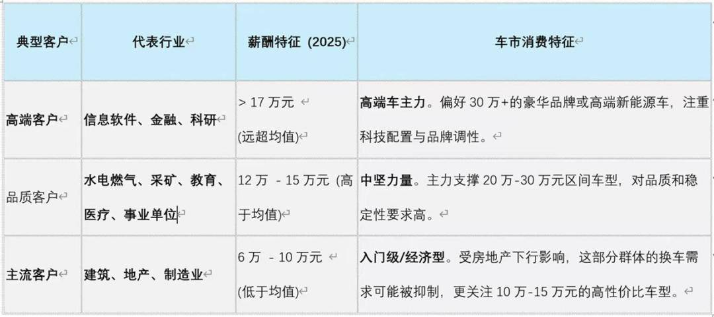

3、岗位差异：管理层与技术层的“双核驱动”

在同一行业内，不同岗位的收入差距悬殊，这种“岗位极差”在车市中表现为消费层级的断层。

·中高层管理者（年入21万+）：

o特征：他们是各行业的“金领”，收入是生产岗的2.6倍。

o购车偏好：行政级轿车（如奥迪A6L、宝马5系）或全尺寸SUV的主力消费群，对后排舒适度、行政服务和品牌尊贵感有硬性要求。

·专业技术人员（年入15.5万）：

o特征：特别是在信息软件业，技术岗收入（27.6万）甚至接近行业均值的两倍。

o购车偏好：新势力智能电动车的核心拥趸。他们懂技术、爱尝鲜，是特斯拉、蔚来、理想等品牌的坚定支持者，关注自动驾驶、智能座舱等参数。

·基层生产/服务人员（年入约8万）：

o特征：收入增长乏力，与管理层差距在扩大。

o购车偏好：刚需代步为主。A0级小车（如五菱宏光MINI、比亚迪海豚）或高性价比的国产紧凑型车是其首选，价格敏感度极高。

4、区域差异：东部沿海的“虹吸效应”

区域经济的不平衡直接映射到车市的地域分布上。

·东部沿海（年入11.7万-15.0万）：

o特征：无论是规上企业还是非私营单位，东部地区收入均为全国领跑，且优势稳固。

o车市表现：新能源渗透率最高、豪华车销量最集中的区域。长三角、珠三角地区对插混、增程以及高端进口车的接受度远高于其他地区。

·中部、东北及西部（年入5.4万-10.4万）：

o特征：收入水平约为东部的70%-80%，且增长动能相对较弱。

o车市表现：传统燃油车的“基本盘”与性价比车型的“主战场”。由于充电设施或使用场景的差异，这些区域对皮实耐用的合资品牌燃油车或高性价比的国产车需求更旺盛。天津（你的所在地）作为北方重要港口城市，兼具工业基础和港口贸易优势，其车市特征通常介于东部沿海高消费与北方内陆实用主义之间，合资品牌（如丰田、大众）和高性价比新能源车在此地竞争激烈。

综上所述，基于收入特征的2026年车市消费群体呈现出以下画像：

1.主力人群：“泛IT/金融从业者”与“专业技术人才”。他们是收入增长最快、购买力最强的群体，决定了高端和智能化车型的市场走向。
2.分层明显：车市不再是“大众化”市场，而是“二八分化”严重。高收入群体追求大空间、高智能化的中大型SUV和豪华轿车；而广大基层员工则支撑了微型电动车和经济型家轿的销量。
3.区域集中：东部沿海依然是车企争夺的“兵家必争之地”，而下沉市场（三四线城市及县域）则更多承接了价格下探的经济型车型。

附：近日信息合集
