# 车市扫描-2026年18期（5月11日-5月17日）

- 公開日時: 2026-05-20 17:40（北京時間）
- 出典: [搜狐号・崔东树](https://www.sohu.com/a/1025241855_115312)
- テーマ（自動判定）: 車市スキャン（週次）
- 画像: 17枚

---

主要信息源自乘联分会每日新闻等

中国汽车流通协会

乘用车市场信息联席分会（乘联分会）

网站：http://www.cpcaauto.com

一、本周车市概述1.2026年5月全国乘用车市场零售开局较强后逐步回落

【2026年5月1-17日乘联会市场分析要闻】

5月1-17日全国乘用车厂家批发66.0万辆，同比去年同期下降18%，较上月同期增长2%；今年以来累计批发863.7万辆，同比去年同期下降7%。5月1-17日市场零售68.0万辆，同比去年同期下降23%，较上月同期增长23%；今年以来累计零售628.5万辆，同比去年同期下降19%。

5月1-17日全国乘用车厂家新能源批发39.6万辆，同比去年同期下降9%，较上月同期增长12%；今年以来累计批发434.9万辆，同比去年同期下降2%。5月1-17日新能源车市场零售40.0万辆，同比去年同期下降12%，较上月同期增长18%；今年以来累计零售315.8万辆，同比去年同期下降17%。

2026年5月1-17日全国新能源市场零售渗透率58.9%；新能源厂家批发渗透率59.9%。

5月第1-3周全国纯燃料轻型车生产28.4万辆，同比去年同期下降41%，较上月同期下降31%。5月第1-3周混合动力与插混总体生产19.7万辆，同比去年同期下降14%，较上月同期增长3%。

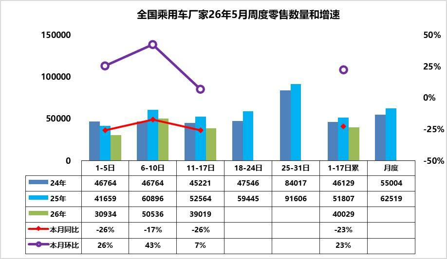

5月第1周乘用车市场日均零售3.1万辆，同比去年同期下降26%，较上月同期增26%。

5月第2周乘用车市场日均零售5.1万辆，同比去年同期下降17%，较上月同期增43%。

5月第3周乘用车市场日均零售3.9万辆，同比去年同期下降26%，较上月同期增7%。

5月1-17日市场零售68.0万辆，同比去年同期下降23%，较上月同期增长23%；今年以来累计零售628.5万辆，同比去年同期下降19%。

2026 年5 月上旬乘用车零售呈现 “五一节日旺销后逐步回落” 的周度节奏，1-5 日受假期影响零售量处于低位，6-10 日的节日订单集中释放形成峰值，11-17 日虽有回落。从同比来看，前三周零售量均低于2025 年同期，1-17 日累计同比下滑23%，市场整体仍面临需求不足的压力。由于去年同期政策补贴带来的高基数效应，同比表现偏弱符合预期。

2026 年3 月以来国内汽油先后五次调价，3 月9 日24 时每吨上调695 元，3 月23 日24 时每吨上调1160 元，4 月7 日24 时每吨上调420 元，4 月21 日24 时每吨下调555 元，5 月8 日24 时每吨上调320 元，综合统计累计每吨上涨2040 元，折合每升共计上涨1.67 元。由此高油价对车市的冲击巨大，高油价的燃油车销量损失短期内是无法依靠新能源弥补的。对比4月卡车市场同比相对零售旺销的局面，卡车更新补贴力度与去年相通，而乘用车补贴剧烈下降的差异化影响较明显。

展望后续，随着5 月下旬车企加大促销力度、冲量窗口开启，零售量有望再次回升，月度同比跌幅大概率较上旬有所收窄；同时市场分化态势将延续，新能源与低价入门车型的表现仍将优于传统燃油车及中高端合资品牌。短期来看，政策红利释放、渠道库存消化仍是影响市场走势的关键变量，需持续关注后续周度零售表现及终端优惠变化。

2.2026年5月全国乘用车厂家销量平稳

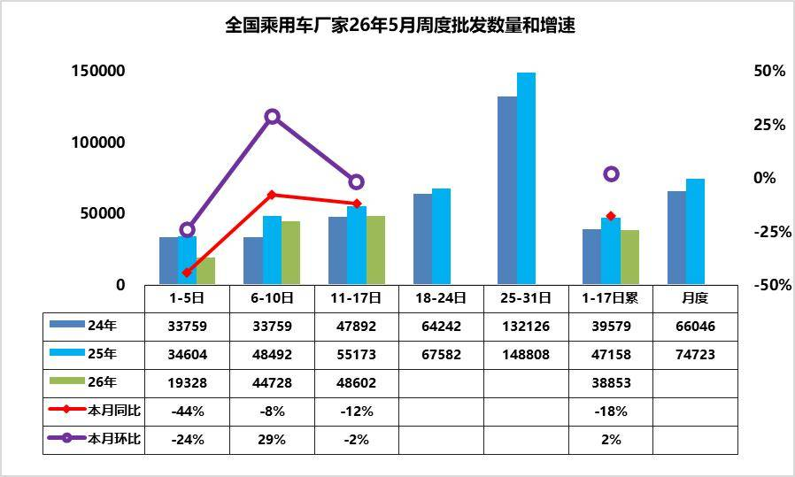

5月第1周批发日均1.9万台，同比去年5月同期下降44%，环比上月同期下降24%。

5月第2周批发日均4.5万台，同比去年5月同期下降8%，环比上月同期增29%。

5月第3周批发日均4.9万台，同比去年5月同期下降12%，环比上月同期下降2%。

5月1-17日全国乘用车厂家批发66.0万辆，同比去年下降18%，较上月同期增长2%；今年以来累计批发863.7万辆，同比去年下降7%。

近期乘用车零售持续相对偏弱，各环节的运行压力都在加大，产销节奏需要放缓。油价高位运行、供应链涨价、反内卷持续进行，从同比上对5 月份不利，但从环比上这些因素已经在4 月份存在，且4 月份下降较大，5 月份环比将会相对企稳。从生产进度看，燃油车的生产剧烈萎缩41%，混合动力表现较好，新能源车性价比更高。由于市场的持续下行压力，经销商库存压力更大，需要有效的化解经销商的生存压力。

3.2026年1-4月汽车增加值6%、投资-0.5%，生产-5%，汽车消费-11%，新能源汽车渗透率44%

2026年国家实施更加积极有为的宏观政策，加大逆周期和跨周期调节，持续扩大内需、优化供给，总体市场需求稳中有升，实现良好开局。2026年4月汽车生产256万台，同比降3%；新能源汽车生产130万台，同比增4%，渗透率51%；燃油车生产127万台，同比降8%。2026年1-4月汽车生产970万台，同比降6%；新能源汽车生产429万台，同比降4%，渗透率44%；燃油车生产541万台，同比降6%。

2026年1-4月汽车工业增加值增6.1%，其中4月汽车工业增加值增9.2%，汽车工业生产表现超预期。2026年1—4月份，汽车行业固定资产投资同比下降0.5%（1-3月同比增长4.8%），仍高于-1.6%的各行业平均水平。

当前，外部环境更趋复杂严峻，海湾局势复杂、高油价冲击产业链供应链稳定和消费需求；国内经济回升向好基础还不稳固，有效需求不足、市场缺乏活力等问题挑战仍然存在，行业稳增长任务依然艰巨。

由于2026年以旧换新的乘用车补贴力度远低于商用车，因此商用车补贴推动零售增长特别好，乘用车暴跌。目前乘用车消费压力很大，期待未来能有长效的强力接续政策，减免购车人员个税、推动新能源车下乡、设立经济型电动车标准，优化C7经济型电动车驾照申领、给200公里以下续航的合规纯电动车车购税更大优惠、鼓励结婚和生育购车等更多的改善措施，拉动购车消费促进经济增长。

4.全国乘用车行业2026年4月末库存354万辆、库存62天、满意度7%

2026年4月月末全国乘用车行业库存354万辆，较上月增长9万辆，较2025年4月增4万辆，形成库存持续增长的趋势。其中厂家库存占比29.8%，相对偏高。26年4月预测乐观度36%，5月初的4月月后满意度为7%，预期低但满意度更差，主要是高油价的冲击太大。团队对5月市场的乐观度下降到27%，这是近期市场乐观度判断的偏低水平，预期不断调低后仍未转为更乐观。

我们根据未来N+3的月度零售预测测算库存支撑未来天数，因此不是固定的当月数据，库存天数也会随预测调整而变化。根据2026年4月底的库存与未来3个月国内零售量综合预估的现有库存支撑未来销售天数在62天，相对于2023年4月的54天、2024年4月的54天，2025年4月的56天，今年4月的总体库存压力相对稍大。

2026年4月仅生产新能源车的企业的总库存上升到75万辆，环比上月增加6万辆，较2025年11月峰值库存降3万辆，但较2025年4月的88万辆降13万辆。近期新能源经销商的厂家和渠道库存面临市场零售低于预期，行业库存总体压力较大。

5.2026年4月全国皮卡市场分析

皮卡产销：皮卡产销呈现春季的产销拉升特征，4月出口走势超强。2026年4月份皮卡市场销售5.9万辆，同比增4.2%，环比降15.8%，处于近5年的当月最高位水平。1-4月销量22万辆，增6.7%。2026年4月份皮卡生产为5.9万辆，同比增0.6%；2026年1-4月皮卡生产22.1万辆，增8.9%。

长城汽车持续保持强势皮卡领军地位，国内外表现均较平稳。受出口持续同比增长促进，长安汽车、江铃汽车、上汽大通、江淮汽车、郑州日产表现较强。在国内皮卡零售市场，长城皮卡、江铃汽车、郑州日产、雷达汽车、江西五十铃等表现较好，国内“皮卡一超多强”格局继续保持。

皮卡出口：2026年4月全国皮卡出口3.1万辆，同比增长41%，环比下降4%；2026年1-4月全国皮卡出口11.3万辆，同比增长34%，行业出口占比继续保持高位。2024年皮卡出口占比皮卡总销量的45%，2025年皮卡出口达到50%，由于2026年总体汽车市场压力大，4月皮卡出口达到53%总量。1-4月皮卡出口占总量52%，遥遥领先其他车型的国际化表现。

新能源皮卡：2025年新能源皮卡7.3万辆，增长243%，2026年4月新能源皮卡0.7万辆，同比降11%，环比增12%；2026年1-4月新能源皮卡2.6万辆，同比下降2%；形成年初新能源皮卡稍弱于燃油皮卡总体增速的走势。随着电动化和乘用化的发展，皮卡市场的空间仍将逐步改善。在4月新能源皮卡销量中：比亚迪皮卡海外销量4500辆、吉利雷达电动皮卡1787辆、郑州日产899辆、长安增程皮卡394辆，其它皮卡企业的新能源车也有一定规模。伴随着国内新能源皮卡市场启动，逐步培育市场，预计中国皮卡未来将会更快的发展来满足国内外需求。

二、本周上市新车1.2026款比亚迪海鸥上市售价6.99-8.59万元

5月11日，2026款比亚迪海鸥正式上市，售价6.99-8.59万元。维持了旧款车型的外观内饰设计，提供芒芒橙/薄荷青/萌芽绿/暖阳白/蜜桃粉5种外观色和燕麦米/沙丘粉/深海蓝3种内饰色可选。选装天神之眼B后支持城市领航辅助和全场景泊车辅助等功能。

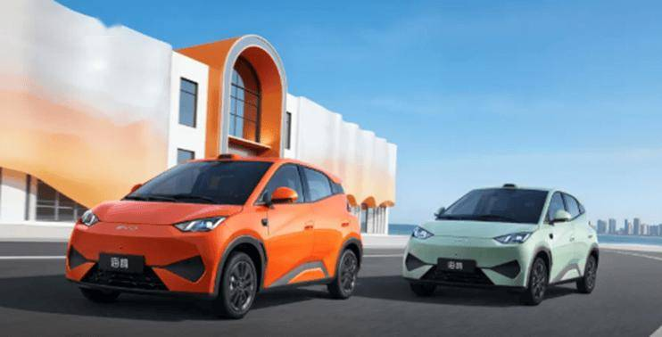

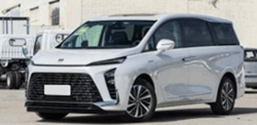

3.新款奥迪A5L Sportback上市臻享价25.99-38.29万元

5月12日，新款奥迪A5L Sportback上市，新车共推6款，售价区间为27.99万-39.99万元，限时臻享价25.99-38.29万元。外观与老款车型基本保持一致。新车配备华为乾崑智驾系统，采用2颗激光雷达，支持高速/城区组合辅助驾驶。搭载2.0T发动机，匹配7DCT变速箱，还提供MHEV plus超级轻混系统车型。

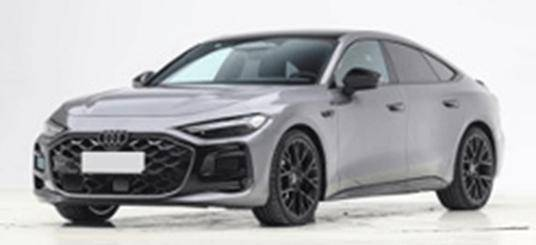

4.方程豹豹8闪充版上市权益后售价为40.98万-41.78万元

5月13日，方程豹豹8闪充版上市，新车共推3款，售价区间为41.98万-42.78万元，权益后售价为40.98万-41.78万元。外观与现款车型基本保持一致。配备云辇-P Ultra、华为双激光乾崑智驾ADS 4.1。搭载2.0T插混系统，纯电续航200km。

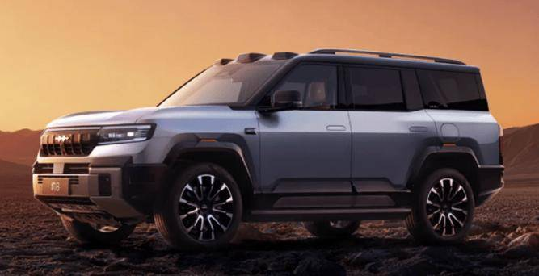

5.方程豹豹5闪充版和210km天神Max版上市权益后售价为25.38万-29.98万元

5月13日，方程豹豹5闪充版和210km天神Max版上市，新车售价为25.98万-30.58万元，权益后售价为25.38万-29.98万元。外观与现款车型基本保持一致。闪充版车型配备云辇-P Ultra智能液压车身控制系统。新车搭载1.5T插混系统，纯电续航210km。

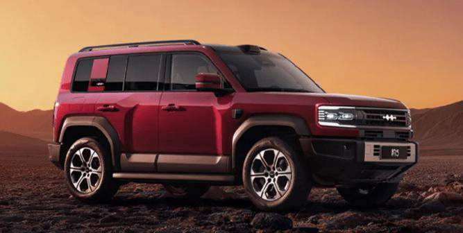

6.智界V9上市售价区间为38.98万-51.98万元

5月15日，智界V9上市，新车共推4款，售价区间为38.98万-51.98万元。新车延续鸿蒙智行家族式设计语言，采用百万像素智慧投影大灯。采用双17.2英寸3.4K中控屏与副驾屏、21.4英寸吸顶屏。配备二排双零重力座椅、华为乾崑智驾ADS 5、二排全维包裹安全气囊等。搭载1.5T增程系统，CLTC纯电续航可达285km，305km。

7.新款传祺M6 MAX上市政企双补价8.88万-10.76万元

5月15日，新款传祺M6 MAX上市，新车共推3款，售价区间为9.98万-11.98万元，政企双补价8.88万-10.76万元。新车换装更大气的龙颜前脸。换装了更大尺寸的液晶仪表以及中控屏。搭载1.5T增压发动机，匹配7DCT变速箱。

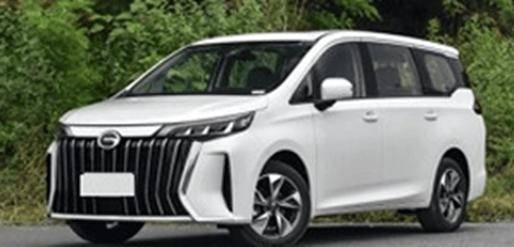

8.长安逸动经典版上市现金礼后售6.49万元

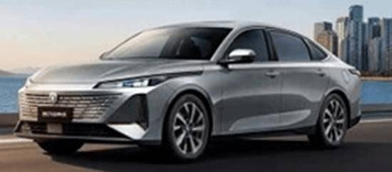

9.乐道L80上市BaaS方案售15.68万-19.38万元

5月15日，乐道L80上市，新车共推3款，售价区间为24.28万-27.98万元，BaaS方案售15.68万-19.38万元。外观与乐道L90基本保持一致。采用35英寸AR-HUD、17.2英寸中控屏、17.3英寸吸顶屏。配备双电动遮阳帘、23扬声器、神玑NX9031芯片等。新车CLTC纯电续航里程为615km，570km。

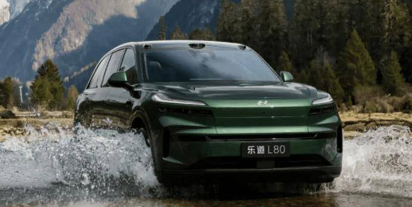

10.哈弗猛龙PLUS上市限时焕新价16.18万-20.18万元

5月15日，哈弗猛龙PLUS上市，新车共推7款，售价区间为16.98万-20.98万元，限时焕新价16.18万-20.18万元。新车延续猛龙设计，车身尺寸有所提升。新车提供5座和7座版本可选。配备前排座椅记忆、压缩机冰箱、头枕音响等。搭载1.5T插混动力，CLTC纯电续航里程为140km，195km，192km，252km，255km。

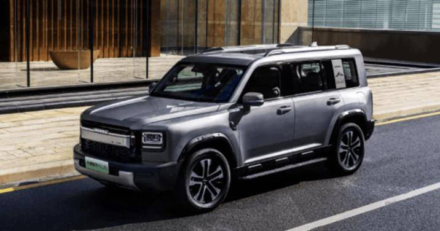

11.全新理想L9上市售价区间为45.98万-50.98万元

5月15日，全新理想L9上市，新车共推2款，售价区间为45.98万-50.98万元。新车通过细节优化提升整车高级感。采用29英寸超宽全景屏、移动吸顶屏。配备马赫100芯片、4颗激光雷达、高通骁龙旗舰版8797 Elite、四零重力座椅等。搭载1.5T增程动力，CLTC纯电续航420km；顶配提供800V主动悬架+全线控底盘。

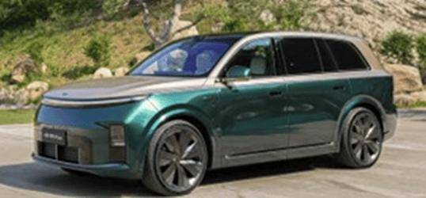

12.奇瑞风云T9长续航版上市限时红包价10.99万-12.99万元

5月16日，奇瑞风云T9长续航版上市，新车共推3款，售价区间为11.99万-13.99万元，限时红包价10.99万-12.99万元。外观与现款车型基本保持一致。新车配备高通8155车机、14扬声器，可选装猎鹰高阶智驾。搭载1.5T插混动力，CLTC纯电续航为220km。

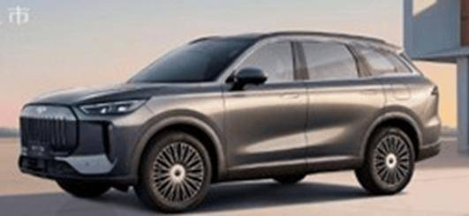

三、宏观经济与政策1.工信部节能与综合利用司组织开展新能源汽车动力电池回收利用行业调研及座谈

5月12-13日，节能与综合利用司主要负责同志带队赴广东省广州市、深圳市开展新能源汽车动力电池回收利用行业调研，与相关行业重点企业、专家等进行座谈，听取有关意见建议。

2.2026国四货车淘汰补贴政策有变

5月13日，交通运输部办公厅、国家发展改革委办公厅、公安部办公厅、商务部办公厅联合印发《2026年老旧营运货车报废更新工作实施细则》（交办运〔2026〕29号），以政策红利引导货运车辆绿色低碳转型。政策重点向电动货车倾斜。各地需预留必要规模的补贴资金重点用于更新为电动货车。

3.统计局：2026年4月份CPI同比上涨1.2%

5月11日，统计局发布数据显示，2026年4月份，CPI同比上涨1.2%，环比上涨0.3%。1-4月平均，CPI比上年同期上涨0.9%。

5月11日，统计局发布数据显示，2026年4月份，PPI同比上涨2.8%，环比上涨1.7%。1-4月平均，PPI比上年同期上涨0.2%。

4.国家统计局：4月新能源车整车制造价格环比下降0.1%

5月11日，国家统计局发布数据显示，4月，锂离子电池制造价格环比上涨1.6%，新能源车整车制造价格下降0.1%，降幅比上月收窄0.7个百分点。国内汽油价格涨幅扩大至19.3%。

5.央行：4月末M2同比增长8.6%

央行发布数据显示，4月末，M2余额353.04万亿元,同比增长8.6%；M1余额114.58万亿元,同比增长5%；M0余额14.75万亿元,同比增长12.2%。前四个月净投放现金6,530亿元。

6.北京：新编制自动驾驶（智能网联汽车）等4个领域负面清单

5月11日，北京市互联网信息办公室、市商务局、市政务和数据局联合印发《中国（北京）自由贸易试验区、国家服务业扩大开放综合示范区数据出境负面清单管理办法（试行）》、《中国（北京）自由贸易试验区、国家服务业扩大开放综合示范区数据出境管理清单（负面清单）（2025版）》。新编制了医疗器械、自动驾驶（智能网联汽车）、贸易物流、银行业等4个领域负面清单。

7.浙江：建立L3智能驾驶试点交通管理细则和政企联动运营机制

浙江印发《浙江省加快新场景建设应用推动科技和产业高质量发展行动方案（2026~2027年）》。推动无人驾驶车辆示范应用，建立L3智能驾驶试点交通管理细则和政企联动运营机制。深化杭州—桐乡—德清“车路云一体化”试点和德清车联网试点建设。到2027年，全省低空典型场景案例达到20个；新增充电桩4万个。

四、新品信息跟踪1.全新比亚迪元PLUS将于5月21日上市

全新比亚迪元PLUS将于5月21日上市。新车在细节上进行调整。中控屏尺寸更大，改用怀挡，增加无线充电面板。新车配备第二代刀片电池、云辇-C系统、闪充技术等。新车CLTC纯电续航里程540km，630km。

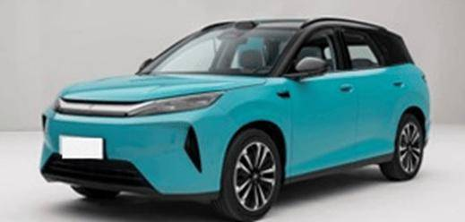

2.启境GT7内饰官图发布

5月14日，启境汽车发布了品牌首款车型——启境GT7的内饰官图和部分配置信息。仪表台采用15.6英寸中控屏+悬浮式液晶仪表的布局，中控屏后方设有全新一代AI交互式星环散射体。前排配备双零重力座椅，支持16向电动调节和10点式按摩，全景天幕面积2.2㎡。

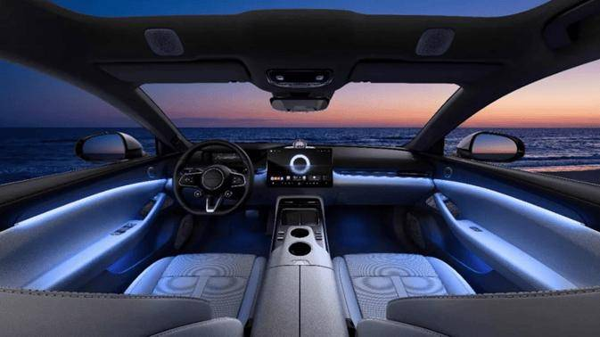

3.小米汽车计划2026年内推出四款新车

小米汽车计划在2026年剩余时间内推出四款新车型。首款为YU7 GT，定位于高性能纯电GT SUV，将于5月底正式发布；第二款为YU7入门版，车身尺寸与现款一致；第三款为全新增程式SUV，内部代号“昆仑”，将启用独立子品牌“SKYNOMAD”；第四款新车疑似为SU7的加长版，代号“MS11-L”。

4.零跑汽车：第二品牌产品最快明年年中上市

5月15日，零跑汽车管理层在2026年一季度业绩会上确认了第二品牌的存在，该品牌计划于今年年底亮相，产品最快将于明年年中上市。公司利用Stellantis集团巴西工厂产能计划正在落地，以实现产品在南美市场的本地化。

5.比亚迪鲨鱼皮卡进入方程豹序列

5月13日，比亚迪方程豹汽车总经理熊甜波表示，鲨鱼皮卡今年将在国内销售，并正式进入方程豹序列。鲨鱼是比亚迪推出的首款新能源皮卡 ，基于DMO超级混动越野平台打造，主打高性能与低能耗，目前已在全球多个海外市场上市。

6.Vision BMW ALPINA正式发布并亮相

5月15日，在2026 年埃斯特庄园古董车展（Concorso d’Eleganza Villa d’Este）上，BMW 集团正式发布并亮相Vision BMW ALPINA（宝马阿尔宾纳设计概念车）。

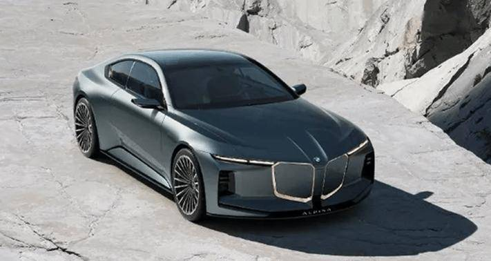

五、企业信息1.比亚迪回应欲收购欧洲汽车制造商工厂

有消息称，比亚迪正与Stellantis（斯特兰蒂斯集团）等欧洲汽车制造商就接管该地区未充分利用的工厂进行谈判。5月14日，比亚迪方面回复称，该消息属实。

2.东风汽车与中远海运签署战略合作协议

东风汽车、中远海运在武汉签署新一轮战略合作协议。双方将聚焦海外物流与港口无人集卡等关键方向，深化多领域战略合作，构建深度协同的伙伴关系。

3.吉利汽车与福特达成欧洲电动车合作

吉利与福特计划在欧洲市场展开电动车合作。福特将在2027至2030年间于欧洲推出四款全新纯电动车型，这些车型将基于吉利的GEA全球智能新能源架构开发，不再采用福特自研纯电平台。吉利负责整车研发、核心零部件供应链、品控体系及生产制造标准，福特则独立完成外观与内饰设计，并适配本地化车机系统，依托其欧洲销售网络进行终端交付。

4.吉利汽车收购雷达汽车

5月15日晚，吉利汽车发布公告，宣布斥资约2.18亿元人民币全资收购雷达汽车（山东）、雷达汽车销售及泰国分销公司Radar Thailand。三家公司正式成为吉利汽车全资附属公司。

5.奇瑞回应“进入日本市场”

有消息称，奇瑞汽车与日本汽车用品巨头澳德巴克斯及其他合资方已成立合资公司，并通过该合资公司旗下的开发销售公司EMT（位于横滨）推出自己的EV品牌。奇瑞汽车回应称，奇瑞只是作为多个股东方之一，投资了EMT项目，并不参与经营管理。

6.六方注资神龙公司超80亿元

5月15日，东风汽车联合长江产业投资集团有限公司、武汉金融控股（集团）有限公司、武汉经开产业投资集团有限公司、Stellantis集团、神龙汽车有限公司签署战略合作协议。根据协议，本次合作总投资额超80亿元人民币，全面推动神龙公司面向智能化、国际化、绿色化进行转型升级，计划于2027年起陆续投放多款全新新能源车型，同步导入Jeep品牌在神龙公司生产，并在全球范围内进行销售。

7.小鹏汽车洽谈收购大众欧洲工厂

据英国《金融时报》报道，小鹏汽车正与大众汽车集团及其他车企洽谈，计划收购一座欧洲工厂。大众汽车集团CEO奥博穆曾表示，考虑向中国合作伙伴开放部分欧洲工厂产能。

8.小米开源Xiaomi OneVL自动驾驶模型

5月13日，小米技术正式发布并开源Xiaomi OneVL一步式潜空间语言视觉推理框架。实现VLA、世界模型、潜空间推理等多个技术路线的统一，在具备XLA模型强悍推理能力的基础上，大幅提升了推理的速度和精度。在速度上对齐“仅答案”预测的潜空间CoT方案。

六、行业信息1.印多摩比尔集团计划年内引入红旗与零跑

据印尼媒体日前报道， 印多摩比尔集团（Indomobil Group）正加快引入中国电动汽车品牌的步伐，并计划于今年内将红旗和零跑两个新品牌引入印度尼西亚市场。目前，该集团已代理多个中国品牌，包括上汽大通、长安汽车、广汽埃安以及江淮汽车。

2.首批中国品牌电动汽车运抵加拿大

据美媒报道，首批中国电动汽车已运抵加拿大。奇瑞和吉利率先将车辆运抵加拿大境内。其中，奇瑞首批约150辆车主要用于测试认证和试驾项目。奇瑞计划在未来三个月内再追加发运1000辆，首批10家经销商门店预计6月底前开业。吉利旗下豪华品牌路特斯运送了18辆Eletre纯电SUV，路特斯Eletre已通过加拿大机动车安全标准认证，6家特许经销商已于3月开业，年底前还将新增6家。

3.4月全国乘用车市场零售138.4万辆

5月11日，乘联分会对外发布最新月度市场报告显示，2026年4月全国乘用车市场零售138.4万辆，同比下滑21.5%，环比下降16.0%。其中，4月燃油车零售销量53.0万辆，同比下滑37%，环比下滑33%，是导致市场总量下滑的主因。新能源汽车零售销量84.9万辆，同比下滑6.8%，环比下滑0.3%，占全国总销量的61.4%。

4.中国汽车专利公开量全球领先

5月16日，中国汽车技术研究中心发布了《汽车产业知识产权十年发展报告》。中国汽车专利公开量近十年持续保持全球领先，新能源汽车领域专利公开量由2016年的5万余件增长至2025年的11万余件，年均增长率达17.1%。智能网联汽车专利则由4.4万件增长至2025年的9.3万件，年均增长率达11.6%。汽车企业海外专利布局已覆盖50多个国家和地区。

5.国轩高科公布固态电池最新进展

5月17日，国轩高科公布固态电池最新进展，升级电芯技术后能量密度达到400Wh/kg。目前，公司固态电池2GWh量产线建设中，已对接多场景客户。

6.亿纬锂能与印度能源企业GNEPL签署8GWh储能大电池订单

5月12日电，亿纬锂能宣布，已与印度能源企业Godawari New Energy Private Limited正式签署8GWh储能大电池订单，并规划未来五年潜在合作规模达60GWh。

七、跨国集团与国际市场1.全球电车需求连续第二个月上涨

5月13日，咨询公司Benchmark Mineral Intelligence发布的数据显示，4月份全球新注册的纯电动汽车和插电式混合动力汽车数量较上年同期增长了6%，达到160万辆。全球电动汽车的需求连续第二个月增长，原因是高昂的汽油价格促使消费者不再选择内燃机汽车。

2.本田首次录得年度亏损

5月14日，本田公布的数据显示，2025财年（2025年4月-2026年3月），因电动化战略调整计提巨额损失，公司出现上市以来首次年度亏损。全财年合并营收21.8万亿日元，同比微增0.5%；营业亏损4143亿日元，净亏损4239亿日元。

3.本田宣布放弃2040年禁售燃油车目标

本田汽车公司宣布，将放弃原定于2040年实现全面停售内燃机车辆的目标，并计划在2030年前推出15款全新混合动力车型，以应对公司近70年来的首次年度亏损。公司还将把原本用于下一代纯电“0系列”的部分架构和零部件转用于混合动力产品线。

4.波兰牵手富士康打造电动汽车制造中心

波兰国有资产部部长沃伊切赫·巴尔春宣布，波兰与全球电子制造巨头富士康签署了一项关于联合电动汽车项目的合作协议，富士康将与波兰国有控股企业波兰电动汽车公司ElectroMobility Poland （EMP）共同在波兰南部的亚沃日诺打造一座集电动汽车生产与研发于一体的现代化制造中心。该项目计划于2029年产出首批汽车，预计将生产3款车型。

5.FF获2500万美元新融资

日前，Faraday Future宣布，公司已与机构投资者签署了2500万美元股份购买协议，预计此次融资所得将进一步加速FF EAI战略的落地实施。

5月11日，法拉第未来（Faraday Future）宣布重大管理层调整，贾跃亭被任命为FF全球CEO，Jerry Wang出任全球执行董事长，Matthias Aydt卸任联合CEO。贾跃亭发文宣布，FF将正式升级为美国物理AI生态系统公司，专注于具身智能机器人业务两大产品引擎：一是EAI人形与仿生机器人，二是EAI汽车机器人。

6.丰田将在印度新建汽车工厂

5月11日，丰田公司表示，将在印度马哈拉施特拉邦新建一座年产能达10万辆的工厂，该工厂预计将于2029年上半年投产。主要负责生产一款全新的SUV车型。

7.福特成立能源子公司

福特汽车近日正式成立全资子公司福特能源（Ford Energy），专门生产并销售美国本土组装的电池储能系统，面向电力公司、数据中心及大型工业客户供货。该新业务板块计划依托福特肯塔基州超级工厂，实现年产20GWh储能产品的产能规模。

8.韩国探索将现代汽车的机器人用于军队

韩国军方正寻求与现代汽车建立战略合作，计划在前线部署机器人装备。

9.韩国汽车累计出口量达7654.8万辆

韩国汽车移动产业协会（KAMA）5月12日发布数据显示，截至今年4月，韩国汽车累计出口量达到7654.8万辆。

10.加拿大3月电动汽车市占率近乎翻倍

加拿大统计局公布的最新月度数据显示，3月加拿大纯电动车及插电式混合动力车销量合计达21574辆，占汽车总销量的12.2%，而去年同期这一比例仅为6.5%。

11.莲花发布“Focus 2030”

5月13日，莲花汽车在伦敦发布“Focus 2030”战略计划，正式放弃了“2027年实现全面纯电动化”的激进目标，转而采取多动力总成策略，短期目标是实现约60%插电式混合动力车与40%纯电动车的产量组合。同时莲花宣布将于2028年推出搭载全新开发的V8混合动力系统的超级跑车Type 135。

12.欧盟委员会批准鸿海与三菱扶桑卡客车成立合资企业

欧盟委员会5月11日宣布，已根据欧盟合并条例批准鸿海科技集团（富士康）与三菱扶桑卡客车成立合资企业。三菱扶桑卡客车由德国戴姆勒卡车控股。该交易主要涉及重型和轻型客车的生产和供应。

13.日本4月新车销量同比上涨9%

14.日产预计2026财年扭亏为盈

5月14日，日产公布的数据显示，2025财年（2025年4月-2026年3月），公司净亏损5331亿日元，较上一财年6709亿日元的亏损额有所收窄。日产正全力推进“Re:Nissan”重组计划，预计2026财年将实现营业利润2000亿日元、净利润200亿日元，有望结束连续亏损局面。

15.特斯拉两年来首次上调Model Y美国售价

16.Waymo在美国召回3791辆汽车

5月12日，美国国家公路交通安全管理局（NHTSA）表示，Alphabet旗下无人驾驶技术公司Waymo在美国召回3791辆汽车，原因是软件出现问题，可能增加碰撞或受伤风险。

17.越南4月汽车销量同比增长6%

越南汽车制造商协会（VAMA）发布的最新数据显示，今年4月越南新车销量达24,479 辆，较去年同期的23,186 辆同比增长6%。受越南国内整体经济强劲增长拉动，2026年前四个月越南汽车市场销量达101,269 辆，较去年同期的82,122 辆同比大增23%。

附：近日信息合集
