# 2026年1-4月中国汽车出口市场分析

- 公開日時: 2026-05-25 11:36（北京時間）
- 出典: [搜狐号・崔东树](https://www.sohu.com/a/1027326804_115312)
- テーマ（自動判定）: 輸出
- 画像: 39枚

---

注：本分析文章仅代表崔东树个人观点，如有异议，请留言。

2025年中国汽车实现出口832万辆，同比2024年全年增速30%。2026年1-4月中国汽车实现出口326万辆，同比2025年同期增速51%，4月中国汽车实现出口94万辆，同比增52%，环比增21%，同比走势总体较强, 环比受到中东影响而偏低。2026年4月中国新能源汽车出口46.3万辆，同比增长59%，1-4月累计出口147万台，增69%的表现很好，4月新能源车出口环比3月表现较强。

2026年4月中国汽车出口中纯电动占比31%（同比-2%），插混占比18%（同比+4%），混动占比7%（同比+2%），纯燃油车占比34%（同比-4%）。

2026年4月中国新能源汽车出口总量的前10国家：巴西92482辆、比利时49227辆、澳大利亚34774辆、英国30910辆、菲律宾23426辆、泰国20901辆、韩国18741辆、德国15040辆、印度11892辆、西班牙11750辆，其中本期较同期增量增大的前五个是：巴西57569辆、比利时23756辆、澳大利亚18240辆、英国12280辆、韩国12099辆。

中国新能源车2026年1-4月出口表现好于预期，主要是插混和混动替代纯电动成为出口增长的新增长点，尤其是货车出口表现较强，成为商用车新能源车出口亮点。中国新能源车出口向中东和发达国家市场呈现高质量发展的局面，主要是出口西欧和中南美市场。

汽车对俄罗斯出口大幅回升，但4月受伊朗战争影响，阿联酋下滑80%，沙特下滑57%，带来的出口损失巨大。

一、中国汽车出口总体走势

1、汽车出口历年走势

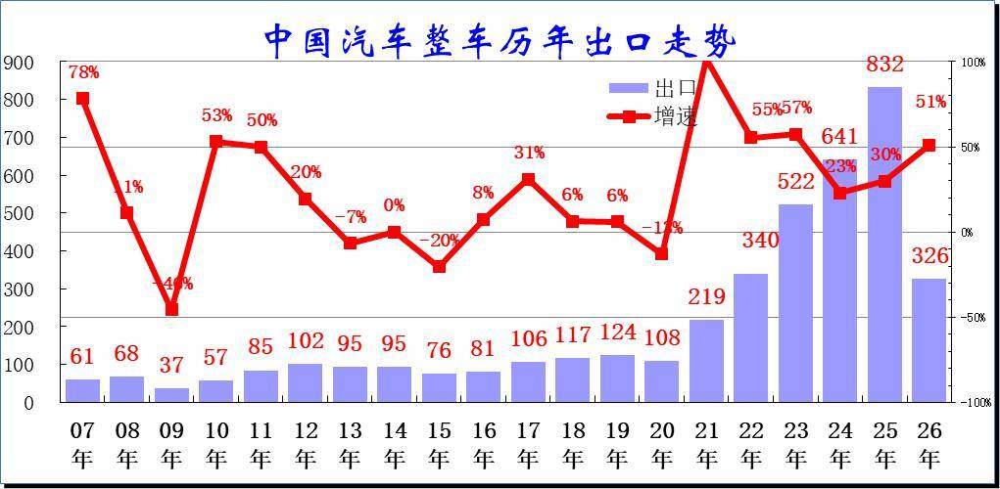

中国汽车出口历经多年百万量级的平台期后，于2021年实现突破。在2013 - 2016年世界经济低迷的大环境下，汽车出口出现剧烈下滑。2017 - 2020年，出口增速逐步企稳并有所改善，年度出口量维持在100万辆左右的水平。2020年出口量达到108万辆，同比下降13%，随后进入2021年以来的高增长期。

中国汽车出口自2021年突破百万量级后持续高增长（2021年增102%，2022-2023年增50%+，2024-2025年增速回落至30%左右），2026年1-4月出口326万辆（同比2025年增51%），延续增长态势。近期中国汽车出口呈现超高速增长态势，未来只要国际市场环境稳定，中国汽车出口发展仍具有巨大空间。

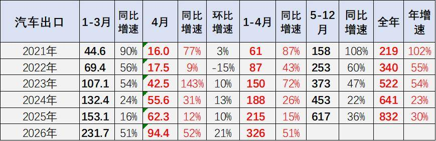

2026年1-4月中国汽车实现出口326万辆，同比2025年同期增速51%，4月中国汽车实现出口94万辆，同比增52%，环比增21%，同比走势总体较强, 环比受到季度初因素偏高。今年的主要动力仍是中国产品竞争力提升和全球南方国家市场的持续增长，巴西车市贡献较大。

从月度走势来看，近几年的中国汽车出口仍呈现出季节性特征，有夏季走高与国内反差的走势特点。2026年1-4月出口增速相对强劲，主要也是国内市场低迷，企业对应海外市场动力和能力增强。

2、整车出口月度走势

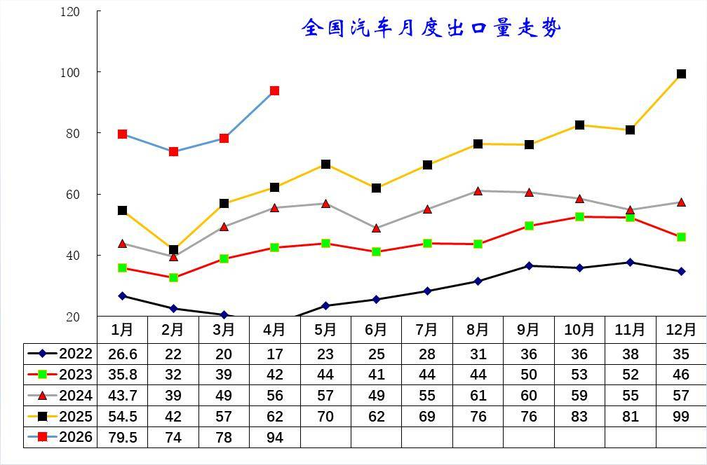

从月度走势看，近几年的中国汽车出口仍呈现惯性持续走强特征，近期呈现出口走高与国内低迷反差走势特征。2026年1-4月出口增速相对很强，延续持续增长动力。虽然有美伊战争的爆发，但由于市场分散，中国汽车出口增速受外部环境影响较小,2026年以来持续拉升。

3、汽车整车出口结构特征

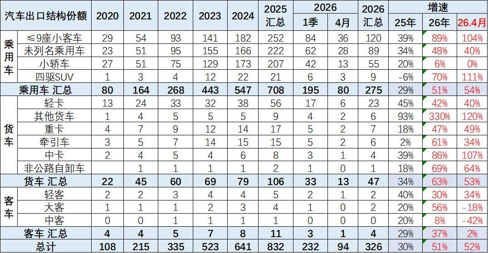

2020年前的中国汽车出口维持在百万规模，随后持续高速增长到2025年的832万辆。乘用车出口持续走强，货车和客车出口也持续较好增长。

今年全年海关各类车型增速分化，乘用车增速逐步回升，货车的增速好于乘用车，货车出口增长63%，相对于国内的燃油货车平稳走势，近期电动货车出口较好。

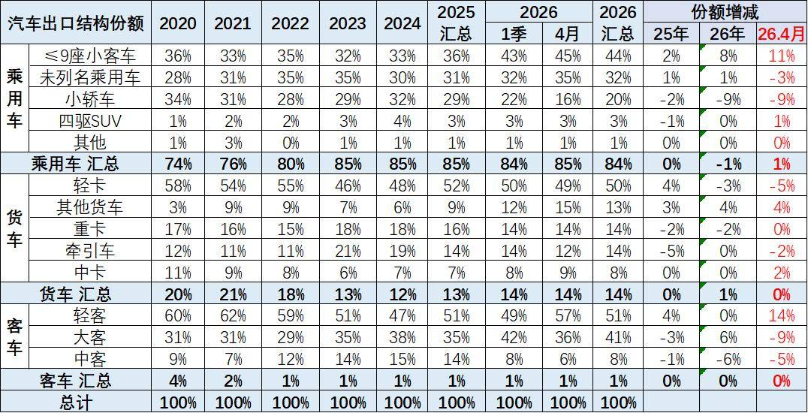

从结构看，乘用车出口占比逐步稳定，到2023年达到85%，随后相对稳定回落。货车出口因电动卡车而明显提升。近几年客车的出口占比持续回落到较低水平。由于乘用车是贸易焦点，出口的货车和客车比例总体达到16%，稍高于国内的商用车占比。

乘用车内部的几类主力车型表现较均衡，2026年乘用车出口表现较强的是9座以下小客车，2026年9座以下客车占比44%，其中4月达到45%。虽然特斯拉出口回落的影响较大，但4月自主的电动车出口增长较好。

货车4月份额表现较好。皮卡4月增长提升，重卡出口表现高位回落，其它卡车市场走势较强。客车中的大中型客车表现较好，轻型客车出口占比回落。

4、出口动力结构特征

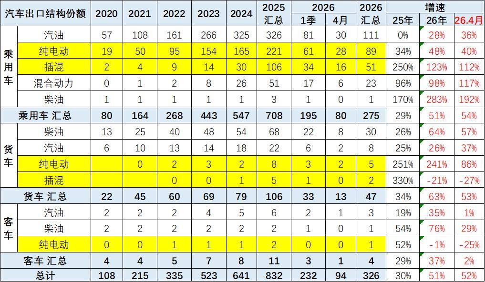

出口动力结构特征方面，2025年乘用车的出口增速回落较大，其中汽油车的出口均增速偏低，今年混合动力乘用车的出口很强，而插混的乘用车出口增速最强。今年货车和客车出口平稳，乘用车出口俄罗斯和欧洲的波动是核心增长推动。

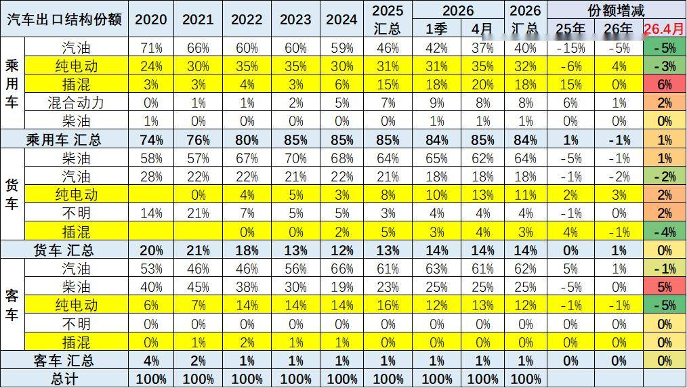

2026年1-4月乘用车的新能源的占比回升，燃油车占比下降明显，混合动力异军突起。汽油乘用车和柴油货车、汽油客车出口下降较大。4月的插混乘用车、纯电动卡车和混动乘用车出口较好增长。

二、汽车出口市场格局

1、出口厂家国内区域特征

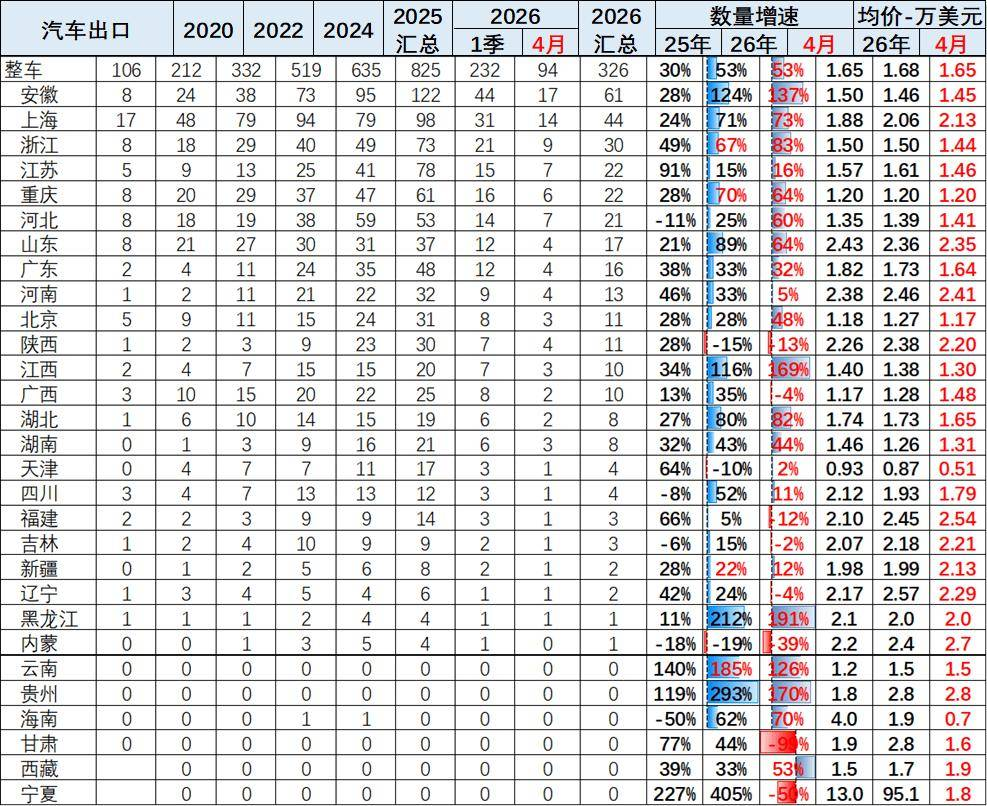

2024年开始上海出口的全国汽车龙头地位被安徽替代，2026年安徽仍保持出口第一的地位。上海对中国出口的重要意义极其明显，实际是长四角的龙头，辐射效应强。2026年1-4月安徽汽车出口61万辆，这主要是由于安徽本地的企业相对比较优秀，加之比亚迪等企业落户合肥。上海企业出口档次高，上汽乘用车和特斯拉两家企业，出口均价较高。

近两年安徽的出口表现相对较强，主要也是奇瑞和江淮的出口表现相对较强，但俄罗斯的市场波动巨大，因此近期安徽出口多元化较好。2026年的重庆、山东、江西的汽车出口贡献度上升较大。

2、出口区域特征

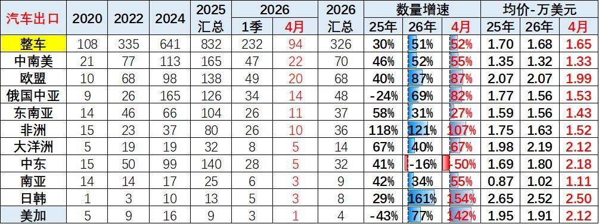

中国汽车出口总体表现较强，其中欧盟和非洲暴增，针对中东和非洲以及大洋洲的出口表现相对优秀。而针对东南亚地区、大洋洲出口表现压力较大。

前期的中国汽车出口在中南美洲和欧盟占比高，东南亚以及南亚等亚洲其它地区表现较强，目前逐步转到以中南美、欧洲表、俄国中亚现相对较强的特征，日韩和美国出口也有改善。尤其4月受到美伊战争影响，中东出口受阻明显。

3、整车出口分国别走势分析

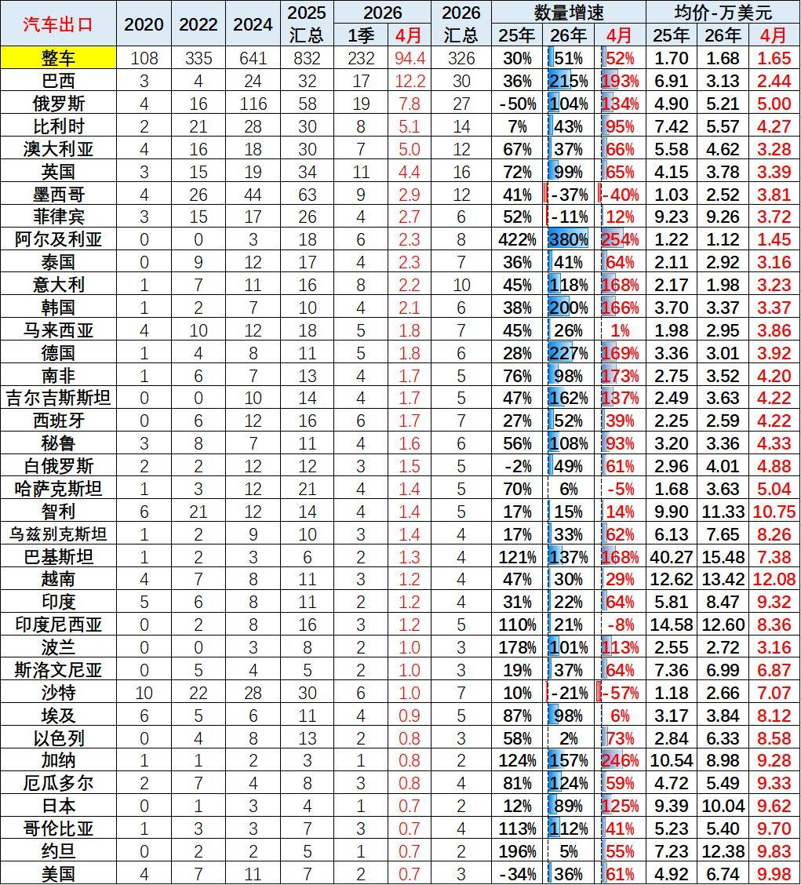

出口均价下降有利于出口增长，随着人民币升值，出口美元价格保持稳定，2026年中国汽车出口价格竞争力较强。前期俄罗斯市场巨变，其它外资退出，因此2023年以来中国对俄罗斯的出口也较多，2025年去库存,2026年回归正常状态。去年出口是对比利时的出口车较多，今年欧洲关系改善，出口表现也有改善。

近期的巴西市场表现较强，中国汽车走进入的本土化建厂取得一定成效。秘鲁、泰国等车市前期暴跌，今年有所恢复。

4、整车出口月度增减量走势

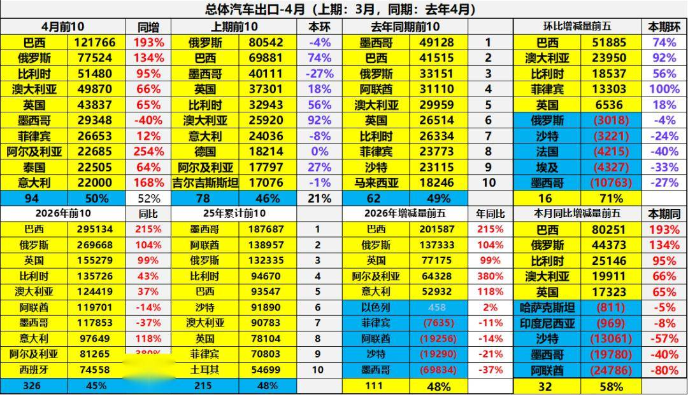

俄罗斯市场中国车企防风险意识提升，2025年俄罗斯国内销量下滑不大，但我们出口去库存力度很大。2026年1-4月我们对俄罗斯的出口恢复较大。

5、历年出口主力国家变化分析

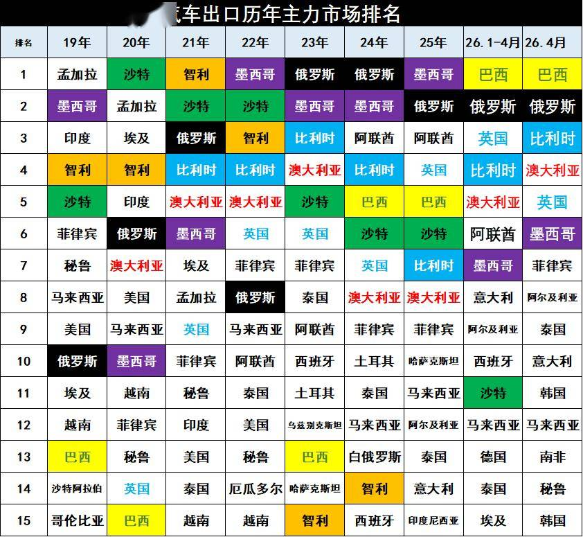

前期汽车出口的海外根据地效果并不理想，主力市场波动较大。2023 - 2024年汽车出口主要市场来自俄罗斯、墨西哥、比利时、澳大利亚、沙特、英国等国家，欧美市场走势较强。近期阿联酋、英国等相对发达国家表现改善。

2026年1-4月汽车出口结构变化，巴西回升到出口第一地位，英国市场增长很强，阿联酋的出口同比下降较大。4月对阿联酋的出口暴跌，巴西出口表现较好。

6、对俄罗斯出口变化分析

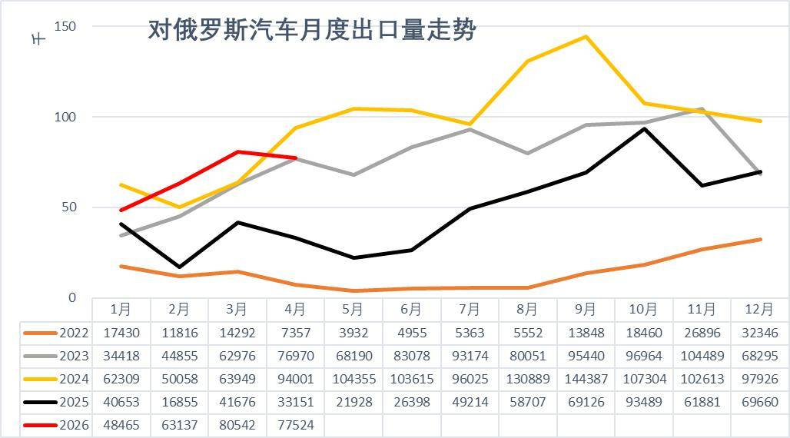

近期由于其它国家汽车企业退出俄罗斯，2023年中国车企迅速保证了俄罗斯的车辆供给需求，前期的中国车企在俄罗斯应该暂时是安全的。

俄罗斯的进口规则根据供需不断调整，2024年俄罗斯汽车销量已经是近几年的最高水平，因此需求提前透支后的2025年下跌是必然的。2025年以来的中国对俄罗斯的新能源车的出口剧烈波动，今年全年的俄罗斯国内需求逐步企稳，中国汽车出口在逐步回升。

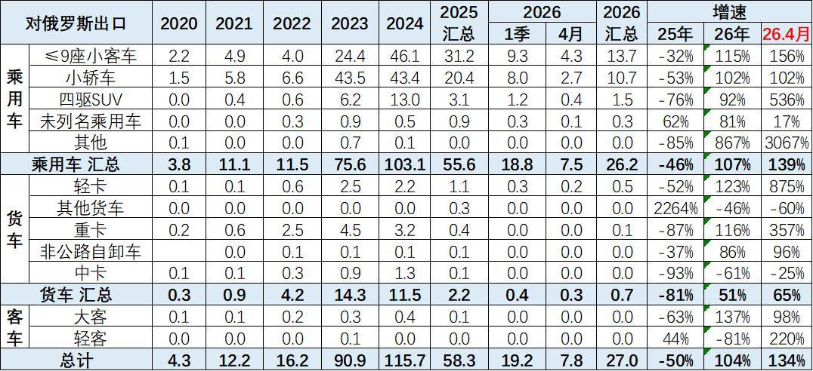

2023年以来俄罗斯突然变成中国汽车出口第一大市场，这是时隔15年后中国汽车再一次的出口巨变。2008年中国自主品牌进军俄罗斯的市场表现很好，但随着俄罗斯对中国汽车巨额加征关税政策，当年中国汽车车企大面积退出俄罗斯，2025年上半年下滑有些类似2009年的走势，但2026年开局因低基数而暴增。

三、新能源车出口走势

1、历年新能源汽车整车出口特征

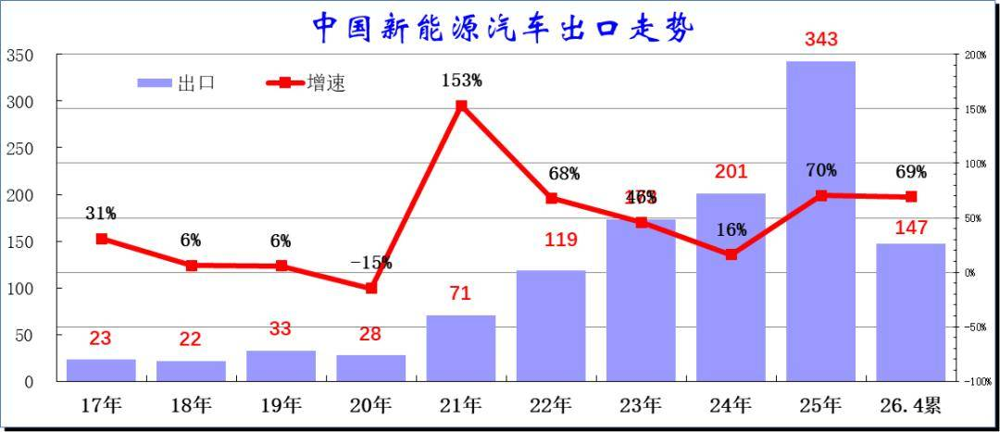

随着中国国内新能源车市场从补贴驱动向市场驱动的转型，中国新能源汽车的市场竞争力大幅增长。中国新能源汽车出口自2021年实现爆发增长，随后进入持续的高增长区间。虽然2024年受到欧盟出口新能源的政策干扰，但2024年全年中国新能源汽车出口仍达到201万辆，同比增长16%。2025年出口新能源车343万辆，同比增长70%，表现良好。2026年1-4月出口新能源车147万辆，同比增长69%，表现良好。

2、历年新能源汽车月度出口特征

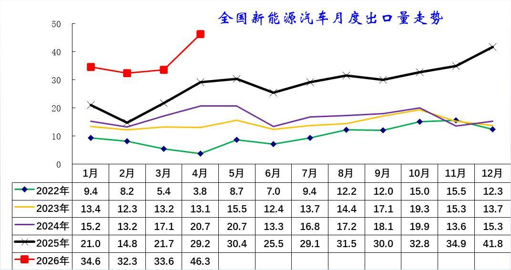

因欧盟加征关税，2024年下半年中国新能源出口走势低迷，市场压力较大。2025年3月开始的新能源车出口暴增的走势超强。2026年1-4月新能源出口持续历史高位，国内低迷推动出口热情更高。

在连续高增长后，2024年全年新能源汽车累计出口量201万辆，同比增长16%。2025年新能源汽车出口量343万辆，同比增长70%，增速高于2024年全年的16%较多。2026年4月中国新能源汽车出口46.3万辆，同比增长59%，1-4月累计出口147万台，增69%的表现很好，4月新能源车出口环比3月表现较强。

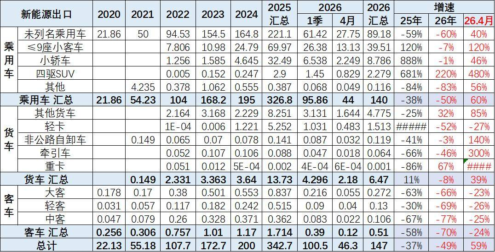

新能源车出口的96%都是乘用车，商用车占比较小，新能源货车表现好于客车。电动化导致的未列名乘用车占比保持高位。

3、汽车整车出口结构变化

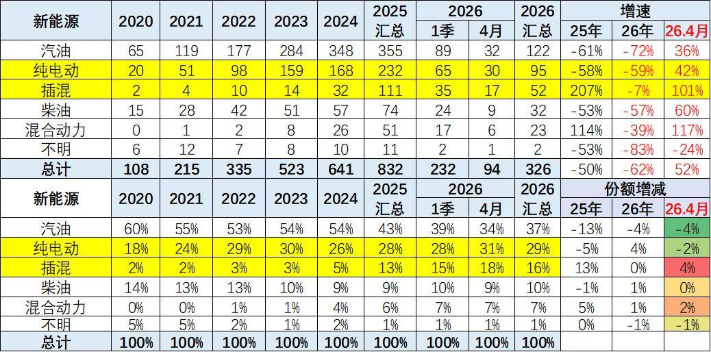

2026年4月中国汽车出口中纯电动占比31%（同比-2%），插混占比18%（同比+4%），混动占比7%（同比+2%），纯燃油车占比34%（同比-4%）。

4、新能源出口地区变化分析

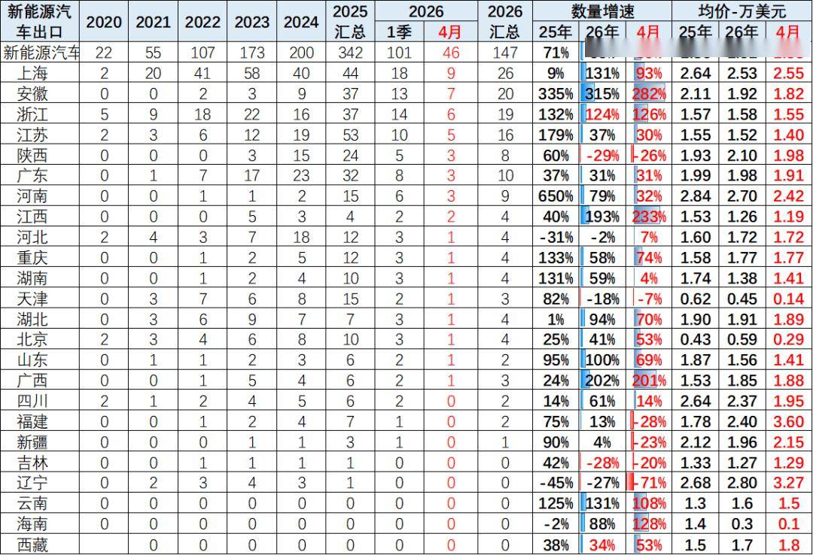

随着特斯拉进入中国，中国汽车出口格局改变，前几年上海长期第一。随着国产车崛起，自主成为新能源出口核心，近期安徽等崛起，4月上海、安徽、浙江、江苏的新能源出口表现较好。

2026年新能源汽车出口均价相对稳定。

5、历年新能源乘用车整车出口国家特征

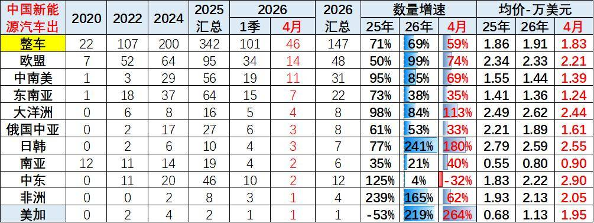

新能源车出口获得更多的突破，2026年仍是欧盟最强，日韩增速表现较高，东南亚还相对平稳增长。

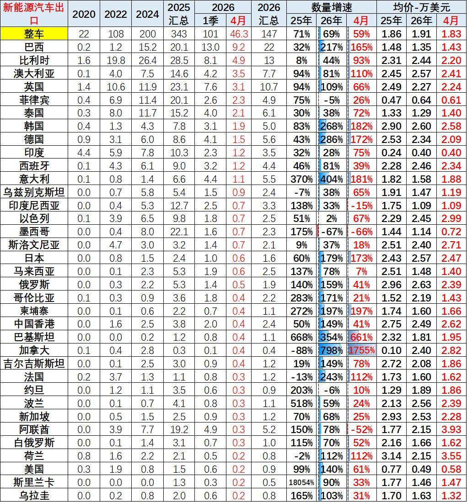

2026年新能源汽车出口同比增长分化。新能源汽车出口主要是欧洲、亚洲两大市场，今年的巴西超越比利时成为新能源车出口的第一大市场，巴西建厂推动巴西出口暴增。

今年新能源车出口的主力市场基本都有较好增长。德国、意大利等市场新能源车出口增长表现突出，墨西哥市场走弱，泰国市场走势相对一般。

6、2026年新能源汽车整车出口变化分析

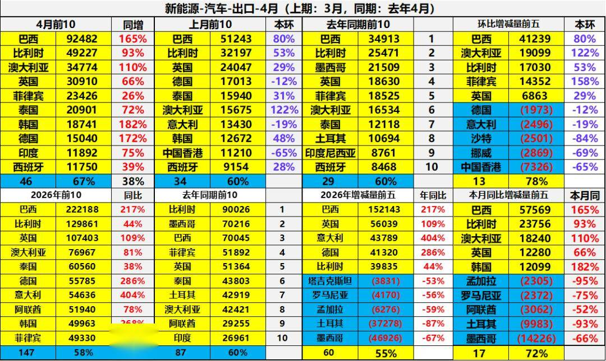

2026年4月中国新能源汽车出口总量的前10国家：巴西92482辆、比利时49227辆、澳大利亚34774辆、英国30910辆、菲律宾23426辆、泰国20901辆、韩国18741辆、德国15040辆、印度11892辆、西班牙11750辆，其中本期较同期增量增大的前五个是：巴西57569辆、比利时23756辆、澳大利亚18240辆、英国12280辆、韩国12099辆。

2026年出口巴西、比利时、英国等欧盟是几大主力方向。近期的土耳其、墨西哥等市场出口较弱。

7、燃油车分动力整车出口变化分析

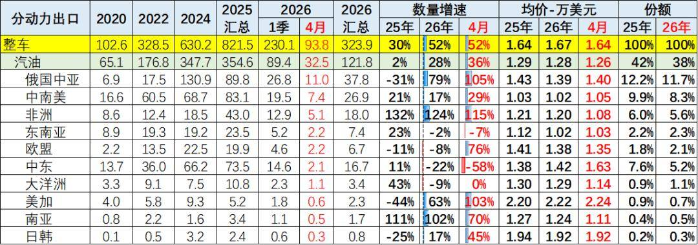

2024年全年中国汽油车型出口348万辆、增22%；2025年中国汽油燃油车出口355万辆、增2%,2026年1-4月中国汽油燃油车出口121.8万辆、增28%。

今年中国对俄罗斯、非洲、南亚等市场的燃油车市场较强，其它市场总体表现一般，尤其是欧盟、大洋洲等市场的燃油车出口下降，高质量发展特征明显。

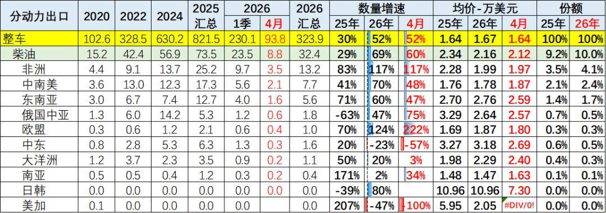

今年柴油车出口好于汽油车，实现柴油车在非洲、中南美的较强增长局面。4月的中东的出口表现较差。

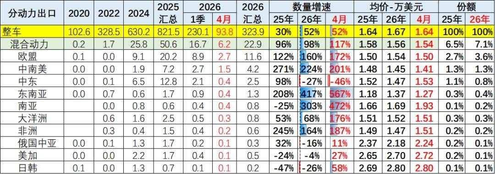

今年混合动力车型对欧洲和中南美、亚洲其它市场的增量超强，体现了中国乘用车竞争力的全面提升。但中东销量剧烈下滑，俄国中亚地区的混合动力表现一般。

8、2026年新能源汽车整车出口变化分析

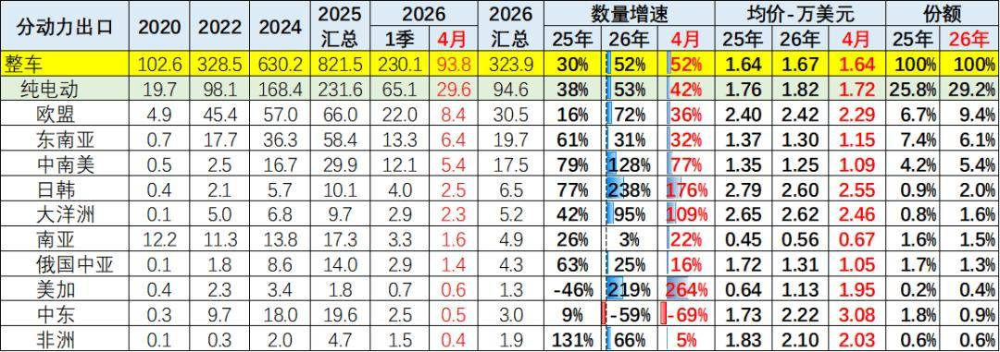

2024年全年中国纯电动车型出口168万辆、增6%；2025年中国纯电动车出口232万辆、增38%；2026年1-4月中国纯电动车出口94.6万辆、增53%，4月增长42%也是很好的。

目前纯电动的欧盟市场仍是绝对主力市场，东南亚市场和中南美等市场的需求相对波动较大，日韩市场上升明显，但中东市场损失巨大。由于国外基础设施缺乏，加之中国纯电动过于追求高端，大型化特征明显，小型电动车缺乏好产品，纯电动的出口仍有提升空间。

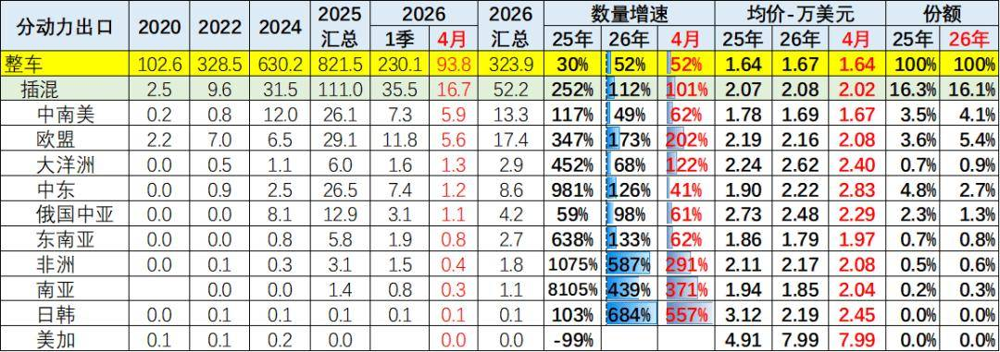

2026年1-4月中国插混车型出口52.2万辆、增112%，其中4月插混出口16.7万辆、增101%。除了美加等地区的插混需求很少，其它地区的中国插混表现都很突出。而欧盟地区的中国插混车型需求爆发增长，中东的土耳其等插混出口总体算是增长。

四、乘用车分类别出口走势

1、乘用车分排量出口

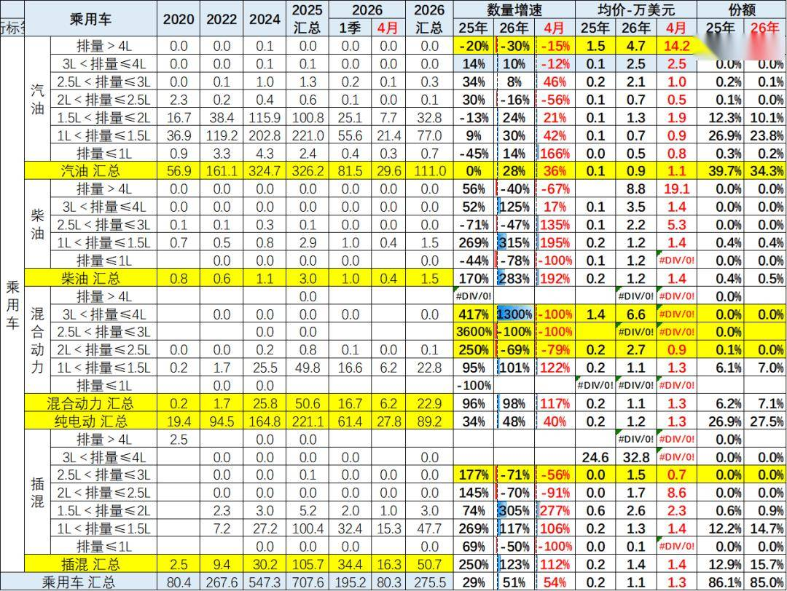

乘用车出口主要靠插混和混合动力乘用车，纯电动表现也很强，燃油车出口保持较好走势。燃油车的排量在1升-1.5升区间为主体，这也是中国自主乘用车的产品综合优势。2025年的1.5-2升车型下滑剧烈。今年1.5-2升车型出口恢复较快，说明俄罗斯等更需求中国的高端高价SUV车型，柴油乘用车基本没啥市场。

而电动车车型的产品档次分化，高端电动车出口改善较大，而入门级插混出口增长较好。

2、乘用车整车出口结构特征

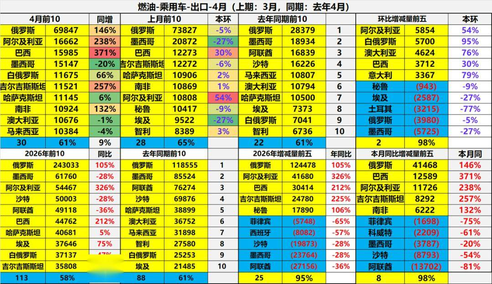

中国燃油乘用车2026年4月出口规模最大的是俄罗斯69847辆、阿尔及利亚16662辆、巴西15985辆、墨西哥15147辆、白俄罗斯11675辆、吉尔吉斯斯坦11521辆、哈萨克斯坦11145辆、南非10924辆、澳大利亚10676辆、马来西亚10384辆，其中本期较同期增量增大的前五个是：俄罗斯41468辆、巴西12589辆、阿尔及利亚11726辆、吉尔吉斯斯坦8292辆、南非6222辆。

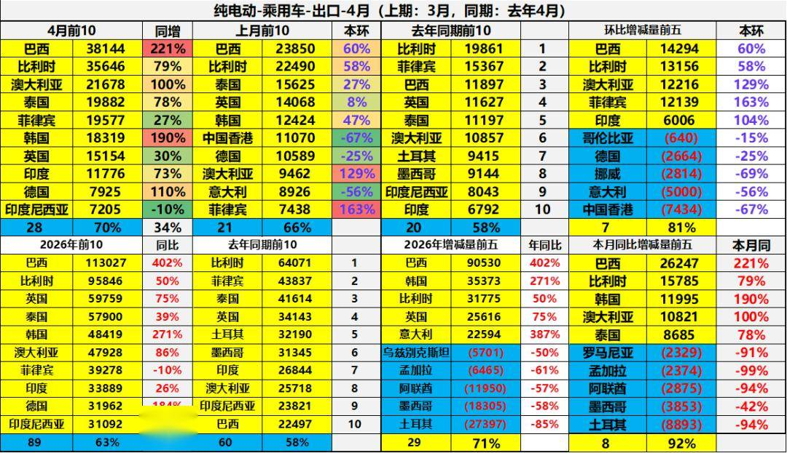

中国纯电动乘用车2026年4月出口主要是巴西38144辆、比利时35646辆、澳大利亚21678辆、泰国19882辆、菲律宾19577辆、韩国18319辆、英国15154辆、印度11776辆、德国7925辆、印度尼西亚7205辆，其中本期较同期增量增大的前五个是：巴西26247辆、比利时15785辆、韩国11995辆、澳大利亚10821辆、泰国8685辆。

2026年4月出口插混乘用车的主要是巴西53865辆、英国15104辆、比利时12869辆、澳大利亚9641辆、德国6823辆、意大利6758辆、西班牙6641辆、以色列4943辆、俄罗斯3996辆、乌兹别克斯坦3616辆，其中本期较同期增量增大的前五个是：巴西31092辆、英国8699辆、比利时8103辆、澳大利亚7659辆、德国5627辆。

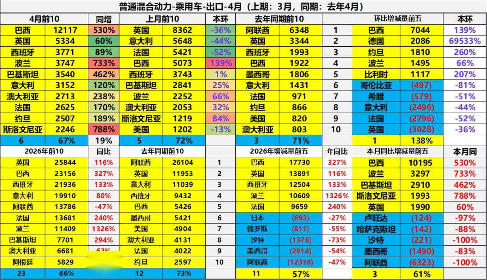

2026年4月出口乘用车普通混合动力的主要是巴西12117辆、英国5334辆、西班牙3771辆、波兰3747辆、巴基斯坦3540辆、意大利3152辆、澳大利亚2713辆、法国2625辆、约旦2507辆、斯洛文尼亚2246辆，其中本期较同期增量增大的前五个是：巴西10195辆、波兰3297辆、巴基斯坦2910辆、斯洛文尼亚1993辆、英国1990辆。

2026年1-4月出口乘用车普通混合动力的主要是英国25844辆、巴西23156辆、西班牙21936辆、意大利19910辆、阿联酋13786辆、法国13681辆、波兰11409辆、巴基斯坦7701辆、澳大利亚6681辆、阿根廷5829台，其中今年较去年同期增量增大的前五个是：巴西17730辆、英国13891辆、西班牙12504辆、波兰10609辆、法国9659辆。

五、货车分类别出口走势

1、货车出口

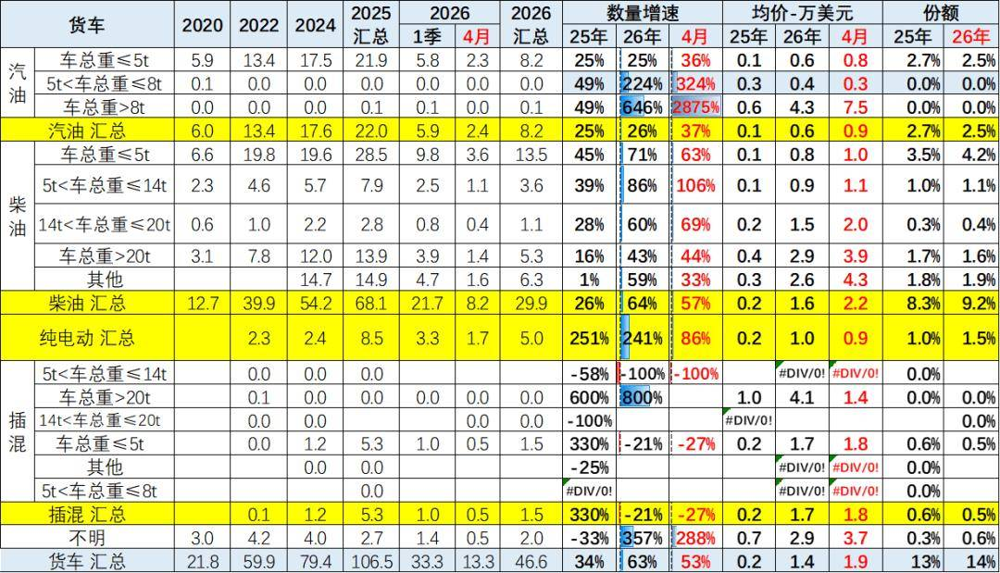

货车市场出口近几年增速不强，在汽车出口市场占比表现处于持续小幅萎缩状态，但2026年因纯电动和柴油轻卡表现较强，拉动出口占比改善。货车市场主力是5吨以下汽油和柴油货车较强，5-14吨和20吨以上柴油重卡货车总体来看也有较强需求。

2、货车出口市场变化特征

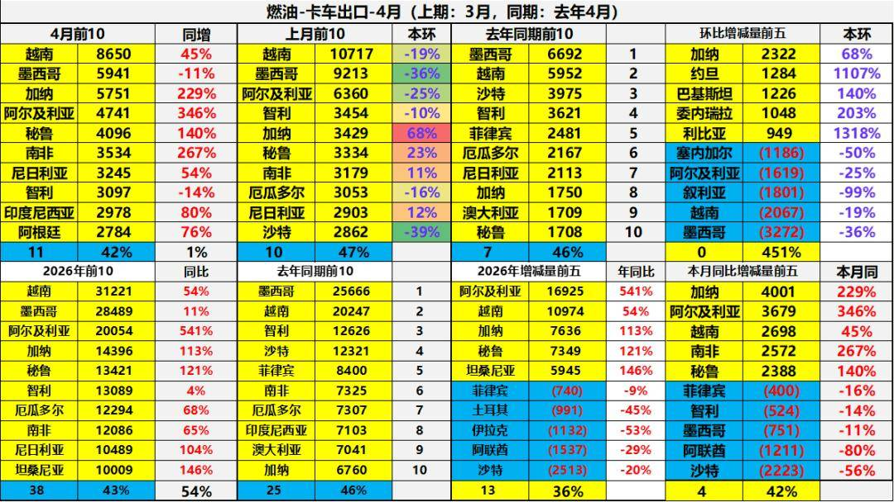

燃油货车出口市场前几位总体表现稳定。2026年4月主力出口市场越南8650辆、墨西哥5941辆、加纳5751辆、阿尔及利亚4741辆、秘鲁4096辆、南非3534辆、尼日利亚3245辆、智利3097辆、印度尼西亚2978辆、阿根廷2784辆，其中本期较同期增量增大的前五个是：加纳4001辆、阿尔及利亚3679辆、越南2698辆、南非2572辆、秘鲁2388辆。

2026年1-4月燃油货车主力出口市场:越南31221辆、墨西哥28489辆、阿尔及利亚20054辆、加纳14396辆、秘鲁13421辆、智利13089辆、厄瓜多尔12294辆、南非12086辆、尼日利亚10489辆、坦桑尼亚10009辆，其中今年较去年同期增量增大的前五个是：阿尔及利亚16925辆、越南10974辆、加纳7636辆、秘鲁7349辆、坦桑尼亚5945辆。

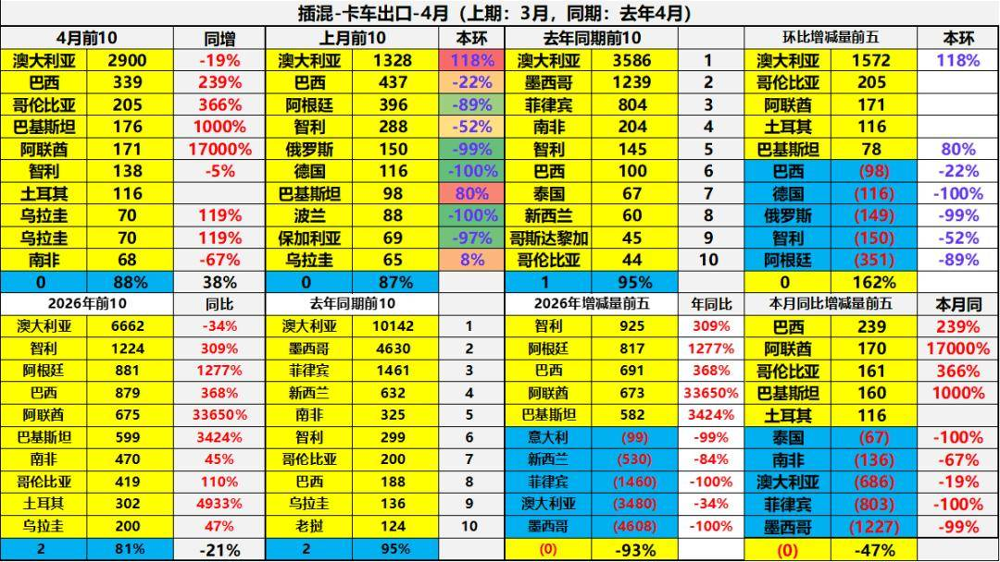

插混的货车出口市场近期较强，这主要是皮卡的乘用车属性的增量，在海外市场形成插混的野外场景便利和使用成本优势。

目前4月出口市场的澳大利亚2900辆、巴西339辆、哥伦比亚205辆、巴基斯坦176辆、阿联酋171辆、智利138辆、土耳其116辆、乌拉圭70辆、乌拉圭70辆、南非68辆，其中本期较同期增量增大的前五个是：巴西239辆、阿联酋170辆、哥伦比亚161辆、巴基斯坦160辆、土耳其116辆。

目前全年累计出口的澳大利亚6662辆、智利1224辆、阿根廷881辆、巴西879辆、阿联酋675辆、巴基斯坦599辆、南非470辆、哥伦比亚419辆、土耳其302辆，其中今年较去年同期增量增大的前五个是：智利925辆、阿根廷817辆、巴西691辆、阿联酋673辆、巴基斯坦582辆。

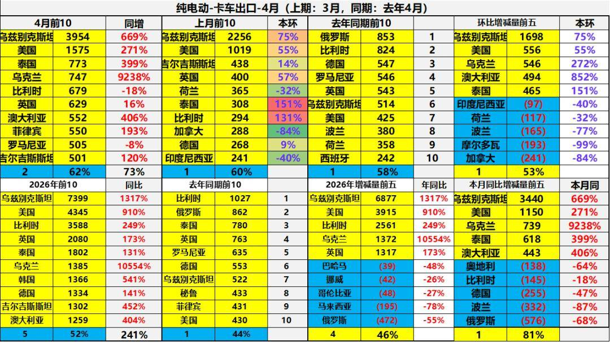

纯电动的货车出口市场近期暴增，这主要是特殊用车属性的暴增，在海外市场形成超强的场景便利和使用成本优势。

六、客车分类别出口走势

1、客车出口总体

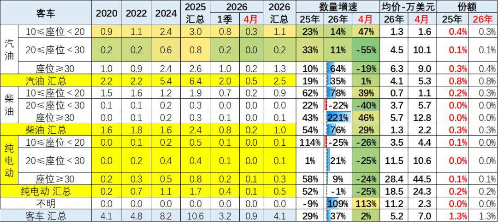

近期世界客车需求出现一定下降，导致前两年的中国客车出口持续萎缩，从2019年的6.4万辆下降到2022年的4.8万辆。2023年以来的世界需求恢复，中国客车2025年的全年达到10.6万辆。

2026年1-4月纯电动客车出口0.5万辆，下降1%的表现一般，柴油客车低基数出口增长较大，汽油大中型客车出口较强。

2、客车出口市场变化特征

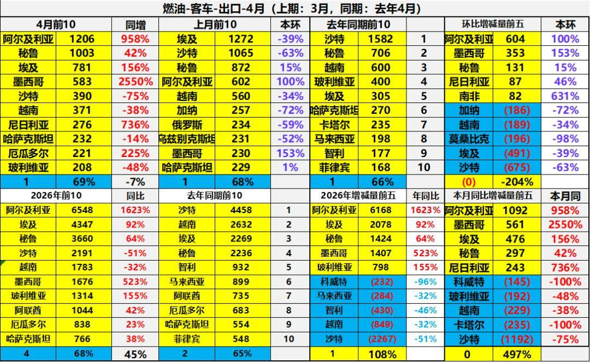

中国燃油客车出口主要市场比较分散，属于欠发达国家为主，市场比较复杂，难以有序持续开展出口。

今年4月燃油客车出口的主力是：阿尔及利亚1206辆、秘鲁1003辆、埃及781辆、墨西哥583辆、沙特390辆、越南371辆、尼日利亚276辆、哈萨克斯坦232辆、厄瓜多尔221辆、玻利维亚208辆，其中本期较同期增量增大的前五个是：阿尔及利亚1092辆、墨西哥561辆、埃及476辆、秘鲁297辆、尼日利亚243辆。

今年全年燃油客车出口的主力是：阿尔及利亚6548辆、埃及4347辆、秘鲁3660辆、沙特2191辆、越南1783辆、墨西哥1676辆、玻利维亚1314辆、阿联酋1044辆、厄瓜多尔838辆、哈萨克斯坦766辆，其中今年较去年同期增量增大的前五个是：阿尔及利亚6168辆、埃及2078辆、秘鲁1424辆、墨西哥1407辆、玻利维亚798辆。

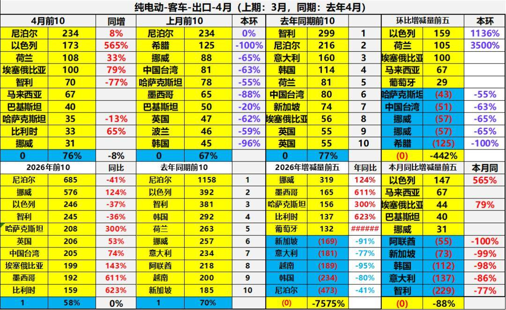

纯电动客车出口市场较小，数据波动较大，今年4月的出口主力是：尼泊尔234辆、以色列173辆、荷兰108辆、埃塞俄比亚100辆、智利70辆、马来西亚67辆、巴基斯坦40辆、哈萨克斯坦35辆、比利时33辆、挪威31辆，其中本期较同期增量增大的前五个是：以色列147辆、马来西亚67辆、埃塞俄比亚44辆、巴基斯坦40辆、挪威31辆。

纯电动客车今年全年的出口主力是：尼泊尔685辆、挪威576辆、以色列246辆、智利245辆、哈萨克斯坦208辆、英国206辆、中国台湾205辆、埃塞俄比亚199辆、墨西哥192辆、比利时159辆，其中今年较去年同期增量增大的前五个是：挪威319辆、墨西哥165辆、哈萨克斯坦156辆、比利时137辆、葡萄牙132辆。

附：近日信息合集
