# 车市扫描-2026年19期（5月18日-5月24日）

- 公開日時: 2026-05-27 17:24（北京時間）
- 出典: [搜狐号・崔东树](https://www.sohu.com/a/1028434051_115312)
- テーマ（自動判定）: 車市スキャン（週次）
- 画像: 20枚

---

主要信息源自乘联分会每日新闻等

中国汽车流通协会

乘用车市场信息联席分会（乘联分会）

网站：http://www.cpcaauto.com

一、本周车市概述1.2026年5月全国乘用车市场零售开局较强后逐步回落

【2026年5月1-24日乘联会市场分析要闻】

5月1-24日全国乘用车厂家批发111万辆，同比去年同期下降13%，较上月同期下降1%；今年以来累计批发908.6万辆，同比去年同期下降7%。5月1-24日市场零售98.9万辆，同比去年同期下降24%，较上月同期增长10%；今年以来累计零售659.4万辆，同比去年同期下降19%。

5月1-24日全国乘用车厂家新能源批发70.5万辆，同比去年同期下降1%，较上月同期增长13%；今年以来累计批发465.9万辆，同比去年同期下降1%。5月1-24日新能源车市场零售61.9万辆，同比去年同期下降11%，较上月同期增长13%；今年以来累计零售337.7万辆，同比去年同期下降16%。

2026年5月1-24日全国新能源市场零售渗透率62.5%；新能源厂家批发渗透率63.6%。

5月第1-4周全国纯燃料轻型车生产39.6万辆，同比去年同期下降45%，较上月同期下降32%。5月第1-4周混合动力与插混总体生产27.8万辆，同比去年同期下降18%，较上月同期下降1%。

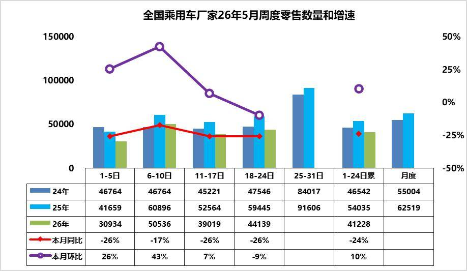

5月第1周乘用车市场日均零售3.1万辆，同比去年同期下降26%，较上月同期增26%。

5月第2周乘用车市场日均零售5.1万辆，同比去年同期下降17%，较上月同期增43%。

5月第3周乘用车市场日均零售3.9万辆，同比去年同期下降26%，较上月同期增7%。

5月第4周乘用车市场日均零售4.4万辆，同比去年同期下降26%，较上月同期降9%。

5月1-24日市场零售98.9万辆，同比去年下降24%，较上月同期增长10%；今年以来累计零售659.4万辆，同比去年下降19%。

“五一“期间，各车企积极推行新车上市权益以及终端促销，车市热度有效提升；2026 年5 月上旬乘用车零售呈现 “五一节日旺销后逐步回落” 的周度节奏，1-5 日受假期影响零售量处于低位，6-10 日的节日订单集中释放形成峰值。但随着节后限时补贴陆续到期，客流自然回落，市场呈现典型的“前高后低”走势。

从同比来看，前四周零售量均低于2025 年同期，市场整体仍面临需求不足的压力。由于去年同期乘用车政策补贴带来的高基数效应，同比表现偏弱符合预期。

2026 年3 月以来国内汽油先后五次调价，3 月9 日24 时每吨上调695 元，3 月23 日24 时每吨上调1160 元，4 月7 日24 时每吨上调420 元，4 月21 日24 时每吨下调555 元，5 月8 日24 时每吨上调320 元，5月21日24时上调75元，综合统计累计每吨上涨2115 元，折合每升共计上涨1.7元左右。由此高油价对车市的冲击巨大，高油价的燃油车销量损失短期内是无法依靠新能源弥补的。对比4月卡车市场同比相对零售旺销的局面，卡车更新补贴力度与去年一致未缩水的稳增长效果明显，而乘用车补贴剧烈下降的差异化影响较明显。

展望后续，随着5 月下旬车企加大促销力度、冲量窗口开启，零售量有望再次回升，月度同比跌幅大概率较上旬有所收窄；同时市场分化态势将延续，新能源与低价入门车型的表现仍将优于传统燃油车及中高端合资品牌。短期来看，政策红利释放、渠道库存消化仍是影响市场走势的关键变量，需持续关注后续周度零售表现及终端优惠变化。

2.2026年5月全国乘用车厂家销量平稳

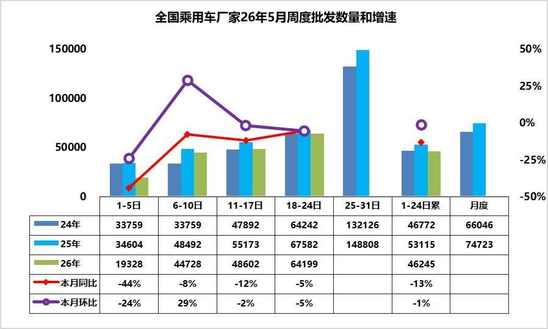

5月第1周批发日均1.9万台，同比去年5月同期下降44%，环比上月同期下降24%。

5月第2周批发日均4.5万台，同比去年5月同期下降8%，环比上月同期增29%。

5月第3周批发日均4.9万台，同比去年5月同期下降12%，环比上月同期下降2%。

5月第4周批发日均6.4万台，同比去年5月同期下降5%，环比上月同期下降5%。

5月1-24日全国乘用车厂家批发111万辆，同比去年下降13%，较上月同期下降1%；今年以来累计批发908.6万辆，同比去年下降7%。

近期乘用车零售持续相对偏弱，各环节的运行压力都在加大，产销节奏需要放缓。油价高位运行、供应链涨价、反内卷持续进行，从同比上对5 月份不利，但从环比上这些因素已经在4 月份存在，且4 月份下降较大，5 月份环比将会相对企稳。从生产进度看，燃油车的生产剧烈萎缩45%，混合动力表现较好，新能源车性价比更高。由于市场的持续下行压力，经销商库存压力更大，需要有效的化解经销商的生存压力。

3.4月中国汽车实现出口94万辆，同比增52%

2025年中国汽车实现出口832万辆，同比2024年全年增速30%。2026年1-4月中国汽车实现出口326万辆，同比2025年同期增速51%，4月中国汽车实现出口94万辆，同比增52%，环比增21%，同比走势总体较强,环比受到中东影响而偏低。2026年4月中国新能源汽车出口46.3万辆，同比增长59%，1-4月累计出口147万台，增69%的表现很好，4月新能源车出口环比3月表现较强。

2026年4月中国汽车出口中纯电动占比31%（同比-2%），插混占比18%（同比+4%），混动占比7%（同比+2%），纯燃油车占比34%（同比-4%）。

2026年4月中国新能源汽车出口总量的前10国家：巴西92482辆、比利时49227辆、澳大利亚34774辆、英国30910辆、菲律宾23426辆、泰国20901辆、韩国18741辆、德国15040辆、印度11892辆、西班牙11750辆，其中本期较同期增量增大的前五个是：巴西57569辆、比利时23756辆、澳大利亚18240辆、英国12280辆、韩国12099辆。

中国新能源车2026年1-4月出口表现好于预期，主要是插混和混动替代纯电动成为出口增长的新增长点，尤其是货车出口表现较强，成为商用车新能源车出口亮点。中国新能源车出口向中东和发达国家市场呈现高质量发展的局面，主要是出口西欧和中南美市场。

4.2026年4月全国新能源商用车国内销量暴增58%

根据国家金融局交强险数据，国内商用车交强险数据的2025年商用车强势增长。由于新能源车强势增长和报废更新政策促进车辆更新，2026年新能源商用车整体呈现快速拉升的良好局面。今年商用车1-3月32万台下滑7%，4月商用车国内销量实现32万台，同比增14%，环比下降7%。2026年1-4月商用车国内销量实现99万台，同比下降1%，

高油价对乘用车冲击巨大，但对商用车的影响很小。2026年4月新能源商用车暴增到11万台，同比增58%，环比3月增13%,2026年1-4月新能源商用车交强险29万台，累计增速34%。而燃油卡车的销量并未因此明显下滑，尤其是3-4月的燃油中重卡表现相对平稳，说明总体经济是不错的。

2026年1-4月份新能源渗透率达到29%，相对于去年1-4月的22%，提升7个百分点，表现相对较好。2026年4月商用车新能源渗透率34%， 较同期增长9个点，强于乘用车的增长。2026年仍是纯电动增长较强，插混与增程的表现改善较大。

2026年4月的卡车新能源渗透率26%，卡车较同期小幅提升；客车新能源渗透率70%，中客略跌。重卡新能源渗透率达到31%、轻卡达到26%，高油耗高税收的物流车型新能源渗透率提升较大。

5.2026年4月俄罗斯车市分析-自主车企份额55%

2026年4月俄罗斯汽车销量达13万辆，同比增40%。1-4月俄罗斯汽车销量达到42.2万辆的较高水平，同比增6%。2026年4月中国出口俄罗斯7.75万辆，自主品牌俄罗斯销量7.1万辆，当地销量是中国出口的92%，1-4月中国出口俄罗斯26.97万辆，自主品牌俄罗斯销量22.96万辆，当地销量是中国出口的85%，总体相对平衡。

2026年中国自主品牌在俄罗斯份额达到54.2%的较高水平，效益不错。2026年的国际车企的车型大量进入，德系和日系的表现较强，韩系的优势弱化。2026年4月自主车企在俄罗斯份额仍有54.8%，处于2026年1-4月峰值水平。面对俄罗斯的复杂环境，自主品牌多生孩子好打架的战略意义重大。自主品牌的整车官方出口，平行出口、绕道出口、本地化建厂、合资组装等各种模式齐上阵，大量的品牌群狼作战，实现了很好的效果。中国自主新能源车销量在俄罗斯车市总体表现是不错的，尤其是以增程式插电混动等高端车型，实现替代了欧美的豪华车的良好表现。新能源车中表现比较突出的是理想、极氪、岚图等品牌，这些品牌表现相对是极强的特征。而问界，比亚迪、小米等品牌也有一定的销量的表现。

中国车企在俄罗斯加速本土化生产与供应链重构，多项举措改善状态。首先是针对俄罗斯进口关税阶梯式上调深化KD组装模式，建立区域生产基地。通过本地化生产规避关税并缩短交付周期。搭建区域配件中心仓，将核心部件本地化率提升至60%以上，降低供应链风险；其次做好产品提升技术适配与极寒环境专项研发。针对俄罗斯零下50℃极寒气候及复杂路况，强化低温电池管理系统、全地形底盘调校及防腐蚀工艺，通过防腐工艺将故障率降低；第三是做好全渠道售后服务体系升级。针对俄罗斯偏远地区维修响应滞后问题，构建“中心仓+移动服务车+授权修理点”三级网络，提升服务覆盖率至90%以上；第四是品牌价值重塑与精准营销。通过技术背书与场景化营销建立高端形象，同时开发欧亚跨境电商平台，提供线上选配+线下提车服务，并利用人民币结算体系降低汇率波动影响。

二、本周上市新车1.魏牌V9X上市34.98万-38.98万元

5月18日，魏牌V9X上市，新车共推3款，售价区间为34.98万-38.98万元。新车采用悬浮立体发光LOGO、贯穿式星河LED灯带、Hi Light智慧大灯。采用12.3英寸仪表屏、双17.3英寸中控/副驾双联屏、21.4英寸后排娱乐屏。配备骁龙8295P座舱芯片、小魏同学智能体、Thor-U辅助驾驶芯片等。搭载2.0T Hi4混动系统，CLTC纯电续航分别为402km、310km、470km。

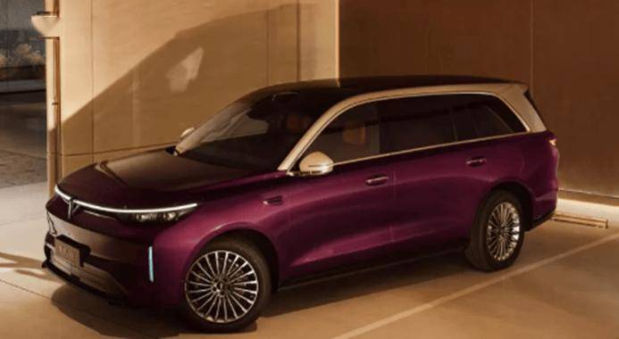

2.小鹏GX上市限时售价26.98万-34.98万元

5月20日，小鹏GX上市，新车共推8款，售价区间为27.98万-35.98万元，限时售价26.98万-34.98万元。新车采用寰宇天地前后贯穿灯、蚌式机舱盖、一体式蚌式尾门。采用8.8英寸仪表屏+17.3英寸中控屏+88英寸AR-HUD。配备AI调光隐私玻璃、33颗Hi-Fi级扬声器、第二代VLA、线控底盘等。新车1.5T增程车型CLTC纯电续航里程430km，纯电版CLTC纯电续航里程750km，665km。

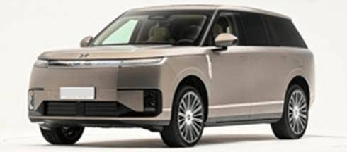

3.五菱缤果Pro上市5.68-7.08万元

5月22日，五菱缤果Pro上市。新车采用圆形LED大灯组、30L前备厢、圆角矩形尾灯、电动尾门。采用8.88英寸液晶仪表、12.8英寸中控屏。配备540度影像、无钥匙进入+无感启动、胎压监测、语音免唤醒、CarPlay/CarLife。CLTC续航里程为330km，403km。

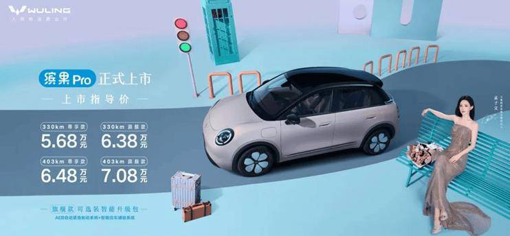

4.腾势N9闪充版上市40.98万-46.98万元

5月18日，腾势N9闪充版上市，新车共推3款，售价区间为40.98万-46.98万元。外观与现款车型基本保持一致。配备圆规掉头、易三方泊车、天神之眼5.0等。搭载2.0T插混系统，CLTC纯电续航提升至420km。

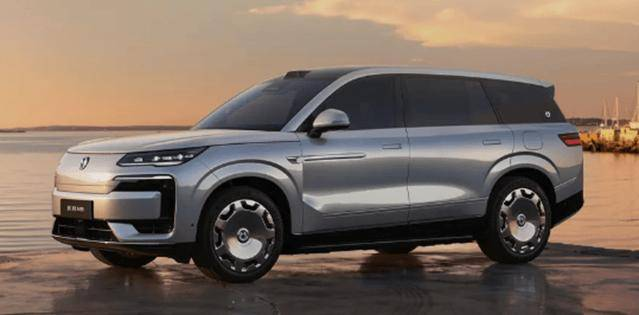

5.新款红旗H6上市17.98万-23.98万元

5月18日，新款红旗H6上市，共推8款，售价区间17.98万-23.98万元。外观与老款车型基本保持一致。配备车道居中保持、亿连手机互联等。搭载2.0T发动机，匹配8TIP变速箱。

5月20日，新款红旗H5上市，新车共推5款，售价区间为12.1万-15.1万元。新车换装全新10.25英寸仪表屏与15.6英寸2.5K中控屏，引入怀挡设计。升级搭载高速NOA和8155P车机芯片。提供1.5T和2.0T两种动力，分别匹配7DCT和8TIP变速箱。

5月20日，新款红旗HQ9上市，新车共推3款，售价33.88万-53.88万元。外观与老款车型基本保持一致。采用全新的双15.6英寸2.5K联屏设计，改用怀挡。配备双零重力座椅、高通骁龙8295P芯片、21.4英寸3K后排屏等。搭载2.0T插混动力，CLTC纯电续航220km。

6.新款极氪009上市权益后售41.38万-44.38万元

5月19日，新款极氪009上市，新车共推3款，售价区间为43.98万-46.98万元，权益后售41.38万-44.38万元。外观与老款车型基本保持一致。换装全新造型方向盘，中控台下方增设水晶旋钮。配备Thor-U驾驶辅助芯片、激光雷达、双零重力座椅、Naim音响等。升级全栈900V高压架构，CLTC纯电续航里程为740km，720km。

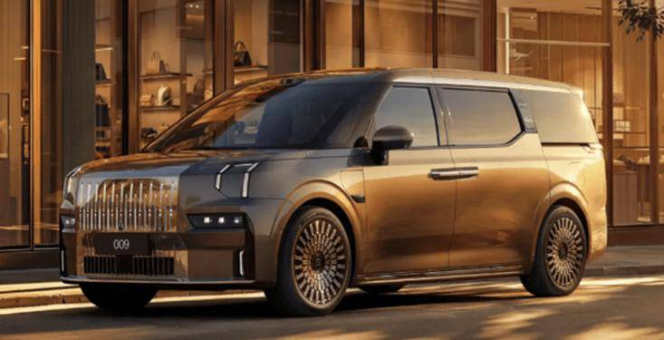

7.智己LS6上汽一亿台限定版上市23.49万-25.49万元

5月20日，智己LS6上汽一亿台限定版上市，新车共推2款，售价区间为23.49万-25.49万元。外观与现款车型基本保持一致。配备520线激光雷达、车载冰箱、二排座椅通风按摩等。CLTC纯电续航分别为650km，802km。

8.新款本田皓影上市13.79万-17.99万元

5月20日，新款本田皓影上市，新车共推7款，售价区间为13.79万-17.99万元。外观与老款车型基本保持一致。新车中控屏幕尺寸扩大到12.3英寸。配备Honda CONNECT 4.0、AI大模型×华为云智能座舱。汽油版搭载1.5T发动机，匹配CVT变速箱，e:HEV版采用2.0L发动机，匹配E-CVT变速箱。

9.别克至境世家万家版上市41.99万元

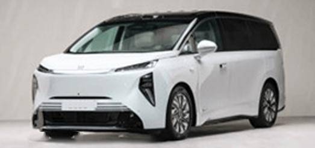

10.北京越野BJ40增程长续航版上市焕新价16.98万-19.98万元

5月21日，北京越野BJ40增程长续航版上市，新车共推3款，售价17.98万-20.98万元，焕新价16.98万-19.98万元。外观与现款车型基本保持一致。配备地平线J6M旗舰芯片，支持HNOA高快领航辅助。搭载1.5T增程系统，CLTC纯电续航分别为201km和252km。

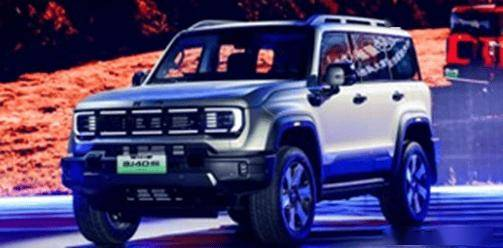

11.比亚迪第三代元PLUS上市售价区间为11.99万-14.99万元

5月21日，比亚迪第三代元PLUS上市，新车共推4款，售价区间为11.99万-14.99万元。新车车顶线条更加平直，换装半隐藏式门把手，提供180L电动前备厢。采用全新双辐式方向盘、手机支架接口、副驾“手办妙妙屋”。配备女王副驾、HUD、方向盘加热、车载冰箱、16扬声器等。新车CLTC续航里程分别为540km和630km。

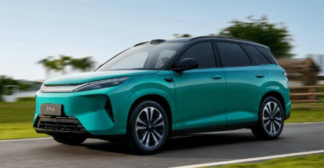

12.小米YU7标准版& YU7 GT上市车标准版售23.35万元

5月21日，小米YU7标准版& YU7 GT上市，新车标准版售23.35万元，GT版售38.99万起。YU7 GT前包围造型更加夸张，使用全新的后包围造型。YU7 GT采用更多的碳纤维装饰面板，“GT”标识布满车内细节。YU7 GT配备专属GT车型UI界面、锁车专属音效、小米蛟龙底盘大师版。YU7 GT首搭小米超级电机V8s EVO，CLTC续航里程705km，YU7标准版CLTC续航里程643km。

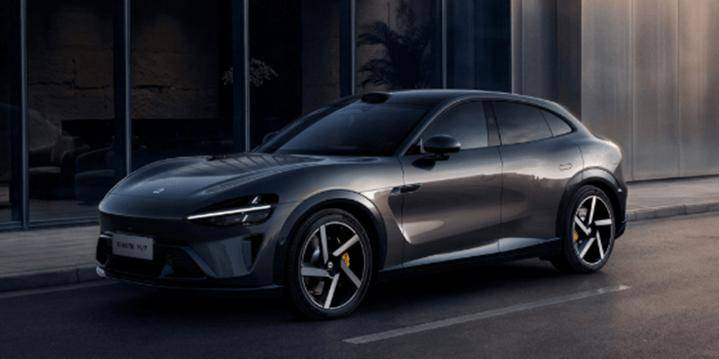

13.与众07上市12.99万-13.99万元

5月22日，大众安徽与众07正式上市，新车共推2款，售价区间为12.99万-13.99万元，限时权益价10.99万-11.99万元。是大众安徽推出的第三款车型，基于CEA架构打造的中型纯电动车，采用后置单电机，CLTC纯电续航里程558km。

5月23日，新款与众06上市，新车共推2款，售价区间为14.99万-15.99万元，限时权益价13.49万-14.49万元。外观与老款车型基本保持一致。内饰采用15英寸中控屏、12英寸副驾防窥娱乐屏、10.25英寸仪表、27英寸AR HUD。配备全新VW OS、智谱清言大模型、四音区定位、双层夹胶静音玻璃等。新车的CLTC续航里程为528km。

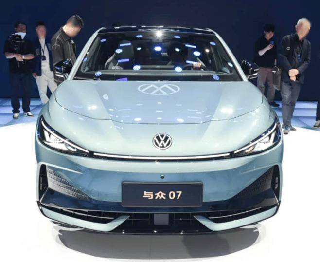

14.岚图泰山X8上市

5月22日，岚图汽车旗下全新大型SUV——泰山X8正式上市。新车定位五座大型SUV，搭载896线双光路图像级激光雷达，配备三腔空气悬架、二排零重力座椅、乾崑智驾ADS、HarmonySpace 5.2。采用双15.6英寸华为智慧双联屏、10.25英寸仪表屏、55英寸AR-HUD、21.4英寸3K吸顶屏。

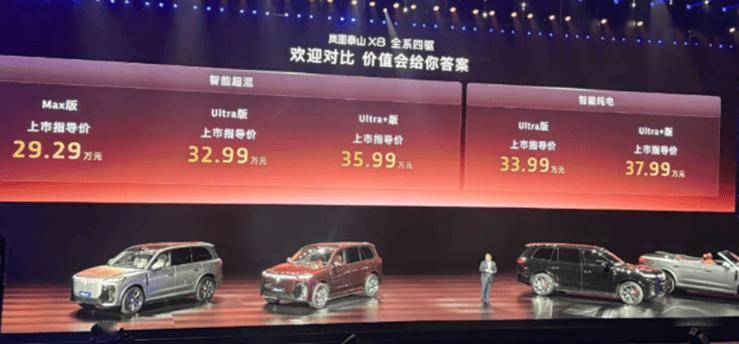

15.极狐贝塔S3上市限时优惠价5.98万-12.08万元

5月22日，极狐贝塔S3上市，新车共推8款，售价区间为6.48万-12.58万元，限时优惠价5.98万-12.08万元。新车采用贯穿LED星河灯带、溜背式轮廓、小鸭尾、扩散器。内饰采用15.6英寸悬浮式中控屏、8.8英寸液晶仪表。配备256色氛围灯、高通骁龙8155芯片、激光雷达、高速NOA领航等。新车换电版本CLTC续航为535km，充电版本CLTC续航为460km，560km，660km。

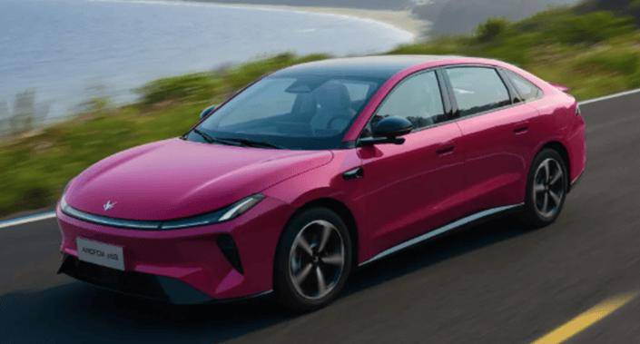

16.吉利银河星耀7 MAX上市限时优惠价9.88万-12.98万元

5月22日，吉利银河星耀7 MAX上市，新车共推5款，售价区间为10.88万-13.98万元，限时优惠价9.88万-12.98万元。新车采用“银河星瀑”纵向格栅、专属镀铟徽标、激光镭雕贯穿尾灯。内饰采用10.2英寸液晶仪表+14.6英寸/15.4英寸中控屏+16.6英寸W-HUD。配备千里浩瀚辅助驾驶H3、全场景AI Agent、Eva机器人、16扬声器等。新车搭载1.5L插混系统，CLTC纯电续航里程220km，230km。

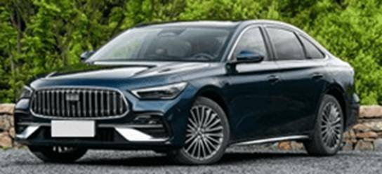

17.吉利帝豪向上系列上市限时感恩价5.59万-6.49万元

5月24日，吉利帝豪向上系列上市，新车共推3款，售价区间为6.89万-7.79万元，限时感恩价5.59万-6.49万元。新车整体沿用第四代帝豪的设计风格。配备后排空调出风口、游艇式机械挡杆、天窗等。新车搭载1.5L发动机，匹配CVT变速箱或5MT变速箱。

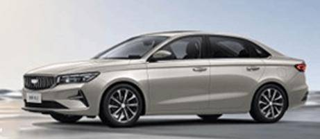

18.新款星途瑶光上市限时优惠价12.49万-13.99万元

5月23日，新款星途瑶光上市，新车共推3款，售价区间为13.79万-15.29万元，限时优惠价12.49万-13.99万元。外观与老款车型基本保持一致。配备高通8155芯片、540度全景影像、8个SONY扬声器、NAPPA真皮座椅等。1.5T插混动力CLTC纯电续航里程120km；燃油动力搭载2.0T发动机，匹配7DCT变速箱。

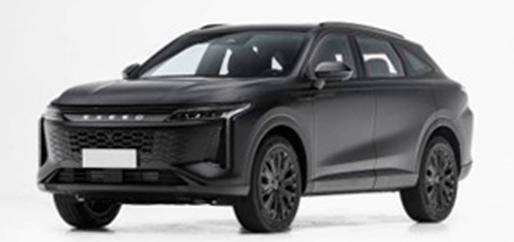

19.长安逸动HEV上市限时优惠价12.49万-13.99万元

5月23日，长安逸动HEV上市，新车共推3款，售价区间为8.99万-9.99万元，。外观与现款车型基本保持一致。配备天枢OS、DeepSeek、前排座椅加热与通风等。新车搭载1.5L HEV混动系统，匹配1挡DHT混动变速箱。

5月23日，长安CS75 PLUS蓝鲸超擎版上市，新车共推3款，售价区间为12.19万-13.99万元，上市抢购价11.39万-13.19万元。新车采用无边界前格栅搭配V字形装饰元素。配备天枢智能驾驶辅助视觉版、专属小蓝灯、CDC魔毯悬架等。新车搭载1.5T HEV混动系统，匹配8TIP变速箱。

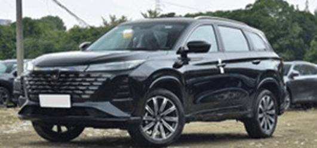

三、宏观经济与政策1.财政部：1-4月全国一般公共预算收入同比增长3.5%

5月20日，财政部发布数据显示，1-4月，全国一般公共预算收入83,404亿元，同比增长3.5%。其中，全国税收收入68,097亿元，同比增长3.9%；非税收入15,307亿元，同比增长1.6%。1-4月，全国一般公共预算支出94,809亿元，同比增长1.3%。

2.工信部加力智能网联新能源汽车等新兴产业领域挖潜扩容

5月19日，工业和信息化部党组书记、部长、部就业促进工作领导小组组长李乐成主持召开部就业促进工作领导小组2026年全体会议，研究部署2026年部就业促进工作重点任务。加力智能网联新能源汽车、高端装备、航空航天等新兴产业领域挖潜扩容。

3.工信部装备工业发展中心开展2026年新能源汽车安全隐患排查工作

工业和信息化部装备工业发展中心5月21日下发《关于开展2026年新能源汽车安全隐患排查工作的通知》，各企业应于2026年8月1日前完成新能源汽车安全隐患排查工作。

4.4月汽车制造业工业增加值同比增长9.2%

5.油价调整

自5月21日24时起，国内汽、柴油（标准品）价格每吨分别上调75元、70元。

6.重庆明确2026年汽车购新和二手车购置补贴政策细则

5月18日，重庆市商务委员会发布关于明确2026年汽车购新和二手车购置补贴政策部分实施细则的通知。5月1日至12月31日期间，个人消费者在参与消费补贴活动的汽车经销商处购买乘用车新车，可享受分档补贴1,000-8,000元/辆；二手乘用车，车辆价格2万元及以上并完成转让登记手续的，按发票金额的1.5%给予补贴，每辆补贴最高4,000元。

7.香港环境及生态局将推出2000万港元高速充电桩计划

5月20日，香港署理环境及生态局局长黄淑娴答复议员提问时表示，特区将采取多管齐下的策略，推出一项2000万港元的商用车专用高速充电桩计划。

四、企业信息1.奥迪上汽项目换帅落定

自2026年7月1日起，奥迪 · 上汽项目CEO Fermin Soneira（宋斐明）将离任，转任兰博基尼首席技术官（CTO）；接替他的，是现任奥迪股份公司监事会成员Fred Schulze。与此同时，上汽奥迪事业部负责人也已完成更迭 —— 胡胤接棒倪晟。

2.比亚迪在印尼推出首款插电混动MPV M6 DM

比亚迪在印度尼西亚正式发布其首款插电混动MPV——M6 DM。该车型搭载比亚迪DM技术，定位为专为印尼市场设计的7座MPV。M6 DM基于中国市场的宋MAX车型开发，配备1.5升发动机与电动机组合，综合输出功率达197马力，纯电续航里程为105公里。

3.长城集团蜂巢汽车智驾系统投资项目落户常熟

5月18日，长城集团蜂巢汽车智驾系统投资项目签约落户常熟经开区。蜂巢汽车计划新增投资10亿元，落地常熟智驾系统项目，利用现有高标准厂房生产智驾域控制器等高端产品。

4.东风汽车与Stellantis集团有意向在欧洲成立一家合资企业

东风汽车与Stellantis集团签署了一项非约束性谅解备忘录，双方有意向在欧洲成立一家合资企业，将负责东风汽车新能源车型在欧洲约定市场的销售、分销、制造、采购及工程研发。还初步商讨了在Stellantis集团的法国雷恩工厂，开展岚图本地化生产的可能性。

5.东风汽车有限公司召回部分东风日产N7、N6汽车

日前，东风汽车有限公司向国家市场监督管理总局备案了召回计划。召回部分2025-2026年款N7汽车，共计49465辆；部分2025-2026年款N6汽车，共计18800辆。本次召回范围内的车辆，由于设计原因，油门踏板总成在长期踩踏后内部摩擦块磨损，踏板转动部件与突出的支耳干涉，导致油门踏板回位不顺畅，存在安全隐患。

6.广汽冯兴亚：2026年海外销量目标锁定25万-30万辆

5月23日，广汽集团董事长冯兴亚在社交平台发文称，广汽将海外作为第一增长曲线，目标“十五五”末进入120个国家、建成2000个网点，2026年海外销量目标锁定25万-30万辆。力争2030年实现海外年销量100万辆。

7.尼得科将终止与广汽集团合资企业

据日媒报道，尼得科将在纯电动汽车驱动装置“E-Axle”领域解除与广汽集团的合资。尼得科社长岸田光哉表示：“希望退出已成为‘一片红海’的E-Axle业务。”

8.吉利将在南非推出首款燃油车型

吉利汽车南非公司的一名高层管理人员表示，中国吉利计划在南非推出旗下首款燃油车型，并计划在2026年底前完成布局，将当地在售车型扩充至约10款。

9.极氪发布新一代液冷超充桩

极氪汽车推出新一代液冷超级充电桩。该桩单枪峰值电流达800A，峰值功率为800kW。其能耗较传统方案降低20%以上，支持多品牌新能源车型，并配备多层级主动防护机制及AI故障预测与隔离保护技术，可在毫秒级内响应异常。

10.理想推送OTA 8.5版本升级

理想汽车宣布向旗下车型推送OTA 8.5版本升级，本次更新围绕智能驾驶、泊车辅助两大核心场景进行功能新增与体验优化，新增手机遥控泊出功能，并升级了VLA大模型智驾能力，覆盖理想MEGA、理想i系列、22-25款理想L系列车型。

11.深蓝汽车正式签约成为葡萄牙国家队

5月22日，深蓝汽车签约成为葡萄牙国家队全球官方合作伙伴。本次官宣仪式落地葡萄牙里斯本，深蓝汽车现场向球队交付全球主力车型深蓝S05，并同步启动1000km欧洲长测。

12.特斯拉官宣监督版FSD入华

5月21日，特斯拉通过官方社交平台（X）正式官宣FSD Supervised（监督版完全自动驾驶）全球最新布局，中国被纳入可用地区名单。目前仍处于员工内测阶段。

13.蔚来发布2026年一季度财报

5月21日，蔚来发布2026年一季度财报，一季度实现经营利润6,680万元，一季度总营收255.3亿元，同比增长112.2%。毛利总额48.6亿元，同比增长428.4%。

14.小鹏汽车收购印尼电动汽车工厂90.1%股权

5月21日，小鹏汽车正式完成对印度尼西亚上市公司PT Sinar Eka Selaras Tbk旗下电动车制造实体PT Era Industri Otomotif（EIDO）90.1%股权的收购。

五、行业信息1.乘联分会预测5月新能源渗透率约62.5%

乘联分会5月22日发布最新调研结果，占市场总销量七成以上的头部厂商零售目标环比上月增长约10%。预计5月狭义乘用车零售约152万辆，环比增长9.9%；其中新能源零售量约95万辆，环比增长12.0%，渗透率约62.5%。

2.首张综合性司机服务地图发布

5月21日，中国交通运输协会城市交通分会等机构共同发布全国首张综合性司机服务地图。将全国超2100个出租汽车司机驿站和货车司机之家、充电加油设施、便民服务点等信息集纳于一张数字地图，打开高德地图搜索“司机服务”即可获取附近服务信息。

3.大众汽车将发行30亿元熊猫债

5月19日，大众汽车国际金融股份公司公告，公司2026年度第一期中期票据（债券通）申购启动。本期债券的本金总额为不超过人民币30亿元。

4.日产或将中国产电动汽车出口至加拿大等市场

近日，日产汽车美洲区负责人Christian Meunier在采访中表示，该公司希望借助与东风汽车集团的合资产能，面向巴西、墨西哥等多个市场推出高性价比中国产电动车型，加拿大也被纳入潜在出口市场名单。

5.Stellantis计划与零跑汽车在意大利生产平价电动车

5月19日，Stellantis计划与零跑汽车在意大利联合生产一款紧凑型电动汽车，以降低成本并获取更具竞争力的技术。Stellantis方面表示，这款名为E-Car的车型将于2028年开始在意大利的工厂投产，零跑汽车是该项目的主要合作方。

6.驭势科技港交所挂牌上市

5月20日，全场景L4级自动驾驶解决方案提供商驭势科技正式在香港联合交易所主板挂牌上市，本次IPO全球公开发行1446万股，最终发行价定为每股60.3港元。

7.中升集团今年重点投资领克

5月19日，领克汽车销售公司常务副总经理周钘在社交平台发文透露，中升集团今年重点投资领克，二季度陆续会有20多家领克新店会开业。

六、跨国集团与国际市场1.福特计划2029年前在欧洲推出7款新车

当地时间5月18日，福特汽车宣布，2029年前将在欧洲市场推出7款全新车型，其中5款为乘用车。旨在扭转福特的乘用车销量颓势，应对来自中国车企的激烈竞争。

2.韩国4月汽车出口总额61.7亿美元

5月20日，韩国产业通商资源部数据显示，4月韩国汽车出口总额61.7亿美元，同比下降5.5%，其中对中东出口下降38.7%，对欧盟、亚洲其他国家出口分别下滑13.1%、31.7%。

3.Klarna与Tekion合作，将灵活支付引入美国汽车维修服务

全球数字银行与灵活支付服务提供商Klarna与汽车零售云平台Tekion宣布达成合作，将Klarna的全套支付解决方案引入美国各地经销商的售后服务部门，为车主提供维修费用的灵活支付选择。

4.梅赛德斯-奔驰计划布局国防军工市场

梅赛德斯-奔驰首席执行官康林松在接受《华尔街日报》采访时称，只要具备商业价值，集团有意进军防务装备制造领域。

5.纽约州撤回无人驾驶出租车提案

美国纽约州州长霍楚尔撤回了一项提案，霍楚尔上个月在一份政策预览报告中提出的这项提案，将允许Waymo等自动驾驶汽车公司申请许可，试运行无人驾驶服务。

6.Stellantis将与捷豹路虎探索在美联合开发车型

Stellantis表示，已与英国捷豹路虎签署初步协议，双方将探索在美国联合开发车辆的可能性。两家公司将就产品及技术开发领域的合作机会展开评估。

7.Stellantis公布600亿美元战略转型计划

5月21日，Stellantis集团正式公布了一项价值600亿美元的战略转型规划，包括到2030 年推出60 款新车型（涵盖内燃机、混合动力和纯电动汽车）。

8.斯巴鲁营业利润跌90%

斯巴鲁（Subaru）发布2025财年（2025年4月-2026年3月）年报。斯巴鲁营收为4.785万亿日元，同比增长2.1%，但营业利润仅401亿日元，同比下滑90%；净利润为908亿日元，同比下滑73%。

9.特斯拉放弃印度建厂计划

印度重工业部部长Kumarawami证实，特斯拉已正式放弃在印度建厂的计划。

10.泰国消费者保护机构OCPB对沃尔沃泰国分公司提起民事诉讼

日前，泰国消费者保护机构OCPB 对沃尔沃泰国分公司提起民事诉讼。源于泰国国内本月发生的两起EX30 起火事故。“大部分消费者想要的是全额退款，而不是换电池。”

11.VinFast拟出售两座越南本土工厂以削减巨额债务

日前，越南电动汽车制造商VinFast表示，计划出售越南本土的两座工厂，此举可帮助该公司削减约182万亿越南盾（约合69亿美元）的债务及各类应付账款。

12.印度最大车企玛鲁蒂铃木宣布上调汽车售价

印度最大汽车制造商玛鲁蒂铃木（Maruti Suzuki）宣布，受持续的通胀压力及严峻的成本环境影响，将于下月起上调旗下汽车售价，最高涨幅达3万卢比（约合311.85美元）。

13.伊朗与阿塞拜疆边境恢复汽车进口通关业务

当地时间19日，伊朗与阿塞拜疆边境地区已恢复汽车进口相关通关业务。位于伊朗西北部的阿尔达比勒—比莱萨瓦尔自由区海关，已被列入获准办理汽车清关业务的海关名单。

附：近日信息合集
