# 2026年1-4月汽车行业利润率3.4%、收入增1%、成本增2%、利润降17%

- 公開日時: 2026-05-27 17:24（北京時間）
- 出典: [搜狐号・崔东树](https://www.sohu.com/a/1028434388_115312)
- テーマ（自動判定）: 利益・収益
- 画像: 11枚

---

注：本分析文章仅代表崔东树个人观点，如有异议，请留言。

一、核心数据观点

2026年1-4月，面对国际环境复杂演变和国内转型压力等多重挑战，国民经济开局良好、质效提升，装备制造业和高技术制造业利润快速增长，原材料制造业利润两位数增长，为全年经济平稳运行奠定坚实基础。2026年1-4月汽车生产970万台，同比降5%。2026年1-4月的汽车行业收入33129亿元，同比增1.1%；成本29404亿元，增2%；利润1119亿元，同比降17%。

2026年1-4月汽车行业销售利润率进一步降至3.4%，4月3.7%，好于1-3月3.2%的表现，但仍处于历史低位，盈利下行压力持续凸显。近期随着车市生产规模扩大，PPI上行，上游有色和石油等矿业利润暴涨，锂电池出口吨单价持续大幅下降，国内电池价格暴涨，车企不造电池的问题严重，车企利润可持续下滑。

2026年各地大力度推动“两新”政策落地实施，逐步有效释放内需活力，但汽车行业效益改善明显落后其它消费品。随着国家反内卷工作持续推进，汽车行业的上游挤压严重，油价暴涨，终端用户购车观望心态严重，车企运行压力持续加大。

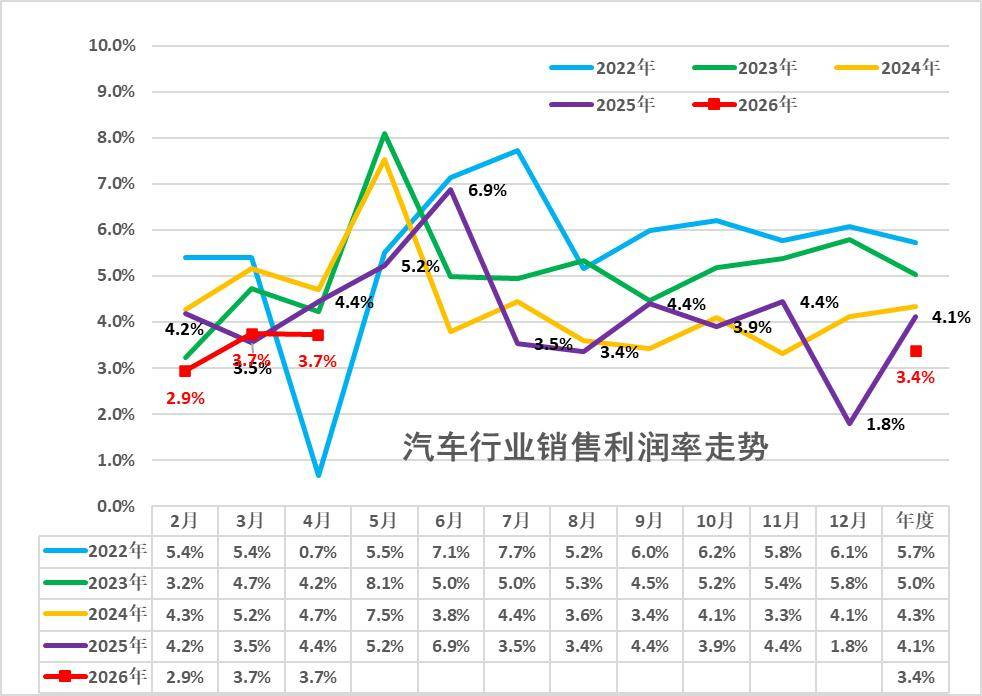

从历年销售利润率走势来看，2024年汽车行业利润表现已显疲软，销售利润率仅4.3%，较历史正常水平大幅下降；2025年汽车行业销售利润率降至4.1%。2026年1-4月汽车行业销售利润率进一步降至3.4%，4月3.7%，好于1-3月3.2%的表现，但仍处于历史低位，盈利下行压力持续凸显。

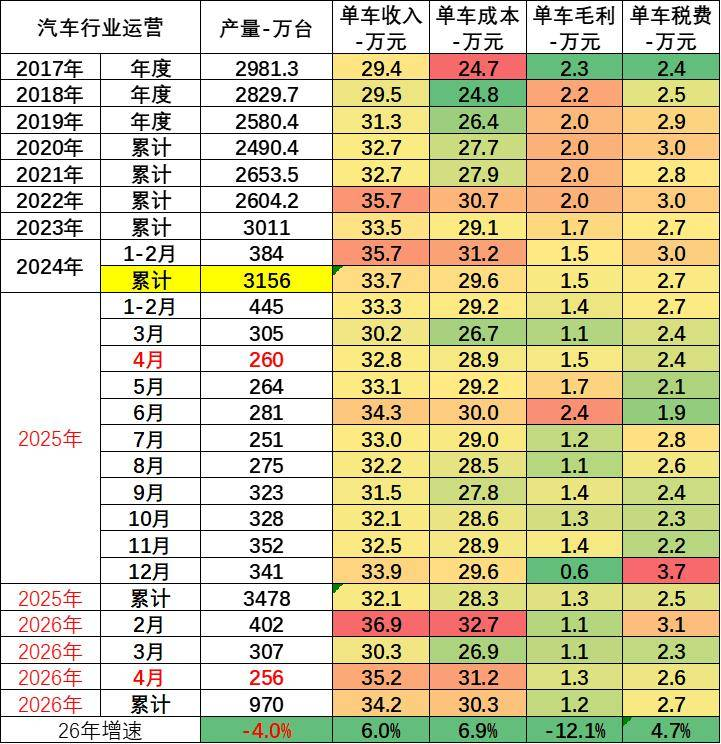

由于汽车行业的产销基本是一致的，统计口径一致，产销差距不大，因此我们用国家统计局产量测算统计局单车经济指标。

1-4月总体工业企业单位成本增长压力大。碳酸锂价格翻一倍，大宗商品价格高位运行，中下游行业原料成本压力有所加大。1-4月汽车行业产业链的总体单车收入34.2万元（有产业链的重复计算）增6.0%，单车成本增30.3万元增6.93%，单车税费2.7万元增4.7%，产业链单车毛利润1.2万元降12.1%。

二、具体分析

1、各类经济体的收入和利润结构

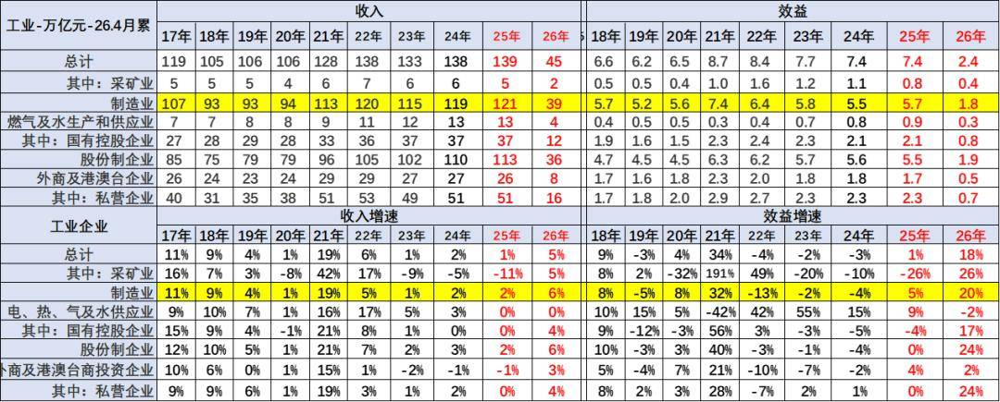

1—4月份，规模以上工业企业实现营业收入44.89万亿元，同比增长5.2%；发生营业成本38.13万亿元，增长4.5%；营业收入利润率为5.43%，同比提高0.60个百分点。

今年总体工业领域的收入增长平稳，利润表现也是相对分化，其中近几年的国有企业的收入和利润波动较大。采矿企业的表现较好，利润增速很强。

注意：基础数据解读

规模以上工业企业利润总额、营业收入等指标的增速均按可比口径计算。报告期数据与上年所公布的同指标数据之间有不可比因素，不能直接相比计算增速。其主要原因是：（一）根据统计制度，每年定期对规模以上工业企业调查范围进行调整。每年有部分企业达到规模标准纳入调查范围，也有部分企业因规模变小而退出调查范围，还有新建投产企业、破产、注（吊）销企业等变化。（二）加强统计执法，对统计执法检查中发现的不符合规模以上工业统计要求的企业进行了清理，对相关基数依规进行了修正。（三）加强数据质量管理，剔除跨地区、跨行业重复统计数据。根据国家统计局最新开展的企业组织结构调查情况，2017年四季度开始，对企业集团（公司）跨地区、跨行业重复计算进行了剔重。（四）“营改增”政策实施后，服务业企业改交增值税且税率较低，工业企业逐步将内部非工业生产经营活动剥离，转向服务业，使工业企业财务数据有所减小。（五）根据第四次全国经济普查单位全面清查结果，对规模以上工业企业调查单位进行了核实调整。

2、收入利润结构变化

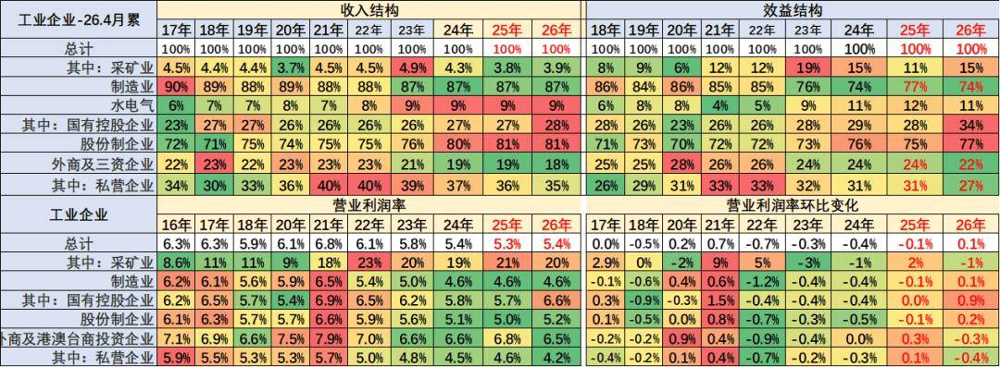

目前看国有企业表现很好，收入和利润占比持续增长，利润占比达到34%，私营企业的销售利润率4.2%的水平较低，较去年利润下滑较明显。

营业收入的利润率指标中，主要是采矿业和煤水电等国有企业指标数值较高，私营企业利润率很差，制造业的利润占比74%，近期明显下降。

三、具体行业分析

1、采矿业利润分化

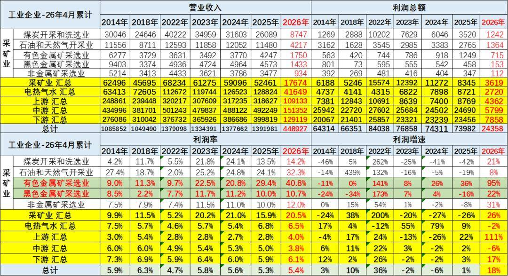

2026年1-4月的高基数和价格走高下，采矿利润增26%仍有很好利润，采矿业1-4月利润率在20.5%水平也是很好的。

2026年1-4月，有色行业利润率暴增40.8%，石油行业利润率增32.3%，近期的石油业的利润率增长惊人。总体采矿行业利润保持高位。对下游的冲击较大。

2、水电气行业利润保持高位

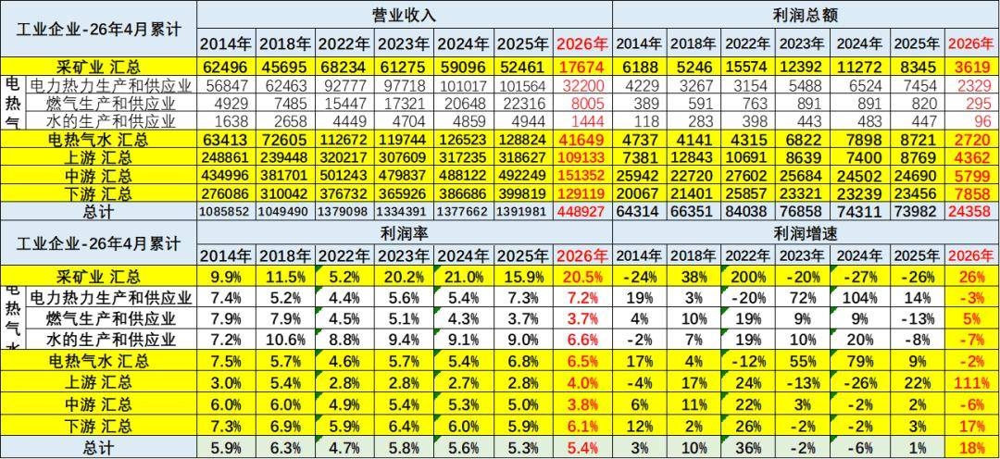

电热气水是高利润服务行业，2026年利润率6.5%。电力行业的利润处于历史高位，水的处理行业利润下降7%，燃气行业利润2026年增5%，电力的利润2026年下降3%。

3、上游利润改善

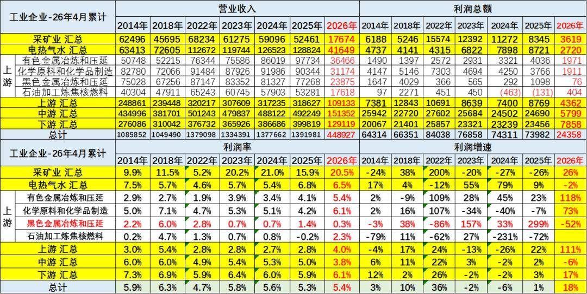

2025年上游行业的销售收入和利润都是出现高增长，尤其是利润率回升到4%。其中有色金属等为代表的销售利润率逐步冲到高位，钢铁从去年年初的巨额亏损到今年仍是较差。化工原料和有色金属冶炼等行业利润还算较好。

4、中游利润表现较好

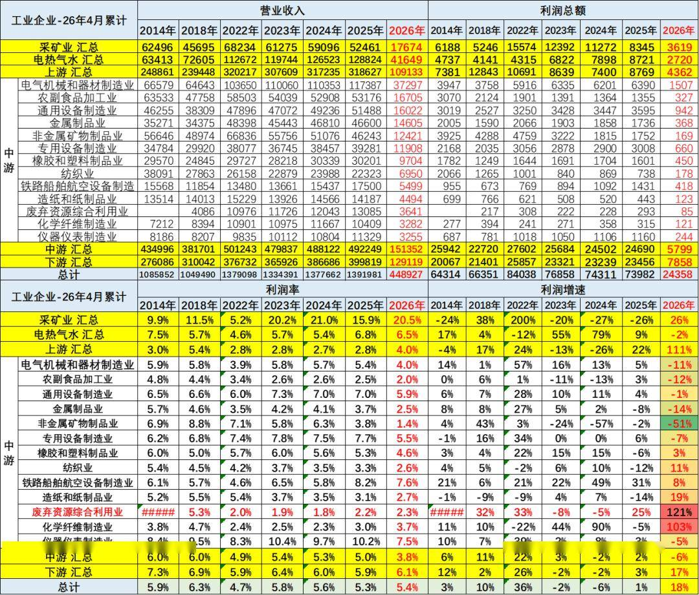

2026年1-4月中游行业的销售收入和利润增长较好。中游行业销售利润率从2018年6%下降到2026年的3.8%，近期企稳。2026年主要中游行业的销售利润率也有所下降，造船铁路等效益好，废弃物资利用和非金属矿物制品业利润增长较大。

5、下游利润逐步改善

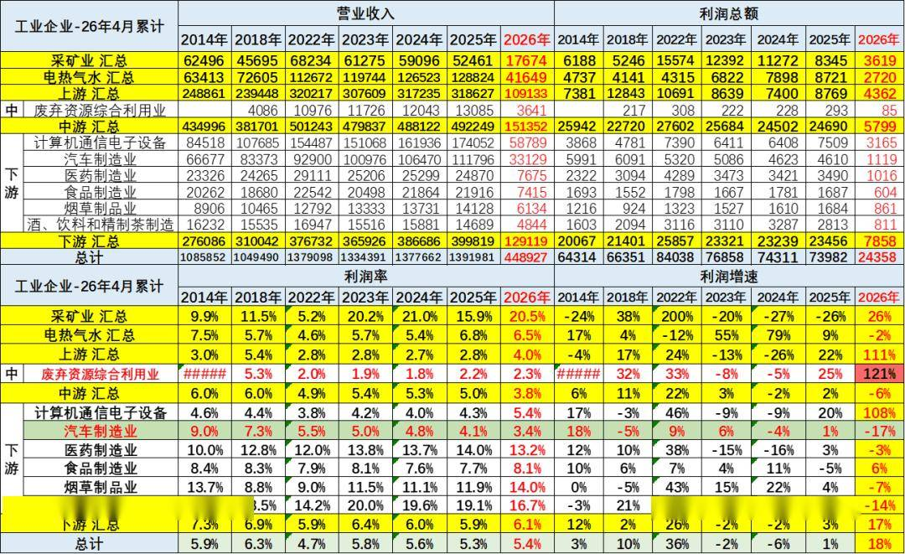

2026年1-4月总体下游工业利润增17%，而汽车业利润降17%，销售利润率3.4%（2014年9%），仍低于下游总体6.1%的利润率水平，也大幅低于烟、酒、药等其它下游企业。

目前高利润的主要还是烟草、酒类、医药行业，酒类行业的利润大幅高于其它行业。计算机通讯行业利润出现异常良好的增长态势。食品行业盈利不强，但也同比提升明显。

四、汽车行业分析

1、汽车行业规模持续扩大

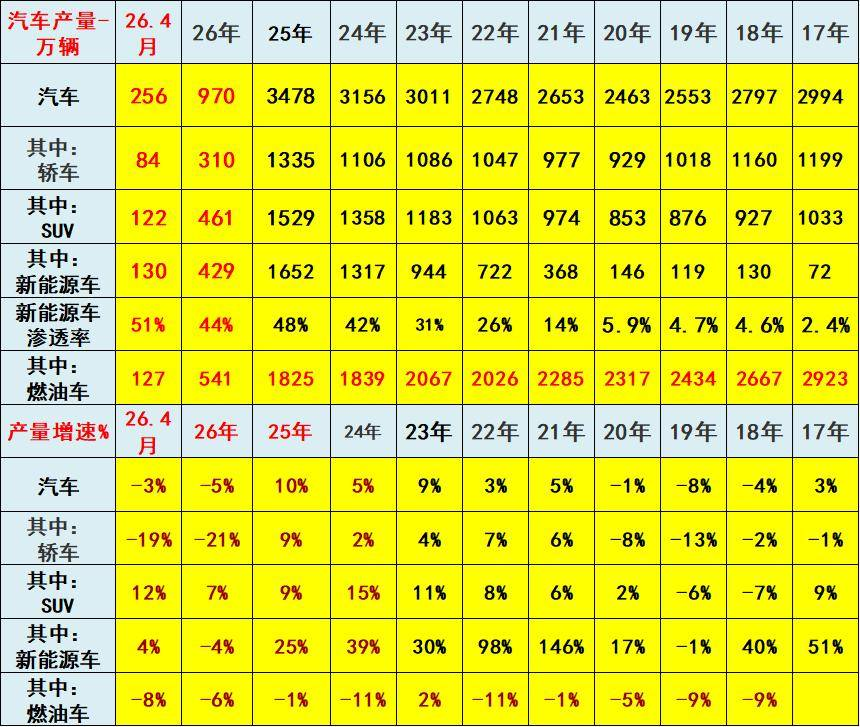

2022年汽车生产2748万台，产量同比增长3%；新能源汽车生产722万，增长98%，渗透率26%；燃油车生产2026万台，降11%。

2023年汽车生产3011万台，同比增9%；新能源汽车生产944万台，同比增30%，渗透率31%；燃油车生产2067万台，增2%。

2024年汽车生产3156万台，同比增长5%；新能源汽车生产1317万台，同比增39%，渗透率42%；燃油车生产1839万台，降11%。

2025年汽车生产3478万台，同比增10%；新能源汽车生产1652万台，同比增25%，渗透率48%；燃油车生产1825万台，同比降1%。

2026年1-4月汽车生产970万台，同比降5%；新能源汽车生产429万台，同比降4%，渗透率44%；燃油车生产541万台，同比降6%。

2026年4月汽车生产256万台，同比降3%；新能源汽车生产130万台，同比增4%，渗透率51%；燃油车生产127万台，同比降8%。

2、汽车行业效益压力较大

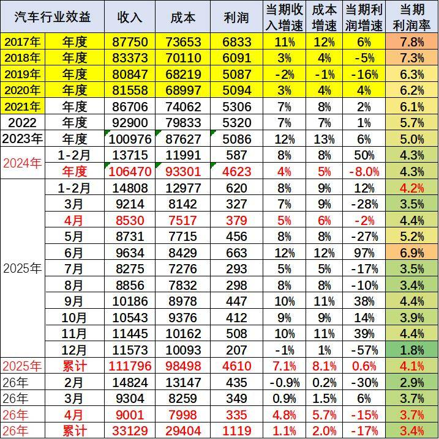

2026年1-4月汽车生产970万台，同比降5%。2026年1-4月的汽车行业收入33129亿元，同比增1.1%；成本29404亿元，增2%；利润1119亿元，同比降17%；汽车行业利润率3.4%，相对于下游工业企业利润率6.1%的平均水平，汽车行业仍偏低。

近期随着车市生产规模扩大，PPI上行，上游碳酸锂成本上升，锂电池出口价格持续下降，国内电池价格暴涨，车企不造电池的问题严重，车企利润可持续下滑。

结合前几年的利润率下行趋势看，近期汽车行业利润下滑幅度仍较大，由于政策加持下的新能源政策优势明显，由于不造电池，没有话语权，主流车企盈利压力仍将急剧增大。随着国家反内卷工作持续推进，对改善上游行业利润的促进效果逐步体现改善，下游压力持续较大。

附：近日信息合集
