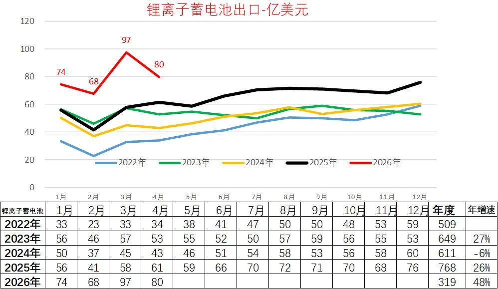
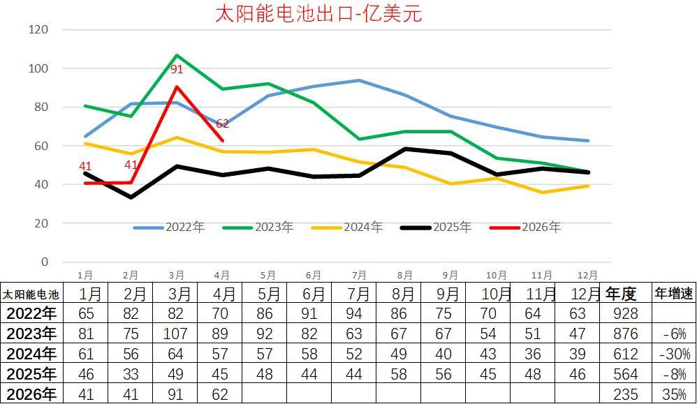
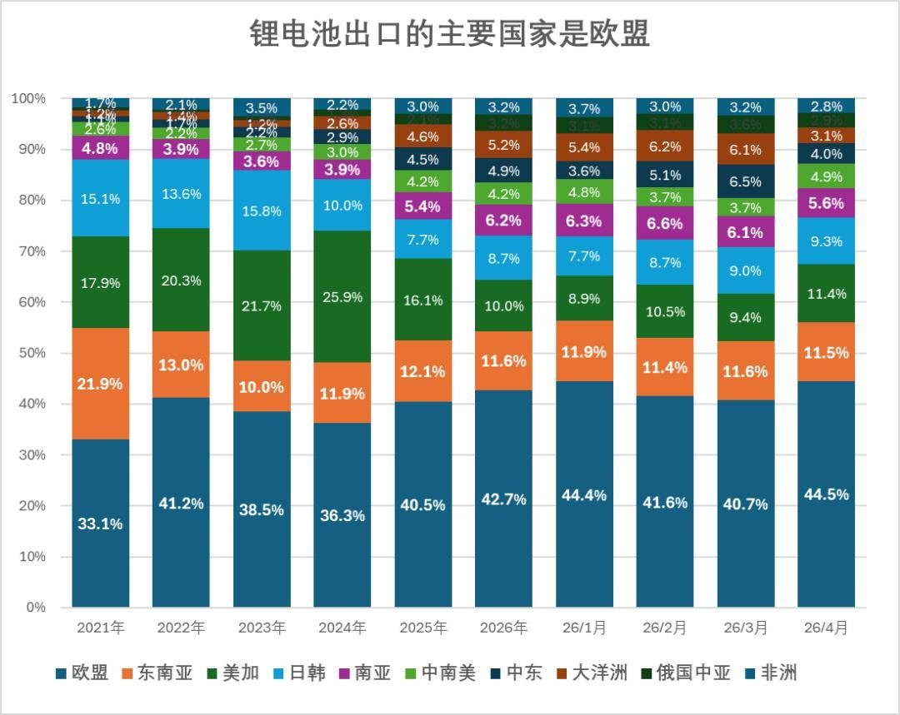
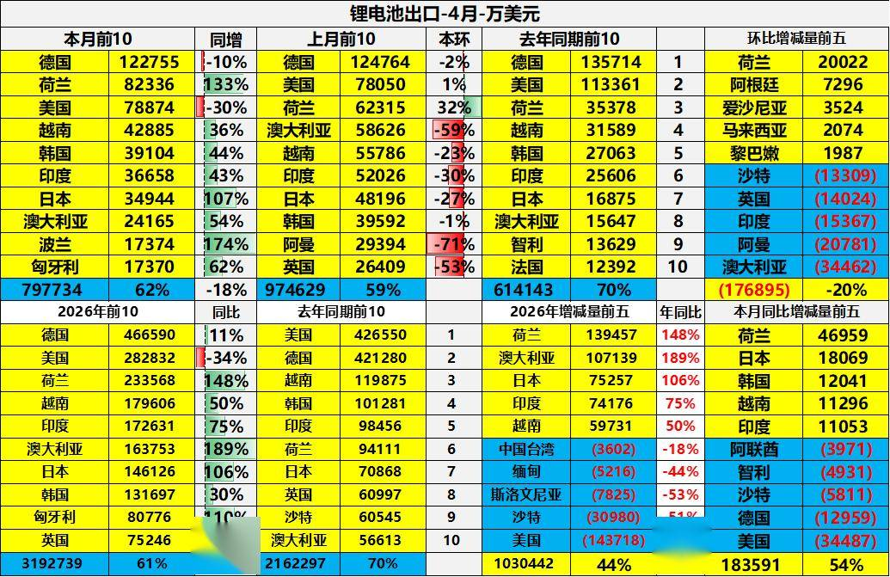
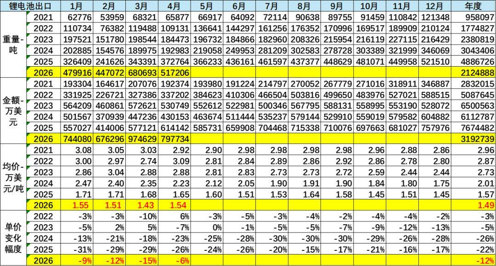
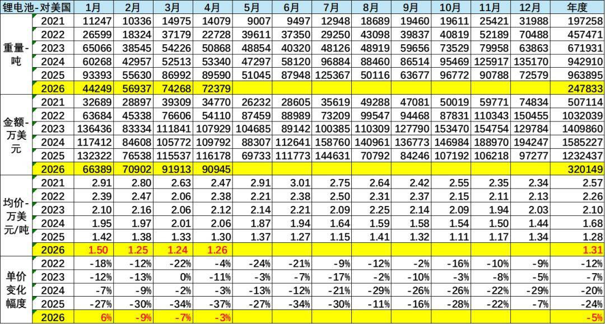
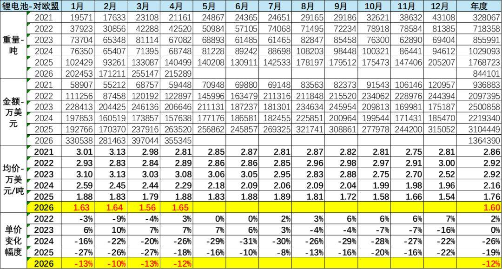

# 2026年4月锂电池出口单价1.54万美元/吨、降价6%；出口额80亿美元、增30%

- 公開日時: 2026-05-29 18:04（北京時間）
- 出典: [搜狐号・崔东树](https://www.sohu.com/a/1029483589_115312)
- テーマ（自動判定）: リチウム電池 輸出
- 画像: 7枚

---

注：本分析文章仅代表崔东树个人观点，如有异议，请留言。

2026年1-4月锂电池出口达到319亿美元，增48%。4月锂电池出口暴增到80亿美元，同比增长30%。中国锂电池出口的主要市场是欧盟，2026年欧盟的市场需求达到42.7%左右，2026年比2025年增长2个百分点。中国对美国锂电池的出口剧烈萎缩到10%，2026年比2025年下降6.1个百分点。对美国的下滑相当于第三位的出口东南亚的总规模。

近几个月的锂离子电池出口价格环比小幅上升，同比持续下降。2026年4月的锂电池出口52万吨，出口额达到80亿美元。从2023年的2.73万美元/吨、2024年的2.01万美元/吨降到2025年的1.57万美元/吨，又降到2026年的1.49万美元/吨，2026年仅下降12%，降幅明显较2024年的降26%和2025年的降22%，改善明显。2026年4月锂电池出口均价1.54万美元/吨，同比降6%，出口吨单价仍处历史谷底。

整体而言，2026年中国锂电池在国内新能源乘用车零售量同比降近20%的背景下，国内涨价国外降价，价跌量增的出口数量表现优秀，依托新兴市场拓展和核心市场深耕，有效应对了内部环境变化带来的挑战。

1、锂离子电池出口

锂电池作为新三样的重要优势产品，出口表现优秀，利润高、市场好。自2020年拜登上台以来，中国出口商品中应该说锂电池的出口表现相对较为优秀。在2021年出口仅有284亿美元，2022年出口509亿美元，2023年出口也达到了649亿美元的超高水平，但是到了2024年下滑6%，2025年的锂离子电池出口达到768亿美元。

2026年1-4月锂电池出口达到319亿美元，增48%；4月锂电池出口暴增到80亿美元，同比增长30%。

2、太阳能电池出口走势

太阳能电池作为新三样的重要优势产品，出口表现波动大，近两年下滑严重，行业内卷严重。太阳能电池应该说在俄乌危机爆发的背景之下，出现了爆发式增长的态势，2020年总体走势相对平稳，而2021年太阳能电池呈现了明显的上升态势，随后2022年太阳能电池又呈现了强势爆发增长态势，达到928亿美元，但2023年随着整体能源形势的相对稳定，太阳能电池的出口回落到876亿美元。2024年下降到612亿美元，2025年下降到564亿美元，降8%。

2026年1-4月太阳能电池出口达到235亿美元，增35%。4月太阳能电池出口暴增到62亿美元，同比增长38%。

3、锂电池出口的结构特征

中国锂电池出口的主要市场是欧盟，2026年欧盟的市场需求达到42.7%左右，2026年比2025年增长2个百分点。

中国对美国锂电池的出口剧烈萎缩到10%，2026年比2025年下降6.1个百分点。对美国的下滑相当于第三位的出口东南亚的总规模。

中国出口的结构主要去欧盟、东南亚和大洋洲、中东等地方。

4、锂电池的价格变化分析

近几个月的锂离子电池出口价格环比小幅上升，同比持续下降。2026年4月的锂电池出口52万吨，出口额达到80亿美元。从2023年的2.73万美元/吨、2024年的2.01万美元/吨降到2025年的1.57万美元/吨，又降到2026年的1.49万美元/吨，2026年仅下降12%，降幅明显较2024年的降26%和2025年的降22%，改善明显。但4月锂电池出口均价1.54万美元/吨，同比降6%，出口吨单价仍处历史谷底。

从出口单价看今年的下降幅度较大，近几个月的锂电池出口价格较2025年4季度明显改善，1月单价1.55万美元、同比下降9%，2月1.51万美元、同比下降12%，3月1.43万美元、同比下降15%，4月退税降低后的降价幅度较去年的降价6%的改善明显。

5、出口美国锂电池分析

2026年中国大陆对美国锂离子电池出口金额总体大幅下滑，4月吨单价降到1.26万美元/吨，同比降3%，但出口单价较2025年10-11月明显改善。我们主要看锂离子蓄电池，数量持续下降，体现了美国的AI带来的电力和储能的暴增，目前尚未与中国出口的锂电池相关。

6、出口欧盟锂电池分析

欧盟是中国锂电池最大出口市场，需求占比稳定在全球出口的43%左右，2026年占比较2025年提升2个百分点，市场地位持续巩固。2026年4月中国对欧盟出口额达35.5亿美元，21.5万吨，成为拉动出口增长的关键力量。

中国对欧盟出口的锂电池增长较快，从2024年222亿美元上升到2025年的310亿美元，增40%。2026年4月中国出口欧盟的电池均价1.65万美元/吨，降低12%，中国对欧盟的出口高增长弥补了对美国锂电池出口的下降。

附：近日信息合集
