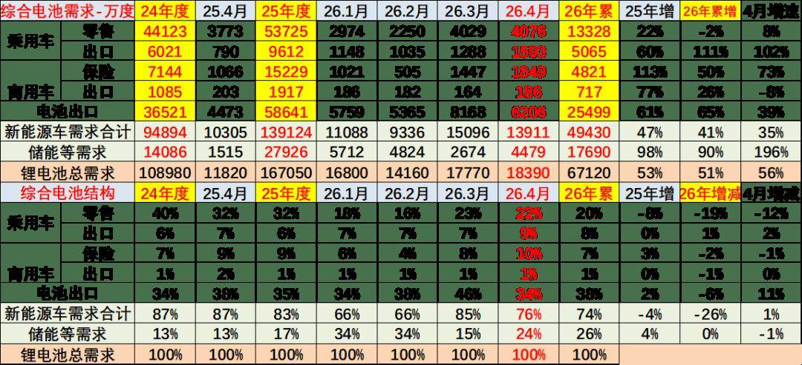
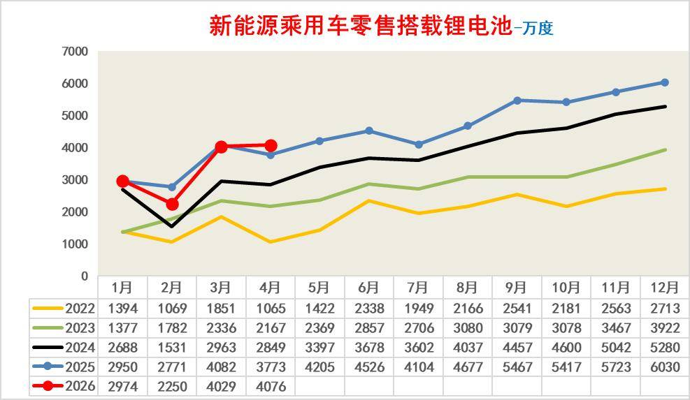
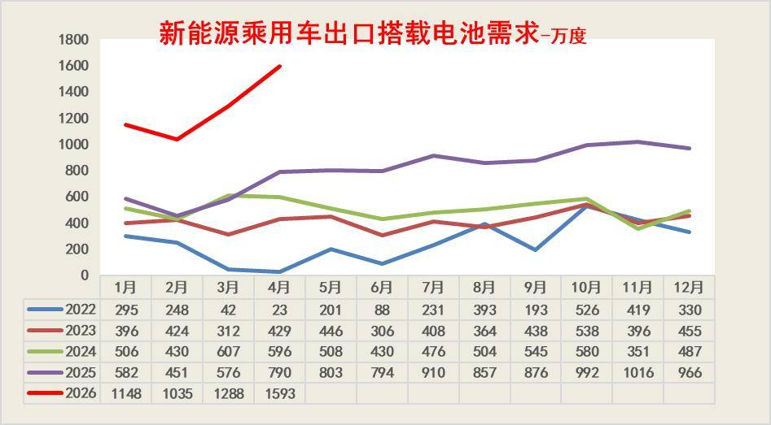
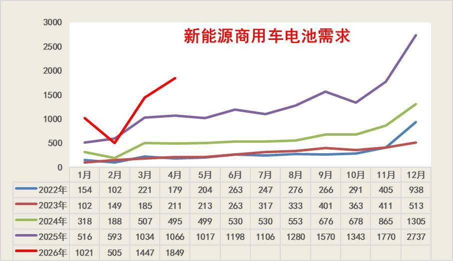
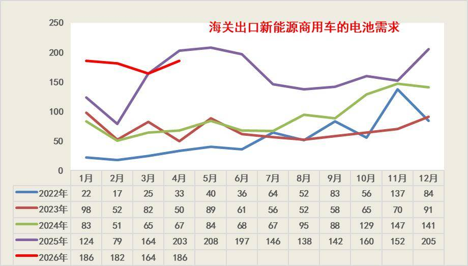
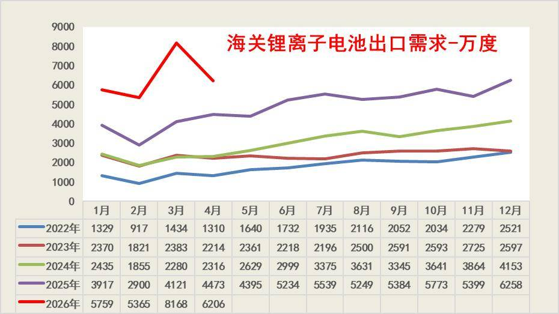
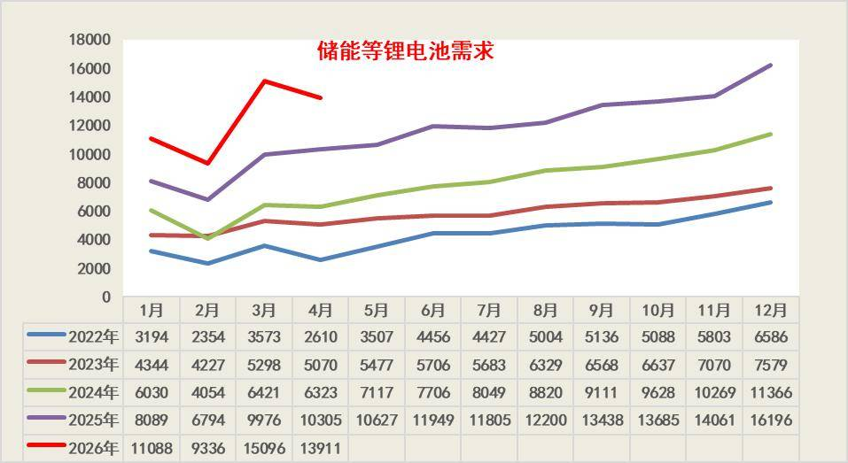

# 2026年4月锂电池总体需求分析

- 公開日時: 2026-05-31 12:08（北京時間）
- 出典: [搜狐号・崔东树](https://www.sohu.com/a/1030111893_115312)
- テーマ（自動判定）: 電池
- 画像: 7枚

---

2026年1-4月锂电池行业整体呈现“总量高增、结构剧变”的格局，全口径总需求达67120万度，同比大幅增长51%。行业增长动力已从传统新能源车单一驱动，转向储能与出口双轮驱动：新能源车相关需求合计49430万度，同比增长41%，增速较往年放缓；而储能等需求累计17690万度，同比大增90%，成为拉动行业增长的核心引擎，4月单月增速更是高达196%。从结构占比看，新能源车需求占比从2025年的83%降至74%，储能需求占比则从17%提升至26%，行业增长逻辑已发生根本性转变。

出口板块同样表现强劲，成为行业另一重要支撑：新能源乘用车出口搭载电池需求同比增长111%，4月单月增速达102%；海关锂离子电池出口累计同比增长65%，反映出海外市场对中国锂电池的需求持续爆发。国内市场中，商用车内销电池需求同比增长50%，增速远超乘用车零售；而乘用车零售需求同比下滑2%，进入存量竞争阶段。整体来看，出口与储能场景的爆发式增长，有效对冲了国内零售端的增速放缓，推动行业维持高位景气，锂电池企业的成长空间正向全球储能、海外汽车出口等多元化场景拓展。。

。

1、锂电池总体需求分析

2026年1-4 月锂电池行业呈现“总量高增、结构剧变”的格局，全口径总需求达67120 万度，同比增长51%。其中新能源车相关需求合计49430 万度，同比增长41%；储能等需求17690 万度，同比大增90%，成为拉动行业增长的核心引擎。国内乘用车零售需求同比下滑2%，但出口需求同比增长111%，电池出口需求同比增长65%，出口板块表现强劲，4月单月乘用车出口增速达102%，储能需求增速更是高达196%。

从结构占比看，新能源车需求占比从2025 年的83% 降至2026 年1-4 月的74%，而储能需求占比从17% 提升至26%，行业增长动力正从新能源车主导向储能与出口双轮驱动切换。国内零售端增速承压，反映出存量竞争加剧；出口与储能场景的爆发式增长，有效对冲了国内市场的放缓，锂电池企业的成长空间正向全球储能、海外汽车出口等多元化场景拓展，行业景气度的韧性显著增强。

。

2、新能源乘用车国内零售锂电池分析

2022-2026年新能源乘用车零售搭载锂电池需求（单位：万度）呈现持续增长态势，2026年1-4月数据表现亮眼：1月2974万度、2月2250万度、3月4029万度、4月4076万度，同比增速显著，延续了行业高景气度。国内新能源乘用车市场渗透率持续提升，带动零售端电池需求稳步攀升，为锂电池行业增长提供了坚实支撑。。

2022-2026年新能源乘用车零售端锂电池需求（单位：万度）整体保持高位运行，2026年1-4月累计需求13328万度，同比小幅下滑2%；其中4月单月需求4076万度，同比增长8%、环比增长79%，终端市场回暖带动电池需求修复。国内新能源乘用车市场进入存量竞争阶段，增速虽有放缓但规模仍处高位，为锂电池行业提供了稳定的基本盘支撑。

3、新能源乘用车出口用锂电池分析

2022-2026年新能源乘用车出口搭载电池需求（单位：万度）持续高增，2026年表现尤为亮眼。1-4月需求分别达1148、1035、1288、1593万度，同比大幅提升，显著高于往年同期。这反映出中国新能源乘用车海外市场份额快速扩张，出口销量持续放量，带动配套电池需求强劲增长，行业出口景气度正处于高位区间。。。

2023-2026年新能源乘用车出口搭载电池需求（单位：万度）呈现爆发式增长，2026年1-4月累计需求达5065万度，同比增速高达111%；其中4月单月需求1593万度，同比增长102%、环比增长24%，延续了强劲的增长态势。行业高景气背后，中国新能源乘用车海外市场份额持续扩张，出口销量快速放量，带动配套电池需求同步走高，全年增长确定性较强。

4、新能源商用车内销用锂电池分析

2022-2026年新能源商用车电池需求呈爆发式增长，2026年表现尤为亮眼：1-4月需求分别达1021、505、1447、1849万度，同比增速大幅提升，显著高于往年同期水平。行业高景气背后，国内新能源商用车市场放量与出口需求共振，带动配套电池需求持续走高，全年增长确定性较强。。

2023-2026年新能源商用车电池需求呈现爆发式增长，2026年1-4月累计需求达4821万度，同比增速高达50%；其中4月单月需求1849万度，同比增长73%、环比增长187%，延续了高景气态势。行业增长背后，国内市场放量与出口需求共振，带动配套电池需求持续走高，全年增长确定性较强。

5、新能源商用车出口用锂电池分析

2022-2026年海关出口新能源商用车的电池需求呈现持续高增长态势，出口规模逐年大幅提升。2026年1-4月需求数据亮眼，1月、4月均达到186万度，2月182万度、3月164万度，显著高于往年同期水平，反映出海外市场对中国新能源商用车的需求持续爆发，带动配套电池出口需求强劲增长。

这一增长背后，中国新能源商用车在海外市场的渗透率持续提升是核心驱动力，凭借技术成熟度与成本优势，在欧洲、东南亚等地区的订单快速放量。从历史趋势看，需求季节性波动特征明显，下半年通常为出口旺季，2026年一季度的高基数也为全年增长奠定了坚实基础，行业出口景气度有望延续。

2023-2026年出口新能源商用车的电池需求数据（单位：万度）显示，行业整体呈现高增长态势，出口规模持续扩张。2026年1-4月累计销量达717万度，同比增长26%；其中1-3月销量531万度，同比增长45%，尽管4月单月销量186万度，同比、环比略有下滑，但仍处于历史高位区间，整体增长动能依然强劲。

这一增长背后，中国新能源商用车在海外市场的竞争力持续提升是核心驱动力，凭借技术、成本优势，在欧洲、东南亚等地区的订单快速放量。从历史节奏看，下半年通常为出口传统旺季，随着海外项目交付高峰期到来，后续需求有望进一步释放，全年出口电池需求的增长确定性较强。

6、锂电池出口暴增

从2022-2026年海关锂离子电池出口数据来看，行业出口规模呈现持续高增长态势，2022年全年出口量在千度级别，2025年已突破6000万度，4年时间出口规模增长超2倍。2026年表现尤为亮眼，1-4月出口量同比增速显著，3月单月出口量达8168万度，创下历史同期新高，反映出海外市场对中国锂电池的需求持续爆发，出口动能强劲。

这一增长背后，全球储能、新能源汽车及消费电子市场的需求扩张是核心驱动力，中国锂电池凭借技术与成本优势，在全球市场的份额持续提升。从季节性规律看，每年2月受春节假期影响出口量短暂回落，3月快速反弹，下半年通常为出口旺季。2026年的高增速也预示着，锂电池出口行业仍处于景气上行周期，海外市场需求的持续释放将为行业增长提供稳定支撑。。

2023-2026年海关锂离子电池出口数据显示，行业出口规模持续高速增长，景气度显著上行。2026年1-4月累计出口量达25499万度，同比增速高达65%；其中1-3月出口19292万度，同比增长76%，4月单月出口6206万度，同比增长39%、环比增长52%，出口动能强劲，延续了此前的高增长态势。

这一增长背后，全球储能、新能源汽车及消费电子市场的旺盛需求是核心驱动力，中国锂电池凭借技术与成本优势，在全球市场的份额持续扩大。从历史节奏看，5-12月通常为出口传统旺季，若后续延续当前增速，2026年全年出口量有望再创历史新高，行业出口增长的确定性较强。。

7、储能需求暴增

从2022-2026年储能锂电池月度需求数据来看，行业呈现持续高增长态势，需求规模四年内增长超2倍，复合增速强劲。每年2月受春节假期影响为传统淡季，需求触底后3月快速反弹，下半年尤其是四季度因项目集中交付成为全年高峰。2026年表现尤为亮眼，1-4月需求同比增速超35%，3月单月需求突破15000，远超往年同期水平，反映出储能及下游电动场景的爆发式增长动能。

这一增长背后，储能行业的快速扩张是核心驱动力，全球新能源装机配套的大储、户储项目持续放量，共同支撑需求上行。同时，行业“年初招标排产、年末集中交付”的节奏，决定了季节性波动特征。2026年需求的高增速，也预示着锂电池行业仍处于景气上行周期，市场规模有望持续扩大。

从2023-2026年储能锂电池需求数据看，行业已从低位修复转向持续高景气上行。2026年增长动能尤为强劲，1-4月累计销量达17690万度，同比增速高达90%；其中4月单月销量4479万度，同比增长196%、环比增长68%，反映出下游项目交付节奏加快，行业旺季提前启动。这一增长既受益于储能场景的持续放量，也体现了行业订单前置、需求前置的新特征。

这一增长背后，全球新能源配套储能项目、户储市场需求的持续扩容是核心驱动力，叠加电动工具、两轮车等小动力场景电动化率提升，共同支撑行业需求扩张。从历史节奏看，5-12月通常为储能需求传统旺季，若后续延续当前增速，2026年全年销量有望再创历史新高，行业增长确定性较强，景气上行态势明确。
