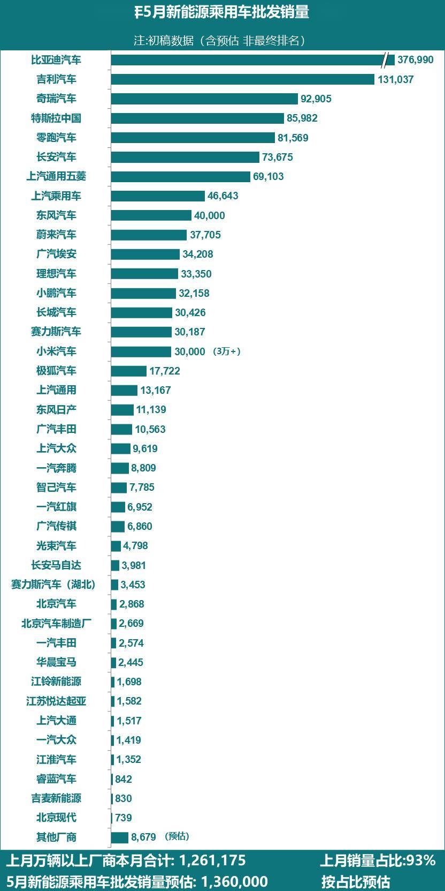

# 【新能源】2026年5月新能源乘用车厂商批发销量快讯

- 公開日時: 2026-06-02 19:30（北京時間）
- 出典: [搜狐号・崔东树](https://www.sohu.com/a/1031221999_115312)
- テーマ（自動判定）: 乗用車市場
- 画像: 1枚

---

本文全文共865字，阅读全文约需2分钟

5月新能源乘用车市场预判

2026年5月，国内车企新能源乘用车预估批售量达136万辆，同比、环比均上涨超11%，实现同环比双位数增长，新能源板块复苏态势初步显现。受霍尔木兹海峡通航受阻影响，国内成品油零售价迎来两轮上调，累计上调幅度接近400元/吨，燃油用车成本显著抬升，压制传统燃油车消费需求，车市大盘整体承压偏弱，新能源车成为市场的核心增长亮点。

本轮新能源车产销双向走强由多重因素共同助推：其一，油价高位运行倒逼国内消费需求由燃油车向新能源切换，叠加车企优化排产、改善供货效率，推动5月新能源批售环比涨幅升至7%；其二，端午假期落在6月，5月整车生产工作日充足，保障车企产能释放；其三，国际高油价带动海外新能源购车需求爆发，自主品牌新能源车凭借低能耗的技术优势与突出性价比，在海外市场相较燃油车竞争力突出，出口规模稳步扩容，进一步托举国内新能源产销。

受益于头部车企电动化技术迭代与多款重磅新品集中上市，5 月多家主流车企新能源批发销量刷新同期历史纪录，印证国内车企电动化转型成效凸显。比亚迪汽车、奇瑞汽车、特斯拉中国、零跑汽车、上汽通用五菱、上汽乘用车、蔚来汽车、极狐汽车、上汽通用、东风日产、广汽丰田、智己汽车、长安马自达、广汽传祺、北京汽车制造厂、上汽大通、北京现代等车企，本月新能源批售量悉数创下历年5月最佳成绩。

全国乘用车市场2026年4月新能源批发销量万辆以上厂商，5月合计占总体新能源乘用车当月销量的93%。根据6月初步汇总数据，这些4月新能源销量万辆以上厂商企业的5月销量为126万辆。目前大部分厂商销量基本都已经锁定大数，因此按照4月结构占比结合5月数据，测算5月的全国新能源乘用车批发销量为136万辆。

综上，根据月度初步乘联数据综合：2026年5月全国乘用车厂商新能源批发预估136万辆，同比增长12%，环比增长11%。

注：由于乘联快报数据可能与厂商终稿数据有差异，因此对此版的具体厂商数据不要与历史终稿数据直接对比，以防误导。

5月乘用车主力厂商新能源批发销量快报

