# 车市扫描-2026年20期（5月25日-5月31日）

- 公開日時: 2026-06-03 17:54（北京時間）
- 出典: [搜狐号・崔东树](https://www.sohu.com/a/1031715481_115312)
- テーマ（自動判定）: 車市スキャン（週次）
- 画像: 16枚

---

主要信息源自乘联分会每日新闻等

中国汽车流通协会

乘用车市场信息联席分会（乘联分会）

网站：http://www.cpcaauto.com

一、本周车市概述1.2026年5月全国乘用车市场零售开局较强后逐步回落

【2026年5月1-31日乘联会市场分析要闻】

5月1-31日全国乘用车厂家批发223.2万辆，同比去年同期下降4%，较上月同期增长6%；今年以来累计批发1020.9万辆，同比去年同期下降6%。5月1-31日市场零售154.5万辆，同比去年同期下降20%，较上月同期增长12%；今年以来累计零售715万辆，同比去年同期下降19%。

5月1-31日全国乘用车厂家新能源批发136.5万辆，同比去年同期增长12%，较上月同期增长11%；今年以来累计批发531.8万辆，同比去年同期增长2%。5月1-31日新能源车市场零售97.4万辆，同比去年同期下降5%，较上月同期增长15%；今年以来累计零售373.2万辆，同比去年同期下降14%。

2026年5月1-31日全国新能源市场零售渗透率63%；新能源厂家批发渗透率61.1%。

5月第1-5周全国纯燃料轻型车生产53.5万辆，同比去年同期下降45%，较上月同期下降20%。5月第1-5周混合动力与插混总体生产37.9万辆，同比去年同期下降17%，较上月同期增长11%。

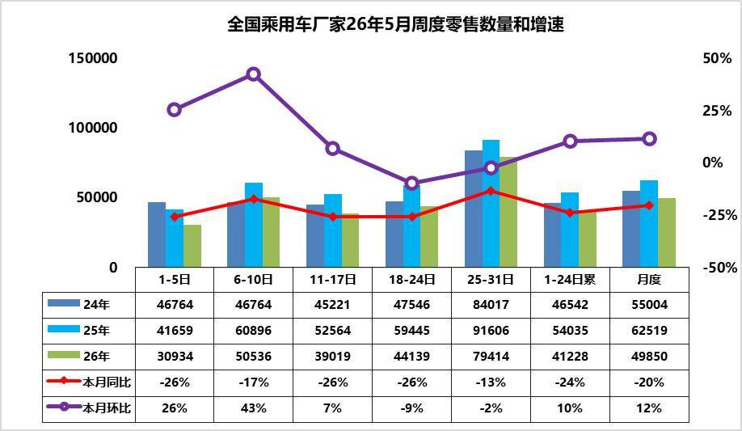

5月第1周乘用车市场日均零售3.1万辆，同比去年同期下降26%，较上月同期增26%。

5月第2周乘用车市场日均零售5.1万辆，同比去年同期下降17%，较上月同期增43%。

5月第3周乘用车市场日均零售3.9万辆，同比去年同期下降26%，较上月同期增7%。

5月第4周乘用车市场日均零售4.4万辆，同比去年同期下降26%，较上月同期降9%。

5月第5周乘用车市场日均零售7.9万辆，同比去年同期下降13%，较上月同期降2%。

5月1-31日市场零售154.5万辆，同比去年下同期降20%，较上月同期增长12%；今年以来累计零售715万辆，同比去年同期下降19%。

‘ ’五一”期间，各车企积极推行新车上市权益以及终端促销，车市热度有效提升；2026 年5 月上旬乘用车零售呈现 “五一节日旺销后逐步回落” 的周度节奏，1-5 日受假期影响零售量处于低位，6-10 日的节日订单集中释放形成峰值。但随着节后限时补贴陆续到期，客流自然回落，市场呈现典型的“前高后低”走势。

从同比来看，前四周零售量均低于2025 年同期，市场整体仍面临需求不足的压力。由于去年同期乘用车政策补贴带来的高基数效应，同比表现偏弱符合预期。

2026 年3 月以来国内汽油先后五次调价，3 月9 日24 时每吨上调695 元，3 月23 日24 时每吨上调1160 元，4 月7 日24 时每吨上调420 元，4 月21 日24 时每吨下调555 元，5 月8 日24 时每吨上调320 元，5月21日24时上调75元，综合统计累计每吨上涨2115 元，折合每升共计上涨1.7元左右。由此高油价对车市的冲击巨大，高油价的燃油车销量损失短期内是无法依靠新能源弥补的。对比4月卡车市场同比相对零售旺销的局面，卡车更新补贴力度与去年一致未缩水的稳增长效果明显，而乘用车补贴剧烈下降的差异化影响较明显。

展望后续，随着5 月下旬车企加大促销力度、冲量窗口开启，零售量有望再次回升，月度同比跌幅大概率较上旬有所收窄；同时市场分化态势将延续，新能源与低价入门车型的表现仍将优于传统燃油车及中高端合资品牌。短期来看，政策红利释放、渠道库存消化仍是影响市场走势的关键变量，需持续关注后续周度零售表现及终端优惠变化。

2.2026年5月全国乘用车厂家销量平稳

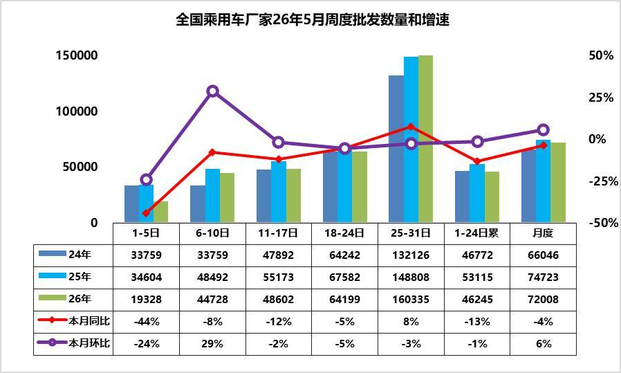

5月第1周批发日均1.9万台，同比去年5月同期下降44%，环比上月同期下降24%。

5月第2周批发日均4.5万台，同比去年5月同期下降8%，环比上月同期增29%。

5月第3周批发日均4.9万台，同比去年5月同期下降12%，环比上月同期下降2%。

5月第4周批发日均6.4万台，同比去年5月同期下降5%，环比上月同期下降5%。

5月第5周批发日均16.0万台，同比去年5月同期增长8%，环比上月同期下降3%。

5月1-31日全国乘用车厂家批发223.2万辆，同比去年同期下降4%，较上月同期增长6%；今年以来累计批发1020.9万辆，同比去年同期下降6%。

近期乘用车零售持续相对偏弱，各环节的运行压力都在加大，产销节奏需要放缓。油价高位运行、供应链涨价、反内卷持续进行，从同比上对5 月份不利，但从环比上这些因素已经在4 月份存在，且4 月份下降较大，5 月份环比相对企稳。从生产进度看，燃油车的生产剧烈萎缩45%，混合动力表现较好，新能源车性价比更高。由于市场的持续下行压力，经销商库存压力更大，需要有效的化解经销商的生存压力。

3.2026年1-4月汽车行业利润率3.4%、收入增1%、成本增2%、利润降17%

2026年1-4月，面对国际环境复杂演变和国内转型压力等多重挑战，国民经济开局良好、质效提升，装备制造业和高技术制造业利润快速增长，原材料制造业利润两位数增长，为全年经济平稳运行奠定坚实基础。2026年1-4月汽车生产970万台，同比降5%。2026年1-4月的汽车行业收入33129亿元，同比增1.1%；成本29404亿元，增2%；利润1119亿元，同比降17%。

2026年1-4月行业销售利润率进一步降至3.4%，4月3.7%，好于1-3月3.2%的表现，但仍处于历史低位，盈利下行压力持续凸显。近期随着车市生产规模扩大，PPI上行，上游有色和石油等矿业利润暴涨，锂电池出口吨单价持续大幅下降，国内电池价格暴涨，车企不造电池的问题严重，车企利润可持续下滑。

2026年各地大力度推动“两新”政策落地实施，逐步有效释放内需活力。但汽车行业效益改善明显落后其它消费品。随着国家反内卷工作持续推进，汽车行业的上游挤压严重，油价暴涨，终端用户购车观望心态严重，车企运行压力持续加大。

4.2026年4月锂电池总体需求分析

2026年1-4月锂电池行业整体呈现“总量高增、结构剧变”的格局，全口径总需求达67120万度，同比大幅增长51%。行业增长动力已从传统新能源车单一驱动，转向储能与出口双轮驱动：新能源车相关需求合计49430万度，同比增长41%，增速较往年放缓；而储能等需求累计17690万度，同比大增90%，成为拉动行业增长的核心引擎，4月单月增速更是高达196%。从结构占比看，新能源车需求占比从2025年的83%降至74%，储能需求占比则从17%提升至26%，行业增长逻辑已发生根本性转变。

出口板块同样表现强劲，成为行业另一重要支撑：新能源乘用车出口搭载电池需求同比增长111%，4月单月增速达102%；海关锂离子电池出口累计同比增长65%，反映出海外市场对中国锂电池的需求持续爆发。国内市场中，商用车内销电池需求同比增长50%，增速远超乘用车零售；而乘用车零售需求同比下滑2%，进入存量竞争阶段。整体来看，出口与储能场景的爆发式增长，有效对冲了国内零售端的增速放缓，推动行业维持高位景气，锂电池企业的成长空间正向全球储能、海外汽车出口等多元化场景拓展。

5.2026年1-4月中国占世界汽车份额31%

2025年全球汽车销量9689万台，同比增长6%。2026年4月的世界汽车销量达到799万台，同比增4%。2026年1-4月世界汽车销量达到3096万台，同比增1%。随着美国、中国车市的年初相对负增长，2026年1-4月世界车市销量增长不强。2025年中国达到世界汽车的35.4%的份额；2026年初的中国份额30.9%，年初较低是春节因素的异常体现。随着政策刺激效果逐步恢复显现，下半年开始中国车市预计逐步走强。

2026年1-4月的全球汽车销量增1%，其中中国汽车销量下降5%，美国销量下降6%，印度汽车市场销量增15%，泰国汽车市场增17%，俄罗斯市场销量增6%，德国的新能源补贴重启，拉动市场表现较好。

东升西降，除了丰田、现代起亚、铃木和塔塔等，其它国际品牌份额2026年出现较大幅下滑。相对于2019年的中国自主品牌全面提升世界份额。吉利、比亚迪、奇瑞、上汽、长安等自主表现较强。电动化发展也导致部分国际车企逐步走向衰落。除了铃木等印度市场较好的因素促进，其它国际品牌份额出现全面较大的下滑。

6.2026年1-4月世界新能源车分析

2026年1-4月世界汽车销量达到3096万台，新能源汽车达到665万台。2026年1-4月的新能源车份额达到21.4%，其中纯电动车的占比达到14.7%，插电混动达到6.7%的汽车比例，2026年1-4月普通混合动力达到7.9%超过插混成为增长亮点。

2026年1-4月中国新能源乘用车世界份额达到61%的水平。2026年中国在世界纯电动车市场份额56%份额，2026年中国在世界插电混动份额达到71%的高水平。

由于欧洲新能源走势大幅回暖，因此1-4月中国之外的其它国家新能源销量合计263万台、增速达到23%，接近于前两年平均水平。

由于自主新能源出口表现较好，而美国变化大，因此自主新能源乘用车海外市场销量份额提升较大。2025年自主新能源乘用车海外市场销量份额达到15.8%，提升较大。2026年自主新能源乘用车海外市场销量份额达到23%，进一步大幅跃升。

二、本周上市新车1.新款比亚迪海狮06 DM-i上市

5月26日，新款比亚迪海狮06 DM-i上市，新车共推4款，售价区间为12.99万-15.99万元。外观与老款车型基本保持一致。配备云辇-C、四音区语音交互、哨兵模式等，可选装天神之眼B。搭载1.5L插混动力，CLTC纯电续航提升至205km和310km。

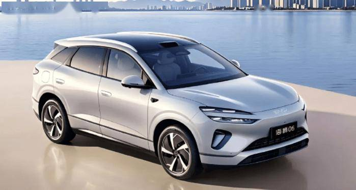

2.比亚迪宋Ultra DM-i上市12.99万-15.99万元

5月28日，比亚迪宋Ultra DM-i上市，新车共推5款，售价区间为12.99万-15.99万元。新车延续纯电动版车型的设计。采用15.6英寸自适应旋转中控屏+10.25英寸液晶仪表+26英寸W-HUD。首搭迪迪虾超级智能体，天神之眼C可选装升级为天神之眼B。新车搭载1.5L插混动力，CLTC纯电续航里程分别为205km和310km。

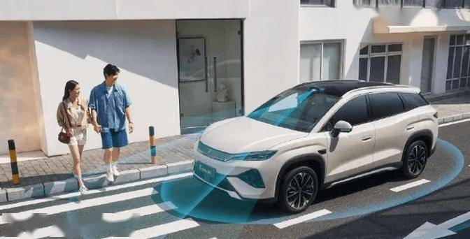

3.蔚来ES9上市电池租用方案39万-52万元

5月27日，蔚来ES9上市，新车共推3款，整车购买价格49.8万-62.8万元，电池租用方案39万-52万元。新车采用HDPL智能高清投影大灯、翼子板智行光帆、23英寸锻造轮圈。内饰采用48英寸5K天际线、15.6英寸中控屏、后排16英寸行政屏*2、枫影真木+主题刺绣。配备神玑NX9031芯片、零重力行政座椅、阵列式LC智能隐私调光车窗、47个扬声器等。新车900V高压平台+全主动悬架，CLTC纯电续航为600km、620km。

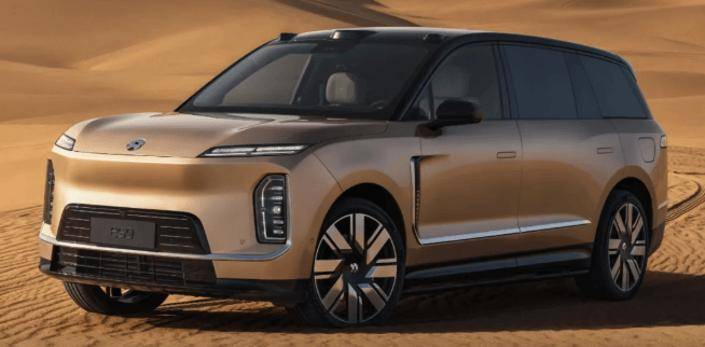

4.极狐问道V9上市限时优惠价19.48万-24.98万元

5月27日，极狐问道V9上市，新车共推4款，售价区间为21.48万-26.98万元，限时优惠价19.48万-24.98万元。新车采用星芒直瀑式进气格栅、贯穿式LED脉冲大灯、传统门把手、侧滑门。采用8.8英寸液晶仪表、悬浮式15.6英寸中控屏、后排21.4英寸娱乐屏。配备磁流变灵韵底盘、高通骁龙8775舱驾一体芯片、独立零重力航空座椅等。搭载1.5T增程动力，CLTC纯电续航里程分别为216km、310km。

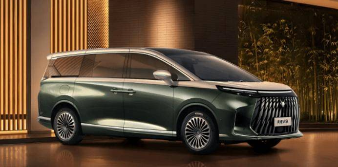

5.新款问界M9上市售价47.98-65.98万元

5月27日，新款问界M9上市，新车共推8款，售价47.98-65.98万元。新车采用全新一代百万像素全彩智慧投影大灯，支持彩色图像投射。采用10.25英寸仪表、双17.2英寸3.4K大屏、32英寸升降式投影巨幕。配备可调光玻璃、零重力座椅、车载氧吧、6激光雷达、后轮转向等。普通增程版CLTC纯电续航340km，422km，纯电版CLTC纯电续航为715km，750km；Ultimate领世加长增程版CLTC纯电续航378km，纯电版CLTC续航里程700km。

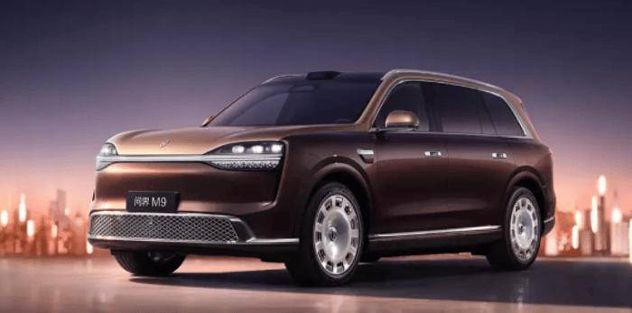

6.MG 4X上市权益价9.28万-10.98万元

5月27日，MG 4X上市，新车共推4款，售价区间为9.98万-11.68万元，权益价9.28万-10.98万元。新车延续MG4家族设计语言。采用10.25英寸全液晶仪表、15.6英寸悬浮式中控屏。配备豆包大模型、四音区语音交互、256色氛围灯、女王副驾等。新车CLTC纯电续航分别为510km和610km。

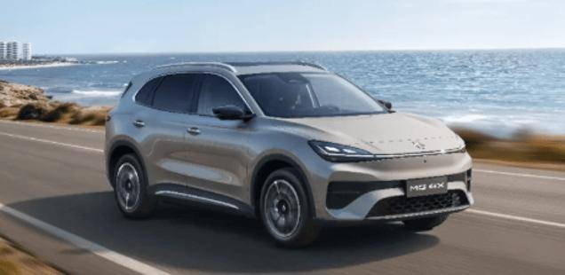

7.新款吉利星愿上市限时售价6.18万-9.18万元

5月28日，新款吉利星愿上市，新车共推6款，售价区间为6.48万-9.48万元，限时售价6.18万-9.18万元。外观与老款车型基本保持一致。采用8.8英寸仪表、14.6英寸中控屏。配备Flyme Auto 2.0、千里浩瀚H3、哨兵模式、全天候防滑防甩尾系统等。新车CLTC纯电续航里程分别为310km、410km、480km。

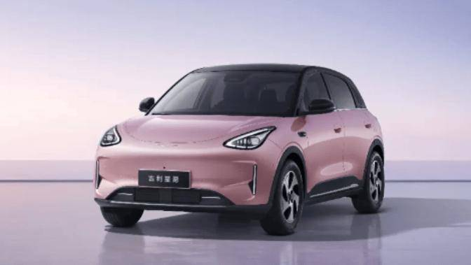

8.沃尔沃ES90上市售价38.99万-45.99万元

5月29日，沃尔沃ES90上市，新车共推2款，售价38.99万-45.99万元。新车采用“Shield”盾形结构前脸、雷神之锤130万高清像素大灯、27L前备厢。采用9英寸全液晶仪表盘、13.2英寸HUD、14.5英寸纵置悬浮式中控屏。配备高通骁龙8155芯片、Orin芯片、25扬声器宝华韦健杜比音响等。新车升级为800V架构，CLTC纯电续航分别为777km和848km。

5月29日，沃尔沃EX90上市，新车共推2款，售价45.99万-52.99万元。新车采用“Shield”盾形结构前脸、雷神之锤130万高清像素大灯、46L前备厢。采用9英寸全液晶仪表盘、13.2英寸HUD、14.5英寸纵置悬浮式中控屏。配备高通骁龙8155芯片、Orin芯片、25扬声器宝华韦健杜比音响等。新车升级为800V架构，CLTC纯电续航分别为756km和737km。

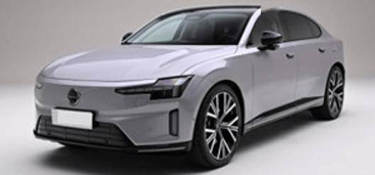

9.奥迪E7X上市售价26.98万-35.98万元

5月29日，奥迪E7X上市，新车共推5款，售价26.98万-35.98万元。新车采用星钻光幕、DLP数字投影大灯、悬浮轮毂盖。内饰采用27英寸贯穿式中控屏+12.3英寸仪表、21.4英寸QD-MiniLED吸顶屏。配备奥迪助手2.0、可调光全景天幕、Momenta智驾、渐进式转向、后轮转向等。搭载纯电动力，CLTC续航里程为751km、705km、691km、660km、635km。

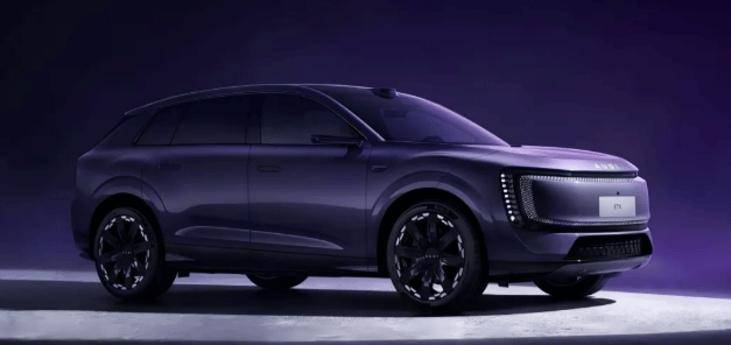

10.大众途观L ePro上市一口价19.19万-20.79万元

5月29日，大众途观L ePro上市，新车共推2款，限时一口价19.19万-20.79万元。新车采用贯穿式LED灯带+发光LOGO。内饰采用15英寸中控屏+10.3英寸液晶仪表+11.6英寸副驾娱乐屏。搭载1.5T插混系统，CLTC纯电续航里程为143km。

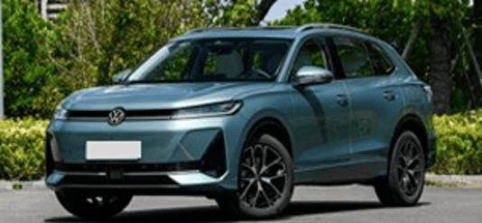

11.大众帕萨特ePro上市一口价16.99万-20.39万元

5月29日，大众帕萨特ePro上市，新车共推3款，限时一口价16.99万-20.39万元。新车采用贯穿式LED灯带+发光LOGO。内饰采用15英寸中控屏+10.3英寸液晶仪表+11.6英寸副驾娱乐屏。搭载1.5T插混系统，CLTC纯电续航里程为157km。

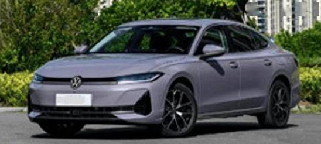

12.领克10限时价16.99-19.19万元与领克10+上市上市限时价21.99-23.59万元

5月30日，领克10与领克10+上市，领克10推3款车型，上市限时价16.99-19.19万元；领克10+推2款车型，上市限时价21.99-23.59万元。新车采用锋刃棱纹前格栅、隐藏式主动进气格栅、66L前备厢、主动升降隐藏式后扰流板。采用12.7英寸高清液晶仪表、25.6英寸AR-HUD、15.4英寸高色域中控屏。配备骁龙8295芯片、Flyme Auto 2系统，23个扬声器、5.7L冷暖一体箱等。领克10搭载单电机，CLTC续航为701km，816km；10+搭载双电机，CLTC续航为536km。

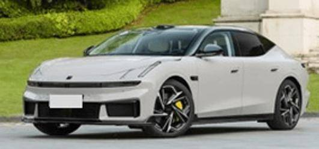

13.新款吉利牛仔上市限时权益价7.59万-8.49万元

5月30日，新款吉利牛仔上市，新车共推3款，售价区间为8.19万-9.09万元，限时权益价7.59万-8.49万元。新车整体基本延续了现有的设计风格。采用14.6英寸中控屏（内置FlymeAuto车机）、8.8英寸液晶仪表。搭载1.5T发动机，匹配7DCT变速箱。

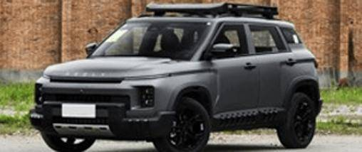

三、宏观经济与政策1.工信部发布《2026年汽车标准化工作要点》

5月26日，工信部发布《2026年汽车标准化工作要点》。其中包括，健全完善并落实智能网联汽车、汽车芯片、新能源汽车、汽车低碳发展等重点领域标准体系，重点开展汽车质量可靠性、车用固态电池标准体系研究，更新和完善数据治理及应用、汽车人工智能等标准子体系，前瞻布局前沿领域标准研究。

2.工信部：规范废旧动力电池回收利用秩序

5月28日，全国新能源汽车动力电池回收利用工作专班召集人、工业和信息化部党组书记、部长李乐成主持召开专班第二次会议。要加快建立应对动力电池规模化退役的长效机制。深入开展规范废旧动力电池回收利用联合执法专项行动，依法依规查处违规交售废旧动力电池、使用废旧动力电池生产不合格产品、不履行信息溯源责任、非法拆解污染环境、无照经营等行为，强化警示震慑作用，规范废旧动力电池回收利用秩序。

3.市场监管总局批准长安汽车与江铃集团收购江铃控股

5月25日，国家市场监管总局发布2026年5月11日-5月17日无条件批准经营者集中案件列表，其中包括重庆长安汽车股份有限公司与江铃汽车集团有限公司收购江铃控股有限公司股权案。交易后，长安汽车和江铃集团分别持有江铃控股50%的股权，共同控制江铃控股。

4.统计局：2026年1-4月份全国规模以上工业企业利润增长18.2%

5月27日，统计局发布数据显示，1-4月份，规模以上工业企业实现营业收入44.89万亿元，同比增长5.2%。1-4月份，全国规模以上工业企业实现利润总额24,358.4亿元，同比增长18.2%；4月份，规模以上工业企业利润同比增长24.7%。

5.统计局：5月份制造业PMI为50.0%

5月31日，统计局发布数据显示，5月份，制造业PMI为50.0%，比上月下降0.3个百分点。标普全球发布中国5月RatingDog制造业PMI录得51.8，较4月回落0.4个百分点。

6.深圳“十五五”规划纲要：打造新一代世界一流汽车城

5月26日，《深圳市国民经济和社会发展第十五个五年规划纲要》发布，全力巩固提升新一代电子信息、新能源汽车、新能源等优势产业全球竞争力。做大新能源汽车“深圳造”规模、提升“含深度”，加快“车路云一体化”应用试点，打造新一代世界一流汽车城，全谱系发展新能源智能交通载具。推动数字电网、大功率充放电设施等新能源产业在全球市场抢占先机。

四、企业信息1.比亚迪发布4nm智驾芯片“璇玑A3”

5月28日晚，比亚迪在智能化战略发布会上发布中国首款4nm制程智驾芯片“璇玑A3” ，已开启规模化量产，支持L3、L4级自动驾驶，三颗芯片总算力超2100TOPS。

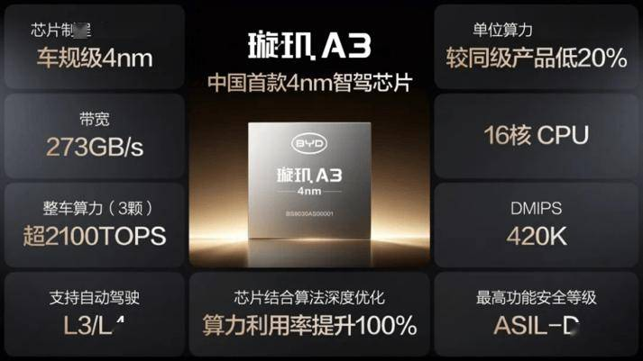

2.保时捷融资租赁公司增资至10亿

近日，保时捷融资租赁有限公司发生工商变更，注册资本由约8.2亿人民币增至10亿人民币，增幅约23%。

3.长城汽车推送坦克400首次OTA升级

5月28日，长城汽车推送了坦克400的首次OTA升级，此次升级进行19项功能优化，并新增“车位到车位”的辅助驾驶功能。坦克官方将此次驾驶辅助系统升级概括为“1次拨杆，2个车位，4次抬杆”。车主仅需一次操作，即可同时全域激活NOA与ETC协同功能，设定从出发地到目的地的点对点行程。

4.东风汽车与欣旺达联合打造，东昱欣晟120Ah超充电芯正式投产

5月25日，东风汽车与欣旺达动力电池战略合作的又一重大成果——东昱欣晟120Ah超充电芯投产活动在湖北宜昌举行。

5.大众全域AI智能体预计下半年上车

5月27日，大众汽车集团（中国）董事长兼首席执行官贝瑞德表示，日前发布的 “全域智能体AI（Agentic AI for All）” ，计划从2026 年下半年起，在基于CEA架构的新车型上全面搭载。2027年，大众将推出新一代CEA 2.0架构，智能化能力再升级。

6.广汽正式进军巴基斯坦市场

近日，广汽集团携手合作伙伴Lucky Motor Corporation在巴基斯坦卡拉奇举行品牌暨车型上市发布会，正式宣布进军巴基斯坦市场，同步发布“巴基斯坦行动”长期主义战略。此次上市，广汽一次性推出四款主力车型，覆盖不同细分市场：HYPTEC HT、AION V、AION UT、AION ES，分别定位高端旗舰、家庭出行、年轻潮流及实用轿车。

7.广汽高域工厂GOVY AirCab首机下线

近日，广汽集团孵化的低空出行科技品牌高域，其工厂正式落成，首台飞行汽车GOVY AirCab下线。该工厂智能制造产线正式投产运营，设计年产能达100台，搭建起零部件配套、整机装配、性能检测、成品交付的全流程智能制造体系。

8.吉利加速布局摩洛哥

近日，吉利汽车在摩洛哥卡萨布兰卡举办新能源产品发布活动，正式宣布进军摩洛哥市场。活动聚焦两款核心车型：Geely EX2与Geely EX5 EM-i。其中，Geely EX2定位紧凑型纯电都市车，适配摩洛哥城市通勤与短途出行场景；Geely EX5 EM-i则为插电混动SUV，搭载新一代EM-i混动技术，纯电续航可达112公里。

9.江汽集团与华为发布迈思特CV质检大模型

江汽集团与华为联合发布“迈思特”CV质检大模型。该模型在尊界超级工厂将整车缺陷拦截率提升至99.99%，新场景模型开发周期缩短95%以上。

10.江汽集团正式登陆摩洛哥

江汽集团于摩洛哥首都卡萨布兰卡举行品牌上市发布仪式。共发布8款重磅车型，产品矩阵全面覆盖乘用、商用及新能源领域。

11.江淮汽车塔什干合资工厂正式落成开业

近日，由江淮汽车与塔什干投资公司共同投资建设并运营的江淮汽车塔什干合资工厂，在乌兹别克斯坦塔什干Yangi Avlod工业园正式落成开业。

12.理想汽车预计第二季度营收241亿-254亿元

5月28日，理想汽车发布2026年第一季度财报。季度营收230亿元，季末现金储备943亿元。一季度交付95142辆，同比增长2.5%。理想汽车预计第二季度营收241亿元至254亿元，预计第二季度交付量95000至100000辆。

13.理想汽车再次改革基座模型组织架构

理想汽车基座模型部门完成新一轮组织调整，新增3个具身智能相关二级部门，分别为具身工程、具身交互、具身行为；同时自动驾驶变成独立二级部门。

14.领克900推送LYNK Flyme Auto 2.3.0 OTA升级

近日，领克900开始推送LYNK Flyme Auto 2.3.0版本OTA升级。此次更新涵盖语音助手、驾驶辅助、音响系统、能量管理、智能车控及导航地图等功能优化。语音助手新增用车场景构建功能，驾驶辅助方面，系统提升了复杂车位场景下的泊车能力，并新增全姿态泊车功能。

15.岚图汽车在成都设立全资销售服务公司

岚图汽车销售服务（成都）有限公司成立，注册资本3,000万元人民币，法定代表人为方凯。该公司由岚图汽车销售服务有限公司全资持股，经营范围涵盖新能源汽车整车销售、汽车销售、汽车零配件批发等业务。

16.猛士与引望战略合作2.0启动

5月26日，猛士品牌宣布，其与引望公司的战略合作2.0正式启动。今年，猛士计划首期将推出5款全新车型，首款车型2026年量产。

17.奇瑞成立合资公司进军日本市场

5月28日，奇瑞宣布进军日本市场，并与四家亚洲汽车企业合作，成立名为EMTA的全新EV品牌。据悉，奇瑞将为面向日本市场的EMTA提供平台和驱动硬件。奇瑞持有EMTA所属新加坡企业27.27%的股份，江苏悦达同样持股27.27%。日本Autobacs Seven与中国国轩高科各持股18.18%，日本Anest持有剩余9.09%。

18.上汽集团拟向JSW进一步出售印度合资车企10%股权

上汽集团将进一步把其印度汽车合资企业JSW MG Motor的10%股权出售给当地合作伙伴JSW。交易完成后，JSW的持股比例将升至45%，成为第一大股东。上汽集团将把这笔交易约60亿卢比的所得重新投入JSW MG Motor，用于推出新车型。

19.赛力斯携字节跳动火山引擎打造全新汽车品牌“赛豆”

5月30日，赛力斯集团旗下子公司“蓝电科技有限公司”正式更名为“重庆赛豆科技有限公司”，标志着赛力斯全新汽车品牌的法律主体正式确立。

20.蔚来建成充换电站总数达8,903座

5月27日，蔚来创始人李斌表示，公司成立十一年来累计研发投入超过688亿元，充换电领域累计投入超200亿元。第五代换电站计划于2026年第三季度开始部署，该换电站兼容蔚来、乐道和萤火虫三个品牌。截至2026年5月26日，蔚来已建成充换电站共计8,903座，其中充电站5,037座，换电站3,866座。

21.小鹏集团第一季度营收130.3亿元

5月28日，小鹏集团宣布第一季度营收130.3亿元人民币，经营亏损18.7亿元人民币，毛利率20.6％。交付量同比下降33.3%，净亏损17.8亿元。小鹏汽车第二季度展望收入为196亿至208亿元；公司预计第二季度交付量100000至106000辆。

22.小鹏Robotaxi已公开路测

5月28日，小鹏集团董事长何小鹏透露，配备全冗余的小鹏GX车队已经在广州进行小范围公开道路的L4级测试，目标是今年三季度在广州启动载客的Robotaxi示范运营服务。小鹏高阶智驾已开始在欧洲进行认证，第二代VAL正在欧洲进行测试。

23.小米Q1财报：智能电动汽车等创新业务收入同比增长6.9%

5月26日，小米集团港股发布2026年第一季度业绩公告。本季度营业收入991亿元，经调整净利润61亿元。智能电动汽车及AI等创新业务分部收入199亿元，同比增长6.9%。

24.小米汽车发布世界模型全新框架

小米汽车发布Xiaomi Auto World Model 全新框架，为业界辅助驾驶世界模型提供了新的框架路径，推动行业从“场景感知”向“认知推演、场景进化”的高阶形态跃迁。

25.一汽-大众黄金超混技术首发

5月29日，在2026粤港澳大湾区国际汽车博览会上，一汽-大众以“油电混共进全智”为主题举办品牌发布会，正式发布全新“黄金超混技术”。首批搭载该技术的迈腾PHEV、探岳L PHEV完成全球首秀，将于6月底正式上市。

五、行业信息1.中汽中心发布国内首个汽车振动噪声综合评价体系

近日，国内首个汽车振动噪声综合评价体系《智能新能源汽车静谧舒适性规程（CQCC）》发布会暨首批车型测试启动仪式在天津举办。CQCC首次构建起覆盖静态、动态、品质三大维度的多场景综合测评体系，包含11项评价子项及38类典型工况，将用户主观驾乘感受转化为可量化、可对比、可溯源的客观指标。可对车辆动力、底盘、车身等系统的振动噪声性能进行全面评价。

2.全国首个标准化轻卡换电生态在深圳投运

地上铁、宁德时代及时代电服于5月25日在深圳联合宣布，全国首个标准化轻卡换电生态正式投入运营。系统采用“巧克力换电”方案，轻卡换电补能全程仅需120秒，实现即换即走。

3.小马智行将2026年Robotaxi营收目标上调至2025年水平的3.5倍

5月26日，小马智行称将2026年自动驾驶出行服务收入目标由此前预计达到的2025年水平的3倍，上调至超过3.5倍。小马智行称将年底自动驾驶出租车车队规模目标由3000辆上调至超过3500辆，覆盖国内外20余个城市。

4.中国石化等投资成立新能源汽车服务公司

近日，舟山中泊新能源汽车服务有限公司成立，经营范围包含：电动汽车充电基础设施运营；新能源汽车换电设施销售；电池销售；集中式快速充电站；机动车充电销售。该公司由中国石化旗下中国石化销售股份有限公司等共同持股。

5.卓驭科技联手一汽红旗，智驾展厅试营业

5月26日，卓驭科技与一汽红旗合作的科技展厅开始试营业。该展厅采取代理商模式，店内不仅销售汽车，还增设了智驾技术展示区。卓驭科技表示，这是公司首次布局线下渠道。

六、跨国集团与国际市场1.德国公共电动汽车充电桩突破20万

最新数据显示，德国已安装超过20万个公共电动汽车充电桩。其中，慢充桩略多于14.9万个，快充桩略多于5.1万个。所有这些充电桩合计可提供8.5吉瓦的电力功率。德国的目标是到2030年达到100万个公共电动汽车充电桩。

2.德国启动电动车补贴申请

日前，德国针对个人新电动汽车补贴计划的在线申请门户正式上线。购买电动车、插电式混合动力车以及增程式电动汽车的消费者可在线申请政府补贴，依据车型和个人情况，补贴金额在1,500欧元至6,000欧元之间。并追溯至2026年1月1日。

3.大众汽车确认在美国停售手动挡车型

大众汽车已确认，自2026款车型之后，将不再在美国市场销售搭载手动变速箱的车型。大众汽车已在2027款Jetta GLI中取消了手动变速箱选项，该品牌旗下已无任何手动挡车型。

4.丰田汽车拟扩大海外减产至8.3万辆

据报道，由于中东局势紧张导致物流速度放缓，丰田汽车计划将截至2026年11月的海外产量削减规模扩大至约8.3万辆。

5.丰田4月全球销量连续3个月同比减少

丰田汽车5月28日数据显示，4月丰田全球销量比上年同期下滑3.1%至84.93万辆，连续3个月同比减少。全球产量同比增加2.0%至83.20万辆，连续2个月增加并创同月历史新高。丰田4月从日本面向中东地区的汽车出口数量为2418辆，较上年同期大减91.7%。面向中东的出口量连续2个月下滑，降幅较3月的46.4%进一步扩大。

6.丰田将中止部分纯电动汽车开发

丰田将中止新一代纯电动汽车（EV）的开发。丰田将把资源集中于SUV等车型的开发。

7.丰田汽车计划11月在巴西开设新工厂

丰田汽车5月29日表示，计划11月初在巴西圣保罗州索罗卡巴市开设其在巴西的第二家工厂，届时该市将成为丰田在巴西的主要工业中心。

8.韩国电动汽车登记量突破100万辆

据韩国汽车移动产业协会数据显示，截至4月底，韩国混合动力车登记量达273万辆，同比增长24.2%。混合动力车在所有登记机动车中占比达10.2%，已连续两个月保持在10%以上。纯电动车同样增长强劲，登记量同比增长近40%，登记量突破100万辆，达到102万辆。

9.雷诺与西班牙工会达成协议保留6000个岗位

法国汽车制造商雷诺表示，公司已与西班牙各大工会达成初步协议，帕伦西亚、巴利亚多利德两大工厂将继续生产五款全新车型，6000个工作岗位也得以保留，还将推动西班牙本土电动汽车生产。目前，西班牙是欧洲第二大汽车生产国。

10.兰博基尼推迟纯电动车战略

据外媒报道，兰博基尼纯电动Lanzador原本计划在2028年推出，后又推迟到2029年，目前最新的进度是无限推迟。兰博基尼高管表示，兰博基尼并不后悔无限期推迟电动汽车。

11.美国汽车安全监管机构对近11.5万辆Rivian汽车展开调查

美国国家公路交通安全管理局（NHTSA）周四表示，已针对114，922辆Rivian（RIVN.O）汽车启动初步调查，起因是车辆后悬挂“后轮倾角拉杆”存在相关问题。该问题涉及该公司旗下的R1S和R1T两款电动汽车。

12.泰国4月汽车产量跌至五年新低

泰国工业联合会表示，受中东战事拖累出口、能源价格走高影响，该国4月汽车产量创下五年以来最低值。4月汽车产量同比下降0.44%，共计103794辆，3月产量曾同比上涨2.69%。国内汽车销量小幅增长2.54%，达48394辆。当月汽车出口量下滑8.43%，仅有60190辆。

13.VinFast在美建厂遇阻并遭起诉

越南车企VinFast因推迟美国建厂计划遭起诉，其原承诺30亿美元投资和7500个就业岗位也恐难兑现。美国北卡罗来纳州总检察长已宣布代表该州商务部对VinFast提起诉讼，指控这家越南电动出行企业违反了与州政府达成的建厂协议，要求征用向VinFast提供的土地。

附：近日信息合集
