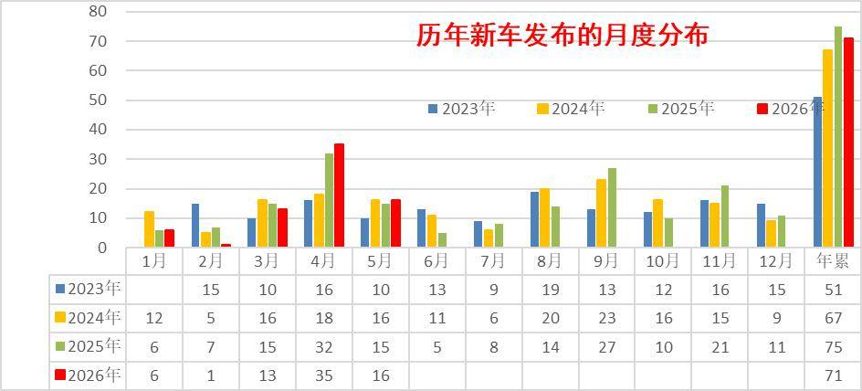
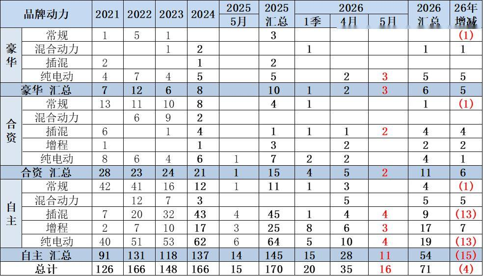
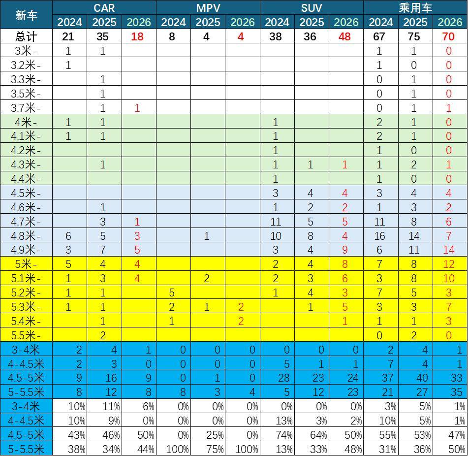
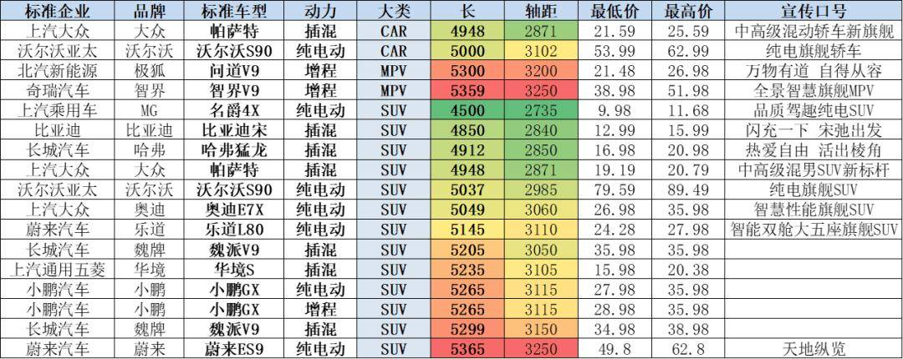
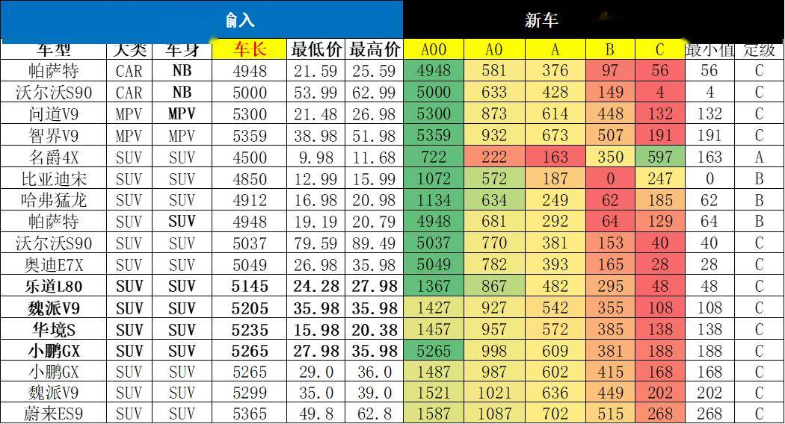
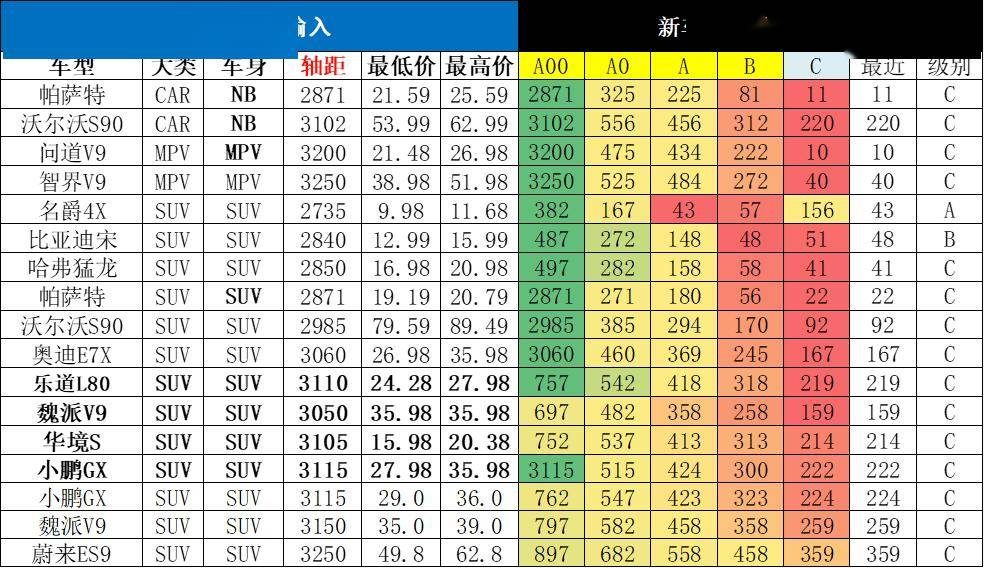
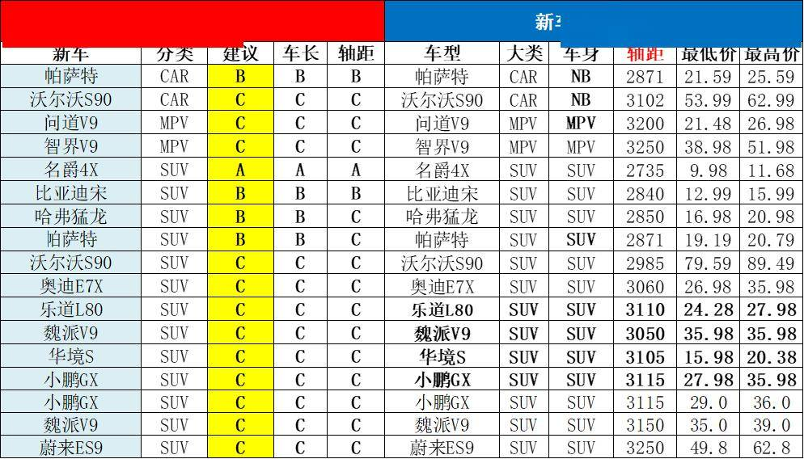

# 乘用车新车的分级测算探讨—5月

- 公開日時: 2026-06-06 15:18（北京時間）
- 出典: [搜狐号・崔东树](https://www.sohu.com/a/1033122095_115312)
- テーマ（自動判定）: セグメント・車種
- 画像: 8枚

---

注：本分析文章仅代表崔东树个人观点，如有异议，请留言。

近期乘用车市场的传统车市场推出新车型逐步放缓，新能源大幅增加新品投放。目前主力车企产品逐步进入多生孩子好竞争的局面，车企呈现剧烈的价格竞争和破圈趋势。这些传统车和新能源车的新车型如何归类也是很重要的，每家都有自己的分级模式，但我们还是习惯用行业相对主流的源自于德国大众的A00、A0、A、B、C、D分级模式作为基础，成为行业参照的公用分级方式。对这个行业分级，测算本月新车的分级如下，具体的调整也是仅供讨论。如有不同观点也可留言。

2026年1季度新车发布较少，4月有35款，5月有16款，好于前两年水平。今年1-5月的新车发布为71款，去年1-5月新车发布75款，2024年同期67款，今年新车少于去年4款，但4-5月北京车展前后新品较多。

1-5月的新品共71款，其中增程车型19款较去年同期多9款，混合动力车型6款较同期多6款；狭义插混车型13款较同期少9款；纯电动车型28款较同期少7款；常规燃油车5款，较同期少3款。这些新车有些是新车型，有些是改款改名字的新车型，更多的是新能源车型。2026年的合资车企的新品推出11款，改善主要是插混和增程的新品全面推出。豪华车新品有6款，较同期多5款，基本都是纯电动，这些新品值得观察。

车型定级因素较复杂，主要是从车长、轴距、价格、企业内部自身车型梯度布局、竞品关系等综合考虑的。从车长轴距考虑的车型定级体现的是新车与现有市场的拟合度，但新车是引领市场变化的，因此还要从厂家定位和历史升级演变等角度论证，这也就是防止算出来的与我们的行业主流观点形成偏差，同时也是让新车引领细分市场的产品变化。

近期新车大型化趋势明显，2026年1-5月的5米以上新车达到35款，新车占比50%，而2024年占比31%，2025年占比36%。目前的新车大型化主要是SUV的新车大型化趋势，原因也是SUV的移动智能空间的概念被消费者接受，车型溢价高，市场销量较好。

5月的新车有基本都是大型车，未来国内车市普及潜力巨大，未来政策层面应该尽量鼓励经济型车发展，我建议制定经济型车标准，鼓励微型电动车普及，这样才能实现国内的私车普及和新能源车出海发展。尤其是随着新的关税国际秩序，我们的新能源车出口还是要考虑海外的农村包围城市，欠发达国家包围发达国家的线路，直接冲击发达国家市场的难度和风险较大。

1、历年各月新车跟踪

2026年1季度新车发布较少，4月有35款，5月有16款，好于前两年水平。今年1-5月的新车发布为71款，去年1-5月新车发布75款，2024年同期67款，今年新车少于去年4款，但4-5月北京车展前后新品较多。

2、各类动力类型新车跟踪

今年5月按动力拆分的新车达到16款，较去年5月的15款多1款。今年5月纯电动新车7款，插混有6款，增程式3款，燃油车没有新品，这是行业发展巨大的隐忧。1-5月的新品共71款，其中增程车型19款较去年同期多9款，混合动力车型6款较同期多6款；狭义插混车型13款较同期少9款；纯电动车型28款较同期少7款；常规燃油车5款，较同期少3款。这些新车有些是新车型，有些是改款改名字的新车型，更多的是新能源车型。近两年的汽油车的数量较前期明显减少，但今年很多混合动力新车推出，体现混合动力替代燃油车实现出口突破的新思路。

3、各类品牌新车跟踪

今年的自主品牌新车数量较去年少，但新能源仍是自主几乎包揽的局面。2026年的合资车企的新品推出11款，改善主要是插混和增程的新品全面推出。豪华车新品有6款，较同期多5款，基本都是纯电动，这些新品值得观察。

4、新车推出的车长分析

新车大型化趋势明显，2026年1-5月的5米以上新车达到35款，新车占比50%，而2024年占比31%，2025年占比36%。目前的新车大型化主要是SUV的新车大型化趋势，原因也是SUV的移动智能空间的概念被消费者接受，车型溢价高，市场销量较好。

5、行业标准车型现状

今年的新能源车的新车数量较多，这些如何分级也是需要多重考虑的。分级测算选择的主要依据是车长和轴距对应的厢型，同时区分合资与自主的类别。价格因素和排量因素实在太复杂，因此暂作为争议车型的备考指标。

根据测算，行业现有销售车辆的每个车型的车长轴距和销量，进行加权汇总测算，得出每个级别的不同国别和厢型的平均长度和轴距，作为这个细分市场的标准车指标。

有了标准车指标，就有了各类车型间的车长和轴距的差距指标，就形成测算评级的基础。

6、5月新车型现状

5月新品的重量级车型较多，其中合资与豪华车的亮点较多，形成车型序列的延展。随着以旧换新的政策推动换购，新品向高端延伸明显。SUV的主流车型的改款新品较强。

豪华品牌的奥迪新品有一定竞争力，满足多元化需求。合资新品的技术自主性相对被动，与新势力新品正面对抗的挑战不小。

7、车型分解的测算-车长

根据每个新车的车长的指标与各级别的标准指标对比，寻找车长差距最小的指标，根据车长的定级看，各车型有些定级参考，大部分测算分级基本符合直觉定位预期。

近期自主的中型SUV较多，而且偏大型化设计。由于设计车辆目标都是超越对手，因此车型跨界力度较大，产品对比的难度较大。有些产品升级的比较大型，但会对应调整到低一级的合理竞争定位。

8、新车定级-轴距

由于车身设计的差异，根据轴距测算车型的定位区间。计算基本也是有很多边缘车型。

本月的主力新品车型的产品轴距差异较大，电动车的产品特色明显，价格差异大，相对复杂。

9、车型分类的综合对比评定

5月的新车有一半是有降级考虑的，主要是从车长、轴距、价格、企业内部自身车型梯度布局、竞品关系等综合考虑的。从车长轴距考虑的车型定级体现的是新车与现有市场的拟合度，但新车是引领市场变化的，因此还要从厂家定位和历史升级演变等角度论证，这也就是防止算出来的与我们的行业主流观点形成偏差，同时也是让新车引领细分市场的产品变化。

本月新车定级比较纠结的车型较多，内资的电动车轴距较长，形成电动车的异常反差。部分车型的车身长，实际定位和价格较低，因此平衡到低一级别。考虑到弱势企业新车大型化和燃油车低迷的特征，定级也是需要共同探讨。

目前这个分级仍在讨论阶段，我们的建议分类也欢迎大家提出意见建议，根据争议情况确定车型建议级别，共同研判产品趋势。

附：近日信息合集
