# 2026年5月全国乘用车市场运行特征分析

- 公開日時: 2026-06-09 19:28（北京時間）
- 出典: [搜狐号・崔东树](https://www.sohu.com/a/1034380789_115312)
- テーマ（自動判定）: 乗用車市場
- 画像: 22枚

---

注：本分析文章仅代表崔东树个人观点，如有异议，请留言。

5月全国乘用车市场零售151.0万辆，同比下降22%，环比增长10%；今年以来累计零售711万辆，同比下降19%。2026年5月国内乘用车市场呈现总量承压、环比走强、结构极致分化的运行态势，整体未实现实质性复苏。本月小幅回暖主要得益于车市“反内卷”成效凸显，车企促销力度趋于稳定，淡化了消费者降价观望预期，叠加北京车展的热度提振，释放了部分滞留购车需求，形成阶段性终端回暖。

1.近年狭义乘用车零售走势

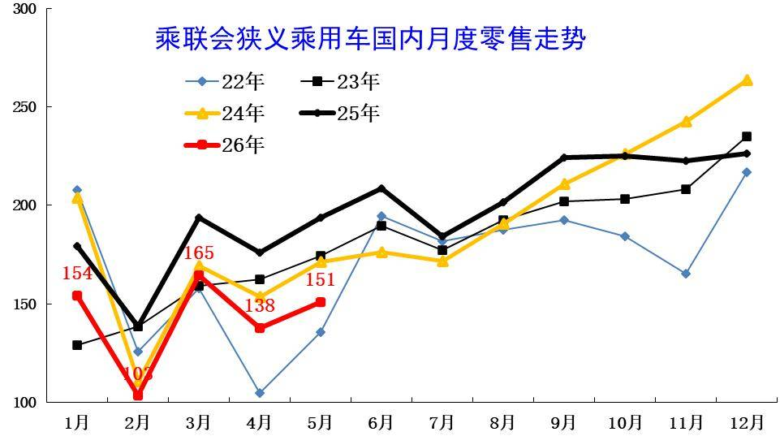

5月全国乘用车市场零售151万辆，同比增长表现较弱，脱离正常增长线路。5月负增长原因是多元的，首先是高油价的影响，其次是以旧换新的新政策规范性较强和补贴缩水，加之上游涨价的剧烈冲击，深层原因是消费能力和意愿偏低。

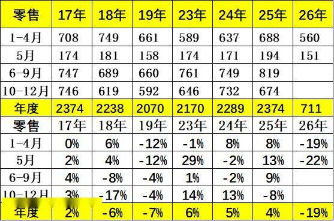

5月全国乘用车市场零售151.0万辆，同比下降22%，环比增长10%；今年以来累计零售711万辆，同比下降19%。由于市场因素影响较复杂，近几年年度销量“前低后高”特征较明显，今年特殊的结构性低迷特征明显，所以2026年5月降22%，属于历年增速的偏低状态。

2.近年狭义乘用车批发走势

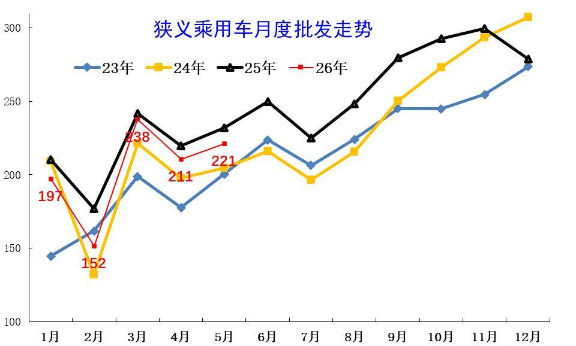

5月全国乘用车厂商批发221万辆，较同期差11万辆，大于4月的差距，渠道压力大的特征没有改善。历年5月的走势相对平稳，今年国内低迷但出口增长，因此总体下滑不大。

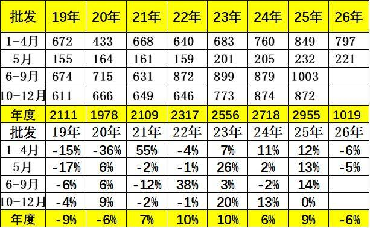

5月全国乘用车厂商批发221.2万辆，同比下降4.6%，环比增长5.0%。4-5月的厂家销量依旧偏弱。

3.近年狭义乘用车生产走势

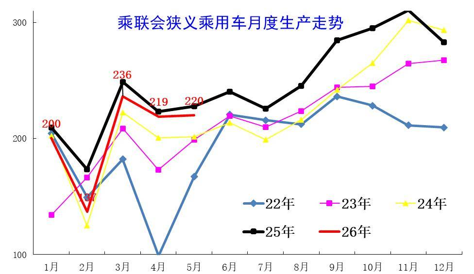

5月乘用车生产减产力度不大，市场需求持续较弱，导致3月主动减产力度很大。5月乘用车生产相对平稳，内部分化严重。

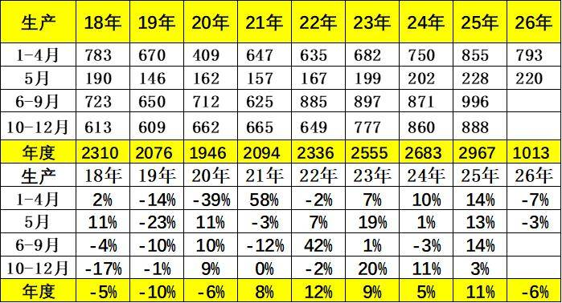

5月乘用车生产220万辆，同比下降3%，环比增加0.5%，较1-4月改善较好。

4.近年狭义乘用车出口走势

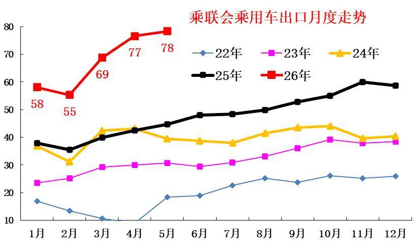

5月乘用车出口（含整车与CKD）78万辆，少有的连续3个月爆发式增长，与2025年走势反差较大。

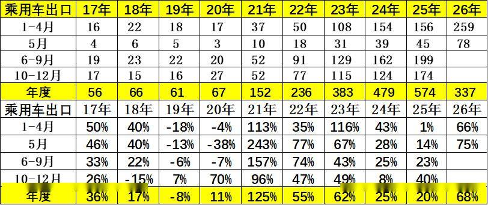

根据乘联数据，5月乘用车出口（含整车与CKD）78.4万辆，同比增长75.1%，环比增长2.3%，占乘用车厂家销量35%（上月36%，2025年同期19%）。5月新能源车占出口总量的54.0%，较同期增加9个百分点。5月自主品牌出口达到68.2万辆，同比增长83%；合资与豪华品牌出口10.2万辆，同比增长36%。

5.产销库存月度变化特征

由于5月厂商生产态势极其谨慎，5月厂商批发高于生产1.1万辆，而厂商月度国内批发低于国内零售8.2万辆。今年仍是去库存特征，1-5月总体乘用车行业库存下降34万辆（2025年同期增长1万辆、2024年同期下降48万辆、2023年同期下降20万辆）。

6.狭义乘用车促销走势

A、新能源车促销力度小幅增长

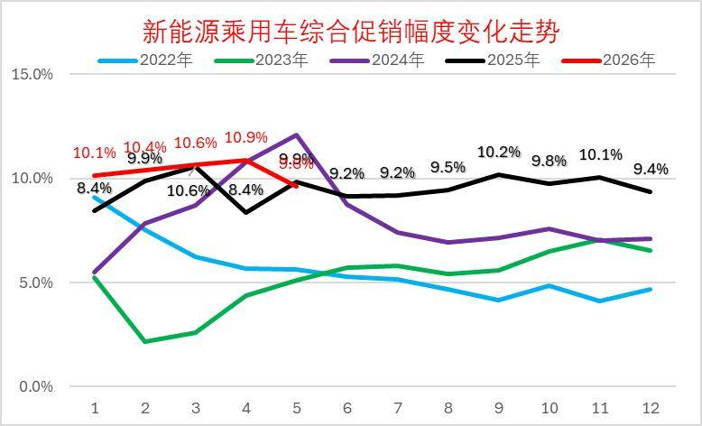

2026年5月的新能源车的促销下降到9.8%的中高位，较同期促销持平，较上月降1.1%。近几个月的促销较稳，随着降价的增多，新车切换的促销急剧下降，5月促销体系暂时回收，目前基本保持正常促销水平的中高位。

B、燃油车促销走势逐步下降

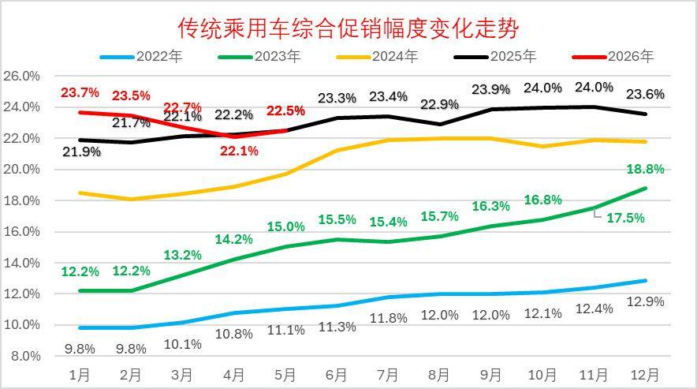

2026年5月传统燃油车的促销回升到22.5%的水平，较上月微增0.4个百分点，较同期持平，燃油车促销连续1年多维持在23%左右。

传统燃油车的促销2025年9月开始小幅加大，幅度较温和，2026年因降价力度大，实现促销逐步回落。

C、豪华车促销走势大幅下降

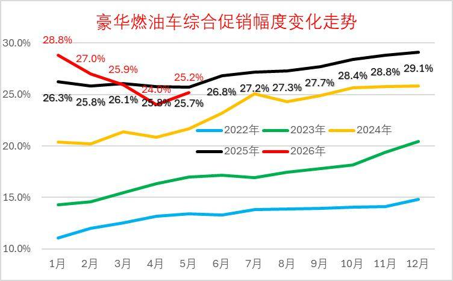

2026年5月豪华车的促销逐步达到25.2%的中高位，较上月回升1.2个点，较同期下降0.5个百分点。虽然消费升级推动高端需求较强，但2025年5月以来豪华车促销力度加大,2026年年初以来的新车指导价降价力度较大，促销因此下降，实际成交价格变化不大。

D、主流合资车促销走势平稳

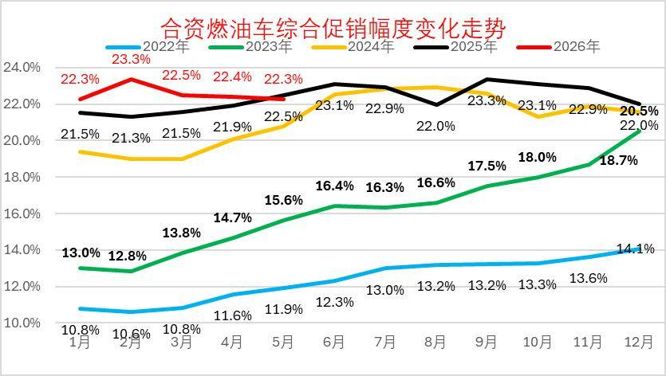

2026年5月合资燃油车的促销逐步达到22.3%的低位，较上月下降0.1个点，较同期少0.2个百分点。合资促销近期稍有增大。

合资燃油车的促销从2023年的13%的低位，2025年9月回升到23.3%峰值，随着新车强力降价，近三个月小幅波动。由于新车价格特别低，因此总体促销力度相对平稳微增。

E、自主燃油车促销走势保持平稳

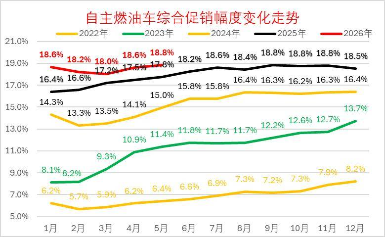

由于自主的新能源较强，加之燃油车出口较好，2025年自主燃油车促销总体平稳。

2026年5月自主燃油车的促销逐步达到18.8%的中高位，较同期增加1个百分点。自主车企在2024-2025年上半年的促销上升较快，随后2025年下半年以来的促销总体稳定。

F、分动力促销力度跟踪相对温和

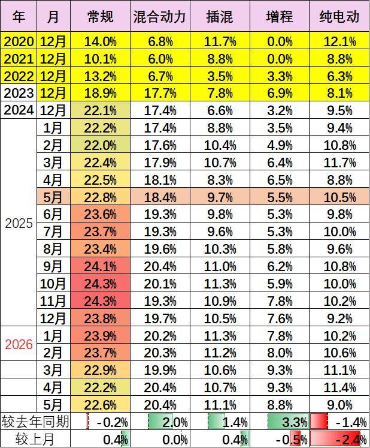

由于部分品牌降价带来的指导价回归，降低了促销幅度。2026年的常规燃油车和混合动力的降价力度大、促销压力较小，而插混由于销量下滑带来的车型促销加大，因此总体纯电动促销相对分化，5月增程同比增加3.3个点的促销。今年插电混合动力促销波动较大，5月同比增加2个点的促销，环比持平；狭义插混车型总体较2025年5月增加1.4个点左右的促销。纯电动车型因为主力车型切换，促销较2025年5月下降1.4个点左右的促销，较上月下降2.4个点左右的促销。

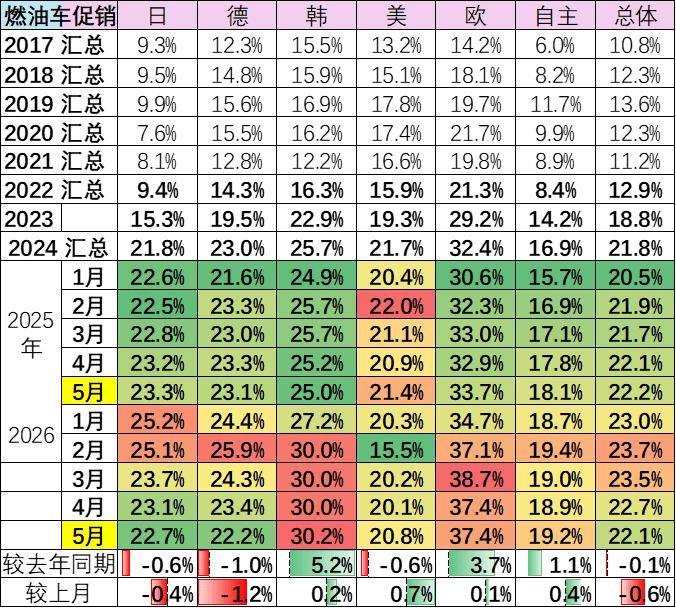

5月的车市促销相对平稳，经销商也是稳促销保利润。目前的欧系促销较大，其它合资车企促销基本22%左右，差异不大。自主车企成为促销最小的。

7.狭义乘用车各级别增长特征

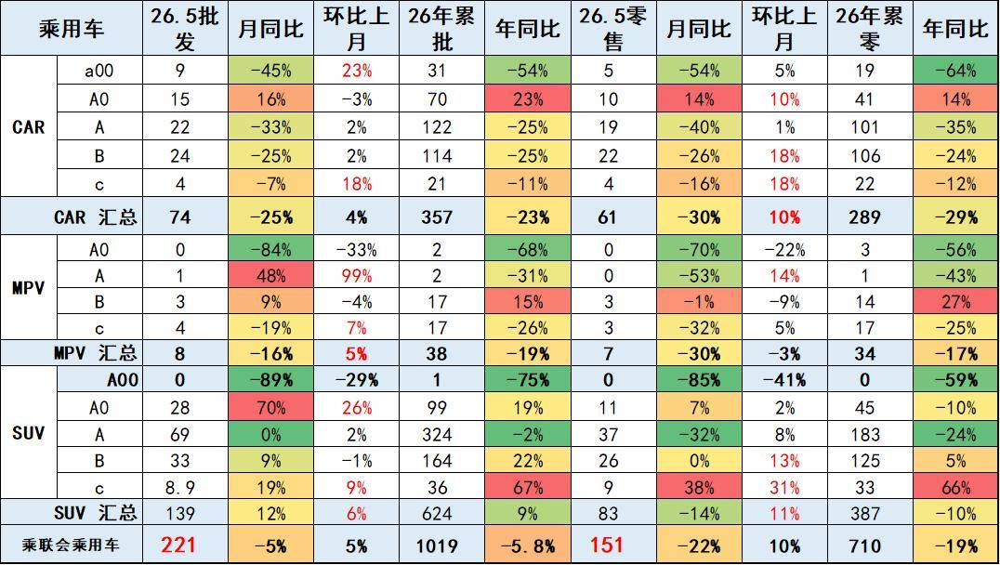

2026年5月乘用车零售降22%，大幅低于批发下降5%的增速,形成内冷外热格局。由于高油价冲击和补贴暂停带来零售回落，5月A级轿车零售与A00级轿车零售均较低，A0级轿车和高端车型成为5月零售主力，SUV的高端表现较强，轿车中主要是A0级轿车销量回升。

8.狭义乘用车国别增长特征

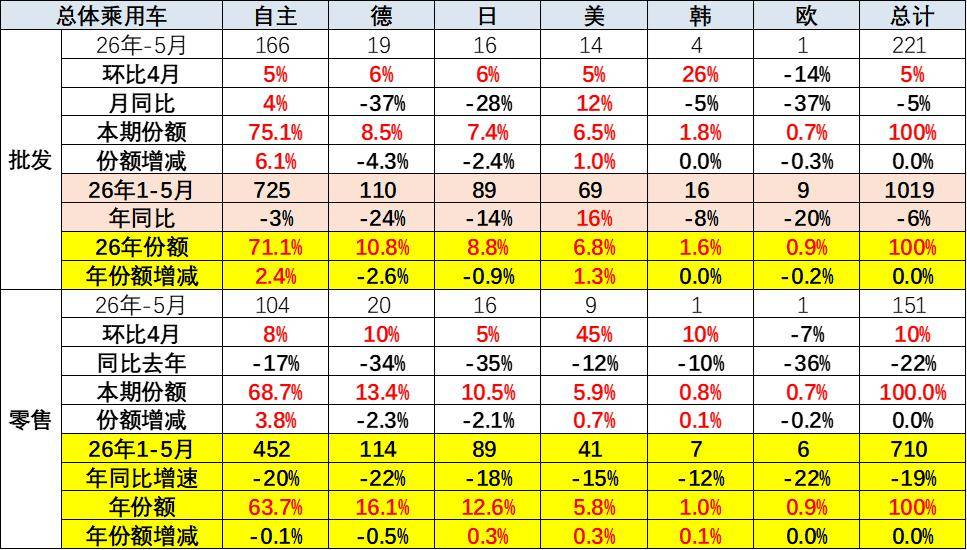

5月自主品牌零售104万辆，同比下降17%，环比增长8%。当月自主品牌国内零售份额为68.7%，同比增长3.8个百分点。自主品牌在新能源市场和出口市场总体较平稳。部分头部传统车企转型升级表现优异，吉利汽车、长安汽车等传统车企品牌份额提升明显。

5月主流合资品牌零售31万辆，同比下降35%，环比增长12%。5月德系品牌零售份额13.4%，同比下降2.3个百分点;日系品牌零售份额10.5%，同比下降2.1个百分点;美系品牌市场零售份额5.9%，同比增长0.7个百分点;韩系零售份额明显改善，低销量合资车企逐步恢复活力。

5月豪华车零售16万辆，同比下降20%，环比增长13%。随着豪华车指导价的合理回归，5月的豪华品牌零售份额10.6%，同比增长0.2个百分点，传统豪华车市场有所企稳。

9.2026年品牌产销特征

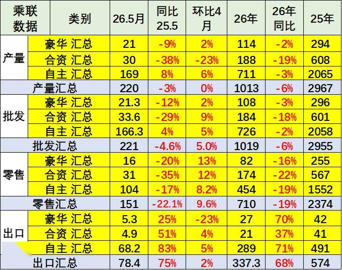

原有的品牌价值体系变化，豪华品牌近期持续压力加大，合资车企的产销走势压力持续较大，自主品牌产业链优势明显。

5月需求分化压力较大，燃油车市场环比走势较差，导致合资品牌走势恶化。自主靠新能源和出口相对表现较好。

10.全国新能源渗透率-批发

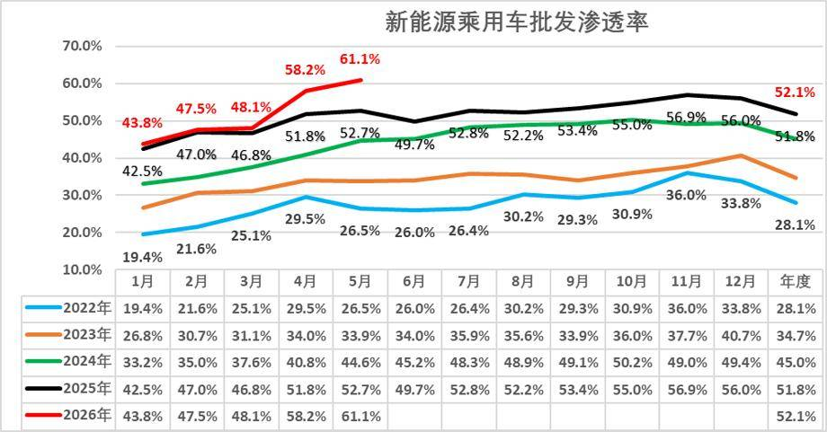

5月新能源车厂商批发渗透率61.1%，较2025年5月提升8个百分点。

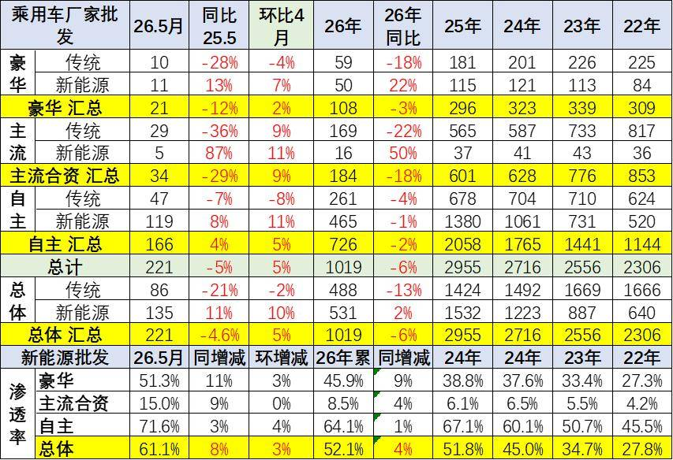

5月自主品牌新能源车渗透率71.6%；豪华车中的新能源车渗透率51.3%；而主流合资品牌新能源车渗透率上升到15.0%。

5月传统车厂家批发同比降21%，而新能源车同比增11%，增速差距32个点。燃油车的市场持续低迷，新能源出口的贡献度大。

11.全国新能源渗透率-零售

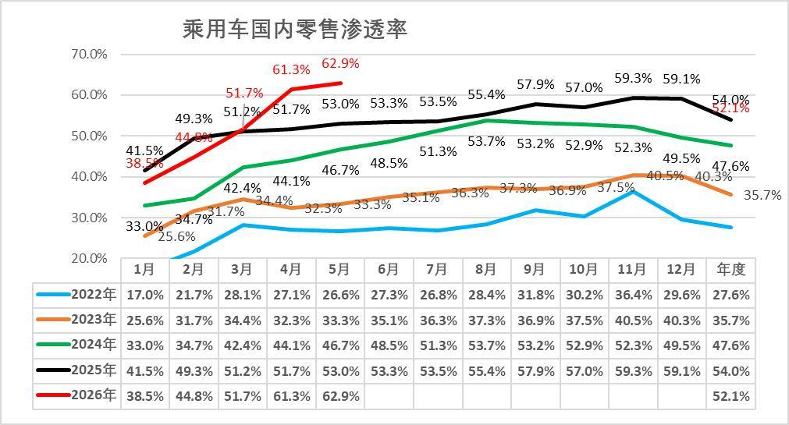

5月新能源车在国内总体乘用车的零售渗透率62.9%，较去年同期增长9.9个百分点，环比增长1.6个百分点。

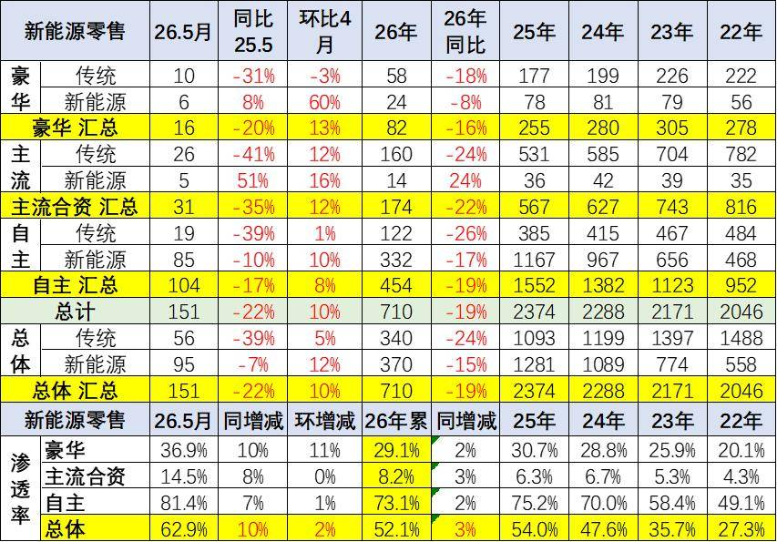

在5月国内零售中，自主品牌中的新能源车渗透率81.4%；豪华车中的新能源车渗透率36.9%；而主流合资品牌中的新能源车渗透率上升到14.5%。

5月燃油车零售同比下降39%，新能源车下降7%，差距仍是30个百分点左右。

附：近日信息合集
