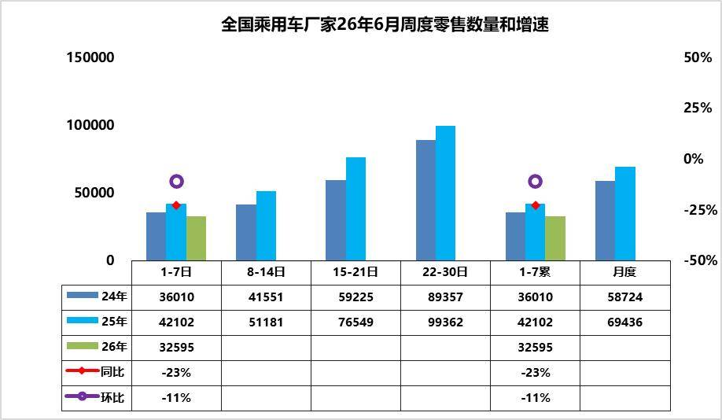
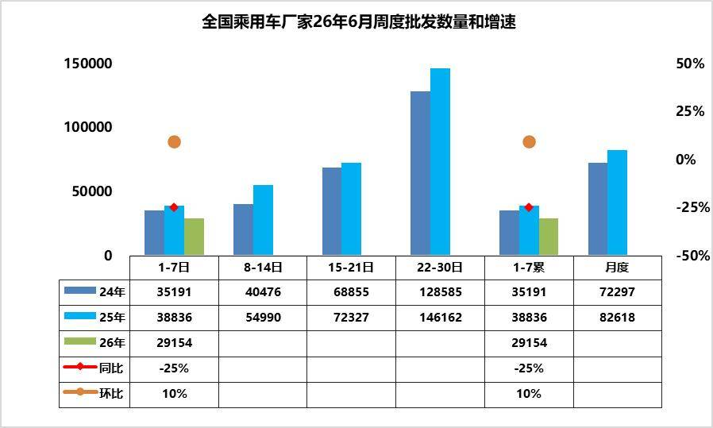
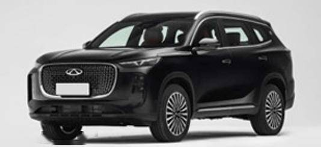
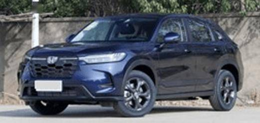
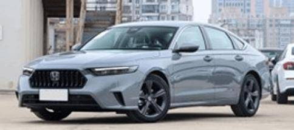
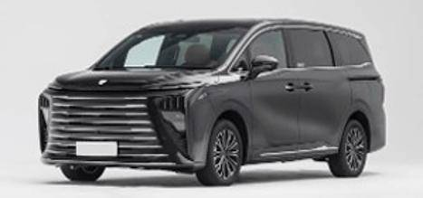
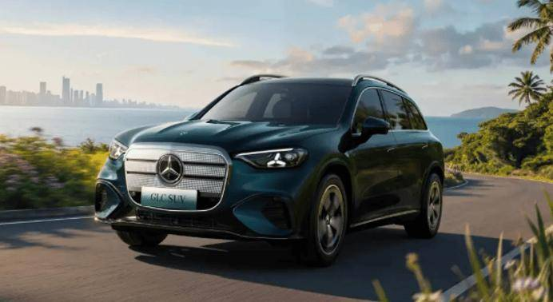
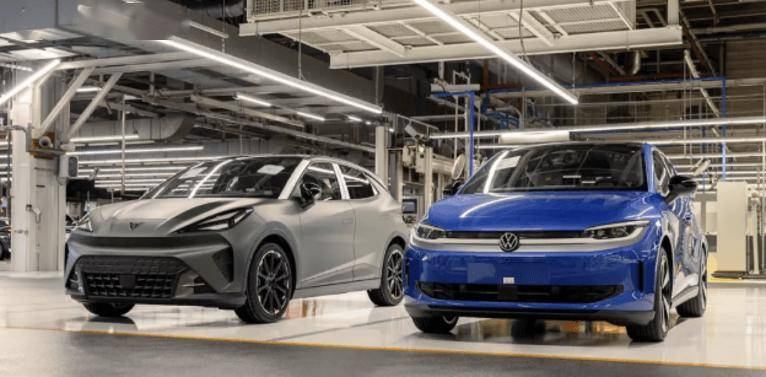

# 车市扫描-2026年21期（6月1日-6月7日）

- 公開日時: 2026-06-10 17:03（北京時間）
- 出典: [搜狐号・崔东树](https://www.sohu.com/a/1034868767_115312)
- テーマ（自動判定）: 車市スキャン（週次）
- 画像: 9枚

---

主要信息源自乘联分会每日新闻等

中国汽车流通协会

乘用车市场信息联席分会（乘联分会）

网站：http://www.cpcaauto.com

一、本周车市概述1.2026年6月全国乘用车市场零售相对平稳

【2026年6月1-7日乘联会市场分析要闻】

6月1-7日全国乘用车厂家批发20.4万辆，同比去年同期下降25%，较上月同期增长10%；今年以来累计批发1039.0万辆，同比去年同期下降6%。6月1-7日市场零售22.8万辆，同比去年同期下降23%，较上月同期下降11%；今年以来累计零售732.7万辆，同比去年同期下降20%。

6月1-7日全国乘用车厂家新能源批发13.7万辆，同比去年同期下降6%，较上月同期增长17%。今年以来累计批发544.4万辆，同比去年同期增长2%。6月1-7日新能源车市场零售15.2万辆，同比去年同期下降14%，较上月同期增长8%；今年以来累计零售385.0万辆，同比去年同期下降15%。

2026年6月1-7日全国新能源市场零售渗透率66.7%；新能源厂家批发渗透率67.2%。

6月第1周全国纯燃料轻型车生产10.8万辆，同比去年同期下降39%，较上月同期增长8%。6月第1周混合动力与插混总体生产6.9万辆，同比去年同期下降15%，较上月同期下降6%。

6月第1周乘用车市场日均零售3.3万辆，同比去年同期下降23%，较上月同期下降11%。

6月1-7日市场零售22.8万辆，同比去年同期下降23%，较上月同期下降11%；今年以来累计零售732.7万辆，同比去年同期下降20%。

去年端午节在5月31日，推动6月初销量较高，首周同比大幅下滑，与终端消费观望情绪、高考前低迷有关，叠加6 月上旬未出现大规模集中营销活动，市场需求释放节奏偏缓。

随着世界杯的即将开幕，购车主体也是球迷主体，4年一轮回的车市与球市的交集。当前2026 年6月首周数据不强，后续三周冲量表现将直接决定全月走势。若油价持续高企，上游价格强势，消费不旺，冲量效应不及往年，6 月零售或仍面临同比走弱压力。

2.2026年6月全国乘用车厂家销量平稳

6月第1周批发日均2.9万台，同比去年6月同期下降25%，环比上月同期增10%。

6月1-7日全国乘用车厂家批发20.4万辆，同比去年同期下降25%，较上月同期增长10%；今年以来累计批发1039万辆，同比去年同期下降6%。

高性价比新车表现优秀，行业价格战持续，消费者对后续降价、新款车型的预期较强，终端零售需求偏弱，经销商基于对未来销量的谨慎判断，主动降低进货量，避免库存积压。

近期乘用车零售持续相对偏弱，各环节的运行压力都在加大，产销节奏需要放缓。从生产进度看，燃油车的生产剧烈萎缩39%，混合动力下降15%的表现仍不强。由于市场的持续下行压力，经销商库存压力更大，需要有效的化解经销商的运营成本。

3.2026年1-4月中国汽车出口海外自主品牌数据跟踪

自2021年以来，中国汽车产业链的韧性较强的优势充分体现，中国汽车出口市场近两年表现超强增长。中国自主车企在海外部分地区销量特征较强。2025年中国自主车企在海外部分能持续统计的地区的当地销量354万台，同比增长28%；2026年4月的中国海外市场自主品牌销量41万台，同比增长60%，2026年1-4月的中国海外市场自主品牌销量151万台，同比增长58%。中国自主的海外部分可统计市场的零售表现很好。

我们总体汽车销量在海外市场的份额差异巨大，南半球20%，欧洲11%，东南亚和中东在8%左右，主流地区份额达到10%左右，但出口美国、日、韩还是很谨慎的。中国新能源车的世界表现超强，海外溢出效应明显，2026年1-4月达到61%的全球份额。其中欧洲17%，南半球79%，东南亚和西亚的份额在46%左右，部分区域已经是绝对优势。。

目前2026年1-4月中国自主海外销量份额主要是俄罗斯超强，大洋洲、非洲等地区超20%，中南美、中东、东南亚份额在15%左右，欧盟7%，日韩和美国几乎为零。2026年比亚迪、吉利、奇瑞、上汽等中国车企在大洋洲和东南亚的份额明显提升。日本丰田、本田、铃木等在大洋洲、非洲、东南亚的压力加大。

由于有中国家电等产业出海的经验教训，汽车出海的策略日益清晰完善，从KD组装到本地化生产、海外并购，车企海外战略效果突出。目前我国自主品牌出口进入了强化根据地打造游击区的农村包围城市的战略新阶段。自主品牌在海外以建设KD组装为起步，逐步加大本土化产业链建设，以整车企业为龙头，零部件与整车抱团出海效果显著，上汽、吉利、长城、奇瑞等取得巨大的成功。自主整车出口从买断模式基本全面转向经销模式，比亚迪、长城、奇瑞等自主整车品牌建设海外本土化的商务管控中心，全面监督当地提升销售服务网点的体系能力，自主品牌在当地市场的口碑越来越好。

4.2026年4月二手车市场分析

2026年4月，全国二手车市场交易量167万台，环比降6.7%，同比降2%，交易金额为1135亿元，同比增3%。2026年1-4月，二手车累计交易量649万台，同比增2.9%，交易额4264亿元，增3.1%。

2026年4月，全国新能源二手车市场交易量14.3万台，环比增2%，同比增长21.6%，新能源渗透率11.6%。2026年1-4月，新能源二手车累计交易量54.8万台，同比增29%。

在中国汽车流通协会的呼吁下，二手车流通改善。各地交管部门办实事，便利群众企业办事，促进二手车流通。但与国际先进的发达国家市场相比，中国二手车的交易比例相对比较低，而中国的汽车市场起步相对较晚，二手车消费起步更晚，目前二手车正处于快速崛起阶段，未来发展潜力极其巨大。尤其是新能源车的发展，让中国的更多的普通消费者有了购车和用车的低成本的巨大优势。虽然国家报废更新政策的力度暂时放缓，但中国二手车发展潜力极其巨大，汽车经销商集团的二手车业务和汽车报废更新蓬勃发展，2026年以旧换新必然是超强增长。

5.2026年5月乘用车市场降价促销分析

2025年以来全国乘用车行业促销与降级均回归理性，市场秩序明显改善。由于新能源车购税恢复征收，指导价对消费者购车交税影响体现，车企主动调价有利于改善压力。

2026年5月降价规模20款，较同期多7款。其中纯燃油车型7款，较同期多5款；插混车型7款，较同期多4款。燃油车和狭义插混的压力太大，价格调整可以理解。

2026年降价规模77款，较同期少4款，其中常规燃油车降价32款，较同期增13款；混合动力燃油车降价4款，较同期增加1款；插混燃油车降价16款，较同期持平；增程式车型降价3款，较同期减少4款；纯电动车型降价22款，较同期减少14款。

2026年5月份，新能源车新车降价车型均价21.5万元的降价力度算术平均达到2.1万元，降价力度达到9.6%的较高水平。2026年1~5月份，新能源车新车降价车型均价24.9万元的降价力度算术平均达到3.1万元，降价力度达到12.5%。

2026年5月份，常规燃油车新车降价车型均价16.6万元的降价力度算术平均达到2.5万元，降价力度达到14.9%。2026年1~5月份，常规燃油车新车降价车型均价22.3万元的降价力度算术平均达到3.3万元，降价力度达到14.6%。

2026年5月份，总体乘用车市场新车降价车型均价20.2万元的降价力度算术平均达到2.2万元，降价幅度达到10.8%。2026年1~5月份，总体乘用车市场新车降价车型均价24.1万元的降价力度算术平均达到3.2万元，降价力度达到13.1%。

2026年5月的新能源车的促销下降到9.8%的中高位，较同期促销持平，较上月降1.1%。2026年5月传统燃油车的促销回升到22.5%的水平，较上月微增0.4个百分点，较同期持平，燃油车促销连续1年多维持在23%左右。

2026年5月豪华车的促销逐步达到25.2%的中高位，较上月回升1.2个点，较同期下降0.5个百分点。2026年5月合资燃油车的促销逐步达到22.3%的低位，较上月下降0.1个点，较同期少0.2个百分点。2026年5月自主燃油车的促销逐步达到18.8%的中高位，较同期增加1个百分点。

二、本周上市新车1.吉利熊猫勇士版上市限时售4.39万元

6月1日，吉利熊猫勇士版上市，新车售价为5.09万元，限时售4.39万元。新车增加了更具户外风格的外观套件。配备ESP、TCS、电子防翻滚、陡坡缓降和制动辅助等。搭载纯电动力，CLTC纯电续航210km。

2.瑞虎8 PLUS非凡冠军版上市上市限时价10.69万-12.19万元

6月2日，瑞虎8 PLUS非凡冠军版上市，新车共推2款，售价区间为12.99万-14.49万元，上市限时价10.69万-12.19万元。外观与现款车型基本保持一致。配备高通8255车规级芯片、8点座椅按摩、猎鹰500辅助驾驶、高通8620智驾芯片等。搭载鲲鹏1.6TGDI发动机，匹配7DCT变速箱。

3.新款东风本田HR-V上市10.99万-12.59万元

6月5日，新款东风本田HR-V上市，新车共推3款，售价区间为10.99万-12.59万元。外观与老款车型基本保持一致。新车取消后排2个充电接口和后备厢12V电源接口。搭载1.5T发动机，匹配CVT变速箱。

4.新款本田英仕派上市

6月5日，新款本田英仕派上市，新车共推3款，售价区间为18.28万-21.38万元。外观与老款车型基本保持一致。配置延续老款的配置等。延续1.5T发动机，匹配CVT变速箱。

5.新款东风风行星海V9上市

6月7日，新款东风风行星海V9上市，新车共推3款，售价区间为17.99万-22.99万元，超级置换价为16.99万-21.99万元。外观与老款车型基本保持一致。换装高通8295P车载芯片，标配L2级辅助驾驶系统。搭载1.5T插混系统，CLTC工况纯电续航200km。

三、宏观经济与政策1.国务院：扩大农村充电设施覆盖范围

6月2日，国务院发布了关于印发《加快农业农村现代化“十五五”规划》的通知。建设多元互补的现代农村能源体系，推进农村电网巩固提升，扩大农村充电设施覆盖范围。多措并举扩大乡村消费。推动农村商品消费扩容升级，支持新能源汽车、智能家电、绿色建材下乡。

2.十部门：2028年底前高速公路服务区（含停车区）新建改建60千瓦以上功率电动汽车充电设施（充电枪）3万个

6月5日，交通运输部等十部门印发《促进小微型客车租赁高质量发展三年行动方案（2026—2028）》，方案提出，完善停车充电等配套服务设施。鼓励租赁企业投放新能源汽车。加快推动高速公路服务区充电设施建设，2028年底前高速公路服务区（含停车区）新建改建60千瓦以上功率电动汽车充电设施（充电枪）3万个，围绕旅游公路、国省干线、“四好农村路”等规划布局充换电设施。引导民航机场、高铁车站、汽车客运站等与租赁企业加强合作，为租赁车辆停放和充电提供便利。

3.鄂尔多斯氢能源车辆通行费全额奖补再延两年

鄂尔多斯市交通运输局发布公告，鄂尔多斯市决定继续执行氢能源车辆通行费全额奖补政策。原政策将于2026年6月1日届满。现将执行期限延长至2028年6月1日。

4.香港：电动车电池回收设施本月投入运作

香港署理环境及生态局局长黄淑娴书面回复立法会议员质询时表示，香港首间大型电动车电池回收设施正在环保园建设，预计于本月投入运作，将退役电池转化为再生黑粉，转废为材。

四、新品信息跟踪1.全新奔驰纯电GLC SUV开启预售

6月5日，全新奔驰纯电GLC SUV开启预售，预售价34.9万元起。配备AIRMATIC空气悬架+后轮主动转向，采用800V平台，搭载前后双电机，CLTC续航里程最长达703km，10%-80%充电时间低至22分钟。搭载Momenta辅助驾驶系统，支持城区/高速领航辅助驾驶。

2.大众ID.POLO正式下线

6月4日，大众ID.POLO于西班牙Martorell工厂正式生产下线。定位纯电动小型轿车。搭载85/99/155kW单电机，匹配37/52kWh电池组，WLTP续航里程329/454km。

五、企业信息1.比亚迪入局人形机器人

比亚迪集团执行副总裁李柯明确表示：“比亚迪也在开发（人形机器人）。比亚迪可以做一个开放的平台，既可以是比亚迪自己做机器人，也可以是跟其他企业合作的机器人。”

2.长安汽车挂牌转让长安福特新能源40%股权

长安汽车在重庆联合产权交易所挂牌转让其持有的长安福特新能源汽车科技有限公司40%股权，转让底价为1.54亿元。

3.东风天元智驾T200辅助驾驶城市NOA发布

6月2日，东风汽车研发总院宣布，天元智驾T200辅助驾驶城市NOA发布，已上线奕派007+ 。天元智驾T200辅助驾驶，搭载地平线J6M芯片，具备128TOPS算力，配备4颗环视摄像头 ，12颗超声波雷达，支持车身360° 无盲区，具备前向200m的探测识别距离、±5cm 的探测精度。

4.方程豹钛7第五次OTA开始推送

6月4日，方程豹推送了钛7的第五次OTA。本次更新覆盖135km两驱Pro版、200km两驱Max版、190km四驱Max版与190km四驱Ultra版，其中，前三个版型涉及6项功能新增与10项功能优化，190km四驱Ultra版则提供17项功能新增与14项功能优化。

5.吉利汽车委任安聪慧为执行董事

6月5日，吉利汽车在港交所发布公告，宣布安聪慧获委任为公司执行董事，该任命自2026年6月5日起生效。

6.smart精灵#5迎来OTA升级

6月3日，smart精灵#5迎来smart OS 2.3.1 CN版本OTA升级。车辆将引入豆包AI大模型，新增文生图、闲聊视频、AI新闻能力等。同时，车辆还针对记忆泊车、NSP领航辅助等辅助驾驶功能进行升级。

7.奇瑞计划在日产英国工厂投产新车

日产汽车公司披露，正与奇瑞进行深度磋商，奇瑞计划在日产位于英国桑德兰的工厂投产整车。两家企业已签署一份不具约束力的谅解备忘录，由奇瑞英国子公司接手该工厂两条生产线中的一条。合作落地后，奇瑞将于2027年4月开始的财年在桑德兰工厂正式投产。

8.Stellantis集团高层到访岚图汽车

6月2日，Stellantis集团执行副总裁、中国及亚太区负责人奥立维一行到访岚图汽车，实地参观岚图工厂和全功能用户中心，并就下一步战略合作进行深入交流。

9.上汽名爵首座欧洲工厂将落地西班牙

上汽集团旗下名爵品牌敲定西班牙作为其首个欧洲整车生产基地。据西班牙地方政府披露，这座落户西班牙西北部的项目初期投资额约2亿欧元（约合2.32亿美元，不含港口相关费用），规划年产能达12万辆整车，工厂预计2028年建成投产。

10.小鹏P7+推送OTA 6.2.0

6月1日，小鹏P7+迎来OTA 6.2.0更新，新增第二代VLA智能辅助驾驶系统。新增三大功能：VLA2.0全场景辅助驾驶；无导航NGP漫游；全场景原地起步，P挡直启NGP。

11.智己汽车5-6月新开28家门店

智己汽车公布其最新渠道网络建设进展与5月销售数据。智己汽车2026年5月交付量达到10,023台。今年1至5月，其累计销量同比增长115%。5月至6月期间，智己汽车将在全国新开28家门店。其中，5月份已完成18家新门店的开业，6月份计划再增加10家门店。

六、行业信息1.我国乘用车12年“胖”了近400公斤

据央视财经官方微博，2024年，我国乘用车平均整备质量达1704公斤，比2012年足足“胖”了近400公斤。此外，2000年前后，市场常见的家用新能源汽车，车宽多在1.7米。2015年，宽度增加到1.8米。新能源汽车车身每增加10毫米宽度，大约能多塞进0.8度电。

2.中国取代日本成澳大利亚头号进口汽车来源国

澳大利亚官方6月4日发布的最新数据显示，得益于电动汽车需求增长，4月近3.6万辆来自中国的乘用车抵达澳大利亚，远超来自日本的2.9万辆。这使得今年前四个月抵达澳大利亚的中国汽车数量超过10万辆，同比大增51%。

3.美国对进口自中国和墨西哥的厢式半挂车及其组件作出反补贴初裁

6月2日，美国商务部发布公告，对进口自中国和墨西哥的厢式半挂车及其组件作出反补贴初裁，初步裁定：上海中集宝伟工业有限公司和青岛中集冷藏运输设备有限公司补贴税率均为82.37%、未应诉企业补贴税率为128.78%、中国其他企业补贴税率为82.37%。

4.高通宣布车端人工智能Claw生态计划

6月5日，在2026高通汽车技术与合作峰会上，高通技术公司与诚迈科技、车联天下、斑马智能、德赛西威、镁佳科技、中科创达等生态企业，宣布车端人工智能Claw生态计划。高通技术公司与生态企业致力于将AI智能体和多模态大模型直接部署到车端。

5.文远知行与Uber宣布落地西班牙首个Robotaxi服务

6月2日，文远知行WeRide与优步Uber宣布，计划在马德里（Madrid）推出西班牙首个商业化Robotaxi试点服务。这是文远知行与Uber首次携手进入欧洲市场。商业化Robotaxi服务将于今年内正式启动。

6.新宙邦：与宁德时代签订电解液合作协议

6月7日，新宙邦公告称，公司与宁德时代签订《电解液合作协议》，2026年至2028年期间，宁德时代预计向公司采购电解液量分别为5万吨、10万吨和15万吨，合计30万吨。

7.英伟达黄仁勋：比亚迪、吉利等采用或正基于NVIDIA Hyperion平台开发智驾

英伟达首席执行官黄仁勋表示，包括比亚迪、吉利、极氪、小米以及小马智行等在内的中国主流车企和自动驾驶公司，均已采用或正在基于NVIDIA Hyperion平台开发智驾。

8.Stellantis 当地工厂将投产C10、B10

Stellantis马来西亚公司4日通过新闻稿宣布，零跑汽车在Stellantis吉打州莪仑制造中心正式启动本地组装，首款投产车型将是零跑C10，B10随后也将加入生产。

七、跨国集团与国际市场1.宝马集团引入AI优化碰撞测试与软件开发

宝马集团开始在车辆研发过程中全面应用人工智能技术，重点用于提升碰撞测试数据分析效率及加速软件开发流程。根据公司声明，该技术已应用于车身结构与材料设计优化，并显著缩短了软件编写所需时间。

2.丰田等日本车企统一零部件不良判定标准

受中东地缘冲突拖累关键原材料流通、零部件供应趋紧影响，丰田汽车及日本多家车企将落地零部件不良判定统一规范，以此减少物料浪费、保障零部件稳定供货。以往即便是黑点、细小划痕等瑕疵轻微、不影响整车使用性能的零部件，零部件厂商也会自行报废处理。今后，只要零部件符合日本国标、功能与外观无实质性缺陷，车企便可正常装车使用。

3.特朗普政府拟要求美墨加协定项下汽车美国本土占比至少50%

美媒援引知情人士消息称，特朗普政府拟对《美墨加协定》作出修订，要求汽车产品中半数零部件与原材料采购自美国本土，方可享受协定规定的低关祱政策。

4.特朗普与车企高层会晤

美国总统特朗普6月4日表示，已同汽车行业高层会面，围绕争议不断的汽车维修权相关立法展开商谈。多年来，美国整车厂商与独立维修门店围绕新车维修权限问题持续博弈。

5.美议员提议取消重型卡车12%消费税

当地时间6月2日，美国共和党参议员Todd Young和民主党参议员Angela Alsobrooks提议取消对重型卡车征收的12%联邦消费税，称此举有望提振新型环保车型的销量。

6.美伊冲突导致欧盟130万个工作岗位面临流失风险

欧盟就业事务专员Roxana Minzatu表示，受美国与伊朗冲突引发的能源成本飙升影响，今年欧盟汽车、建筑、冶金、化工及运输行业或将损失多达130万个就业岗位。其中，汽车行业潜在岗位流失最高，达60万个。

7.Stellantis将在法国工厂投产三款标致新能源车型

6月2日，Stellantis集团宣布，自2029年起将在法国东部的米卢斯（Mulhouse）工厂投产三款全新标致纯电动车型及混动车型。

8.塔塔汽车引进奇瑞整车平台授权推进印度高端电动车量产

印度塔塔汽车计划从中国奇瑞汽车引进整车制造平台授权，以推进其高端电动汽车项目落地。塔塔汽车将依托奇瑞与捷豹路虎在中国合资生产的Freelander平台，在印度南部泰米尔纳德邦新建工厂投产旗下高端品牌Avinya系列电动车。

9.特斯拉上线网页版行车记录仪查看器

特斯拉上线了一个全新网页端行车记录仪查看工具，方便用户在车外查看行车记录仪录像。官方在线查看工具访问地址为dashcam.tesla.com，随2026.20版本车机系统更新一同发布。

10.现代汽车与英伟达商讨在韩设立人工智能研发中心

6月4日，现代汽车联合韩国政府正与英伟达就落地韩国人工智能技术中心进入最终磋商阶段，新万金成为选址首选，该研发中心将是英伟达级别顶尖的研发基地。

11.英伟达推出用于Robotaxi的开放推理模型Alpamayo 2 Super

英伟达发布NVIDIA Alpamayo 2 Super，这是一款拥有320亿参数的基于推理的视觉语言动作（VLA）模型，扩展了NVIDIA Alpamayo系列的开放式AI模型、仿真框架和物理AI数据集，旨在为安全的L4级自动驾驶出租车开发提供支持。

附：近日信息合集
