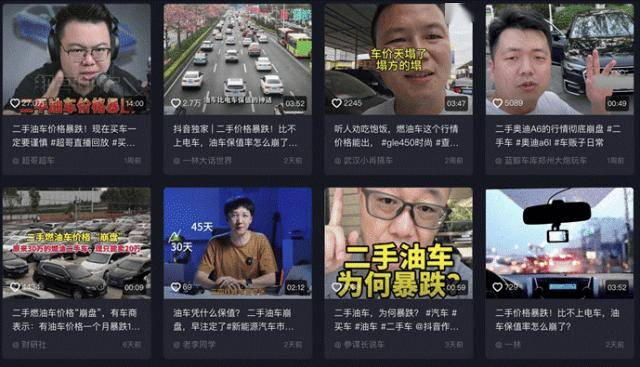
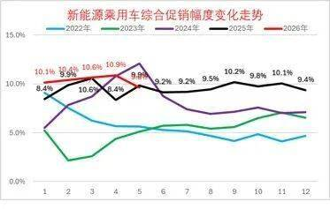
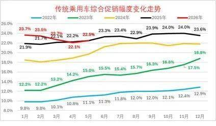
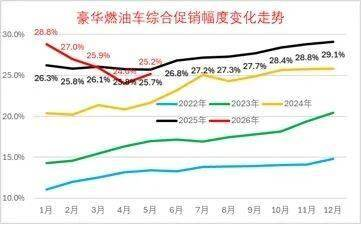
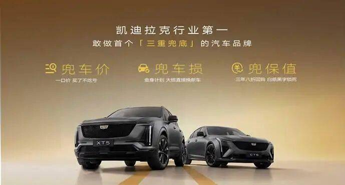

# 三年八折回购：燃油车保值承诺的一道分水岭

- 公開日時: 2026-06-12 10:30（北京時間）
- 出典: [搜狐号・崔东树](https://www.sohu.com/a/1035541794_115312)
- テーマ（自動判定）: その他
- 画像: 5枚

---

2026年，随着国家的号召，国内豪华车市场告别野蛮价格内卷，正式进入价格趋稳、价值回归的全新发展周期。但表面的促销收窄之下，更深层的危机正在浮出水面。

中国汽车流通协会数据显示，5月二手燃油车平均交易价格同比下跌18.7%，3年车龄燃油车平均残值率仅为38.2%，较2023年暴跌21个百分点。凯美瑞、雅阁等曾经的"保值神车"3年残值腰斩，部分国六b准新车二手车价甚至低于新车指导价。新车价格战叠加二手车残值崩盘，豪华品牌的销量增长被残值恐慌卡住了脖子。

在这个节点上，凯迪拉克推出全系燃油车三重兜底。最值得行业关注的，不是一口价，不是金身权益，而是那个数字：三年八折保值回购。这不是促销政策，这是一道分水岭。

一、25% 的促销幅度背后：豪华车市场的信任塌方

先看三组数据。

2026年5月，新能源车促销幅度9.8%，燃油车22.5%，豪华车25.2%。

25% 意味着什么？一辆40万的豪华车，终端成交价已经跌破30万。品牌溢价在促销中蒸发——消费者买的已经不是"豪华"，而是"折扣"。

更致命的是，这不是一次性的。豪华车促销幅度已连续一年多维持在23%以上高位。消费者形成了一个预期：今天买了，明天还会降。持币观望成为理性选择——不是不想买，是怕买亏了。

价格战的尽头没有赢家。品牌折了价，经销商赔了钱，消费者丢了信心。

当残值体系全面崩塌，整个市场的交易逻辑都在瓦解——消费者不敢买，二手车商库存积压不敢收，4S店以旧换新推不动——这是一个三方皆输的死局。

二、三年八折：一次公开的价值对赌

凯迪拉克的回应方式，不是继续降价，而是给价格一个底线。

三年八折保值回购，用一句话说清楚：你今天花30万买的车，三年后我愿意用24万买回来。写在合同里，不是限时活动，不是有条件赠品，是法律意义上的价值担保。

豪华品牌 3 年车龄保值率 |
保时捷 | 60.5% ，环比下滑 1.9%
特斯拉 | 56.5% ，环比下滑 0.5%
奔驰 | 54.8% ，环比下滑 1.9% 。
宝马 | 48.2% ，环比下滑 3.2%
奥迪 | 47.4% ，环比下降 1.2%
雷克萨斯 | 56.3% ，环比下滑 2.4%
路虎 | 54.5% ，环比下滑 0.4%

结合中国汽车流通协会数据来看，主流豪华车型三年实际残值大多仅50%~57%，不少品牌甚至跌破50%，而凯迪拉克却白纸黑字锁定八折回购。——30个百分点的差额，这不是促销让利几个点。这是对行业定价权的公开挑战：市场的价我不认，我的车，我定价。

这在豪华车市场是一个前所未有的动作。过去也有品牌做过保值回购，但要么设定了苛刻的触发条件，要么限定少数车型。全系燃油车无差别覆盖、三年锁价——这是行业首次。

它的意义不在于"保值"本身，而在于它改变了交易的根本逻辑：

过去，残值风险由消费者独自承担；现在，品牌与消费者共同承担。

从行业视角看，这一举动划出了一条清晰的分界线。豪华车市场的竞争规则正在被改写——过去比谁降得多，今后比谁敢承诺。一边是敢承诺的品牌，用确定性替代不确定性。另一边是不敢承诺的，陷入"降价→贬值→再降价"的死循环。当有人先迈出这一步，消费者会问：为什么他能承诺，你不能？

这是豪华品牌对自身产品价值的公开对赌。你敢做，说明你相信自己的车三年后还值那个钱；你不敢，说明你自己都没这个底气。

三、不止是保值：三重兜底的确定性体系

三年八折不是孤立的。三重兜底是一条完整的链条，覆盖购车-用车-换车的每一个脆弱环节：

一口价——全国统一售价，价格焦虑关在门外。消费者走进4S店之前就知道价格，不需要谈判、不需要担心被套路。

金身权益——大额维修免费换新，用车风险锁进保险箱。豪华车维修成本是最大的隐性炸弹，金身权益把不可预见的损失变成了可兜底的承诺。

三年八折——残值锁定，硬生生把50%的市场均值拉到80%。

买车时价格透明、用车时风险兜底、换车时残值锁定。从50%到80%，中间隔着的不是30个百分点，是一整个行业的信任鸿沟。单个政策可被模仿，但凯迪拉克提供的全周期确定性体系很难复制。

四、燃油豪华车的价值正名

有一个被忽视的背景：在新能源渗透率持续攀升的当下，燃油豪华车的价值正在被系统性地低估。

新能源车有"技术快速迭代"的光环，即便残值惨淡，消费者也有"买新技术"的心理补偿。燃油车却被贴上"落后技术"的标签，在舆论场承受着不成比例的贬值压力。

但数据告诉我们另一个事实：燃油车仍占豪华车市场的主体份额，5月促销环比仅微增0.4个百分点，促销力度已趋于稳定。燃油豪华车的真实需求依然坚实——问题不在产品力，而在消费者对未来的不确定感。

而凯迪拉克的三年八折回购，本质上是一次对燃油豪华车价值的正名：一辆好的燃油豪华车，三年后依然值它该值的钱。技术路线不是价值的唯一尺度，品质和体验才是。

豪华品牌的护城河不是参数、配置、价格——这些都可复制。真正的护城河只有一个：信任。消费者相信你今天的承诺三年后依然有效，相信你卖出的车不会让他后悔。从50%到80%，凯迪拉克用合同而不是口号兑现了这份信任。说一百遍"长期主义"，不如做一件让消费者看到真金白银的事。

结语：

2026年豪华车市场的价格战，已经打完了。

接下来的竞争，不拼谁降得更低，只拼谁敢承诺得更多。在这场行业转型的大考中，凯迪拉克率先以实打实的权益坚守长期主义，为豪华车市场高质量发展，交出了极具参考价值的行业答卷。

敢用真金白银为消费者兜底的品牌，会活到下一个周期。不敢的，会在价格战的余烬中慢慢退场。
