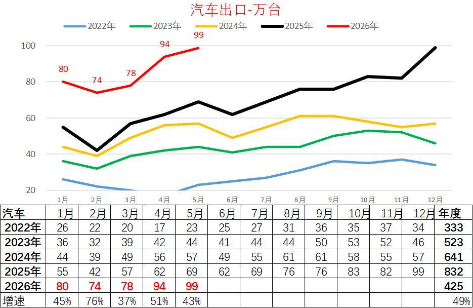
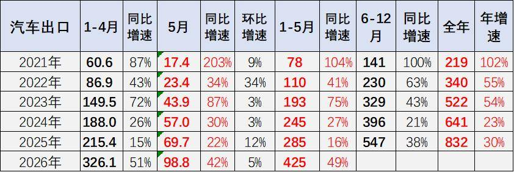
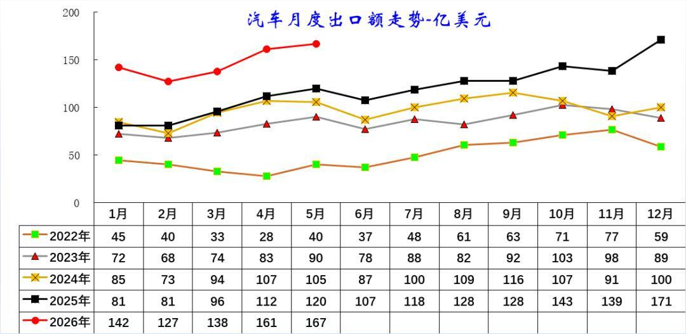
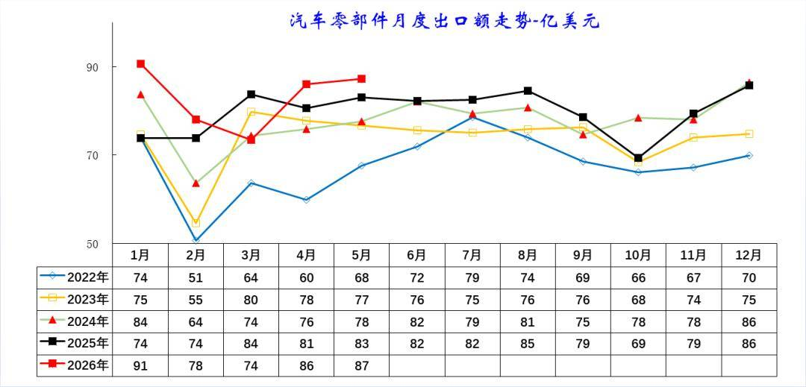
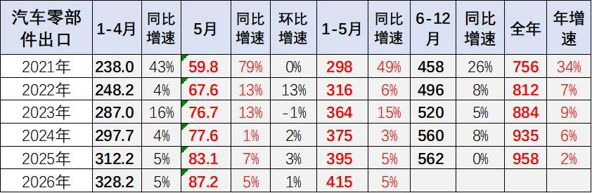

# 5月中国汽车出口98.8万，同比增42%，环比增5%

- 公開日時: 2026-06-13 13:56（北京時間）
- 出典: [搜狐号・崔东树](https://www.sohu.com/a/1036102253_115312)
- テーマ（自動判定）: 輸出
- 画像: 5枚

---

注：本分析文章仅代表崔东树个人观点，如有异议，请留言。

2026年5月，中国汽车出口在高油价、运力紧张背景下实现强势突破：1-5月汽车整车累计出口425万台，同比增速达49%，创近年同期新高。其中5月单月整车出口98.8万台，同比增长42%，环比小幅提升，接近百万台关口，成为拉动整体增长的核心动力。

2026年1-5月，我国汽车零部件出口额达415亿美元，同比增长5%，延续了近年来的稳健扩张态势。其中，5月单月出口87.2亿美元，同比增长5%、环比微增1%，增速虽不及整车出口，但规模持续高位运行，展现出较强的出口韧性。

今年汽车零部件出口同步稳步增长，重点服务欧美成熟市场，依托完善的供应链体系，为全球车企提供稳定配套，形成“零部件深耕欧美、整车辐射全球”的交叉互补格局，产业链协同效应凸显，共同支撑中国汽车产业的全球竞争力持续提升。

1、中国汽车出口爆发增长

2022-2025年，我国汽车出口步入稳步攀升的成长期，规模从333万台跃升至832万台，四年间实现近2.5倍增长，形成了持续扩张的基本盘。月度出口量逐年抬升，2025年单月峰值已突破99万台，为后续增长筑牢基础。

2026年则进入加速突破的新阶段，1-5月出口量连续刷新历史高位，累计达425万台，同比增速高达49%，单月同比增幅均保持在37%以上，展现出强劲的增长动能。这一阶段的表现，标志着我国汽车出口从规模扩张向高质量、高增速的跃升期迈进。

2026年我国汽车出口迎来爆发式增长，1-5月累计出口425万台，同比增速达49%，创近年同期新高，远超2021-2025年同期水平。其中5月单月出口98.8万台，同比增长42%，环比小幅提升，接近百万台关口，成为拉动整体增长的核心动力，也印证了我国汽车产业出海动能的持续强化。

从历史趋势看，我国汽车出口自2021年起进入高速扩张通道，2021-2025年全年出口量从219万台跃升至832万台，年增速虽有波动但始终保持高位。2026年增速的显著回升，既受益于新能源汽车竞争力提升、海外市场渠道拓展，也体现了自主品牌在全球市场份额的持续扩大，为全年出口突破千万台奠定了坚实基础。

2、中国汽车出口均价持续提升

2026年1-5月，我国汽车出口额呈现高位加速增长态势，月度出口额分别达142、127、138、161、167亿美元，整体显著高于往年同期水平，创历史新高。对比历年走势，2022-2025年出口额实现持续扩容，2025年单月峰值已突破170亿美元，为2026年的高位增长筑牢基础。

从阶段特征看，2022-2024年出口额处于稳步抬升阶段，从单月不足百亿美元逐步向百亿美元关口迈进；2025年进入加速增长期，多次突破120亿美元。2026年则实现质的跃升，反映出我国汽车出口不仅在规模上持续扩张，产品附加值与单车价值同步提升，出口结构持续优化，全球市场竞争力显著增强。

2026年1-5月我国汽车出口额迎来爆发式增长，1-5月累计出口额达736亿美元，同比增速高达50%，远超2022-2025年同期水平。其中5月单月出口额167.1亿美元，同比增长39%，环比小幅提升，延续了强劲的增长态势，反映出我国汽车出口在规模与价值量上的双重突破。

回顾历史数据，我国汽车出口额自2022年起进入高速增长通道，从2022年全年602亿美元跃升至2025年的1424亿美元，四年间实现翻倍增长。2026年增速的显著回升，既得益于新能源汽车高附加值产品占比提升，也体现了自主品牌在全球高端市场竞争力的增强，为全年出口额突破2000亿美元奠定了坚实基础。

3、汽车零部件出口走势

2022-2026年我国汽车零部件月度出口额走势。2026年1-5月出口额分别达91、78、74、86、87亿美元，整体处于近五年高位，1月单月创同期新高。

对比来看，2022-2025年出口规模持续扩容，从单月峰值79亿美元稳步升至86亿美元，2月受春节影响的季节性波动特征明显。这反映出我国汽车零部件产业在全球供应链中的竞争力持续增强，为整车出口提供了坚实支撑。

2026年1-5月，我国汽车零部件出口额达415亿美元，同比增长5%，延续了近年来的稳健扩张态势。其中，5月单月出口87.2亿美元，同比增长5%、环比微增1%，增速虽不及整车出口，但规模持续高位运行，展现出较强的出口韧性。

从历年趋势看，我国汽车零部件出口已从2021年的高速增长（年增速34%）逐步转向稳健发展阶段，2022-2025年增速维持在2%-9%区间，出口规模从756亿美元稳步提升至958亿美元。这一变化既反映了全球汽车供应链重构下的结构性机遇，也体现了中国零部件企业在高端化、配套化升级中的竞争力提升。

作为整车出口的重要支撑，零部件出口的稳定增长，为我国汽车产业全球化布局筑牢了供应链基础，也为后续整车出海提供了持续的配套保障。

附：近日信息合集
