# 2026年5月汽车增加值8%、投资-2.7%，生产-3%，汽车消费-16%，新能源汽车渗透率58%

- 公開日時: 2026-06-16 19:04（北京時間）
- 出典: [搜狐号・崔东树](https://www.sohu.com/a/1037490378_115312)
- テーマ（自動判定）: 産業統計
- 画像: 22枚

---

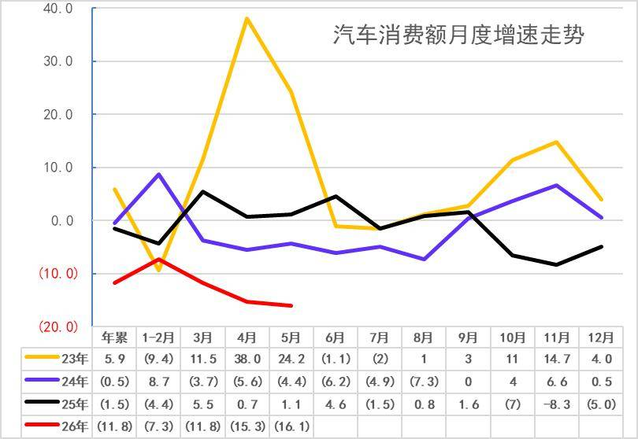

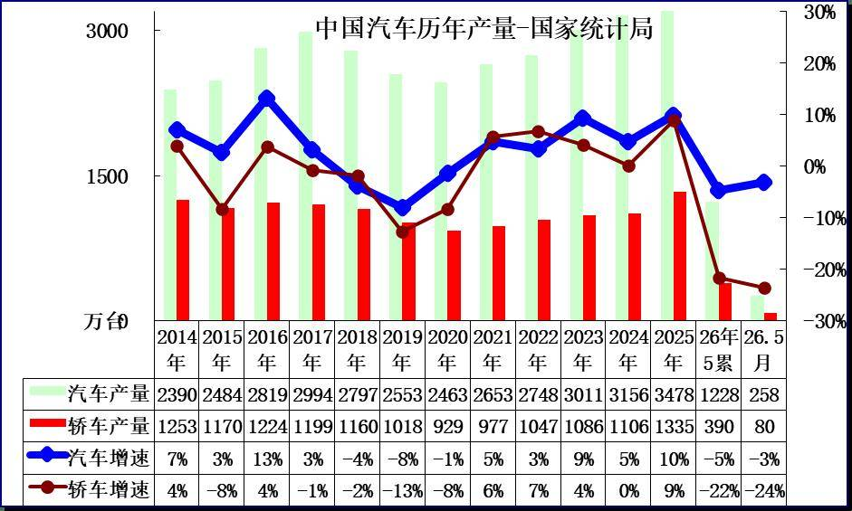

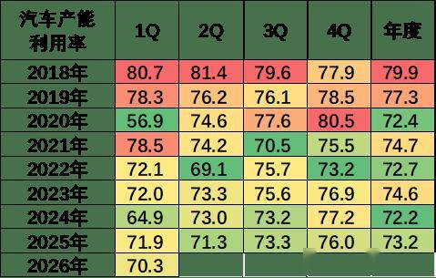

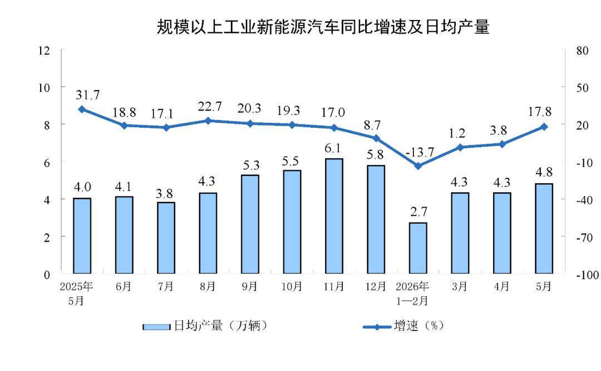

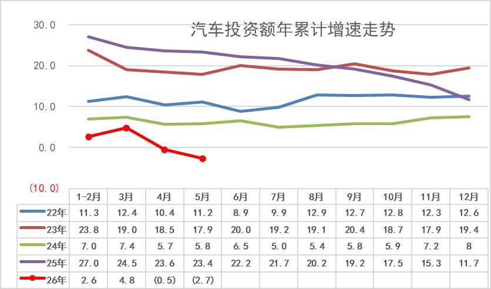

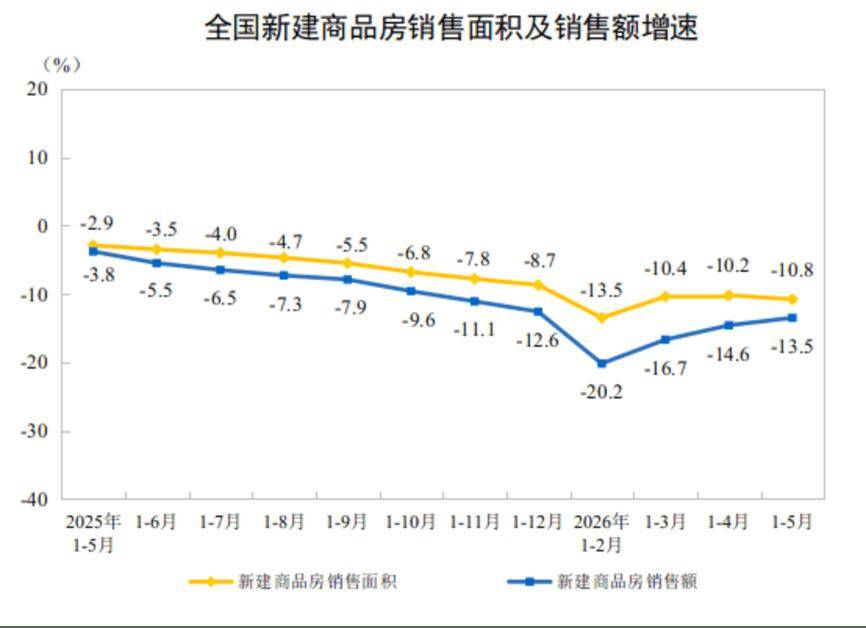

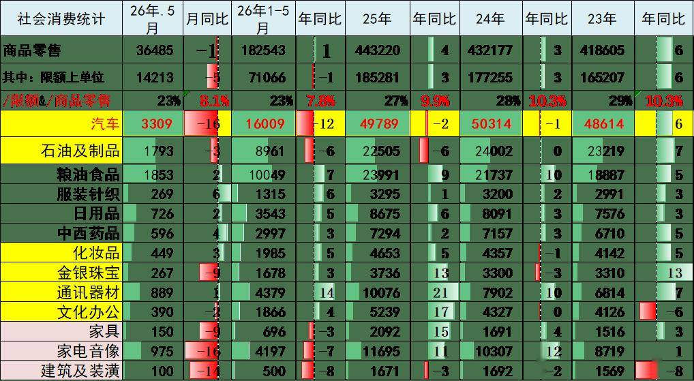

注：本分析文章仅代表崔东树个人观点，如有异议，请留言。

2026年国家实施更加积极有为的宏观政策，加大逆周期和跨周期调节，持续扩大内需、优化供给，总体市场需求稳中有升，实现良好开局。

2026年1-5月汽车生产1228万台，同比降5%；新能源汽车生产578万台，同比增1%，渗透率47%；燃油车生产650万台，同比降9%。2026年5月汽车生产258万台，同比降3%；新能源汽车生产149万台，同比增18%，渗透率58%；燃油车生产109万台，同比降22%。。

5月份，规模以上工业增加值同比实际增长4.5%，1—5月份，规模以上工业增加值同比增长5.4%。各行业中，26年1-5月汽车工业增加值增6.6%，其中5月汽车工业增加值增8.3%，汽车工业生产表现很强。。26年1—5月份，汽车行业固定资产投资同比下降2.7%，仍大幅高于-4.1%的各行业平均水平。

1—5月份，社会消费品零售总额206031亿元，同比增长1.4%。其中，汽车消费额16009亿元、同比降12%；除汽车以外的消费品零售额190022亿元，增长2.7%。5月份，社会消费品零售总额41090亿元，同比下降0.6%。其中，汽车消费额3309亿元、同比降16%；除汽车以外的消费品零售额37781亿元，增长1.1%。

当前，外部环境更趋复杂严峻，海湾局势复杂、高油价冲击产业链供应链稳定和消费需求；国内经济回升向好基础还不稳固，高物价，衣食支出暴增，有效需求不足、市场缺乏活力等问题挑战仍然存在，行业稳增长任务依然艰巨。

由于2026年以旧换新的乘用车补贴力度远低于商用车，因此商用车补贴推动新能源零售增长特别好，新能源乘用车暴跌。目前乘用车消费压力很大，期待未来能有长效的强力接续政策，减免购车人员个税、推动新能源车下乡、设立经济型电动车标准，优化C7经济型电动车驾照申领、给200公里以下续航的合规纯电动车车购税更大优惠、鼓励结婚和生育购车等更多的改善措施，拉动购车消费促进经济增长。

1.汽车消费相对平稳下行

自从楼市2021年下跌以来，汽车消费从2020年的3.94万亿元上升到2024年的5.03万亿元，摆脱了2018-2020年连续3年徘徊在3.9万亿元的被动局面。由于房地产下跌利好消费，买房投资挤压消费问题改善，目前看消费不旺的问题稍有改善。

2026年1-5月份，汽车消费同比降11.8%,5月汽车消费同比降16.1%,基数连续拉高后，今年的回落较大， 2025年的3月高基数压力最大，但5月的基数降低未改变汽车零售额下行压力，高油价的消费冲击较明显。

2.2026年汽车产量起步偏低

分产品看，5月份，规模以上工业626种产品中有300种产品产量同比增长。其中，汽车258.2万辆，下降3.2%，其中新能源汽车148.9万辆，增长17.8%；发电量7843亿千瓦时，增长4.2%；原油加工量5372万吨，下降9.1%。5月份，规模以上工业企业实现出口交货值13884亿元，同比名义增长10.1%。

3.2026年汽车增加值表现较好

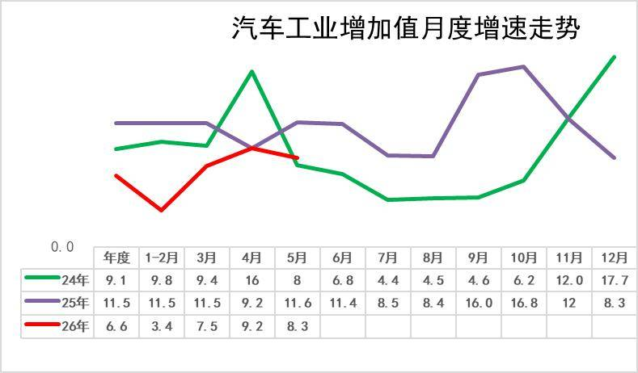

2020年汽车工业增加值增6.6%；2021年增速徘徊在5.5%的水平；2022年的汽车增加值6.3%，较强；2023年汽车业增加值增13%，实现超强增长；2024年的9.1%的汽车增加值相对提升较好；2025年的汽车工业增加值增11.5%。

5月份，规模以上工业增加值同比实际增长4.5%，1—5月份，规模以上工业增加值同比增长5.4%。2026年1-5月汽车工业增加值增6.6%，其中5月汽车工业增加值增8.3%，汽车工业生产表现很强。

4.汽车产能利用率相对平稳

2020-2024年全国工业产能利用率保持在72.4—74.6的较小波动范围内。2024年四季度，全国规模以上工业产能利用率为76.2%，比上年同期上升0.3个百分点，比三季度上升1.1个百分点。2025年全国规模以上工业产能利用率为74.4%。分主要行业看， 2025年汽车行业产能利用率73.2%，相对处于较低水平。

2026年1季度，全国规模以上工业产能利用率为70.3%，比去年下降1.6个百分点。

5.汽车生产具体情况

2026年5月份日均新能源汽车生产4.8万台，同比增17.8%。由于新能源轿车的去年基数较高，今年生产波动较大。2025年上半年的生产较好是小微型电动车，需求也是中低端的需求较强，因此销售额增速稍低于销量增速。今年补贴锐减的小微型冲击较大，但5月商用车补贴高，市场暴涨。

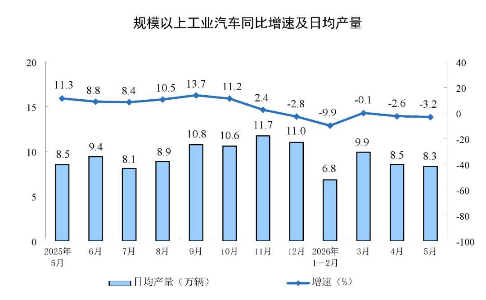

分产品看， 2026年5月份，汽车日均8.3万辆，降3.2%，考虑到2025年1-5月基数抬高，2026年年政策性补贴收缩，今年1-5月增速的表现较弱。

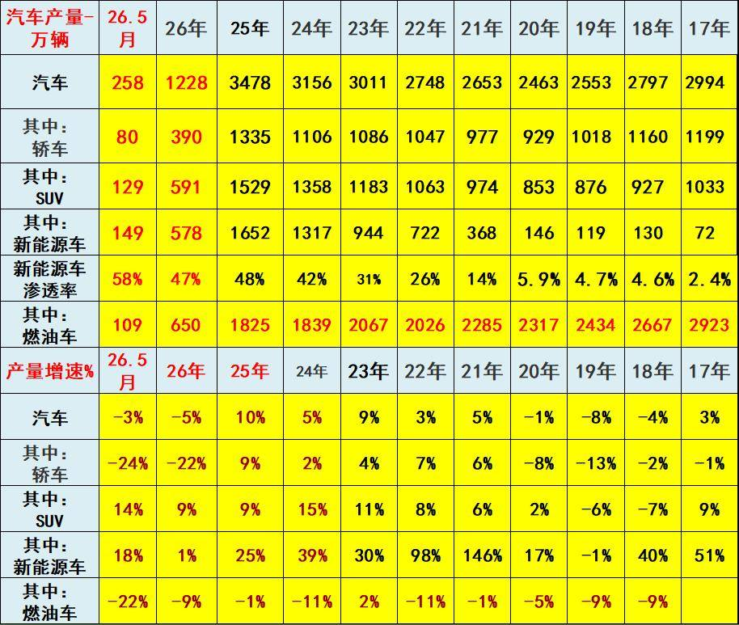

2022年汽车生产2748万台，产量同比增长3%；新能源汽车生产722万，增长98%，渗透率26%；燃油车生产2026万台，降11%。

2023年汽车生产3011万台，同比增9%；新能源汽车生产944万台，同比增30%，渗透率31%；燃油车生产2067万台，增2%。

2024年汽车生产3156万台，同比增长5%；新能源汽车生产1317万台，同比增39%，渗透率42%；燃油车生产1839万台，降11%。

2025年汽车生产3478万台，同比增10%；新能源汽车生产1652万台，同比增25%，渗透率48%；燃油车生产1825万台，同比降1%。

2026年1-5月汽车生产1228万台，同比降5%；新能源汽车生产578万台，同比增1%，渗透率47%；燃油车生产650万台，同比降9%。

2026年5月汽车生产258万台，同比降3%；新能源汽车生产149万台，同比增18%，渗透率58%；燃油车生产109万台，同比降22%。

6.2026年汽车投资小幅回落

1—5月份，全国固定资产投资（不含农户）178512亿元，同比下降4.1%。

2026年1—5月份，汽车行业固定资产投资同比下降2.7%，仍大幅高于-4.1%的各行业平均水平。

7.房地产的消费挤压问题稍有改善

1—5月份，新建商品房销售面积31320万平方米，同比下降10.8%；其中住宅销售面积下降12.1%。新建商品房销售额29366亿元，下降13.5%；其中住宅销售额下降4.1%。

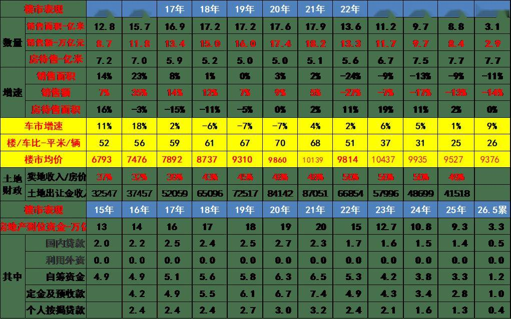

2021年土地出让金收入87051亿元，占房地产销售额48%；2023年土地出让金收入57996亿元，占房地产销售额50%；2024年土地出让金收入48699亿元，占卖房收入50%，房地产对地方财政贡献巨大。2025年卖地收入数据仍占房价49%。

目前，2026年1-5月汽车销量与房地产销量关系是26平米房/1辆车，销量的对比不合理现象有所改善。虽然房车比最高时的2020年70平米房/1辆车有所改善，但前期的债务压力和目前万元均价的楼市挤压消费压力仍大，导致车市需求因债务压力低迷。

楼市的财富效应对高端车需求有一定的促进效果，近期居民的楼市债务压力下降和购房需求减弱，对改善车市消费也带来一定潜在利好。

8.车市消费需要有持续政策支持

自从楼市2021年下跌以来，汽车消费从2020年的3.94万亿元上升到2025年的4.98万亿元，摆脱了2018-2020年的连续3年徘徊在3.9万亿元的被动局面。由于房地产下跌利好消费，买房投资挤压消费问题改善。2025年，社会消费品零售总额501202亿元，比上年增长3.7%。其中，汽车消费额49789亿元、同比降2%；除汽车以外的消费品零售额451413亿元，增长4.4%。

生活成本大幅上涨，衣食消费增长过快，购车消费被吃穿挤压严重。2026年1-5月车市消费降12%，目前看消费不旺的问题仍有待改善。

1—5月份，社会消费品零售总额206031亿元，同比增长1.4%。其中，汽车消费额16009亿元、同比降12%；除汽车以外的消费品零售额190022亿元，增长2.7%。5月份，社会消费品零售总额41090亿元，同比下降0.6%。其中，汽车消费额3309亿元、同比降16%；除汽车以外的消费品零售额37781亿元，增长1.1%。

近几年的成品油消费相对负增长，随着价格暴涨，成品油消费额仍明显下降，这也是消费不足的体现。在总体社会零售中，限额以上的商品零售表现较弱，这体现了房地产对消费影响较大，楼市对总体大宗消费的抑制效果明显。

附：近日信息合集
