# 车市扫描-2026年22期（6月8日-6月14日）

- 公開日時: 2026-06-17 18:17（北京時間）
- 出典: [搜狐号・崔东树](https://www.sohu.com/a/1037991524_115312)
- テーマ（自動判定）: 車市スキャン（週次）
- 画像: 30枚

---

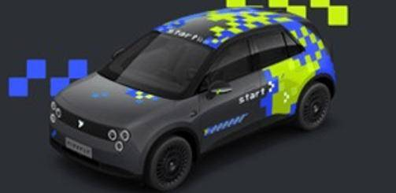

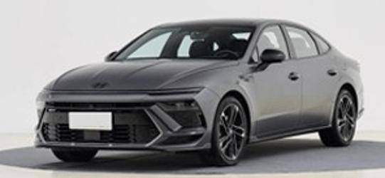

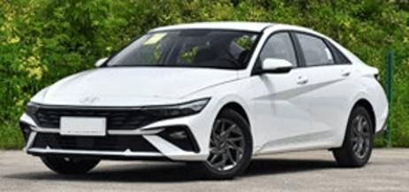

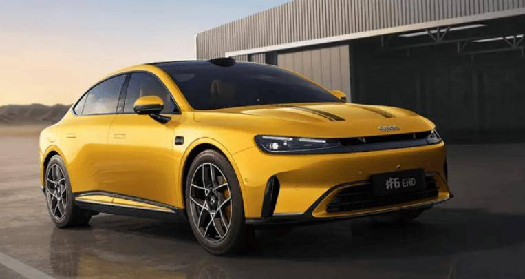

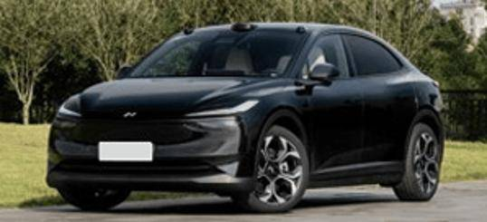

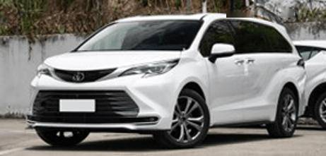

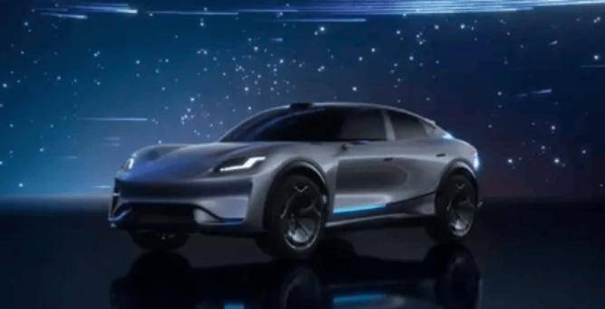

主要信息源自乘联分会每日新闻等

中国汽车流通协会

乘用车市场信息联席分会（乘联分会）

网站：http://www.cpcaauto.com

一、本周车市概述1.2026年6月全国乘用车市场零售相对平稳

【2026年6月1-14日乘联会市场分析要闻】

6月1-14日全国乘用车厂家批发55.6万辆，同比去年同期下降15%，较上月同期增长8%；今年以来累计批发1074.2万辆，同比去年同期下降6%。6月1-14日市场零售53.4万辆，同比去年同期下降18%，较上月同期下降5%；今年以来累计零售763.3万辆，同比去年同期下降19%。

6月1-14日全国乘用车厂家新能源批发37.8万辆，同比去年同期增长10%，较上月同期增长22%；今年以来累计批发568.4万辆，同比去年同期增长2%。6月1-14日新能源车市场零售34.1万辆，同比去年同期下降8%，较上月同期增长5%；今年以来累计零售403.9万辆，同比去年同期下降15%。

2026年6月1-14日全国新能源市场零售渗透率63.9%；新能源厂家批发渗透率67.9%。

6月第1-2周全国纯燃料轻型车生产22.5万辆，同比去年同期下降44%，较上月同期下降1%。6月第1-2周混合动力与插混总体生产16万辆，同比同期下降16%，较上月同期增长1%。

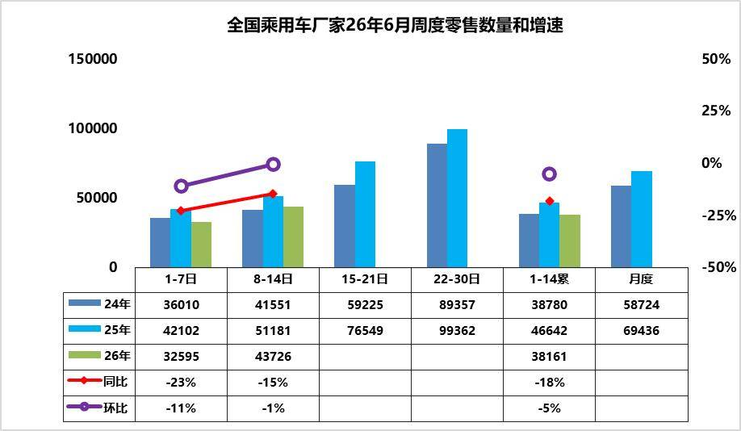

6月第1周乘用车市场日均零售3.3万辆，同比去年同期下降23%，较上月同期下降11%。

6月第2周乘用车市场日均零售4.4万辆，同比去年同期下降15%，较上月同期下降1%。

6月1-14日市场零售53.4万辆，同比去年同期下降18%，较上月同期下降5%；今年以来累计零售763.3万辆，同比去年同期下降19%。

去年端午节在5月31日，推动6月初销量较高，首周同比大幅下滑，与终端消费观望情绪、高考前低迷有关，叠加6 月上旬未出现大规模集中营销活动，市场需求释放节奏偏缓。与去年同期最大区别是少了政策的强力拉动，去年年中期部分城市资金即将用完，引发恐慌性购买，今年政策平稳，无额外助力，市场偏弱。

成本上涨抑制消费增长，上游利润持续高涨，下游压力进一步加大，相关群体收入增长较慢，1-5月吃穿支出增长6%左右，远高于住行消费支出-12%增速，车市消费将持续低迷。

随着世界杯的即将开幕，购车主体也是球迷主体，4年一轮回的车市与球市的交集。当前2026 年6月首周数据不强，后续三周冲量表现将直接决定全月走势。若油价持续高企，上游价格强势，消费不旺，冲量效应不及往年，6 月零售或仍面临同比走弱压力。

2.2026年6月全国乘用车厂家销量平稳

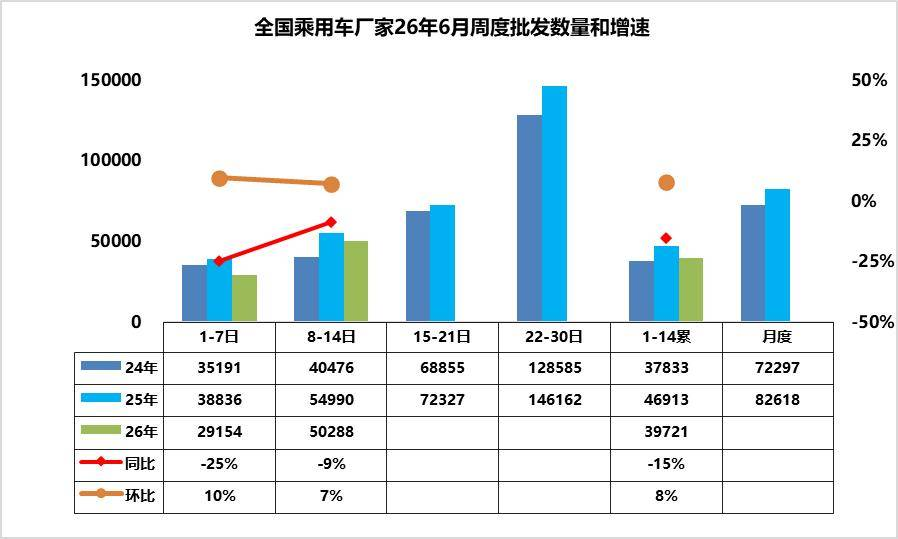

6月第1周批发日均2.9万台，同比去年6月同期下降25%，环比上月同期增10%。

6月第2周批发日均5.0万台，同比去年6月同期下降9%，环比上月同期增7%。

6月1-14日全国乘用车厂家批发55.6万辆，同比去年同期下降15%，较上月同期增长8%；今年以来累计批发1074.2万辆，同比去年同期下降6%。

高性价比新车表现优秀，行业价格战持续，消费者对后续降价、新款车型的预期较强，终端零售需求偏弱，经销商基于对未来销量的谨慎判断，主动降低进货量，避免库存积压。

近期乘用车零售持续相对偏弱，各环节的运行压力都在加大，产销节奏需要放缓。从生产进度看，燃油车的生产剧烈萎缩39%，混合动力下降15%的表现仍不强。由于市场的持续下行压力，经销商库存压力更大，需要有效的化解经销商的运营成本。

3.2026年5月汽车工业增加值8%、投资-2.7%，生产-3%，汽车消费-16%，新能源汽车渗透率58%

2026年国家实施更加积极有为的宏观政策，加大逆周期和跨周期调节，持续扩大内需、优化供给，总体市场需求稳中有升，实现良好开局。

2026年1-5月汽车生产1228万台，同比降5%；新能源汽车生产578万台，同比增1%，渗透率47%；燃油车生产650万台，同比降9%。2026年5月汽车生产258万台，同比降3%；新能源汽车生产149万台，同比增18%，渗透率58%；燃油车生产109万台，同比降22%。

5月份，规模以上工业增加值同比实际增长4.5%，1—5月份，规模以上工业增加值同比增长5.4%。各行业中，2026年1-5月汽车工业增加值增6.6%，其中5月汽车工业增加值增8.3%，汽车工业生产表现很强。2026年1—5月份，汽车行业固定资产投资同比下降2.7%，仍大幅高于-4.1%的各行业平均水平。

1—5月份，社会消费品零售总额206031亿元，同比增长1.4%。其中，汽车消费额16009亿元、同比降12%；除汽车以外的消费品零售额190022亿元，增长2.7%。5月份，社会消费品零售总额41090亿元，同比下降0.6%。其中，汽车消费额3309亿元、同比降16%；除汽车以外的消费品零售额37781亿元，增长1.1%。

当前，外部环境更趋复杂严峻，海湾局势复杂、高油价冲击产业链供应链稳定和消费需求；国内经济回升向好基础还不稳固，高物价，衣食支出暴增，有效需求不足、市场缺乏活力等问题挑战仍然存在，行业稳增长任务依然艰巨。

由于2026年以旧换新的乘用车补贴力度远低于商用车，因此商用车补贴推动新能源零售增长特别好，新能源乘用车暴跌。目前乘用车消费压力很大，期待未来能有长效的强力接续政策，减免购车人员个税、推动新能源车下乡、设立经济型电动车标准，优化C7经济型电动车驾照申领、给200公里以下续航的合规纯电动车车购税更大优惠、鼓励结婚和生育购车等更多的改善措施，拉动购车消费促进经济增长。

4.全国乘用车行业2026年5月末库存348万辆、库存66天、满意度26%

2026年5月月末全国乘用车行业库存348万辆，较上月下降6万辆，较2025年5月增3万辆，形成库存持续走平的趋势。其中厂家库存占比30.3%，相对偏高。26年5月乐观度27%，6月初的5月月后满意度为26%，预期低但满意度更差，主要是高油价的冲击太大。团队对6月市场的乐观度降到31%，这是近期市场乐观度判断的历史偏低预测指数。。

我们根据未来N+3的月度零售预测测算库存支撑未来天数，因此不是固定的当月数据，库存天数也会随预测调整而变化。根据2026年5月底的库存与未来3个月国内零售量综合预估的现有库存支撑未来销售天数在66天，相对于2023年5月的55天、2024年5月的62天，2025年5月的57天，今年5月的总体库存压力相对稍大。

2026年5月仅生产新能源车的企业的总库存上升到79万辆，环比上月增加4万台，较2025年11月峰值库存增1万辆，但较2025年5月的87万台降9万辆。近期新能源经销商的厂家和渠道库存面临市场零售低于预期，行业库存总体压力较大。

5.2026年5月全国皮卡市场分析

皮卡产销：皮卡产销呈现春季的产销拉升特征，5月出口走势超强。2026年5月份皮卡市场销售6.1万辆，同比增16.3%，环比增2.4%，处于近5年的当月次高位水平。2026年1-5月销量28.1万台，增8.6%。2026年5月份皮卡生产为5.9万辆，同比增14.5%；2026年1-5月皮卡生产28.0万台，增长10%。

长城汽车持续保持强势皮卡领军地位，国内外表现均较平稳。受出口持续同比增长促进，长安汽车、江铃汽车、上汽大通、江淮汽车、郑州日产表现较强。在国内皮卡零售市场，长城皮卡、江铃汽车、郑州日产、雷达汽车、江西五十铃等表现较好，国内“皮卡一超多强”格局继续保持。

皮卡出口：2026年5月全国皮卡出口3.6万辆，同比增长26%，环比增15%；2026年1-5月全国皮卡出口15万辆，同比增长32%，行业出口占比继续保持高位。2024年皮卡出口占比皮卡总销量的45%，2025年皮卡出口达到50%，2026年累计皮卡出口达到53%，2026年5月皮卡出口达到60%，中国自主皮卡出口提升较好。

新能源皮卡：2026年5月新能源皮卡0.9万辆，同比增20%，环比增24%；2026年1-5月新能源皮卡3.5万辆，同比增3%；形成新能源皮卡稍弱于燃油皮卡总体增速的走势。随着电动化和乘用化的发展，皮卡市场的空间仍将逐步改善。5月新能源皮卡销量中：比亚迪皮卡海外销量4233辆、吉利雷达电动皮卡2318辆、郑州日产1509辆、长安增程皮卡690辆，其它皮卡企业的新能源车也有一定规模。伴随着国内新能源皮卡市场启动，逐步培育市场，预计中国皮卡未来将会更快的发展来满足国内外需求。

6.5月中国汽车出口98.8万台，同比增42%,环比增5%

2026年5月，中国汽车出口在高油价、运力紧张背景下实现强势突破：1-5月汽车整车累计出口425万台，同比增速达49%，创近年同期新高。其中5月单月整车出口98.8万台，同比增长42%，环比小幅提升，接近百万台关口，成为拉动整体增长的核心动力。

2026年1-5月，我国汽车零部件出口额达415亿美元，同比增长5%，延续了近年来的稳健扩张态势。其中，5月单月出口87.2亿美元，同比增长5%、环比微增1%，增速虽不及整车出口，但规模持续高位运行，展现出较强的出口韧性。

今年汽车零部件出口同步稳步增长，重点服务欧美成熟市场，依托完善的供应链体系，为全球车企提供稳定配套，形成“零部件深耕欧美、整车辐射全球”的交叉互补格局，产业链协同效应凸显，共同支撑中国汽车产业的全球竞争力持续提升。

二、本周上市新车1.firefly萤火虫像素玩家版上市电池租用方案售9.58万元

2.新款现代索纳塔上市售价区间为13.98万-17.38万元

6月10日，新款现代索纳塔上市，新车共推4款，售价区间为13.98万-17.38万元。外观与老款车型基本保持一致。内饰采用12.3英寸仪表盘+12.3英寸中控屏的双联屏设计。动力采用1.5T或2.0T发动机，搭配8TIP变速箱。

3.新款现代伊兰特上市售价9.98万-12.38万元

6月10日，新款现代伊兰特上市，新车共推3款，售价9.98万-12.38万元。外观与老款车型基本保持一致。全系增加了Type-C充电接口。搭载1.5L发动机，匹配CVT变速箱。

4.新款途胜L上市16.98万-18.68万元

6月10日，新款途胜L上市，新车共推4款，售价区间为16.98万-18.68万元。外观与老款车型基本保持一致。配备手机互联、智能语音交互、ISLW限速预警等。搭载1.5T发动机，匹配8TIP变速箱。

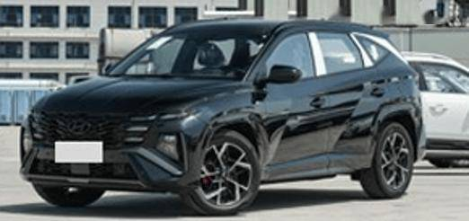

5.吉利银河星舰7 EV远航家上市限时指导价9.98万-11.98万元

6月10日，吉利银河星舰7 EV远航家上市，新车共推4款，售价10.98万-12.98万元，上市限时指导价9.98万-11.98万元。外观与现款车型基本保持一致。配备16扬声器、前排座椅加热/通风/按摩、50W风冷充电板等。采用纯电动力，CLTC纯电续航为525km和605km。

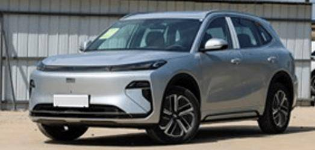

6.smart精灵#6 EHD上市限时售17.79万-21.79万元

6月11日，smart精灵#6 EHD上市，新车共推3款，售价区间为17.99万-22.99万元，限时售17.79万-21.79万元。新车采用掀背式造型、外后视镜照地投影灯、4档智能调节主动扰流板。内饰采用10.2英寸液晶仪表、13英寸双OLED中控屏、25.6英寸AR-HUD。配备AMD V2000芯片、豆包AI大模型、Nappa真皮座椅、20扬森海塞尔音响、激光雷达等。搭载1.5T插电式混动系统，CLTC纯电续航里程分别为135km，285km。

7.新款乐道L60上市租电方案售13.58万-16.58万元

6月11日，新款乐道L60上市，共推3款，售价19.28万-22.28万元，租电方案售13.58万-16.58万元。外观与老款车型基本保持一致。内饰增加17.3英寸3K后排折叠屏、天窗遮阳帘、超纤绒顶棚。配备神玑NX9031、蔚来世界模型、6L冷暖箱+52L车载大冰柜等。新车每个版本均可选大电池，CLTC续航里程为560km、555km、525km、740km、730km、700km。

8.传祺向往M8 PHEV L上市售价区间为26.98万-30.98万元

6月11日，传祺向往M8 PHEV L上市，新车共推3款，售价区间为26.98万-30.98万元。外观与现款车型基本保持一致，车长车高升级。配备高通骁龙8295P芯片、17.3英寸后排娱乐屏、Momenta驾驶辅助等。搭载1.5T插混系统，CLTC纯电续航为235km，248km。

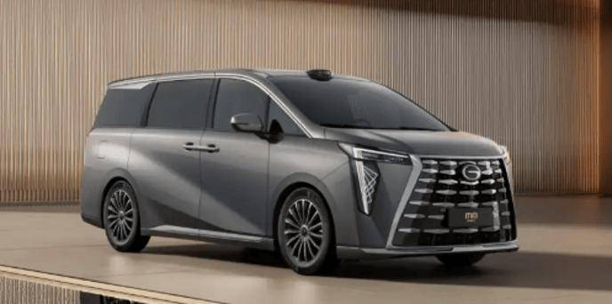

9.新款丰田赛那SIENNA上市权益价24.28万-33.78万元

6月12日，新款丰田赛那SIENNA上市，新车共推10款，售价区间为29.88万-39.38万元，权益价24.28万-33.78万元。新车延续老款赛那SIENNA的设计。中控台设计整体优化，木纹饰板减少，转而增加了软质材料包裹的面积。配备无线充电面板、huawei HiCar5.0、小米后排支架+PAD等。延续2.5L油电混力系统，匹配E-CVT变速箱，提供两驱以及四驱版本。

10.昊铂S600上市限时权益价17.99万-19.99万元

6月12日，昊铂S600上市，新车共推4款，售价区间为19.99万-21.99万元，限时权益价17.99万-19.99万元。新车采用主动进气格栅与双真气道、分体式大灯、无框电吸门、ISD智能交互尾灯。内饰采用17.3英寸智能中控大屏、10.25英寸液晶仪表、27英寸AR-HUD。配备激光雷达、骁龙8295P芯片、Momenta R7智驾、6.5L冷暖冰箱、22扬声器等。新车1.5T增程版CLTC纯电续航分别为230km，215km，纯电版CLTC续航里程为660km。

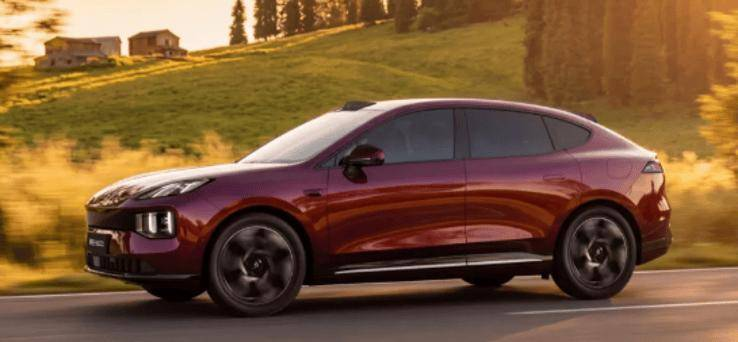

11.北京越野BJ30旅行家高光版上市超级置换价8.29万-10.99万元

6月12日，北京越野BJ30旅行家高光版上市，新车共推2款，售价区间为11.29万-13.99万元，超级置换价8.29万-10.99万元。新车采用全新的外观设计，换装大尺寸运动化多辐轮圈。配备10扬声器HiFi音响、64色氛围灯、50W无线充电、前排加热通风等。1.5T燃油车型匹配7DCT变速箱，1.5T油电混动车型匹配DHT混动专用变速箱。

12.全新深蓝S07增程版上市15.49-17.19万

6月13日，全新深蓝S07增程版正式上市。尺寸和内外设计上与在售车型基本保持一致，定位增程式混动中型SUV。搭载深蓝1.5L超级增程2.0和新一代原力超集电驱，系统最大功率190/200kW，峰值扭矩290N·m，匹配31.73/39.05kWh的3C超充电池，官方零百加速时间7.5/7.6s，CLTC纯电续航里程230/300km，综合续航里程1320/1385km，NEDC百公里馈电油耗3.8/3.88L，30%-80%充电时间低至15分钟。搭载华为乾崑智驾ADS Pro。

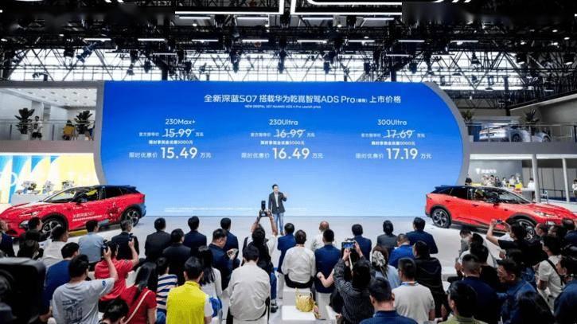

三、宏观经济与政策1.两部门约谈提醒涉嫌非理性竞争汽车生产企业

6月11日，工业和信息化部、市场监管总局对涉嫌存在非理性竞争行为的汽车生产企业进行约谈提醒，要求企业严格遵守《中华人民共和国价格法》《关于制止低价倾销行为的规定》等法律法规规章，按照《汽车行业价格行为合规指南》要求，加强价格合规建设，强化产品质量管控，切实保护消费者合法权益，共同维护优质优价、良性竞争的市场秩序。

2.工信部公布享受车船税减免优惠的新能源汽车车型

6月11日，工信部公示《享受车船税减免优惠的节约能源使用新能源汽车车型目录》（第八十七批）拟发布内容，本批新产品准入申请涉及743户车辆生产企业，共申报新产品2454个。纯电动产品共223户企业802个型号、插电式混合动力产品共66户企业123个型号、燃料电池产品共15户企业38个型号。

3.到2030年新能源重卡渗透率达到40%

交通运输部、国家发展改革委、工业和信息化部等11个部门联合发布《推动新能源重卡规模化应用实施方案》，明确提出到2030年，新能源重卡渗透率达到40%，保有量突破160万辆，占总保有量的20%左右。

4.统计局：5月份全国CPI同比上涨1.2%，PPI同比上涨3.9%

6月10日，统计局发布数据显示，2026年5月份，CPI同比上涨1.2%，环比下降0.1%。1-5月平均，CPI比上年同期上涨1.0%。5月份，PPI同比上涨3.9%，环比上涨0.5%。1-5月平均，PPI比上年同期上涨1.0%。

5.比亚迪蔚来等被美列入“企业清单”

美东时间6月8日，美国国防部正式更新“中国军工企业清单”。较2025年1月的134家新增54家。包括比亚迪、蔚来两家新能源车企及宁德时代、中创新航、亿纬锂能、禾赛科技、速腾聚创等汽车产业链企业。

6.广东省加强二手车出口管理

6月10日，广东省11部门联合印发《广东省加强二手车出口管理若干措施》，从严格出口管理、加强合规审查、完善生态链、提升出口效率、提升国际化经营能力及推动健康发展六个方面提出十四项具体措施。其中，严控新车以二手车名义出口，建立企业动态管理及退出机制，加强改装车出口合规审查，加强企业监测等措施将得到落实。

7.欧瑞德汽车核心零部件再制造项目签约连云港

日前，欧瑞德汽车核心零部件再制造项目签约仪式在连云港市举行。连云港市长周进会见斯泰兰蒂斯集团高级副总裁劳伦斯一行，双方就深化汽车制造领域循环经济发展进行交流。

8.武汉迎峰度夏充换电电价临时调整

6月11日，国网武汉供电公司发布虚拟电厂管理提升的12项措施，其中包括充电桩分时电价调整政策，以保障迎峰度夏稳定供电。“充电桩分时电价调整政策”执行时间为7月1日至9月30日，工商业电动汽车充换电设施用电可在14—17时午间低谷时段，享受低谷电价政策。按此前政策，午间低谷时段为12－14时，调整后，原低谷时段调整为平时段。

四、新品信息跟踪1.赛豆科技发布新品牌AIVA

日前，赛豆科技在北京正式发布AI先锋生态出行品牌AIVA，并官宣携手火山引擎，联合定义、联合设计、共同打造AI汽车体验。火山引擎为AIVA品牌提供豆包大模型、智能座舱等技术服务，帮助AIVA品牌提升车载智能交互体验。首款概念车AIVA Origin Concept发布。

2.广汽本田2027年推三款新车型

广汽本田宣布计划于2027年推出三款全新车型，涉及燃油、混合动力和新能源三大领域。其中包括全新一代雅阁、搭载第五代i-MMD混动技术的全新产品，以及基于中国新能源平台开发的自研车型。从2027年起，广汽本田将全面导入本田第五代i-MMD混动技术。

五、企业信息1.比亚迪筹建欧洲第二座生产基地

据路透社报道，比亚迪执行副总裁李柯宣布，将在今年第四季度启动匈牙利工厂整车组装。“匈牙利现在是第一优先事项。第二优先事项是在欧洲寻找第二个生产基地。”该公司正考虑收购位于南欧的一座现有工厂，作为其在欧洲建设第二座整车工厂的选址方案之一。

2.北汽集团与中国长安汽车达成战略合作

6月13日，北汽集团与中国长安汽车集团签署战略合作协议。双方将聚焦前瞻技术与新兴产业、绿色低碳发展、产业链、供应链、海外市场等关键领域开展合作协同。

3.时代北汽电池工厂预计8月投产

6月10日，北汽集团官方宣布，时代北汽（北京）新能源科技有限公司电池工厂首颗电芯于近日下线，进入量产阶段。目前，工厂建设已进入尾声，正在对第二条产线设备进行调试，预计8月正式投产。2026年全年，工厂预计将生产电芯7.5GWh。项目达产后，将形成年产15GWh的动力电池产能。

4.长安泰国罗勇工厂2万台整车下线

日前，长安汽车宣布泰国罗勇工厂正式迎来2万台整车下线的全新里程碑时刻。

5.东风固态电池下半年量产

6月9日，武汉经开区官方账号正式官宣，东风全新一代固态电池将于2026年下半年量产装车。按照规划，东风这款自研自产的氧化物-聚合物复合半固态电池，能量密度可达350Wh/kg，搭载于东风奕派eπ007，CLTC续航将突破1000km，同时具备耐高温、抗挤压、低温性能优异等安全与实用优势。

6.李书福：将有序关停并转吉利汽车集团相关冗余主体

6月13日，吉利控股集团董事长李书福在2026中国汽车重庆论坛上表示，将进一步理顺吉利汽车集团有限公司与吉利汽车控股有限公司的关系，有序关停并转吉利汽车集团有限公司相关冗余主体，集中优势资源做强吉利汽车控股有限公司核心上市平台。

7.江淮汽车拟斥资5000万元至1亿元回购股份

6月9日，江淮汽车公告，计划以集中竞价交易方式回购公司股份，回购总金额不低于5000万元且不超过1亿元，回购价格不超过64元/股。本次回购股份将用于维护公司价值及股东权益，回购期限为自股东大会审议通过回购方案之日起3个月内。

8.凯迪拉克官宣推出全系燃油车3年8折回购政策

6月12日，凯迪拉克宣布限时推出全系燃油车三年八折保值回购政策，涵盖CT5、CT6、XT4、XT5车型，并承诺3年内单次事故损失达到原车购车发票价的30%可免费换新车。该活动时间截至2026年6月30日。

9.奇瑞没有在印度市场直接投资和技术转让等安排

6月8日，“奇瑞集团”公众号发文称，近日许多媒体援引外媒信息，解读奇瑞与印度塔塔集团的相关合作，奇瑞表示，奇瑞与印度塔塔集团正在商谈的合作协议，限定为车型相关的零部件供应，为其提供汽车散件。奇瑞没有在印度市场直接投资和技术转让等安排，“平台转让”“平台授权”“技术授权”“技术出口”“技术输出”等表述均与事实不符。

10.奇瑞与引望签署战略合作协议

6月11日，奇瑞汽车股份有限公司与引望智能技术有限公司在安徽芜湖签署深化战略合作协议，将围绕L3级、L4级自动驾驶等技术开展深度合作。

11.张正萍任赛力斯汽车董事长

近日，赛力斯汽车有限公司发生工商变更，张兴海卸任董事长，由张正萍接任董事长，同时，多位主要人员发生变更。

12.沃尔沃XC70推送OTA升级

沃尔沃XC70车型开始推送OTA1.3版本软件升级，自2026年6月17日起陆续向用户推送。此次升级将NPA智能领航辅助功能的可用范围扩展至全国，并新增前车驶离提醒功能。该提醒功能在NPA未激活状态下运行，系统会在前车起步前2秒内监测驾驶员视线方向。

13.蔚来:公司深度参与制定新加坡充换电标准正式推出

蔚来公司宣布，由公司深度参与研究制定的新加坡电动车充换电标准《新加坡标准SS 722》于近期正式推出。首次针对电动乘用车及重型货车建立换电与移动充电技术规范。

14.小鹏汽车启动游艇项目

近日，小鹏汽车已正式进入游艇领域，今年初在内部组建了约百人的研发团队，项目代号为“飞鱼”，由小鹏汽车整车架构负责人钱占伟负责。该游艇项目聚焦于底盘算法技术，目标客户为高净值C端家庭市场，目前仍处于研发阶段。小鹏方面回应表示：“对此事尚不了解”。

15.众泰汽车罢免董事长被否决

6月12日，众泰汽车股份有限公司对外发布关于第九届董事会2026年度第五次临时会议决议公告。公告内容显示，董事会审议未通过《关于免去韩必文董事长职务的议案》。

六、行业信息1.5月全国乘用车市场零售151万辆

乘联分会公布数据显示，5月1-31日，全国乘用车市场零售151.0万辆，同比下降22.1%，环比增长9.2%；今年以来累计零售709.9万辆，同比下降19.5%。

2.中国汽车软件技术跻身全球核心标准

6月10日，国际汽车开放系统架构组织在上海宣布，中国自主研发的智能驾驶操作系统，正式成为全球智能驾驶系统公共代码库的核心基线，这也是中国汽车基础软件技术首次进入全球行业标准。

3.李佳琦直播间售卖奔驰

6月10日晚间，淘宝“李佳琦直播间”首次售卖梅赛德斯-奔驰汽车。当晚共上架了全新奔驰纯电GLC SUV与长轴距C级轿车多款车型共40台。两个购车订金链接开售后秒售罄。

七、跨国集团与国际市场1.宝腾汽车计划将旗下电动汽车工厂产能扩充一倍

马来西亚本土车企宝腾控股正加速推进电动化布局，将扩建位于霹雳州丹绒马林汽车高科技谷生产基地内新建的新能源整车工厂，提升产能规模。该公司计划追加投资3,700万林吉特（折合1,000万美元），将该工厂年产能由当前2万辆提升至4.2万辆，实现产能翻倍。

2.大众全球产能削减300万辆

近日，大众集团宣布将全球年产能由原计划的1200万辆下调至900万辆，削减幅度达300万辆，以匹配当前市场需求。重组重点集中于德国本土工厂，包括开工率偏低且人力成本较高的埃姆登和茨维考工厂。有消息称，小鹏汽车正与大众协商收购部分工厂事宜。

3.大众集团年内将在德国削减1.9万个岗位

据路透社报道，大众集团CEO奥博穆将在今年6月18日举行的年度股东大会上向投资者表示，公司正按计划在德国推行大规模裁员与降本举措，到今年年底将削减1.9万个岗位。

4.丰田入股日本自动驾驶企业Tier IV

6月9日，丰田通过旗下的Toyota Invention Partners运营的基金，向自动驾驶系统开发和服务商Tier IV出资。出资比例为1%，出资金额为10亿日元。

5.2026年一季度美国汽车经销商并购交易同比增长32%

根据美媒初步统计的数据，2026年第一季度美国汽车经销商买卖交易数量同比增长32%，雪佛兰（Chevrolet）则是本季度交易量最大的汽车品牌。今年一季度共有26家雪佛兰品牌经销商完成所有权变更。

6.Rivian启动R2公众交付

美国电动汽车制造商Rivian近日宣布，其全新中型SUV——R2已正式启动面向公众客户的交付，同时开始向现有预订用户发送配置和下单邀请。

7.日产CEO：计划借鉴中国经验，将新车研发周期缩短一半

近日，日产汽车首席执行官伊万·埃斯皮诺萨接受日经新闻采访时表示，日产计划效仿中国车企依托人工智能技术快速进行产品迭代的模式，将全新车型的研发周期缩短一半。他设定的目标是，将整车研发周期控制在30个月内。

8.特斯拉首次公布欧洲FSD（监督版）安全数据

特斯拉首次公布了欧洲地区FSD（监督版）的安全数据，展现了这套系统应对欧洲复杂道路布局与交通法规的实际表现。从初期的运行数据来看，其安全表现大幅优于人类驾驶员。

9.通用汽车计划开发钠离子电池

当地时间9日，通用汽车与美国电网储能企业Peak Energy宣布，将共同开发和部署专为电网储能打造的下一代钠离子电池电芯。通用汽车将在其位于密歇根州的电池实验室负责钠离子电芯研发，并保留电芯独家制造权；Peak Energy则将该电芯集成到其专有储能系统中。

10.通用汽车高管斯特林・安德森：公司目前主攻乘用车自动驾驶技术

通用汽车首席产品官斯特林・安德森在接受采访时表示，公司目前主攻乘用车自动驾驶技术，未来这套技术也可应用于无人驾驶网约车服务。

11.英伟达与LG集团合建AI工厂推进自动驾驶、机器人

6月8日，英伟达与LG集团宣布合作建设AI工厂，为LG旗下机器人、自动驾驶、数据中心及GPU云服务等核心业务提供加速计算基础设施。LG电子将对齐英伟达DRIVE Hyperion架构推进ADAS及软件定义汽车产品线。

12.印度5月乘用车零售销量402591辆

13.越南纯电车首次注册费减免政策延长至2030年底
