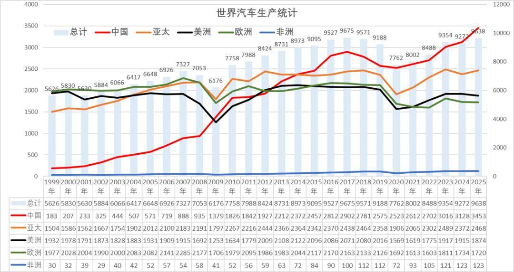
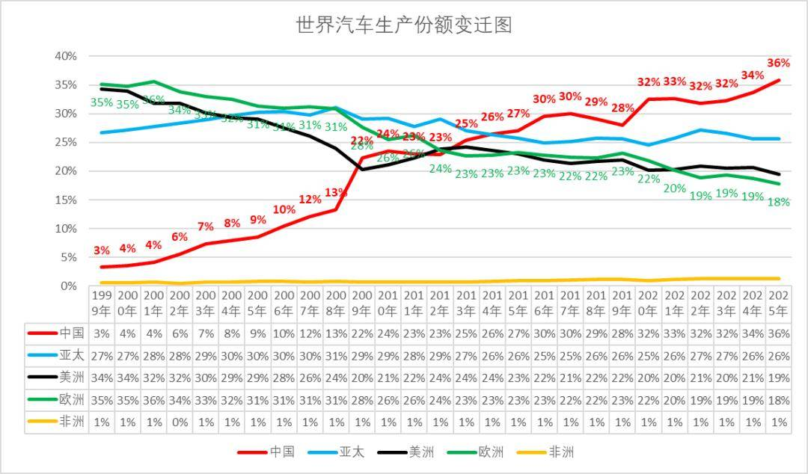
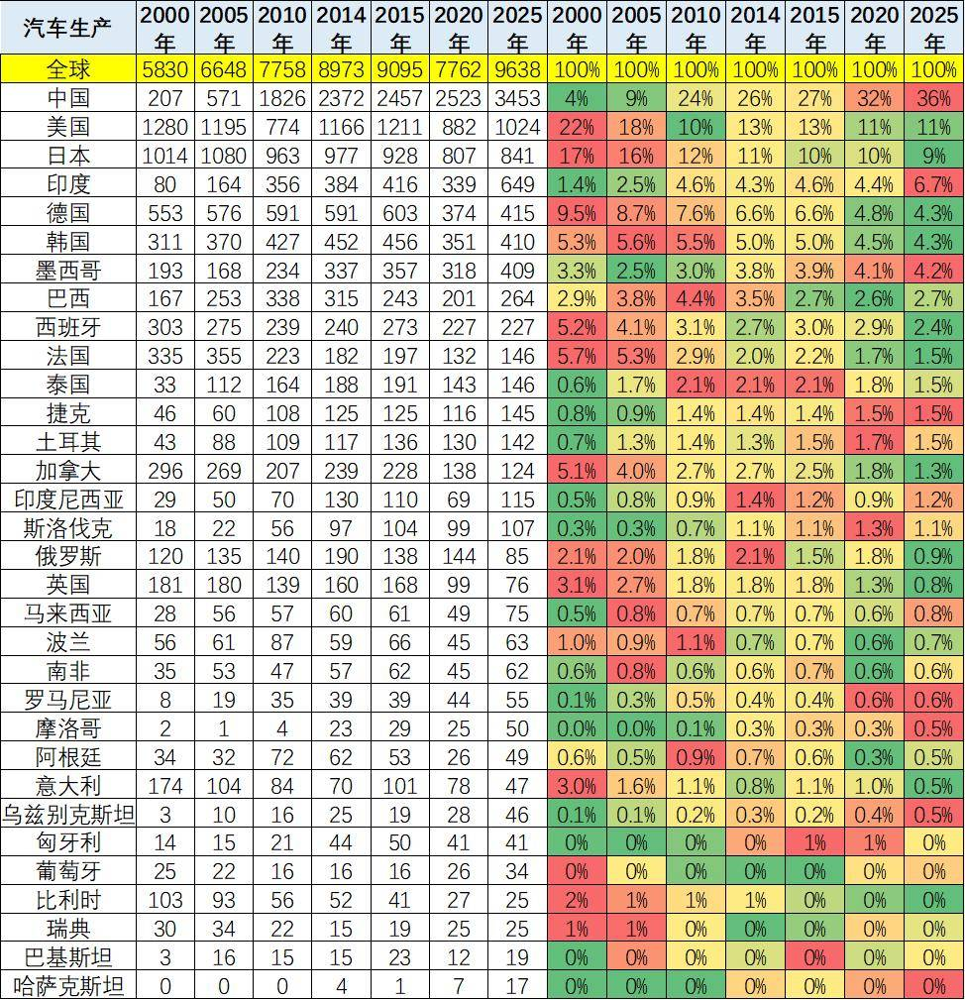
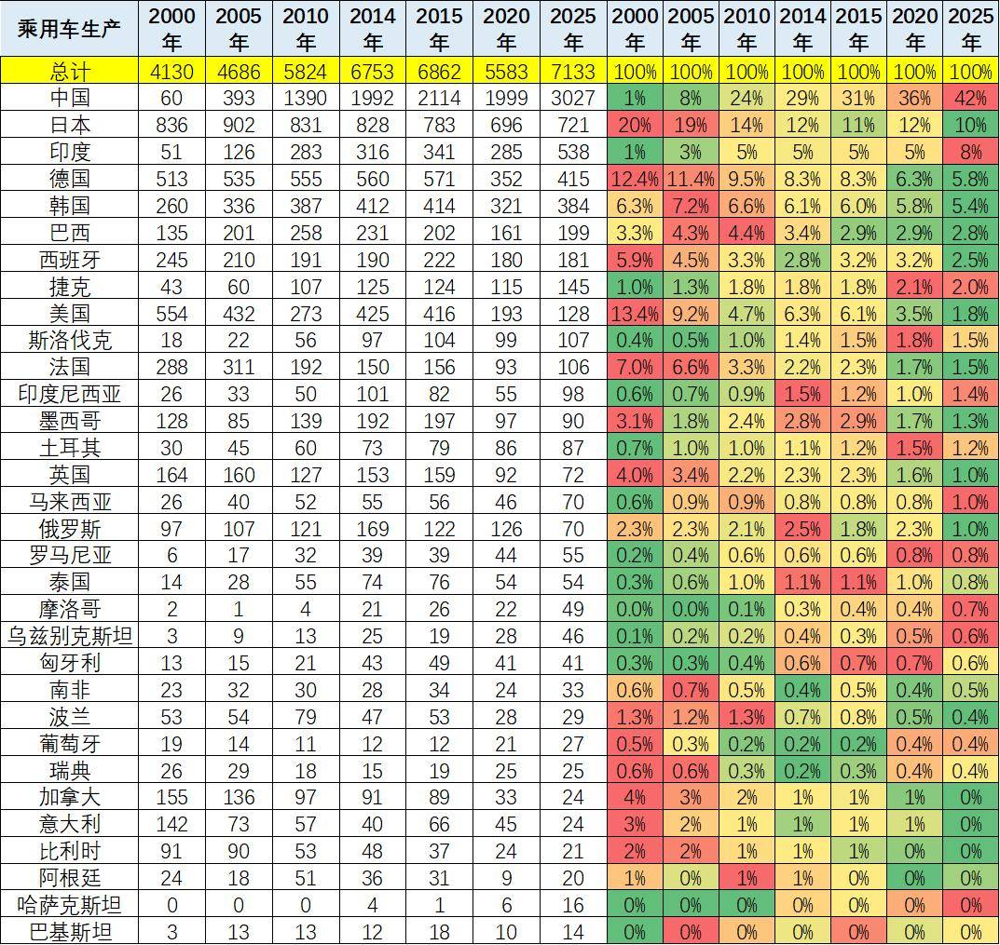
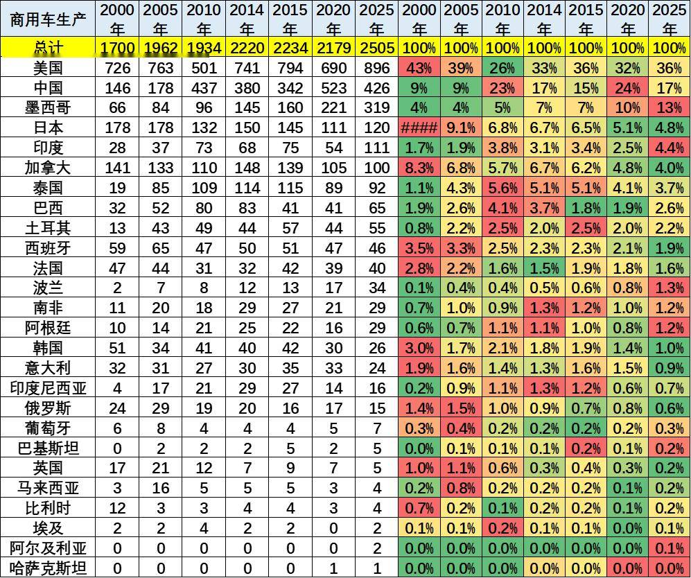

# 历年世界汽车生产统计分析

- 公開日時: 2026-06-22 17:43（北京時間）
- 出典: [搜狐号・崔东树](https://www.sohu.com/a/1040072001_115312)
- テーマ（自動判定）: 世界市場
- 画像: 5枚

---

注：本分析文章仅代表崔东树个人观点，如有异议，请留言。

根据世界汽车组织统计数据，全球汽车生产不断增长，2025年达到9638万台。世界汽车生产的周期波动特征清晰。2008金融危机、2020疫情两次大幅冲击全球产量，中国依托内需与新能源实现快速修复，对冲全球下行压力。

世界汽车产能重心彻底东移。全球制造中心从欧美日转向中国，中国整车份额由3%升至36%，乘用车份额更是突破42%，成为全球绝对第一生产大国；欧洲、美洲本土产能持续收缩，份额近乎腰斩。乘商用车格局分化。乘用车高度向中国集中，传统汽车强国本土产量大幅外流；商用车美国长期保持全球龙头，中国商用车份额冲高回落，墨西哥依托北美自贸体系持续承接轻卡产能。新兴区域分流产能：印度、东南亚、中东欧、拉美逐步释放产能，欧美车企将制造基地外迁降低成本；中国全球布局改变世界汽车产业体系。非洲体量长期微乎其微，不改变大盘格局。

欧盟拟对比亚迪、奇瑞、上汽PHEV 加征反补贴关税，结合2000-2025 全球汽车产能东移大趋势来看，是传统汽车产业区域面对产能格局重构的贸易保护应激反应。过去25 年全球制造重心持续向中国转移，中国乘用车全球份额已达42%，欧洲本土乘用车产能持续萎缩、份额腰斩，本土车企新能源转型进度滞后，面对中国高性价比BEV、PHEV 双重冲击，欧盟先对纯电征税、再扩围插混，试图用关税壁垒延缓本土产能份额流失。

该政策双向受损：短期压制中国车企欧洲出口，同时抬高欧洲购车成本、拖累其电动化进程。从全球产能布局逻辑看，关税壁垒将加速国内车企落地欧盟本地工厂，并加大东南亚、印度等新兴市场布局，进一步推动全球汽车产能多点分散；长期摩擦也会加剧中欧汽车产业割裂，违背全球汽车产业分工转移的长期大趋势。

1、世界汽车生产统计

从1999-2025全球汽车生产数据看，产业重心持续东移，中国是全球产量增长核心引擎，产量从183万台跃升至3453万台，2008金融危机、2020疫情两次冲击后均快速反弹，持续领跑全球。亚太整体依托中国、印度支撑保持总量高位；欧美产量长期存量徘徊，近年持续萎缩，受排放法规、成本压力拖累。2020年疫情是全球产销最大低谷，随后中国新能源拉动全球总量修复走高，非洲体量极小，对大盘影响微弱，全球汽车产能格局已彻底转向亚太。

2、中国汽车生产份额世界领先

1999-2025全球汽车生产份额格局彻底重构，欧美份额持续单边下滑：欧洲从35%跌至18%，美洲由34%回落至19%，传统汽车工业中心产能持续外迁。中国份额呈爆发式上行，从仅3%一路攀升至36%，2009年完成份额拐点反超欧美，成为全球第一生产核心。剔除中国后的亚太份额长期稳定在25%-30%区间，形成双极支撑；非洲份额始终不足1%，对全球产业格局无实质影响，全球汽车制造重心全面向中国转移。

3、世界各国汽车生产走势

2000-2025全球汽车制造版图彻底重塑，中国产量从207万飙升至3453万，份额由4%升至36%，独揽全球三分之一产能。美、日、德、法等传统工业国份额持续下滑，美国从22%降至11%、欧洲老牌车企产能大幅收缩。印度、墨西哥、泰国等新兴市场稳步扩容，成为区域增量支点。日韩产能小幅萎缩，欧洲多国生产基地外迁，全球汽车制造重心全面向中国及东南亚、南亚新兴经济体转移。

4、世界各国乘用车生产走势

2000-2025 全球乘用车格局发生颠覆性变化，中国乘用车产量从60 万台增至3027 万台，份额由1% 暴涨至42%，牢牢占据全球乘用车制造核心。日、德、美传统强国份额持续大幅下滑，日本从20% 降至10%，欧美本土产能持续外迁。印度、印尼、墨西哥等新兴市场份额稳步提升，成为区域增量来源。欧洲多国本土乘用车产能收缩明显，大量产能转移至低成本区域，全球乘用车制造重心全面向中国及南亚、东南亚转移。

5、世界各国商用车生产特征

由于商用车的皮卡规模特别大，因此北美的商用车优势明显，占到全球商用车一半以上。

2000-2025 全球商用车格局分化显著，美国长期稳居第一，份额维持36% 左右，是全球中重卡核心产区。中国商用车份额从9% 提升至峰值24% 后回落至17%，新能源商用车拉动本土产能扩容，但出口冲击国内产量波动。墨西哥份额持续走高至13%，依托北美配套承接大量轻卡产能。日、欧传统商用车强国份额持续萎缩，印度、土耳其、波兰等新兴市场稳步提升，欧美本土商用车产能持续向低成本区域转移。

附：近日信息合集
