# 2026年1-5月中国汽车出口市场分析

- 公開日時: 2026-06-25 11:58（北京時間）
- 出典: [搜狐号・崔东树](https://www.sohu.com/a/1041386445_115312)
- テーマ（自動判定）: 輸出
- 画像: 41枚

---

2025年中国汽车实现出口832万辆，同比2024年全年增速30%。2026年1-5月中国汽车实现出口424万辆，同比2025年同期增速49%，5月中国汽车实现出口98.7万辆，同比增42%，环比增5%，同比走势总体较强, 环比走势平稳。2026年5月中国新能源汽车出口46.3万辆，同比增长59%，1-5月累计出口189万台，增61%的表现很好，5月新能源车出口环比4月表现较强。

2026年5月中国汽车出口总量的前10国家：俄罗斯94301辆、巴西90242辆、澳大利亚54027辆、墨西哥46156辆、菲律宾39643辆、泰国39626辆、英国38700辆、意大利32427辆、阿尔及利亚27596辆、比利时26803辆，其中本期较同期增量增大的前五个是：俄罗斯72362辆、巴西42772辆、泰国29326辆、意大利22207辆、澳大利亚20670辆。

2026年1-5月累计整车出口总量的前10国家：巴西385813辆、俄罗斯364710辆、英国194238辆、澳大利亚178641辆、墨西哥164955辆、比利时162758辆、意大利130098辆、阿联酋129054辆、阿尔及利亚109575辆、泰国106217辆，其中本期较同期增量增大的前五个是：巴西244737辆、俄罗斯210285辆、英国86103辆、阿尔及利亚82086辆、意大利73457辆。

2026年5月中国汽车出口中纯电动占比29%（同比-5%），插混占比17%（同比+4%），混动占比9%（同比+4%），纯燃油车占比35%（同比-3%）。

2026年5月中国新能源汽车出口总量的前10国家：巴西67161辆、澳大利亚45006辆、泰国38670辆、菲律宾34325辆、英国24973辆、比利时24595辆、意大利14778辆、西班牙13933辆、墨西哥13784辆、韩国13343辆，其中本期较同期增量增大的前五个是：巴西31666辆、澳大利亚30687辆、泰国30078辆、菲律宾12663辆、意大利9217辆。

2026年1-5月中国新能源汽车出口总量的前10国家：巴西289558辆、比利时154646辆、英国132570辆、澳大利亚122022辆、泰国99425辆、菲律宾83691辆、意大利69431辆、德国68241辆、韩国63351辆、西班牙58030辆，其中本期较同期增量增大的前五个是：巴西183960辆、澳大利亚65247辆、英国59343辆、意大利52993辆、泰国46991辆。

中国新能源车2026年1-5月出口表现好于预期，主要是插混和混动替代纯电动成为出口增长的新增长点，尤其是纯电动货车出口表现较强，成为商用车新能源车出口亮点。中国新能源车出口主要是出口西欧和中南美市场。中东市场受阻，运力不足的影响不明显。汽车对俄罗斯出口大幅回升，但受伊朗战争影响，5月阿联酋下滑76%，沙特下滑41%，带来的出口损失巨大。

随着出海规模不断扩大，急需科技加持市场销售。鸿蒙生态的全场景智慧营销平台鲸鸿动能已具备覆盖全球主要市场的本地化运营能力，围绕数智化营销体系建设、海外市场全域营销投放及车联网技术等方向展开合作，助力中国汽车品牌实现从“走出去”到“走进去”的全球化升级。

一、中国汽车出口总体走势

1、汽车出口历年走势

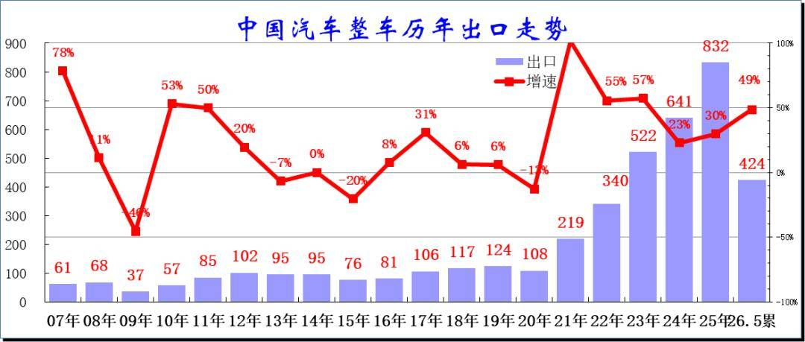

中国汽车出口历经多年百万量级的平台期后，于2021年实现突破。在2013 - 2016年世界经济低迷的大环境下，汽车出口出现剧烈下滑。2017 - 2020年，出口增速逐步企稳并有所改善，年度出口量维持在100万辆左右的水平。2020年出口量达到108万辆，同比下降13%，随后进入2021年以来的高增长期。

中国汽车出口自2021年突破百万量级后持续高增长（2021年增102%，2022-2023年增50%+，2024-2025年增速回落至30%左右），2026年1-5月出口424万辆（同比2025年增49%），延续增长态势。近期中国汽车出口呈现超高速增长态势，未来只要国际市场环境稳定，中国汽车出口发展仍具有巨大空间。

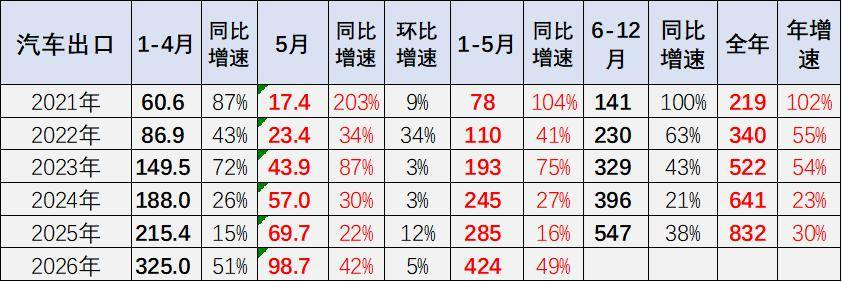

2026年1-5月中国汽车实现出口424万辆，同比2025年同期增速49%，5月中国汽车实现出口98.7万辆，同比增42%，环比增5%，同比走势总体较强, 环比走势平稳。今年的主要动力仍是中国产品竞争力提升和全球南方国家市场的持续增长，巴西车市贡献较大。

从月度走势来看，近几年的中国汽车出口仍呈现出季节性特征，有夏季走高与国内反差的走势特点。2026年1-5月出口增速相对强劲，主要也是国内市场低迷，企业对应海外市场动力和能力增强。

2、整车出口月度走势

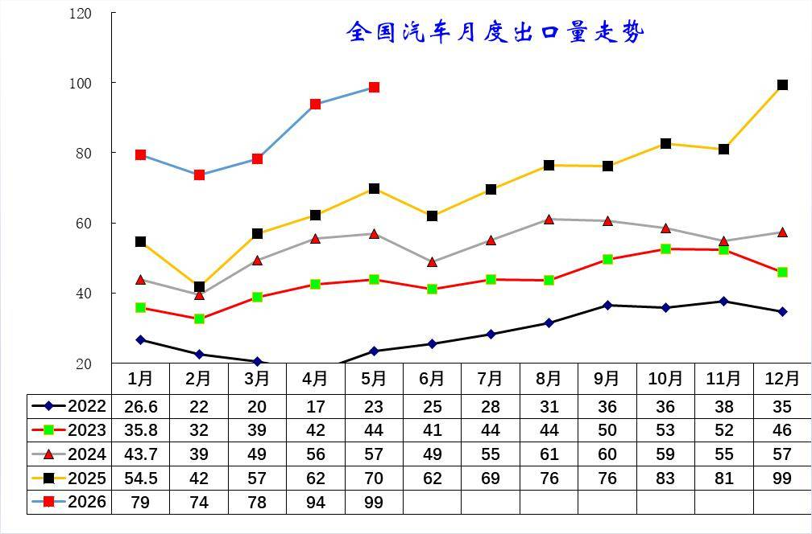

从月度走势看，近几年的中国汽车出口仍呈现惯性持续走强特征，近期呈现出口走高与国内低迷反差走势特征。2026年1-5月出口增速相对很强，延续持续增长动力。虽然有美伊战争的爆发，但由于市场分散，中国汽车出口增速受外部环境影响较小,2026年以来持续拉升。

3、汽车整车出口结构特征

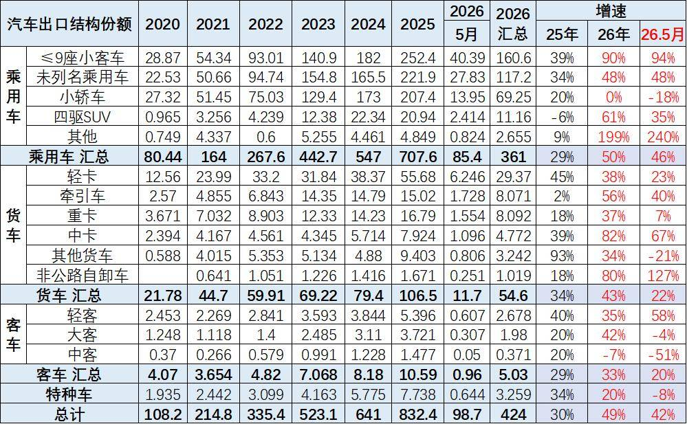

2020年前的中国汽车出口维持在百万规模，随后持续高速增长到2025年的832万辆。乘用车出口持续走强，货车和客车出口也持续较好增长。

今年全年海关各类车型增速分化，乘用车增速逐步回升，货车的增速好于乘用车，货车出口增长43%，相对于国内的燃油货车平稳走势，近期电动货车出口较好。

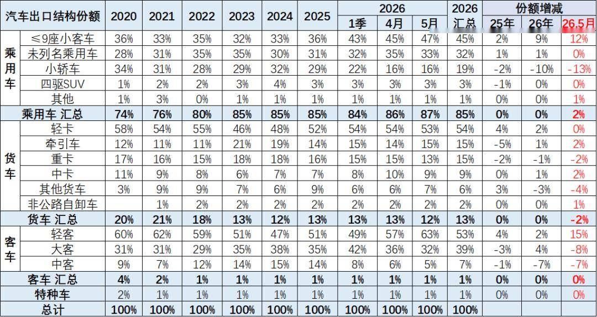

从结构看，乘用车出口占比逐步稳定，到2023年达到85%，随后相对稳定回落。货车出口因电动卡车而明显提升。近几年客车的出口占比持续回落到较低水平。由于乘用车是贸易焦点，出口的货车和客车比例总体达到13%，稍高于国内的商用车占比。

乘用车内部的几类主力车型表现较均衡，2026年乘用车出口表现较强的是9座以下小客车，2026年9座以下客车占比45%，其中5月达到47%。虽然特斯拉出口回落的影响较大，但5月自主的电动车出口增长较好。

货车5月份额表现较好。皮卡5月增长提升，重卡出口表现高位回落，其它卡车市场走势较强。客车中的大中型客车表现较好，轻型客车出口占比回落。

4、出口动力结构特征

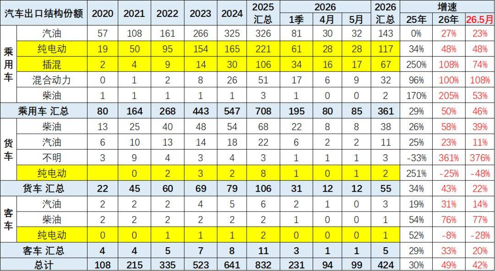

出口动力结构特征方面，2025年乘用车的出口增速回落较大，其中汽油车的出口均增速偏低，今年混合动力乘用车的出口很强，而插混的乘用车出口增速最强。今年货车和客车出口平稳，乘用车出口俄罗斯和欧洲的波动是核心增长推动。

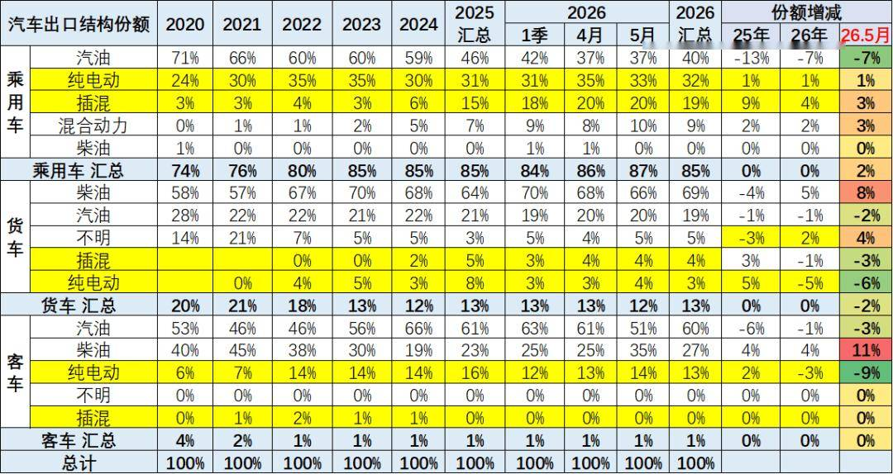

2026年1-5月乘用车的新能源的占比回升，燃油车占比下降明显，混合动力异军突起。汽油乘用车和柴油货车、汽油客车出口下降较大。5月的插混乘用车、纯电动卡车和混动乘用车出口较好增长。

二、汽车出口市场格局

1、出口厂家国内区域特征

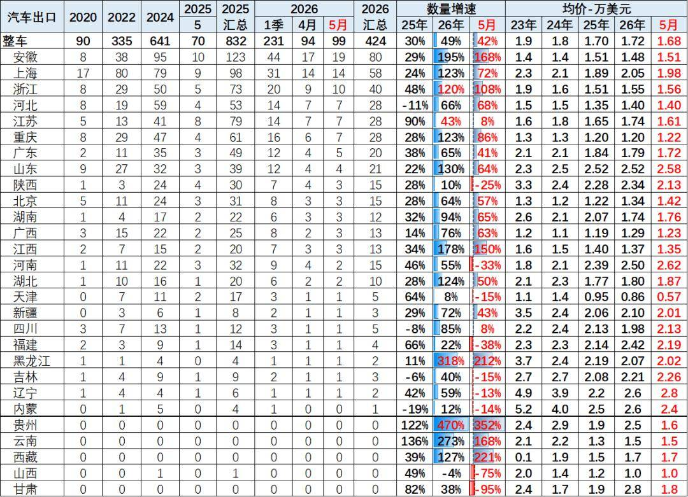

2024年开始上海出口的全国汽车龙头地位被安徽替代，2026年安徽仍保持出口第一的地位。上海对中国出口的重要意义极其明显，实际是长四角的龙头，辐射效应强。2026年1-5月安徽汽车出口80万辆，这主要是由于安徽本地的企业相对比较优秀，加之比亚迪等企业落户合肥。上海企业出口档次高，上汽乘用车和特斯拉两家企业，出口均价较高。

近两年安徽的出口表现相对较强，主要也是奇瑞和江淮的出口表现相对较强，但俄罗斯的市场波动巨大，因此近期安徽出口多元化较好。2026年的重庆、山东、江西的汽车出口贡献度上升较大。

2、出口区域特征

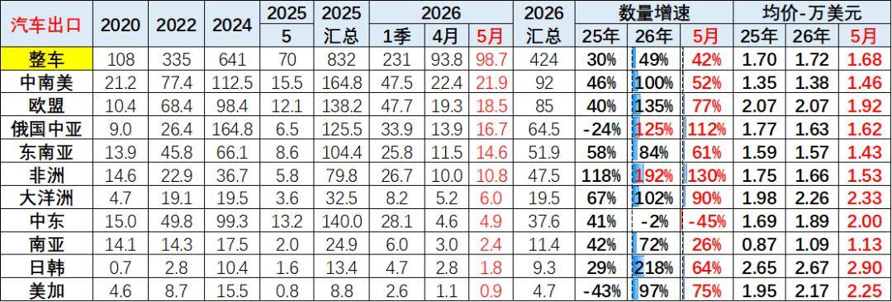

中国汽车出口总体表现较强，其中欧盟和非洲暴增，针对日韩和非洲以及大洋洲的出口表现相对优秀。而针对东南亚地区、大洋洲出口表现压力较大。

前期的中国汽车出口在中南美洲和欧盟占比高，东南亚以及南亚等亚洲其它地区表现较强，目前逐步转到以中南美、欧洲表、俄国中亚现相对较强的特征，日韩和美国出口也有改善。尤其5月受到美伊战争影响，中东出口受阻明显。

3、整车出口分国别走势分析

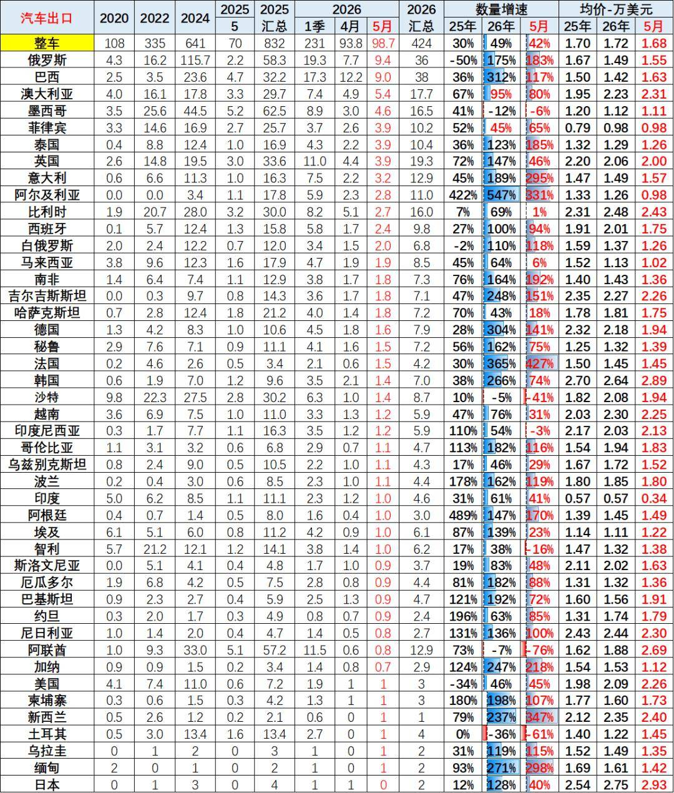

出口均价下降有利于出口增长，随着人民币升值，出口美元价格保持稳定，2026年中国汽车出口价格竞争力较强。前期俄罗斯市场巨变，其它外资退出，因此2023年以来中国对俄罗斯的出口也较多，2025年去库存,2026年回归正常状态。去年出口是对比利时的出口车较多，今年欧洲关系改善，出口表现也有改善。

5月我们对阿联酋市场出口下滑76%，沙特下滑41%，而土耳其下降61%。

近期的巴西市场表现较强，中国汽车走进入的本土化建厂取得一定成效。秘鲁、泰国等车市今年有所恢复。

4、整车出口月度增减量走势

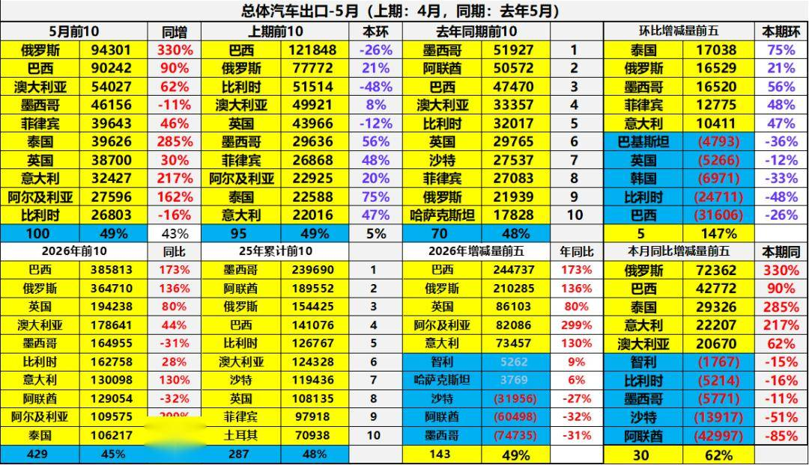

2026年5月中国汽车出口总量的前10国家：俄罗斯94301辆、巴西90242辆、澳大利亚54027辆、墨西哥46156辆、菲律宾39643辆、泰国39626辆、英国38700辆、意大利32427辆、阿尔及利亚27596辆、比利时26803辆，其中本期较同期增量增大的前五个是：俄罗斯72362辆、巴西42772辆、泰国29326辆、意大利22207辆、澳大利亚20670辆。

俄罗斯市场中国车企防风险意识提升，2025年俄罗斯国内销量下滑不大，但我们出口去库存力度很大。2026年1-5月我们对俄罗斯的出口恢复较大。

2026年1-5月累计整车出口总量的前10国家：巴西385813辆、俄罗斯364710辆、英国194238辆、澳大利亚178641辆、墨西哥164955辆、比利时162758辆、意大利130098辆、阿联酋129054辆、阿尔及利亚109575辆、泰国106217辆，其中本期较同期增量增大的前五个是：巴西244737辆、俄罗斯210285辆、英国86103辆、阿尔及利亚82086辆、意大利73457辆。

5、历年出口主力国家变化分析

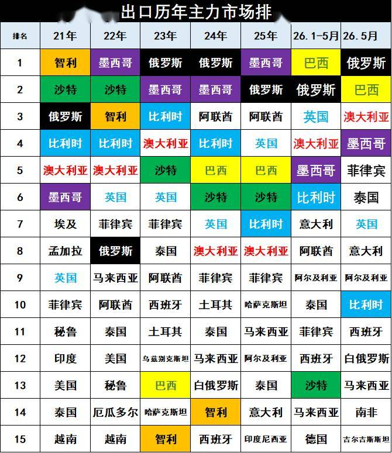

前期汽车出口的海外根据地效果并不理想，主力市场波动较大。2023 - 2024年汽车出口主要市场来自俄罗斯、墨西哥、比利时、澳大利亚、沙特、英国等国家，欧美市场走势较强。近期阿联酋、英国等相对发达国家表现改善。

2026年1-5月汽车出口结构变化，巴西回升到出口第一地位，英国市场增长很强，阿联酋的出口同比下降较大。5月对阿联酋的出口暴跌，俄罗斯出口表现较好。

6、对俄罗斯出口变化分析

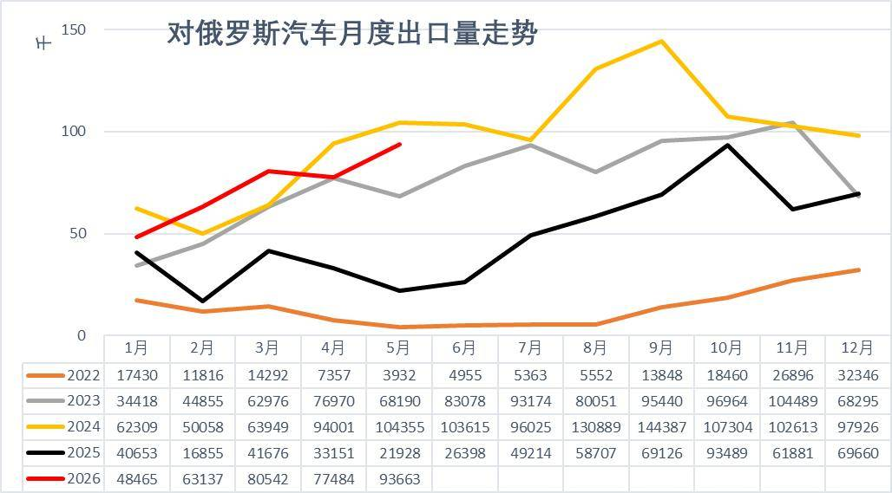

近期由于其它国家汽车企业退出俄罗斯，2023年中国车企迅速保证了俄罗斯的车辆供给需求，前期的中国车企在俄罗斯应该暂时是安全的。

俄罗斯的进口规则根据供需不断调整，2024年俄罗斯汽车销量已经是近几年的最高水平，因此需求提前透支后的2025年下跌是必然的。2025年以来的中国对俄罗斯的新能源车的出口剧烈波动，今年全年的俄罗斯国内需求逐步企稳，中国汽车出口在逐步回升。

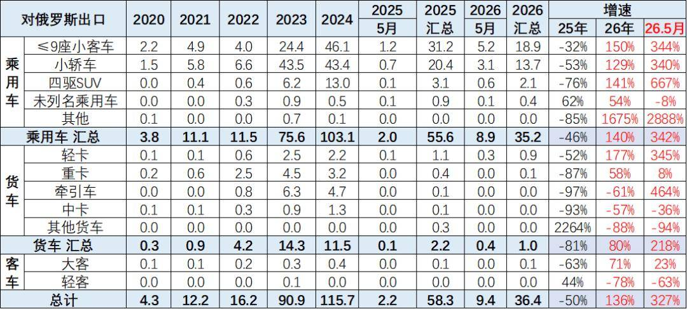

2023年以来俄罗斯突然变成中国汽车出口第一大市场，这是时隔15年后中国汽车再一次的出口巨变。2008年中国自主品牌进军俄罗斯的市场表现很好，但随着俄罗斯对中国汽车巨额加征关税政策，当年中国汽车车企大面积退出俄罗斯，2025年上半年下滑有些类似2009年的走势，但2026年开局因低基数而暴增。

三、新能源车出口走势

1、历年新能源汽车整车出口特征

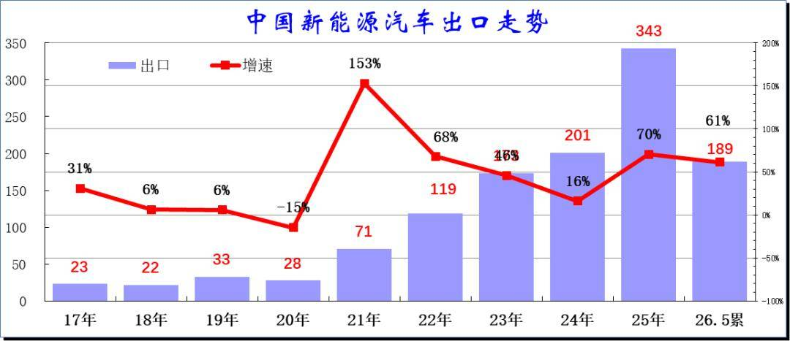

随着中国国内新能源车市场从补贴驱动向市场驱动的转型，中国新能源汽车的市场竞争力大幅增长。中国新能源汽车出口自2021年实现爆发增长，随后进入持续的高增长区间。虽然2024年受到欧盟出口新能源的政策干扰，但2024年全年中国新能源汽车出口仍达到201万辆，同比增长16%。2025年出口新能源车343万辆，同比增长70%，表现良好。2026年1-5月出口新能源车189万辆，同比增长61%，表现良好。

2、历年新能源汽车月度出口特征

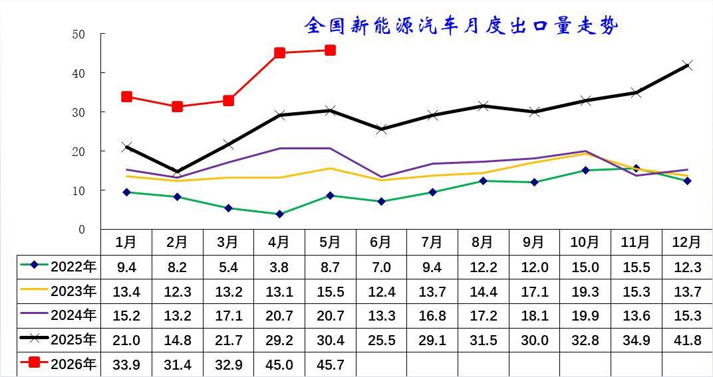

因欧盟加征关税，2024年下半年中国新能源出口走势低迷，市场压力较大。2025年3月开始的新能源车出口暴增的走势超强。2026年1-5月新能源出口持续历史高位，国内低迷推动出口热情更高。

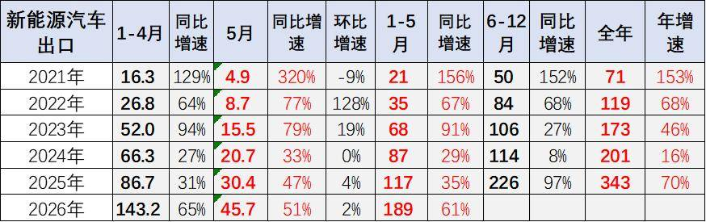

在连续高增长后，2024年全年新能源汽车累计出口量201万辆，同比增长16%。2025年新能源汽车出口量343万辆，同比增长70%，增速高于2024年全年的16%较多。2026年5月中国新能源汽车出口45.7万辆，同比增长51%，1-5月累计出口189万台，增61%的表现很好，5月新能源车出口环比4月表现较弱。

3、汽车整车出口结构变化

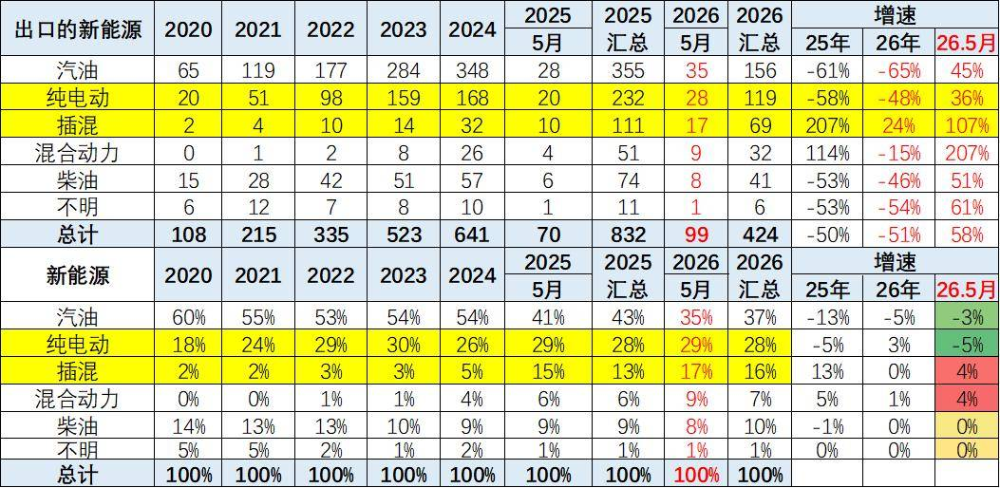

2026年5月中国汽车出口中纯电动占比29%（同比-5%），插混占比17%（同比+4%），混动占比9%（同比+4%），纯燃油车占比35%（同比-3%）。

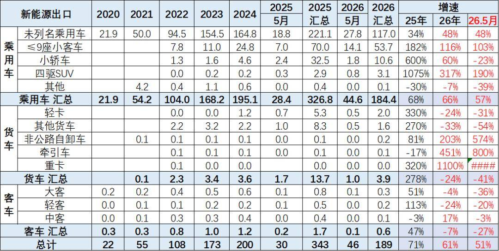

新能源车出口的97%都是乘用车，商用车占比较小，新能源货车表现好于客车。电动化导致的未列名乘用车占比保持高位。

4、新能源出口地区变化分析

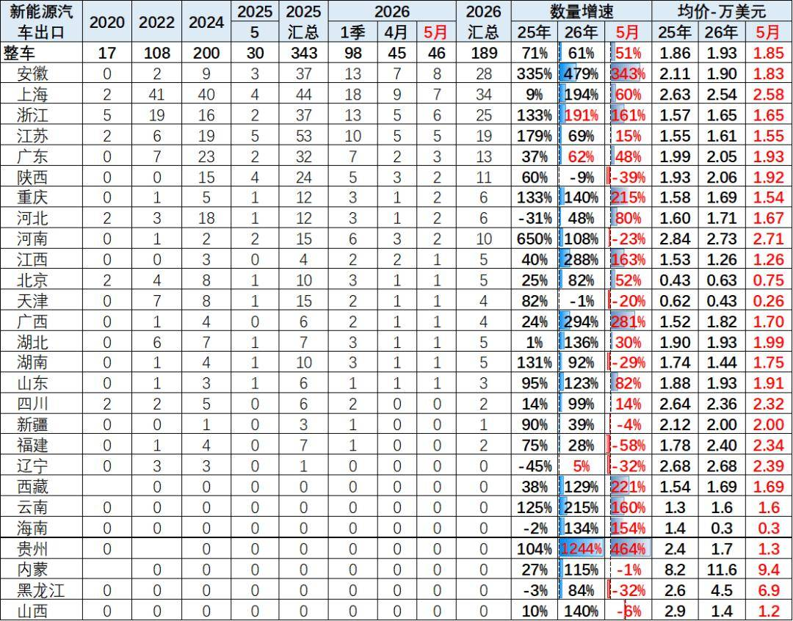

随着特斯拉进入中国，中国汽车出口格局改变，前几年上海长期第一。随着国产车崛起，自主成为新能源出口核心，近期安徽等崛起，5月安徽、上海、浙江、江苏的新能源出口表现较好。

2026年新能源汽车出口均价相对稳定。

5、历年新能源乘用车整车出口国家特征

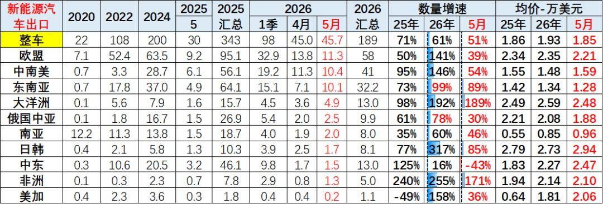

新能源车出口获得更多的突破，2026年仍是欧盟最强，日韩增速表现较高，东南亚还相对平稳增长。

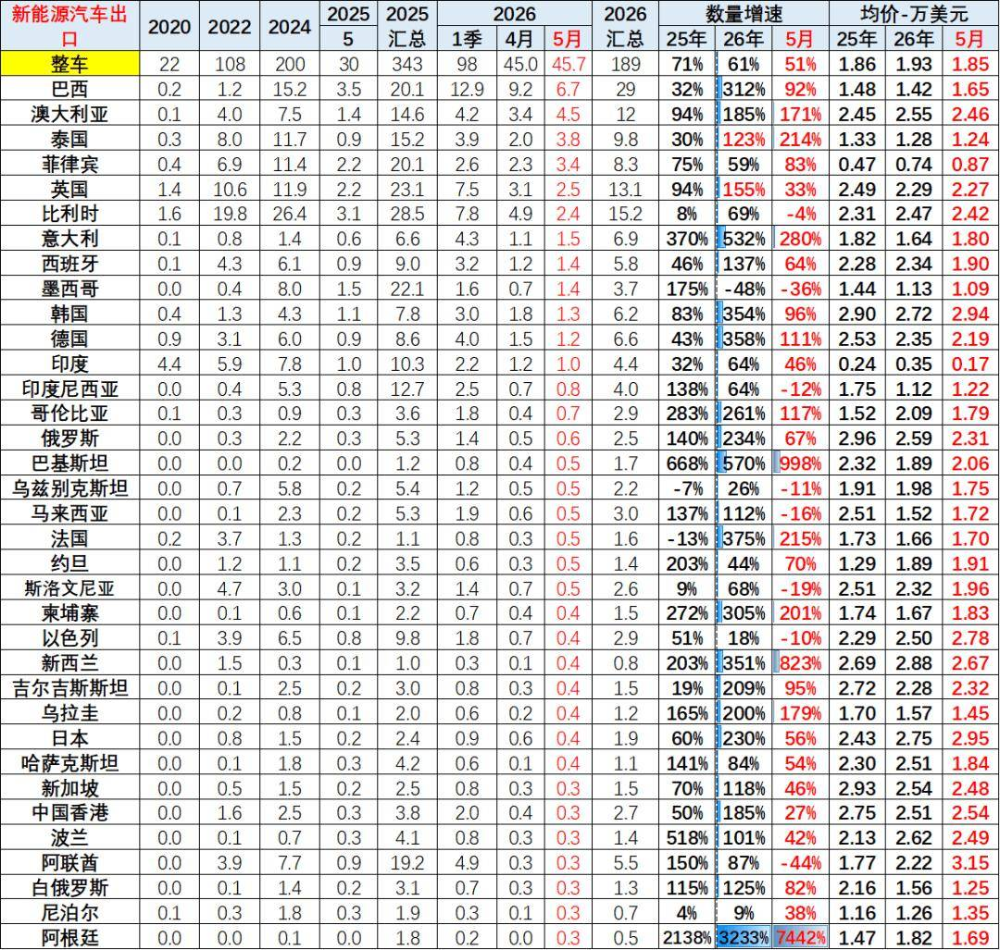

2026年新能源汽车出口同比增长分化。新能源汽车出口主要是欧洲、亚洲两大市场，今年的巴西超越比利时成为新能源车出口的第一大市场，巴西建厂推动巴西出口暴增。

今年新能源车出口的主力市场基本都有较好增长。德国、意大利等市场新能源车出口增长表现突出，墨西哥市场走弱，泰国市场走势相对一般。

6、2026年新能源汽车整车出口变化分析

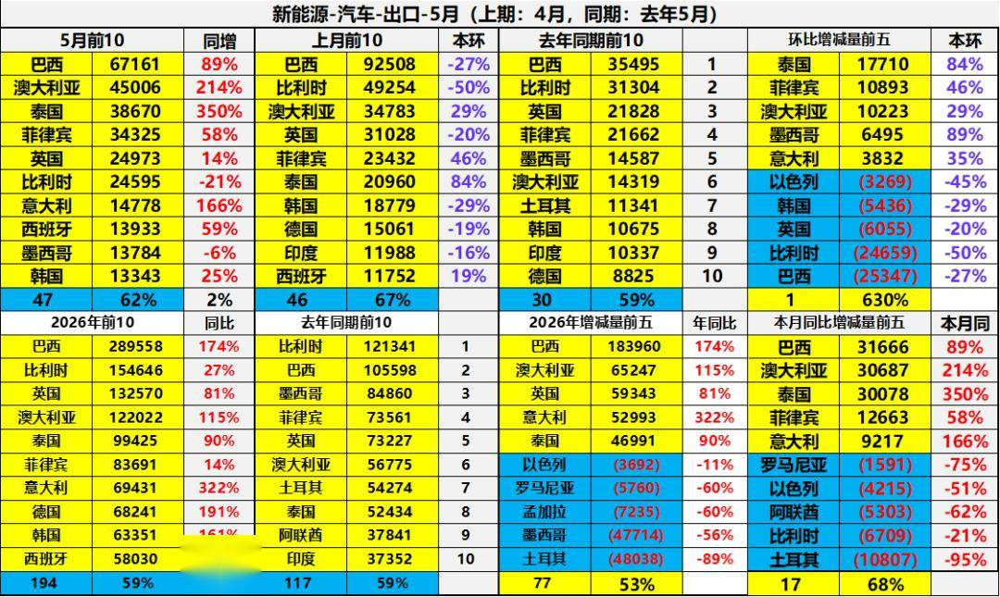

2026年5月中国新能源汽车出口总量的前10国家：巴西67161辆、澳大利亚45006辆、泰国38670辆、菲律宾34325辆、英国24973辆、比利时24595辆、意大利14778辆、西班牙13933辆、墨西哥13784辆、韩国13343辆，其中本期较同期增量增大的前五个是：巴西31666辆、澳大利亚30687辆、泰国30078辆、菲律宾12663辆、意大利9217辆。

2026年1-5月中国新能源汽车出口总量的前10国家：巴西289558辆、比利时154646辆、英国132570辆、澳大利亚122022辆、泰国99425辆、菲律宾83691辆、意大利69431辆、德国68241辆、韩国63351辆、西班牙58030辆，其中本期较同期增量增大的前五个是：巴西183960辆、澳大利亚65247辆、英国59343辆、意大利52993辆、泰国46991辆。

2026年出口巴西、比利时、英国等欧盟是几大主力方向。近期的土耳其、墨西哥等市场出口较弱。

7、燃油车分动力整车出口变化分析

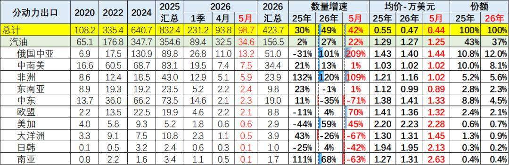

2024年全年中国汽油车型出口348万辆、增22%；2025年中国汽油燃油车出口355万辆、增2%,2026年1-5月中国汽油燃油车出口157万辆、增27%。

今年中国对俄罗斯、非洲、南亚等市场的燃油车市场较强，其它市场总体表现一般，尤其是欧盟、大洋洲等市场的燃油车出口下降，高质量发展特征明显。

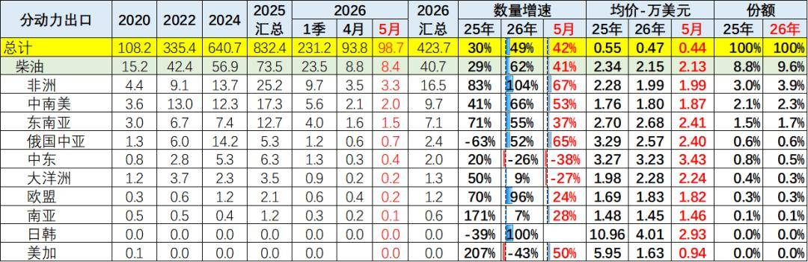

今年柴油车出口好于汽油车，实现柴油车在非洲、中南美的较强增长局面。5月的中东的出口表现较差。

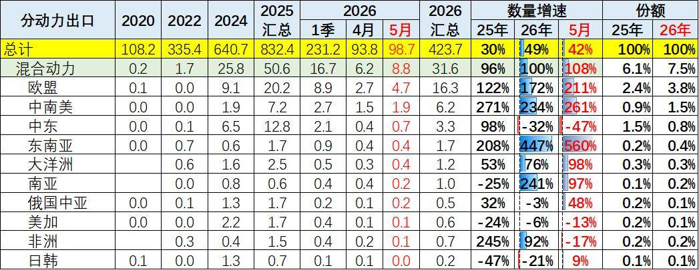

今年混合动力车型对欧洲和中南美、亚洲其它市场的增量超强，体现了中国乘用车竞争力的全面提升。但中东销量剧烈下滑，俄国中亚地区的混合动力表现一般。

8、2026年新能源汽车整车出口变化分析

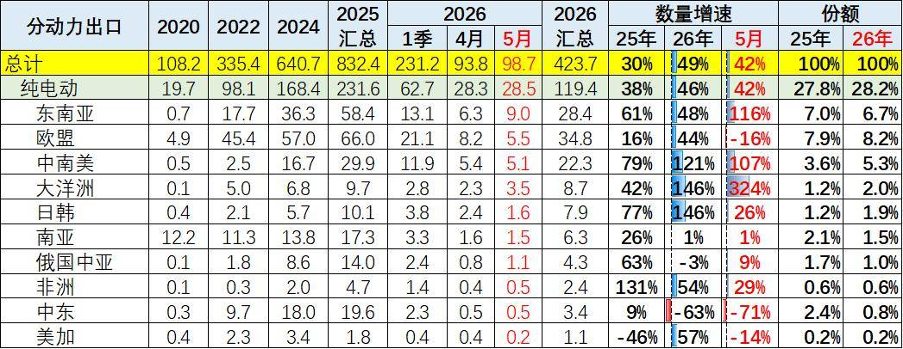

2024年全年中国纯电动车型出口168万辆、增6%；2025年中国纯电动车出口232万辆、增38%；2026年1-5月中国纯电动车出口119.4万辆、增46%，5月增长42%也是很好的。

目前纯电动的欧盟市场仍是绝对主力市场，东南亚市场和中南美等市场的需求相对波动较大，日韩市场上升明显，但中东市场损失巨大。由于国外基础设施缺乏，加之中国纯电动过于追求高端，大型化特征明显，小型电动车缺乏好产品，纯电动的出口仍有提升空间。

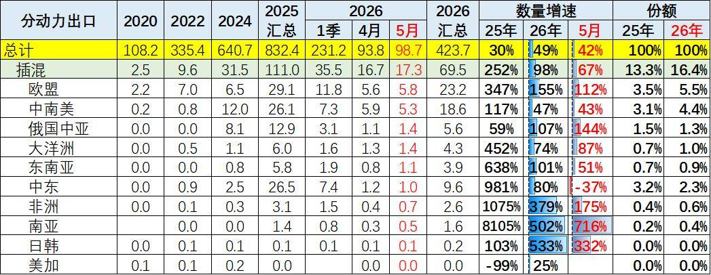

2026年1-5月中国插混车型出口69.5万辆、增98%，其中5月插混出口17.3万辆、增67%。除了美加等地区的插混需求很少，其它地区的中国插混表现都很突出。而欧盟地区的中国插混车型需求爆发增长，中东的土耳其等插混出口总体算是增长。

四、鲸鸿动能四位一体的品牌阵地赋能汽车出海，驱动海外市场持续增长

1、四位一体的品牌阵地，驱动海外市场持续增长

随着出海规模扩大，一批科技平台正在为车企提供新助力。其中，鸿蒙生态的全场景智慧营销平台鲸鸿动能，正在系统助力中国车企出海正从“产品输出”进入“品牌扎根”的新阶段。过去，行业更关注“把车卖到海外”；而新的竞争阶段，真正决定增长质量的，是能否建立一套统一、可信、可运营的品牌阵地——让品牌在海外被看见、被信任、被选择。

针对中国车企出海面临的品牌形象不统一、核心优势难传递、流量无法沉淀、营销效果难衡量、合规风险等五大核心挑战，鲸鸿动能推出以PetalGenie AI Marketing Agent 为智能中枢，整合全域营销、经营阵地、合规保障三大经营模块，形成“3+1”出海一站式品牌阵地解决方案，驱动出海增长闭环。

在经营阵地层面，品牌阵地不是简单的信息展示，而是三大核心功能的集合体：坚持“全球一套品牌口径，区域做本地化适配”的品牌主阵地，建立统一的品牌认知；将海外用户看车、预约试驾、在线询价、经销商门店查询等所有交互行为统一收口至官网的线索承接池，构建全渠道销售线索的“统一入口”；以及沉淀海外潜客、车主一手数据资产的用户资产库，构建真正属于企业的用户数据银行与私域运营基础。

在全域触达层面，鲸鸿动能整合搜索、社交、视频、内容联盟、KOL等三方媒体资源，以数据和AI赋能持续提升线索转化效率。其中，Petal Genie作为新一代AI Marketing Agent，从市场洞察到落地执行，打通出海营销“全域感知、意图智算、激活编排、阵地掌控”O1-O4全链路，形成一站式增长闭环，让营销从经验驱动走向智能驱动。

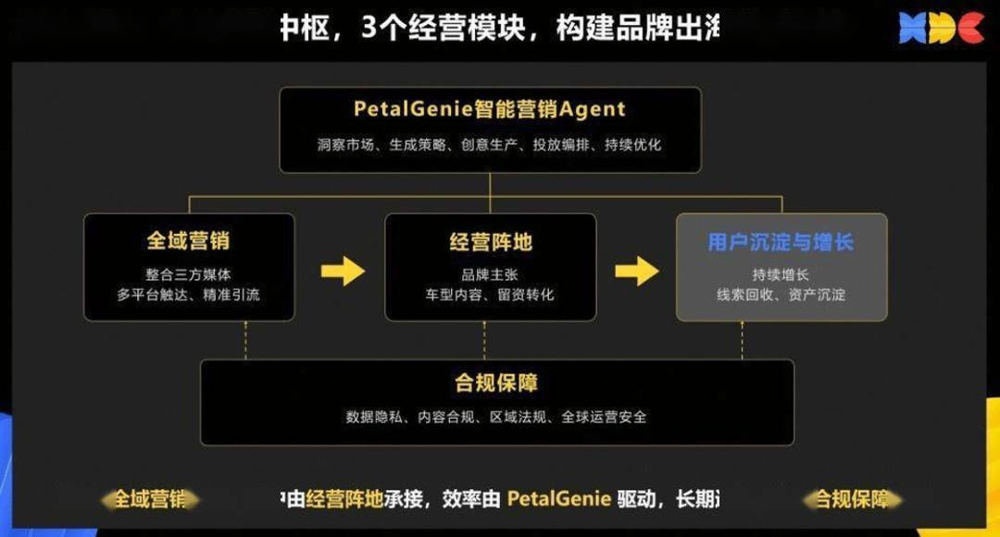

2、鲸鸿动能：全链路打通，汽车营销新范式

在合规保障层面，合规不是限制增长，而是品牌在海外市场长期经营的安全边界。方案系统覆盖数据隐私合规、内容合规、市场本地化、技术部署合规、运营流程合规五大维度，为品牌出海筑牢长期运营底座，通过一站式品牌阵地，支撑中国车企出海从产品输出到品牌扎根。

在经营阵地与出海合规层面，鲸鸿动能帮助车企在海外市场建立自主可控的数字总部，通过统一核心数据口径、统计规则与监测维度的标准化数据体系，实现流量、转化、留存、效果指标的量化管理与持续复盘，为业务决策提供客观精准的数据支撑。

依托鸿蒙生态的端到端支撑，鲸鸿动能承接上层用户经营与商业转化，形成从技术底座到营销赋能的完整闭环。这一独特组合让中国车企在海外市场不仅拥有领先的智能座舱产品力，更具备可持续运营用户、建立品牌忠诚度的数字化能力。在落地路径上，鲸鸿动能提出“先建阵地，再跑数据，持续优化”的实践建议：0-60天完成经营阵地框架、国家站模板与内容媒资规范搭建；61-90天实现AI接入赋能、埋点与线索表单配置及合规基础部署；91-120天建立看板归因、线索评分分发与自动化触达能力；120天以上则推动多市场复制、内容增长与持续优化治理。

3、将产品力转化为品牌力，实现全球化高质量增长

鲸鸿动能是基于鸿蒙生态的全场景智慧营销平台。依托华为“1+8+N”全场景硬件生态、媒体及内容生态，为广告主和开发者提供广告营销与流量变现服务。通过数据与AI能力驱动，实现精准触达和商业增长，让每一次连接都产生价值。

中国车企出海的竞争，正在从产品力竞争走向品牌力、用户经营能力和数字化运营能力的综合竞争。本次“智能座舱出海”分论坛，标志着鲸鸿动能面向车企出海的端到端解决方案全面就绪。

产品力是硬实力，品牌阵地是软实力，更是长期护城河。通过Petal Genie、经营阵地、全域营销、合规保障四位一体的品牌阵地体系，鲸鸿动能为出海车企打造合规、自主可控的一站式品牌经营阵地，将产品力转化为品牌力，助力中国汽车产业实现全球化高质量发展。

五、乘用车分类别出口走势

1、乘用车分排量出口

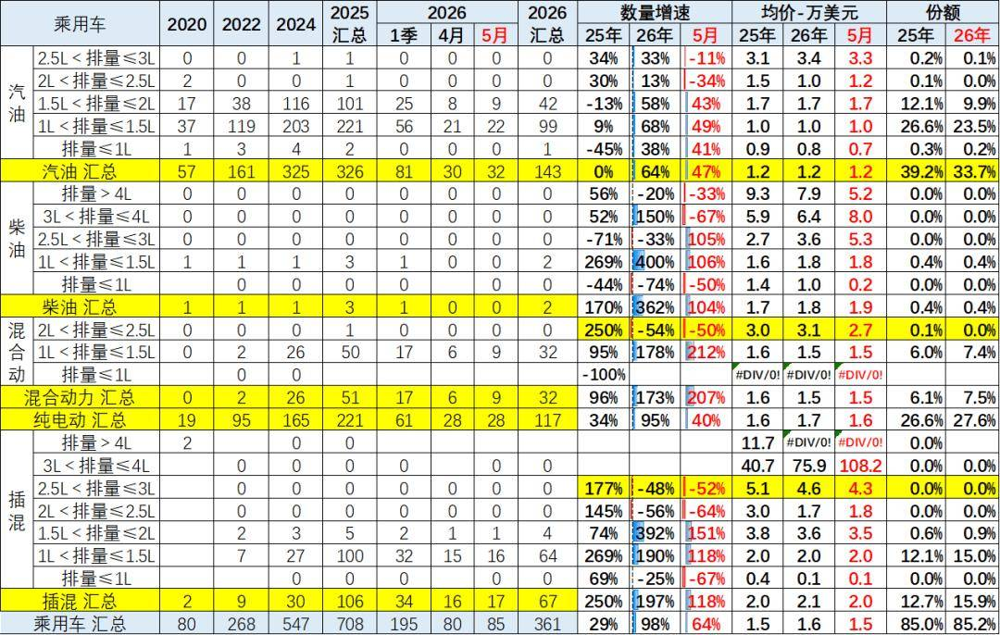

乘用车出口主要靠插混和混合动力乘用车，纯电动表现也很强，燃油车出口保持较好走势。燃油车的排量在1升-1.5升区间为主体，这也是中国自主乘用车的产品综合优势。2025年的1.5-2升车型下滑剧烈。今年1.5-2升车型出口恢复较快，说明俄罗斯等更需求中国的高端高价SUV车型，柴油乘用车基本没啥市场。

而电动车车型的产品档次分化，高端电动车出口改善较大，而入门级插混出口增长较好。

2、乘用车整车出口结构特征

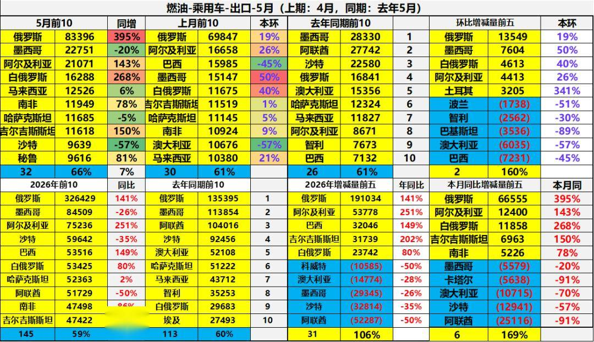

中国燃油乘用车2026年5月出口规模最大的是俄罗斯和墨西哥等国家。

中国纯电动乘用车2026年5月出口主要是泰国36811辆、澳大利亚32368辆、巴西28728辆、菲律宾26410辆、比利时14025辆、英国13852辆、韩国12719辆、印度9902辆、印度尼西亚6909辆、墨西哥6892辆，其中本期较同期增量增大的前五个是：泰国28628辆、澳大利亚25115辆、巴西20938辆、菲律宾9292辆、哥伦比亚3131辆。

中国纯电动乘用车2026年1-5月出口主要是巴西141755辆、比利时109871辆、泰国94711辆、澳大利亚80296辆、英国73611辆、菲律宾65688辆、韩国61138辆、印度43791辆、印度尼西亚38001辆、德国37175辆，其中今年较去年同期增量增大的前五个是：巴西111468辆、澳大利亚47325辆、泰国44914辆、韩国37902辆、英国26416辆。

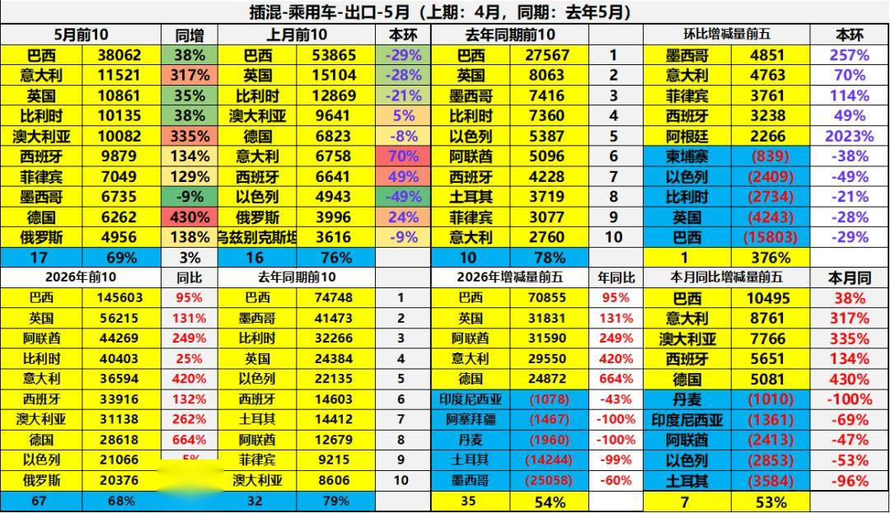

2026年5月出口插混乘用车的主要是巴西38062辆、意大利11521辆、英国10861辆、比利时10135辆、澳大利亚10082辆、西班牙9879辆、菲律宾7049辆、墨西哥6735辆、德国6262辆、俄罗斯4956辆，其中本期较同期增量增大的前五个是：巴西10495辆、意大利8761辆、澳大利亚7766辆、西班牙5651辆、德国5081辆。

2026年1-5月出口插混乘用车的主要是巴西145603辆、英国56215辆、阿联酋44269辆、比利时40403辆、意大利36594辆、西班牙33916辆、澳大利亚31138辆、德国28618辆、以色列21066辆、俄罗斯20376辆，其中今年较去年同期增量增大的前五个是：巴西70855辆、英国31831辆、阿联酋31590辆、意大利29550辆、德国24872辆。

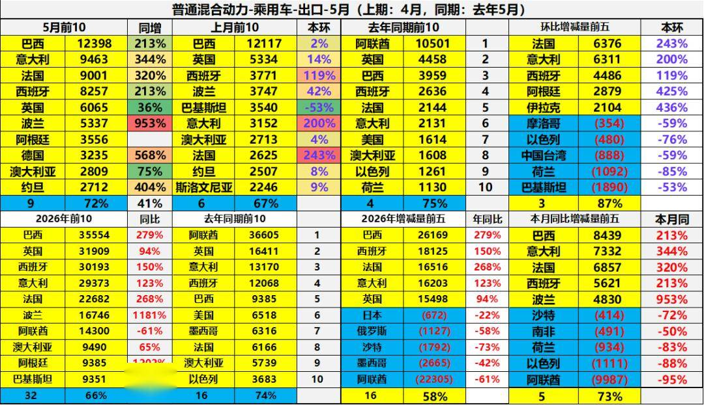

2026年5月出口乘用车普通混合动力的主要是巴西12398辆、意大利9463辆、法国9001辆、西班牙8257辆、英国6065辆、波兰5337辆、阿根廷3556辆、德国3235辆、澳大利亚2809辆、约旦2712辆，其中本期较同期增量增大的前五个是：巴西8439辆、意大利7332辆、法国6857辆、西班牙5621辆、波兰4830辆。

2026年1-5月出口乘用车普通混合动力的主要是巴西35554辆、英国31909辆、西班牙30193辆、意大利29373辆、法国22682辆、波兰16746辆、阿联酋14300辆、澳大利亚9490辆、阿根廷9385辆、巴基斯坦9351辆，其中今年较去年同期增量增大的前五个是：巴西26169辆、西班牙18125辆、法国16516辆、意大利16203辆、英国15498辆。

六、货车分类别出口走势

1、货车出口

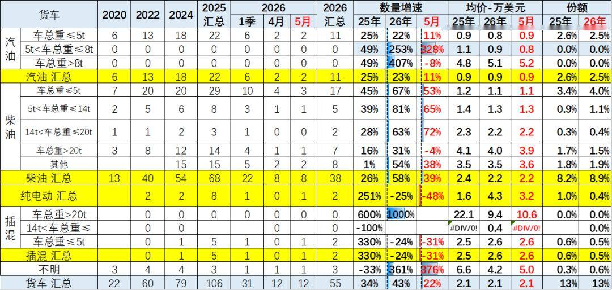

货车市场出口近几年增速不强，在汽车出口市场占比表现处于持续小幅萎缩状态，但2026年因纯电动和柴油轻卡表现较强，拉动出口占比改善。货车市场主力是5吨以下汽油和柴油货车较强，5-14吨和20吨以上柴油重卡货车总体来看也有较强需求。

2、货车出口市场变化特征

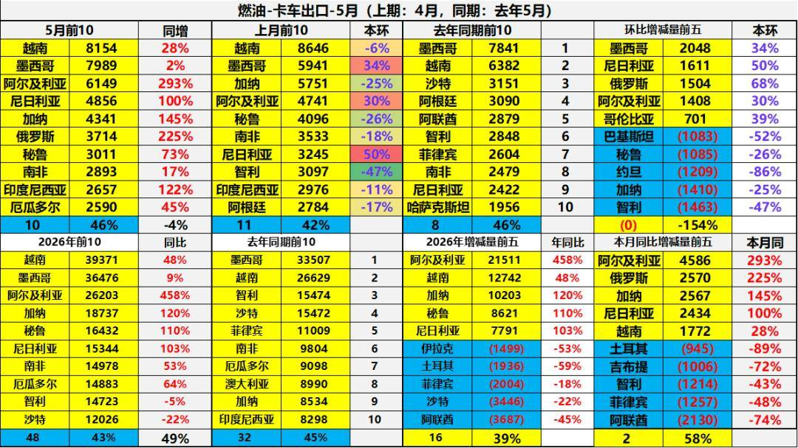

燃油货车出口市场前几位总体表现稳定。2026年5月主力出口市场越南8154辆、墨西哥7989辆、阿尔及利亚6149辆、尼日利亚4856辆、加纳4341辆、俄罗斯3714辆、秘鲁3011辆、南非2893辆、印度尼西亚2657辆、厄瓜多尔2590辆，其中本期较同期增量增大的前五个是：阿尔及利亚4586辆、俄罗斯2570辆、加纳2567辆、尼日利亚2434辆、越南1772辆。

2026年1-5月燃油货车主力出口市场:越南39371辆、墨西哥36476辆、阿尔及利亚26203辆、加纳18737辆、秘鲁16432辆、尼日利亚15344辆、南非14978辆、厄瓜多尔14883辆、智利14723辆、沙特12026辆，其中今年较去年同期增量增大的前五个是：阿尔及利亚21511辆、越南12742辆、加纳10203辆、秘鲁8621辆、尼日利亚7791辆。

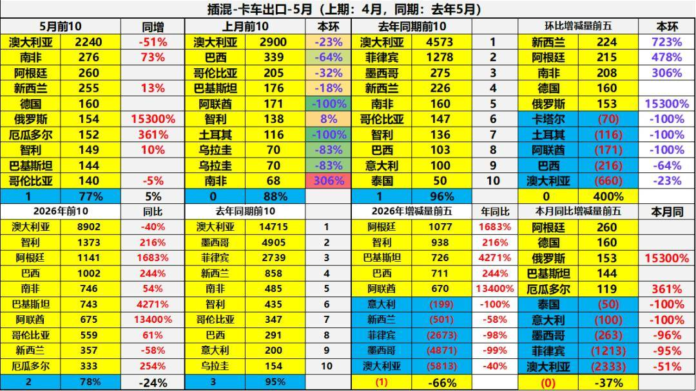

插混的货车出口市场近期较强，这主要是皮卡的乘用车属性的增量，在海外市场形成插混的野外场景便利和使用成本优势。

目前5月出口市场的澳大利亚2240辆、南非276辆、阿根廷260辆、新西兰255辆、德国160辆、俄罗斯154辆、厄瓜多尔152辆、智利149辆、巴基斯坦144辆、哥伦比亚140辆，其中本期较同期增量增大的前五个是：阿根廷260辆、德国160辆、俄罗斯153辆、巴基斯坦144辆、厄瓜多尔119辆。

目前全年累计出口的澳大利亚8902辆、智利1373辆、阿根廷1141辆、巴西1002辆、南非746辆、巴基斯坦743辆、阿联酋675辆、哥伦比亚559辆、新西兰357辆、厄瓜多尔333辆，其中今年较去年同期增量增大的前五个是：阿根廷1077辆、智利938辆、巴基斯坦726辆、巴西711辆、阿联酋670辆。

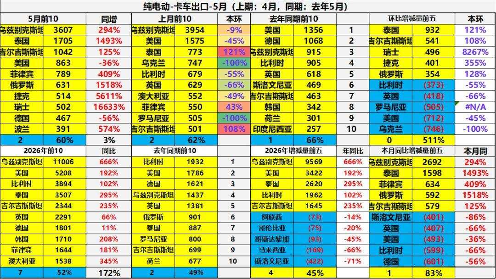

纯电动的货车出口市场近期暴增，这主要是特殊用车属性的暴增，在海外市场形成超强的场景便利和使用成本优势。

七、客车分类别出口走势

1、客车出口总体

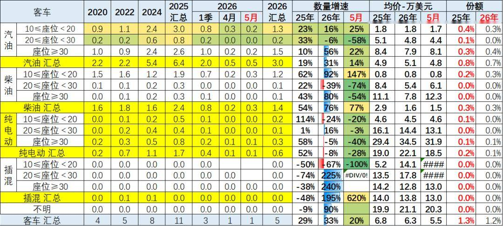

近期世界客车需求出现一定下降，导致前两年的中国客车出口持续萎缩，从2019年的6.4万辆下降到2022年的4.8万辆。2023年以来的世界需求恢复，中国客车2025年的全年达到10.6万辆。

2026年1-5月纯电动客车出口0.6万辆，下降8%的表现一般，柴油客车低基数出口增长较大，汽油大中型客车出口较强。

2、客车出口市场变化特征

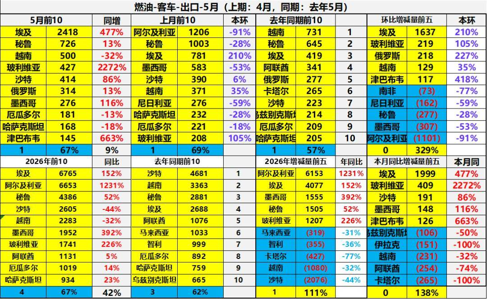

中国燃油客车出口主要市场比较分散，属于欠发达国家为主，市场比较复杂，难以有序持续开展出口。

今年5月燃油客车出口的主力是：埃及2418辆、秘鲁726辆、越南500辆、玻利维亚427辆、沙特414辆、俄罗斯314辆、墨西哥276辆、厄瓜多尔181辆、哈萨克斯坦168辆、津巴布韦145辆，其中本期较同期增量增大的前五个是：埃及1999辆、玻利维亚409辆、沙特191辆、墨西哥148辆、津巴布韦126辆。

今年全年燃油客车出口的主力是：埃及6765辆、阿尔及利亚6653辆、秘鲁4386辆、沙特2605辆、越南2283辆、墨西哥1952辆、玻利维亚1741辆、阿联酋1131辆、厄瓜多尔1019辆、哈萨克斯坦934辆，其中今年较去年同期增量增大的前五个是：阿尔及利亚6153辆、埃及4077辆、墨西哥1555辆、秘鲁1505辆、玻利维亚1207辆。

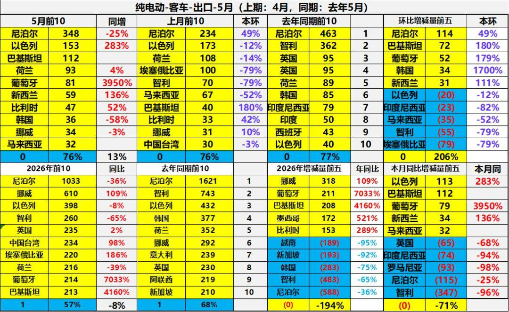

纯电动客车出口市场较小，数据波动较大，今年5月的出口主力是：尼泊尔348辆、以色列153辆、巴基斯坦112辆、荷兰93辆、葡萄牙81辆、新西兰59辆、比利时47辆、韩国36辆、挪威34辆、马来西亚32辆，其中本期较同期增量增大的前五个是：以色列113辆、巴基斯坦112辆、葡萄牙79辆、新西兰34辆、马来西亚32辆。

纯电动客车今年全年的出口主力是：尼泊尔1033辆、挪威610辆、以色列398辆、智利260辆、英国235辆、中国台湾234辆、埃塞俄比亚220辆、荷兰216辆、葡萄牙214辆、巴基斯坦213辆，其中今年较去年同期增量增大的前五个是：挪威318辆、葡萄牙211辆、巴基斯坦208辆、墨西哥172辆、比利时153辆。

附：近日信息合集
