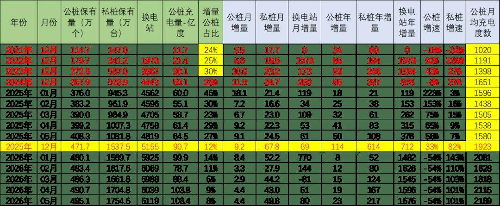
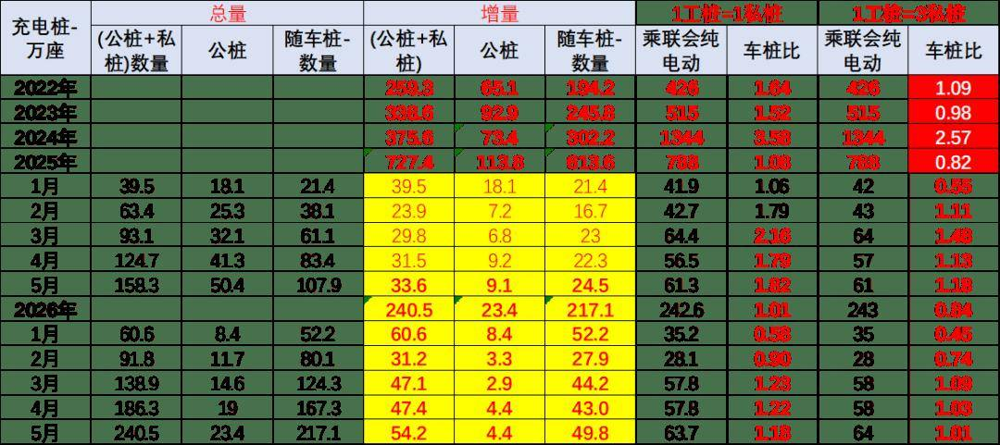

# 全国充电桩市场分析-2026年5月

- 公開日時: 2026-06-26 18:35（北京時間）
- 出典: [搜狐号・崔东树](https://www.sohu.com/a/1042101282_115312)
- テーマ（自動判定）: 乗用車市場
- 画像: 2枚

---

注：本分析文章仅代表崔东树个人观点，如有异议，请留言。

根据乘联分会整理的数据分析，2026年5月相对同期的公桩数量增长23万个，公桩年增量同比2025年下降54%，随车私桩较2025年底增长217万个，私桩年增量同比2025年增101%。2026年5月的充电基础设施的公桩总量达到495万个，5月公桩数量较上月增长4.4万个，相对去年12月累计增量23万个。随车私桩目前有1755万个，5月较上月增长49.8万个；5月公桩单桩月均充电2189度，较去年5月1580度增长较好。

2026年5月的纯电动乘用车国内零售63.7万台，新建4.4万个公桩和49.8万个私桩。纯电动乘用车的国内零售规模，公共充电桩如果与私桩看做1:1的用户服务数量对比，则2026年1-5月车桩比是1:0.1，充电桩是相对充足的。这里要拆分出插混充电较少的特殊性。也就是上海模式的，只烧油不充电的需求特色。

目前充电基础设施仍存在总体明显过剩，布局不够完善、结构不够合理、老旧充电桩技术落后、服务不够均衡、运营不够规范等问题亟待提升。相信随着新能源车规模不断提升，充电基础设施调整难度小，电动车提升潜力大。

由于电动车波谷时段的调峰蓄能对电网有利，因此发展私人慢充的线路是完全正确的，需要更多的私桩普及，实现可持续发展。着眼未来新能源汽车特别是电动汽车快速增长的趋势，需要进一步构建高质量充电基础设施体系，更新老旧交流低功率桩，增加高功率直流快充的升级，更好满足人民群众购置和使用新能源汽车需要，助力推进交通运输绿色低碳转型与现代化基础设施体系建设。

1、充电桩总体状态

充电基础设施为电动车提供充换电服务，是重要的交通能源融合类基础设施。

2021年的公桩数量增长34万个，随车私桩增长60万个，公桩年增量同比2020年下降18%，私桩年增量同比2020年下降32%。

2022年的公桩数量增长65万个，随车私桩增长194万个，公桩年增量同比2021年增速92%，私桩年增量同比2021年增长226%。

2023年的公桩数量增长93万个，公桩年增量同比2022年增速达到43%，随车私桩较2022年底增长245.7万个，私桩年增量同比2022年增27%。

2024年的公桩数量增长85万个，公桩年增量同比2023年下降8%，随车私桩较2023年底增长337万个，私桩年增量同比2023年增长37%。

2025年的公桩数量增长114万个，公桩年增量同比2024年增33%，随车私桩较2024年底增长614万个，私桩年增量同比2023年增长82%。

2026年5月相对同期的公桩数量增长23万个，公桩年增量同比2025年下降54%，随车私桩较2025年底增长217万个，私桩年增量同比2025年增101%。

2026年5月的充电基础设施的公桩总量达到495万个，5月公桩数量较上月增长4.4万个，相对去年12月累计增量23万个。随车私桩目前有1755万个，5月较上月增长49.8万个；5月公桩单桩月均充电2189度，较去年5月1580度增长较好。

2、充电桩月度增长状态

2026年5月底公共充电桩数量较2025年底增加23.4万个，增速较快。2026年5月底私人充电桩数量较2025年底增加217万个，增速较快。

2026年5月底换电站数量较2025年底增加964个，近几个月增速波动大。

充电桩是私人充电为主导。据调查，一般通过自有充电桩、共享充电桩以及小区或公司内的公共充电桩充电，各自占比在22%-26%之间，总体达到75%左右。不足的受访者在小区外路边的公共充电桩等地充电，部分受访者在商场、影院等地附带的公共充电桩充电。

3、各地公共充电桩特征分析

目前广东、浙江、江苏、山东等人口和经济大省是充电设施的主力，上海的规模较大，北京的地位明显下降到退出前10。

4、充电桩的满足需求能力分析

2026年5月的纯电动乘用车国内零售63.7万台，新建4.4万个公桩和49.8万个私桩。纯电动乘用车的国内零售规模，公共充电桩如果与私桩看做1:1的用户服务数量对比，则2026年1-5月车桩比是1:0.1，充电桩是相对充足的。这里要拆分出插混充电较少的特殊性。也就是上海模式的，只烧油不充电的需求特色。

但如果细分功能看，按公桩的充电利用率是私桩的3倍，也就是3:1的关系，则2026年1-5月纯电动车与充电设施与的销量占比达到0.84，也就是一个桩为0.84台车服务，基本是1:1的关系，由于公桩安装大幅下降，总体车桩比的增量稳定在0.84的相对宽裕水平。

国家新能源发展规划明确提出私桩慢充是发展趋势，要占到90%以上。目前私桩发展稍慢，严重影响电动车普及。

根据调查，自有充电桩用户的各项满意度（充电桩充足性、布局合理性、充电价格、结算准确性等方面）均高于选择其他受访者。私用桩为车主私人享有，满足在家充电需求，通常随车配建，客户群体庞大，是基础充电设施的绝对主力。

附：近日信息合集
