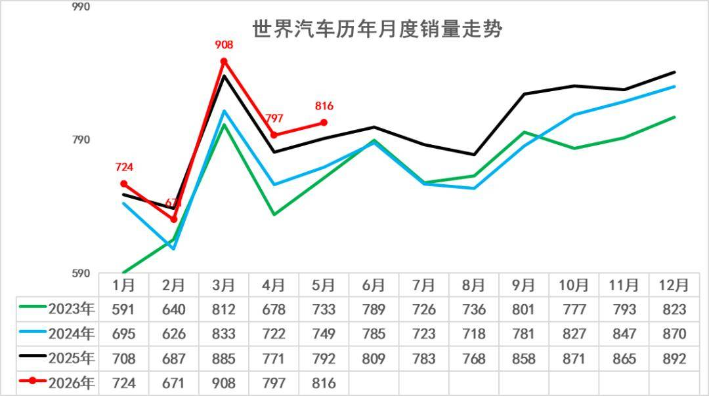
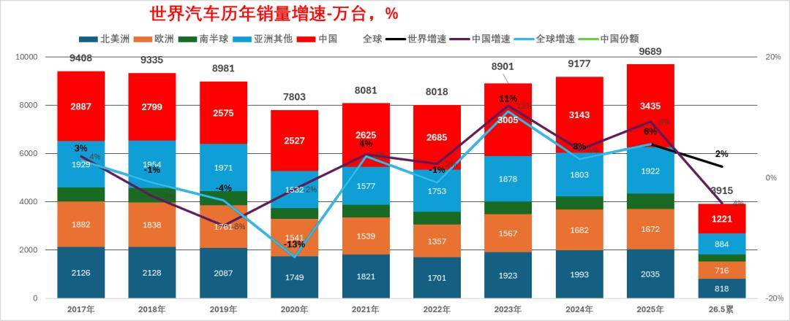
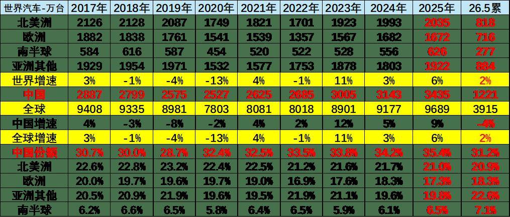
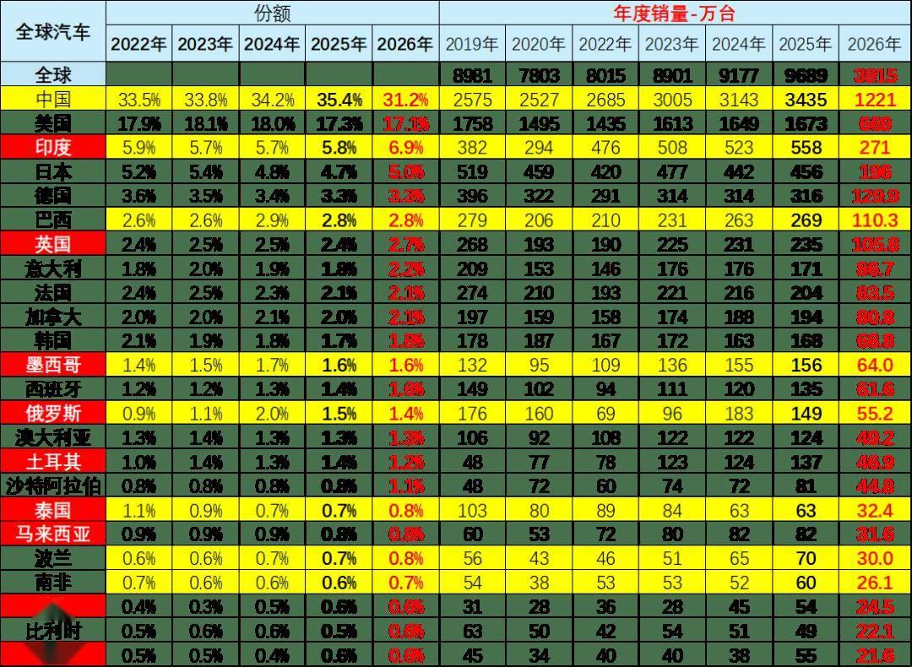
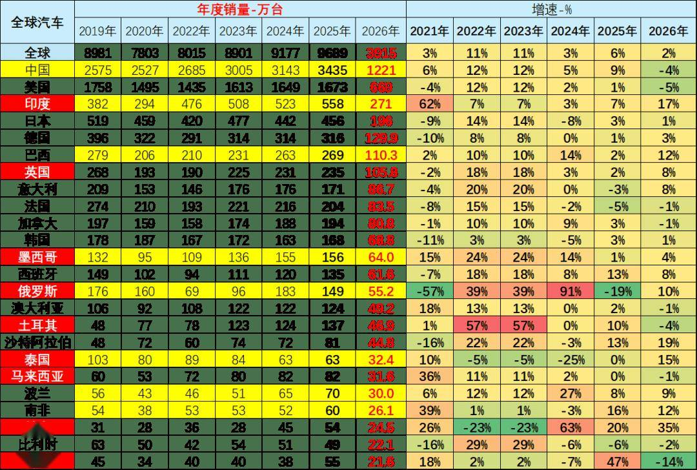
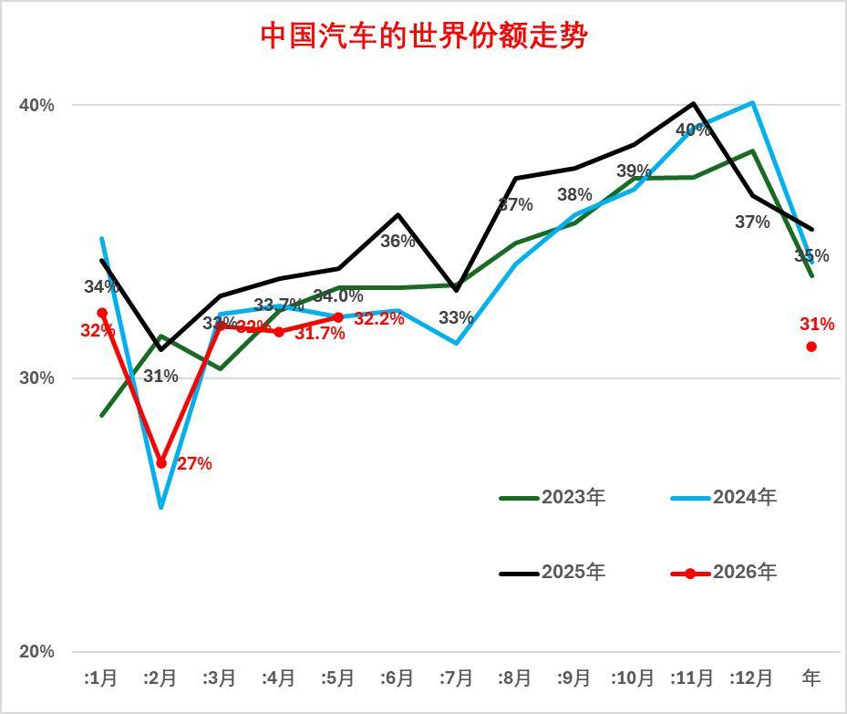
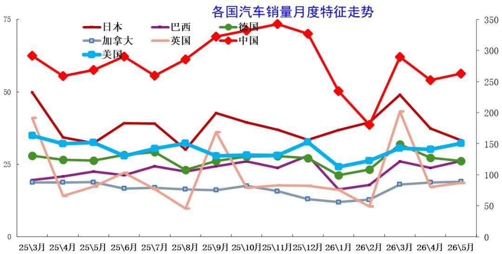
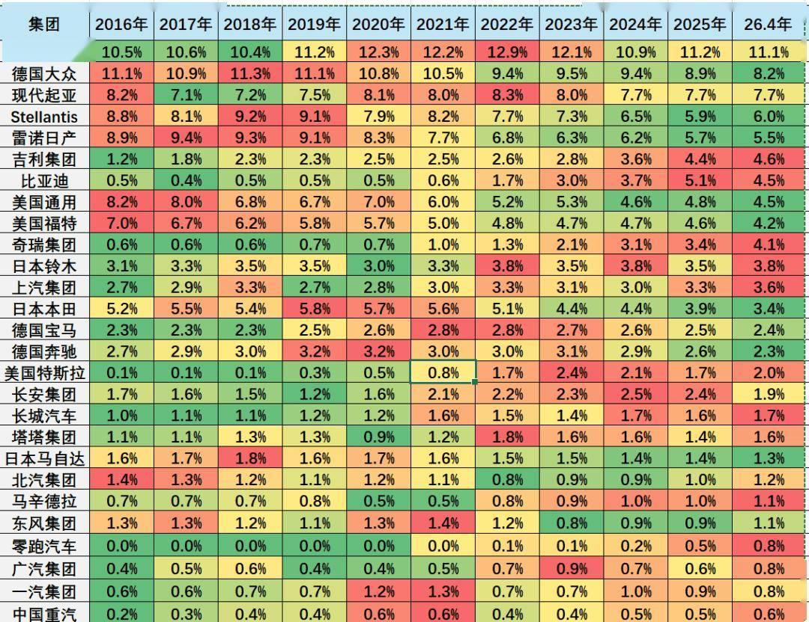
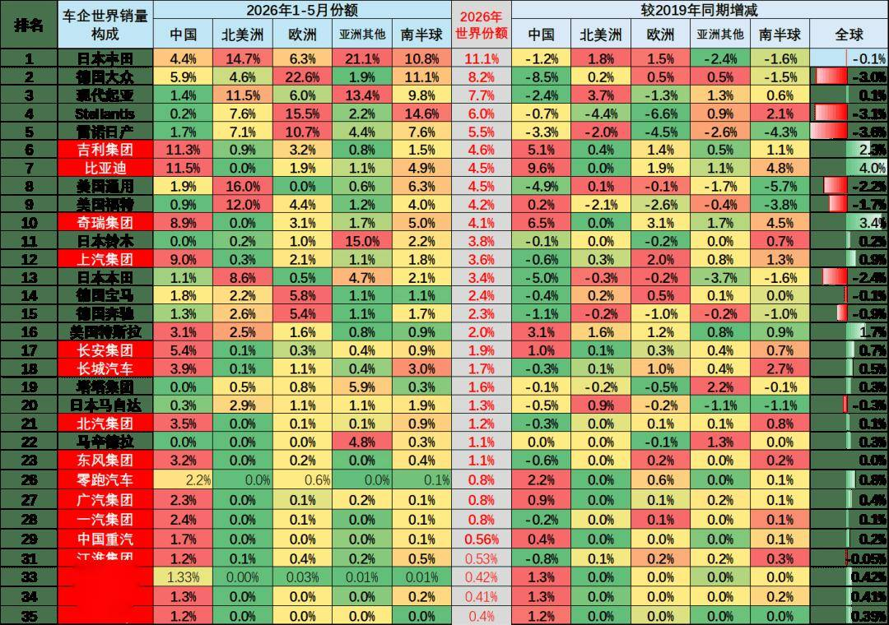

# 2026年1-5月中国占世界汽车份额31%

- 公開日時: 2026-06-28 19:21（北京時間）
- 出典: [搜狐号・崔东树](https://www.sohu.com/a/1042872205_115312)
- テーマ（自動判定）: 世界市場
- 画像: 9枚

---

根据世界汽车组织统计数据，全球汽车生产不断增长，2025年达到9638万台，较2024年的9272万台增4%，中占世界生产份额36%。根据我们统计2025年全球汽车销量9689万台，较2024年9177万台同比增长6%。2026年5月的世界汽车销量达到816万台，同比增3%。2026年1-5月世界汽车销量达到3915万台，同比增2%。随着美国、中国车市的年初相对负增长，2026年1-5月世界车市销量增长不强。随着美国、中国车市的年初相对负增长，2026年1-5月世界车市销量增长不强。2025年中国达到世界汽车的35.4%的份额；2026年初的中国份额31.2%，2026年初，中国汽车销量下滑较大，随着商用车走强，5月份额回升到32.2%。年初较低是入门级销量萎缩因素的异常体现，乘用车弱、商用车强，出口暴增。期待能有改善低端收入和减少抑制低端消费政策，随着政策刺激效果逐步恢复显现，预计未来中国车市逐步走强。

2026年1-5月的全球汽车销量增2%，其中中国汽车销量下降4%，美国销量下降5%，印度汽车市场销量增17%，泰国汽车市场增15%，俄罗斯市场销量增10%，越南增35%。新兴市场拉动市场表现较好。

东升西降，除了丰田、现代起亚、铃木和塔塔等，其它国际品牌份额2026年出现较大幅下滑。相对于2019年的中国自主品牌全面提升世界份额。吉利、比亚迪、奇瑞、上汽、长安等自主表现较强。电动化发展也导致部分国际车企逐步走向衰落。除了铃木等印度市场较好的因素促进，其它国际品牌份额出现全面较大的下滑。

1、当月世界汽车销量走势

2025年以来世界车市增长总体较好，各月均好于同期水平。2026年世界车市波动较大，因2026年中国春节在2月，中国春节前车市销量平稳导致世界1月增长较好，但2月因春节因素导致中国车市销量剧烈下滑，3-5月走势明显改善。

2025年全球汽车销量9689万台，同比增长6%。2026年5月的世界汽车销量达到816万台，同比增3%。2026年1-5月世界汽车销量达到3915万台，同比增2%。随着美国、中国车市的年初相对负增长，2026年1-5月世界车市销量增长不强。

在2018-2020年连续下滑后，2021年的世界主力国家汽车销量8135万台，同比增长4%，疫情后恢复表现较好。但2022年仅有8018万台，同比下降1%，仅稍高于2020年销量。2023年的世界汽车销量达到8901万台，同比增长11%。2024年年度总销量9177万台，超越2019年，恢复到合理水平。2025年汽车销量达到9689万台，创历史新高。2026年世界经济走势较好，印度、越南等汽车市场火爆，中国、美国等市场总体偏弱，总体市场温和增长。

2、历年世界汽车销量走势

上表中的世界汽车销量主要是70个国家的销量，这70个核心国家在2019年有9000万台左右，这也是基本能跟踪到月度的销量。由于战乱频发，近几个月世界数据偏慢。

其它还有100个国家只能是跟踪到年度的销量，近年总共大约300万台左右，相对8000万台的70家主力国家，这些较小的国家总量也就是3%左右，影响不大。

从主力国家代表的世界销量看，2018年后开始下滑周期，2020年进入谷底；2021年开始回升；2026年的世界销量增速2%的表现较好，其中中国车市下滑4%的影响较大。今年中国车市的综合表现低于预期，世界车市增长压力也在加大。

3、中国2026年销量保持领军地位

中国汽车市场对世界汽车市场影响力极其巨大。2016-2018年中国汽车占世界30%左右；2019年下降到29%，但仍具有绝对优势；2020-2021年份额回升到32%；2022年中国份额上升到33.5%；2023年中国份额保持在33.8%； 2024年中国达到世界汽车的34.2%的份额；2025年中国达到世界汽车的35.4%的份额；2026年初的中国份额31.2%，年初较低是入门级消费低迷因素的异常体现。随着政策刺激效果逐步恢复显现，下半年开始中国车市预计逐步走强。

4、发展中国家市场大幅走强

从全球各国销量来看，目前表现相对较好的是欧美发达国家市场，有钱才买得起车是客观现实，车辆要更低成本。2023-2024年俄罗斯市场逐步恢复中，带来中国自主车企的高销量和高利润。2025年以来俄罗斯市场下滑较大，2026年份额降到1.3%。印度等新兴市场表现较强。部分国家1季度的年度占比较高，形成2026年的开局分化走势。

中国车市近几年走势总体较好，份额持续提升，2020年以来中国的世界份额持续提升，到2023年达到33.8%，2024年中国车市达到34.2%，2025年中国车市达到世界35.4%，2026年中国车市达到世界31.2%，较2025年下滑4.2个百分点。

5、世界各国市场走势

2026年1-5月的全球汽车销量增2%，其中中国汽车销量下降4%，美国销量下降5%，印度汽车市场销量增17%，泰国汽车市场增15%，俄罗斯市场销量增10%，越南增35%。新兴市场拉动市场表现较好。

6、中国的世界市场份额走势

欧美圣诞的年末销量影响较大，而年初相对较强。中国车市受到春节休假影响而年初较弱，年度冲刺带来年末较强。

2026年初，随着两新补贴政策逐步启动的进度平缓，导致中国汽车1-2月销量下滑较大，3月份额回升，5月份额回升到32.2%。

7、各国汽车销量月度走势特征

从世界各国的月度销量增速走势来看，基本保持月度之间的走势均衡状态。但受到季节因素、年度因素等诸多影响，各国走势仍有较大反差。

由于中国车市仍是私车普及期，呈现年初年末相对较强、年中走势相对偏软的情况，而印度车市呈现年初相对较强，年中相对平稳的特征。

8、国际集团的世界占比表现

本图为各主力汽车集团的世界销量份额走势。从目前集团综合表现来看，国际头部车企份额明显下降，中国车企普遍表现较强。随着印度、巴西、俄罗斯的国际车市地位提升，加之吉利、奇瑞、铃木等亚洲车企的市场表现较好，所以东亚车企产销走势较好。欧洲车企表现普遍较差。

今年1-5月的世界前10车企中3家中国车企的份额是较强的，吉利第6位，比亚迪回升到世界第7位。奇瑞第10位，

9、国际集团的各区域份额表现

东升西降，今年相对于2019年的中国自主品牌全面提升世界份额。吉利、比亚迪、奇瑞、上汽、长安等自主表现较强。

除了丰田、现代起亚、铃木和塔塔等，其它国际品牌份额2026年出现较大幅下滑。

亚洲车企较强，2026年丰田集团表现相对较强，较2019年持平，2026年在世界份额保持在11.1%左右的水平，这也是因为丰田在欧洲和北美市场总体表现较强。韩国现代汽车的走势较平稳，2026年达到7.7%，较2019年持平，韩国现代集团在北美和亚洲其它市场表现很好，但在中国因产品力不强而持续走势偏弱。铃木的市场表现较强，主要是印度和日本等市场表现较强。本田集团也在今年较2019年下滑2.3%的表现较差，中国市场表现偏弱。

2026年欧洲车企普遍较弱，尤其雷诺日产、stellantis 大众的表现相对较弱，份额较2019年下降3个点左右，也就是损失近300万台。这些欧洲企业的中国市场压力大，中国市场不能退缩，需要二次创业。电动化转型成功带来中国二线车企的全面增长。
