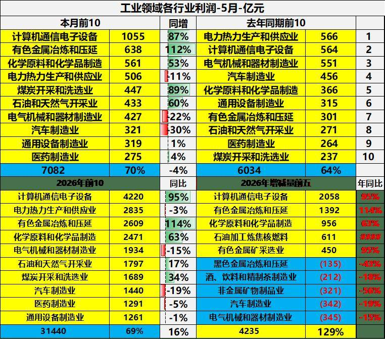
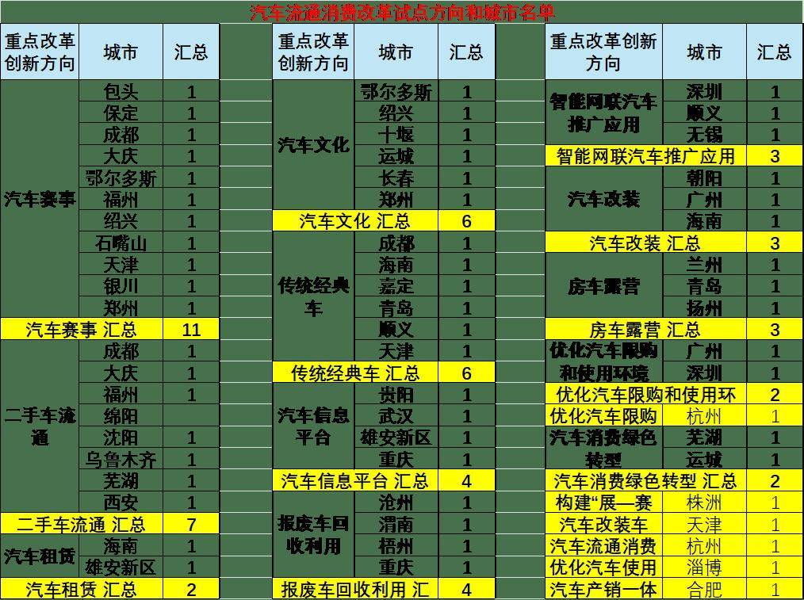

# 从“西药”到“中药”：汽车后市场改革的政策逻辑与消费拉动路径分析

- 公開日時: 2026-06-29 01:16（北京時間）
- 出典: [搜狐号・崔东树](https://www.sohu.com/a/1043082247_115312)
- テーマ（自動判定）: 産業統計
- 画像: 2枚

---

为贯彻落实国务院办公厅《加快培育服务消费新增长点工作方案》部署要求，破除汽车后市场领域不合理限制措施，培育新业态，打造新场景，激发汽车后市场活力，更好满足群众多样化汽车消费需求，商务部等8部门发布关于开展汽车流通消费改革试点工作的通知（商办消费函〔2025〕14号）。同时在各地申报基础上，经专家评审并向社会公示，确定汽车流通消费改革试点城市共40个。

一、促销费思路之变

1、政策补贴需要体系话突破

本次提振汽车消费跳出以往短期补贴刺激的单一思路，以全链条改革打通汽车生产、流通、服务、消费各环节，兼顾存量盘活与新业态培育，是推动汽车产业从增量刺激转向长效、高质量发展的系统性探索。“西药”治标，“中药”治本——这一比喻精准道出了此次政策组合拳的深层逻辑：不是追求立竿见影的短期刺激，而是着眼于系统性、长效性的制度变革。

2、、为何是此时：汽车“产热销冷”的结构性矛盾

政策出台的时间节点绝非偶然。2026年1—5月，国内汽车制造业工业增加值同比增长6.6%，增速持续抬升。与制造端的热火朝天形成强烈反差的是，1—5月全国社会消费品零售总额同比仅增长1.4%，5月增速更是转负至-0.6%——若剔除汽车品类消费影响，当月社零增速可回升至1.1%。汽车品类已成为拖累消费复苏的核心因素。

从利润看，汽车是最惨的，5月汽车行业利润下滑30%，是主流工业行业中最惨的，对应的是最挣钱的上游有色和半导体，汽车为上游做了巨大的贡献。而消费需求极其分化，入门级消费崩塌，市场压力全让整车企业承担。

我认为，2026年乘用车消费压力很大，商用车报废更新政策不变，乘用车报废更新车型的补贴均值较2025年降21%，置换更新车型的补贴均值较2025年降30%。短期补贴政策的边际效应正在递减。与此同时，中国汽车市场正从“增量时代”加速迈入“存量时代”：中国乘用车平均车龄7年以上的占比已突破50%。这意味着，围绕维修、保养、改装、租赁、二手车交易的“用车”需求将迎来爆发式增长。

正是在这一背景下，政策思路发生了根本性转变——从“刺激买车”转向“服务用车”，从短期补贴转向长效制度供给。

二、政策思路的深层解码：一套“中药”式的系统疗法

1、 “西药”失灵：短期刺激为何难以为继？

我认为明确指出，此次政策的本质是“以全链条改革打通汽车生产、流通、服务、消费各环节，兼顾存量盘活与新业态培育，是推动汽车产业从增量刺激转向长效、高质量发展的系统性探索”。

过去几年，汽车消费政策高度依赖以旧换新补贴等短期刺激手段。这些政策在短期内确有成效——截至2026年6月22日，汽车以旧换新已累计支持超过2100万人次换购新车。然而，补贴退坡后的消费断层、政策“透支”后的市场低迷，已成为不可回避的问题。我认为预测，2026年国内乘用车零售量可能下降11%。短期“西药”的疗效正在消退，亟需一服调理体质的“中药”。

2、中药”的药理：制度破冰、标准护航、场景创造

这套“中药”的药理逻辑，可以用“破”“立”“扩”“优”四个字概括：

第一，制度破冰，释放被压抑的需求（“破”）。政策直指后市场领域长期存在的制度性障碍。例如，针对长期处于灰色地带的汽车改装，明确提出“建立健全汽车改装管理制度”“明确对汽车改装实施分级分类管理，确定汽车改装项目清单”；针对房车“买房容易用车难”的痛点，提出“支持各地优化房车上路通行管理措施”“建设一批高标准、多功能的房车营地”。这些举措的本质，是将过去不合法或不明确的消费需求引导至阳光下规范释放。

我认为此前就曾指出，汽车改装行业面临的核心问题就是“缺乏核心主管部门”，导致不同部门都以自己的角度去管。此次政策从制度层面回应了这一痛点。

第二，标准护航，引导产业高质量发展（“立”）。 在制度创新的同时，政策高度重视标准体系建设”。

第三，场景创造，拓展消费边界（“扩”与“优”）。 “扩”即扩展消费场景，推动“小众爱好”变成“大众选择”，支持各地因地制宜发展拉力赛、越野赛、卡丁车赛等面向大众的体验式赛事活动。“优”即优化服务供给，鼓励汽车租赁品牌化、连锁化、规模化发展，推广“异地还车”“以租代购”等多元化服务模式。

3、从“买车”到“用车”：消费逻辑的根本转变

我认为在2026年初曾给出一个预测：未来5到10年，汽车全链条消费市场规模将突破10万亿元，其中二手车、后市场、新能源配套服务是主要增长极。这一预测揭示了政策的核心目标：将汽车消费的增长逻辑从“一次买卖”转变为“全链条服务”。

国家促销费总的工作措施体现在三个方面——既有统一部署，又有先行先试；既注重盘活存量，又坚持做优增量；既要“管得好”，又要推动“放得活”。这一表述精准概括了“中药”式改革的系统思维：不是头痛医头、脚痛医脚，而是从制度、标准、场景等多个层面进行系统性调理。

三、试点城市的差异化布局：一场“全国一盘棋、各地特色棋”的改革试验

1、40城布局的总体特征

此次确定的40个试点城市，覆盖全国除港澳台、西藏、青海、云南、江西外的27个省级行政区。每个城市都领到了自己的“专属任务”——有的主攻汽车改装，有的聚焦二手车流通，有的专注汽车赛事、房车露营。

通知要求各试点城市“结合本地产业特色、市场特点、资源禀赋、区位条件、功能定位等实际情况，针对汽车流通消费不合理限制等堵点问题，完善改革创新举措”。这意味着，40个城市并非“一刀切”，而是各有所长、各司其职。

2、典型城市画像：差异化试点的战略意图

从16个改革创新方向的分布来看，各城市的任务配置极具针对性：

综合改革先锋型——天津以汽车改装、传统经典车、汽车赛事三项任务为重点，力图在多个制度空白领域实现突破。这种“多任务”配置，旨在为全国探索综合性改革经验。

政策突破型——杭州以“优化汽车限购、汽车流通消费综合改革承载区”为重点。杭州作为全国新车上牌“一件事”改革首批试点城市，已在全国首创机动车电子登记信息、率先建成城市级停车平台。这类城市的改革直接指向释放被抑制的购车需求，是短期内最能见效的方向。

产业升级型——北京顺义以“智能网联汽车推广应用、传统经典车”为重点；无锡专注“智能网联汽车推广应用”。这些城市依托雄厚的科技与产业基础，探索未来汽车技术的商业化应用。

文旅融合型——扬州以“房车露营”为重点；兰州同样聚焦房车露营。这类城市发挥旅游资源优势，探索“汽车+文旅”的产业融合模式。

存量盘活型——沈阳以“二手车流通”为重点；渭南以“报废车回收利用”为重点。这些城市聚焦汽车生命周期的中后端，探索盘活存量资源的有效路径。

赛事经济型——成都以“汽车赛事、传统经典车、二手车流通”三项任务为重点；株洲以“构建'展—赛—销'一体化汽车生态体系”为重点。

3、布局逻辑：从“点”上突破到“面”上普及

此次政策部署将“点”上突破与“面”上普及结合。盛秋平指出，将通过“揭榜挂帅”的方式，支持试点城市围绕汽车后市场以及新车消费、二手车流通、报废车回收利用等环节，聚焦短板堵点，因地制宜改革创新、先行先试，推动形成各具特色的试点成果。

40个城市如同40块“试验田”，各自在不同方向上深耕。一旦某个方向在试点城市取得成功，其经验便可被快速复制推广——这正是“中药”式改革的精髓：不求速效，但求长效；不求一刀切，但求精准施策。

四、消费拉动的三重路径

基于上述政策思路与试点布局，此次改革对消费的拉动作用将通过三重路径实现：

第一重：直接释放被抑制的需求。 以杭州、广州、深圳等城市优化汽车限购为代表，通过放宽购车指标直接推动潜在需求释放。这是“西药”式短期刺激的延续，但被置于“中药”式长效改革的框架之中——限购松绑不是孤立的，而是与后市场培育、流通体系完善等形成联动。

第二重：培育新业态创造新增量。 汽车改装、房车露营、汽车赛事、传统经典车等领域的制度突破和标准建立，将把小众爱好培育成大众消费。我认为的数据显示，中国汽车改装行业正以年均15%的复合增长率增长；而国内房车综合保有量仅约26.8万台，市场渗透率不足0.1%，与美国1380万辆、欧洲960万辆的保有量差距悬殊——这些数字背后是巨大的增长空间。行业预测，2030年房车市场规模将突破1800亿元，年均增速达18%-22%。

第三重：盘活存量畅通全链条。 在3.7亿辆的汽车保有量中，车龄7年以上车辆占比过半。二手车流通的便利化、报废车回收的规范化，将激活汽车全生命周期的价值，并通过置换需求反向拉动新车销售，形成“存量带动增量”的良性循环。数据显示，汽车以旧换新政策实施两年多来，已累计支持超过2100万人次换购新车。

五、总体趋势：从“购买一辆车”到“用好一辆车”

我认为的“中药”比喻，揭示了中国汽车消费政策的一次深刻转型。这不是一次简单的政策调整，而是一场从理念到制度、从短期到长效的系统性变革。

政策的深层目标，是推动汽车产业从“制造销售”向“生态服务”转型。当3.7亿辆汽车的保有量遇上突破50%的“7年车龄”拐点，围绕“用车”的万亿级市场正在打开。40个试点城市的差异化布局，则为这场变革提供了多元化的实践路径——有的在制度创新上突破，有的在产业升级上探索，有的在文旅融合上试水。

中国汽车市场需要的是“长效的强力接续政策”。此次出台的政策组合拳，正是这样一服着眼长远的“中药”——它或许不像短期补贴那样立竿见影，但一旦“药效”全面释放，将为汽车消费乃至整个国民经济注入持续的增长动能。未来的中国汽车市场，不仅要让消费者“买到一辆好车”，更要让消费者“用好、玩好一辆车”。这，才是汽车消费的真正蓝海。
