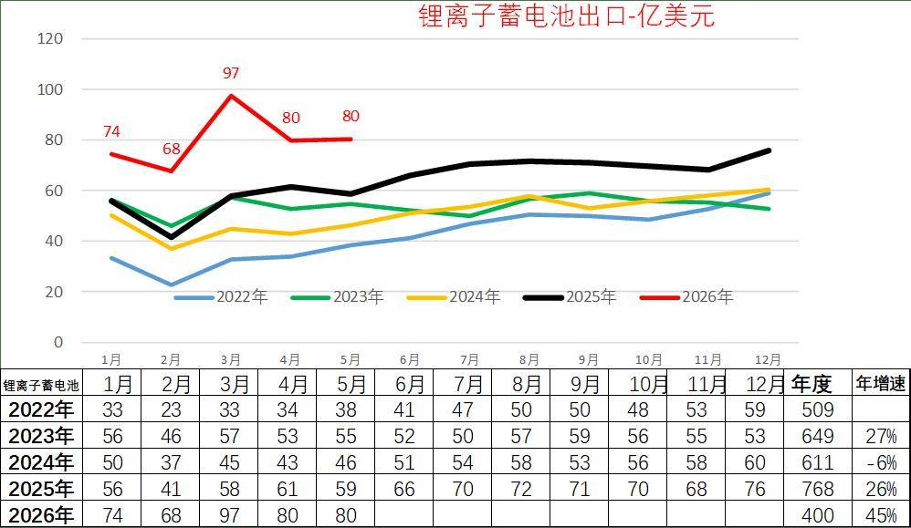
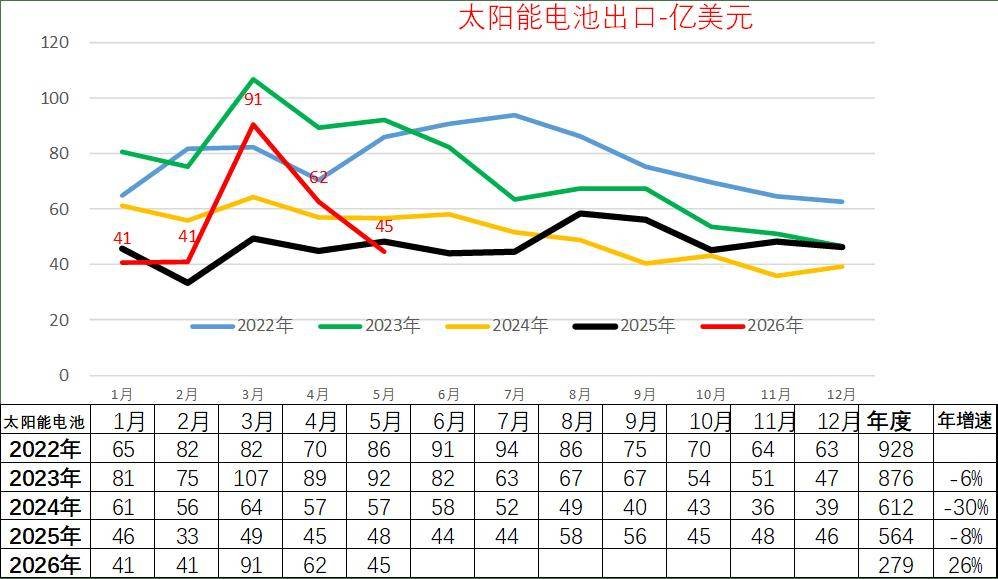
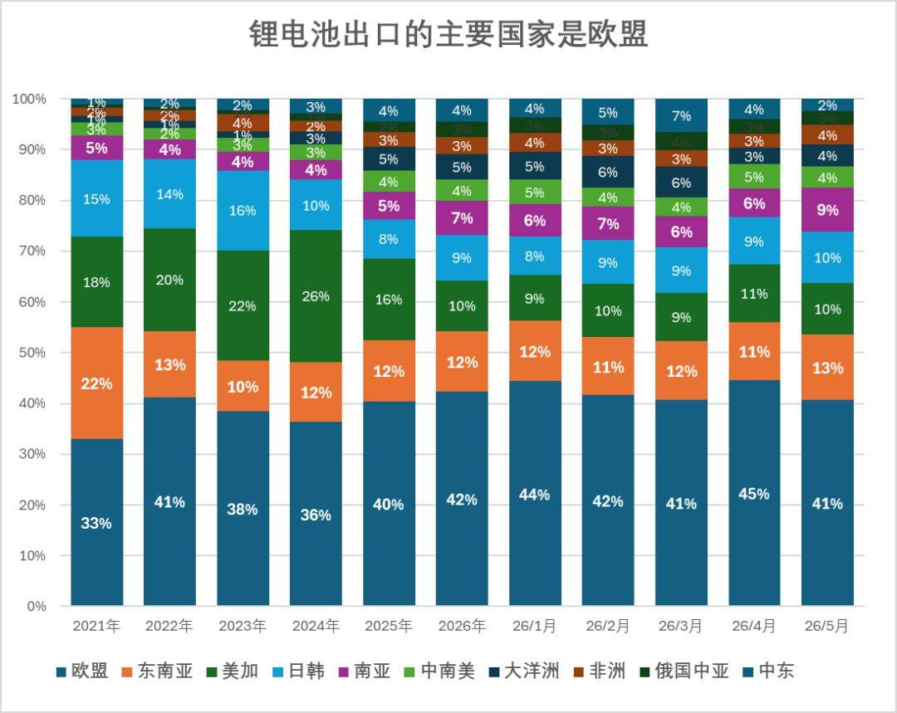
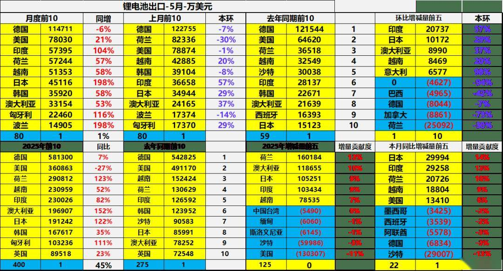
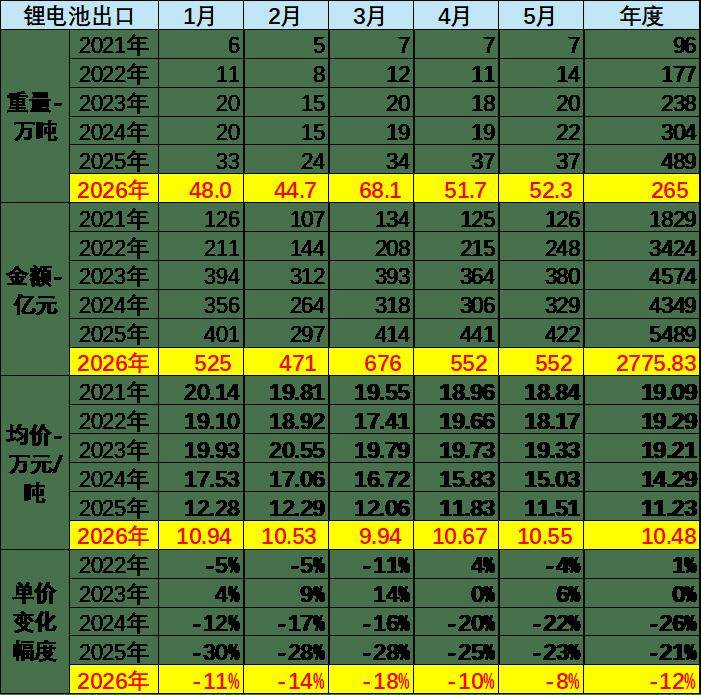
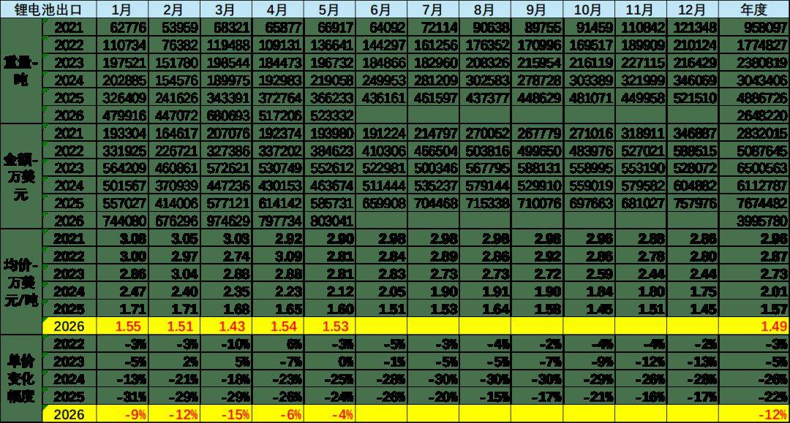
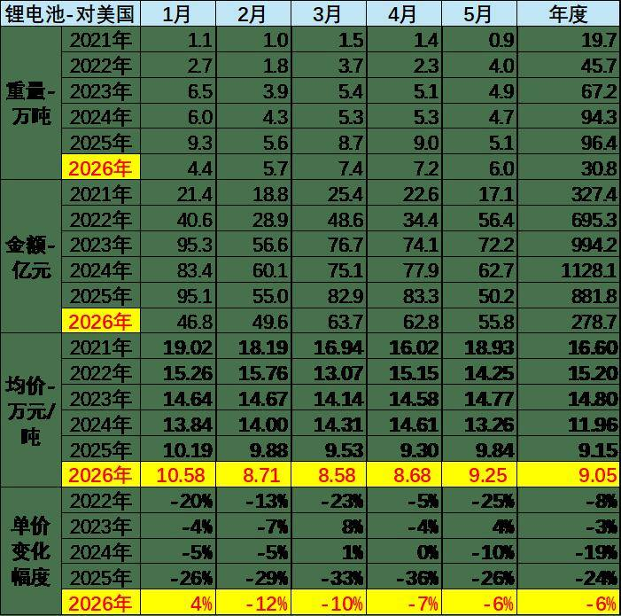
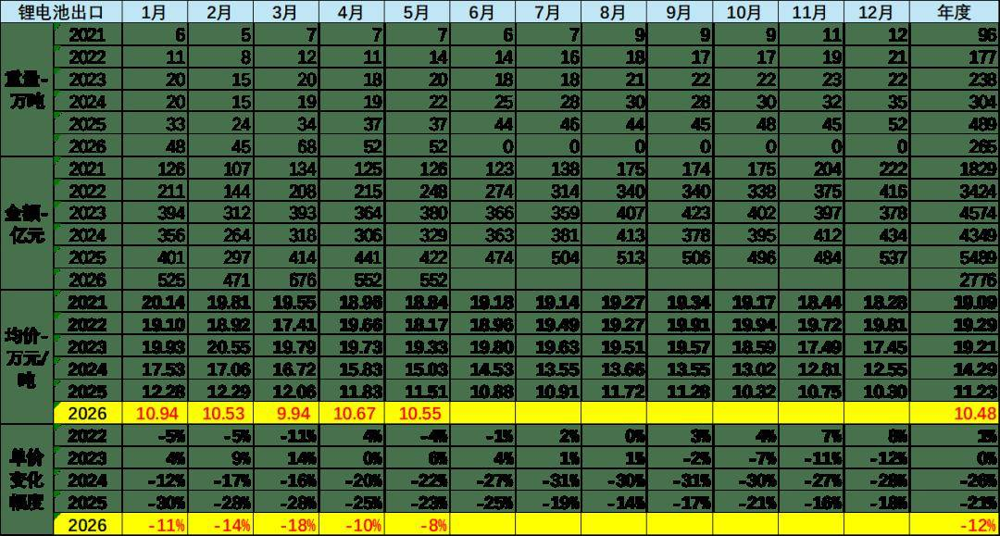
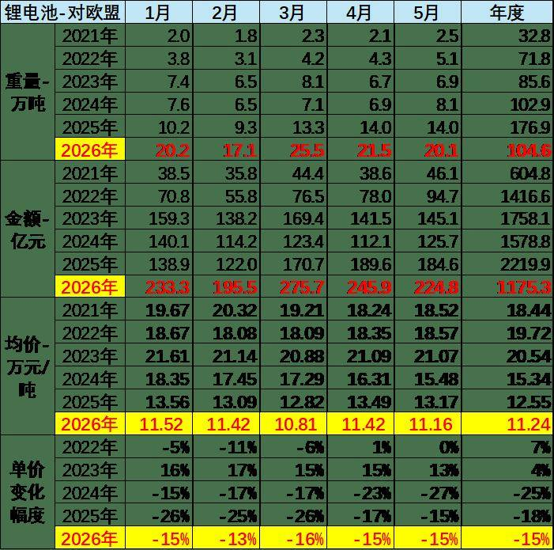

# 26年1-5月锂电池出口单价10.48万元/吨、降价12%；出口额400亿美元、增45%

- 公開日時: 2026-06-30 20:28（北京時間）
- 出典: [搜狐号・崔东树](https://www.sohu.com/a/1043919277_115312)
- テーマ（自動判定）: リチウム電池 輸出
- 画像: 10枚

---

，

2026年1-5月锂电池出口达到400亿美元，增45%。5月锂电池出口维持在80亿美元，同比增长35%。。中国锂电池出口的主要市场是欧盟，2026年欧盟的市场需求达到42 %左右，2026年比2025年增长2个百分点。中国对美国锂电池的出口剧烈萎缩到10%，2026年比2025年下降6个百分点。对美国的下滑持续巨大。。

锂离子电池出口价格从2023年的2.73万美元/吨、2024年的2.01万美元/吨降到1.57万美元/吨，又降到2026年的1.49万美元/吨，26年仅下降12%，降幅明显较24年的降26%和25年的降22%，改善明显。但5月锂电池出口均价1.53万美元/吨，同比降4%，出口吨单价仍处历史谷底。.

由于人民币升值，从人民币口径出口单价看下降幅度较大。无论碳酸锂价格如何变化，近几年的锂电池出口价格持续下降。锂电池出口价格从2024年14.29万元下降26%，到25年的11.23万元/吨，降21%。26年10.48万元/吨降12%，其中5月中国出口的电池均价10.55万元/吨、同比下降8%，4-5月退税降低后的降价幅度较去年的改善明显。。。

整体而言，2026年中国锂电池在国内新能源乘用车零售量同比降近20%的背景下，国内成本涨价国外电池大幅降价，价跌量增的出口数量表现优秀，依托新兴市场拓展和核心市场深耕，有效应对了内部环境变化带来的挑战。

1、锂离子电池出口

锂电池作为新三样的重要优势产品，出口表现优秀，利润高、市场好。自2020年拜登上台以来，中国出口商品中应该说锂电池的出口表现相对较为优秀。在2021年出口仅有284亿美元，2022年出口509亿美元， 2023年出口也达到了649亿美元的超高水平，但是到了2024年下滑6%。2025年的锂离子电池出口达到768亿美元。

2026年1-5月锂电池出口达到400亿美元，增45%。5月锂电池出口维持在80亿美元，同比增长35%。

2、太阳能电池出口走势

太阳能电池作为新三样的重要优势产品，出口表现波动大，近两年下滑严重，行业内卷严重。太阳能电池应该说在俄乌危机爆发的背景之下，出现了爆发式增长的态势，2020年总体走势相对平稳，而2021年太阳能电池呈现了明显的上升态势，随后2022年太阳能电池又呈现了强势爆发增长态势，达到928亿美元，但2023年随着整体能源形势的相对稳定，太阳能电池的出口回落到876亿美元。2024年下降到612亿美元，2025年下降到564亿美元，降8%。

2026年1-5月太阳能电池出口达到279亿美元，增26%。5月太阳能电池出口暴增到45亿美元，同比下降7%。

3、3、锂电池出口的结构特征

中国锂电池出口的主要市场是欧盟，2026年欧盟的市场需求达到42 %左右，2026年比2025年增长2个百分点。

中国对美国锂电池的出口剧烈萎缩到10%，2026年比2025年下降6个百分点。对美国的下滑持续巨大。

中国出口的结构主要去欧盟、东南亚和日韩、中东等地方。

从锂电池的出口走势看，26年5月中国锂电池出口主力国家是：德国114711万美元、美国78030万美元、印度57395万美元、荷兰57244万美元、越南51353万美元、日本45116万美元、韩国35920万美元、澳大利亚33154万美元、匈牙利22460万美元、波兰14905万美元、，其中本期较同期增量增大的前五个是：日本29994万美元、印度29258万美元、荷兰20726万美元、越南18804万美元、美国13410万美元、。

26年1-5月中国锂电池出口主力国家是：德国581300万美元、美国360863万美元、荷兰290812万美元、越南230959万美元、印度230026万美元、澳大利亚196907万美元、日本191242万美元、韩国167617万美元、匈牙利103236万美元、英国89518万美元、，其中今年较去年同期增量增大的前五个是：荷兰160184万美元、澳大利亚118655万美元、日本105251万美元、印度103434万美元、越南78535万美元。

4、锂电池的价格变化分析

近几个月的锂离子电池出口价格环比小幅上升，同比持续下降。2026年5月的锂电池出口68万吨，出口额达到97亿美元。锂离子电池出口价格从2023年的2.73万美元/吨、2024年的2.01万美元/吨降到1.57万美元/吨，又降到2026年的1.49万美元/吨，26年仅下降12%，降幅明显较24年的降26%和25年的降22%，改善明显。但5月锂电池出口均价1.53万美元/吨，同比降4%，出口吨单价仍处历史谷底。

从人民币口径出口单价看今年的下降幅度较大，近几个月的锂电池出口价格较。从2024年14.29万元下降26%，到25年的11.23万元，降21%。26年10.48万元降12%，其中5月中国出口的电池均价10.55万元、同比下降8%，4-5月退税降低后的降价幅度较去年的改善明显。

5、出口美国锂电池分析

2026年中国大陆对美国锂离子电池出口金额总体大幅下滑，5月吨单价降到1.35万美元，同比降1%，但出口单价较25年10-11月明显改善。

中国对美国出口的锂电池价格下降较快，从2024年11.96万元下降19%，到25年的9.15万元，降24%。26年5月中国出口欧盟的电池均价9.25元/吨，降低6%，中国对美国的出口下降较快，价格也下降较大。

我们主要看锂离子蓄电池，数量持续下降，体现了美国的AI带来的电力和储能的暴增，目前尚未与中国出口的锂电池相关。

6、出口欧盟锂电池降价分析

欧盟是中国锂电池最大出口市场，需求占比稳定在全球出口的42%左右，2026年占比较2025年提升2个百分点，市场地位持续巩固。2026年5月中国对欧盟出口额达32.6亿美元，20.1万吨，成为拉动出口增长的关键力量。

中国对欧盟出口的锂电池增长较快，从2024年 222亿美元上升到25年的310亿美元，增40%。26年5月中国出口欧盟的电池均价1.62万美元/吨，降低12%，中国对欧盟的出口高增长弥补了对美国锂电池出口的下降。

中国对欧盟出口的锂电池价格下降较快，从2024年15.34万元下降25%，到25年的12.55万元，降18%。26年5月中国出口欧盟的电池均价11.24元/吨，降低15%，中国对欧盟的出口高增长弥补了对美国锂电池出口的下降。

4、

附：近日信息合集
