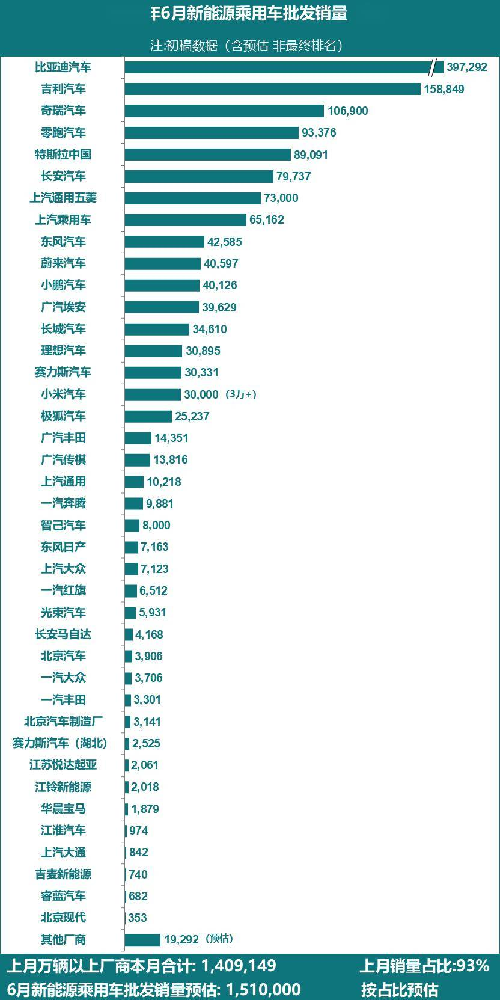

# 【新能源】2026年6月新能源乘用车厂商批发销量快讯

- 公開日時: 2026-07-02 19:52（北京時間）
- 出典: [搜狐号・崔东树](https://www.sohu.com/a/1044923739_115312)
- テーマ（自動判定）: 乗用車市場
- 画像: 1枚

---

本文全文共1001字，阅读全文约需3分钟

6月新能源乘用车市场预判

2026年6月，全国新能源乘用车厂商批发销量预估达到151万辆，同比增长22%，环比增长12%，实现两位数双增长，标志着新能源板块在经历前期调整后已进入明确的复苏通道。这一增速显著高于同期整体车市大盘，新能源车成为拉动乘用车市场增长的核心引擎。

新能源乘用车较强增长的核心驱动因素：油价倒挂、供给优化与出口共振。1、高油价加速消费结构转换。受霍尔木兹海峡通航受阻影响，国内成品油零售价持续维持高位，传统燃油车使用成本大幅上升，直接抑制了燃油车消费意愿。在此背景下，终端需求加速向新能源车型切换，形成对新能源销量的刚性支撑；2、车企排产优化与产能释放。主流车企主动推动燃油车转型新能源，推动6月批售环比增幅升至10%以上，供给端响应速度显著加快；3、海外市场爆发式增长。国际油价高企，海外消费者对低能耗、高性价比的新能源车型需求激增。自主品牌凭借成熟的电动化技术和突出的成本优势，在海外市场对燃油车形成强替代效应，出口规模稳步扩大，进一步反哺国内产销量。

受益于头部车企加速电动化转型与消费环境驱动，6月多家主流车企的新能源批发销量刷新同期历史纪录，印证国内车企电动化转型成效凸显。比亚迪汽车、吉利汽车、奇瑞汽车、零跑汽车、上汽通用五菱、上汽乘用车、蔚来汽车、小鹏汽车、东风汽车、极狐汽车、广汽丰田、广汽传祺、上汽通用、智己汽车、长安马自达、北京汽车制造厂、东风小康、江苏悦达起亚、北京现代等车企，本月新能源批售量悉数创下历年 6月最佳成绩。这些车企覆盖自主、合资及新势力品牌，说明电动化转型已从“少数先行”演变为“全行业共识”，技术迭代与新品投放节奏加快，市场表现持续提升。

全国乘用车市场2026年5月新能源批发销量万辆以上厂商，6月合计占总体新能源乘用车当月销量的93%。根据7月初步汇总数据，这些5月新能源销量万辆以上厂商企业的6月销量为141万辆。目前大部分厂商销量基本都已经锁定大数，因此按照5月结构占比结合6月数据，测算6月的全国新能源乘用车批发销量为151万辆。

综上，根据月度初步乘联数据综合：2026年6月全国乘用车厂商新能源批发预估151万辆，同比增长22%，环比增长12%。

注：由于乘联快报数据可能与厂商终稿数据有差异，因此对此版的具体厂商数据不要与历史终稿数据直接对比，以防误导。

6月乘用车主力厂商新能源批发销量快报

