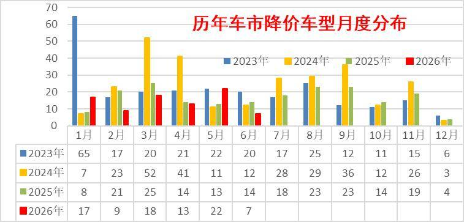
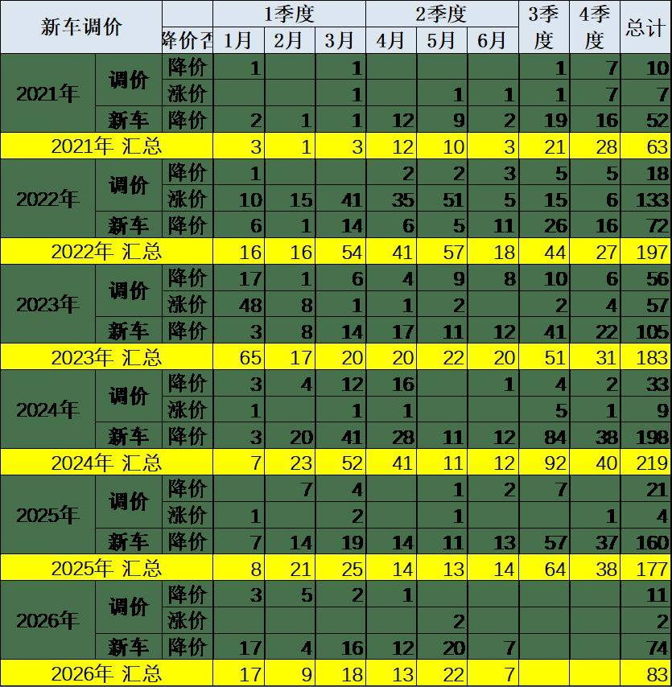
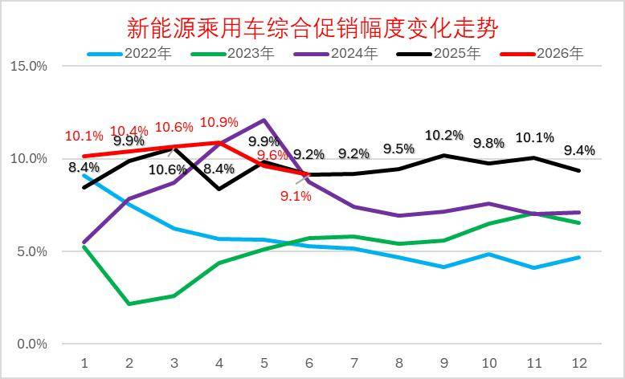
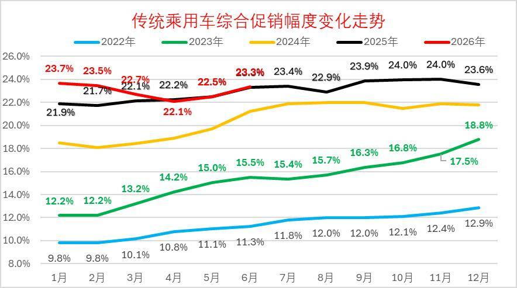
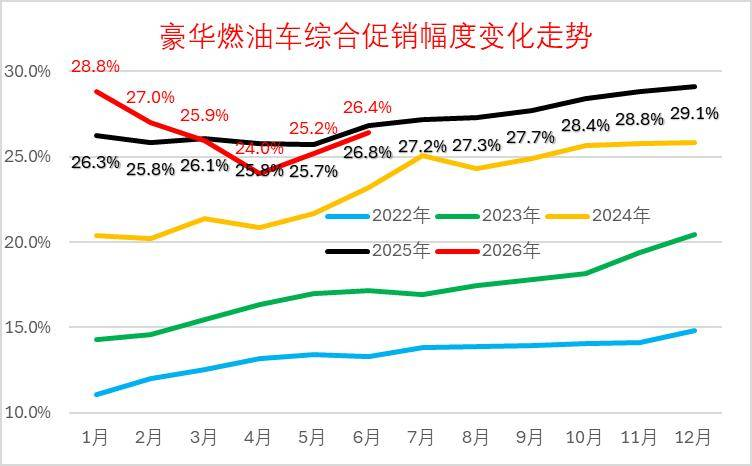
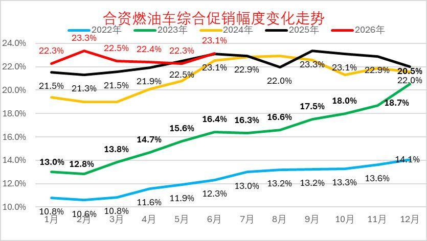
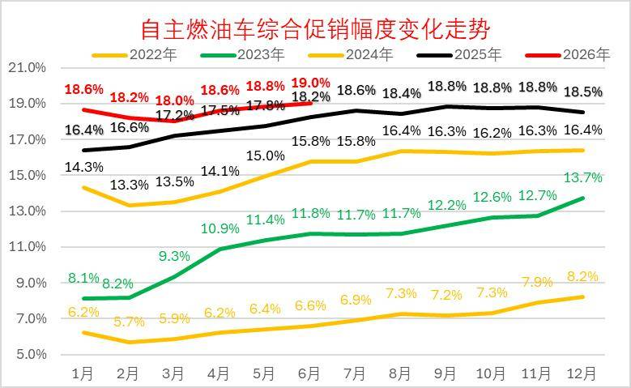
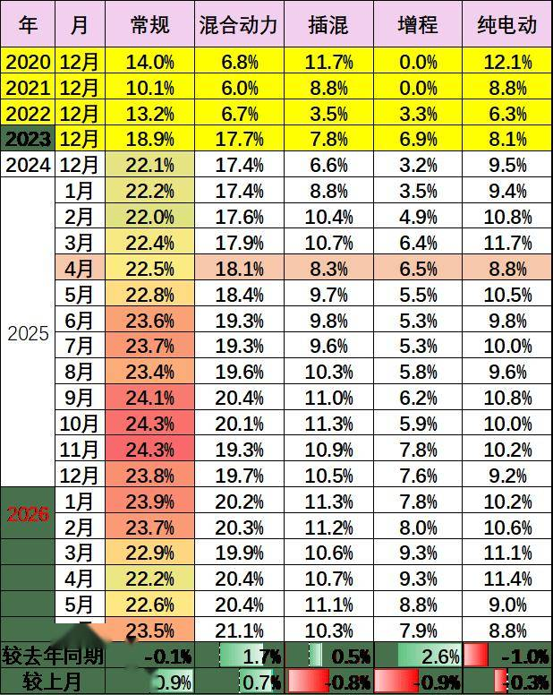
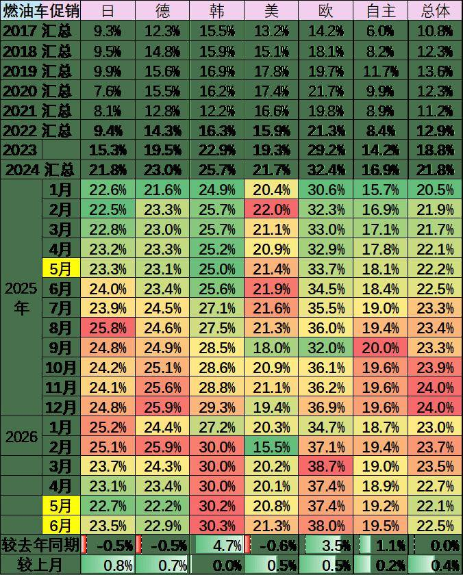

# 2026年6月乘用车市场降价促销分析

- 公開日時: 2026-07-06 17:27（北京時間）
- 出典: [搜狐号・崔东树](https://www.sohu.com/a/1046590562_115312)
- テーマ（自動判定）: 値引き・販促
- 画像: 10枚

---

2025年以来全国乘用车行业促销与降级均回归理性，市场秩序明显改善。由于新能源车购税恢复征收，指导价对消费者购车交税影响体现。

面对价格体系的重塑，2026年5月份有22款车型降价，6月份有7款车型降价，较去年3-6月大规模降价，今年3-6月市场保持相对克制，降价品牌表现很强。2026年6月降价规模7款，较同期少7款。其中纯燃油车型4款，较同期少2款；插混车型1款，较同期少1款。燃油车和狭义插混的压力太大，价格调整可以理解。

2026年降价规模83款，较同期少12款，其中常规燃油车降价31款，较同期增7款；混合动力燃油车降价5款，较同期增加2款；插混燃油车降价19款，较同期增1款；增程式车型降价4款，较同期减少4款；纯电动车型降价24款，较同期减少18款。

2026年1~6月份，新能源车新车降价车型均价24.7万元的降价力度算术平均达到3万元，降价力度达到12%。2026年6月份，新能源车新车降价车型均价22.1万元的降价力度算术平均达到1.2万元，降价力度达到5.6%的较低水平。2026年1~6月份，常规燃油车新车降价车型均价22.5万元的降价力度算术平均达到3.2万元，降价力度达到14.1%。2026年6月份，常规燃油车新车降价车型均价30万元的降价力度算术平均达到0.1万元，降价力度达到0.3%。

2026年1~6月份，总体乘用车市场新车降价车型均价24万元的降价力度算术平均达到3万元，降价力度达到12.6%。2026年6月份，总体乘用车市场新车降价车型均价23.1万元的降价力度算术平均达到1.1万元，降价幅度达到4.8%。。

2026年6月的新能源车的促销下降到9.1%的中低位，较同期促销持平，较上月降0.5%。6月传统燃油车的促销回升到23.3%的水平，较上月微增0.8个百分点，较同期持平，燃油车促销连续1年多维持在23%左右。

一、总体降价跟踪

1、月度降价状态跟踪

降价分析主要关注新车推出而突破前期价格下限的情况，也就是较隐蔽的降价行为，这里主要定义三年内的降价。而有些新车前几年开始上市很便宜，随后因2022年碳酸锂价格而宣布涨价，然后现在宣布降价，虽然没有突破上市时的底价，但为了体现降价的现象，因此此次分析中也算降价。

由于部分按动力细分的车型在年内有多次的价格调整行动，因此按照非重复计算的方式，车型数不是简单累加，而是合并了重复车型。

从降价节奏来看，2023年的降价总体较多， 2024年的降价在3-6月份达到了超强的程度，2025年的部分车企春季和秋季的阶段性组合促销，其一口价的价格包含补贴等因素，没有明确宣布降低到新的价格，因此目前只能按照促销处理，没有计入当年的降价车型范畴，这将在下面的促销幅度体现。

面对价格体系的重塑，2026年5月份有22款车型降价，6月份有7款车型降价，较去年3-6月大规模降价，今年3-6月市场保持相对克制，但降价效果很好。

2、车型最低价分析

2020-2021年的车企降价力度较小，2022-2024年力度较猛，2025年降到177款车型，2026年1月的新车降价的规模相对活跃,2月因春节因素大幅减少,，3-5月回升到20款左右降价,，6月降到7款。由于市场运行压力太大，目前的价格竞争主要是新车推出直接突破原有价格的下限，而不是增配不降价的模式。

面对新能源车车购税开始征收，2026年1-6月直接降价的车型较多，虚高的指导价回归，有利于消费者的交税成本合理化。

2026年截止到6月的降价车型总体较丰富，主要是豪华车的价格重新梳理。

2026年降价规模83款，较同期少12款，其中常规燃油车降价31款，较同期增7款；混合动力燃油车降价5款，较同期增加2款；插混燃油车降价19款，较同期增1款；增程式车型降价4款，较同期减少4款；纯电动车型降价24款，较同期减少18款。

2026年6月降价规模7款，较同期少7款。其中纯燃油车型4款，较同期少2款；插混车型1款，较同期少1款。燃油车和狭义插混的压力太大，价格调整可以理解。

3、综合降价幅度

2026年1~6月份，新能源车新车降价车型均价24.7万元的降价力度算术平均达到3万元，降价力度达到12%。2026年6月份，新能源车新车降价车型均价22.1万元的降价力度算术平均达到1.2万元，降价力度达到5.6%的较低水平。

2026年1~6月份，常规燃油车新车降价车型均价22.5万元的降价力度算术平均达到3.2万元，降价力度达到14.1%。2026年6月份，常规燃油车新车降价车型均价30万元的降价力度算术平均达到0.1万元，降价力度达到0.3%。

2026年1~6月份，总体乘用车市场新车降价车型均价24万元的降价力度算术平均达到3万元，降价力度达到12.6%。2026年6月份，总体乘用车市场新车降价车型均价23.1万元的降价力度算术平均达到1.1万元，降价幅度达到4.8%。

4、进口车价格变化

由于高端市场竞争格局巨变，市场环境剧烈恶化，降价车型逐步出现，为了经销商利益和消费者权益，宝马等品牌开始调整指导价格，实际成交价格基本稳定，这样的空降还是很有意义的。

二、车市促销跟踪

1、新能源车促销力度小幅增长

2026年6月的新能源车的促销下降到9.1%的中低位，较同期促销持平，较上月降0.5%。近几个月的促销收缩较大，随着低价新车的增多，新车切换的促销急剧下降，6月促销体系暂时回收，目前基本保持正常促销水平的中高位。

2、燃油车促销走势逐步下降

2026年6月传统燃油车的促销回升到23.3%的水平，较上月微增0.8个百分点，较同期持平，燃油车促销连续1年多维持在23%左右。

传统燃油车的促销2025年9月开始小幅加大，幅度较温和，2026年因降价力度大，实现促销逐步回落。

3、豪华车促销走势大幅下降

2026年6月豪华车的促销逐步达到26.4%的中高位，较上月回升1.2个点，较同期下降0.5个百分点。虽然消费升级推动高端需求较强，但2025年6月以来豪华车促销力度加大,2026年年初以来的新车指导价降价力度较大，促销因此下降，实际成交价格变化不大。

4、主流合资车促销走势平稳

2026年6月合资燃油车的促销逐步达到23.1%的低位，较上月增加0.8个点，较同期少0.1个百分点。合资促销近期稍有增大。

合资燃油车的促销从2023年的13%的低位，2025年9月回升到23.3%峰值，随着新车强力降价，近三个月小幅波动。由于新车价格特别低，因此总体促销力度相对平稳微增。

5、自主燃油车促销走势保持平稳

由于自主的新能源较强，加之燃油车出口较好，2025年自主燃油车促销总体平稳。

2026年6月自主燃油车的促销逐步达到19点的高位，较同期增加0.8点。自主车企在2024-2025年上半年的促销上升较快，随后2025年下半年以来的促销总体稳定。

6、分动力促销力度跟踪相对温和

由于部分品牌降价带来的指导价回归，降低了促销幅度。2026年的常规燃油车和混合动力的降价力度大、高油价下销量差，促销力度也持续增大。

新能源车促销明显改善，插混和增程的促销明显改善，新品的促销降低改善市场表现。纯电动车型因为主力车型切换，促销较2025年6月下降1个点左右的促销，较上月下增0.3%左右促销。

6月的车市促销相对平稳，经销商也是稳促销保利润。目前的欧系和韩系促销大，其它合资车企促销基本22%左右，差异不大。自主车企成为促销最小的。

三、具体降价车型跟踪-6月

1、新能源车降价分析

2026年6月份纯电动车型新车降价的力度似乎较温和，个别低销量车型指导价下探的降价达到18%左右，但非主力车型的实际影响不大。根据新能源车促销10%的规模，正常车型价格下探的力度还是问题不大的。

2026年6月份插混和增程车型新车降价的力度相对温和，因为其中部分是有较好销量的车型，实际效果还是不错的。

近期有个别车型的个别款式出现涨价事件，由于有促销等因素干扰，实际的意义不大，只是宣传改善心态的举措。

2、燃油车降价分析

混动车型近期因车购税税收调整间接受益，销量稍有改善。部分车企考虑海外市场的混动巨大规模，加大混动车型的投入，指导价也有微调。

附：近日信息合集
