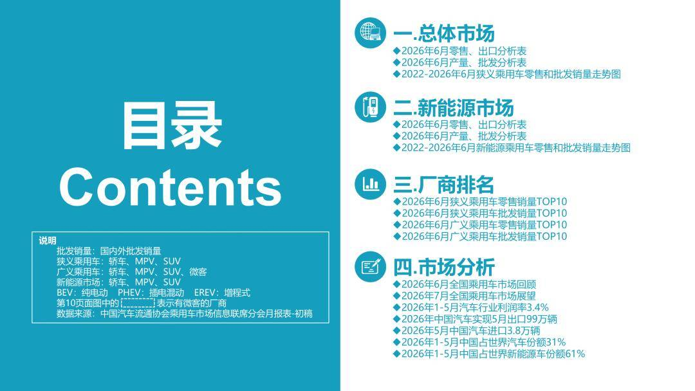
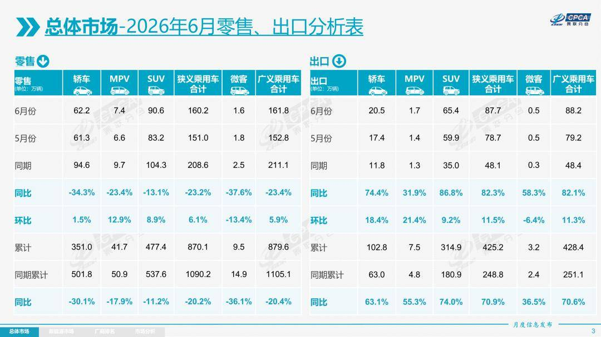
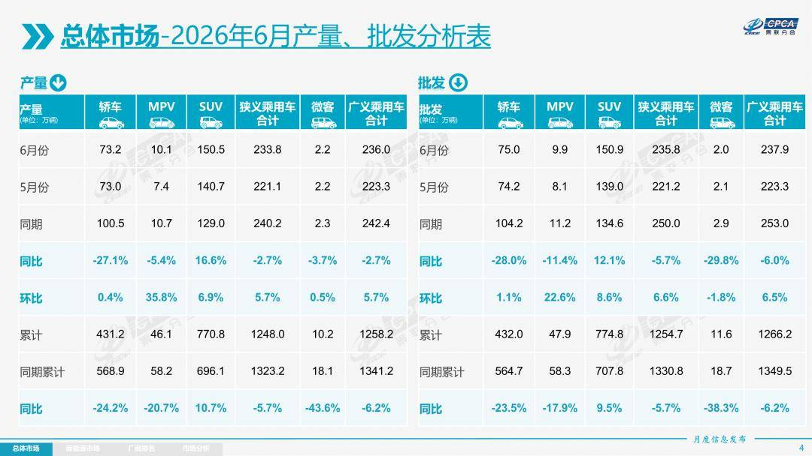
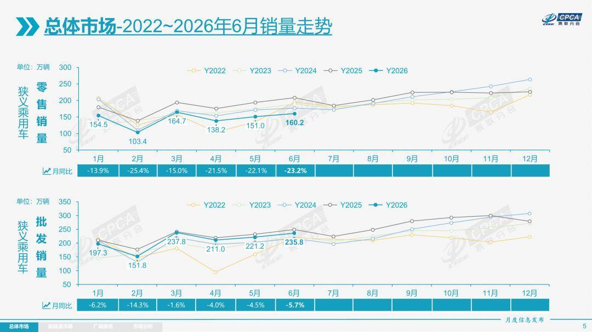
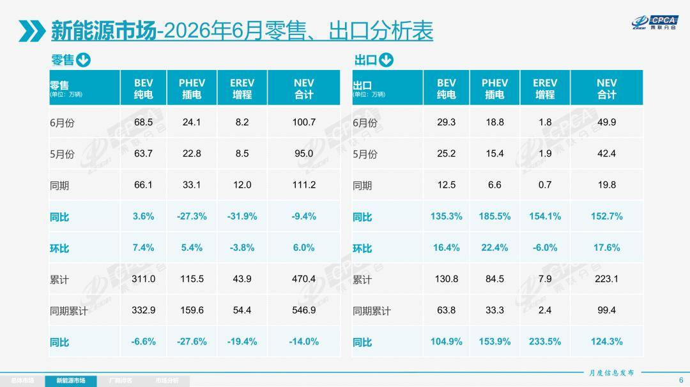
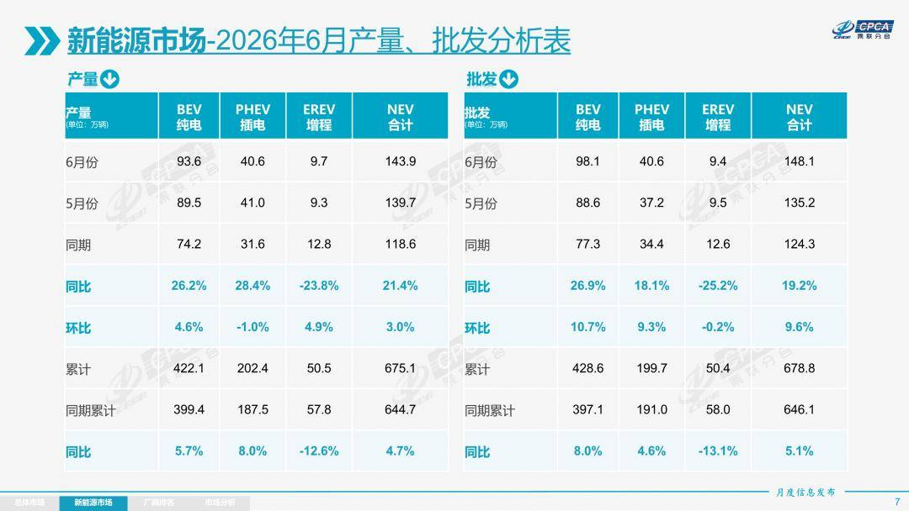
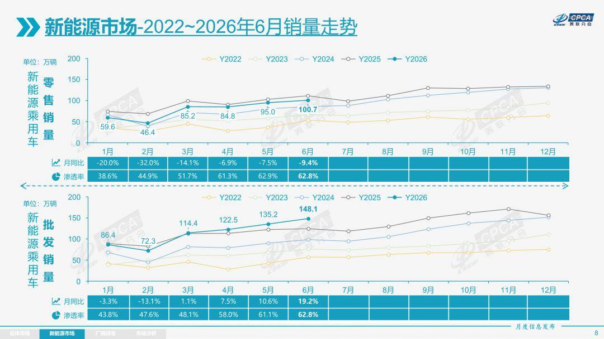
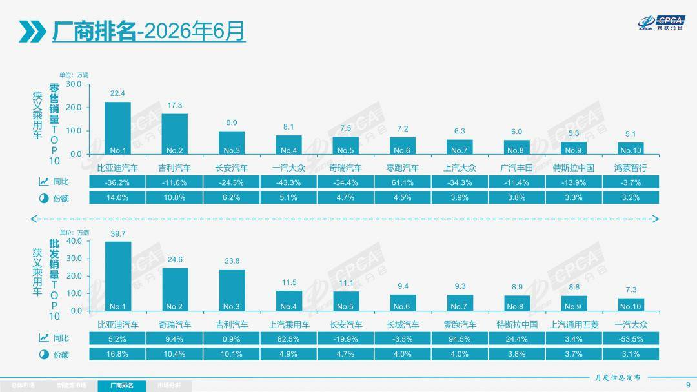
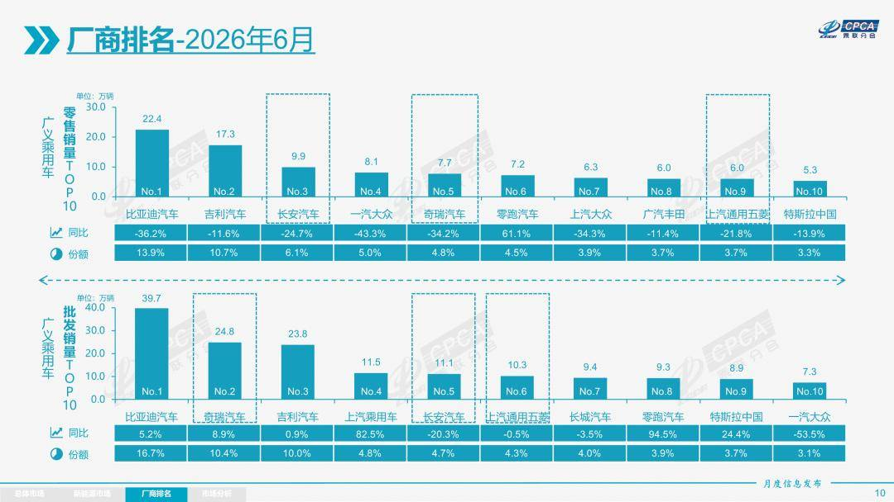

# 【月度分析】2026年6月份全国乘用车市场分析

- 公開日時: 2026-07-08 17:44（北京時間）
- 出典: [搜狐号・崔东树](https://www.sohu.com/a/1047600881_115312)
- テーマ（自動判定）: 乗用車市場
- 画像: 9枚

---

本文全文共9929字，阅读全文约需33分钟

1.2026年6月全国乘用车市场回顾

零售：6月全国乘用车市场零售160.2万辆，同比下降23.2%，环比增长6.1%；今年以来累计零售870.1万辆，同比下降20.2%。2026年6月国内乘用车市场呈现“总量承压、环比走强、结构极致分化”的运行趋势性复苏态势。

6月车市核心特征为“燃油车内销崩塌、新能源强势主导、出口强势增长”。国内车市下滑的核心压力是燃油车，在高油价冲击下的零售下滑39%，6月常规燃油车份额37.2%，同比减量占乘用车总减量的78%，其中普通混合动力车型零售下降7%，纯燃油车下降42%，燃油车结构进一步分化。高油价、消费转型等因素加速“油电替代”过程，本月新能源零售渗透率保持在62.8%的历史高位。合资品牌电动化转型加速，6月新能源合资车型销量同比增长45%，燃油车同比下降39%。出口继续保持行业核心增长地位，6月新能源出口占比57%创新高，同时燃油车出口增速33%的表现也很强，形成中国出海油电双增长的超强表现。

当前国内车市存量竞争特征凸显，行业内部分化持续加剧。新能源市场告别全域增长，呈现“高端电动车爆发、低端经济型车型承压”的两极分化态势，县乡市场、入门级车型下滑过大。同时“新车效应”短期化，对市场拉动效力大幅减弱。渠道端压力持续凸显，行业被动去库存节奏加快，经销商普遍亏损、经营风险攀升。整体而言，6月车市环比走强仅为结构性修复，电动化迭代与海外出口已成为行业长期增长的核心支撑。

目前购车消费稍有改善是外部冲击改善、消费疲软与市场分化三重压力的叠加共振的结果。今年外部环境遭遇罕见的多重干扰叠加。国际油价从126美元/桶高位回落至80美元附近，国内汽油价格从年初7,670元/吨，涨到4月峰值10,325元/吨，6月两次下调后到9,125元，真正近六年最大降幅7月3日下调950元到8,175元/吨，尚在窗口之外，全月仍受高油价惯性压制。端午错位形成高基数效应，“618”促销不及预期，世界杯开赛分流购车群体的时间与预算，高考与农忙压制到店客流，叠加高温多雨天气，加之高基数因素罕见同频挤压。

消费端与市场内部结构性问题加剧需求压力。近期房市下跌与股市结构性低迷形成负财富效应，居民收入与就业预期未见改善，吃穿支出增速（+6%）远高于住行增速（-12%），AOO级和A级购车消费意愿走低。商用车补贴力度大、效果好，乘用车以旧换新政策撬动效果边际递减，油价回落速度慢，未能有效刺激需求。多重因素叠加阶段性异常波动，并非趋势性恶化。随着7月油价近六年最大降幅落地、世界杯结束、雨季消退，被压制的需求有望在三季度逐步释放。

2026年6月乘用车市场的特征：一、总量承压、结构性大分化，“燃油冷、纯电热”成最大焦点，国内零售下滑核心原因是“燃油崩塌”促进新能源零售渗透率快速突破60%，达到62.8%，电动化替代速度超预期；二、微型电动车承压，A级车萎缩，入门级消费亟待支持，经济型电动车标准期待推出；三、出口爆发式增长，出口中新能源占比57%（历史新高），新能源+自主双驱动出海，成为核心增长引擎；四、被动去库存特征明显、渠道库存下降较快，上市经销商全面亏损，经销商生存压力持续加大；五、自主品牌高端突破凸显，20-30万、30-40万、40万以上等消费市场的乘用车零售均超50%。

6月燃油车零售同比下降39%，其中纯燃油车下降42%，普通混合动力下降7%。燃油车中自主下降39%，主流合资下降39%，豪华下降39%，均无差别地受到高油价剧烈冲击。

6月新能源车零售同比下降9%，其中自主下降11%，主流合资增长45%，豪华下降11%，自主经济型电动车国内零售受到补贴暴跌的影响较大。由于新能源商用车补贴力度强，MPV中低端与小型商用车的功能有相通之处，因此MPV中低端下滑较大。

6月自主品牌零售110万辆，同比下降18%，环比增长6%。当月自主品牌国内零售份额为68.6%，同比增长4.5个百分点。自主品牌在新能源市场和出口市场总体较平稳。部分头部传统车企转型升级表现优异，部分传统车企品牌份额提升明显。

6月主流合资品牌零售33万辆，同比下降34%，环比增长8%。6月德系品牌零售份额12.8%，同比下降3.4个百分点，日系品牌零售份额11.0%，同比下降1.0个百分点。美系品牌市场零售份额5.8%，同比下降0.1个百分点。低销量合资车企逐步恢复活力。

6月豪华车零售17万辆，同比下降30%，环比增长3%。随着豪华车指导价的合理回归，6月豪华品牌零售份额10.3%，同比下降1.1个百分点。

出口：根据乘联数据，6月乘用车出口（含整车与CKD）87.7万辆，同比增长82.3%，环比增长11.5%，占乘用车厂商销量37%（上月36%，2025年同期19%）。6月新能源车占出口总量的56.9%，较同期增加16个百分点。6月自主品牌出口达到76.3万辆，同比增长86%；合资与豪华品牌出口11.4万辆，同比增长61%。

生产：6月乘用车生产233.8万辆，同比下降2.7%，环比增长5.7%。6月豪华品牌生产同比下降13%，环比增长1%；合资品牌生产同比下降27%，环比增长32%；自主品牌生产同比增长7%，环比增长2%。

批发：6月全国乘用车厂商批发235.8万辆，同比下降5.7%，环比增长6.6%；受出口暴增的促进激励，6月乘用车批发同比增速较零售增速高出17.5个百分点。6月自主车企批发178.1万辆，同比增长6%，环比增长7%。主流合资车企批发36.7万辆，同比下降34%，环比增长9%。豪华车批发21.0万辆，同比下降23%，环比下降1%。

6月乘用车主力厂商总体批发格局持续变化，上汽乘用车、零跑汽车、特斯拉中国、蔚来汽车、小米汽车、广汽埃安、极狐汽车、北汽越野等车企实现同比20%以上高增长。6月车市集中度推升，10万辆以上批发销量的乘用车厂商5家（上月4家，去年同期5家），占整体市场份额47.0%（上月43%，同期45%）。5-10万辆批发量的乘用车厂商份额占比26.2%（上月26%，同期25%），1-5万辆批发量的乘用车厂商份额占比24.1%（上月27%，同期27%）。

库存：由于6月厂商生产安排极其谨慎，6月厂商批发高于生产2.0万辆，而厂商月度国内批发低于国内零售12.0万辆。今年仍是去库存特征，1-6月总体乘用车行业库存下降48万辆（2025年同期下降17万辆、2024年同期下降49万辆、2023年同期下降20万辆）。

新能源：6月新能源乘用车生产达到143.9万辆，同比增长21.4%，环比增长3.0%。1-6月累计新能源乘用车生产达到675.1万辆，同比增长4.7%。

6月新能源乘用车批发销量达到148.1万辆，同比增长19.2%，环比增长9.6%；1-6月新能源乘用车批发销量达到678.8万辆，同比增长5.1%。6月常规燃油乘用车批发销量达到88万辆，同比下降30%，环比增长2%。

6月新能源乘用车市场零售100.7万辆，同比下降9.4%，环比增长6.0%；1-6月新能源乘用车市场零售470.4万辆，同比下降14.0%。6月常规燃油乘用车零售60万辆，同比下降39%，环比增长6.3%；其中普通混合动力车型同比仅下降7%，环比增长24%的走势表现抢眼。

6月新能源乘用车厂商出口49.9万辆，同比增长152.7%，环比增长17.6%；1-6月新能源乘用车厂商出口223.1万辆，同比增长124.3%，6月常规燃油乘用车出口37.8万辆，同比增长33%，环比增长4%。

1)批发：6月新能源车厂商批发渗透率62.8%，较2025年6月提升13个百分点。6月自主品牌新能源车渗透率73.9%；豪华车中的新能源车渗透率55.5%；主流合资品牌新能源车渗透率上升到13.1%。

6月纯电动批发销量98.1万辆，同比增长26.9%，环比增长10.7%；6月狭义插混销量40.6万辆，同比增长18.1%，环比增长9.3%；6月增程式批发9.4万辆，同比下降25.2%，环比下降0.2%。6月新能源批发结构中：纯电动66.2%(同比+4.0%，环比+0.7%)、狭义插混27.4%(同比-0.2%，环比-0.1%)、增程式6.4%(同比-3.8%，环比-0.6%)。

6月B级电动车批发29.5万辆，同比增长37%，环比增长8%，占纯电动份额30%，较去年同期增长2个百分点。纯电动市场的A00+A0级经济型电动车市场压力较大，其中A00级批发销量7.7万辆，同比下降50%，环比下降11%，占纯电动的8%份额，较去年同期下降11.9个百分点；A0级批发销量31.4万辆，占纯电动的32%份额，同比增长9个百分点；A级电动车23.6万，占纯电动份额24%，同比下降2.7个百分点；从长期普及趋势看，经济型电动车增长是最有潜力的，只有入门级电动车普及才能真正拉动车市可持续增量。

6月乘用车批发销量超两万辆的车型有21个（上月16个），比亚迪宋（79,280辆）、Model Y（56,454辆）、比亚迪元 UP（54,223辆）、吉利星愿（50,906辆）、瑞虎 7（36,099辆）、比亚迪海豚（34,528辆）、Model 3（32,637辆）、缤越（29,536辆）、零跑 A10（26,804辆）、奇瑞JAEC00 J5（26,785辆）、比亚迪海鸥（25,080辆）、名爵 4系（25,014辆）、五菱缤果（24,196辆）、方程豹钛 7（23,710辆）、启源 Q05（23,523辆）、名爵 ZS（22,010辆）、捷途旅行者（21,516辆）、理想 i6（21,453辆）、星舰 7（20,948辆）、探索 06（20,890辆）、小米 SU7（20,414辆）。其中新能源车型占绝对主力地位。

2）零售：6月新能源车在国内总体乘用车的零售渗透率62.8%，较去年同期增长9.5个百分点，环比下降0.1个百分点。6月国内零售，自主品牌中的新能源车渗透率81.8%；豪华车中的新能源车渗透率39.6%；而主流合资品牌中的新能源车渗透率仅上升到11.9%。从月度新能源车国内零售份额看，6月自主品牌新能源车零售份额63.2%，同比下降7.7个百分点；主流合资品牌新能源车份额4.3%，同比增长1.4个百分点；新势力份额26.0%，零跑汽车、蔚来汽车等品牌拉动新势力份额同比增长6.5个百分点；特斯拉份额5.3%，同比下降0.2个点。

3）出口：6月新能源乘用车出口49.9万辆，同比增长152.7%，环比增长17.6%。占乘用车出口56.9%，较去年同期增长15.9个百分点；其中纯电动占新能源出口的58.7%（去年同期63.1%），作为核心焦点的A00+A0级纯电动车占纯电动出口的53.8%（去年同期51.2%）。伴随着中国新能源车的规模优势显现和市场扩张需求，中国制造的新能源品牌产品越来越多地走出国门，在海外的认可度持续提升。其中狭义插混占新能源出口的37.7%（去年同期33.4%），增程占新能源出口的3.6%（去年同期3.5%）。虽然近期受到外部国家的一些干扰，但自主狭义插混出口发展中国家增长迅猛，前景光明。6月厂商新能源出口方面优秀的企业是：比亚迪汽车（170,897辆）、奇瑞汽车（73,819辆）、吉利汽车（61,550辆）、特斯拉中国（36,171辆）、上汽乘用车（30,581辆）、零跑汽车（21,000辆）、东风汽车（15,680辆）、长安汽车（15,061辆）、上汽通用五菱（12,953辆）、长城汽车（10,469辆）。其他车企新能源出口也有一定规模。

从海外体系建设上，部分自主品牌的CKD出口占比较高，国际化表现优秀。其中长城汽车CKD出口占比37.5%，上汽通用五菱CKD出口占比33.0%，领途汽车CKD出口占比24.8%，上汽乘用车CKD出口占比14.8%。

4）车企：6月新能源乘用车企业总体走势较强，比亚迪汽车纯电动与插混双驱动夯实自主品牌新能源领先地位；以比亚迪汽车、吉利汽车、奇瑞汽车等为代表的狭义插混表现持续较强。在产品投放方面，随着自主车企在新能源路线上“多线并举”策略的实施，市场基盘持续扩大，新能源月度批发销量突破万辆的厂商达到20家（同比多2家，环比持平），占新能源乘用车总量93.6%（上月93.4%，去年同期91.3%）。其中，比亚迪汽车（397,292辆）、吉利汽车（158,849辆）、奇瑞汽车（106,922辆）、零跑汽车（93,376辆）、特斯拉中国（89,091辆）、长安汽车（72,194辆）、上汽通用五菱（69,088辆）、上汽乘用车（65,162辆）、蔚来汽车（40,597辆）、小鹏汽车（40,126辆）、东风汽车（37,372辆）、小米汽车（34,738辆）、长城汽车（34,610辆）、理想汽车（30,895辆）、赛力斯汽车（30,345辆）、广汽埃安（25,536辆）、极狐汽车（25,237辆）、广汽丰田（14,387辆）、上汽通用（10,220辆）、一汽奔腾（10,097辆）。

国内新能源乘用车零售突破2万辆的企业品牌是：比亚迪汽车（224,478辆）、吉利汽车（107,951辆）、零跑汽车（72,376辆）、长安汽车（66,900辆）、特斯拉中国（52,920辆）、鸿蒙智行（50,624辆）、上汽通用五菱（43,043辆）、蔚来汽车（40,525辆）、奇瑞汽车（36,449辆）、小米汽车（34,738辆）、上汽乘用车（33,783辆）、小鹏汽车（32,593辆）、东风汽车（32,409辆）、理想汽车（30,895辆）、极狐汽车（25,237辆）、长城汽车（24,141辆）、广汽埃安（23,622辆）。

5）新势力：6月新势力零售份额26.0%，同比增加6.5个百分点。新势力车型中的纯电动销量占比82.2%，较同期的58.0%占比大幅提升；新势力纯电动中的10-15万级别销量占比大幅增长。自主传统车企的独立新能源品牌作为创二代的表现较强，份额18.5%，同比增长5.2个百分点。极氪、奕派科技、深蓝汽车、极狐、岚图等自主大集团的自创新能源品牌表现优秀。

6）普混：6月普通混合动力乘用车批发10.2万辆，同比增长13%，环比增长10%。其中一汽丰田（36,757辆）、广汽丰田（34,439辆）、上汽乘用车（10,383辆）、吉利汽车（7,003辆）、东风本田（3,625辆）、长安福特（3,452辆）、长城汽车（2,802辆）、东风汽车（1,603辆）、广汽本田（1,561辆）。混合动力的市场相对较强，上汽乘用车、吉利汽车等自主混动的海外市场异军突起。

2.2026年7月份全国乘用车市场展望

7月共有23个工作日，生产销售时间相对充裕。随着国际油价暴跌到70美元左右，PPI大降，燃油车海外需求改善，电池等新国标落地后的新能源车新品产销提升，7月车市将进入结构性改善期。

近几年夏季车市淡季不淡的特征日益明显，2014年至2019年的7月车市零售占全年总量平均在6.9%，而2020年至2025年期间的7月车市零售占全年总量平均在8%，其中2025年仍达到7.8%的占比，车市月度规律日益向欧美老龄化市场特征靠拢，消费升级较强，而入门级消费低迷体现普及化特征不足。

总量展望：批发高位运行，零售仍待回暖。6月新国标实施前乘用车渠道库存明显下降。进入7月，出口继续强势，批发端维持较强出货意愿，但终端零售受消费信心和观望情绪制约，改善空间有限。批发与零售的增速差可能继续拉大。

政策效应集中释放，油电竞争格局加速重塑。7月是新能源汽车安全新国标集中落地月，碰撞安全和电池“热失控不起火”等强制要求正式生效，技术门槛显著抬高，主流产品的开发成本和认证周期将拉长，部分低线车型面临改款压力。同时，车船税调整公告于7月初发布，明确2027年起混动不再免税，释放“油电同权”信号，纯电车型的政策优势进一步凸显，7月新能源渗透率大概率维持高位但增速放缓，结构上纯电占比可能小幅回升。

成本利润双承压，价格战退潮后价值竞争升温。车规级芯片价格暴涨，碳酸锂炒作抬价，1—5月行业利润率已降至3.4%的五年最低，车企盈利空间被严重挤压。持续的降价促销已难以为继，上半年价格战明显退潮，消费者已从“等降价”转向“看技术”。7月预计各品牌促销力度趋于理性，新品定价更注重配置和安全溢价，而非单纯内卷杀价，市场竞争焦点加速向智能化、安全性和续航真实表现转移。

下半年将迎渐进改善。乘联分会预测团队曾于6月中把对2026年度零售总量增速预测降到了-14%，这是历年6月预测的最差值，极其悲观。估计7月后的市场预期将逐步改善，原因是随着安全新规和税改预期逐步消化，叠加芯片供应紧张边际缓解、国际油价回归70美元以下、PPI大降、消费信心缓慢修复，零售端降幅有望在三、四季度逐步收窄。新能源行业已从政策哺育期迈入市场化成熟期，未来车企的核心竞争力在于技术安全、全球布局和用户价值创造，“价格驱动”全面让位于“价值驱动”，市场结构将持续优化。

3.2026年1-5月汽车行业利润率3.4%

2026年1-5月，面对国际环境复杂演变和国内转型压力等多重挑战，国民经济开局良好、质效提升，装备制造业和高技术制造业利润快速增长，原材料制造业利润两位数增长，为全年经济平稳运行奠定坚实基础。2026年1-5月汽车生产1,228万辆，同比下降5%。2026年1-5月的汽车行业收入42,096亿元，同比增长1.4%；成本37,397亿元，增长2.3%；利润1,440亿元，同比下降20%；汽车行业利润率3.4%，相对于下游工业企业利润率6.1%的平均水平，汽车行业仍偏低。

2026年1-5月行业销售利润率进一步降至3.4%，5月3.6%，弱于3-4月3.7%的月度表现。历年5月一般利润率较高（23年年度5%而5月8.1%，24年年度4.3%而5月7.5%，25年年度4.1%而5月5.2%），今年5月却处于异常低位，盈利下行压力持续凸显。近期随着车市生产规模扩大，PPI上行，上游有色和石油等矿业利润暴涨，钛酸锂价格近20万，2026年1-5月锂电池出口吨单价下降12%（24年下降26%、25年下降21%），国内电池价格坚挺，锂电上市公司应付账期200天而应收账期要求60天，车企不自制电池的问题已经拖累了车企利润的持续下滑。

2026年各地大力度推动“两新”政策落地实施，逐步有效释放内需活力。但汽车行业效益改善明显落后于其它消费品。随着国家反内卷工作持续推进，汽车行业受上游挤压严重，一方面油价暴涨，有色金属、半导体利润暴增，另一方面终端用户购车观望心态严重，车辆销路不畅，车企运行压力持续加大，汽车高质量发展受到上游的巨大冲击。

4.2026年中国汽车实现5月出口99万辆，1-5月出口424万辆

2025年中国汽车实现出口832万辆，同比增速30%。2026年1-5月中国汽车实现出口424万辆，同比增速49%，5月中国汽车实现出口98.7万辆，同比增长42%，环比增长5%，同比走势总体较强, 环比走势平稳。2026年5月中国新能源汽车出口46.3万辆，同比增长59%，1-5月累计出口189万辆，增长61%的表现很好，5月新能源车出口环比表现较强。

2026年5月中国汽车出口总量的前10国家：俄罗斯94,301辆、巴西90,242辆、澳大利亚54,027辆、墨西哥46,156辆、菲律宾39,643辆、泰国39,626辆、英国38,700辆、意大利32,427辆、阿尔及利亚27,596辆和比利时26,803辆，其中本期较同期增量增长的前五是：俄罗斯72,362辆、巴西42,772辆、泰国29,326辆、意大利22,207辆和澳大利亚20,670辆。

2026年1-5月累计整车出口总量的前10国家：巴西385,813辆、俄罗斯364,710辆、英国194,238辆、澳大利亚178,641辆、墨西哥164,955辆、比利时162,758辆、意大利130,098辆、阿联酋129,054辆、阿尔及利亚109,575辆和泰国106,217辆，其中本期较同期增量增长的前五是：巴西244,737辆、俄罗斯210,285辆、英国86,103辆、阿尔及利亚82,086辆和意大利73,457辆。

2026年5月中国汽车出口中纯电动占比29%（同比-5%），插混占比17%（同比+4%），混动占比9%（同比+4%），纯燃油车占比35%（同比-3%）。

2026年5月中国新能源汽车出口总量的前10国家：巴西67,161辆、澳大利亚45,006辆、泰国38,670辆、菲律宾34,325辆、英国24,973辆、比利时24,595辆、意大利14,778辆、西班牙13,933辆、墨西哥13,784辆和韩国13,343辆，其中本期较同期增量增长的前五是：巴西31,666辆、澳大利亚30,687辆、泰国30,078辆、菲律宾12,663辆和意大利9,217辆。

2026年1-5月中国新能源汽车出口总量的前10国家：巴西289,558辆、比利时154,646辆、英国132,570辆、澳大利亚122,022辆、泰国99,425辆、菲律宾83,691辆、意大利69,431辆、德国68,241辆、韩国63,351辆和西班牙58,030辆，其中本期较同期增量增长的前五是：巴西183,960辆、澳大利亚65,247辆、英国59,343辆、意大利52,993辆和泰国46,991辆。

中国新能源乘用车2026年1-5月出口表现好于预期，主要是插混和混动替代了纯电动成为出口增长的新增长点，而在商用车出口中，纯电动货车出口表现较强，成为商用车新能源车出口亮点。中国新能源车出口主要是出口西欧和中南美市场。受美伊战争影响，出口中东市场受阻，5月阿联酋下滑80%，沙特下滑57%。但我国汽车对俄罗斯出口仍得到大幅回升。

5.2026年5月中国汽车进口3.8万辆

2026年5月进口车进口3.8万辆，下滑19%，但由于2025年1月基数低，虽然美伊战争导致运输受阻，但进口车总体下降较小，2026年1-5月进口汽车16万辆，同比下降11%。随着国产车的崛起和国际品牌本土化加速，近几年汽车进口持续低迷，进口车已持续3年负增长，如果熨平波动，则是连续8年的负增长。

5月进口车下滑压力仍较大。2026年5月进口量最高的前10国家是：日本19,018辆、德国9,935辆、斯洛伐克2,889辆、美国2,770辆、英国2,063辆、奥地利439辆、墨西哥320辆、中国137辆、南非112辆和波兰87辆。其中本期较同期增量增长的前五是：墨西哥283辆、中国136辆、奥地利120辆、南非112辆和马来西亚18辆。

2026年1-5月进口最高的前10国家是：日本85,007辆、德国35,039辆、美国14,373辆、英国9,429辆、斯洛伐克9,398辆、墨西哥2,327辆、奥地利1,966辆、泰国1,699辆、瑞典584辆和韩国358辆。其中本期较同期增量增长的前五是：日本14,964辆、泰国1,485辆、奥地利657辆、墨西哥445辆和中国315辆。

在进口车近几年持续下滑的背景下，今年的豪华市场走势分化，雷克萨斯销量相对较稳，保持进口豪华车的第一位置。部分超豪华品牌异常波动，出现崩盘迹象，行业运行压力较大。

国产与进口豪华车市场的需求总体偏弱，其中上海、北京、苏州、杭州、成都、无锡等地区的豪华车市场压力较大。今年的喀什、伊犁、大庆、哈尔滨等中西部产石油地区的需求较强。

6.2026年1-5月中国占世界汽车份额31%

根据世界汽车组织统计数据，全球汽车生产不断增长，2025年达到9,638万辆，较2024年的9,272万辆增长4%，中国占世界生产份额36%。根据我们统计2025年全球汽车销量9,689万辆，较2024年9,177万辆同比增长6%。2026年5月的世界汽车销量达到816万辆，同比增长3%。2026年1-5月世界汽车销量达到3,915万辆，同比增长2%。随着美国、中国车市的年初相对负增长，2026年1-5月世界车市销量增长分化，2026年初中国份额从2025年全年的35.4%回落到31.2%；虽然2026年初中国汽车销量下滑较大，但其中商用车走强，5月份世界汽车的中国份额回升到32.2%。年初较低是由于入门级销量萎缩因素的异常波动，造成了“乘用车弱、商用车强，出口暴增”局面。期待能有改善低端收入和减少抑制低端消费政策，随着政策刺激效果逐步恢复显现，预计未来中国车市将逐步走强。

2026年1-5月的全球汽车销量增长2%，其中中国汽车销量下降4%，美国销量下降5%，印度汽车市场销量增长17%，泰国汽车市场增长15%，俄罗斯市场销量增长10%，越南增长35%，新兴市场拉动全球市场表现较好。

东升西降，除了丰田、现代起亚、铃木和塔塔等，其它国际品牌份额2026年均出现较大幅下滑。而中国自主品牌的崛起全面提升了在世界的份额。吉利、比亚迪、奇瑞、上汽、长安等自主都有较强表现。

7.2026年1-5月中国占世界新能源车份额61%

2026年1-5月世界新能源乘用车达到882万辆，同比增长10%，其中5月新能源车销量211万辆增长15%，增速仍远低于历史正常水平。2026年1-5月的新能源车渗透率达到22.5%，其中纯电动车的占比达到15.6%，插电混动达到6.9%的汽车比例，普通混合动力达到8%的表现优秀。

2025年中国新能源乘用车世界份额68.3%；2026年1-5月中国新能源乘用车世界份额达到62%的水平。中国在世界纯电动车市场份额表现相对平稳， 2023-2025年的份额在63%左右的水平；2026年中国在世界纯电动车市场份额为58%，2025年中国在世界插电混动份额达到76.4%的超高水平，2026年中国在世界插电混动份额达到71%的高水平，中国在世界插电混动市场呈现超强的表现。

中国之外市场的新能源走势总体增长异常，美国新能源近期走势剧烈波动，由于欧美新能源走势大幅回暖，因此1-5月销量338万辆、增速达到26%，接近于前两年平均水平。美国新能源车2026年5月销量9.5万辆同比下降33%，1-5月美国新能源车销量44万，降低34%。初步统计欧洲新能源乘用车5月37万辆同比增长23%，2026年1-5月184万辆同比增长29%。

由于自主新能源出口表现较好，而美国取消补贴政策后的市场变化大，因此自主新能源乘用车海外市场销量份额提升较大。2025年自主新能源乘用车海外市场销量份额达到15.8%，提升较大。2026年自主新能源乘用车海外市场销量份额达到23.4%，进一步大幅跃升。
