# 2026年6月全国乘用车市场运行特征分析

- 公開日時: 2026-07-09 20:05（北京時間）
- 出典: [搜狐号・崔东树](https://www.sohu.com/a/1048164024_115312)
- テーマ（自動判定）: 乗用車市場
- 画像: 22枚

---

注：本分析文章仅代表崔东树个人观点，如有异议，请留言。

6月全国乘用车市场零售160.2万辆，同比下降23%，环比增长6%；今年以来累计零售870万辆，同比下降20%。2026年6月国内乘用车市场呈现“总量承压、环比走强、结构极致分化”的运行趋势性复苏态势。

6月车市核心特征为“燃油车内销崩塌、新能源强势主导、出口强势增长”。国内车市下滑的核心压力是燃油车在高油价冲击下的零售下滑39%，6月常规燃油车份额37.2%，同比减量占乘用车总减量的78%，其中常规混合动力车型零售下降7%，纯燃油车下降42%，燃油车结构进一步分化。高油价、消费转型等因素加速“油电替代”过程，本月新能源零售渗透率保持在62.8%的历史高位。合资品牌电动化转型加速，6月新能源合资车型销量同比增长45%，燃油车同比下降39%。出口继续保持行业核心增长地位，6月新能源出口占比57%创新高，同时燃油车出口增速33%的表现也很强，形成中国出海油电双增长的超强表现。

1.近年狭义乘用车零售走势

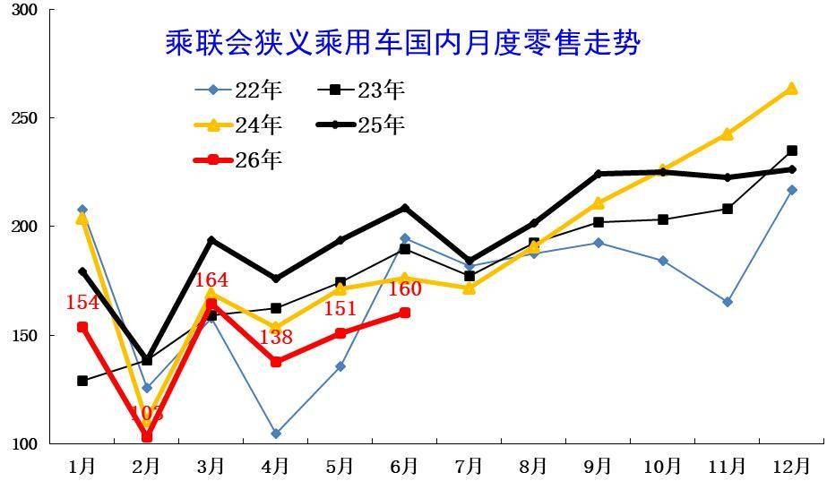

6月全国乘用车市场零售160万辆，同比增长表现较弱，脱离正常增长线路。6月负增长原因是多元的，首先是高油价的影响，其次是以旧换新的新政策规范性较强和补贴缩水，加之上游涨价的剧烈冲击，深层原因是消费能力和意愿偏低。

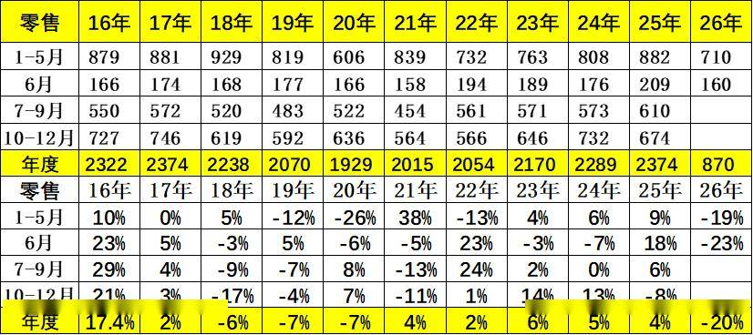

6月全国乘用车市场零售160.2万辆，同比下降23%，环比增长6%；今年以来累计零售870万辆，同比下降20%。2026年6月国内乘用车市场呈现“总量承压、环比走强、结构极致分化”的运行趋势性复苏态势。

2.近年狭义乘用车批发走势

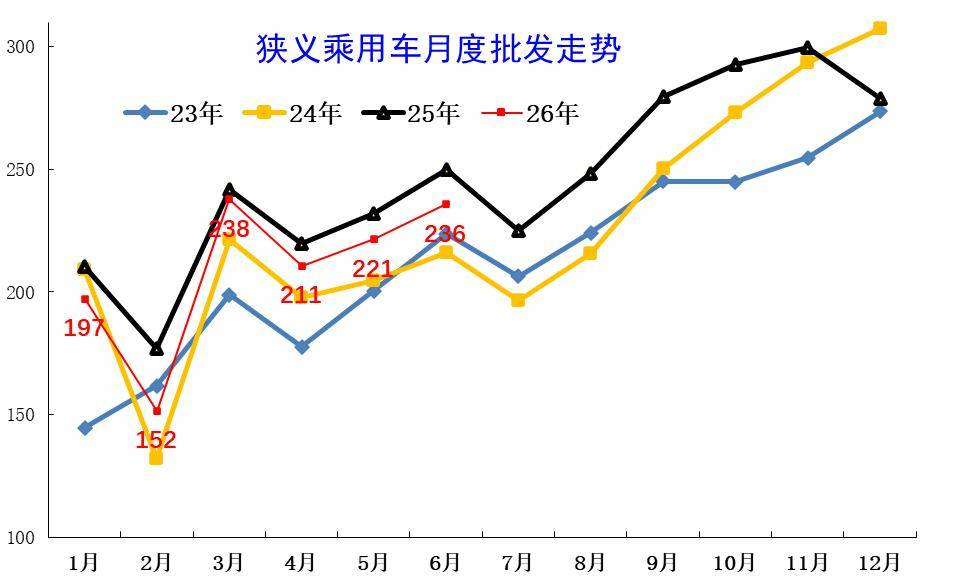

6月全国乘用车厂商批发236万辆，较同期差14万台，大于5月的差距，渠道压力大的特征没有改善。历年6月的走势相对平稳，今年国内低迷但出口增长，因此总体下滑不大。

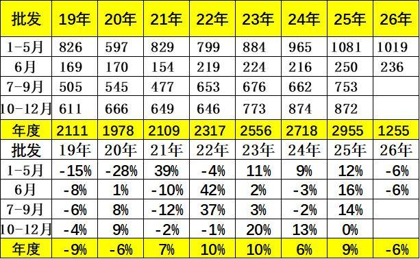

6月全国乘用车厂商批发235.8万辆，同比下降5.7%，环比增长6.5%；受出口暴增的促进，6月乘用车批发同比增速较零售增速高出17.5个百分点。

3.近年狭义乘用车生产走势

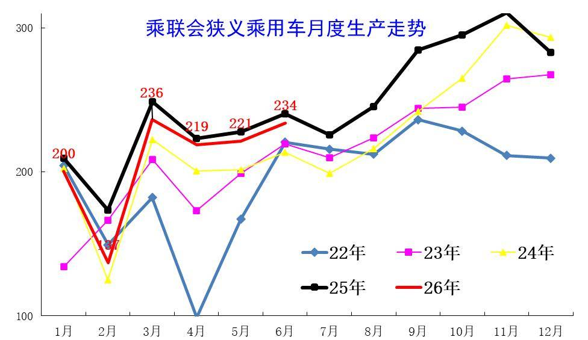

1季度乘用车生产减产力度较大。7月新国标启动，6月市场需求持续较弱，导致6月主动减产力度很大。6月乘用车出口拉动巨大。

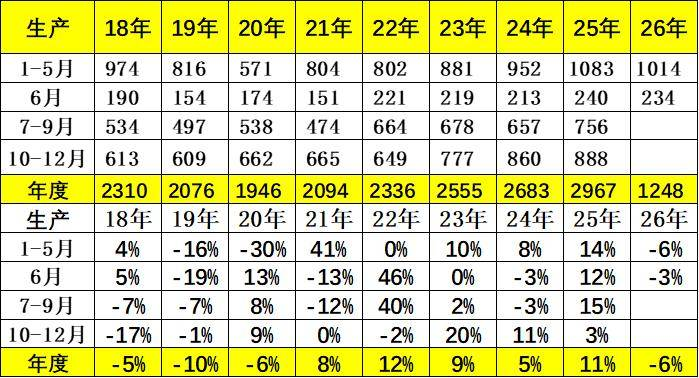

6月乘用车生产233.8万辆，同比下降2.7%，环比增长5.6%。

4.近年狭义乘用车出口走势

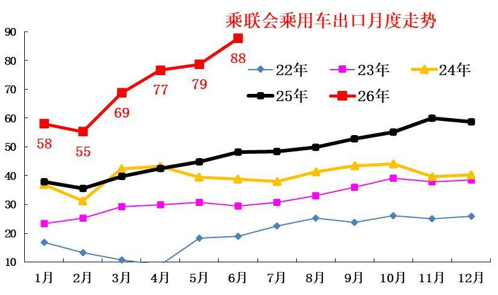

6月乘用车出口（含整车与CKD）88万辆，少有的连续3个月爆发式增长，且6月环比暴增，与2025年走势反差较大。

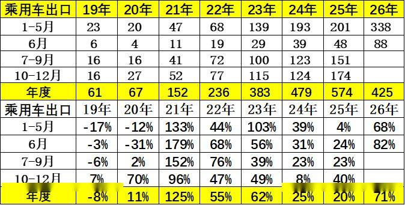

6月乘用车出口（含整车与CKD）87.7万辆，同比增长82.3%，环比增长11.5%，占乘用车厂商销量37%（上月36%，2025年同期19%）。

5.产销库存月度变化特征

由于6月厂商生产态势极其谨慎，6月厂商批发高于生产2.0万辆，而厂商月度国内批发低于国内零售12.0万辆。今年仍是去库存特征，1-6月总体乘用车行业库存下降47万辆（2025年同期下降16万辆、2024年同期下降49万辆、2023年同期下降20万辆）。

6.狭义乘用车促销走势

A、新能源车促销力度小幅增长

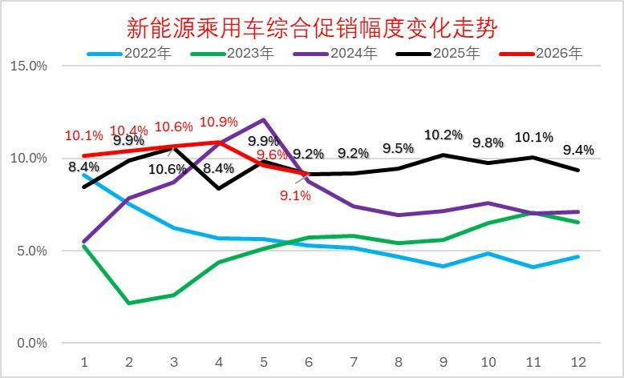

2026年6月的新能源车的促销下降到9.1%的中低位，较同期促销持平，较上月降0.5%。近几个月的促销收缩较大，随着低价新车的增多，新车切换的促销急剧下降，6月促销体系暂时回收，目前基本保持正常促销水平的中高位。

B、燃油车促销走势逐步下降

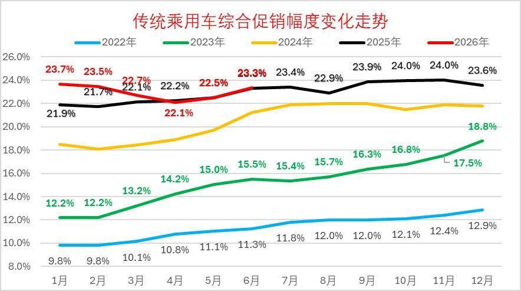

2026年6月传统燃油车的促销回升到23.3%的水平，较上月微增0.8个百分点，较同期持平，燃油车促销连续1年多维持在23%左右。

传统燃油车的促销2025年9月开始小幅加大，幅度较温和，2026年因降价力度大，实现促销逐步回落。

C、豪华车促销走势大幅下降

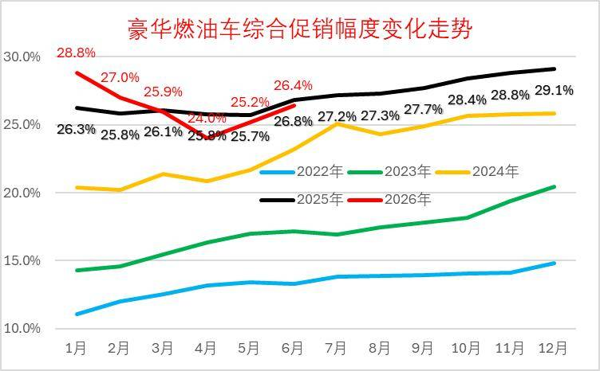

2026年6月豪华车的促销逐步达到26.4%的中高位，较上月回升1.2个百分点，较同期下降0.5个百分点。虽然消费升级推动高端需求较强，但2025年6月以来豪华车促销力度加大,2026年年初以来的新车指导价降价力度较大，促销因此下降，实际成交价格变化不大。

D、主流合资车促销走势平稳

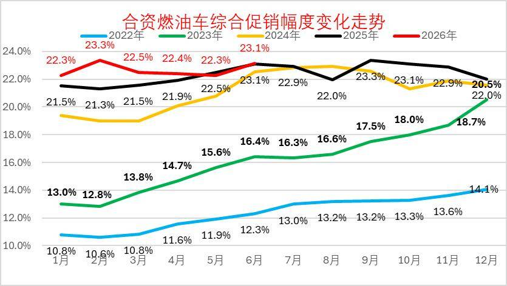

2026年6月合资燃油车的促销逐步达到23.1%的低位，较上月增加0.8个点，较同期少0.1个百分点。合资促销近期稍有增大。

合资燃油车的促销从2023年的13%的低位，2025年9月回升到23.3%峰值，随着新车强力降价，近三个月小幅波动。由于新车价格特别低，因此总体促销力度相对平稳微增。

E、自主燃油车促销走势保持平稳

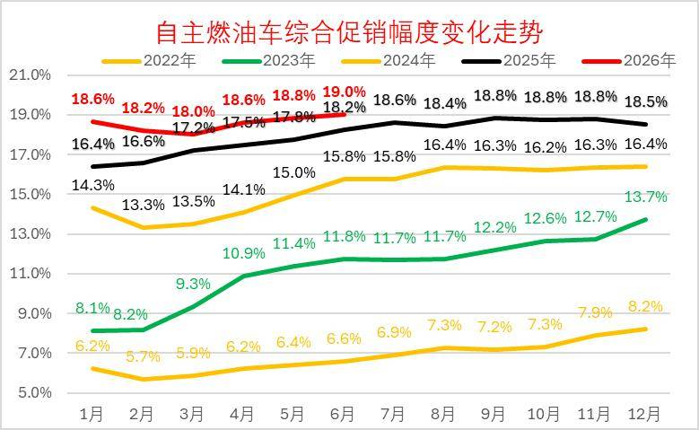

由于自主的新能源较强，加之燃油车出口较好，2025年自主燃油车促销总体平稳。

2026年6月自主燃油车的促销逐步达到19点的高位，较同期增加0.8个百分点。自主车企在2024-2025年上半年的促销上升较快，随后2025年下半年以来的促销总体稳定。

F、分动力促销力度跟踪相对温和

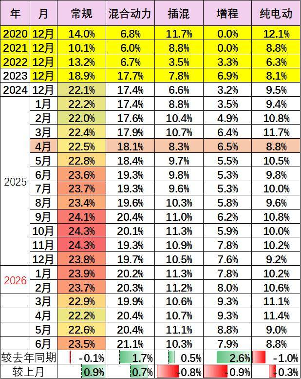

由于部分品牌降价带来的指导价回归，降低了促销幅度。2026年的常规燃油车和混合动力的降价力度大、高油价下销量差，促销力度也持续增大。

新能源车促销明显改善，插混和增程的促销明显改善，新品的促销降低改善市场表现。纯电动车型因为主力车型切换，促销较2025年6月下降1个点左右的促销，较上月下降0.3%左右促销。

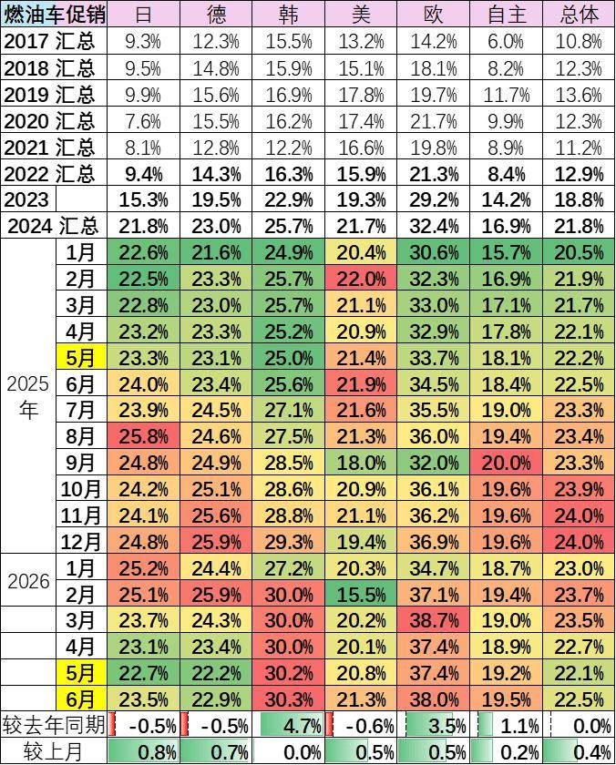

6月的车市促销相对平稳，经销商也是稳促销保利润。目前的欧系和韩系促销大，其它合资车企促销基本22%左右，差异不大。自主车企成为促销最小的。

7.狭义乘用车各级别增长特征

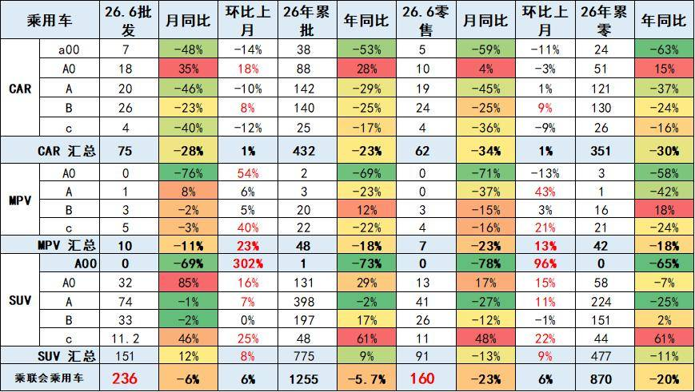

2026年6月乘用车零售降23%，批发下降6%，零售大幅弱于批发的增速,形成内冷外热格局。由于高油价冲击和补贴暂停带来零售回落，6月A级轿车零售与A00级轿车零售均较低，A0级轿车和高端车型成为6月零售主力，SUV的高端表现较强，轿车中主要是A0级轿车销量回升。

8.狭义乘用车国别增长特征

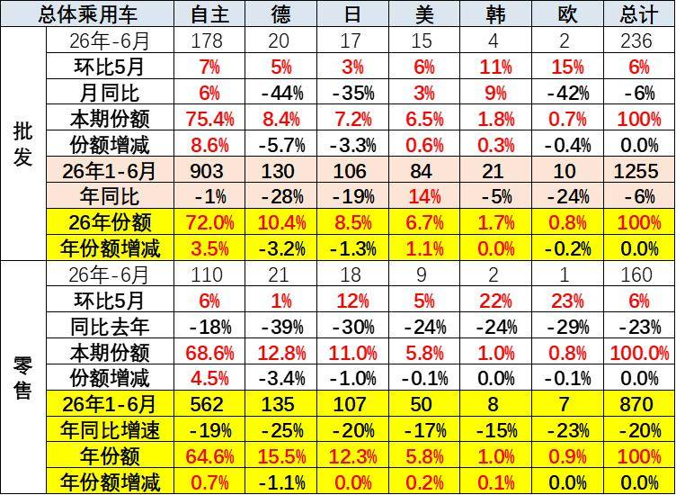

6月自主品牌零售110万辆，同比下降18%，环比增长6%。当月自主品牌国内零售份额为68.6%，同比增长4.5个百分点。自主品牌在新能源市场和出口市场总体较平稳。部分头部传统车企转型升级表现优异，部分传统车企品牌份额提升明显。

6月主流合资品牌零售33万辆，同比下降34%，环比增长8%。6月德系品牌零售份额12.8%，同比下降3.4个百分点；日系品牌零售份额11.0%，同比下降1.0个百分点；美系品牌市场零售份额5.8%，同比下降0.1个百分点。低销量合资车企逐步恢复活力。

6月豪华车零售17万辆，同比下降30%，环比增长3%。随着豪华车指导价的合理回归，6月的豪华品牌零售份额10.3%，同比下降1.1个百分点。

9.2026年品牌产销特征

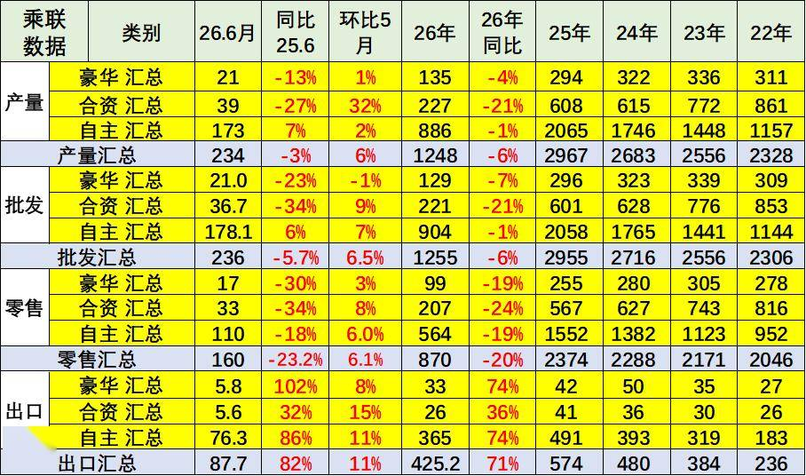

原有的品牌价值体系变化，豪华品牌近期持续压力加大，合资车企的产销走势压力持续较大，自主品牌产业链优势明显。

6月需求分化压力较大，燃油车市场环比走势较差，导致合资品牌走势恶化。自主靠新能源和出口相对表现较好。

10.全国新能源渗透率-批发

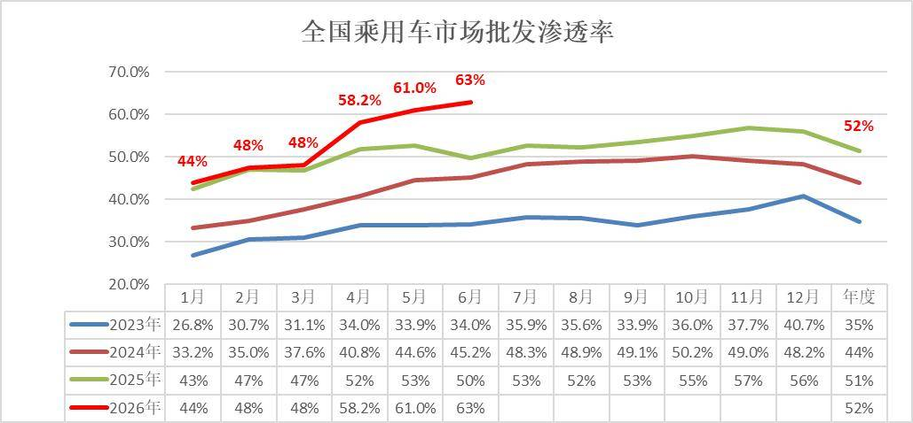

6月新能源车厂商批发渗透率62.8%，较2025年6月提升13个百分点。

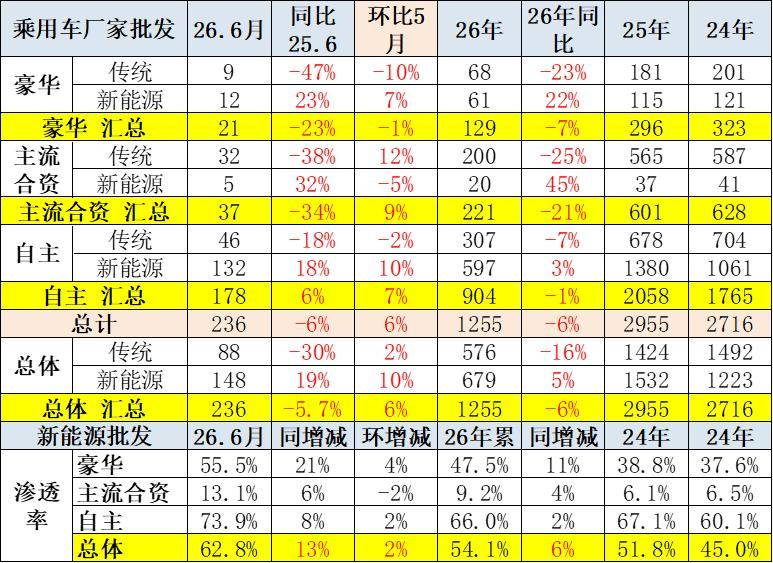

6月自主品牌新能源车渗透率73.9%；豪华车中的新能源车渗透率55.5%；而主流合资品牌新能源车渗透率上升到13.1%。

6月传统车厂家批发同比降30%，而新能源车同比增19%，增速差距50个百分点，燃油车的市场持续低迷，新能源出口的贡献度大。

11.全国新能源渗透率-零售

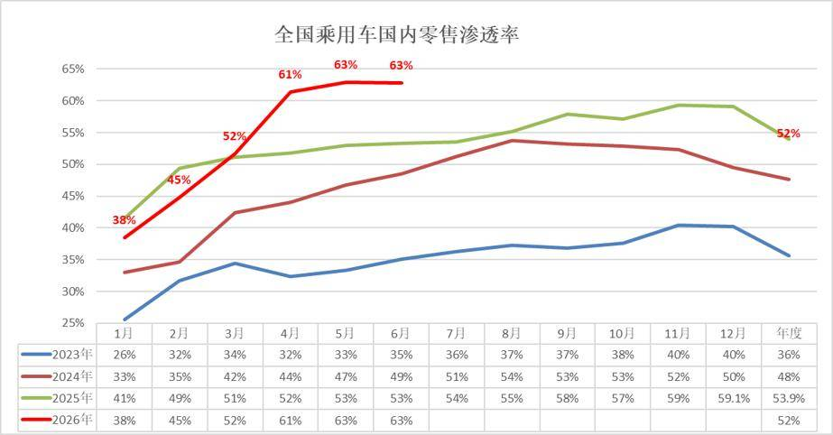

6月新能源车在国内总体乘用车的零售渗透率62.8%，较去年同期增长9.5个百分点，环比下降0.1个百分点。

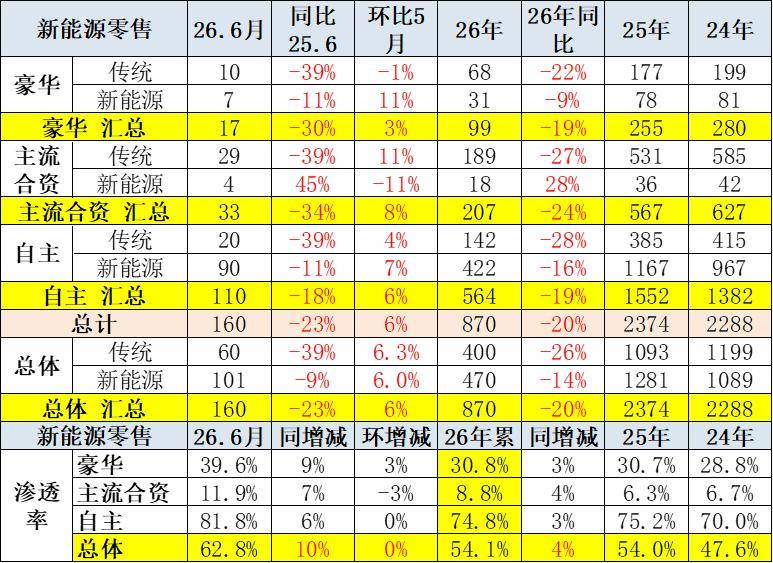

6月国内零售，自主品牌中的新能源车渗透率81.8%；豪华车中的新能源车渗透率39.6%；而主流合资品牌中的新能源车渗透率仅上升到11.9%。

6月燃油车零售同比下降39%，新能源车下降9%，差距仍是30个百分点左右。但6月燃油车的环比走势强于新能源车，形成油价下降后的需求稍有改善的特征。

附：近日信息合集
