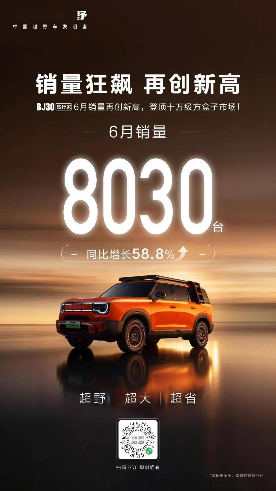

# 十万级方盒子市场格局改写—BJ30旅行家凭全能实力重塑赛道竞争规则

- 公開日時: 2026-07-10 17:24（北京時間）
- 出典: [搜狐号・崔东树](https://www.sohu.com/a/1048592088_115312)
- テーマ（自動判定）: セグメント・車種
- 画像: 1枚

---

2026年轻越野方盒子赛道正在迎来历史性拐点。过去数年，燃油方盒子开辟十万级轻越野蓝海，市场竞争长期停留在外观造型、基础通过性的基础需求。但随着家庭用户需求迭代、混动技术全面普及，单纯依靠造型出圈、燃油动力的传统方盒子产品，已难以匹配消费者“可城、可野、家用、低成本”的多元诉求。

乘联会数据显示，2026年6月北京越野BJ30旅行家单月销量达到8030台，同比大涨58.8%，同口径超越领军竞品的月度销量，正式登顶十万级轻越野方盒子销冠；同月，BJ30旅行家完成15万台整车下线，成为国内轻越野SUV最快达成15万台销量的车型。

我认为BJ30旅行家登顶绝非短期流量红利，而是行业需求变革、技术代差、全周期价值优势三重因素叠加下，十万级方盒子市场格局彻底改写的标志性事件。赛道竞争逻辑，已经从“颜值取胜”转向“混动、空间、越野、低成本”综合实力的全方位比拼。

一、行业底层变革：十万级方盒子赛道三大结构性痛点，旧产品体系已无法适配新需求

纵观当前十万级轻越野方盒子市场，以哈弗大狗为代表的传统燃油车型，诞生之初填补了平价硬派SUV空白，但伴随用户群体从单身年轻玩家转向多孩置换家庭，固有短板持续放大，形成三大行业痛点：

1. 燃油动力用车成本高，混动产品供给空白

传统燃油方盒子风阻大、自重高，城市拥堵路况油耗普遍突破9L/100km，长期通勤油费压力显著。2026年HEV混动成为家用SUV主流技术路线，无充电焦虑、低油耗的产品更受家庭青睐，但此前十万级方盒子市场长期缺少成熟油电混动车型，市场存在巨大供给缺口。

2. 空间设计偏向5座单人出行，无法满足三代同堂家用

市面主流燃油方盒子均为5座布局，轴距普遍不足2750mm，后排无法完全纯平放倒，装载能力有限；第三排缺失导致全家出行、长途露营场景受限，搬家、户外装备装载等实用场景短板突出，家用属性严重不足。

3. 越野性能与性价比难以兼顾，入门门槛偏高

多数方盒子车型仅搭载基础两驱、普通机械四驱，缺少专业全地形控制与锁止机构；同时入门版本配置单薄，想要完整越野配置需拉高预算，普通家庭难以实现“平价越野”，违背轻越野普及化趋势。

在此背景下，市场急需一款兼顾专业越野、大七座家用、超低用车成本、亲民入手价的混动方盒子产品，BJ30旅行家的到来，精准补齐行业供给短板，直接改写赛道竞争标准。

二、数据实证：四项硬核市场事实，印证BJ30旅行家行业领跑地位

（一）月度销量反超，细分销冠易主，赛道进入全新领跑周期

6月BJ30旅行家零售8030台，同比增长58.8%，拿下十万级轻越野方盒子月度销冠。BJ30旅行家上市不足两年便完成15万台下线，用户接纳速度远超同类竞品，终端热度持续走高。

（二）四大细分赛道第一，长期领跑混动轻越野市场

依托混动差异化优势，BJ30旅行家拿下连续两年HEV混动方盒子销量第一，构建难以撼动的市场壁垒：

高保值率代表车辆长期价值，在置换需求爆发的2026年，成为家庭用户购车核心决策依据，也是BJ30区别于竞品的核心优势。

（三）全球市场双重认可，混动技术经受全球极端路况验证

国内市场热销之外，BJ30旅行家先后斩获阿拉伯地区最佳混动SUV、阿根廷年度最佳进口SUV国际大奖；南非、印尼、阿联酋、波兰、墨西哥五国汽车博主，在非铺装路、高温荒漠、冰雪山路、城市拥堵等极端场景实测，BJ30旅行家百公里油耗全部控制在5L以内，混动技术适配全球各类路况，技术实力得到海外市场验证。

（四）央视权威品质背书，15万公里拆解验证耐久实力

6月央视财经全程直播北汽株洲超级工厂，行业首次公开拆解行驶15万公里的BJ30旅行家，相当于沿国境线行驶6圈。拆解结果显示：发动机无积碳、变速箱无渗漏磨损、电池无鼓包衰减、底盘副车架无锈蚀渗油，整车耐久表现接近新车水准。

全自动化机器人焊接、五千吨级冲压设备、全自动水性漆喷涂的高标准产线，从制造源头保障车身刚性与长期可靠性，解决用户对混动越野车型长期耐用性的核心焦虑，这也是多数竞品缺少的权威品质佐证。

三、核心产品壁垒：“超野、超大、超省”三维全能，构建差异化优势

BJ30旅行家作为国内首款HEV混动方盒子SUV，依托北京越野67年专业越野技术沉淀，打造轻越野旅行“三项全能”实力，全方位解决传统方盒子产品痛点。

（一）超野：专业越野技术下放，实现越野平权，打破“轻越野=弱性能”误区

市场普遍存在认知误区：轻越野等于性能缩水，而BJ30旅行家以“越野属性优先”为研发策略，实现同级领先硬实力：

1. 三擎四驱六模专属混动架构，综合功率316kW、综合扭矩685N·m，零百加速6.59秒；0.03秒极速电四驱响应，速度是机械四驱3倍，打滑瞬间完成动力分配；

2. 同级独有旅行越野三大件：电四驱+能量中锁+ATS七模式全地形控制系统，覆盖雪地、沙地、泥地、涉水等场景，无需专业越野技巧即可轻松脱困；

3. 通过性指标同级领先：25°接近角、30°离去角、215mm最小离地间隙，烂路、陡坡、交叉轴通行底气充足；

4. 安全车身标准拉满：63.4%高强度笼式车身，车身扭转刚度24800N·m/度，整车完成400万公里-35℃至50℃极端环境耐久测试，单轮悬空半米车门仍可正常开启，越野出行安全底线拉满。

对比燃油机械四驱、单一燃油动力架构，BJ30旅行家混动电驱在响应速度、脱困效率、动力输出上形成代际领先。

（二）超大：10万级唯一七座方盒子，家用场景全面碾压同级

家庭用户核心刚需是空间，这也是传统燃油方盒子最大短板，BJ30旅行家以尺寸与布局优势实现全面领先：

1. 2820mm超长轴距，66%超高得房率；10万级唯一三排七座方盒子，第三排可舒适容纳1米8成年人，膝盖不顶、头部不压抑，真正实现三代人同车出行；

2. 空间拓展能力拉满：二排放倒形成1496L纯平储物空间，相当于38个20寸登机箱，1.92米纯平大床，同级唯一主驾一键放平座椅，露营、休憩、大件装载一机搞定；全车38处精细化储物空间，随身物品各有专属位置；

3. 座舱智能化配置越级：15.6英寸中控大屏、10扬声器HiFi音响、华为HiCar互联、1.05㎡全景天窗、220V外放电接口，兼顾家用舒适与户外娱乐。

（三）超省：全周期低成本，从购车、用车、维保三重维度降低家庭负担

混动技术的核心价值，是重构车辆全生命周期使用成本，BJ30旅行家做到省油、省时、省心三位一体：

1. 省油：油耗全面优于燃油方盒子

两驱版百公里综合油耗5.85L，四驱版6.45L，远低于哈弗大狗8.35L的官方油耗，日常通勤、长途自驾大幅减少油费支出；多国极端路况实测油耗低至4.4-4.9L，混动节能优势突出。

2. 省时：HEV无充电焦虑，加油即走

区别于插混车型依赖充电桩，BJ30旅行家油电混动无需充电，省去安装充电桩、排队补能的时间损耗，一年可节省数十小时时间成本，短途通勤、长途穿越均无束缚。

3. 省心：终身质保加持，维保门槛更低

首任非营运车主享整车终身质保，覆盖发动机、变速箱及99%零部件；无大容量高压电池安全隐患，配件全国普及，普通修理厂均可维保；同时推出3万超级置换政策，全系置换价低至6.99万元起，将硬派方盒子入手门槛拉至7万级，真正实现越野平权，让普通家庭轻松拥有轻越野生活。

四、行业战略意义：BJ30旅行家重塑十万级方盒子赛道两大发展趋势

趋势一：赛道竞争从“燃油外观内卷”转向“混动价值竞争”

在此之前，十万级方盒子市场比拼集中在外观套件、基础配置堆砌，动力长期以燃油为主。BJ30旅行家凭借成熟HEV混动实现技术差异化，证明低油耗、无充电焦虑的混动架构，才是家庭轻越野的最优解。未来，混动将成为十万级方盒子车型标配，纯燃油方盒子产品市场份额将持续萎缩。

趋势二：轻越野产品从“单人玩具”转向“全场景家庭工具”

行业过去对轻越野的定位局限于年轻单身用户的个性玩具，而BJ30旅行家七座大空间、全能装载、低用车成本的产品设定，重新定义轻越野核心用户——多成员家庭。兼顾城市通勤、全家出游、户外露营、大件装载的全场景能力，将成为后续所有方盒子新品的核心考核标准。

站在品牌战略角度，BJ30旅行家也完善北京越野双线布局：BJ40守住重度专业越野赛道，BJ30旅行家占领十万级家用轻越野细分市场，形成高低搭配、专业与家用全覆盖的完整产品矩阵，巩固北京越野中国越野车发明者的行业地位。

五、行业预判与总结

从6月销量登顶、15万台下线两大关键节点来看， BJ30旅行家凭借“超野、超大、超省”三重全能实力，完成对传统燃油方盒子产品的价值超越。

2026下半年，十万级轻越野赛道竞争会进一步加剧，只靠造型、燃油动力、5座布局的车型将逐步失去市场竞争力，具备成熟HEV混动、七座大空间、高保值率、可靠耐久、低入手门槛的产品，才能持续抢占用户心智。

BJ30旅行家的市场突围，本质是北京越野“越野平权”理念落地的成功实践：以68年专业越野技术下放、混动技术创新、亲民定价，打破越野车型高价、高用车成本的固有标签，让更多普通家庭轻松实现轻越野自由，也为中国自主轻越野SUV行业开辟全新增长范式。
