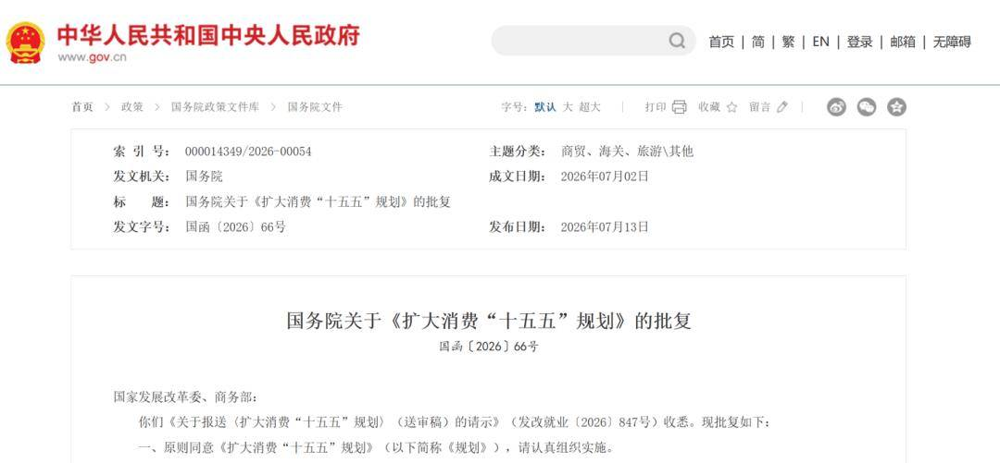

# 对《扩大消费

- 公開日時: 2026-07-14 10:56（北京時間）
- 出典: [搜狐号・崔东树](https://www.sohu.com/a/1050024945_115312)
- テーマ（自動判定）: 産業統計
- 画像: 1枚

---

注：本分析文章仅代表崔东树个人观点，如有异议，请留言。

7月13日，中央政府印发的《扩大消费“十五五”规划》，明确了“十五五”时期消费领域发展的思路目标、重点任务和政策举措。《扩大消费"十五五"规划》将汽车消费定位为扩内需的核心抓手，标志着汽车促消费从短期补贴刺激转向长效制度建设。当前汽车内需面临总量走弱、城乡失衡、流通不畅、长效机制缺失四大突出矛盾，亟需从宏观稳增长、产业电动化转型和结构性增量释放三个维度系统破局。

我个人认为：促销费政策抓住了核心消费潜力增长点，空间较大，意义重大。我感觉目前银发经济、县域出行等下沉潜力尚未充分释放，建议建立经济型车标准、C7驾照、购车个税抵扣等配套举措，我认为这样将有效改善入门刚需的门槛与高端置换两端堵点，为“十五五”期间汽车市场持续扩容提供优化门槛和促进换购的双重支撑。

一、《扩大消费"十五五"规划》总体政策

《扩大消费"十五五"规划》是中央着眼2026-2030年中长期布局、将扩大内需上升为战略基点的顶层设计文件，核心是把消费作为经济增长第一拉动力，推动经济发展方式从投资、出口驱动转向内需主导。规划有四条主线贯穿始终：一是从短期刺激转向长效制度供给，减少一次性消费券、阶段性减税等脉冲式干预，转而通过标准建设、财税改革、流通体系完善构建稳定预期；二是从商品消费转向商品与服务消费并重，拉长消费链条，释放全生命周期消费潜力；三是从城市消费转向城乡协同，把县域、农村和银发、多孩等结构性群体作为核心增量来源；四是从购买管理转向使用管理，清理不合理限制性措施，优化消费配套环境。汽车作为占社零约10%、产业链最长的大宗消费品，是本轮规划扩内需的核心抓手，规划中的汽车条款集中体现了上述四条主线的落地路径。

二、当前汽车内需突出矛盾

当前国内汽车市场已从增量时代转入存量更新阶段，多重堵点压制内需复苏。一是居民收入预期偏弱，多年价格战催生持币观望心态，新车零售持续承压，汽车作为占社零10%的大宗消费品，拖累整体消费修复；二是城乡供需错配，一二线趋于饱和，县域农村缺少平价合规代步电动车，低速非标车隐患突出；三是置换流通不畅、大城市限购约束刚需、城乡充电配套不足；四是政策多为短期购置税补贴，长效激励机制缺失，市场波动大。

三、国家出台汽车促消费政策核心逻辑

1.稳宏观大盘刚需支撑

我国汽车千人保有量仅约200辆，远低于发达国家水平，与住宅等大宗消费品的普及率差距明显，汽车消费仍有较大提升空间。尤其是今年以来新车零售持续走弱，5月同比下滑约15%，成为拖累社零增速的主要因素。汽车上下游联动上百个产业，吸纳大量就业，是扩大内需核心抓手。面对出口地缘壁垒、外需不确定性，打通国内汽车全链条循环，能稳定社零与经济增长底盘。

2.适配产业电动化转型节点

市场矛盾从"买车难"转为"用车、换车难"，政策推动购车管理转向用车配套优化，补齐充电基建，巩固我国新能源产业全球领先优势，助力双碳能源转型。

3.激活存量、缩小城乡消费差距

依靠二手车流通改革、汽车下乡、限购松绑释放置换与下沉市场需求，兼顾大城市刚需与县域消费潜力，服务共同富裕与乡村振兴；同时拉长汽车后市场消费链条，拓宽产业盈利空间。

4.构建长效促消费制度

摆脱一次性消费券、短期减税的脉冲式刺激，通过标准、财税、流通、基建系统性改革，形成十五五周期稳定政策环境，避免需求透支、市场大起大落。

四、政策实施效果预判

短期2026-2027年限购差异化松绑、二手车流通简化将释放逐步百万级刚需，置换购车占比提升至55%以上，新能源车渗透率持续提升；中长期“十五五”末新车国内外销量有望突破4000万辆，海外市场和县域市场成为增长主力，新能源车渗透率稳定70%以上。行业摆脱单纯价格内卷，盈利增长点转向二手车、维保、电池回收等服务；充电网络全覆盖实现车网互动储能，完成交通绿色转型，城乡汽车消费差距显著收窄。

五、政策战略意义

对内打通首购、置换、二手流通、后市场完整内需闭环，夯实国内大循环支点；对外完善电动化配套体系，强化中国汽车全球竞争力；制度层面实现汽车由购买管控向使用服务转型，为家电、住房等大宗消费改革提供示范；同时降低居民用车综合成本，兼顾民生出行保障与碳减排中长期目标。

六、建议促汽车消费的个人观点

建议1：出台全国统一经济型电动车标准，契合银发经济政策方向

低速电动车（俗称"老头乐"）是县乡市场极具中国特色的老年出行工具，普及率很高，背后反映的是真实需求与合规供给之间的缺口——有庞大出行需求，但缺乏针对性的正规电动车产品供给。建立经济型车标准与国家发展银发经济的战略方向高度一致。

当前我国已步入深度老龄化，《关于发展银发经济增进老年人福祉的意见》明确将老年适老化出行、适老化产品列为重点培育领域，经济型电动车正是落实这一方向的关键载体。对标海外小型代步车体系制定国标，规范尺寸、续航、安全配置，可补齐当前平价合规小车供给缺失、老人被迫使用无保障低速车的短板。合规代步车普及能释放庞大银发首购刚需，老年人有车后进一步带动就医、文旅、商超、乡村休闲多元消费，形成汽车拉动银发经济的连锁效应。

而且经济型电动车也会打开海外市场的巨大空间，海外很多消费者不富裕、道路狭窄，中国的经济型电动车必然会成为世界神车。

建议2：增设C7专用驾照缓解县域出行痛点

针对国标经济型电动车设立C7简易驾照，简化考试科目，降低中老年群体取证门槛，放宽老年人体检考核标准。目前乡镇中老年出行需求旺盛，但多数中老年人难以通过传统C1、C2考试，被迫使用非标低速车。经济型电动车的C7落地后合规代步车获得完整路权，搭配县域充电、维保网点建设，系统性打通农村购车、用车全流程堵点，与经济型车标准共同构成适老出行完整方案。

建议3：推出购车抵扣个税长效财税政策

将家庭购车支出、汽车消费贷款利息纳入个税专项附加扣除，替代短期阶段性补贴，构建五年稳定激励机制。工薪家庭买经济型车可减轻入门负担，高收入群体置换中高端车型能大幅降低购车成本，有效缩短居民平均换车周期，同时稳定长期购车预期，拉动新车销售与二手车置换双向增长。

总体建议：双向优化消费门槛，同步拉动刚需入门与高端换购

以经济型车标准、C7驾照降低下沉银发、农村市场首购门槛，夯实基础消费盘；依靠购车个税抵扣激励多孩、中产家庭升级置换，撬动中高端车型消费。两端同步发力，破解市场低端供给缺失、高端置换动力不足的结构性矛盾，平衡城乡、代际消费，推动行业走出低价内卷，实现分层可持续增长。

附：近日信息合集
