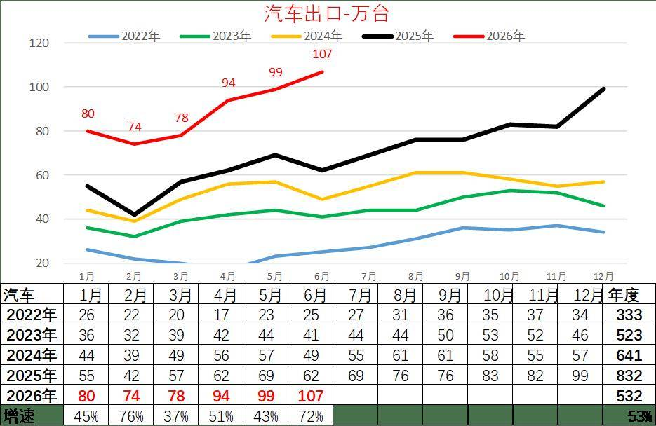
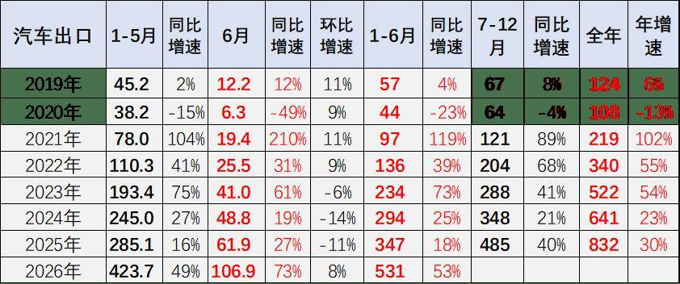
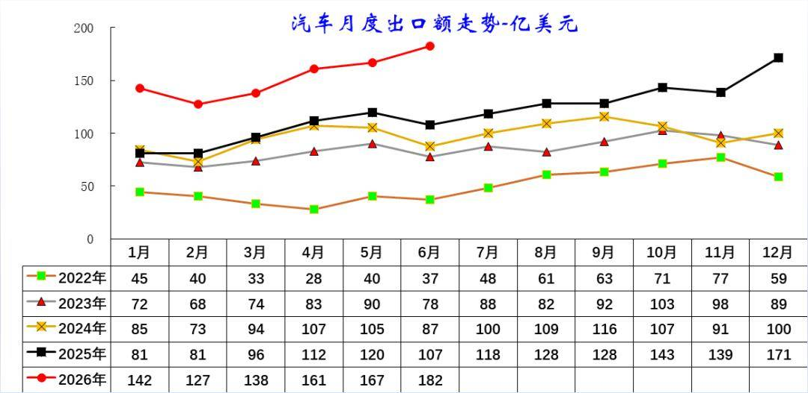
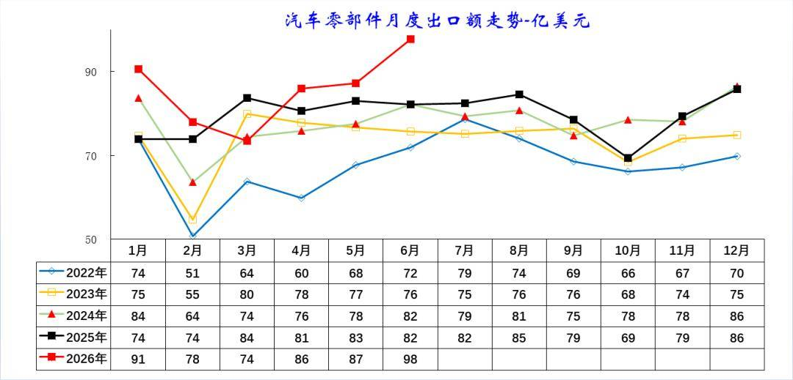

# 6月中国汽车出口107万，同比增73%,环比增8%

- 公開日時: 2026-07-14 19:07（北京時間）
- 出典: [搜狐号・崔东树](https://www.sohu.com/a/1050301707_115312)
- テーマ（自動判定）: 輸出
- 画像: 4枚

---

2026 年 1-6 月汽车出口 531 万台，同比大增 53%，大幅甩开往年同期水平。其中 6 月出口 106.9 万台，同比增速 73%，环比小幅回升 8%，增长爆发力突出。

2026 年 1-6 月汽车出口总额 918 亿美元，同比大幅增长 54%，增长力度重回高位。6 月出口 182.3 亿美元，同比增 70%，环比转正增长 9%，打破 2022-2025 年 6 月环比普遍下滑的规律。

2026 年 1-6 月零部件出口总额 513 亿美元，同比增长 7%，增速较 2025 年上半年小幅回升。6 月单月出口 97.8 亿美元，同比增 19%，环比大涨 12%，一改 2023-2025 年 6 月环比转弱的态势。

今年汽车零部件出口同步稳步增长，重点服务欧美成熟市场，依托完善的供应链体系，为全球车企提供稳定配套，形成“零部件深耕欧美、整车辐射全球”的交叉互补格局，产业链协同效应凸显，共同支撑中国汽车产业的全球竞争力持续提升。

1、中国汽车出口爆发增长

2026 年 1-6 月汽车出口持续走高，月度数值从 1 月 80 万台升至 6 月 107 万台，仅 2 月小幅回调，整体增长动能强劲。

对比往年同期，2026 年各月出口量全面大幅超越 2022-2025 年同期，单月增速均超 37%，6 月同比增速达 72%，1-6 月累计出口 532 万台，同比增幅 53%。

海外市场需求持续释放，国产汽车出海竞争力稳步提升，上半年出口规模、增速均创历年同期新高。。

2026年我国汽车出口迎来爆发式增长。2026 年 1-6 月汽车出口 531 万台，同比大增 53%，大幅甩开往年同期水平。其中 6 月出口 106.9 万台，同比增速 73%，环比小幅回升 8%，增长爆发力突出。

复盘 2019-2025 年走势：2021 年迎来出海爆发，后续增速逐年放缓；2023 年后单月环比常出现下滑，而 2026 年 6 月实现环比正增长，海外需求韧性显著增强。

2、中国汽车出口均价持续提升

2026 年 1-6 月汽车出口额持续强势走高，单月金额从 1 月 142 亿美元升至 6 月 182 亿美元，仅 2 月小幅回落，各月数值大幅领先 2022-2025 年同期。

对比历年，2022 年出口额基数最低、全年波动平缓；2023-2025 年稳步抬升，但单月峰值均低于 2026 年上半年水平。

出口额增速显著高于出口量增速，反映单车出口均价持续上行，新能源、高端车型占比提升，汽车出海从规模扩张转向价值提升。。

2026 年 1-6 月汽车出口总额 918 亿美元，同比大幅增长 54%，增长力度重回高位。6 月出口 182.3 亿美元，同比增 70%，环比转正增长 9%，打破 2022-2025 年 6 月环比普遍下滑的规律。

复盘历年，2023 年出口额增速冲高后逐年放缓，2025 年上半年增速仅 8%；2026 年增速大幅反弹，出口额增速（54%）高于出口量增速（53%），单车均价持续提升，高端化、新能源产品拉动出口价值显著上行。

3、汽车零部件出口走势

2026年零部件出口额走势强劲，1月91亿美元、6月冲高至98亿美元，仅3月小幅回调，1-6月各月数值全面高于2022-2025年同期。

往年规律为2月出口额全年低谷，2026年2月78亿美元，显著高于往年同期底部。2022-2025年月度规模常年维持50-86亿美元区间，2026年突破区间上限。

整车出口带动配套零部件外需提升，新能源配套零部件海外需求放量，支撑零部件出口持续走高。。

2026 年 1-6 月零部件出口总额 513 亿美元，同比增长 7%，增速较 2025 年上半年小幅回升。6 月单月出口 97.8 亿美元，同比增 19%，环比大涨 12%，一改 2023-2025 年 6 月环比转弱的态势。

2022-2025 年零部件出口增速持续低位徘徊，2025 年 6 月同比零增长，景气度偏弱。2026 年随整车出口大幅放量，配套零部件外需同步回暖，6 月产销配套订单集中释放，月度出口规模创近年同期新高。。

作为整车出口的重要支撑，零部件出口的稳定增长，为我国汽车产业全球化布局筑牢了供应链基础，也为后续整车出海提供了持续的配套保障。。

附：近日信息合集
