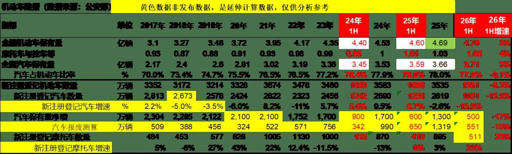
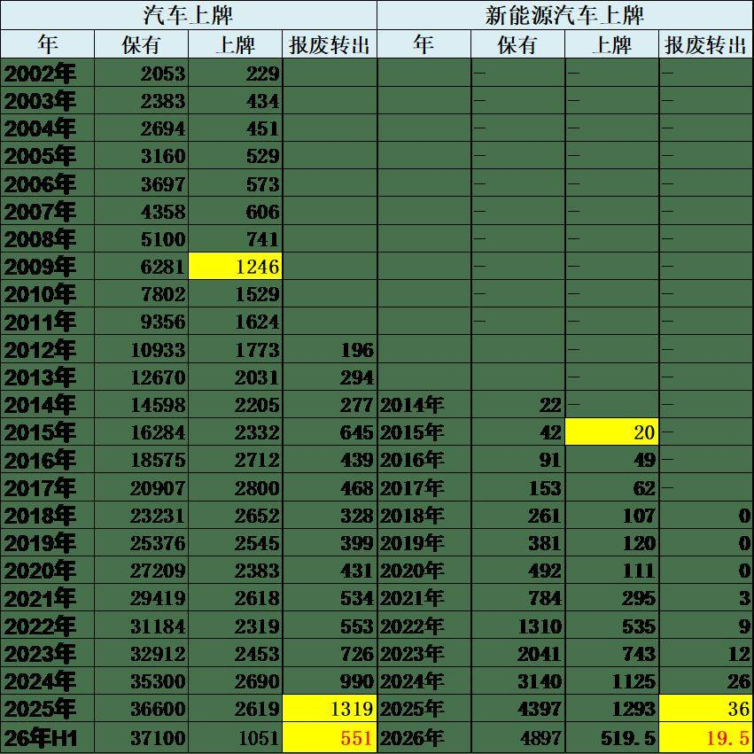
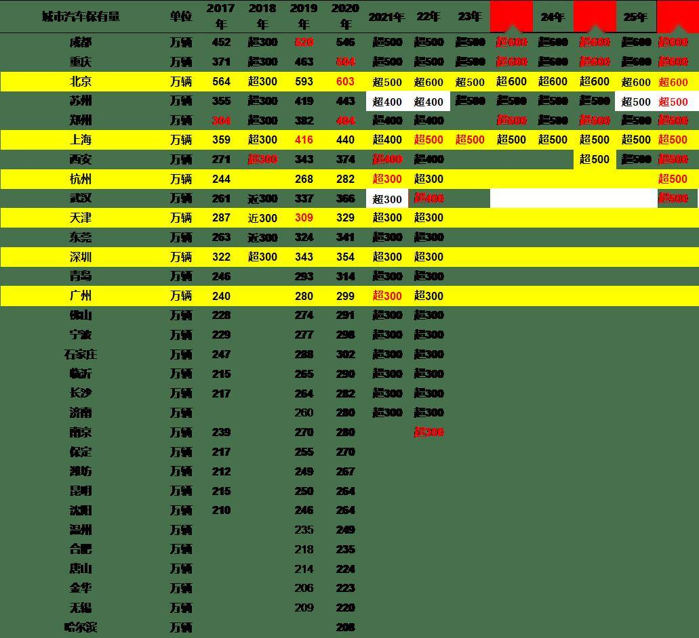

# 公安部2026年上半年的上牌和驾驶员数据分析

- 公開日時: 2026-07-15 01:30（北京時間）
- 出典: [搜狐号・崔东树](https://www.sohu.com/a/1050358343_115312)
- テーマ（自動判定）: その他
- 画像: 3枚

---

据公安部最新数据，截至2026年6月底，全国机动车保有量达4.76亿辆，其中汽车3.71亿辆；机动车驾驶人5.67亿人，其中汽车驾驶人5.33亿人。

2026年上半年，全国新注册登记机动车1581万辆，降6.3%。其中，汽车新注册登记1051万辆、降15.9%，摩托车新注册登记511万辆、增23%。

2026年上半年，全国共办理机动车转让登记业务1852万笔、降6%。其中，办理汽车转让登记业务1705万笔、降7%。全国异地办理交易登记二手小客车业务345万笔，同比增长11.98%。

截至26年6月底，全国新能源汽车保有量达4897万辆，占汽车总量的13.19%，较去年同期提高2.92个百分点。其中，纯电动汽车保有量3367.5万辆，占新能源汽车总量的68.77%。上半年新注册登记新能源汽车519.5万辆，占汽车新注册登记量的49.42%，较去年同期提高4.45个百分点。据简单测算报废转出新能源汽车较多，2025年有36万台的报废转出，26年上半年有19.5万台。

截至2026年6月底，成都、重庆、北京汽车保有量超过600万辆，郑州、苏州、上海、西安、杭州、武汉汽车保有量超过500万辆。今年杭州汽车保有量超越武汉，而2022年是武汉率先突破400万，当时杭州还不足，这次超500万城市中，杭州表现较强。

1、汽车上牌和保有量平稳

据公安部7月14日发布最新统计，截至2026年6月底，全国机动车保有量达4.76亿辆，其中汽车3.71亿辆；新注册登记机动车数量依然高位，新注册登记汽车数量超千万。2026年上半年，全国新注册登记机动车1581万辆，降6.3%。其中，汽车新注册登记1051万辆降15.9%，摩托车新注册登记511万辆增23%。

目前保有量净增长速度放缓，这也体现了年轻人口逐年规模下降，新驾照人数下降，消费从首购向换购升级发展。好在国家以旧换新政策有效地稳定了增长。

2、二手车增长潜力大

2023年，全国公安交管部门共办理机动车转让登记业务3415万笔，其中，汽车转让登记业务3187万笔。2024 年，全国公安交管部门共办理机动车转让登记业务 3750 万笔。其中，汽车转让登记业务 3502 万笔，占 93.40%。 2025年，全国共办理机动车转让登记业务4111万笔。其中，汽车转让登记业务3841万笔。

2026年上半年，全国共办理机动车转让登记业务1852万笔降6%。其中，办理汽车转让登记业务1705万笔降7%。全国异地办理交易登记二手小客车业务345万笔，同比增长11.98%。

自2020年以来，全国二手汽车交易登记量已连续6年超过汽车新车注册登记量，二手车异地交易登记改革措施在便利群众企业办事、促进二手车流通方面效果明显。

在中国汽车流通协会的呼吁下，二手车流通改善。各地交管部门办实事，便利群众企业办事，促进二手车流通。

二手车增长潜力大。早在2022年的二手车交易已经超过新车，今年的二手车交易占新车162%。虽然今年年初新车价格不稳带来的二手车交易低迷，但随着进一步改善环境，下半年应该提升明显。

3、新能源车增长喜人

截至 2024 年底，全国新能源汽车保有量达 3140 万辆，占汽车总量的 8.90%；其中纯电动汽车保有量 2209 万辆，占新能源汽车保有量的 70.34%。2024 年新注册登记新能源汽车 1125 万辆，占新注册登记汽车数量的 41.83%，与 2023 年相比增加 382 万辆，增长 51.49%。

截至2025年底，全国新能源汽车保有量达4397万辆，占汽车总量的12.01%；其中纯电动汽车保有量3022万辆，占新能源汽车保有量的68.74%。2025年新注册登记新能源汽车1293万辆，占新注册登记汽车数量的49.38%，与2024年相比增加168万辆，增长14.93%。。

截至26年6月底，全国新能源汽车保有量达4897万辆，占汽车总量的13.19%，较去年同期提高2.92个百分点。其中，纯电动汽车保有量3367.5万辆，占新能源汽车总量的68.77%。上半年新注册登记新能源汽车519.5万辆，占汽车新注册登记量的49.42%，较去年同期提高4.45个百分点。

4、汽车与新能源车报废转出

目前测算总体汽车的报废规模与2008年-2009年间的上牌规模接近，近似理解为2009年前的车基本报废转出，也就是15年的平均报废转出时间，未来几年的报废转出规模将大幅增长。

新能源汽车的报废与上牌的关系更复杂，部分次新车可能事故报废，部分可能作为零公里二手车转出到俄罗斯等国家，因此实际的总体报废规模应该比较少，也就是在2015年左右的上牌规模，大约10年的时间。

5、主力城市新车的保有量水平提升较快

截至26年6月底，全国有105个城市的汽车保有量超过100万辆，同比增加4个城市，47个城市超过200万辆，27个城市超过300万辆。其中，成都、重庆、北京汽车保有量超过600万辆，郑州、苏州、上海、西安、杭州、武汉汽车保有量超过500万辆。

目前成都、重庆、保有超过北京，郑州超越苏州和上海，这几个都是不限购的城市，500万以上不限购，市场也能稳定地发展，区域省会中心地位稳固。

今年杭州汽车保有量超越武汉，而22年是武汉率先突破400万，这次超500万，杭州表现较强。

6、大城市的车市发展较强

2026年上半年1-2百万58个（增2个），2-3百万20个，3-5百万18个城市（少2个），其中深圳、杭州、广州、天津4个限购；苏州、郑州、西安、武汉均不限购；5-6百万共6个，限购2个；6百万以上是成都、北京、重庆。其中500万以上9个城市3个限购，非限购以旧主流。

中国车市发展应该说以大城市发展为核心。车市普及主要随着人口的流入而持续的增长，因此超大城市和大型城市的车辆普及率相对增长较快，超过500万保有量的城市目前已经有6个，扩张速度明显放缓。

2025年500万以上保有量城市是30%限购，其它限购城市的深圳、广州、天津的汽车保有量已经远远落后于其它非限购城市，需要考虑500万以下保有量城市放开限购了。燃油车既限购还限行，而且还要交上万亿的燃油税收，在新能源车销量已经占50%的情况下，需要同车同权，推动燃油车用户正常消费。

7、汽车驾驶员占比持续提升

截至6月底，全国机动车驾驶人数量达5.67亿人，其中，汽车驾驶人数量为5.33亿人，占驾驶人总数的94.04%。2026年上半年，全国新领证驾驶人数量1304万人，同比增长3.66%。

新增汽车驾驶员的数量按照两年平均是处于2000万的规模，2017年3200万，处于历年相对高位的水平。2022-2023年基本是2100万左右，处于历年相对低位的水平，26年继续下降。目前汽车驾驶员人数的增量潜力仍大，对车市增量的贡献度未来仍有很大潜力。

未来中国汽车驾驶员有希望达6亿，汽车保有量超4亿，年汽车产销超4000万是有希望的。我个人希望针对微型电动车实施C7驾照，挖掘消费潜力，简化中老年人的考驾照难度，让他们规范驾车，也有利于正规微型电动车发展。
